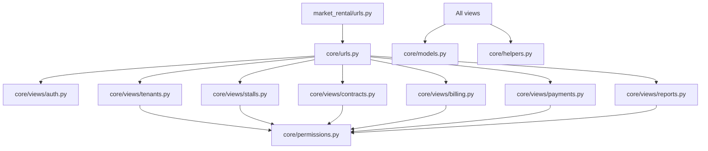
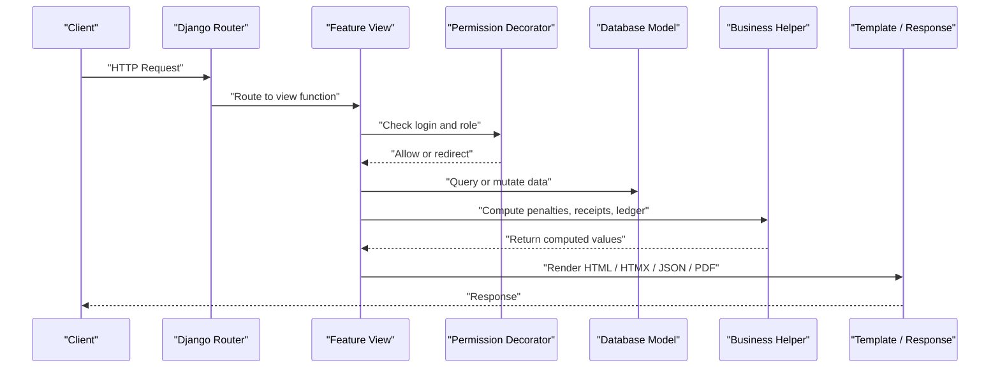
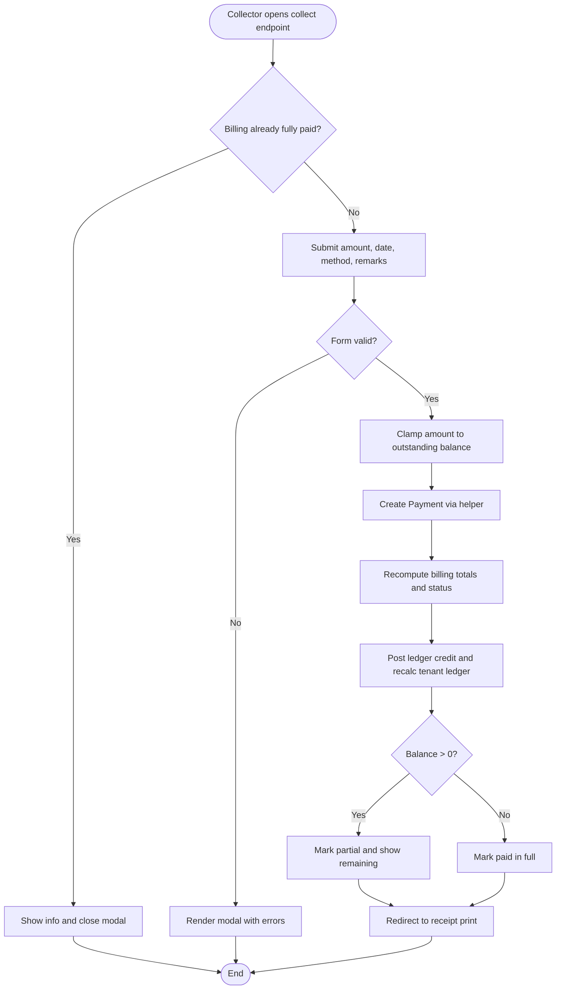
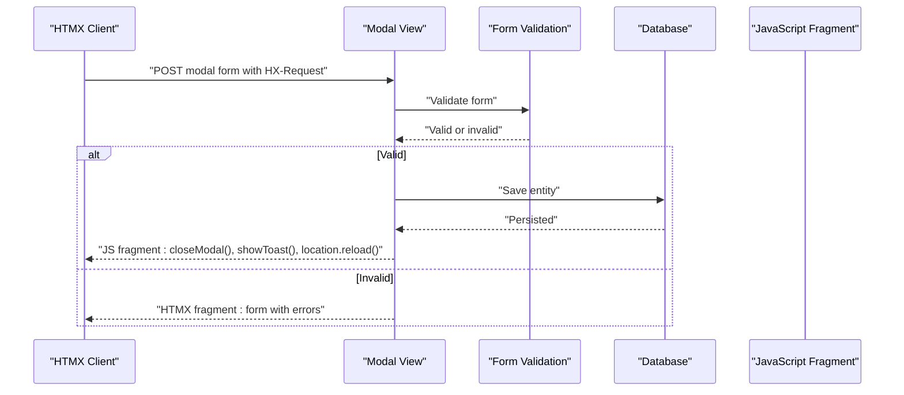

# API Reference

<cite>
**Referenced Files in This Document**
- [market_rental/urls.py](file://market_rental/urls.py)
- [core/urls.py](file://core/urls.py)
- [core/views/auth.py](file://core/views/auth.py)
- [core/permissions.py](file://core/permissions.py)
- [core/models.py](file://core/models.py)
- [core/helpers.py](file://core/helpers.py)
- [core/views/tenants.py](file://core/views/tenants.py)
- [core/views/stalls.py](file://core/views/stalls.py)
- [core/views/contracts.py](file://core/views/contracts.py)
- [core/views/billing.py](file://core/views/billing.py)
- [core/views/payments.py](file://core/views/payments.py)
- [core/views/reports.py](file://core/views/reports.py)
</cite>

## Table of Contents
1. [Introduction](#introduction)
2. [Project Structure](#project-structure)
3. [Core Components](#core-components)
4. [Architecture Overview](#architecture-overview)
5. [Authentication and Authorization](#authentication-and-authorization)
6. [Tenant Interface Endpoints](#tenant-interface-endpoints)
7. [Staff Interface Endpoints](#staff-interface-endpoints)
8. [HTMX and Dynamic Content Patterns](#htmx-and-dynamic-content-patterns)
9. [Data Models and Relationships](#data-models-and-relationships)
10. [Error Handling, Status Messages, and Audit Trail](#error-handling-status-messages-and-audit-trail)
11. [Performance and Concurrency Characteristics](#performance-and-concurrency-characteristics)
12. [Troubleshooting Guide](#troubleshooting-guide)
13. [Conclusion](#conclusion)

## Introduction
This document is the API reference for the Market Rental System. The system exposes a Django web application with:
- A tenant self-service portal for viewing billing history and managing profile-related actions.
- A staff interface for managing tenants, stalls, contracts, billings, payments, notices, ledger, reports, settings, users, and audit logs.
- HTMX-driven dynamic table updates, modal form submissions, and AJAX interactions.
- PDF and Excel export endpoints for lists and official receipts.
- Role-based access control separating admin, cashier, supervisor, treasurer, collector, and tenant roles.

The URL configuration is mounted under the project root, so all documented paths are relative to the site root. Authentication is handled through standard Django login/logout views, while business endpoints use decorators that enforce role checks.

## Project Structure
The application is organized by feature modules under `core.views`, with URLs centralized in `core/urls.py` and included from the project root `market_rental/urls.py`.



**Diagram sources**
- [market_rental/urls.py:7-12](file://market_rental/urls.py#L7-L12)
- [core/urls.py:1-55](file://core/urls.py#L1-L55)
- [core/views/auth.py:9-35](file://core/views/auth.py#L9-L35)
- [core/views/tenants.py:1-17](file://core/views/tenants.py#L1-L17)
- [core/views/stalls.py:1-10](file://core/views/stalls.py#L1-L10)
- [core/views/contracts.py:1-13](file://core/views/contracts.py#L1-L13)
- [core/views/billing.py:1-22](file://core/views/billing.py#L1-L22)
- [core/views/payments.py:1-18](file://core/views/payments.py#L1-L18)
- [core/views/reports.py:1-15](file://core/views/reports.py#L1-L15)
- [core/permissions.py:1-88](file://core/permissions.py#L1-L88)
- [core/models.py:1-336](file://core/models.py#L1-L336)
- [core/helpers.py:1-595](file://core/helpers.py#L1-L595)

**Section sources**
- [market_rental/urls.py:7-17](file://market_rental/urls.py#L7-L17)
- [core/urls.py:56-198](file://core/urls.py#L56-L198)

## Core Components
The core components are:
- **Authentication**: Login and logout views.
- **Permissions**: Role definitions, role checks, and decorators.
- **Models**: Tenant, Stall, MarketSection, StallType, RentalContract, Billing, Payment, TenantLedger, Notice, AuditLog, SystemSetting, UserProfile, PenaltySetting.
- **Helpers**: Receipt numbering, payment recording, billing generation, overdue penalty accrual, PDF rendering, and tenant login creation.
- **Views**: Feature-specific view functions for tenants, stalls, contracts, billing, payments, reports, ledger, notices, settings, users, and audit logs.

Key responsibilities:
- Views handle HTTP requests, validation, authorization, data loading, and template or JSON responses.
- Helpers centralize financial logic such as receipt numbers, payment posting, billing recomputation, and PDF generation.
- Permissions define canonical roles and provide reusable decorators.
- Models define the database schema and relationships.

**Section sources**
- [core/views/auth.py:9-35](file://core/views/auth.py#L9-L35)
- [core/permissions.py:6-88](file://core/permissions.py#L6-L88)
- [core/models.py:7-336](file://core/models.py#L7-L336)
- [core/helpers.py:18-595](file://core/helpers.py#L18-L595)

## Architecture Overview
The request flow follows this pattern:
1. The client sends an HTTP request to a URL defined in `core/urls.py`.
2. Django routes the request to a view function.
3. The view enforces authentication and role permissions.
4. The view validates input, performs business logic, and interacts with models.
5. The view returns HTML, HTMX fragments, JSON, PDF, or redirects.



**Diagram sources**
- [core/urls.py:56-198](file://core/urls.py#L56-L198)
- [core/permissions.py:61-88](file://core/permissions.py#L61-L88)
- [core/helpers.py:351-420](file://core/helpers.py#L351-L420)

## Authentication and Authorization
### Authentication
- Login endpoint: `POST /login/`
  - Uses Django’s `AuthenticationForm`.
  - On success, sets session and redirects to dashboard or a provided `next` parameter.
  - On failure, displays an error message and re-renders the login page.
- Logout endpoint: `GET /logout/`
  - Clears session and redirects to login.

### Authorization Roles
| Role | Description | Allowed Actions |
|---|---|---|
| Admin | Full administrative access | All management, collection, reporting, settings, user administration |
| Cashier | Management role focused on collections and financial operations | Management screens, collection endpoints |
| Supervisor | Oversight role | Management screens, reporting |
| Treasurer | Financial oversight role | Management screens, reporting |
| Collector | Field collector | Record payments, collect bills, view own receipts |
| Tenant | Self-service user | Portal dashboard, history, password change, own billing/payment visibility |

### Permission Decorators
- `admin_required`: Admin-only.
- `management_required`: Admin, cashier, supervisor, treasurer.
- `management_or_tenant_required`: Management roles plus tenant-scoped access.
- `collector_required`: Admin, collector, cashier.
- `supervisor_required`: Admin, supervisor, treasurer.
- `tenant_isolation_queryset`: Restricts querysets to the current tenant when the logged-in user has role `tenant`.
- `tenant_required`: Restricts a view to tenant accounts only.

**Section sources**
- [core/views/auth.py:9-35](file://core/views/auth.py#L9-L35)
- [core/permissions.py:6-125](file://core/permissions.py#L6-L125)

## Tenant Interface Endpoints
The tenant portal is restricted to users with role `tenant`. Tenants can only see their own data.

| Endpoint | Method | Purpose | Authentication | Authorization | Notes |
|---|---|---|---|---|---|
| `/portal/` | GET | Tenant dashboard | Required | Tenant only | Shows tenant-owned summary |
| `/portal/history/` | GET | Tenant payment and billing history | Required | Tenant only | History view |
| `/portal/password/` | GET | Tenant password management | Required | Tenant only | Password update flow |

These endpoints are defined in `core/urls.py` and intended for tenant self-service. Tenant isolation is enforced at both decorator and queryset levels.

**Section sources**
- [core/urls.py:60-63](file://core/urls.py#L60-L63)
- [core/permissions.py:102-118](file://core/permissions.py#L102-L118)

## Staff Interface Endpoints
The staff interface covers CRUD operations and operational workflows for tenants, stalls, contracts, billing, payments, reports, ledger, notices, settings, users, and audit logs.

### Tenants
| Endpoint | Method | Purpose | Authentication | Authorization | Request Parameters | Response |
|---|---|---|---|---|---|---|
| `/tenants/` | GET | List tenants with filters and pagination | Required | Management | `status`, `search`, `page` | HTML list; HTMX fragment `_table.html` |
| `/tenants/add/` | GET/POST | Add tenant | Required | Management | Form fields | Redirect to credentials page or render form |
| `/tenants/<int:pk>/edit/` | GET/POST | Edit tenant | Required | Management | Form fields | Redirect or render form |
| `/tenants/<int:pk>/delete/` | POST | Terminate tenant | Required | Admin | None | Redirect to tenant list |
| `/tenants/bulk-delete/` | POST | Hard-delete selected tenants | Required | Admin | `selected_tenants[]` | Redirect with messages |
| `/tenants/<int:pk>/` | GET | View tenant details | Required | Management or tenant (own data) | None | Tenant view |
| `/tenants/search/` | GET | Search active tenants | Required | Management | `q` | JSON array or HTMX search results |
| `/tenants/add-modal/` | GET/POST | Modal add tenant | Required | Management | Form fields | HTMX fragment or credentials fragment |
| `/tenants/<int:pk>/edit-modal/` | GET/POST | Modal edit tenant | Required | Management | Form fields | HTMX script or fragment |
| `/tenants/print/` | GET | Print preview tenant list | Required | Management | Filters | HTML print view |
| `/tenants/export/pdf/` | GET | Export tenant list as PDF | Required | Management | Filters | PDF file |
| `/tenants/<int:pk>/print/` | GET | Print tenant view | Required | Management or tenant (own data) | None | HTML print view |
| `/tenants/<int:pk>/export/pdf/` | GET | Export tenant view as PDF | Required | Management or tenant (own data) | None | PDF file |

#### Tenant Search Response Schema
- Type: JSON array
- Items:
  - `id`: integer
  - `tenant_id`: string
  - `full_name`: string
  - `business_name`: string

**Section sources**
- [core/urls.py:65-78](file://core/urls.py#L65-L78)
- [core/views/tenants.py:19-302](file://core/views/tenants.py#L19-L302)
- [core/views/tenants.py:305-468](file://core/views/tenants.py#L305-L468)

### Stalls
| Endpoint | Method | Purpose | Authentication | Authorization | Request Parameters | Response |
|---|---|---|---|---|---|---|
| `/stalls/` | GET | List stalls with filters and pagination | Required | Management | `section`, `status`, `search`, `page` | HTML list; HTMX fragment `_table.html` |
| `/stalls/add/` | GET/POST | Add stall | Required | Management | Form fields | Redirect or render form |
| `/stalls/<int:pk>/edit/` | GET/POST | Edit stall | Required | Management | Form fields | Redirect or render form |
| `/stalls/<int:pk>/delete/` | POST | Delete stall | Required | Management | None | Redirect to stall list |
| `/stalls/<int:pk>/` | GET | View stall details | Required | Management | None | Stall view |
| `/stalls/add-modal/` | GET/POST | Modal add stall | Required | Management | Form fields | HTMX script or fragment |
| `/stalls/<int:pk>/edit-modal/` | GET/POST | Modal edit stall | Required | Management | Form fields | HTMX script or fragment |
| `/stalls/print/` | GET | Print preview stall list | Required | Management | Filters | HTML print view |
| `/stalls/export/pdf/` | GET | Export stall list as PDF | Required | Management | Filters | PDF file |
| `/stalls/<int:pk>/print/` | GET | Print stall view | Required | Login | None | HTML print view |
| `/stalls/<int:pk>/export/pdf/` | GET | Export stall view as PDF | Required | Login | None | PDF file |

**Section sources**
- [core/urls.py:80-91](file://core/urls.py#L80-L91)
- [core/views/stalls.py:13-275](file://core/views/stalls.py#L13-L275)

### Contracts
| Endpoint | Method | Purpose | Authentication | Authorization | Request Parameters | Response |
|---|---|---|---|---|---|---|
| `/contracts/` | GET | List contracts with filters and pagination | Required | Management | `status`, `tenant`, `stall`, `search`, `page` | HTML list; HTMX fragment `_table.html` |
| `/contracts/add/` | GET/POST | Create contract(s) | Required | Management | Contract form fields | Redirect or render form |
| `/contracts/<int:pk>/edit/` | GET/POST | Edit contract | Required | Management | Contract form fields | Redirect or render form |
| `/contracts/<int:pk>/delete/` | POST | Delete contract | Required | Management | None | Redirect to contract list |
| `/contracts/<int:pk>/` | GET | View contract details | Required | Management | None | Contract view |
| `/contracts/<int:pk>/terminate/` | POST | Terminate contract | Required | Management | None | Redirect to contract list |
| `/contracts/add-modal/` | GET/POST | Modal create contract | Required | Management | Contract form fields | HTMX script or fragment |
| `/contracts/<int:pk>/edit-modal/` | GET/POST | Modal edit contract | Required | Management | Contract form fields | HTMX script or fragment |
| `/contracts/bulk-assign/` | GET/POST | Assign one tenant to multiple vacant stalls | Required | Management | Bulk assign form fields | Redirect or render bulk assign page |
| `/contracts/print/` | GET | Print preview contract list | Required | Management | Filters | HTML print view |
| `/contracts/export/pdf/` | GET | Export contract list as PDF | Required | Management | Filters | PDF file |
| `/contracts/<int:pk>/print/` | GET | Print contract view | Required | Management | None | HTML print view |
| `/contracts/<int:pk>/export/pdf/` | GET | Export contract view as PDF | Required | Management | None | PDF file |

#### Contract Creation Behavior
- Creates one `RentalContract` per selected stall.
- Marks occupied stalls accordingly.
- Auto-generates initial billings up to the current month.
- Records audit log entries.
- Returns success messages and redirects to the contract list.

**Section sources**
- [core/urls.py:107-120](file://core/urls.py#L107-L120)
- [core/views/contracts.py:16-530](file://core/views/contracts.py#L16-L530)

### Billing
| Endpoint | Method | Purpose | Authentication | Authorization | Request Parameters | Response |
|---|---|---|---|---|---|---|
| `/billing/` | GET | List billings grouped by tenant | Required | Management or tenant (own data) | `month`, `year`, `tenant`, `status`, `search`, `page` | HTML list; HTMX fragment `_table.html` |
| `/billing/generate/` | GET/POST | Generate billing for a contract | Required | Management | `tenant`, `contract`, `billing_month`, `billing_year` | Redirect to billing list |
| `/billing/generate-all/` | GET/POST | Generate billings for all active contracts | Required | Management | `billing_month`, `billing_year` | Redirect to billing list |
| `/billing/<int:pk>/` | GET | View billing details | Required | Management or tenant (own data) | None | Billing view |
| `/billing/<int:pk>/collect/` | GET/POST | Collect payment for a billing | Required | Collector | Amount, date, method, remarks | Redirect to receipt or HTMX script |
| `/billing/<int:pk>/quick-pay/` | GET/POST | Alias for collect | Required | Collector | Same as collect | Redirect to receipt |
| `/billing/collect/tenant/<int:tenant_pk>/` | GET/POST | Batch collect for a tenant | Required | Collector | Selected billing IDs, date, method, remarks | Redirect to batch receipt or single receipt |
| `/billing/add-modal/` | GET/POST | Modal generate billing | Required | Management | Billing form fields | HTMX script or fragment |
| `/billing/<int:pk>/edit-modal/` | GET/POST | Modal edit billing | Required | Management | Billing form fields | HTMX script or fragment |
| `/billing/print/` | GET | Print preview billing list | Required | Management or tenant (own data) | Filters | HTML print view |
| `/billing/export/pdf/` | GET | Export billing list as PDF | Required | Management or tenant (own data) | Filters | PDF file |
| `/billing/<int:pk>/print/` | GET | Print billing view | Required | Management or tenant (own data) | None | HTML print view |
| `/billing/<int:pk>/export/pdf/` | GET | Export billing view as PDF | Required | Management or tenant (own data) | None | PDF file |

#### Billing Collection Flow


**Diagram sources**
- [core/views/billing.py:415-489](file://core/views/billing.py#L415-L489)
- [core/helpers.py:351-420](file://core/helpers.py#L351-L420)

**Section sources**
- [core/urls.py:122-135](file://core/urls.py#L122-L135)
- [core/views/billing.py:25-765](file://core/views/billing.py#L25-L765)

### Payments
| Endpoint | Method | Purpose | Authentication | Authorization | Request Parameters | Response |
|---|---|---|---|---|---|---|
| `/payments/` | GET | List payments with filters and pagination | Required | Management or tenant (own data); collector sees own collections | `date_from`, `date_to`, `tenant`, `stall`, `collector`, `status`, `payment_method`, `search`, `page` | HTML list; HTMX fragment `_table.html` |
| `/payments/add/` | GET/POST | Record payment | Required | Collector | Payment form fields | Redirect to receipt |
| `/payments/<int:pk>/` | GET | View payment details | Required | Management or tenant (own data); collector sees own collections | None | Payment view |
| `/payments/<int:pk>/receipt/` | GET | View receipt HTML | Required | Management or tenant (own data); collector sees own collections | None | Receipt template |
| `/payments/<int:pk>/print/` | GET | Print receipt | Required | Management or tenant (own data); collector sees own collections | `auto=1`, `back=` | Print receipt template |
| `/payments/<int:pk>/export/pdf/` | GET | Export receipt as PDF | Required | Management or tenant (own data); collector sees own collections | None | PDF file |
| `/payments/batch-receipt/` | GET | View batch receipt for last batch collection | Required | Management or tenant (own data); collector sees own collections | None | Batch receipt template |
| `/payments/batch-receipt/export/pdf/` | GET | Export batch receipt as PDF | Required | Management or tenant (own data); collector sees own collections | None | PDF file |
| `/payments/add-modal/` | GET/POST | Modal record payment | Required | Collector | Payment form fields | HTMX script or fragment |
| `/payments/<int:pk>/edit-modal/` | GET/POST | Modal edit payment | Required | Management | Payment form fields | HTMX script or fragment |
| `/payments/<int:pk>/void/` | POST | Void payment | Required | Management | None | Redirect to payment list |
| `/payments/print/` | GET | Print preview payment list | Required | Management or tenant (own data); collector sees own collections | Filters | HTML print view |
| `/payments/export/pdf/` | GET | Export payment list as PDF | Required | Management or tenant (own data); collector sees own collections | Filters | PDF file |

#### Payment Access Rules
- Tenants can only view their own payments and receipts.
- Collectors can only view receipts for payments they recorded.
- Management roles can view all payments.

**Section sources**
- [core/urls.py:137-150](file://core/urls.py#L137-L150)
- [core/views/payments.py:20-653](file://core/views/payments.py#L20-L653)

### Reports
| Endpoint | Method | Purpose | Authentication | Authorization | Request Parameters | Response |
|---|---|---|---|---|---|---|
| `/reports/` | GET | Dashboard report | Required | Management | `month`, `year` | Dashboard template |
| `/reports/daily/` | GET | Daily collection report | Required | Management | `date_from`, `date_to`, `page` | Daily report template |
| `/reports/weekly/` | GET | Weekly collection report | Required | Management | `date_from`, `date_to`, `page` | Weekly report template |
| `/reports/monthly/` | GET | Monthly collection report | Required | Management | `month`, `year`, `page` | Monthly report template |
| `/reports/annual/` | GET | Annual collection report | Required | Management | `year` | Annual report template |
| `/reports/section/` | GET | Collection by section | Required | Management | `month`, `year` | Section report template |
| `/reports/collector/` | GET | Collection by collector | Required | Management | `date_from`, `date_to` | Collector report template |
| `/reports/paid-tenants/` | GET | Paid tenants report | Required | Management | `month`, `year`, `page` | Paid tenants template |
| `/reports/unpaid-tenants/` | GET | Unpaid tenants report | Required | Management | `month`, `year`, `page` | Unpaid tenants template |
| `/reports/overdue/` | GET | Overdue accounts report | Required | Management | `page` | Overdue template |
| `/reports/ledger/` | GET | Tenant ledger report | Required | Management | `tenant`, `date_from`, `date_to`, `page` | Ledger template |
| `/reports/occupancy/` | GET | Stall occupancy report | Required | Management | `section`, `status`, `page` | Occupancy template |
| `/reports/vacant/` | GET | Vacant stall report | Required | Management | `section`, `page` | Vacant template |
| `/reports/export/pdf/` | GET | Export report as PDF | Required | Management | `report`, `month`, `year`, `date_from`, `date_to` | PDF response |
| `/reports/export/excel/` | GET | Export report as Excel | Required | Management | `report`, `month`, `year`, `date_from`, `date_to` | Excel response |

**Section sources**
- [core/urls.py:152-167](file://core/urls.py#L152-L167)
- [core/views/reports.py:18-775](file://core/views/reports.py#L18-L775)

## HTMX and Dynamic Content Patterns
Many endpoints support HTMX by detecting the `HX-Request` header or a custom `htmx` attribute. When HTMX is present:
- List endpoints return partial table fragments instead of full pages.
- Modal endpoints return JavaScript snippets that close modals, show toast notifications, and reload pages.
- Collection endpoints return JavaScript that closes modals and navigates to receipt printing.

Common patterns:
- `is_htmx(request)` helper detects HTMX requests.
- Modal forms return either the form fragment on validation errors or a script response on success.
- Tables use a `pagination_target` context variable to target specific DOM elements for HTMX replacement.



**Diagram sources**
- [core/views/tenants.py:305-363](file://core/views/tenants.py#L305-L363)
- [core/views/stalls.py:128-184](file://core/views/stalls.py#L128-L184)
- [core/views/contracts.py:249-344](file://core/views/contracts.py#L249-L344)
- [core/views/billing.py:335-412](file://core/views/billing.py#L335-L412)
- [core/views/payments.py:419-518](file://core/views/payments.py#L419-L518)

**Section sources**
- [core/views/tenants.py:19-20](file://core/views/tenants.py#L19-L20)
- [core/views/stalls.py:13-14](file://core/views/stalls.py#L13-L14)
- [core/views/contracts.py:16-17](file://core/views/contracts.py#L16-L17)
- [core/views/billing.py:25-26](file://core/views/billing.py#L25-L26)
- [core/views/payments.py:153-154](file://core/views/payments.py#L153-L154)

## Data Models and Relationships
The primary entities and their relationships are:

```mermaid
erDiagram
USER {
uuid id PK
string username UK
string first_name
string last_name
boolean is_superuser
}
USER_PROFILE {
uuid user_id PK FK
enum role
string phone
text address
boolean must_change_password
}
TENANT {
int pk PK
string tenant_id UK
uuid user_id FK
string full_name
string business_name
enum status
timestamp created_at
timestamp updated_at
}
MARKET_SECTION {
int pk PK
string name UK
text description
}
STALL_TYPE {
int pk PK
string name UK
text description
}
STALL {
int pk PK
string stall_number UK
int section_id FK
int stall_type_id FK
decimal size
decimal monthly_rate
enum status
text remarks
timestamp created_at
timestamp updated_at
}
RENTAL_CONTRACT {
int pk PK
int tenant_id FK
int stall_id FK
date start_date
date end_date
decimal monthly_rent
int due_day
decimal security_deposit
enum status
text remarks
timestamp created_at
timestamp updated_at
}
BILLING {
int pk PK
int tenant_id FK
int stall_id FK
int contract_id FK
int billing_month
int billing_year
decimal rental_amount
decimal penalty_amount
decimal discount
decimal total_due
decimal amount_paid
decimal balance
date due_date
enum status
timestamp created_at
timestamp updated_at
}
PAYMENT {
int pk PK
string receipt_number UK
int tenant_id FK
int stall_id FK
int billing_id FK
int billing_month
int billing_year
decimal rental_amount
decimal penalty_amount
decimal discount
decimal total_amount_due
decimal amount_paid
date payment_date
enum payment_method
string official_receipt_no
uuid collected_by_id FK
enum status
text remarks
timestamp created_at
timestamp updated_at
}
TENANT_LEDGER {
int pk PK
int tenant_id FK
int billing_id FK
date transaction_date
string description
decimal debit
decimal credit
decimal balance
int payment_id FK
timestamp created_at
}
AUDIT_LOG {
int pk PK
uuid user_id FK
string action
string module
text description
string ip_address
timestamp created_at
}
SYSTEM_SETTING {
int pk PK
string municipality_name
string market_name
string office_name
string receipt_prefix
int default_due_day
enum penalty_type
decimal penalty_value
int grace_period
image logo
string theme_color
text terms_and_conditions
}
USER ||--o{ USER_PROFILE : "has profile"
USER ||--o{ TENANT : "linked tenant"
TENANT ||--o{ RENTAL_CONTRACT : "owns contracts"
STALL ||--o{ RENTAL_CONTRACT : "assigned to contracts"
RENTAL_CONTRACT ||--o{ BILLING : "generates billings"
TENANT ||--o{ BILLING : "receives billings"
STALL ||--o{ BILLING : "associated with billings"
BILLING ||--o{ PAYMENT : "collected by payments"
TENANT ||--o{ PAYMENT : "makes payments"
STALL ||--o{ PAYMENT : "payments relate to stalls"
TENANT ||--o{ TENANT_LEDGER : "has ledger entries"
BILLING ||--o{ TENANT_LEDGER : "linked to ledger"
PAYMENT ||--o{ TENANT_LEDGER : "posted to ledger"
USER ||--o{ AUDIT_LOG : "performs actions"
```

**Diagram sources**
- [core/models.py:7-336](file://core/models.py#L7-L336)

**Section sources**
- [core/models.py:7-336](file://core/models.py#L7-L336)

## Error Handling, Status Messages, and Audit Trail
### Error Handling
- Most views use Django’s `messages` framework to display success, warning, info, or error messages.
- HTMX endpoints often return JavaScript snippets to close modals and show toast notifications.
- PDF exports may fall back to HTML previews if WeasyPrint or xhtml2pdf is unavailable.
- Integrity errors during contract creation are caught and surfaced as user-friendly messages.

### Status Messages
Common message types:
- Success: Entity created, updated, terminated, voided, or collected successfully.
- Warning: Duplicate billing, no selections, blocked deletions due to payment history.
- Info: Already paid, auto-generated billing available, no batch receipts.
- Error: Validation failures, permission denied, missing records, assignment conflicts.

### Audit Trail
Every significant mutation is recorded in `AuditLog`:
- Tenant create/update/terminate/bulk delete.
- Stall create/update/delete.
- Contract create/update/delete/terminate/bulk assign.
- Billing generate/generate all/create/update/collect/batch collect.
- Payment create/update/void.
- Overdue penalties applied automatically.

**Section sources**
- [core/views/tenants.py:54-263](file://core/views/tenants.py#L54-L263)
- [core/views/stalls.py:55-114](file://core/views/stalls.py#L55-L114)
- [core/views/contracts.py:88-246](file://core/views/contracts.py#L88-L246)
- [core/views/billing.py:174-624](file://core/views/billing.py#L174-L624)
- [core/views/payments.py:250-550](file://core/views/payments.py#L250-L550)
- [core/helpers.py:423-520](file://core/helpers.py#L423-L520)

## Performance and Concurrency Characteristics
### Pagination
Most list endpoints paginate results with 10 or 50 items per page depending on the feature area.

### Database Optimization
- Views use `select_related` to reduce N+1 queries for related objects.
- Aggregations compute totals efficiently using Django ORM aggregates.
- Grouping billings by tenant reduces visual complexity and improves readability.

### Concurrency Safety
- Bulk tenant deletion uses `select_for_update` when supported by the database backend.
- Contract bulk assignment locks stalls atomically to prevent concurrent occupation.
- Billing collection uses `select_for_update` on selected billings within a transaction.
- Payment recording locks the target billing row and retries receipt number generation on collision.
- Billing recomputation is centralized in `recalc_billing_from_payments` to ensure consistent settlement state.

### Rate Limiting
There is no explicit rate limiting middleware in the analyzed code. If rate limiting is required, it should be added at the Django middleware level or behind a reverse proxy.

**Section sources**
- [core/views/tenants.py:23-51](file://core/views/tenants.py#L23-L51)
- [core/views/stalls.py:17-52](file://core/views/stalls.py#L17-L52)
- [core/views/contracts.py:45-85](file://core/views/contracts.py#L45-L85)
- [core/views/billing.py:62-171](file://core/views/billing.py#L62-L171)
- [core/views/payments.py:186-247](file://core/views/payments.py#L186-L247)
- [core/views/contracts.py:431-530](file://core/views/contracts.py#L431-L530)
- [core/views/billing.py:511-634](file://core/views/billing.py#L511-L634)
- [core/helpers.py:351-420](file://core/helpers.py#L351-L420)

## Troubleshooting Guide
### Common Issues
- **HTMX not updating tables**: Ensure the request includes `HX-Request: true` and the response targets the correct `pagination_target`.
- **Modal not closing after submission**: Check that HTMX responses include the expected JavaScript snippet calling `closeModal()` and optionally `showToast()`.
- **PDF export fails**: Verify WeasyPrint or xhtml2pdf dependencies; otherwise use browser Print → Save as PDF fallback.
- **Duplicate billing warnings**: A billing already exists for the same tenant, stall, month, and year.
- **Bulk delete blocked**: Tenants with payment history cannot be hard-deleted; terminate them or void payments first.
- **Contract assignment conflict**: Another user claimed a stall; re-select and retry.
- **Overdue penalties not applied**: Penalties are applied best-effort on billing list entry; ensure the cache key allows daily execution.

### Debugging Techniques
- Inspect Django messages for user-facing feedback.
- Review audit logs for action traces.
- Use browser developer tools to inspect HTMX headers and responses.
- Check database constraints and unique indexes for integrity errors.
- Validate form inputs against model choices and Decimal precision.

**Section sources**
- [core/views/tenants.py:127-263](file://core/views/tenants.py#L127-L263)
- [core/views/contracts.py:88-135](file://core/views/contracts.py#L88-L135)
- [core/views/billing.py:174-246](file://core/views/billing.py#L174-L246)
- [core/helpers.py:522-595](file://core/helpers.py#L522-L595)

## Conclusion
The Market Rental System provides a comprehensive set of endpoints for managing tenants, stalls, contracts, billings, payments, and reports. It supports both staff and tenant interfaces with strong role-based access control, HTMX-driven dynamic interactions, and robust financial operations including receipt generation, ledger reconciliation, and overdue penalties. For external integrations, treat these endpoints as server-rendered web APIs rather than a REST JSON API; HTMX clients should expect HTML fragments and occasional JavaScript responses. When extending the system, follow existing patterns for permission decorators, audit logging, Decimal arithmetic, and PDF/Excel exports.