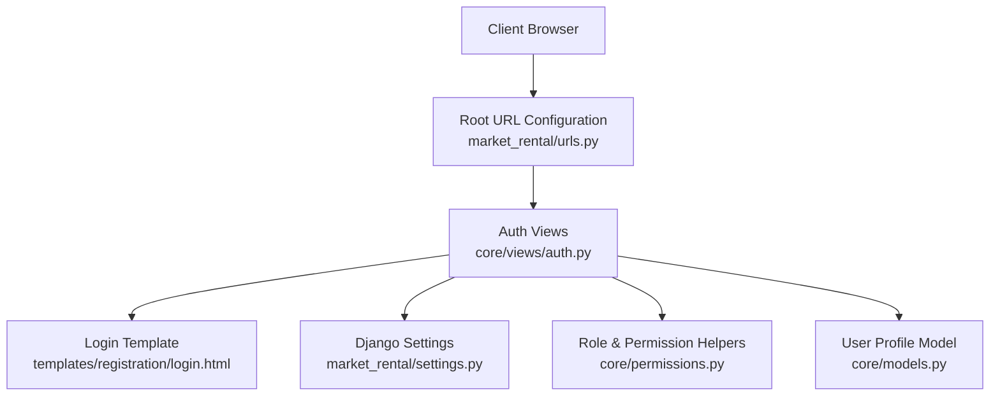
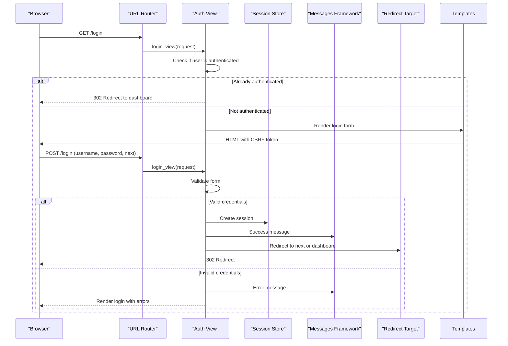
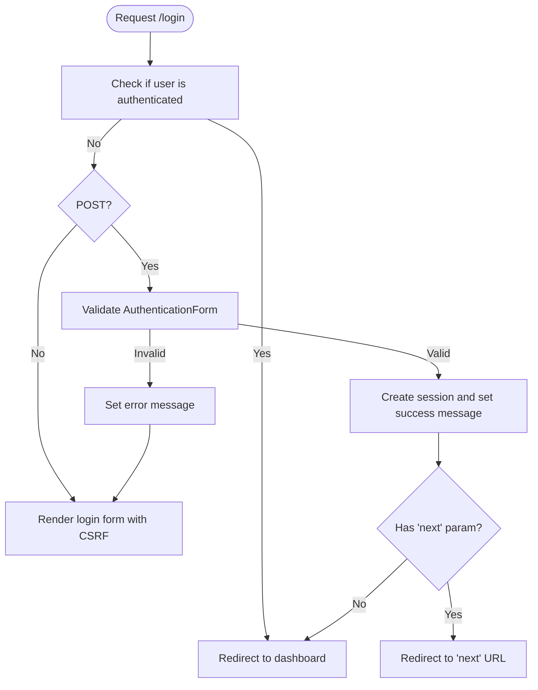
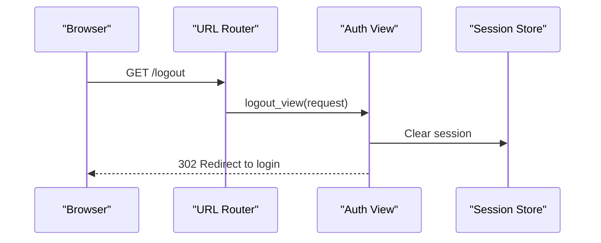
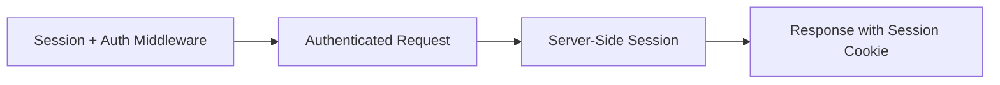
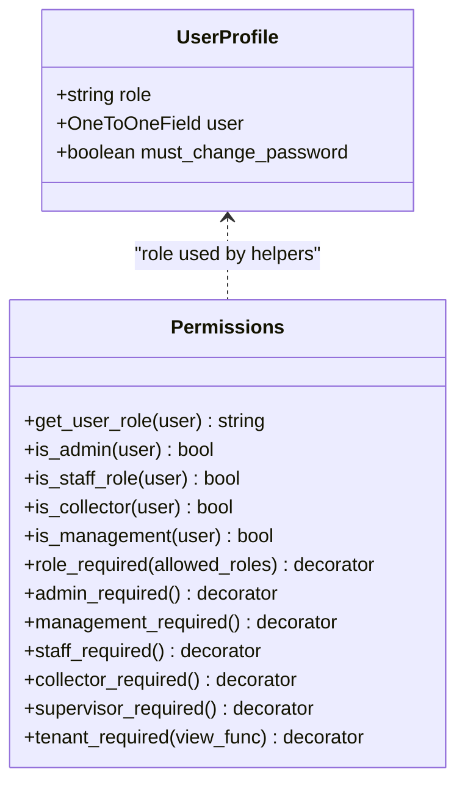
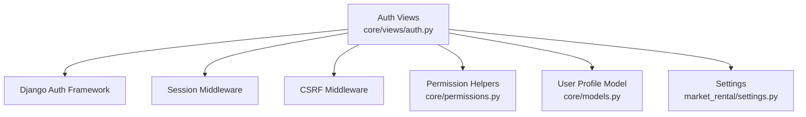

# Authentication API

<cite>
**Referenced Files in This Document**
- [auth.py](file://core/views/auth.py)
- [urls.py](file://market_rental/urls.py)
- [settings.py](file://market_rental/settings.py)
- [permissions.py](file://core/permissions.py)
- [models.py](file://core/models.py)
- [login.html](file://templates/registration/login.html)
</cite>

## Table of Contents
1. [Introduction](#introduction)
2. [Project Structure](#project-structure)
3. [Core Components](#core-components)
4. [Architecture Overview](#architecture-overview)
5. [Detailed Component Analysis](#detailed-component-analysis)
6. [Dependency Analysis](#dependency-analysis)
7. [Performance Considerations](#performance-considerations)
8. [Troubleshooting Guide](#troubleshooting-guide)
9. [Conclusion](#conclusion)

## Introduction
This document describes the authentication API for the Market Rental System. It covers login and logout endpoints, session management, role-based access control, and security considerations such as CSRF protection, password validation, and account lockout behavior. The system uses Django’s built-in authentication framework with a custom role model to enforce permissions across staff and tenant flows.

## Project Structure
Authentication is implemented as standard Django views and wired into the root URL configuration. The login page is rendered from a template that includes CSRF protection and displays user-facing messages.

**Diagram sources**
- [urls.py:10-11](file://market_rental/urls.py#L10-L11)
- [auth.py:9-35](file://core/views/auth.py#L9-L35)
- [login.html:71-78](file://templates/registration/login.html#L71-L78)
- [settings.py:40-49](file://market_rental/settings.py#L40-L49)
- [permissions.py:61-87](file://core/permissions.py#L61-L87)
- [models.py:7-20](file://core/models.py#L7-L20)

**Section sources**
- [urls.py:10-11](file://market_rental/urls.py#L10-L11)
- [auth.py:9-35](file://core/views/auth.py#L9-L35)
- [login.html:71-78](file://templates/registration/login.html#L71-L78)

## Core Components
- Login view: Handles GET and POST requests for user sign-in, redirects authenticated users, and manages success/error messages.
- Logout view: Logs out the current user and redirects to the login page.
- Role-based access control: Decorators and helper functions restrict access based on user roles.
- Security middleware: CSRF protection, session handling, and authentication middleware are enabled.
- Password validation: Built-in validators enforce password policies.

Key responsibilities:
- `login_view`: Validates credentials via Django’s `AuthenticationForm`, logs in the user, and supports optional next-page redirection.
- `logout_view`: Clears the session and redirects to the login page.
- `role_required` and related decorators: Enforce role checks after authentication.
- Settings: Configure CSRF, sessions, login/logout redirect URLs, and password validators.

**Section sources**
- [auth.py:9-35](file://core/views/auth.py#L9-L35)
- [permissions.py:61-87](file://core/permissions.py#L61-L87)
- [settings.py:40-49](file://market_rental/settings.py#L40-L49)
- [settings.py:154-159](file://market_rental/settings.py#L154-L159)
- [settings.py:195-197](file://market_rental/settings.py#L195-L197)

## Architecture Overview
The authentication flow integrates Django’s request/response lifecycle with role-based authorization.

**Diagram sources**
- [auth.py:9-29](file://core/views/auth.py#L9-L29)
- [login.html:71-78](file://templates/registration/login.html#L71-L78)
- [settings.py:195-197](file://market_rental/settings.py#L195-L197)

## Detailed Component Analysis

### Login Endpoint
- URL: `/login`
- Method: GET (render form), POST (submit credentials)
- Request parameters:
  - `username`: User identifier
  - `password`: Secret credential
  - `next`: Optional query parameter to redirect after successful login
- Response formats:
  - GET: Renders the login page with an HTML form including CSRF token and error/success messages.
  - POST:
    - On success: 302 redirect to `next` if provided, otherwise to the dashboard. A success message is set.
    - On failure: Re-renders the login page with an error message indicating invalid credentials.
- Error handling:
  - Uses Django’s `AuthenticationForm` for validation.
  - Displays generic “Invalid username or password” message to avoid leaking information about valid usernames.

Security notes:
- CSRF protection is enforced by the `CsrfViewMiddleware`.
- The login template includes ``.
- If the user is already authenticated, the view redirects to the dashboard instead of re-authenticating.

**Diagram sources**
- [auth.py:9-29](file://core/views/auth.py#L9-L29)
- [login.html:71-78](file://templates/registration/login.html#L71-L78)

**Section sources**
- [auth.py:9-29](file://core/views/auth.py#L9-L29)
- [login.html:71-78](file://templates/registration/login.html#L71-L78)

### Logout Endpoint
- URL: `/logout`
- Method: GET
- Request parameters: None
- Response format:
  - 302 redirect to the login page after clearing the session.
  - An informational message indicates successful logout.

Behavior:
- Calls Django’s `logout` to clear the session.
- Sets a message informing the user they have been logged out.
- Redirects to the named login route.

**Diagram sources**
- [auth.py:32-35](file://core/views/auth.py#L32-L35)
- [settings.py:195-197](file://market_rental/settings.py#L195-L197)

**Section sources**
- [auth.py:32-35](file://core/views/auth.py#L32-L35)

### Session Management
- Sessions are managed by Django’s `SessionMiddleware`.
- Authentication state is stored in the server-side session and attached to each request via `AuthenticationMiddleware`.
- Redirect URLs:
  - `LOGIN_URL`: Name of the login route.
  - `LOGIN_REDIRECT_URL`: Default destination after login.
  - `LOGOUT_REDIRECT_URL`: Destination after logout.

Production hardening:
- When not in debug mode, secure cookies are enforced:
  - `SESSION_COOKIE_SECURE = True`
  - `CSRF_COOKIE_SECURE = True`
  - `SECURE_SSL_REDIRECT = True`
  - `CSRF_TRUSTED_ORIGINS` configured for trusted domains.

**Diagram sources**
- [settings.py:40-49](file://market_rental/settings.py#L40-L49)
- [settings.py:182-190](file://market_rental/settings.py#L182-L190)
- [settings.py:195-197](file://market_rental/settings.py#L195-L197)

**Section sources**
- [settings.py:40-49](file://market_rental/settings.py#L40-L49)
- [settings.py:182-190](file://market_rental/settings.py#L182-L190)
- [settings.py:195-197](file://market_rental/settings.py#L195-L197)

### Role-Based Access Control and Permission Integration
Roles are defined in the `UserProfile` model and enforced through permission helpers and decorators.

- Roles:
  - Admin, Collector, Cashier, Supervisor, Treasurer, Tenant
- Key helpers:
  - `get_user_role(user)`
  - `is_admin(user)`
  - `is_staff_role(user)`
  - `is_collector(user)`
  - `is_management(user)`
- Decorators:
  - `role_required(allowed_roles)`
  - `admin_required`
  - `management_required`
  - `staff_required`
  - `collector_required`
  - `supervisor_required`
  - `tenant_required`

Access control behavior:
- Decorators require authentication and then check the user’s role against allowed sets.
- Superusers bypass profile-based checks where applicable.
- Unauthorized access results in a user-facing error message and redirect to the dashboard.
- Tenant isolation helpers restrict data queries to the current tenant when appropriate.

**Diagram sources**
- [models.py:7-20](file://core/models.py#L7-L20)
- [permissions.py:32-87](file://core/permissions.py#L32-L87)

**Section sources**
- [models.py:7-20](file://core/models.py#L7-L20)
- [permissions.py:32-87](file://core/permissions.py#L32-L87)

### Authentication Flow Examples

#### Successful Authentication
- Steps:
  - Client submits valid credentials to `/login`.
  - Server validates via `AuthenticationForm`, creates a session, and sets a success message.
  - Client receives a redirect to `next` if provided, otherwise to the dashboard.
- Expected outcome:
  - Session established.
  - Subsequent protected routes respond normally based on user role.

#### Failed Login Attempt
- Steps:
  - Client submits invalid credentials to `/login`.
  - Form validation fails; an error message is set.
  - Client re-renders the login page with the error displayed.
- Expected outcome:
  - No session created.
  - Generic error message shown to avoid revealing whether the username exists.

#### Session State Management
- After login:
  - Session cookie is present and secure in production.
  - Requests include the authenticated user context.
- After logout:
  - Session is cleared.
  - Client is redirected to the login page.

[No sources needed since this section provides conceptual examples without analyzing specific files]

## Dependency Analysis
Authentication depends on Django’s auth framework, session middleware, CSRF middleware, and the application’s role-permission layer.

**Diagram sources**
- [auth.py:1-6](file://core/views/auth.py#L1-L6)
- [permissions.py:1-87](file://core/permissions.py#L1-L87)
- [models.py:7-20](file://core/models.py#L7-L20)
- [settings.py:40-49](file://market_rental/settings.py#L40-L49)

**Section sources**
- [auth.py:1-6](file://core/views/auth.py#L1-L6)
- [permissions.py:1-87](file://core/permissions.py#L1-L87)
- [models.py:7-20](file://core/models.py#L7-L20)
- [settings.py:40-49](file://market_rental/settings.py#L40-L49)

## Performance Considerations
- Authentication uses Django’s optimized forms and session backend; no custom heavy logic is present in login/logout views.
- Avoid excessive logging or database queries during authentication to keep response times low.
- In production, ensure the session backend is appropriately configured (e.g., cache-backed sessions) to handle concurrent logins efficiently.

[No sources needed since this section provides general guidance]

## Troubleshooting Guide
Common issues and resolutions:
- CSRF errors on login:
  - Ensure the login form includes the CSRF token and that `CsrfViewMiddleware` is enabled.
  - Verify `CSRF_TRUSTED_ORIGINS` includes your domain in production.
- Redirect loops after login:
  - Confirm `LOGIN_REDIRECT_URL` points to a valid route.
  - Check that the target route does not force another redirect back to login.
- Persistent login failures:
  - Validate that credentials are correct and that the user has a valid profile if required by downstream features.
  - Review password validation rules and ensure passwords meet policy requirements.
- Session not persisting:
  - Confirm `SessionMiddleware` is active and `SESSION_COOKIE_SECURE` is correctly set for HTTPS environments.
- Account lockout:
  - There is no explicit account lockout mechanism in the authentication views; repeated failed attempts will continue to render the login form with an error message. Implement rate limiting or lockout policies at the application or infrastructure level if required.

**Section sources**
- [settings.py:40-49](file://market_rental/settings.py#L40-L49)
- [settings.py:182-190](file://market_rental/settings.py#L182-L190)
- [settings.py:154-159](file://market_rental/settings.py#L154-L159)
- [auth.py:9-29](file://core/views/auth.py#L9-L29)

## Conclusion
The authentication API provides straightforward login and logout functionality using Django’s built-in mechanisms, with robust CSRF protection, secure session handling, and role-based access control. While there is no built-in account lockout policy, the system can be extended with rate limiting and additional security controls as needed. For production deployments, ensure secure cookie settings, trusted origins, and SSL redirection are properly configured.

[No sources needed since this section summarizes without analyzing specific files]