# Billing API

<cite>
**Referenced Files in This Document**
- [billing.py](file://core/views/billing.py)
- [models.py](file://core/models.py)
- [helpers.py](file://core/helpers.py)
- [forms.py](file://core/forms.py)
- [urls.py](file://core/urls.py)
- [collect_grouped.html](file://templates/billing/collect_grouped.html)
</cite>

## Table of Contents
1. [Introduction](#introduction)
2. [Project Structure](#project-structure)
3. [Core Components](#core-components)
4. [Architecture Overview](#architecture-overview)
5. [Detailed Component Analysis](#detailed-component-analysis)
6. [Dependency Analysis](#dependency-analysis)
7. [Performance Considerations](#performance-considerations)
8. [Troubleshooting Guide](#troubleshooting-guide)
9. [Conclusion](#conclusion)

## Introduction
This document describes the billing management API surface for the market rental system. It covers:

- **Billing generation**: `billing_generate` and `billing_generate_all`.
- **Collection workflows**: `billing_collect`, `billing_quick_pay`, and `billing_tenant_collect`.
- **Billing administration**: `billing_list`, `billing_add_modal`, and `billing_edit_modal`.
- **Penalty calculation**, due date handling, and billing status tracking.
- **Integration with contracts, payments, ledgers, receipts, and audit logs**.
- **Examples** for monthly billing generation, partial payment processing, and grouped collection.
- **Financial calculations and audit trail requirements**.

The endpoints are implemented as Django views, routed through a central URL configuration, and backed by domain models for tenants, stalls, contracts, billings, payments, ledgers, settings, and audit logs.

## Project Structure
The billing feature is primarily implemented in:

| Area | File | Responsibility |
|---|---|---|
| Views | `core/views/billing.py` | HTTP endpoints for listing, generating, collecting, viewing, printing, exporting, and modal editing of billings. |
| Models | `core/models.py` | Domain entities such as `Tenant`, `Stall`, `RentalContract`, `Billing`, `Payment`, `TenantLedger`, `SystemSetting`, `AuditLog`, and `PenaltySetting`. |
| Helpers | `core/helpers.py` | Shared financial logic: penalty computation, idempotent billing creation, receipt numbering, payment recording, overdue sweeps, ledger recalculation, and PDF rendering helpers. |
| Forms | `core/forms.py` | Validation and UI bindings for billing entries, payments, quick collection, and system settings. |
| URLs | `core/urls.py` | Route definitions mapping URL paths to billing view functions. |
| Templates | `templates/billing/collect_grouped.html` | Grouped tenant collection interface used by `billing_tenant_collect`. |

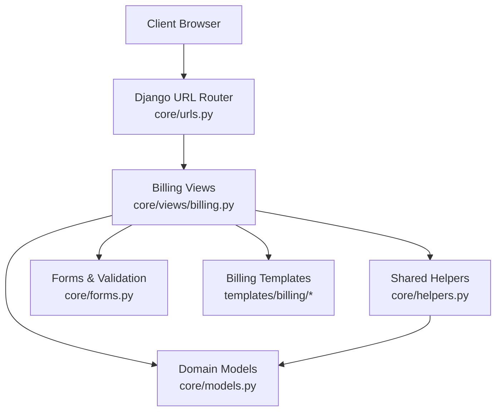

**Diagram sources**
- [urls.py:23-28](file://core/urls.py#L23-L28)
- [billing.py:1-22](file://core/views/billing.py#L1-L22)
- [helpers.py:15-15](file://core/helpers.py#L15-L15)
- [models.py:190-336](file://core/models.py#L190-L336)
- [forms.py:402-774](file://core/forms.py#L402-L774)

**Section sources**
- [billing.py:1-22](file://core/views/billing.py#L1-L22)
- [models.py:190-336](file://core/models.py#L190-L336)
- [helpers.py:15-15](file://core/helpers.py#L15-L15)
- [forms.py:402-774](file://core/forms.py#L402-L774)
- [urls.py:23-28](file://core/urls.py#L23-L28)

## Core Components
The billing subsystem revolves around these core components:

| Component | Purpose | Key Fields / Behavior |
|---|---|---|
| `RentalContract` | Defines the business agreement between a tenant and a stall. | Monthly rent, due day, start/end dates, active status. |
| `Billing` | Represents one month’s charge for a tenant/stall/contract combination. | Rental amount, penalty amount, discount, total due, amount paid, balance, due date, status. |
| `Payment` | Records an actual monetary settlement against a billing. | Receipt number, official receipt number, amount paid, payment method, collector, status. |
| `TenantLedger` | Maintains a running debit/credit history per tenant. | Transaction date, description, debit, credit, running balance, linked billing/payment. |
| `SystemSetting` | Global defaults for billing rules. | Default due day, penalty type/value, grace period, receipt prefix. |
| `PenaltySetting` | Per-contract override for penalty behavior. | Penalty type/value, grace period, due day, active flag. |
| `AuditLog` | Immutable record of important operations. | User, action, module, description, IP address. |

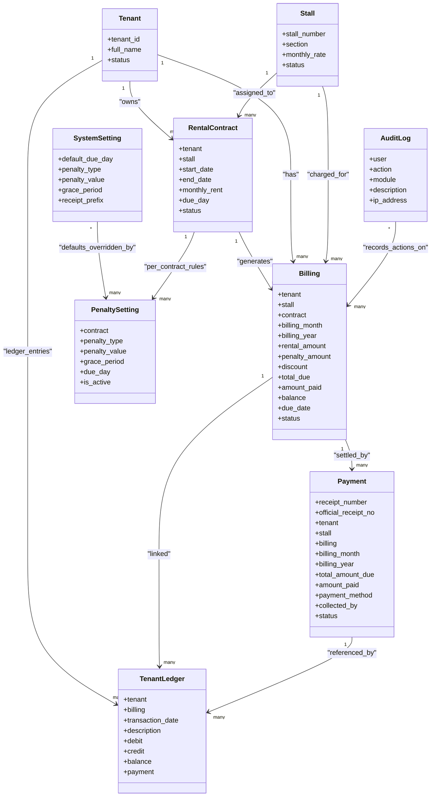

**Diagram sources**
- [models.py:157-336](file://core/models.py#L157-L336)

**Section sources**
- [models.py:157-336](file://core/models.py#L157-L336)

## Architecture Overview
The billing architecture follows a request-driven flow:

1. A user accesses a billing endpoint.
2. The URL router dispatches to a billing view.
3. The view validates input, enforces permissions, and coordinates business logic.
4. Financial operations use shared helpers to ensure consistent penalty math, receipt numbering, ledger updates, and status resolution.
5. Results are rendered as HTML, HTMX fragments, or PDFs.
6. Important actions are recorded in audit logs.

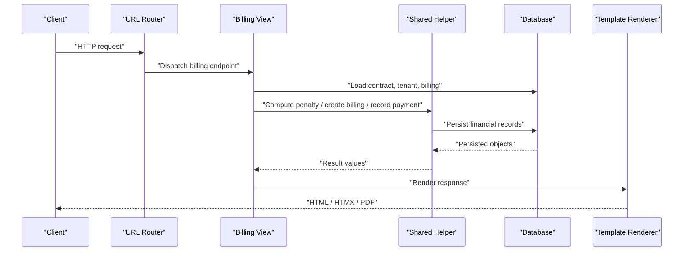

**Diagram sources**
- [urls.py:122-135](file://core/urls.py#L122-L135)
- [billing.py:62-765](file://core/views/billing.py#L62-L765)
- [helpers.py:132-520](file://core/helpers.py#L132-L520)

## Detailed Component Analysis

### Billing Generation Endpoints

#### `billing_generate`
- **Route**: `/billing/generate/`
- **Method**: GET renders a form; POST creates a single billing.
- **Permissions**: Management role required.
- **Inputs**:
  - Tenant ID
  - Contract ID
  - Billing month
  - Billing year
- **Behavior**:
  - Loads the selected contract and its tenant/stall.
  - Prevents duplicate billing for the same tenant/stall/month/year.
  - Computes due date using the contract’s due day and month length safety.
  - Computes penalty based on contract or system settings.
  - Creates a `Billing` row with initial unpaid totals.
  - Creates a `TenantLedger` debit entry.
  - Creates an audit log entry.
  - Redirects to the billing list.

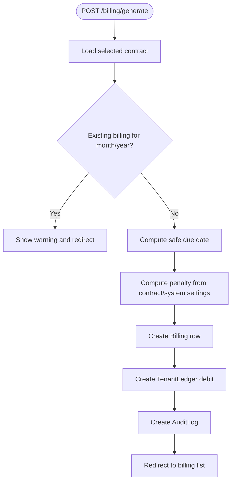

**Diagram sources**
- [billing.py:174-246](file://core/views/billing.py#L174-L246)

**Section sources**
- [billing.py:174-246](file://core/views/billing.py#L174-L246)
- [models.py:190-218](file://core/models.py#L190-L218)

#### `billing_generate_all`
- **Route**: `/billing/generate-all/`
- **Method**: GET renders a form; POST generates billings for all active contracts.
- **Permissions**: Management role required.
- **Inputs**:
  - Billing month (optional, defaults to current month)
  - Billing year (optional, defaults to current year)
- **Behavior**:
  - Iterates active contracts.
  - Skips months already billed.
  - Uses the same due date and penalty logic as single generation.
  - Creates billings and ledger entries.
  - Creates one audit log summarizing the batch.

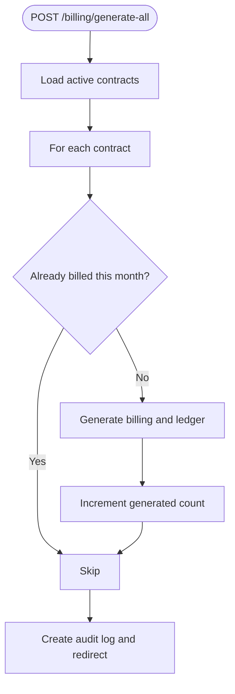

**Diagram sources**
- [billing.py:249-315](file://core/views/billing.py#L249-L315)

**Section sources**
- [billing.py:249-315](file://core/views/billing.py#L249-L315)

### Collection Workflows

#### `billing_collect`
- **Route**: `/billing/<pk>/collect/`
- **Method**: GET shows collection form; POST processes payment.
- **Permissions**: Collector role required.
- **Inputs**:
  - Amount paid
  - Payment date
  - Payment method
  - Remarks
- **Behavior**:
  - Loads the billing with related tenant, stall, section, and contract.
  - Rejects fully paid billings.
  - Clamps overpayments to the outstanding balance.
  - Calls the shared payment service to create a `Payment`, update billing totals/status, post a ledger credit, and recompute running balances.
  - Records an audit log.
  - Returns either an HTMX fragment or redirects to the printable receipt page.

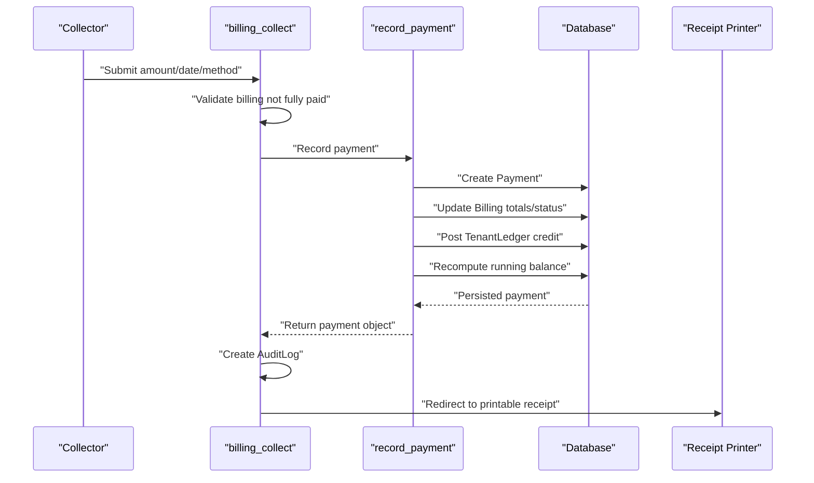

**Diagram sources**
- [billing.py:415-489](file://core/views/billing.py#L415-L489)
- [helpers.py:351-420](file://core/helpers.py#L351-L420)

**Section sources**
- [billing.py:415-489](file://core/views/billing.py#L415-L489)
- [helpers.py:351-420](file://core/helpers.py#L351-L420)

#### `billing_quick_pay`
- **Route**: `/billing/<pk>/quick-pay/`
- **Method**: Same as `billing_collect`.
- **Purpose**: Legacy alias for backward compatibility.

**Section sources**
- [billing.py:492-495](file://core/views/billing.py#L492-L495)

#### `billing_tenant_collect`
- **Route**: `/billing/collect/tenant/<tenant_pk>/`
- **Method**: GET shows grouped collection workspace; POST settles selected months.
- **Permissions**: Collector role required.
- **Inputs**:
  - Selected billing IDs
  - Payment date
  - Payment method
  - Remarks
- **Behavior**:
  - Ensures initial billings exist for the tenant’s contracts.
  - Lists every billing tied to the tenant, ordered oldest first.
  - Calculates outstanding amounts.
  - Validates selection, date, and payment method.
  - Locks selected billings inside a transaction to prevent concurrent double-collection.
  - Generates one consolidated official receipt number for the batch.
  - Creates one `Payment` per selected month via the shared payment service.
  - Stores batch payment keys in the session for consolidated receipt printing.
  - Redirects to either a single-receipt print page or a batch receipt page.

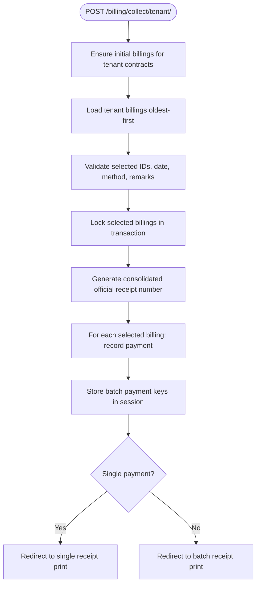

**Diagram sources**
- [billing.py:511-634](file://core/views/billing.py#L511-L634)
- [collect_grouped.html:63-78](file://templates/billing/collect_grouped.html#L63-L78)

**Section sources**
- [billing.py:511-634](file://core/views/billing.py#L511-L634)
- [collect_grouped.html:63-78](file://templates/billing/collect_grouped.html#L63-L78)

### Billing Administration Endpoints

#### `billing_list`
- **Route**: `/billing/`
- **Method**: GET lists billings.
- **Permissions**: Login required; collectors/cashiers/supervisors/treasurers/admins see auto-generated current-month billings and overdue penalties.
- **Features**:
  - Auto-generates current-month billings for eligible roles.
  - Applies overdue penalties if eligible.
  - Filters by month, year, tenant, status, and search terms.
  - Groups billings visually by tenant.
  - Aggregates totals for due, paid, and balance.
  - Supports pagination.
  - Supports HTMX table refresh.

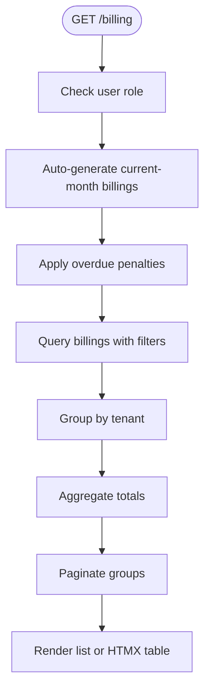

**Diagram sources**
- [billing.py:62-171](file://core/views/billing.py#L62-L171)

**Section sources**
- [billing.py:62-171](file://core/views/billing.py#L62-L171)

#### `billing_add_modal`
- **Route**: `/billing/add-modal/`
- **Method**: GET renders add form; POST creates billing via form.
- **Permissions**: Management role required.
- **Behavior**:
  - Saves billing through the billing form.
  - Creates a corresponding ledger debit.
  - Creates an audit log.
  - Returns HTMX fragment when called via HTMX.

**Section sources**
- [billing.py:335-370](file://core/views/billing.py#L335-L370)
- [forms.py:402-462](file://core/forms.py#L402-L462)

#### `billing_edit_modal`
- **Route**: `/billing/<pk>/edit-modal/`
- **Method**: GET renders edit form; POST updates billing.
- **Permissions**: Management role required.
- **Behavior**:
  - Updates billing through the billing form.
  - Updates the original ledger debit.
  - Recomputes the tenant ledger running balance.
  - Creates an audit log.
  - Returns HTMX fragment when called via HTMX.

**Section sources**
- [billing.py:373-412](file://core/views/billing.py#L373-L412)
- [forms.py:402-462](file://core/forms.py#L402-L462)

### Penalty Calculation Logic

Penalty calculation has two closely related implementations:

1. **View-level helper**: Used by manual billing generation endpoints.
2. **Shared helper**: Used by automated billing creation and overdue sweeps.

Both follow the same policy:

- Prefer per-contract active penalty settings if present.
- Fall back to global system settings otherwise.
- Respect the grace period: no penalty until today is after due date plus grace days.
- Support fixed and percentage penalty types.
- Use decimal arithmetic for financial precision.

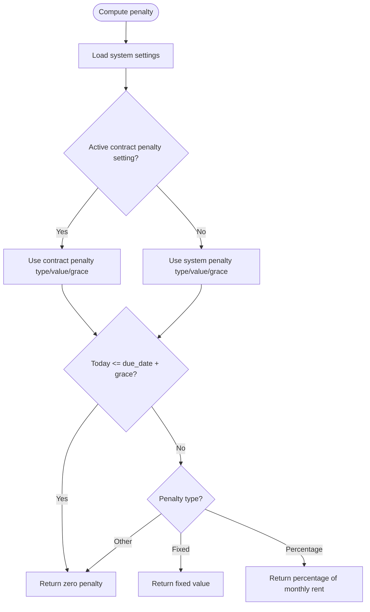

**Diagram sources**
- [billing.py:29-51](file://core/views/billing.py#L29-L51)
- [helpers.py:132-152](file://core/helpers.py#L132-L152)

**Section sources**
- [billing.py:29-51](file://core/views/billing.py#L29-L51)
- [helpers.py:132-152](file://core/helpers.py#L132-L152)

### Due Date Management

Due dates are computed safely to avoid invalid calendar dates:

- The due day comes from the contract.
- If the configured due day exceeds the month’s last day, the system uses the last day of that month.
- The same safe due date function is reused across views and helpers.

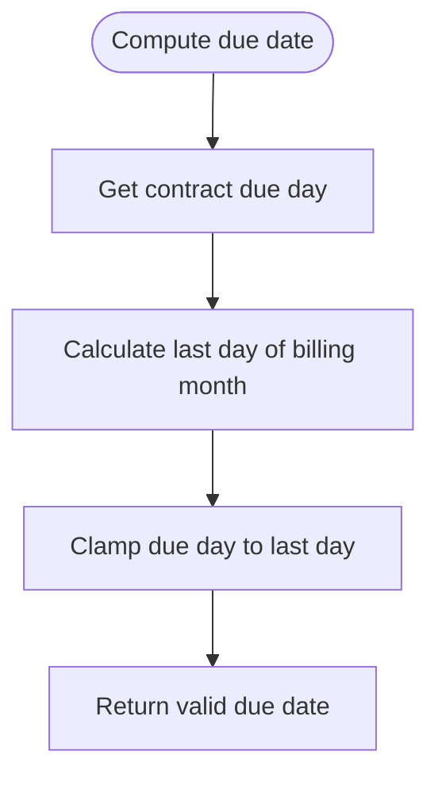

**Diagram sources**
- [billing.py:54-59](file://core/views/billing.py#L54-L59)
- [helpers.py:125-129](file://core/helpers.py#L125-L129)

**Section sources**
- [billing.py:54-59](file://core/views/billing.py#L54-L59)
- [helpers.py:125-129](file://core/helpers.py#L125-L129)

### Billing Status Tracking

Billing status is derived from financial state:

| Condition | Status |
|---|---|
| No payments applied and balance equals total due | `Unpaid` |
| Some payments applied but balance remains positive | `Partial` |
| Total paid equals or exceeds total due | `Paid` |
| Overdue sweep detects past-due unpaid/partial bills | `Overdue` |

The authoritative recomputation happens in the shared payment helper, which locks the billing row and recalculates totals from valid payments.

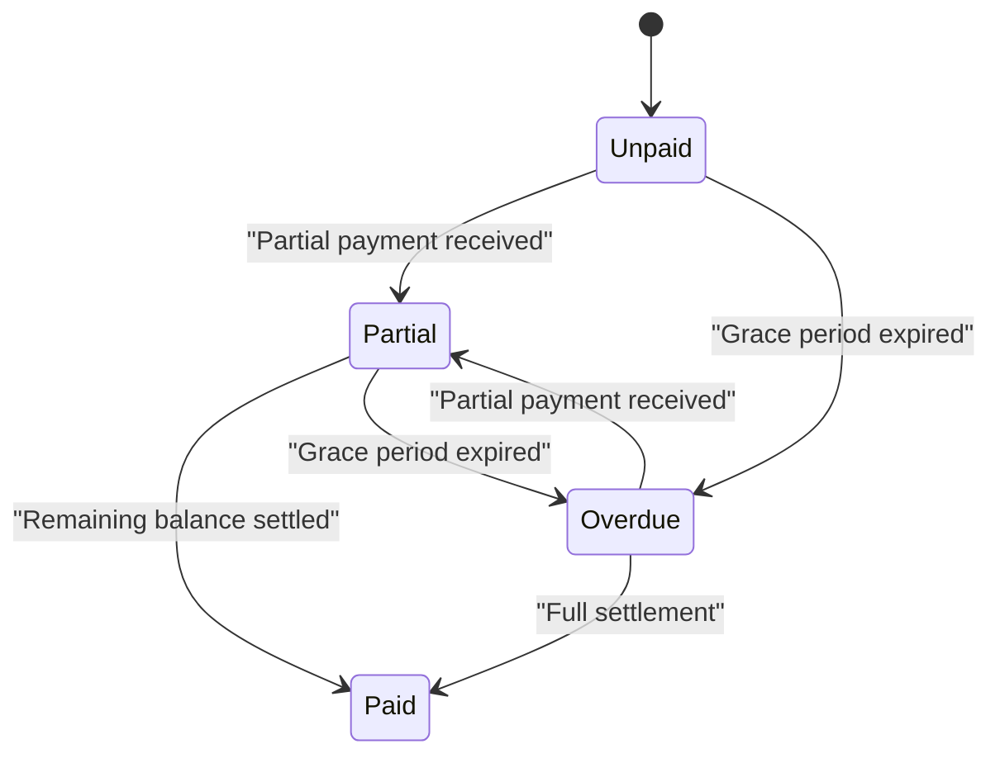

**Diagram sources**
- [models.py:190-218](file://core/models.py#L190-L218)
- [helpers.py:321-348](file://core/helpers.py#L321-L348)
- [helpers.py:423-500](file://core/helpers.py#L423-L500)

**Section sources**
- [models.py:190-218](file://core/models.py#L190-L218)
- [helpers.py:321-348](file://core/helpers.py#L321-L348)
- [helpers.py:423-500](file://core/helpers.py#L423-L500)

### Integration with Contracts and Payments

#### Contracts
- Billings are created from active contracts.
- Contract fields drive billing inputs: monthly rent, due day, tenant, stall, and penalty overrides.
- Automated helpers ensure billings exist for contract windows without creating duplicates.

#### Payments
- All payment posting goes through the shared payment service.
- The service:
  - Generates a unique receipt number.
  - Creates a `Payment` row.
  - Recomputes billing totals and status.
  - Posts a ledger credit.
  - Recalculates the tenant ledger running balance.
  - Handles rare receipt collisions with retries.

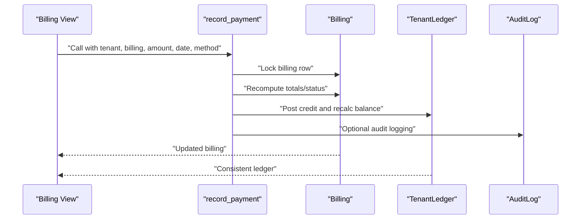

**Diagram sources**
- [helpers.py:351-420](file://core/helpers.py#L351-L420)
- [billing.py:415-489](file://core/views/billing.py#L415-L489)

**Section sources**
- [billing.py:415-489](file://core/views/billing.py#L415-L489)
- [helpers.py:351-420](file://core/helpers.py#L351-L420)

### Examples

#### Monthly Billing Generation
A manager generates billings for one tenant or all active tenants:

- Use `billing_generate` for a single contract.
- Use `billing_generate_all` for all active contracts.
- Both compute due dates and penalties consistently.
- Both create ledger debits and audit logs.

Operational example:
- Select an active contract.
- Choose the billing month and year.
- Submit the form.
- Confirm success message and review the billing list.

**Section sources**
- [billing.py:174-315](file://core/views/billing.py#L174-L315)

#### Partial Payment Processing
A collector collects less than the full outstanding balance:

- Open `billing_collect` for a specific billing.
- Enter an amount smaller than the outstanding balance.
- Submit the payment.
- The system records a partial payment, leaves a remaining balance, and sets billing status to `Partial`.
- A receipt is printed.

Operational example:
- Outstanding balance is ₱100.
- Collector enters ₱60.
- System records ₱60 payment.
- Remaining balance becomes ₱40.
- Billing status becomes `Partial`.

**Section sources**
- [billing.py:415-489](file://core/views/billing.py#L415-L489)
- [forms.py:728-774](file://core/forms.py#L728-L774)

#### Grouped Collection Interface
A collector settles multiple months for one tenant:

- Open `billing_tenant_collect` for the tenant.
- Review month-by-month breakdown.
- Select one or more outstanding months.
- Submit with payment date, method, and optional remarks.
- System creates one payment per selected month under a consolidated official receipt number.
- Redirects to a single or batch receipt print page.

**Section sources**
- [billing.py:511-634](file://core/views/billing.py#L511-L634)
- [collect_grouped.html:63-78](file://templates/billing/collect_grouped.html#L63-L78)

## Dependency Analysis

### View-to-Helper Dependencies
Billing views depend on shared helpers for financial correctness and consistency.

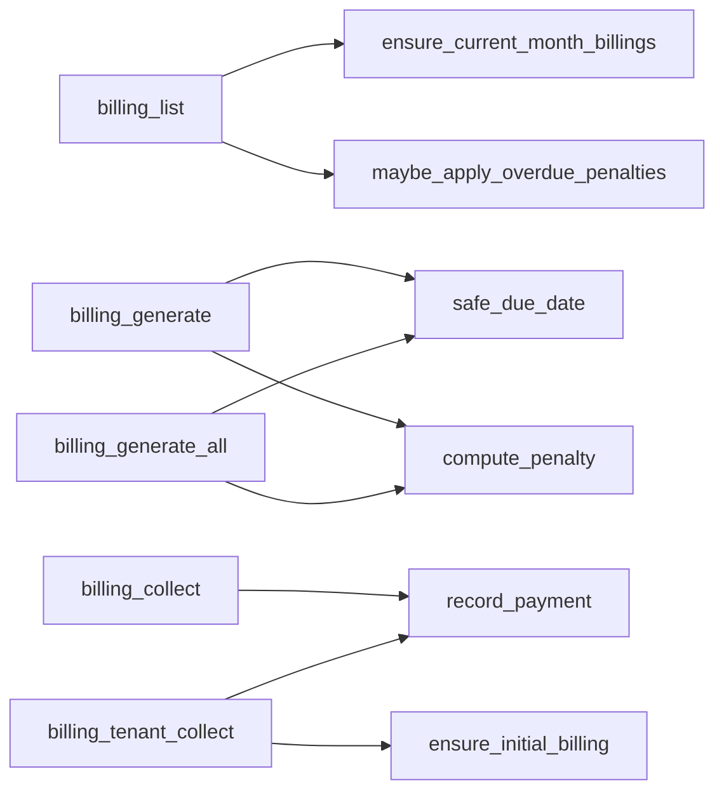

**Diagram sources**
- [billing.py:62-634](file://core/views/billing.py#L62-L634)
- [helpers.py:125-520](file://core/helpers.py#L125-L520)

### Model Relationships
Billing operations touch several models in coordinated transactions.

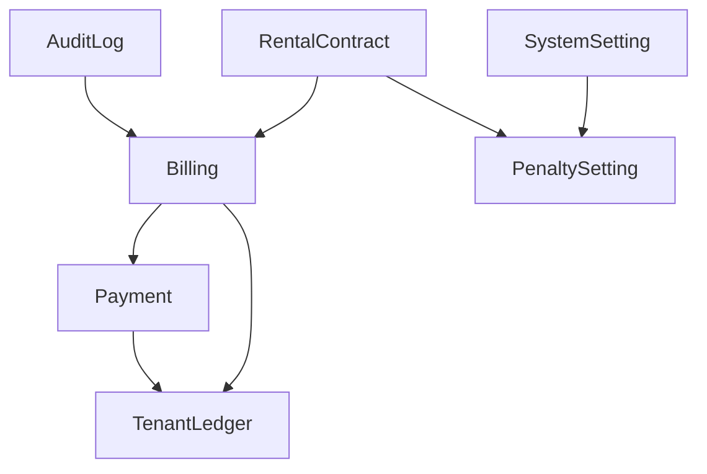

**Diagram sources**
- [models.py:157-336](file://core/models.py#L157-L336)

**Section sources**
- [billing.py:62-634](file://core/views/billing.py#L62-L634)
- [helpers.py:125-520](file://core/helpers.py#L125-L520)
- [models.py:157-336](file://core/models.py#L157-L336)

## Performance Considerations

- **Idempotent billing creation**: Repeated calls to billing generation helpers do not create duplicate rows because uniqueness is enforced at the model level and checked before creation.
- **Throttled overdue penalties**: Overdue penalty application runs at most once per day per cache instance, preventing repeated heavy sweeps during normal browsing.
- **Transaction-safe collections**: Grouped tenant collection locks selected billing rows inside a transaction to prevent race conditions.
- **Decimal arithmetic**: Financial calculations use `Decimal` to avoid floating-point drift.
- **Selective queries**: Views use `select_related` to reduce N+1 queries when loading tenant, stall, section, and contract data.
- **Pagination**: Billing list groups and paginates tenant cards to keep large datasets manageable.

[No sources needed since this section provides general guidance]

## Troubleshooting Guide

### Billing Already Exists
- **Symptom**: Warning that a billing already exists for a tenant/stall/month/year.
- **Cause**: Duplicate generation attempt.
- **Resolution**: Use the existing billing or choose a different month/year.

**Section sources**
- [billing.py:186-192](file://core/views/billing.py#L186-L192)

### Already Fully Paid
- **Symptom**: Collector sees a message that the billing is already fully paid.
- **Cause**: Billing status is `Paid` and balance is zero.
- **Resolution**: Do not collect again; view payment history instead.

**Section sources**
- [billing.py:422-429](file://core/views/billing.py#L422-L429)

### Invalid Payment Date
- **Symptom**: Error message about an invalid payment date in grouped collection.
- **Cause**: Submitted date does not match expected format.
- **Resolution**: Use a valid date string or leave it blank to default to today.

**Section sources**
- [billing.py:545-550](file://core/views/billing.py#L545-L545)

### No Selection in Grouped Collection
- **Symptom**: Error asking to select at least one billing month.
- **Cause**: Batch submission without checking any billing IDs.
- **Resolution**: Tick at least one month before submitting.

**Section sources**
- [billing.py:539-543](file://core/views/billing.py#L539-L543)

### Overdue Penalties Not Applied Immediately
- **Symptom**: Penalty does not appear immediately after due date.
- **Cause**: Grace period may still be active, or the daily throttled trigger has already run for the day.
- **Resolution**: Wait until grace period expires; the system applies penalties automatically on eligible requests.

**Section sources**
- [billing.py:29-51](file://core/views/billing.py#L29-L51)
- [helpers.py:503-520](file://core/helpers.py#L503-L520)

### Receipt Number Collision
- **Symptom**: Rare database integrity error during payment creation.
- **Cause**: Extremely unlikely collision in receipt number generation.
- **Resolution**: The payment service retries up to five times; if it persists, investigate receipt prefix configuration and concurrent payment volume.

**Section sources**
- [helpers.py:276-300](file://core/helpers.py#L276-L300)
- [helpers.py:373-399](file://core/helpers.py#L373-L399)

## Conclusion
The billing API provides a complete workflow for generating charges, collecting payments, managing billing records, and maintaining financial integrity. Its design emphasizes:

- Consistent penalty and due date logic.
- Clear billing status transitions.
- Robust payment recording with ledger reconciliation.
- Auditable operations.
- Support for both single-billing and grouped collection workflows.
- Idempotent and thread-safe financial operations.

Administrators should configure system settings and per-contract penalty rules carefully, while collectors rely on the guided interfaces to generate accurate billings and settle payments with proper receipts and audit trails.

[No sources needed since this section summarizes without analyzing specific files]