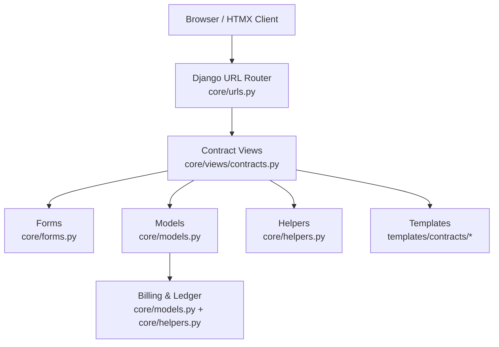
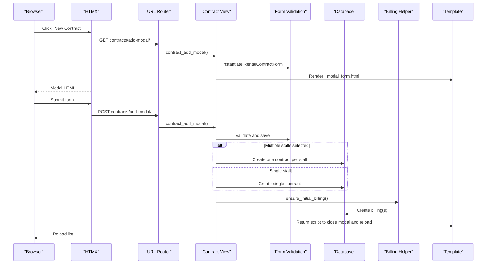
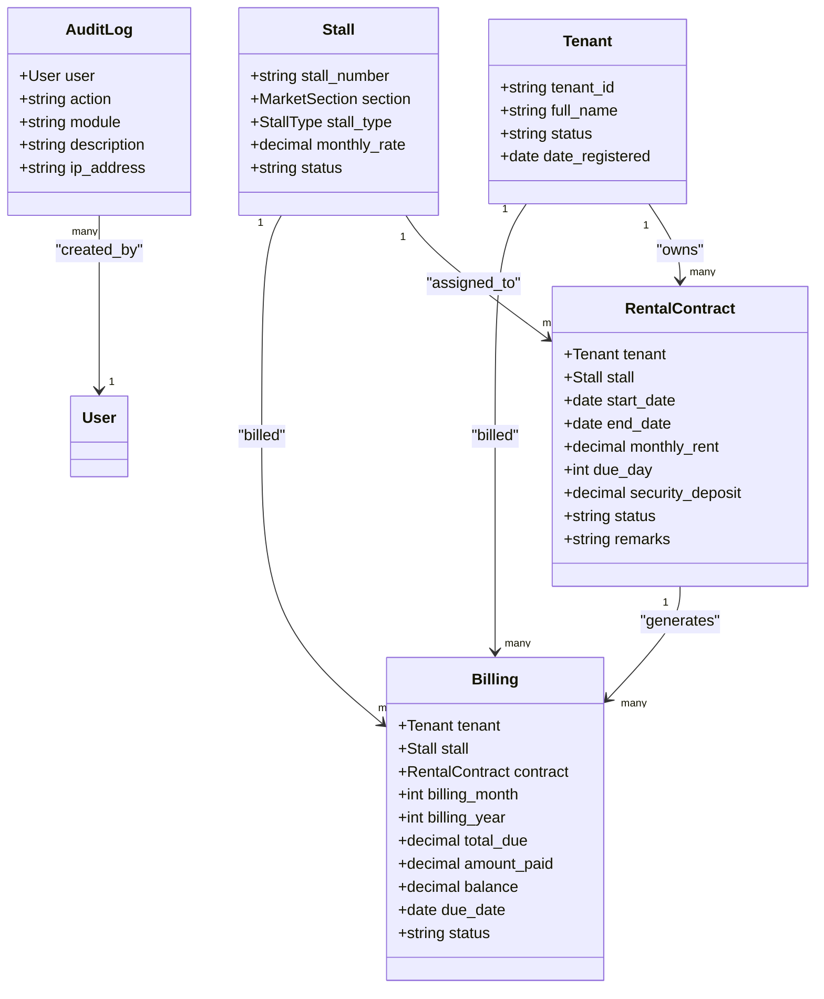
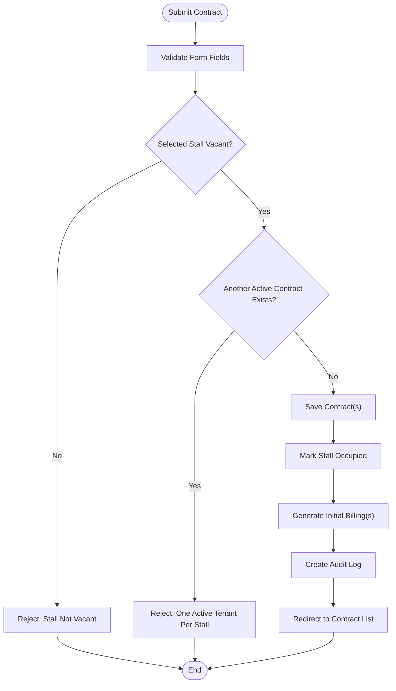

# Contracts API

<cite>
**Referenced Files in This Document**
- [contracts.py](file://core/views/contracts.py)
- [models.py](file://core/models.py)
- [urls.py](file://core/urls.py)
- [forms.py](file://core/forms.py)
- [helpers.py](file://core/helpers.py)
- [_modal_form.html](file://templates/contracts/_modal_form.html)
- [_tenant_stall_autofill.html](file://templates/contracts/_tenant_stall_autofill.html)
- [_stall_picker.html](file://templates/contracts/_stall_picker.html)
- [bulk_assign.html](file://templates/contracts/bulk_assign.html)
</cite>

## Table of Contents
1. [Introduction](#introduction)
2. [Project Structure](#project-structure)
3. [Core Components](#core-components)
4. [Architecture Overview](#architecture-overview)
5. [Detailed Component Analysis](#detailed-component-analysis)
6. [Dependency Analysis](#dependency-analysis)
7. [Performance Considerations](#performance-considerations)
8. [Troubleshooting Guide](#troubleshooting-guide)
9. [Conclusion](#conclusion)

## Introduction
This document describes the contract management API surface for the Market Rental System. It covers:
- Contract lifecycle endpoints: listing, creation, editing, deletion, and termination.
- Bulk assignment of one tenant to multiple vacant stalls.
- Contract terms, tenant-stall relationships, validity periods, and renewal behavior.
- HTMX modal interactions for contract forms.
- Tenant-stall autofill that suggests previously held stalls.
- Business rules such as one active tenant per stall and automatic billing generation.

The system is a Django application where URLs map to view functions that render templates or return partial HTML via HTMX. Data models enforce core business constraints, while forms add validation and user-facing behavior.

## Project Structure
Contract-related functionality lives primarily under `core/views/contracts.py`, with URL routing in `core/urls.py`. The data model is defined in `core/models.py`, form logic in `core/forms.py`, shared helpers (including billing automation) in `core/helpers.py`, and UI fragments in `templates/contracts/`.

**Diagram sources**
- [urls.py:107-120](file://core/urls.py#L107-L120)
- [contracts.py:45-529](file://core/views/contracts.py#L45-L529)
- [forms.py:281-725](file://core/forms.py#L281-L725)
- [models.py:93-187](file://core/models.py#L93-L187)
- [helpers.py:155-235](file://core/helpers.py#L155-L235)

**Section sources**
- [urls.py:107-120](file://core/urls.py#L107-L120)
- [contracts.py:45-529](file://core/views/contracts.py#L45-L529)

## Core Components
- **RentalContract**: Represents a tenancy agreement between a tenant and a stall, including dates, rent, due day, deposit, status, and remarks.
- **Stall**: Physical market stall with number, section, type, monthly rate, and occupancy status.
- **Tenant**: Person or entity renting a stall.
- **Billing**: Monthly billing records tied to a contract, tenant, and stall.
- **AuditLog**: Records administrative actions such as create, update, delete, terminate, and bulk assign.
- **SystemSetting**: Stores default contract terms and penalty configuration.

Key business rules enforced by the model and forms:
- One active contract per stall at any time.
- Only active tenants can be assigned.
- Only vacant stalls without an active contract are assignable.
- End date must be after start date for bulk assignments.
- Default contract terms are stored in system settings and printed on contracts.

**Section sources**
- [models.py:93-187](file://core/models.py#L93-L187)
- [models.py:190-219](file://core/models.py#L190-L219)
- [models.py:304-316](file://core/models.py#L304-L316)
- [models.py:42-68](file://core/models.py#L42-L68)
- [forms.py:281-400](file://core/forms.py#L281-L400)
- [forms.py:652-725](file://core/forms.py#L652-L725)

## Architecture Overview
The contract API follows a request-to-template flow with optional HTMX partial responses.

**Diagram sources**
- [contracts.py:249-294](file://core/views/contracts.py#L249-L294)
- [forms.py:335-363](file://core/forms.py#L335-L363)
- [helpers.py:208-235](file://core/helpers.py#L208-L235)

## Detailed Component Analysis

### Contract List (`contract_list`)
Lists all contracts with filtering by status, tenant, stall, and search text. Supports pagination and HTMX table refreshes.

- HTTP method: GET
- Query parameters:
  - `status`: Filter by contract status.
  - `tenant`: Filter by tenant ID.
  - `stall`: Filter by stall ID.
  - `search` or `q`: Search across tenant name, tenant ID, business name, stall number, and section name.
  - `page`: Page number for pagination.
- Response:
  - Full page when not HTMX.
  - Partial table fragment when HTMX requests `_table.html`.

Business behavior:
- Uses optimized queries with related fields.
- Orders by most recent start date and creation time.

**Section sources**
- [contracts.py:45-85](file://core/views/contracts.py#L45-L85)
- [urls.py:108-110](file://core/urls.py#L108-L110)

### Contract Add (`contract_add`)
Creates one or more contracts from a form submission.

- HTTP method: GET renders form; POST creates contracts.
- Success behavior:
  - Saves contracts atomically.
  - Occupies each stall if not already occupied.
  - Generates initial billings for applicable months.
  - Logs audit entries for create or bulk assign.
  - Redirects to contract list.
- Failure behavior:
  - IntegrityError indicates another user claimed a stall; re-renders form with error message.
  - Validation errors show corrected form.

Use cases:
- Single-stall contract creation.
- Multi-stall creation through the checklist field.

**Section sources**
- [contracts.py:88-135](file://core/views/contracts.py#L88-L135)
- [forms.py:335-363](file://core/forms.py#L335-L363)
- [helpers.py:208-235](file://core/helpers.py#L208-L235)

### Contract Edit (`contract_edit`)
Updates an existing contract and synchronizes stall status.

- HTTP method: GET renders form; POST updates contract.
- Stall synchronization:
  - If moving from old stall to new stall, marks old stall vacant if no other active contract remains.
  - If contract becomes active, marks new stall occupied and ensures initial billing exists.
  - If contract becomes non-active, checks whether new stall should become vacant.
- Audit logging and redirect on success.

**Section sources**
- [contracts.py:138-183](file://core/views/contracts.py#L138-L183)

### Contract Delete (`contract_delete`)
Deletes a contract and adjusts stall status.

- HTTP method: POST deletes contract.
- Stall synchronization:
  - Marks stall vacant if no other active contract remains.
- Audit logging and redirect on success.

**Section sources**
- [contracts.py:186-208](file://core/views/contracts.py#L186-L208)

### Contract Terminate (`contract_terminate`)
Terminates a contract and sets its end date to today.

- HTTP method: POST terminates contract.
- Stall synchronization:
  - Marks stall vacant if no other active contract remains.
- Audit logging and redirect on success.

Renewal workflow:
- Terminating a contract does not delete it; it changes status to terminated.
- A new contract can be created for the same stall once the prior active contract is terminated.
- The tenant-stall autofill helps renewals by suggesting previously held stalls.

**Section sources**
- [contracts.py:225-246](file://core/views/contracts.py#L225-L246)
- [_tenant_stall_autofill.html:62-117](file://templates/contracts/_tenant_stall_autofill.html#L62-L117)

### HTMX Modal Add/Edit (`contract_add_modal`, `contract_edit_modal`)
Modal-based contract creation and editing using HTMX.

- `contract_add_modal`:
  - Renders `_modal_form.html`.
  - On successful save, returns JavaScript to close the modal, show a toast, and reload the page.
  - Handles IntegrityError by re-rendering the modal with an error message.
- `contract_edit_modal`:
  - Similar flow for editing.
  - Synchronizes stall status and billing on save.

HTMX interaction details:
- Forms use `hx-post` and `hx-target="#modal-content"` to submit into the modal container.
- Successful responses include scripts calling `closeModal()` and `showToast()`.

**Section sources**
- [contracts.py:249-344](file://core/views/contracts.py#L249-L344)
- [_modal_form.html:18-35](file://templates/contracts/_modal_form.html#L18-L35)

### Bulk Assignment (`contract_bulk_assign`)
Assigns one tenant to multiple vacant stalls in a single operation.

- HTTP method: GET renders form; POST performs assignment.
- Form fields:
  - Tenant (active only).
  - Start date (required).
  - End date (optional, must be after start date).
  - Due day (1–28).
  - Security deposit per stall (optional).
  - Remarks (optional).
  - Stalls (checkbox list of vacant stalls without active contracts).
- Processing:
  - Locks each stall row during assignment to prevent race conditions.
  - Creates one Active contract per stall, inheriting the stall’s monthly rate.
  - Marks each stall occupied.
  - Generates initial billing outside the lock to keep critical sections small.
  - Logs audit entry and shows success message.
- Error handling:
  - If a stall is no longer vacant, raises a ValueError and displays an error.
  - Keeps bound form so users can correct conflicting selections.

Example workflow:
1. Open bulk assignment page.
2. Select tenant and multiple vacant stalls.
3. Set start date and optional end date.
4. Submit; system creates contracts and billings.
5. Redirect to contract list with success message.

**Section sources**
- [contracts.py:431-529](file://core/views/contracts.py#L431-L529)
- [forms.py:652-725](file://core/forms.py#L652-L725)
- [bulk_assign.html:30-96](file://templates/contracts/bulk_assign.html#L30-L96)

### Contract Terms and Validity Periods
- Contract terms are stored in `SystemSetting.terms_and_conditions` and printed on every rental contract.
- Validity period is represented by `start_date` and optional `end_date`.
- Billing generation respects these dates:
  - Future start month: generates billing for start month only.
  - Past or current start month: generates billings up to current month unless ended before that month.
- Penalty calculations use system settings or per-contract penalty settings.

**Section sources**
- [models.py:42-68](file://core/models.py#L42-L68)
- [models.py:157-187](file://core/models.py#L157-L187)
- [helpers.py:125-152](file://core/helpers.py#L125-L152)
- [helpers.py:155-235](file://core/helpers.py#L155-L235)

### Tenant-Stall Autofill Functionality
When a tenant is selected in the contract form:
- The form injects a JSON map of previously held stalls into the tenant select widget.
- The autofill script:
  - Ticks checkboxes for vacant stalls the tenant previously held.
  - Auto-selects a single stall in single-stall mode.
  - Applies the stall’s monthly rate to the rent field when exactly one stall is suggested.
  - Warns if previously held stalls are no longer vacant.
  - Shows which stalls are already under an active contract.

This supports renewal workflows by letting operators quickly reassign a tenant to a familiar stall.

**Section sources**
- [forms.py:330-387](file://core/forms.py#L330-L387)
- [_tenant_stall_autofill.html:7-129](file://templates/contracts/_tenant_stall_autofill.html#L7-L129)
- [_modal_form.html:37-51](file://templates/contracts/_modal_form.html#L37-L51)

### Stall Picker Component
Shared checkbox-based stall selection used by both contract forms and bulk assignment.

Features:
- Filter input to search stalls by number or label.
- Select All / Deselect All toggle.
- Selected count display.
- Disabled submit button until at least one stall is selected.
- Each stall label includes its monthly rate.

**Section sources**
- [_stall_picker.html:1-70](file://templates/contracts/_stall_picker.html#L1-L70)

## Dependency Analysis

**Diagram sources**
- [models.py:117-187](file://core/models.py#L117-L187)
- [models.py:190-219](file://core/models.py#L190-L219)
- [models.py:304-316](file://core/models.py#L304-L316)

### Constraint Enforcement Flow

**Diagram sources**
- [forms.py:389-399](file://core/forms.py#L389-L399)
- [contracts.py:90-135](file://core/views/contracts.py#L90-L135)
- [helpers.py:208-235](file://core/helpers.py#L208-L235)

## Performance Considerations
- Use of `select_related` reduces N+1 queries when listing and viewing contracts.
- Atomic transactions protect against concurrent stall assignment and billing creation.
- Database-level unique constraint prevents duplicate active contracts per stall.
- Bulk assignment locks individual stall rows to minimize contention while keeping billing generation outside the lock.
- Pagination limits list rendering to 10 items per page.

Recommendations:
- Keep index coverage on frequently filtered fields such as `stall.status`, `contract.status`, and `billing.tenant`.
- Monitor database lock contention during peak bulk assignment operations.
- Consider caching stall availability counts if the stall picker becomes a bottleneck.

[No sources needed since this section provides general guidance]

## Troubleshooting Guide

Common issues and resolutions:
- **Stall taken between render and submit**:
  - Cause: Another user assigned the stall.
  - Symptom: IntegrityError or form validation error indicating stall not available.
  - Resolution: Refresh the form and re-select available stalls.
- **Cannot assign a stall because it already has an active contract**:
  - Cause: Violation of one active tenant per stall rule.
  - Symptom: Validation error stating stall already has an active contract.
  - Resolution: Terminate or edit the existing contract first.
- **Bulk assignment fails with “no longer vacant”**:
  - Cause: Race condition or manual stall status change.
  - Symptom: Error message listing non-vacant stalls.
  - Resolution: Refresh the page and deselect conflicting stalls.
- **End date validation error**:
  - Cause: End date is not later than start date.
  - Resolution: Adjust dates accordingly.
- **HTMX modal does not close after save**:
  - Cause: Missing or overridden JavaScript functions.
  - Resolution: Ensure `closeModal()` and `showToast()` are available in the page context.

Operational tips:
- Always verify stall status before assigning.
- Use the tenant-stall autofill to reduce errors during renewals.
- Review audit logs for traceability of contract changes.

**Section sources**
- [contracts.py:98-102](file://core/views/contracts.py#L98-L102)
- [contracts.py:259-265](file://core/views/contracts.py#L259-L265)
- [contracts.py:505-512](file://core/views/contracts.py#L505-L512)
- [forms.py:709-725](file://core/forms.py#L709-L725)

## Conclusion
The contract management API provides robust tools for managing tenant-stall relationships, enforcing business rules, and automating billing. Key strengths include:
- Clear lifecycle endpoints for listing, creating, editing, deleting, and terminating contracts.
- Safe bulk assignment with locking and validation.
- HTMX-driven modal interactions for efficient operator workflows.
- Tenant-stall autofill that simplifies renewals.
- Strong model constraints ensuring one active tenant per stall.

For best results:
- Use bulk assignment for multi-stall onboarding.
- Leverage autofill for quick renewals.
- Monitor audit logs and stall statuses to maintain data integrity.
- Follow the termination workflow before reassigning stalls.

[No sources needed since this section summarizes without analyzing specific files]