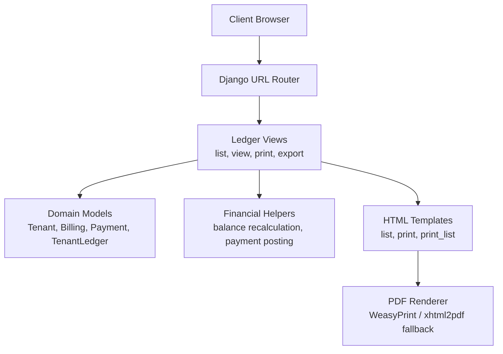
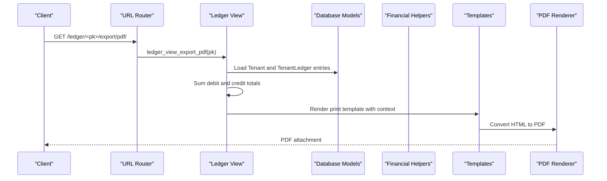
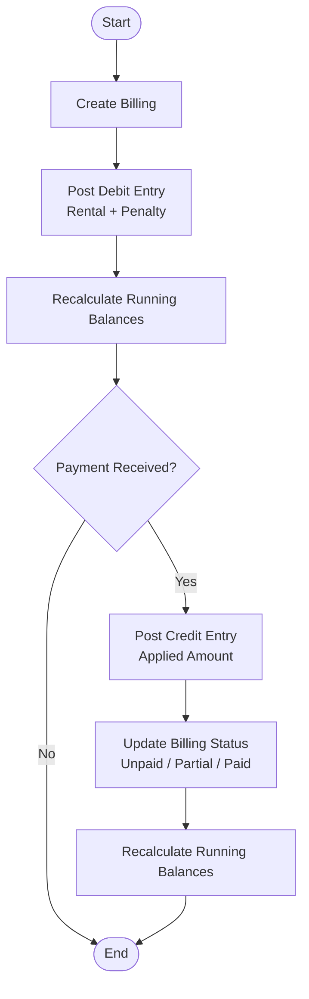
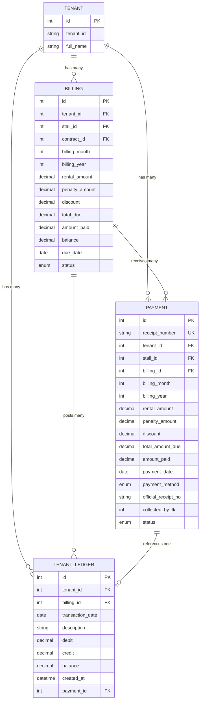
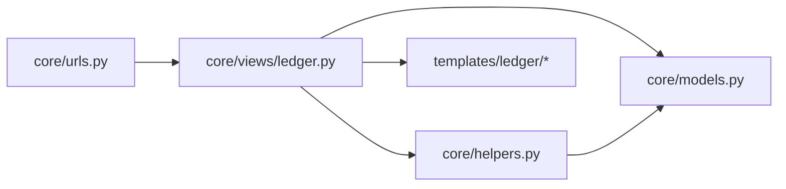

# Financial Ledger API

<cite>
**Referenced Files in This Document**   
- [core/views/ledger.py](file://core/views/ledger.py)
- [core/urls.py](file://core/urls.py)
- [core/models.py](file://core/models.py)
- [core/helpers.py](file://core/helpers.py)
- [templates/ledger/list.html](file://templates/ledger/list.html)
- [templates/ledger/print.html](file://templates/ledger/print.html)
- [templates/ledger/print_list.html](file://templates/ledger/print_list.html)
</cite>

## Table of Contents
1. [Introduction](#introduction)
2. [Project Structure](#project-structure)
3. [Core Components](#core-components)
4. [Architecture Overview](#architecture-overview)
5. [Detailed Component Analysis](#detailed-component-analysis)
6. [Dependency Analysis](#dependency-analysis)
7. [Performance Considerations](#performance-considerations)
8. [Troubleshooting Guide](#troubleshooting-guide)
9. [Conclusion](#conclusion)
10. [Appendices](#appendices)

## Introduction
This document provides API documentation for the financial ledger endpoints in the Market Rental System. It covers:

- Ledger listing, viewing, printing, and PDF export.
- Running balance calculation using double-entry bookkeeping principles.
- Debit and credit entry tracking through billing, payments, and penalties.
- Transaction history retrieval per tenant.
- The relationship between ledger entries, payments, and billing records.
- Examples for balance reconciliation, transaction history queries, and ledger printing workflows.
- Accounting principles and data integrity requirements enforced by the system.

The ledger is primarily a read-oriented reporting layer over `TenantLedger`, `Billing`, `Payment`, and related models. Writing operations that create or modify ledger entries are performed by shared helper functions rather than directly by these endpoints.

## Project Structure
The ledger feature is implemented as Django views with URL routing, backed by domain models and helper utilities. Templates provide HTML rendering for both browser display and PDF generation.

**Diagram sources**
- [core/urls.py:169-175](file://core/urls.py#L169-L175)
- [core/views/ledger.py:16-182](file://core/views/ledger.py#L16-L182)
- [core/models.py:190-277](file://core/models.py#L190-L277)
- [core/helpers.py:155-273](file://core/helpers.py#L155-L273)
- [core/helpers.py:522-594](file://core/helpers.py#L522-L594)

**Section sources**
- [core/urls.py:169-175](file://core/urls.py#L169-L175)
- [core/views/ledger.py:16-182](file://core/views/ledger.py#L16-L182)

## Core Components
The ledger functionality centers on five HTTP endpoints:

| Endpoint | Method | URL Pattern | Purpose |
|---|---|---|---|
| `ledger_list` | GET | `/ledger/` | Lists active tenants eligible for ledger access; supports search and pagination. |
| `ledger_view` | GET | `/ledger/<int:pk>/` | Shows a single tenant’s ledger entries, totals, and running balance. |
| `ledger_print` | GET | `/ledger/<int:pk>/print/` | Renders a printable HTML view of one tenant’s ledger. |
| `ledger_list_export_pdf` | GET | `/ledger/export/pdf/` | Exports a multi-tenant ledger list as PDF. |
| `ledger_view_export_pdf` | GET | `/ledger/<int:pk>/export/pdf/` | Exports a single tenant’s ledger as PDF. |

All endpoints require authentication and enforce role-based access. Tenants can only access their own ledger; management roles can access all active tenants.

**Section sources**
- [core/urls.py:169-175](file://core/urls.py#L169-L175)
- [core/views/ledger.py:16-182](file://core/views/ledger.py#L16-L182)

## Architecture Overview
The ledger endpoints follow a layered architecture:

- **URL Layer**: Routes requests to view functions.
- **View Layer**: Validates user role, filters tenants or ledger entries, computes summary totals, and renders templates.
- **Model Layer**: Provides `Tenant`, `Billing`, `Payment`, and `TenantLedger` entities.
- **Helper Layer**: Computes penalties, creates billings, posts payments, updates billing status, and recalculates ledger balances.
- **Template Layer**: Renders HTML for screen and print, and drives PDF output via a renderer helper.

**Diagram sources**
- [core/urls.py:173-175](file://core/urls.py#L173-L175)
- [core/views/ledger.py:112-133](file://core/views/ledger.py#L112-L133)
- [core/helpers.py:522-594](file://core/helpers.py#L522-L594)

## Detailed Component Analysis

### Ledger List Endpoint
`ledger_list` returns a paginated list of active tenants with active contracts. For tenant users, it redirects to their own ledger view. Search filters by full name or tenant ID. HTMX support allows partial table reloads.

Key behaviors:
- Role check: tenant users are redirected to their own ledger.
- Query: active tenants with active contracts.
- Search: case-insensitive match on name and ID.
- Pagination: 10 tenants per page.
- HTMX: returns `_table.html` when requested.

Example usage:
- Management: open `/ledger/` to browse tenants.
- Tenant: open `/ledger/` and be redirected to `/ledger/<own_tenant_id>/`.

**Section sources**
- [core/views/ledger.py:16-48](file://core/views/ledger.py#L16-L48)
- [templates/ledger/list.html:25-49](file://templates/ledger/list.html#L25-L49)

### Ledger View Endpoint
`ledger_view` loads a tenant’s ledger entries, aggregates total debits and credits, and calculates a running balance. Entries are ordered by most recent first for display.

Key behaviors:
- Authorization: tenant users can only view their own ledger.
- Data loading: `TenantLedger` entries with related `billing` and `payment`.
- Aggregation: sum of `debit` and `credit`.
- Balance: `running_balance = total_debits - total_credits`.
- Pagination: 20 entries per page.

Reconciliation note:
- The displayed balance equals the net effect of all ledger debits minus credits.
- The underlying model stores a per-entry `balance` field that is recomputed chronologically by helpers.

**Section sources**
- [core/views/ledger.py:51-82](file://core/views/ledger.py#L51-L82)
- [core/models.py:261-277](file://core/models.py#L261-L277)
- [core/helpers.py:260-273](file://core/helpers.py#L260-L273)

### Ledger Print Endpoint
`ledger_print` renders an HTML view suitable for printing a tenant’s ledger. It uses the same data model as `ledger_view` but passes all entries to the template without pagination.

Key behaviors:
- Authorization: tenant-only restriction applies.
- Context includes tenant, entries, totals, running balance, system settings, and current user.
- Template supports browser print and PDF export links.

**Section sources**
- [core/views/ledger.py:85-109](file://core/views/ledger.py#L85-L109)
- [templates/ledger/print.html:1-18](file://templates/ledger/print.html#L1-L18)

### Ledger View Export PDF Endpoint
`ledger_view_export_pdf` exports a single tenant’s ledger as a PDF file. It reuses the print template and helper renderer.

Key behaviors:
- Authorization: tenant-only restriction applies.
- Filename format: `ledger_<tenant_id>_<date>.pdf`.
- Rendering pipeline: template → WeasyPrint → xhtml2pdf fallback → HTML preview with print instructions.

**Section sources**
- [core/views/ledger.py:112-133](file://core/views/ledger.py#L112-L133)
- [core/helpers.py:522-594](file://core/helpers.py#L522-L594)

### Ledger List Export PDF Endpoint
`ledger_list_export_pdf` exports a multi-tenant ledger list as a PDF. It mirrors the list view logic but generates a PDF filename for the entire list.

Key behaviors:
- Role handling: tenant users are redirected to their own ledger view.
- Filtering: active tenants with active contracts, optional search.
- Filename format: `ledger_tenants_<date>.pdf`.

**Section sources**
- [core/views/ledger.py:160-182](file://core/views/ledger.py#L160-L182)
- [templates/ledger/print_list.html:1-15](file://templates/ledger/print_list.html#L1-L15)

### Running Balance Calculation and Double-Entry Bookkeeping
The ledger follows double-entry bookkeeping:

- Debits increase what the tenant owes (e.g., billing amounts, penalties).
- Credits decrease what the tenant owes (e.g., payments applied).
- Running balance is computed as cumulative debits minus cumulative credits.

Implementation highlights:
- Billing creation posts a debit entry.
- Payments post a credit entry.
- Overdue penalties post additional debit entries.
- A helper recomputes all running balances chronologically after changes.

**Diagram sources**
- [core/helpers.py:155-205](file://core/helpers.py#L155-L205)
- [core/helpers.py:351-420](file://core/helpers.py#L351-L420)
- [core/helpers.py:423-500](file://core/helpers.py#L423-L500)
- [core/helpers.py:260-273](file://core/helpers.py#L260-L273)

**Section sources**
- [core/helpers.py:155-205](file://core/helpers.py#L155-L205)
- [core/helpers.py:260-273](file://core/helpers.py#L260-L273)
- [core/helpers.py:351-420](file://core/helpers.py#L351-L420)
- [core/helpers.py:423-500](file://core/helpers.py#L423-L500)

### Relationship Between Ledger Entries, Payments, and Billing Records
- `TenantLedger` is the audit trail of financial movements for a tenant.
- Each ledger entry references a `Billing` and optionally a `Payment`.
- `Billing` represents a monthly obligation with rental amount, penalty, discount, total due, amount paid, and balance.
- `Payment` records actual cash received, method, date, receipt number, and collector.

Data relationships:
- One `Tenant` has many `Billing` records.
- One `Billing` has many `Payment` records.
- One `Billing` has many `TenantLedger` entries.
- One `Payment` may have one `TenantLedger` entry.

**Diagram sources**
- [core/models.py:117-277](file://core/models.py#L117-L277)

**Section sources**
- [core/models.py:190-277](file://core/models.py#L190-L277)

## Dependency Analysis
The ledger endpoints depend on:

- URL routing for path resolution and named URL patterns.
- Permission decorators ensuring correct access control.
- Database models for tenant, billing, payment, and ledger data.
- Helper functions for financial calculations and PDF rendering.

**Diagram sources**
- [core/urls.py:169-175](file://core/urls.py#L169-L175)
- [core/views/ledger.py:16-182](file://core/views/ledger.py#L16-L182)
- [core/models.py:190-277](file://core/models.py#L190-L277)
- [core/helpers.py:155-273](file://core/helpers.py#L155-L273)

**Section sources**
- [core/urls.py:169-175](file://core/urls.py#L169-L175)
- [core/views/ledger.py:16-182](file://core/views/ledger.py#L16-L182)

## Performance Considerations
- Use `select_related('billing', 'payment')` to reduce N+1 queries when loading ledger entries.
- Aggregate totals with database-level `Sum` instead of computing in Python.
- Paginate large lists to avoid heavy DOM rendering.
- Prefer chronological order for balance recalculation; reverse ordering is acceptable for display but not for running balance computation.
- PDF generation may fall back to HTML if system libraries are missing; ensure production environments install required dependencies for optimal performance.

[No sources needed since this section provides general guidance]

## Troubleshooting Guide
Common issues and resolutions:

- **Tenant cannot access ledger**: Ensure the tenant user is linked to a `Tenant` record and has the correct role.
- **Incorrect running balance**: Run the balance recalculation helper to synchronize stored balances with chronological debits and credits.
- **PDF export fails**: Check WeasyPrint or xhtml2pdf availability; the renderer falls back to HTML with print instructions if libraries are missing.
- **Overdue penalties not applied**: Verify the overdue accrual process runs and that grace periods and penalty settings are configured correctly.
- **Duplicate billings**: Billing creation is idempotent; verify unique constraints on tenant, stall, month, and year.

**Section sources**
- [core/views/ledger.py:16-182](file://core/views/ledger.py#L16-L182)
- [core/helpers.py:260-273](file://core/helpers.py#L260-L273)
- [core/helpers.py:522-594](file://core/helpers.py#L522-L594)
- [core/helpers.py:423-500](file://core/helpers.py#L423-L500)

## Conclusion
The Financial Ledger API provides secure, role-aware endpoints for listing, viewing, printing, and exporting tenant-ledger data. It enforces double-entry bookkeeping through explicit debit and credit entries, maintains consistent running balances via helper-driven recalculation, and integrates closely with billing and payment workflows. The design prioritizes financial integrity, auditability, and usability across both web and printed formats.

[No sources needed since this section summarizes without analyzing specific files]

## Appendices

### Example Workflows

#### Balance Reconciliation
- Retrieve all ledger entries for a tenant.
- Compute cumulative debits and credits.
- Compare the resulting balance with the sum of outstanding billing balances.
- If mismatched, run the ledger recalculation helper to normalize stored balances.

#### Transaction History Queries
- Use `ledger_view` to fetch entries for a specific tenant.
- Filter by date range at the application level if needed.
- Inspect associated billing and payment details through related fields.

#### Ledger Printing Workflow
- Open `ledger_print` to render the printable HTML.
- Use browser print or click “Export PDF” to generate a PDF file.
- Validate that totals and running balance appear correctly in the output.

[No sources needed since this section provides conceptual examples]