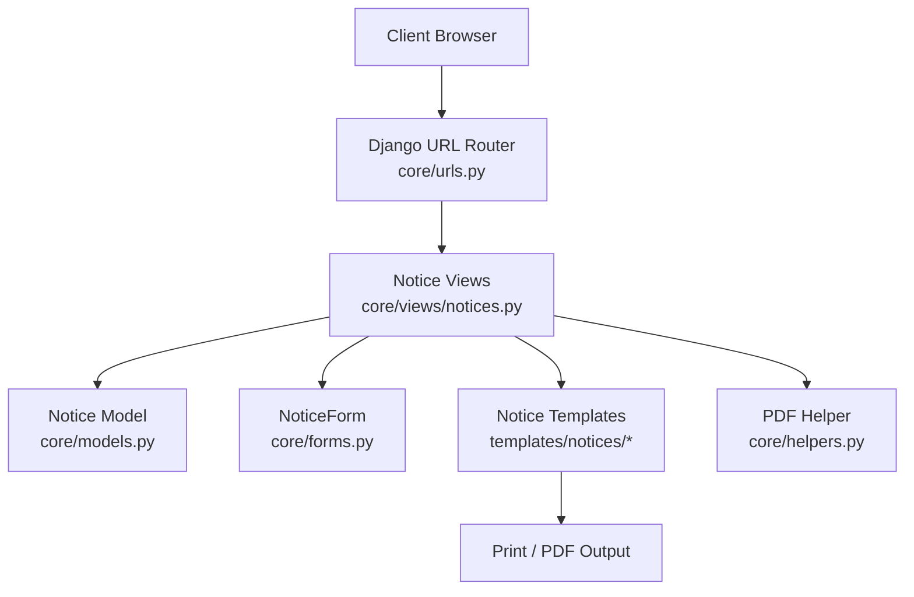
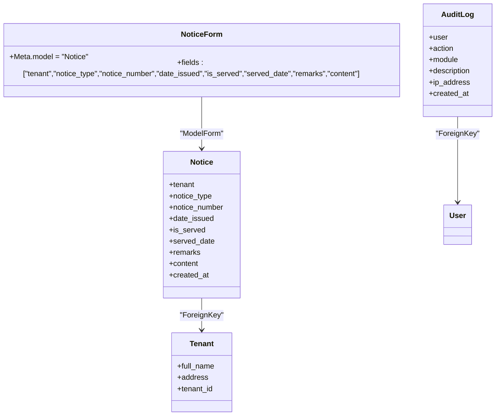
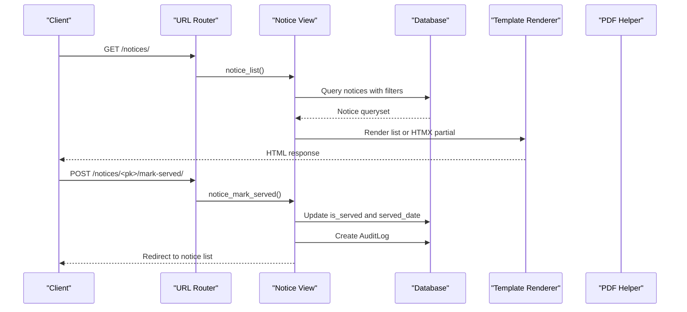
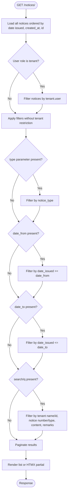
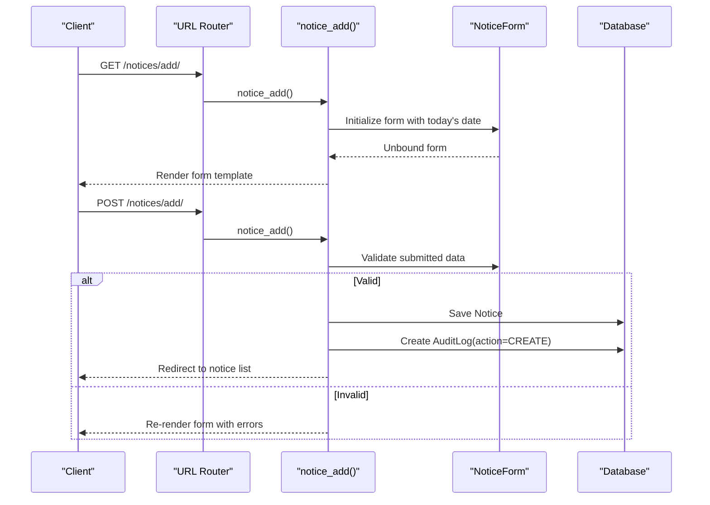
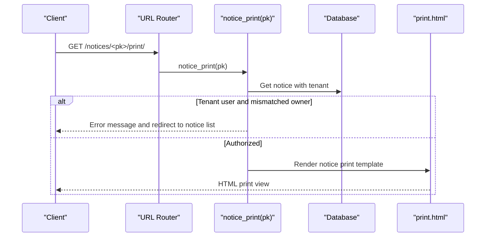
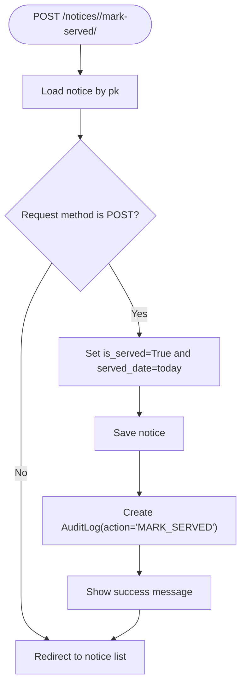
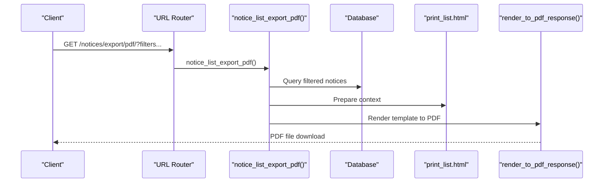
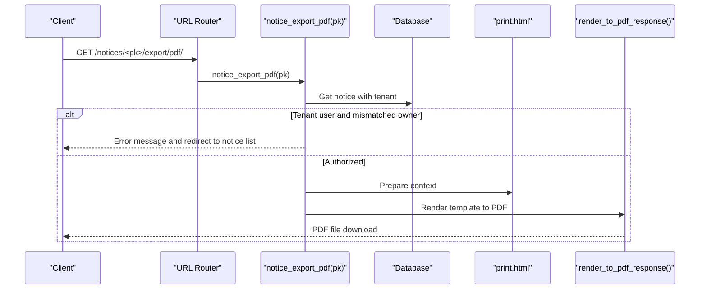
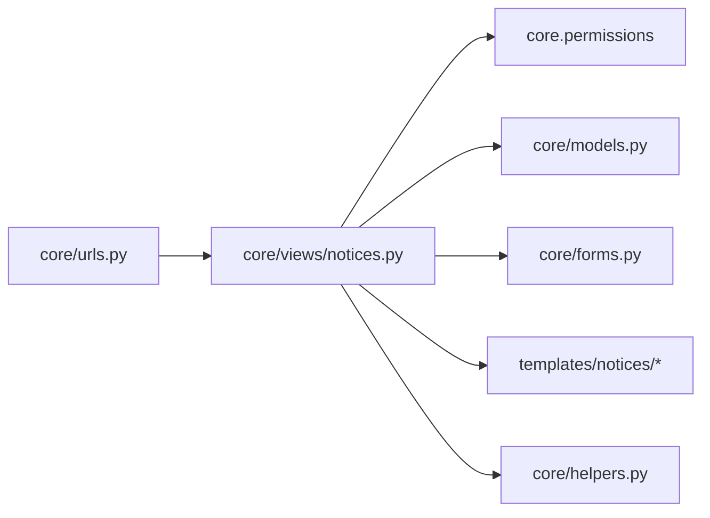

# Notices API

<cite>
**Referenced Files in This Document**
- [core/views/notices.py](file://core/views/notices.py)
- [core/urls.py](file://core/urls.py)
- [core/models.py](file://core/models.py)
- [core/forms.py](file://core/forms.py)
- [templates/notices/print.html](file://templates/notices/print.html)
- [templates/notices/form.html](file://templates/notices/form.html)
- [templates/notices/list.html](file://templates/notices/list.html)
- [templates/notices/_table.html](file://templates/notices/_table.html)
- [templates/notices/print_list.html](file://templates/notices/print_list.html)
- [core/helpers.py](file://core/helpers.py)
- [core/management/commands/seed_data.py](file://core/management/commands/seed_data.py)
</cite>

## Table of Contents
1. [Introduction](#introduction)
2. [Project Structure](#project-structure)
3. [Core Components](#core-components)
4. [Architecture Overview](#architecture-overview)
5. [Detailed Component Analysis](#detailed-component-analysis)
6. [Dependency Analysis](#dependency-analysis)
7. [Performance Considerations](#performance-considerations)
8. [Troubleshooting Guide](#troubleshooting-guide)
9. [Conclusion](#conclusion)
10. [Appendices](#appendices)

## Introduction
This document provides API documentation for the notice management functionality in the Market Rental System. It covers notice operations, export capabilities, notice types, serving tracking, templates, automated generation triggers, and compliance-related behaviors. The system supports:

- Listing notices with filtering and pagination.
- Creating notices through a form-backed endpoint.
- Printing individual notices.
- Marking notices as served with audit logging.
- Exporting a filtered list of notices to PDF.
- Exporting an individual notice to PDF.

The endpoints are implemented as Django views and routed through the application URL configuration. Notice data is stored in a dedicated model, while notice rendering uses HTML templates that can be printed or converted to PDF.

## Project Structure
The notice feature spans several layers:

- **URL routing**: Notice endpoints are registered under the `notices/` path namespace.
- **Views**: Business logic for listing, creating, printing, marking served, and exporting notices.
- **Models**: Notice entity with type choices, issuance date, service status, and content.
- **Forms**: Notice creation/editing form backed by the Notice model.
- **Templates**: Print and list templates used for both browser display and PDF export.
- **Utilities**: Shared PDF response helper used by export endpoints.

**Diagram sources**
- [core/urls.py:177-184](file://core/urls.py#L177-L184)
- [core/views/notices.py:21-204](file://core/views/notices.py#L21-L204)
- [core/models.py:280-301](file://core/models.py#L280-L301)
- [core/forms.py:524-537](file://core/forms.py#L524-L537)
- [templates/notices/print.html:1-70](file://templates/notices/print.html#L1-L70)
- [templates/notices/print_list.html:1-62](file://templates/notices/print_list.html#L1-L62)
- [core/helpers.py](file://core/helpers.py)

**Section sources**
- [core/urls.py:177-184](file://core/urls.py#L177-L184)
- [core/views/notices.py:21-204](file://core/views/notices.py#L21-L204)

## Core Components
The notice subsystem consists of:

- **Notice model**: Stores tenant association, notice type, unique notice number, issuance date, service flags, remarks, and content.
- **NoticeForm**: Validates and renders notice creation fields including tenant, type, number, date, served flag, served date, remarks, and content.
- **Notice views**: Handle listing, adding, printing, marking served, list print preview, list PDF export, and single notice PDF export.
- **Notice templates**: Provide printable layouts for single notices and lists, including letterhead, table rows, and signature blocks.
- **Audit logging**: Records creation and serving actions for notices.

**Diagram sources**
- [core/models.py:280-301](file://core/models.py#L280-L301)
- [core/models.py:304-316](file://core/models.py#L304-L316)
- [core/forms.py:524-537](file://core/forms.py#L524-L537)

**Section sources**
- [core/models.py:280-301](file://core/models.py#L280-L301)
- [core/forms.py:524-537](file://core/forms.py#L524-L537)
- [core/views/notices.py:70-88](file://core/views/notices.py#L70-L88)
- [core/views/notices.py:103-118](file://core/views/notices.py#L103-L118)

## Architecture Overview
The notice workflow follows a request-response pattern:

1. A client requests a notice operation via a URL route.
2. The URL router dispatches to the corresponding view function.
3. The view enforces role-based access control and filters notices based on user role.
4. For write operations (create, mark served), the view persists changes and logs audit entries.
5. For read/export operations, the view prepares context and renders templates or returns PDF responses.

**Diagram sources**
- [core/urls.py:177-184](file://core/urls.py#L177-L184)
- [core/views/notices.py:21-26](file://core/views/notices.py#L21-L26)
- [core/views/notices.py:103-118](file://core/views/notices.py#L103-L118)

**Section sources**
- [core/urls.py:177-184](file://core/urls.py#L177-L184)
- [core/views/notices.py:21-26](file://core/views/notices.py#L21-L26)
- [core/views/notices.py:103-118](file://core/views/notices.py#L103-L118)

## Detailed Component Analysis

### Notice List Endpoint
- **Route**: `/notices/`
- **Method**: GET
- **Access**: Management or tenant roles; tenants see only their own notices.
- **Filters**:
  - `type`: Filter by notice type.
  - `tenant`: Filter by tenant ID.
  - `date_from`, `date_to`: Filter by issuance date range.
  - `search` or `q`: Full-text search across tenant name, tenant ID, notice number, notice type, content, and remarks.
- **Pagination**: Returns paginated results with 10 items per page.
- **Response**: Renders either the full list template or an HTMX partial depending on request headers.

**Diagram sources**
- [core/views/notices.py:21-66](file://core/views/notices.py#L21-L66)

**Section sources**
- [core/views/notices.py:21-66](file://core/views/notices.py#L21-L66)
- [core/urls.py:178](file://core/urls.py#L178)

### Notice Add Endpoint
- **Route**: `/notices/add/`
- **Methods**: GET (form), POST (submit)
- **Access**: Management role only.
- **Behavior**:
  - GET renders the notice creation form with default issue date set to today.
  - POST validates the form, saves the notice, creates an audit log entry, shows success message, and redirects to the notice list.
  - Validation errors show error messages and re-render the form.

**Diagram sources**
- [core/views/notices.py:69-88](file://core/views/notices.py#L69-L88)
- [core/forms.py:524-537](file://core/forms.py#L524-L537)
- [templates/notices/form.html:18-85](file://templates/notices/form.html#L18-L85)

**Section sources**
- [core/views/notices.py:69-88](file://core/views/notices.py#L69-L88)
- [core/forms.py:524-537](file://core/forms.py#L524-L537)
- [templates/notices/form.html:18-85](file://templates/notices/form.html#L18-L85)
- [core/urls.py:181](file://core/urls.py#L181)

### Notice Print Endpoint
- **Route**: `/notices/<int:pk>/print/`
- **Method**: GET
- **Access**: Management or tenant roles; tenants can only print their own notices.
- **Behavior**:
  - Loads the notice with related tenant data.
  - Enforces tenant isolation for tenant users.
  - Renders the printable notice template with notice details, tenant address, content, and signature block.

**Diagram sources**
- [core/views/notices.py:91-100](file://core/views/notices.py#L91-L100)
- [templates/notices/print.html:1-70](file://templates/notices/print.html#L1-L70)

**Section sources**
- [core/views/notices.py:91-100](file://core/views/notices.py#L91-L100)
- [templates/notices/print.html:1-70](file://templates/notices/print.html#L1-L70)
- [core/urls.py:182](file://core/urls.py#L182)

### Notice Mark Served Endpoint
- **Route**: `/notices/<int:pk>/mark-served/`
- **Method**: POST
- **Access**: Management role only.
- **Behavior**:
  - Sets `is_served` to true and records `served_date` as today.
  - Creates an audit log entry with action `MARK_SERVED`.
  - Shows success message and redirects to the notice list.

**Diagram sources**
- [core/views/notices.py:103-118](file://core/views/notices.py#L103-L118)

**Section sources**
- [core/views/notices.py:103-118](file://core/views/notices.py#L103-L118)
- [core/urls.py:184](file://core/urls.py#L184)

### Notice List Print Preview
- **Route**: `/notices/print/`
- **Method**: GET
- **Access**: Management or tenant roles; tenants see only their own notices.
- **Behavior**:
  - Applies same filters as list endpoint but excludes tenant filter parameter.
  - Renders a printable list template with header, table, and signature lines.

**Section sources**
- [core/views/notices.py:121-153](file://core/views/notices.py#L121-L153)
- [templates/notices/print_list.html:1-62](file://templates/notices/print_list.html#L1-L62)
- [core/urls.py:179](file://core/urls.py#L179)

### Notice List Export PDF
- **Route**: `/notices/export/pdf/`
- **Method**: GET
- **Access**: Management or tenant roles; tenants see only their own notices.
- **Behavior**:
  - Applies same filters as list endpoint.
  - Renders the print list template into a PDF using the shared PDF helper.
  - Filename format: `notices_list_YYYY-MM-DD.pdf`.

**Diagram sources**
- [core/views/notices.py:156-189](file://core/views/notices.py#L156-L189)
- [core/helpers.py](file://core/helpers.py)

**Section sources**
- [core/views/notices.py:156-189](file://core/views/notices.py#L156-L189)
- [core/urls.py:180](file://core/urls.py#L180)

### Notice Export PDF (Single Notice)
- **Route**: `/notices/<int:pk>/export/pdf/`
- **Method**: GET
- **Access**: Management or tenant roles; tenants can only export their own notices.
- **Behavior**:
  - Loads the notice with related tenant data.
  - Enforces tenant isolation for tenant users.
  - Renders the single notice template into a PDF using the shared PDF helper.
  - Filename format: `notice_<notice_number>_YYYY-MM-DD.pdf`.

**Diagram sources**
- [core/views/notices.py:192-204](file://core/views/notices.py#L192-L204)
- [templates/notices/print.html:1-70](file://templates/notices/print.html#L1-L70)

**Section sources**
- [core/views/notices.py:192-204](file://core/views/notices.py#L192-L204)
- [core/urls.py:183](file://core/urls.py#L183)

## Dependency Analysis
The notice module depends on:

- **URL configuration**: Registers notice routes and names.
- **Permission helpers**: Enforce role-based access control (`management_required`, `management_or_tenant_required`).
- **Models**: Notice, Tenant, AuditLog, SystemSetting.
- **Forms**: NoticeForm for validation and rendering.
- **Templates**: Notice list, form, print, and print list templates.
- **Helpers**: PDF response utility for generating downloadable PDFs.

**Diagram sources**
- [core/urls.py:44](file://core/urls.py#L44)
- [core/views/notices.py:1-14](file://core/views/notices.py#L1-L14)
- [core/models.py:280-316](file://core/models.py#L280-L316)
- [core/forms.py:524-537](file://core/forms.py#L524-L537)
- [templates/notices/print.html:1-70](file://templates/notices/print.html#L1-L70)
- [templates/notices/print_list.html:1-62](file://templates/notices/print_list.html#L1-L62)

**Section sources**
- [core/urls.py:44](file://core/urls.py#L44)
- [core/views/notices.py:1-14](file://core/views/notices.py#L1-L14)

## Performance Considerations
- **Query optimization**: Notice list and export endpoints use `select_related('tenant')` to reduce N+1 queries when accessing tenant data.
- **Pagination**: The list endpoint paginates results to limit memory usage and improve responsiveness.
- **Filtering**: Filters are applied at the database level using Django ORM querysets, which is efficient for large datasets.
- **HTMX support**: The list endpoint supports HTMX partial rendering for faster UI updates without full page reloads.
- **PDF generation**: Export endpoints render templates to PDF; consider caching or background tasks if exporting large lists frequently.

[No sources needed since this section provides general guidance]

## Troubleshooting Guide
Common issues and resolutions:

- **Tenant cannot see notices**: Ensure the tenant user is associated with the correct tenant record. The list and print/export endpoints filter by `tenant__user=request.user` for tenant roles.
- **Mark served not working**: Verify the request is a POST and the user has management permissions. Check audit logs for `MARK_SERVED` entries.
- **PDF export fails**: Confirm the PDF helper is configured correctly and templates render without errors. Check server logs for template rendering exceptions.
- **Form validation errors**: Review form fields and ensure required fields like tenant, notice type, notice number, and content are provided.

**Section sources**
- [core/views/notices.py:21-66](file://core/views/notices.py#L21-L66)
- [core/views/notices.py:103-118](file://core/views/notices.py#L103-L118)
- [core/views/notices.py:156-189](file://core/views/notices.py#L156-L189)
- [core/views/notices.py:192-204](file://core/views/notices.py#L192-L204)

## Conclusion
The notice management API provides comprehensive functionality for creating, viewing, printing, marking served, and exporting notices. It enforces role-based access control, supports filtering and pagination, and integrates with audit logging for compliance. Templates provide professional print layouts suitable for official correspondence. Automated generation triggers exist in seed data, demonstrating how notices can be generated based on billing conditions.

[No sources needed since this section summarizes without analyzing specific files]

## Appendices

### Notice Types
The system defines four notice types:

- **Payment Reminder**: Used to remind tenants of upcoming or due payments.
- **Overdue Notice**: Issued when payments are past due.
- **Final Demand**: Escalated notice indicating potential cancellation or collection proceedings.
- **Vacancy Notice**: Declares a stall vacant and instructs the tenant to vacate.

These types are defined in the Notice model and used throughout the system for filtering and reporting.

**Section sources**
- [core/models.py:280-286](file://core/models.py#L280-L286)

### Serving Tracking Mechanisms
Serving tracking is implemented through:

- `is_served`: Boolean flag indicating whether the notice has been served.
- `served_date`: Date when the notice was marked as served.
- Audit logs: Record creation and serving actions with user, IP address, and description.

The interface allows marking notices as served directly from the list view, updating the status and recording the action.

**Section sources**
- [core/models.py:287-293](file://core/models.py#L287-L293)
- [core/views/notices.py:103-118](file://core/views/notices.py#L103-L118)
- [templates/notices/_table.html:33-36](file://templates/notices/_table.html#L33-L36)

### Notice Templates
Notice templates provide structured layouts for official documents:

- **Single notice template**: Includes letterhead, notice type, notice number, issuance date, recipient details, content, signature block, and footer remarks.
- **List template**: Includes municipality/market header, office name, generated timestamp, total count, table of notices, and signature lines.

Templates are designed for both screen display and print/PDF output.

**Section sources**
- [templates/notices/print.html:1-70](file://templates/notices/print.html#L1-L70)
- [templates/notices/print_list.html:1-62](file://templates/notices/print_list.html#L1-L62)

### Automated Generation Triggers
Automated notice generation is demonstrated in the seed data command:

- Analyzes open billings and ranks tenants by outstanding balance.
- Generates Final Demand notices for tenants with multiple bills.
- Generates Overdue notices for tenants with overdue bills.
- Generates Payment Reminders for tenants with any open bills.
- Generates Vacancy notices for tenants whose contracts have lapsed.
- Creates unique notice numbers and optionally marks some notices as served.

This demonstrates how business rules can trigger notice creation based on billing and contract states.

**Section sources**
- [core/management/commands/seed_data.py:434-500](file://core/management/commands/seed_data.py#L434-L500)

### Compliance Requirements
Compliance aspects include:

- **Audit logging**: All notice creation and serving actions are logged with user identity, action type, module, description, and IP address.
- **Role-based access control**: Only authorized users can create notices or mark them as served; tenants can only access their own notices.
- **Official formatting**: Notice templates include official letterhead, signature blocks, and remarks sections suitable for legal correspondence.
- **Delivery protocols**: While email delivery is not implemented in the current codebase, the system supports marking notices as served and tracking service dates, which can be extended to integrate with external delivery systems.

**Section sources**
- [core/views/notices.py:70-88](file://core/views/notices.py#L70-L88)
- [core/views/notices.py:103-118](file://core/views/notices.py#L103-L118)
- [templates/notices/print.html:22-66](file://templates/notices/print.html#L22-L66)