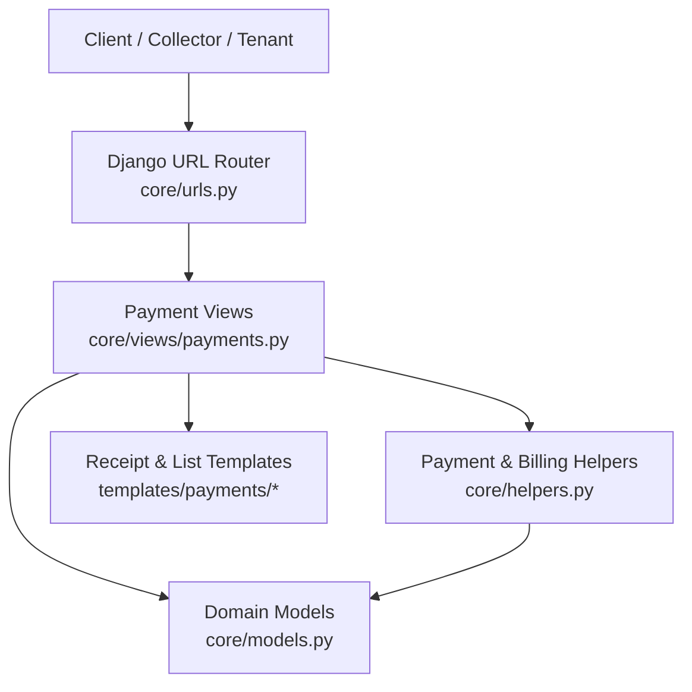
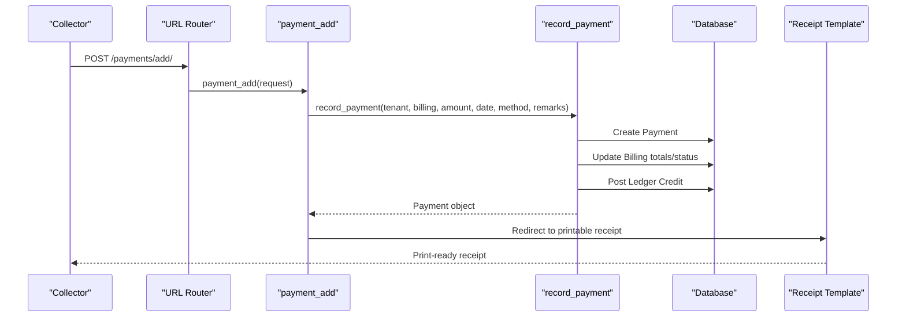
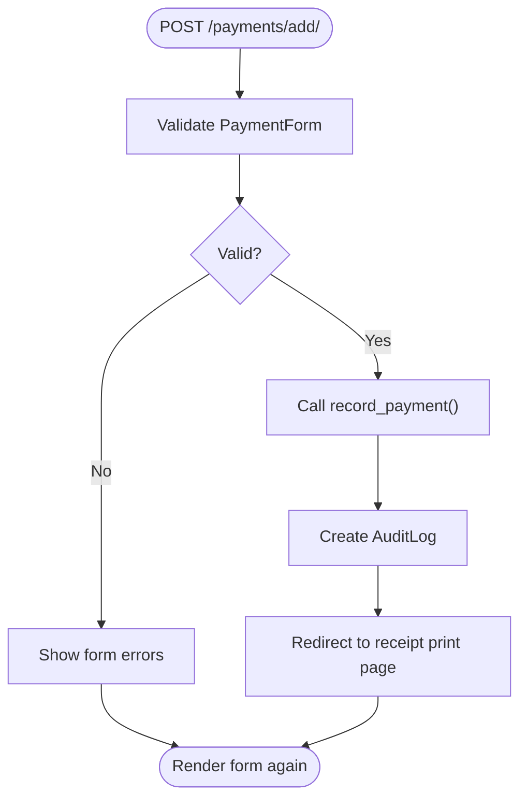
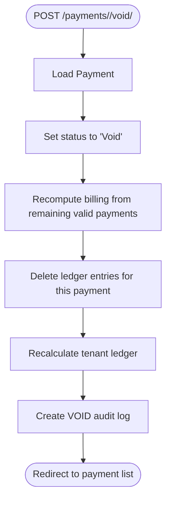
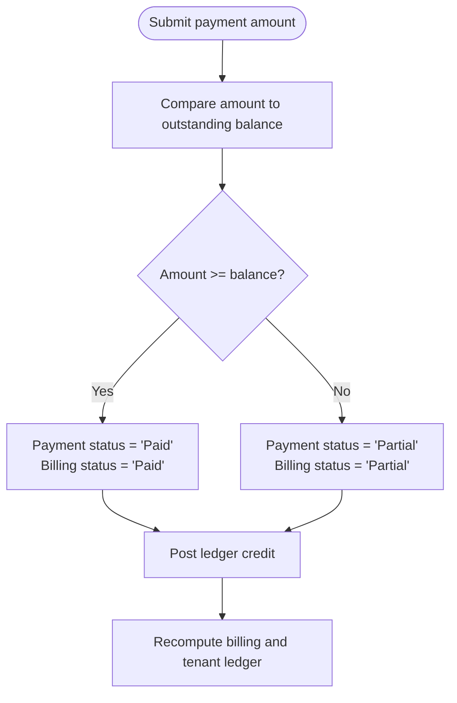
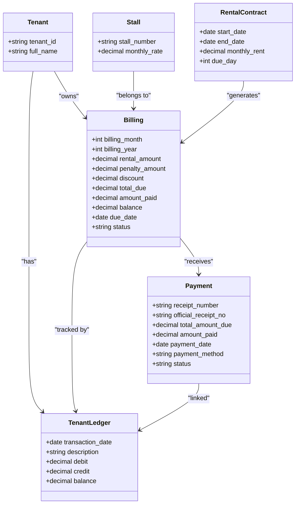
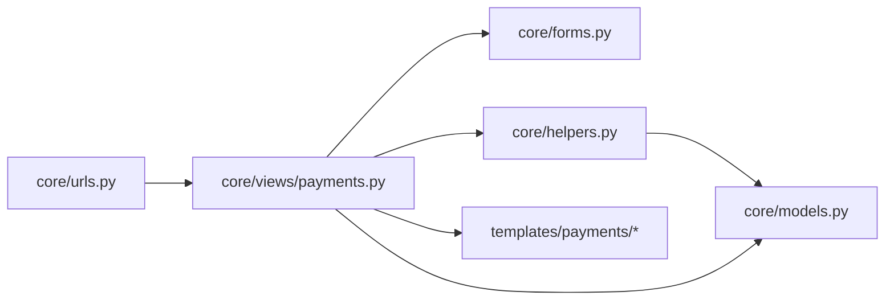

# Payments API

<cite>
**Referenced Files in This Document**
- [core/views/payments.py](file://core/views/payments.py)
- [core/urls.py](file://core/urls.py)
- [core/models.py](file://core/models.py)
- [core/helpers.py](file://core/helpers.py)
- [core/forms.py](file://core/forms.py)
- [templates/payments/list.html](file://templates/payments/list.html)
- [templates/payments/print_batch.html](file://templates/payments/print_batch.html)
</cite>

## Table of Contents
1. [Introduction](#introduction)
2. [Project Structure](#project-structure)
3. [Core Components](#core-components)
4. [Architecture Overview](#architecture-overview)
5. [Detailed Component Analysis](#detailed-component-analysis)
6. [Dependency Analysis](#dependency-analysis)
7. [Performance Considerations](#performance-considerations)
8. [Troubleshooting Guide](#troubleshooting-guide)
9. [Conclusion](#conclusion)

## Introduction
This document describes the payment processing API surface for the market rental system. It covers:

- Payment operations: listing, recording, and voiding payments.
- Receipt generation: viewing, printing, exporting single receipts, and batch receipt handling.
- Supported payment methods: cash, GCash, bank transfer, and check.
- Partial payment handling and settlement rules.
- Receipt numbering and official receipt behavior.
- Integration with billing and tenant ledger systems.
- Audit logging and financial integrity controls.

The endpoints are implemented as Django views bound to URL routes. They render HTML templates and can export PDFs through a helper that tries WeasyPrint first and falls back to browser-based print when native PDF generation is unavailable.

## Project Structure
Payment-related functionality lives primarily under `core/views/payments.py`, with routing defined in `core/urls.py`. Business logic for payment posting, billing recomputation, ledger updates, and receipt numbering is centralized in `core/helpers.py`. Data models for payments, billings, tenants, stalls, contracts, ledgers, and audit logs are defined in `core/models.py`. Forms used by payment entry and quick collection live in `core/forms.py`.

**Diagram sources**
- [core/urls.py:137-150](file://core/urls.py#L137-L150)
- [core/views/payments.py:186-653](file://core/views/payments.py#L186-L653)
- [core/helpers.py:260-420](file://core/helpers.py#L260-L420)
- [core/models.py:190-316](file://core/models.py#L190-L316)

**Section sources**
- [core/urls.py:137-150](file://core/urls.py#L137-L150)
- [core/views/payments.py:1-653](file://core/views/payments.py#L1-L653)
- [core/helpers.py:1-595](file://core/helpers.py#L1-L595)
- [core/models.py:1-336](file://core/models.py#L1-L336)

## Core Components
The payment subsystem consists of:

| Component | Responsibility | Key Implementation |
|---|---|---|
| Payment views | Handle listing, adding, viewing, printing, batching, exporting, editing, and voiding payments | `core/views/payments.py` |
| URL router | Maps HTTP paths to view functions | `core/urls.py` |
| Payment model | Stores each recorded payment, method, amounts, status, and receipt identifiers | `core/models.py` |
| Billing model | Tracks monthly due, paid, balance, and settlement status | `core/models.py` |
| Tenant ledger | Records debits, credits, running balances, and links to payments | `core/models.py` |
| Helpers | Centralizes receipt numbering, payment posting, billing recomputation, ledger recalculation, and PDF rendering | `core/helpers.py` |
| Forms | Validates payment inputs, prevents overpayment, and supports quick collection | `core/forms.py` |
| Templates | Renders payment lists, single receipts, batch receipts, and print/export pages | `templates/payments/*` |

**Section sources**
- [core/views/payments.py:186-653](file://core/views/payments.py#L186-L653)
- [core/urls.py:137-150](file://core/urls.py#L137-L150)
- [core/models.py:190-316](file://core/models.py#L190-L316)
- [core/helpers.py:260-595](file://core/helpers.py#L260-L595)
- [core/forms.py:465-521](file://core/forms.py#L465-L521)
- [templates/payments/list.html:1-27](file://templates/payments/list.html#L1-L27)
- [templates/payments/print_batch.html:20-44](file://templates/payments/print_batch.html#L20-L44)

## Architecture Overview
The payment workflow follows a strict separation between user-facing endpoints and authoritative business logic:

1. A collector or management user submits a payment through a form.
2. The view validates the request and delegates to `record_payment`.
3. `record_payment` creates a unique receipt number, persists the payment, recomputes billing totals, posts a ledger credit, and recalculates the tenant’s running balance.
4. The user is redirected to the printable receipt page.
5. Batch collections store the created payment IDs in the session so multiple receipts can be printed or exported together.
6. Voiding changes the payment status to `Void`, recomputes billing, removes associated ledger entries, and recalculates the tenant ledger.

**Diagram sources**
- [core/urls.py:141-144](file://core/urls.py#L141-L144)
- [core/views/payments.py:250-294](file://core/views/payments.py#L250-L294)
- [core/helpers.py:351-420](file://core/helpers.py#L351-L420)

## Detailed Component Analysis

### Payment Endpoints

#### List Payments
- **Route:** `/payments/`
- **Method:** GET
- **Purpose:** Display filtered and paginated payment history.
- **Filters:** date range, tenant, stall, collector, status, payment method, and search across tenant names, tenant IDs, stall numbers, receipt numbers, official receipt numbers, and collector identities.
- **Role filtering:** Tenants see only their own payments; collectors see only payments they collected unless they are superusers.
- **Output:** HTML table or HTMX partial.

**Section sources**
- [core/urls.py:138-140](file://core/urls.py#L138-L140)
- [core/views/payments.py:186-247](file://core/views/payments.py#L186-L247)

#### Add Payment
- **Route:** `/payments/add/`
- **Method:** POST
- **Authorization:** Collector role required.
- **Purpose:** Record a new payment against a billing period.
- **Behavior:**
  - Validates the payment form.
  - Calls `record_payment` as the single source of truth.
  - Creates an audit log entry.
  - Redirects to the printable receipt page.
- **Partial payments:** Allowed when the submitted amount is less than the outstanding balance.
- **Overpayment guard:** Form validation rejects amounts exceeding the outstanding balance beyond a small tolerance.

**Diagram sources**
- [core/views/payments.py:250-294](file://core/views/payments.py#L250-L294)
- [core/forms.py:465-521](file://core/forms.py#L465-L521)

**Section sources**
- [core/urls.py:141-141](file://core/urls.py#L141-L141)
- [core/views/payments.py:250-294](file://core/views/payments.py#L250-L294)
- [core/forms.py:465-521](file://core/forms.py#L465-L521)

#### View Payment
- **Route:** `/payments/<pk>/`
- **Method:** GET
- **Purpose:** Show payment details and linked ledger entries.
- **Access control:** Enforces tenant-only and collector-only visibility.

**Section sources**
- [core/urls.py:142-142](file://core/urls.py#L142-L142)
- [core/views/payments.py:297-311](file://core/views/payments.py#L297-L311)

#### Generate Single Receipt
- **Route:** `/payments/<pk>/receipt/`
- **Method:** GET
- **Purpose:** Render the standard receipt template for a payment.
- **Access control:** Enforces role-based visibility.

**Section sources**
- [core/urls.py:143-143](file://core/urls.py#L143-L143)
- [core/views/payments.py:314-328](file://core/views/payments.py#L314-L328)

#### Print Single Receipt
- **Route:** `/payments/<pk>/print/`
- **Method:** GET
- **Purpose:** Render the printable receipt with optional auto-print and back navigation.
- **Back URL safety:** Only whitelisted back targets are allowed.

**Section sources**
- [core/urls.py:144-144](file://core/urls.py#L144-L144)
- [core/views/payments.py:331-348](file://core/views/payments.py#L331-L348)
- [core/helpers.py:303-318](file://core/helpers.py#L303-L318)

#### Batch Receipt Viewer
- **Route:** `/payments/batch-receipt/`
- **Method:** GET
- **Purpose:** Display every receipt created by the most recent batch collection.
- **Session dependency:** Reads payment IDs stored in the session after a batch collection.
- **Access control:** Tenants and collectors may only view receipts belonging to them.

**Section sources**
- [core/urls.py:146-146](file://core/urls.py#L146-L146)
- [core/views/payments.py:351-373](file://core/views/payments.py#L351-L373)

#### Export Batch Receipt PDF
- **Route:** `/payments/batch-receipt/export/pdf/`
- **Method:** GET
- **Purpose:** Export the batch receipt set as a PDF file.
- **Filename pattern:** Uses the consolidated official receipt number and tenant ID.
- **Fallback behavior:** If PDF libraries are unavailable, returns an HTML preview with a browser Print option.

**Section sources**
- [core/urls.py:147-147](file://core/urls.py#L147-L147)
- [core/views/payments.py:376-396](file://core/views/payments.py#L376-L396)
- [core/helpers.py:522-595](file://core/helpers.py#L522-L595)

#### Export Single Receipt PDF
- **Route:** `/payments/<pk>/export/pdf/`
- **Method:** GET
- **Purpose:** Export a single receipt as a PDF.
- **Filename pattern:** Includes receipt number and current date.

**Section sources**
- [core/urls.py:145-145](file://core/urls.py#L145-L145)
- [core/views/payments.py:399-416](file://core/views/payments.py#L399-L416)

#### Edit Payment
- **Route:** `/payments/<pk>/edit-modal/`
- **Method:** POST
- **Authorization:** Management role required.
- **Purpose:** Update a payment and recompute affected billing(s), ledger entries, and tenant ledger balances.

**Section sources**
- [core/urls.py:149-149](file://core/urls.py#L149-L149)
- [core/views/payments.py:460-518](file://core/views/payments.py#L460-L518)

#### Void Payment
- **Route:** `/payments/<pk>/void/`
- **Method:** POST
- **Authorization:** Management role required.
- **Purpose:** Mark a payment as voided, remove its ledger entries, recompute billing, and recalculate the tenant ledger.
- **Audit requirement:** Logs the void action with previous status.

**Diagram sources**
- [core/views/payments.py:521-550](file://core/views/payments.py#L521-L550)
- [core/helpers.py:321-348](file://core/helpers.py#L321-L348)

**Section sources**
- [core/urls.py:150-150](file://core/urls.py#L150-L150)
- [core/views/payments.py:521-550](file://core/views/payments.py#L521-L550)

### Payment Methods
Supported payment methods are defined on the `Payment` model:

| Method | Description |
|---|---|
| Cash | Physical currency payment |
| GCash | Digital wallet payment |
| Bank Transfer | Electronic bank transfer |
| Check | Paper check payment |

These choices appear in payment forms and are persisted with each payment record.

**Section sources**
- [core/models.py:221-252](file://core/models.py#L221-L252)
- [core/forms.py:465-496](file://core/forms.py#L465-L496)

### Partial Payment Handling
Partial payments are supported and enforced consistently:

- The billing status becomes `Partial` when total paid is greater than zero but less than total due.
- The billing status becomes `Paid` when total paid meets or exceeds total due.
- The payment status reflects whether the submitted amount settles the pre-payment balance.
- Form validation prevents overpayment beyond the outstanding balance plus a small tolerance.
- Quick collection defaults to the outstanding balance and treats smaller amounts as partial payments.

**Diagram sources**
- [core/helpers.py:321-420](file://core/helpers.py#L321-L420)
- [core/forms.py:498-521](file://core/forms.py#L498-L521)

**Section sources**
- [core/models.py:190-258](file://core/models.py#L190-L258)
- [core/helpers.py:321-420](file://core/helpers.py#L321-L420)
- [core/forms.py:498-521](file://core/forms.py#L498-L521)

### Receipt Numbering System
Receipt numbers follow a structured format:

- Format: `<prefix>-<YYYYMM>-<000001>`
- Prefix: Configured via system settings; defaults to `RCP` if not configured.
- Month sequence: Derived from existing receipts for the same month, not row creation order.
- Zero-padded suffix: Ensures lexicographic ordering equals numeric ordering.
- Collision handling: Retries up to five times on unique constraint conflicts.

Official receipt numbers may be supplied manually; otherwise, the system-generated receipt number is used.

**Section sources**
- [core/helpers.py:276-300](file://core/helpers.py#L276-L300)
- [core/models.py:221-252](file://core/models.py#L221-L252)

### Integration with Billing and Ledger Systems

#### Billing Integration
- Each payment is tied to a specific `Billing` record representing a tenant-stall-month obligation.
- `recalc_billing_from_payments` recomputes `amount_paid`, `balance`, and `status` based on all valid payments.
- Billing rows are locked during recomputation to prevent concurrent settlement races.

#### Ledger Integration
- Every payment posts a credit entry to the tenant ledger.
- The ledger maintains a running balance per tenant.
- After payment, edit, or void, the tenant ledger is recalculated chronologically.
- Voiding removes ledger entries for the voided payment and recalculates subsequent balances.

**Diagram sources**
- [core/models.py:157-316](file://core/models.py#L157-L316)

**Section sources**
- [core/helpers.py:321-420](file://core/helpers.py#L321-L420)
- [core/models.py:190-316](file://core/models.py#L190-L316)

### Examples

#### Payment Recording Workflow
A collector records a payment for an overdue billing:

1. Collector opens `/payments/add/`.
2. Selects tenant, stall, billing period, payment method, and amount.
3. Submits the form.
4. System creates a payment, assigns a receipt number, updates billing totals, posts a ledger credit, and recalculates the tenant ledger.
5. Collector is redirected to the printable receipt page.

**Section sources**
- [core/views/payments.py:250-294](file://core/views/payments.py#L250-L294)
- [core/helpers.py:351-420](file://core/helpers.py#L351-L420)

#### Receipt Generation Example
After recording a payment:

- Single receipt: `/payments/<pk>/receipt/`
- Printable receipt: `/payments/<pk>/print/`
- PDF export: `/payments/<pk>/export/pdf/`

**Section sources**
- [core/views/payments.py:314-416](file://core/views/payments.py#L314-L416)

#### Batch Receipt Example
After a batch collection:

- View batch receipts: `/payments/batch-receipt/`
- Export batch PDF: `/payments/batch-receipt/export/pdf/`

**Section sources**
- [core/views/payments.py:351-396](file://core/views/payments.py#L351-L396)

#### Void Processing Example
Management voids a previously recorded payment:

1. POST to `/payments/<pk>/void/`.
2. Payment status becomes `Void`.
3. Billing recomputed without the voided payment.
4. Ledger entries removed.
5. Tenant ledger recalculated.
6. Audit log created.

**Section sources**
- [core/views/payments.py:521-550](file://core/views/payments.py#L521-L550)

## Dependency Analysis
The payment subsystem has clear dependencies:

- Views depend on helpers for authoritative payment posting and billing recomputation.
- Helpers depend on models for persistence and on system settings for configuration.
- Forms validate user input before calling helpers.
- Templates render output and provide print/export actions.
- URL routes connect HTTP requests to view functions.

**Diagram sources**
- [core/urls.py:137-150](file://core/urls.py#L137-L150)
- [core/views/payments.py:1-653](file://core/views/payments.py#L1-L653)
- [core/helpers.py:1-595](file://core/helpers.py#L1-L595)
- [core/forms.py:1-774](file://core/forms.py#L1-L774)
- [core/models.py:1-336](file://core/models.py#L1-L336)

**Section sources**
- [core/urls.py:137-150](file://core/urls.py#L137-L150)
- [core/views/payments.py:1-653](file://core/views/payments.py#L1-L653)
- [core/helpers.py:1-595](file://core/helpers.py#L1-L595)
- [core/forms.py:1-774](file://core/forms.py#L1-L774)
- [core/models.py:1-336](file://core/models.py#L1-L336)

## Performance Considerations
- Use pagination for payment lists to avoid loading large result sets.
- Prefer HTMX partial rendering where available to reduce full-page reloads.
- Avoid unnecessary queries by using `select_related` for tenant, stall, billing, and collector data.
- Batch receipt operations rely on session-stored payment IDs; ensure the session remains available during the print/export flow.
- PDF export may fall back to browser print if WeasyPrint is unavailable; plan for client-side printing in environments without native PDF libraries.

[No sources needed since this section provides general guidance]

## Troubleshooting Guide

### Common Issues
- **Missing batch receipts:** Ensure a batch collection was performed before accessing batch receipt endpoints.
- **Access denied on receipts:** Tenants can only view their own receipts; collectors can only view receipts they recorded.
- **PDF not generated:** If WeasyPrint or xhtml2pdf is unavailable, the system returns an HTML preview with a Print button.
- **Overpayment error:** The form rejects amounts exceeding the outstanding balance beyond a small tolerance.
- **Inconsistent billing status:** Always use `recalc_billing_from_payments` after edits or voids to restore consistency.

### Audit and Integrity Checks
- Verify audit logs exist for payment creation, updates, and voids.
- Confirm that ledger balances match outstanding billing totals after any modification.
- Check that receipt numbers are unique and follow the configured prefix and monthly sequence.

**Section sources**
- [core/views/payments.py:157-183](file://core/views/payments.py#L157-L183)
- [core/views/payments.py:250-294](file://core/views/payments.py#L250-L294)
- [core/views/payments.py:521-550](file://core/views/payments.py#L521-L550)
- [core/helpers.py:522-595](file://core/helpers.py#L522-L595)
- [core/forms.py:498-521](file://core/forms.py#L498-L521)

## Conclusion
The Payments API provides a secure, auditable, and financially consistent interface for recording payments, generating receipts, and managing partial and void transactions. Its design centralizes critical financial logic in helpers, enforces role-based access, and integrates tightly with billing and ledger systems. For reliable operation, configure system settings such as receipt prefixes, ensure PDF libraries are available where needed, and monitor audit logs and ledger balances after modifications.

[No sources needed since this section summarizes without analyzing specific files]