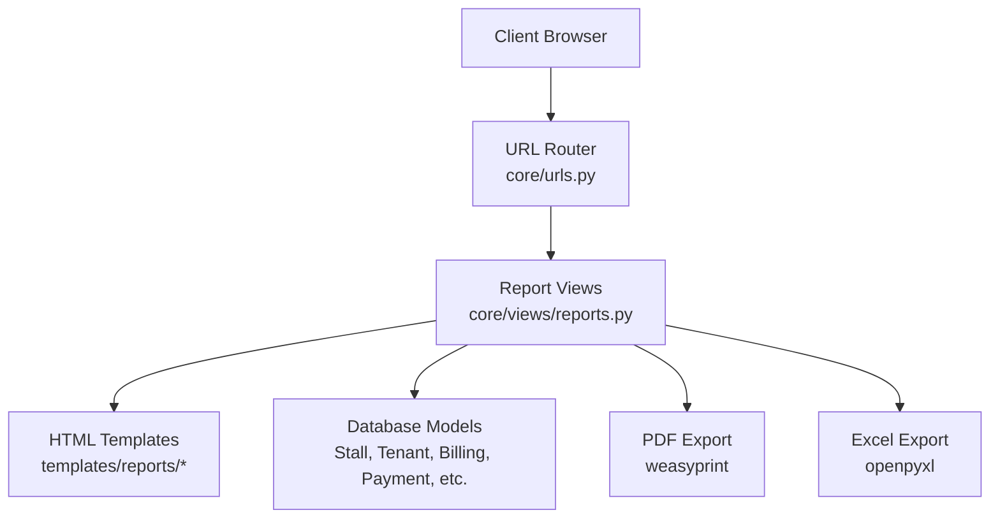
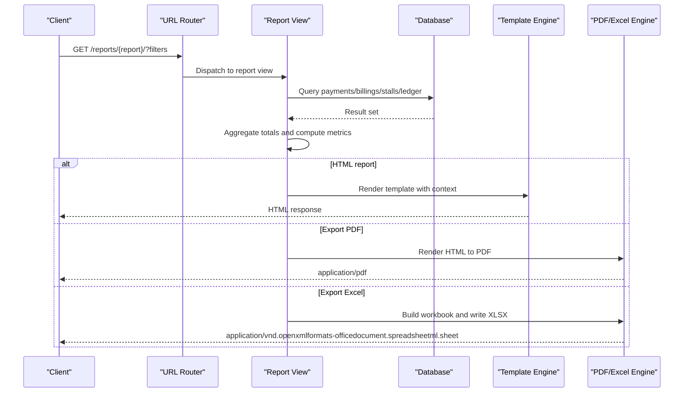
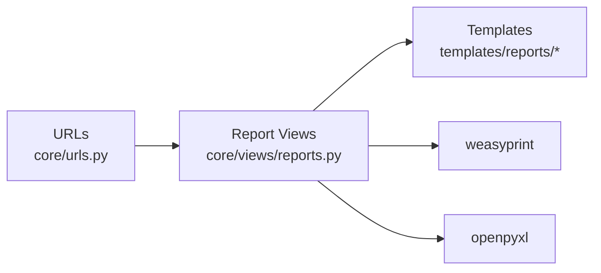

# Reports API

<cite>
**Referenced Files in This Document**
- [core/urls.py](file://core/urls.py)
- [core/views/reports.py](file://core/views/reports.py)
- [templates/reports/daily.html](file://templates/reports/daily.html)
- [templates/reports/weekly.html](file://templates/reports/weekly.html)
- [templates/reports/monthly.html](file://templates/reports/monthly.html)
- [templates/reports/annual.html](file://templates/reports/annual.html)
- [templates/reports/section.html](file://templates/reports/section.html)
- [templates/reports/collector.html](file://templates/reports/collector.html)
- [templates/reports/paid_tenants.html](file://templates/reports/paid_tenants.html)
- [templates/reports/unpaid_tenants.html](file://templates/reports/unpaid_tenants.html)
- [templates/reports/tenants_report.html](file://templates/reports/tenants_report.html)
- [templates/reports/overdue.html](file://templates/reports/overdue.html)
- [templates/reports/ledger.html](file://templates/reports/ledger.html)
- [templates/reports/occupancy.html](file://templates/reports/occupancy.html)
- [templates/reports/vacant.html](file://templates/reports/vacant.html)
- [templates/reports/export_pdf.html](file://templates/reports/export_pdf.html)
- [templates/reports/export_excel.html](file://templates/reports/export_excel.html)
</cite>

## Table of Contents
1. [Introduction](#introduction)
2. [Project Structure](#project-structure)
3. [Core Components](#core-components)
4. [Architecture Overview](#architecture-overview)
5. [Detailed Component Analysis](#detailed-component-analysis)
6. [Dependency Analysis](#dependency-analysis)
7. [Performance Considerations](#performance-considerations)
8. [Troubleshooting Guide](#troubleshooting-guide)
9. [Conclusion](#conclusion)
10. [Appendices](#appendices)

## Introduction
This document provides API documentation for the reporting endpoints of the Market Rental System. It covers all report types and export functionality, including parameters, filtering options, data aggregation methods, output formats, template customization guidance, performance considerations for large datasets, common query examples, and best practices for data accuracy.

The reporting system is implemented as Django views that render HTML reports and generate downloadable PDF or Excel files. All report endpoints require management-level access.

## Project Structure
Reports are exposed through URL routes and handled by a single view module. Templates define the user interface and print/export links.

**Diagram sources**
- [core/urls.py:152-167](file://core/urls.py#L152-L167)
- [core/views/reports.py:18-774](file://core/views/reports.py#L18-L774)

**Section sources**
- [core/urls.py:152-167](file://core/urls.py#L152-L167)
- [core/views/reports.py:18-774](file://core/views/reports.py#L18-L774)

## Core Components
- Report views: Provide interactive HTML pages with filters and summaries.
- Export endpoints: Generate PDF or Excel downloads based on the same data logic.
- Shared helpers: Date range and month/year parsing utilities used across reports.
- Templates: Present report data and provide Print/PDF/Excel actions.

Key responsibilities:
- Filtering by date ranges, months/years, sections, statuses, and tenants.
- Aggregating totals (sums, counts) and computing derived metrics (e.g., collection rate).
- Paginating large result sets for web rendering.
- Rendering PDF via weasyprint and Excel via openpyxl when available.

**Section sources**
- [core/views/reports.py:18-774](file://core/views/reports.py#L18-L774)

## Architecture Overview
The request flow for any report is consistent:
1. The client requests a report page or an export endpoint.
2. The URL router maps to a view function.
3. The view parses filters, queries the database, aggregates results, and renders a template or generates a file.
4. For exports, the view uses weasyprint (PDF) or openpyxl (Excel).

**Diagram sources**
- [core/urls.py:152-167](file://core/urls.py#L152-L167)
- [core/views/reports.py:452-774](file://core/views/reports.py#L452-L774)

## Detailed Component Analysis

### Common Parameters and Helpers
- Date range: `date_from`, `date_to`
  - If missing, defaults to first day of current month to today.
- Month/Year: `month`, `year`
  - Defaults to current month/year; validated to integers.
- Section filter: `section`
  - Filters stalls or section-based reports by section ID.
- Status filter: `status`
  - Filters stalls by status (Occupied, Vacant, Reserved, Maintenance).
- Tenant filter: `tenant`
  - Filters ledger entries by tenant ID.

These parameters are parsed by shared helpers and applied consistently across views.

**Section sources**
- [core/views/reports.py:18-37](file://core/views/reports.py#L18-L37)

### Report Endpoints

#### Daily Collection Report
- Route: `/reports/daily/`
- Purpose: List payments within a date range with totals and pagination.
- Parameters:
  - `date_from`, `date_to`: Inclusive date range.
  - `page`: Page number for pagination.
- Data aggregation:
  - Total collected: Sum of `amount_paid` for Paid/Partial payments in range.
  - Transaction count: Count of matching payments.
- Template: `templates/reports/daily.html`

Example queries:
- Get daily collections from 2025-01-01 to 2025-01-31:
  - `GET /reports/daily/?date_from=2025-01-01&date_to=2025-01-31`

Export integration:
- PDF: `GET /reports/export/pdf/?report=daily&date_from=...&date_to=...`
- Excel: `GET /reports/export/excel/?report=daily&date_from=...&date_to=...`

**Section sources**
- [core/views/reports.py:80-103](file://core/views/reports.py#L80-L103)
- [templates/reports/daily.html:1-108](file://templates/reports/daily.html#L1-L108)

#### Weekly Collection Report
- Route: `/reports/weekly/`
- Purpose: Same as daily but defaults to current week if dates not provided.
- Parameters:
  - `date_from`, `date_to`: Optional; defaults to start-of-week to end-of-week.
  - `page`: Pagination.
- Data aggregation:
  - Total collected and transaction count over the selected week.
- Template: `templates/reports/weekly.html`

Example queries:
- Default current week:
  - `GET /reports/weekly/`
- Custom week:
  - `GET /reports/weekly/?date_from=2025-01-06&date_to=2025-01-12`

Export integration:
- PDF: `GET /reports/export/pdf/?report=weekly&date_from=...&date_to=...`
- Excel: `GET /reports/export/excel/?report=weekly&date_from=...&date_to=...`

**Section sources**
- [core/views/reports.py:106-136](file://core/views/reports.py#L106-L136)
- [templates/reports/weekly.html:1-109](file://templates/reports/weekly.html#L1-L109)

#### Monthly Collection Report
- Route: `/reports/monthly/`
- Purpose: Payments and billing summary for a specific month/year.
- Parameters:
  - `month`, `year`: Month and year to report.
  - `page`: Pagination.
- Data aggregation:
  - Total collected: Sum of payments in the month.
  - Total billed: Sum of total_due for billings in the month.
  - Transaction count: Number of payments in the month.
- Template: `templates/reports/monthly.html`

Example queries:
- January 2025:
  - `GET /reports/monthly/?month=1&year=2025`

Export integration:
- PDF: `GET /reports/export/pdf/?report=monthly&month=1&year=2025`
- Excel: `GET /reports/export/excel/?report=monthly&month=1&year=2025`

**Section sources**
- [core/views/reports.py:139-171](file://core/views/reports.py#L139-L171)
- [templates/reports/monthly.html:1-122](file://templates/reports/monthly.html#L1-L122)

#### Annual Collection Report
- Route: `/reports/annual/`
- Purpose: Yearly breakdown of collections per month.
- Parameters:
  - `year`: Year to report.
- Data aggregation:
  - Per-month totals and counts; grand totals across the year.
- Template: `templates/reports/annual.html`

Example queries:
- Year 2025:
  - `GET /reports/annual/?year=2025`

Export integration:
- PDF: `GET /reports/export/pdf/?report=annual&year=2025`
- Excel: `GET /reports/export/excel/?report=annual&year=2025`

**Section sources**
- [core/views/reports.py:174-208](file://core/views/reports.py#L174-L208)
- [templates/reports/annual.html:1-104](file://templates/reports/annual.html#L1-L104)

#### Section Collection Report
- Route: `/reports/section/`
- Purpose: Aggregated billing and occupancy metrics per market section.
- Parameters:
  - `month`, `year`: Period for billing aggregation.
- Data aggregation:
  - For each section: stall counts (occupied/vacant), billed/collected/balance sums.
- Template: `templates/reports/section.html`

Example queries:
- February 2025:
  - `GET /reports/section/?month=2&year=2025`

Export integration:
- PDF: `GET /reports/export/pdf/?report=section&month=2&year=2025`
- Excel: `GET /reports/export/excel/?report=section&month=2&year=2025`

**Section sources**
- [core/views/reports.py:211-250](file://core/views/reports.py#L211-L250)
- [templates/reports/section.html:1-94](file://templates/reports/section.html#L1-L94)

#### Collector Performance Report
- Route: `/reports/collector/`
- Purpose: Collections by collector within a date range.
- Parameters:
  - `date_from`, `date_to`: Inclusive range.
- Data aggregation:
  - Per collector: transaction count and total collected; grand totals.
- Template: `templates/reports/collector.html`

Example queries:
- March 2025:
  - `GET /reports/collector/?date_from=2025-03-01&date_to=2025-03-31`

Export integration:
- PDF: `GET /reports/export/pdf/?report=collector&date_from=...&date_to=...`
- Excel: `GET /reports/export/excel/?report=collector&date_from=...&date_to=...`

**Section sources**
- [core/views/reports.py:253-287](file://core/views/reports.py#L253-L287)
- [templates/reports/collector.html:1-108](file://templates/reports/collector.html#L1-L108)

#### Paid Tenants Report
- Route: `/reports/paid-tenants/`
- Purpose: Tenants with Paid status for a given month/year.
- Parameters:
  - `month`, `year`.
- Data aggregation:
  - Total collected and tenant count for paid accounts.
- Template: `templates/reports/paid_tenants.html` (extends `tenants_report.html`)

Example queries:
- April 2025:
  - `GET /reports/paid-tenants/?month=4&year=2025`

Export integration:
- PDF: `GET /reports/export/pdf/?report=paid&month=4&year=2025`
- Excel: `GET /reports/export/excel/?report=paid&month=4&year=2025`

**Section sources**
- [core/views/reports.py:290-314](file://core/views/reports.py#L290-L314)
- [templates/reports/paid_tenants.html:1-2](file://templates/reports/paid_tenants.html#L1-L2)
- [templates/reports/tenants_report.html:1-140](file://templates/reports/tenants_report.html#L1-L140)

#### Unpaid Tenants Report
- Route: `/reports/unpaid-tenants/`
- Purpose: Tenants with Unpaid/Partial/Overdue status for a given month/year.
- Parameters:
  - `month`, `year`.
- Data aggregation:
  - Total unpaid balance and tenant count.
- Template: `templates/reports/unpaid_tenants.html` (extends `tenants_report.html`)

Example queries:
- May 2025:
  - `GET /reports/unpaid-tenants/?month=5&year=2025`

Export integration:
- PDF: `GET /reports/export/pdf/?report=unpaid&month=5&year=2025`
- Excel: `GET /reports/export/excel/?report=unpaid&month=5&year=2025`

**Section sources**
- [core/views/reports.py:317-342](file://core/views/reports.py#L317-L342)
- [templates/reports/unpaid_tenants.html:1-2](file://templates/reports/unpaid_tenants.html#L1-L2)
- [templates/reports/tenants_report.html:1-140](file://templates/reports/tenants_report.html#L1-L140)

#### Overdue Accounts Report
- Route: `/reports/overdue/`
- Purpose: All overdue accounts regardless of month.
- Parameters: None required.
- Data aggregation:
  - Total overdue balance and account count.
- Template: `templates/reports/overdue.html`

Example queries:
- `GET /reports/overdue/`

Export integration:
- PDF: `GET /reports/export/pdf/?report=overdue`
- Excel: `GET /reports/export/excel/?report=overdue`

**Section sources**
- [core/views/reports.py:345-363](file://core/views/reports.py#L345-L363)
- [templates/reports/overdue.html:1-102](file://templates/reports/overdue.html#L1-L102)

#### Tenant Ledger Report
- Route: `/reports/ledger/`
- Purpose: Debit/credit ledger entries filtered by tenant and/or date range.
- Parameters:
  - `tenant`: Optional tenant ID.
  - `date_from`, `date_to`: Optional inclusive range.
- Data aggregation:
  - Total debit, total credit, and outstanding balance.
- Template: `templates/reports/ledger.html`

Example queries:
- By tenant and date range:
  - `GET /reports/ledger/?tenant=1001&date_from=2025-01-01&date_to=2025-01-31`

Export integration:
- Excel: `GET /reports/export/excel/?report=ledger&tenant=1001&date_from=...&date_to=...`
- Note: PDF export link is not present in the ledger template.

**Section sources**
- [core/views/reports.py:366-394](file://core/views/reports.py#L366-L394)
- [templates/reports/ledger.html:1-103](file://templates/reports/ledger.html#L1-L103)

#### Stall Occupancy Report
- Route: `/reports/occupancy/`
- Purpose: Stall register with occupancy metrics and filters.
- Parameters:
  - `section`: Optional section ID.
  - `status`: Optional status (Occupied/Vacant/Reserved/Maintenance).
- Data aggregation:
  - Total stalls, occupied, vacant, and occupancy rate.
- Template: `templates/reports/occupancy.html`

Example queries:
- Filter by section and status:
  - `GET /reports/occupancy/?section=3&status=Vacant`

Export integration:
- PDF: `GET /reports/export/pdf/?report=occupancy&section=3&status=Vacant`
- Excel: `GET /reports/export/excel/?report=occupancy&section=3&status=Vacant`

**Section sources**
- [core/views/reports.py:397-428](file://core/views/reports.py#L397-L428)
- [templates/reports/occupancy.html:1-125](file://templates/reports/occupancy.html#L1-L125)

#### Vacant Stall Report
- Route: `/reports/vacant/`
- Purpose: List of vacant stalls, optionally filtered by section.
- Parameters:
  - `section`: Optional section ID.
- Data aggregation:
  - Total vacant stalls.
- Template: `templates/reports/vacant.html`

Example queries:
- Section 5:
  - `GET /reports/vacant/?section=5`

Export integration:
- Excel: `GET /reports/export/excel/?report=vacant&section=5`
- Note: PDF export link is not present in the vacant template.

**Section sources**
- [core/views/reports.py:431-448](file://core/views/reports.py#L431-L448)
- [templates/reports/vacant.html:1-105](file://templates/reports/vacant.html#L1-L105)

### Export Functionality

#### PDF Export
- Route: `/reports/export/pdf/`
- Supported report types:
  - `monthly`, `daily`, `weekly`, `annual`, `section`, `collector`, `paid`/`paid_tenants`, `unpaid`/`unpaid_tenants`, `overdue`, `occupancy`, `vacant`, `ledger`
- Behavior:
  - Renders a dedicated PDF template per report type.
  - Uses weasyprint to convert HTML to PDF.
  - Returns a downloadable PDF with filename pattern `{report_type}_report_{today}.pdf`.
- Error handling:
  - If weasyprint is unavailable, returns a fallback page instructing installation.

Common parameters:
- `report`: Report type identifier.
- `month`, `year`: For monthly/annual/section/paid/unpaid/overdue.
- `date_from`, `date_to`: For daily/weekly/collector/ledger.
- `tenant`: For ledger.
- `section`, `status`: For occupancy/vacant.

Example workflows:
- Monthly PDF:
  - `GET /reports/export/pdf/?report=monthly&month=6&year=2025`
- Weekly PDF:
  - `GET /reports/export/pdf/?report=weekly&date_from=2025-06-02&date_to=2025-06-08`
- Section PDF:
  - `GET /reports/export/pdf/?report=section&month=6&year=2025`
- Occupancy PDF:
  - `GET /reports/export/pdf/?report=occupancy&section=2&status=Occupied`

**Section sources**
- [core/views/reports.py:451-563](file://core/views/reports.py#L451-L563)
- [templates/reports/export_pdf.html:1-34](file://templates/reports/export_pdf.html#L1-L34)

#### Excel Export
- Route: `/reports/export/excel/`
- Supported report types:
  - Same as PDF plus additional fields tailored for spreadsheets.
- Behavior:
  - Builds an openpyxl workbook with styled headers and auto-width columns.
  - Returns a downloadable XLSX with filename pattern `{report_type}_report_{today}.xlsx`.
- Error handling:
  - If openpyxl is unavailable, returns a fallback page instructing installation.

Common parameters:
- Same as PDF export.

Example workflows:
- Annual Excel:
  - `GET /reports/export/excel/?report=annual&year=2025`
- Paid Tenants Excel:
  - `GET /reports/export/excel/?report=paid&month=7&year=2025`
- Overdue Excel:
  - `GET /reports/export/excel/?report=overdue`
- Vacant Excel:
  - `GET /reports/export/excel/?report=vacant&section=4`

**Section sources**
- [core/views/reports.py:566-774](file://core/views/reports.py#L566-L774)
- [templates/reports/export_excel.html:1-34](file://templates/reports/export_excel.html#L1-L34)

### Template Customization Guidance
- Report templates extend a base report layout and include action bars for Print/PDF/Excel where applicable.
- To customize:
  - Modify the corresponding template under `templates/reports/`.
  - Adjust table columns, KPI cards, and filters to match business needs.
  - Ensure export links pass correct parameters (`report`, `month`, `year`, `date_from`, `date_to`, `tenant`, `section`, `status`).
- PDF templates live under `templates/reports/pdf/` and are rendered server-side for PDF generation.

[No sources needed since this section provides general guidance]

## Dependency Analysis
The reporting subsystem depends on:
- URL routing configuration mapping endpoints to views.
- View functions implementing data retrieval and aggregation.
- Templates for presentation and export actions.
- External libraries for PDF and Excel generation.

**Diagram sources**
- [core/urls.py:152-167](file://core/urls.py#L152-L167)
- [core/views/reports.py:451-774](file://core/views/reports.py#L451-L774)

**Section sources**
- [core/urls.py:152-167](file://core/urls.py#L152-L167)
- [core/views/reports.py:451-774](file://core/views/reports.py#L451-L774)

## Performance Considerations
- Use date ranges and filters to limit dataset size.
- Prefer monthly or narrower windows for heavy reports like annual or ledger.
- Leverage pagination for web views; avoid exporting unbounded datasets without filters.
- For large datasets:
  - Pre-aggregate where possible (e.g., use existing aggregated fields).
  - Avoid unnecessary joins; rely on select_related already used in views.
  - Consider caching frequently accessed aggregations at the application layer.
- Monitor memory usage during PDF/Excel generation for very large outputs.

[No sources needed since this section provides general guidance]

## Troubleshooting Guide
- PDF export unavailable:
  - Symptom: A message indicates weasyprint is not installed.
  - Resolution: Install weasyprint and its system dependencies, then restart the application.
- Excel export unavailable:
  - Symptom: A message indicates openpyxl is not installed.
  - Resolution: Install openpyxl via pip and restart the application.
- Empty reports:
  - Verify filters (dates, month/year, section, status, tenant) are correctly set.
  - Confirm underlying data exists for the selected period.

**Section sources**
- [templates/reports/export_pdf.html:1-34](file://templates/reports/export_pdf.html#L1-L34)
- [templates/reports/export_excel.html:1-34](file://templates/reports/export_excel.html#L1-L34)

## Conclusion
The Reports API provides comprehensive financial and operational insights through a consistent set of endpoints. Users can filter by time periods, sections, statuses, and tenants, and export results as PDF or Excel. Proper parameter usage, careful filtering, and awareness of external library requirements ensure reliable and performant reporting.

[No sources needed since this section summarizes without analyzing specific files]

## Appendices

### API Reference Summary

| Endpoint | Method | Description | Key Parameters | Output |
|---|---|---|---|---|
| `/reports/daily/` | GET | Daily collection report | `date_from`, `date_to`, `page` | HTML |
| `/reports/weekly/` | GET | Weekly collection report | `date_from`, `date_to`, `page` | HTML |
| `/reports/monthly/` | GET | Monthly collection report | `month`, `year`, `page` | HTML |
| `/reports/annual/` | GET | Annual collection report | `year` | HTML |
| `/reports/section/` | GET | Collection by section | `month`, `year` | HTML |
| `/reports/collector/` | GET | Collection by collector | `date_from`, `date_to` | HTML |
| `/reports/paid-tenants/` | GET | Paid tenants report | `month`, `year` | HTML |
| `/reports/unpaid-tenants/` | GET | Unpaid tenants report | `month`, `year` | HTML |
| `/reports/overdue/` | GET | Overdue accounts report | None | HTML |
| `/reports/ledger/` | GET | Tenant ledger report | `tenant`, `date_from`, `date_to` | HTML |
| `/reports/occupancy/` | GET | Stall occupancy report | `section`, `status` | HTML |
| `/reports/vacant/` | GET | Vacant stall report | `section` | HTML |
| `/reports/export/pdf/` | GET | PDF export | `report`, plus report-specific params | PDF |
| `/reports/export/excel/` | GET | Excel export | `report`, plus report-specific params | XLSX |

**Section sources**
- [core/urls.py:152-167](file://core/urls.py#L152-L167)
- [core/views/reports.py:80-774](file://core/views/reports.py#L80-L774)