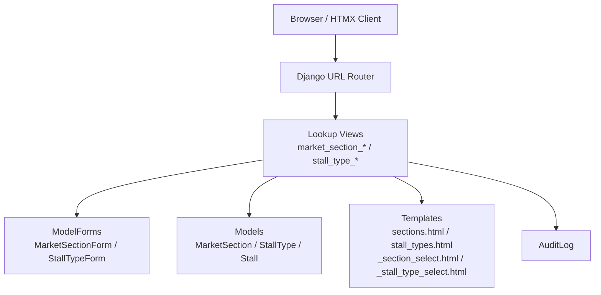
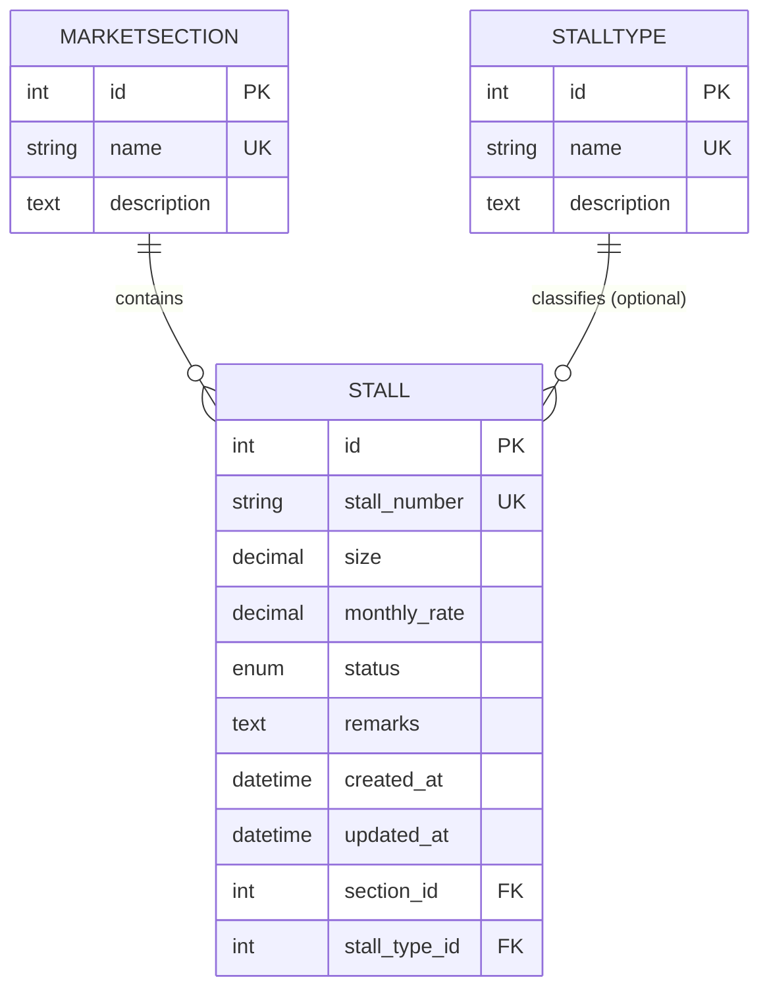
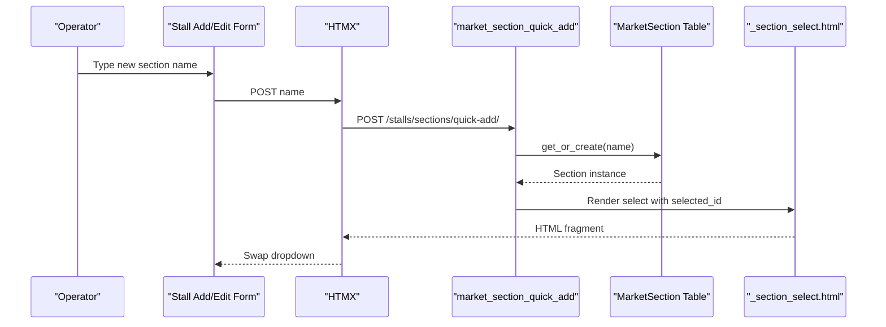
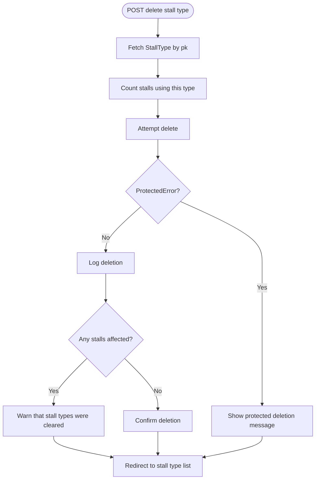
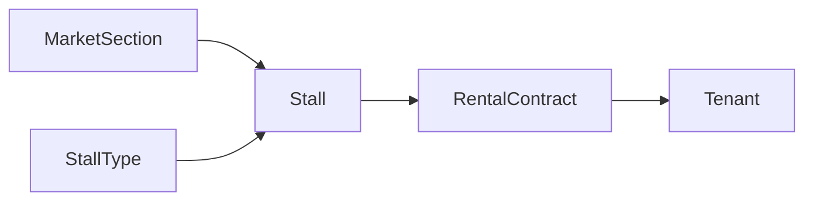
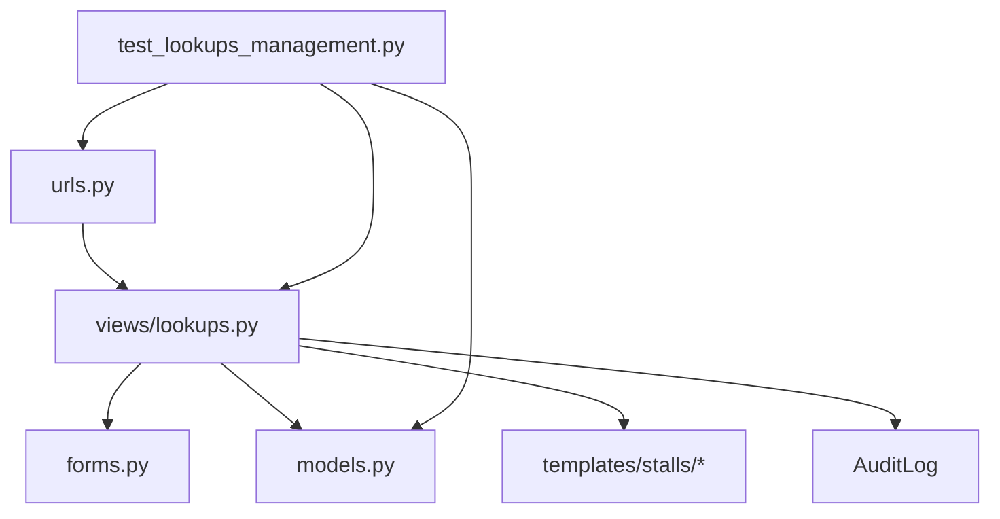

# Market Sections & Types API

<cite>
**Referenced Files in This Document**
- [models.py](file://core/models.py)
- [lookups.py](file://core/views/lookups.py)
- [urls.py](file://core/urls.py)
- [forms.py](file://core/forms.py)
- [_section_select.html](file://templates/stalls/_section_select.html)
- [_stall_type_select.html](file://templates/stalls/_stall_type_select.html)
- [test_lookups_management.py](file://core/test_lookups_management.py)
</cite>

## Table of Contents
1. [Introduction](#introduction)
2. [Project Structure](#project-structure)
3. [Core Components](#core-components)
4. [Architecture Overview](#architecture-overview)
5. [Detailed Component Analysis](#detailed-component-analysis)
6. [Dependency Analysis](#dependency-analysis)
7. [Performance Considerations](#performance-considerations)
8. [Troubleshooting Guide](#troubleshooting-guide)
9. [Conclusion](#conclusion)

## Introduction
This document describes the API surface for managing two lookup tables used to organize stalls in the market rental system:

- **MarketSection**: represents a physical area or zone within the market where stalls are located.
- **StallType**: defines categories of stall business lines, such as food, clothing, electronics, or services.

These lookups power the Stall form dropdowns and influence stall assignment, filtering, reporting, and data integrity. The endpoints support full CRUD operations plus HTMX-driven quick-add fragments that let operators create new sections or types directly from the stall creation/edit page without leaving the form.

The intended audience includes market administrators, records staff, and developers integrating with or extending the stall organization features.

## Project Structure
The lookup management is implemented as Django views backed by models, forms, URL routes, and small HTML fragments returned via HTMX.

**Diagram sources**
- [urls.py:93-105](file://core/urls.py#L93-L105)
- [lookups.py:50-173](file://core/views/lookups.py#L50-L173)
- [lookups.py:176-289](file://core/views/lookups.py#L176-L289)
- [forms.py:261-278](file://core/forms.py#L261-L278)
- [models.py:71-102](file://core/models.py#L71-L102)
- [_section_select.html:1-10](file://templates/stalls/_section_select.html#L1-L10)
- [_stall_type_select.html:1-9](file://templates/stalls/_stall_type_select.html#L1-L9)

**Section sources**
- [urls.py:93-105](file://core/urls.py#L93-L105)
- [lookups.py:1-23](file://core/views/lookups.py#L1-L23)

## Core Components
The core data model consists of three primary entities:

| Entity | Purpose | Key Fields | Relationship Behavior |
|---|---|---|---|
| `MarketSection` | Physical area or zone in the market | `name`, `description` | Referenced by `Stall.section` with cascade deletion |
| `StallType` | Business category of a stall | `name`, `description` | Referenced by `Stall.stall_type` with null-safe deletion |
| `Stall` | Individual stall assigned to a section and optionally a type | `stall_number`, `section`, `stall_type`, `size`, `monthly_rate`, `status`, `remarks` | Links reference data to operational stall records |

### Data Model Relationships

**Diagram sources**
- [models.py:71-114](file://core/models.py#L71-L114)

### Validation Rules and Naming Conventions
- Both `MarketSection.name` and `StallType.name` are unique character fields with a maximum length of 100 characters.
- Descriptions are optional text fields.
- Names must be unique across all sections and across all stall types respectively.
- Quick-add endpoints trim whitespace; empty names are ignored rather than creating blank entries.
- Ordering defaults to alphabetical by name for both lists.

**Section sources**
- [models.py:71-90](file://core/models.py#L71-L90)
- [lookups.py:147-173](file://core/views/lookups.py#L147-L173)
- [lookups.py:271-289](file://core/views/lookups.py#L271-L289)

## Architecture Overview
The lookup management follows a consistent pattern:

1. A manager list view renders an inline add/edit/delete interface.
2. Create/update/delete actions validate through Django forms.
3. Successful writes redirect; failed validation re-renders the same page with errors.
4. All mutations log audit entries.
5. Quick-add endpoints return partial HTML fragments for HTMX replacement inside the stall form.

```mermaid
sequenceDiagram
participant Operator as "Operator Browser"
participant HTMX as "HTMX"
participant URLs as "URL Router"
participant View as "Lookup View"
participant Form as "ModelForm"
participant DB as "Database"
participant Template as "HTML Fragment"
Operator->>HTMX : Submit quick-add payload
HTMX->>URLs : POST stalls/sections/quick-add/
URLs->>View : market_section_quick_add()
View->>Form : Validate name
Form->>DB : get_or_create(name)
DB-->>Form : Section instance
View->>Template : Render select fragment
Template-->>HTMX : New <select> HTML
HTMX-->>Operator : Replace dropdown option
```

**Diagram sources**
- [urls.py:98](file://core/urls.py#L98)
- [lookups.py:147-173](file://core/views/lookups.py#L147-L173)
- [_section_select.html:1-10](file://templates/stalls/_section_select.html#L1-L10)

## Detailed Component Analysis

### MarketSection Endpoints

| Endpoint | Method | Path | Name | Description |
|---|---|---|---|---|
| List sections | GET | `/stalls/sections/` | `market_section_list` | Renders the full-page section manager with inline add/edit/delete. |
| Create section | POST | `/stalls/sections/create/` | `market_section_create` | Adds a new section after form validation. |
| Update section | POST | `/stalls/sections/<pk>/update/` | `market_section_update` | Renames or updates an existing section. |
| Delete section | POST | `/stalls/sections/<pk>/delete/` | `market_section_delete` | Deletes a section only if no stalls still reference it. |
| Quick-add section | POST | `/stalls/sections/quick-add/` | `market_section_quick_add` | Creates or reuses a section from the stall form and returns a refreshed `<select>` fragment. |

#### Request and Response Behavior

- **Authorization**: All endpoints require management-level access through the `management_required` decorator.
- **Create/Update**:
  - Validates through `MarketSectionForm`.
  - On success, logs an audit entry and redirects to the list or a provided `next` parameter.
  - On failure, returns HTTP 200 with the bound form and error messages.
- **Delete**:
  - Blocks deletion when stalls are still assigned to the section.
  - Catches `ProtectedError` and shows a user-friendly message.
  - Logs successful deletions.
- **Quick-add**:
  - Accepts a `name` field.
  - Trims whitespace.
  - Uses `get_or_create` to avoid duplicate names.
  - Returns a fragment containing the updated section dropdown with the newly created or reused section pre-selected.
  - Sets an `HX-Trigger` header so client-side code can react to the addition.

#### Example Flow: Creating a Section from the Stall Form

**Diagram sources**
- [lookups.py:147-173](file://core/views/lookups.py#L147-L173)
- [_section_select.html:1-10](file://templates/stalls/_section_select.html#L1-L10)

**Section sources**
- [urls.py:93-98](file://core/urls.py#L93-L98)
- [lookups.py:50-173](file://core/views/lookups.py#L50-L173)
- [forms.py:261-268](file://core/forms.py#L261-L268)
- [test_lookups_management.py:29-132](file://core/test_lookups_management.py#L29-L132)

### StallType Endpoints

| Endpoint | Method | Path | Name | Description |
|---|---|---|---|---|
| List stall types | GET | `/stalls/stall-types/` | `stall_type_list` | Renders the full-page stall type manager. |
| Create stall type | POST | `/stalls/stall-types/create/` | `stall_type_create` | Adds a new stall type after form validation. |
| Update stall type | POST | `/stalls/stall-types/<pk>/update/` | `stall_type_update` | Renames or updates an existing stall type. |
| Delete stall type | POST | `/stalls/stall-types/<pk>/delete/` | `stall_type_delete` | Deletes a stall type; stalls lose their type because the relationship allows null. |
| Quick-add stall type | POST | `/stalls/stall-types/quick-add/` | `stall_type_quick_add` | Creates or reuses a stall type from the stall form and returns a refreshed `<select>` fragment. |

#### Request and Response Behavior

- **Authorization**: All endpoints require management-level access.
- **Create/Update**:
  - Validates through `StallTypeForm`.
  - On success, logs an audit entry and redirects.
  - On failure, re-renders the list with the row open in edit mode and inline errors.
- **Delete**:
  - Allowed even when stalls reference the type because `Stall.stall_type` uses `SET_NULL`.
  - Warns the operator about how many stalls will have their type cleared.
  - Catches `ProtectedError` and shows a user-friendly message.
- **Quick-add**:
  - Accepts a `name` field.
  - Trims whitespace.
  - Uses `get_or_create` to collapse duplicates.
  - Returns a fragment containing the updated stall type dropdown with the new or existing type pre-selected.
  - Sets an `HX-Trigger` header.

#### Example Flow: Deleting a Stall Type

**Diagram sources**
- [lookups.py:245-268](file://core/views/lookups.py#L245-L268)

**Section sources**
- [urls.py:100-105](file://core/urls.py#L100-L105)
- [lookups.py:176-289](file://core/views/lookups.py#L176-L289)
- [forms.py:271-278](file://core/forms.py#L271-L278)
- [test_lookups_management.py:134-180](file://core/test_lookups_management.py#L134-L180)

### Integration with Stall Inventory Management

Stalls are organized by:

- **Section**: Required foreign key to `MarketSection`. Deletion cascades, meaning deleting a section would remove associated stalls. Therefore, the API prevents deletion while stalls remain assigned.
- **Stall Type**: Optional foreign key to `StallType`. Deletion clears the type on related stalls instead of failing.

This design supports:

- Filtering stalls by physical area.
- Grouping reports by section.
- Categorizing stalls by business line.
- Enforcing uniqueness of section and type names.
- Maintaining referential integrity while allowing flexible classification.

**Diagram sources**
- [models.py:71-114](file://core/models.py#L71-L114)
- [models.py:157-187](file://core/models.py#L157-L187)
- [models.py:117-154](file://core/models.py#L117-L154)

**Section sources**
- [models.py:71-114](file://core/models.py#L71-L114)
- [lookups.py:120-144](file://core/views/lookups.py#L120-L144)
- [lookups.py:245-268](file://core/views/lookups.py#L245-L268)

## Dependency Analysis

**Diagram sources**
- [urls.py:46-51](file://core/urls.py#L46-L51)
- [urls.py:93-105](file://core/urls.py#L93-L105)
- [lookups.py:25-32](file://core/views/lookups.py#L25-L32)
- [test_lookups_management.py:1-15](file://core/test_lookups_management.py#L1-L15)

**Section sources**
- [urls.py:46-51](file://core/urls.py#L46-L51)
- [urls.py:93-105](file://core/urls.py#L93-L105)
- [lookups.py:25-32](file://core/views/lookups.py#L25-L32)
- [test_lookups_management.py:1-15](file://core/test_lookups_management.py#L1-L15)

## Performance Considerations
- Lookup lists annotate each record with a stall count, enabling the UI to disable delete buttons without additional per-row queries.
- Quick-add endpoints use `get_or_create`, which avoids duplicate inserts and reduces validation round-trips.
- HTMX fragments minimize full-page reloads during stall form interactions.
- Database constraints enforce uniqueness at the model level, preventing expensive application-level duplicate checks.

[No sources needed since this section provides general guidance]

## Troubleshooting Guide

### Cannot Delete a MarketSection
**Symptom**: Deleting a section fails with a message indicating stalls are still assigned.  
**Cause**: `Stall.section` is a cascade foreign key; deleting the section would destroy live stalls.  
**Resolution**: Reassign or delete the stalls first, then retry deletion.

**Section sources**
- [lookups.py:120-144](file://core/views/lookups.py#L120-L144)
- [models.py:93-114](file://core/models.py#L93-L114)

### Stall Type Deleted but Stalls Still Exist
**Symptom**: After deleting a stall type, some stalls appear without a type.  
**Cause**: `Stall.stall_type` allows null values; deletion clears the type instead of failing.  
**Resolution**: Review affected stalls and assign an appropriate type.

**Section sources**
- [lookups.py:245-268](file://core/views/lookups.py#L245-L268)
- [models.py:82-102](file://core/models.py#L82-L102)

### Quick-Add Does Not Create a Blank Section or Type
**Symptom**: Submitting an empty or whitespace-only name does not create a record.  
**Cause**: The quick-add endpoints strip the input and ignore empty names.  
**Resolution**: Provide a non-empty name.

**Section sources**
- [lookups.py:147-173](file://core/views/lookups.py#L147-L173)
- [lookups.py:271-289](file://core/views/lookups.py#L271-L289)

### Unauthorized Access to Lookup Management Pages
**Symptom**: Non-management users are redirected away from section or stall type pages.  
**Cause**: All lookup endpoints are guarded by `management_required`.  
**Resolution**: Use a user account with management privileges.

**Section sources**
- [lookups.py:52-55](file://core/views/lookups.py#L52-L55)
- [lookups.py:178-180](file://core/views/lookups.py#L178-L180)
- [test_lookups_management.py:125-132](file://core/test_lookups_management.py#L125-L132)

## Conclusion
The MarketSection and StallType APIs provide a controlled, audited way to manage the reference data that organizes stalls. Sections represent physical areas, while stall types define business categories. Their relationship to stalls ensures data integrity: sections cannot be deleted while in use, and stall types can be safely removed with predictable behavior. The HTMX quick-add endpoints streamline stall inventory workflows by letting operators extend lookup tables inline. These endpoints should be used consistently to maintain clean naming, reliable filtering, and accurate reporting across the market rental system.