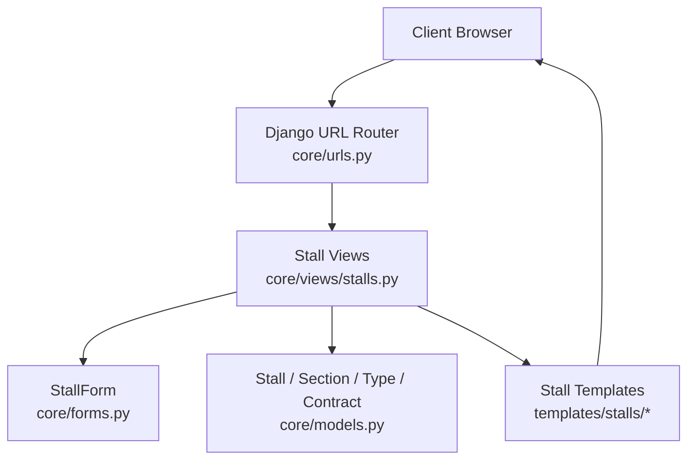
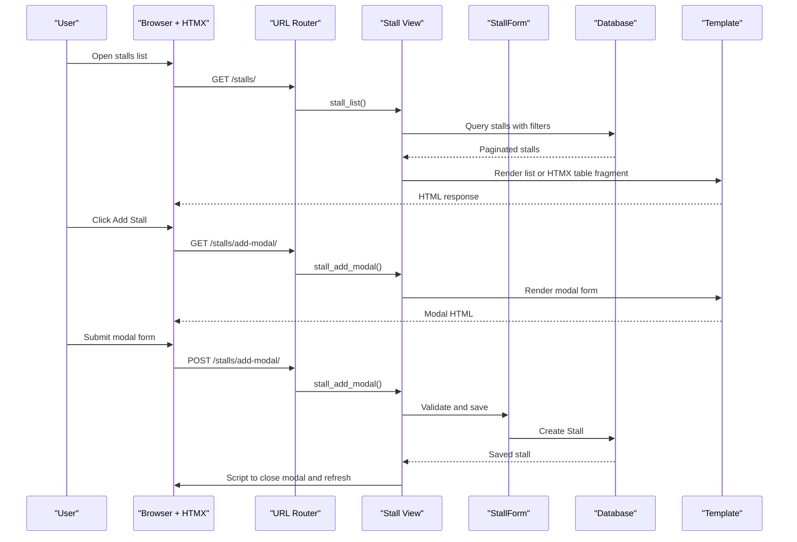
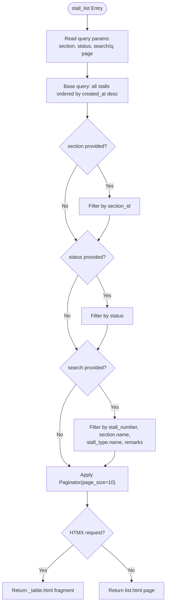
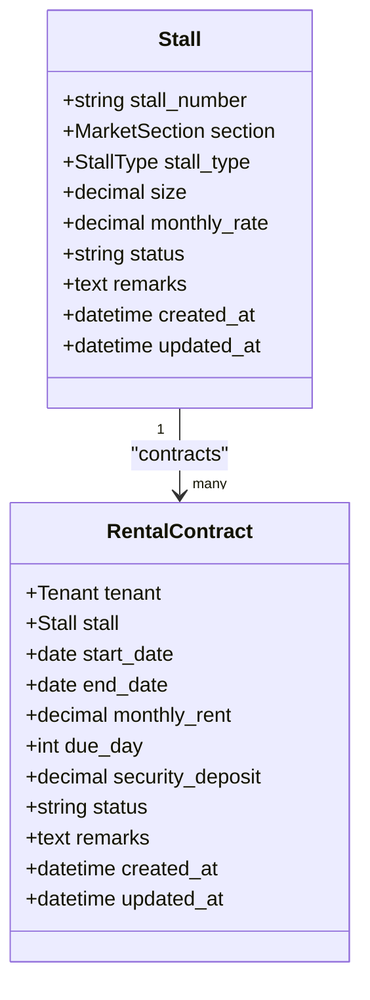
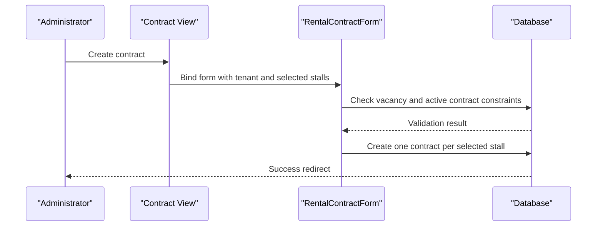
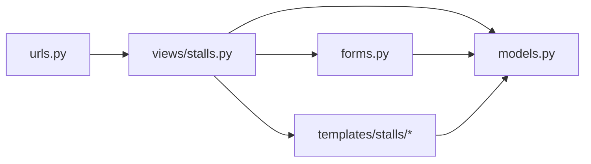

# Stall Management API

<cite>
**Referenced Files in This Document**
- [stalls.py](file://core/views/stalls.py)
- [urls.py](file://core/urls.py)
- [models.py](file://core/models.py)
- [forms.py](file://core/forms.py)
- [list.html](file://templates/stalls/list.html)
- [_table.html](file://templates/stalls/_table.html)
- [_modal_form.html](file://templates/stalls/_modal_form.html)
- [view.html](file://templates/stalls/view.html)
</cite>

## Table of Contents
1. [Introduction](#introduction)
2. [Project Structure](#project-structure)
3. [Core Components](#core-components)
4. [Architecture Overview](#architecture-overview)
5. [Detailed Component Analysis](#detailed-component-analysis)
6. [Dependency Analysis](#dependency-analysis)
7. [Performance Considerations](#performance-considerations)
8. [Troubleshooting Guide](#troubleshooting-guide)
9. [Conclusion](#conclusion)

## Introduction
This document describes the stall management endpoints for the market rental system. It covers the complete CRUD surface: listing stalls with filtering and pagination, creating new stalls, editing existing stalls, deleting stalls, viewing stall details, and HTMX-powered modal endpoints for dynamic form submission. It also explains stall status tracking, occupancy constraints enforced by rental contracts, print/export capabilities, and how stall creation integrates with sections, types, and contract assignment workflows.

The implementation is a Django application using server-rendered templates, HTMX for partial updates, and standard HTTP request/response semantics. There is no separate JSON-only REST layer; clients interact through HTML pages and HTMX fragments.

## Project Structure
Stall management lives under the `core` app:
- Views are defined in `core/views/stalls.py`.
- URL routes are registered in `core/urls.py`.
- Data models are defined in `core/models.py`.
- Form validation and field configuration are in `core/forms.py`.
- Templates live under `templates/stalls/`.

**Diagram sources**
- [urls.py:80-91](file://core/urls.py#L80-L91)
- [stalls.py:17-184](file://core/views/stalls.py#L17-L184)
- [forms.py:201-258](file://core/forms.py#L201-L258)
- [models.py:71-114](file://core/models.py#L71-L114)

**Section sources**
- [urls.py:80-91](file://core/urls.py#L80-L91)
- [stalls.py:1-184](file://core/views/stalls.py#L1-L184)

## Core Components
- **Stall model**: Represents a physical rental space with fields for stall number, section, type, size, monthly rate, status, remarks, and timestamps.
- **MarketSection and StallType**: Lookup tables that classify stalls.
- **RentalContract**: Links a tenant to a stall for a time period; enforces one active contract per stall.
- **StallForm**: Validates and renders stall data, including required section selection and optional stall type.
- **Stall views**: Provide list, add, edit, delete, view, modal add/edit, and print/export endpoints.
- **Templates**: Render lists, detail views, modals, and print layouts.

Key responsibilities:
- Filtering and pagination for stall listings.
- HTMX-driven modal forms for add/edit without full page reloads.
- Audit logging for create/update/delete operations.
- Print and PDF export for stall lists and individual stall details.

**Section sources**
- [models.py:71-114](file://core/models.py#L71-L114)
- [models.py:157-187](file://core/models.py#L157-L187)
- [forms.py:201-258](file://core/forms.py#L201-L258)
- [stalls.py:17-184](file://core/views/stalls.py#L17-L184)

## Architecture Overview
The stall management flow uses Django’s request-response cycle with HTMX for interactive UI updates.

**Diagram sources**
- [urls.py:80-91](file://core/urls.py#L80-L91)
- [stalls.py:17-52](file://core/views/stalls.py#L17-L52)
- [stalls.py:128-154](file://core/views/stalls.py#L128-L154)
- [forms.py:201-258](file://core/forms.py#L201-L258)

## Detailed Component Analysis

### Endpoint Reference

| Operation | Method | URL Pattern | Name | Description |
|---|---:|---|---|---|
| List stalls | GET | `/stalls/` | `stall_list` | Renders stall list with filtering and pagination. Supports HTMX partial table updates. |
| Add stall (full page) | POST | `/stalls/add/` | `stall_add` | Creates a new stall via full-page form submission. |
| Edit stall (full page) | POST | `/stalls/<pk>/edit/` | `stall_edit` | Updates an existing stall via full-page form submission. |
| Delete stall | POST | `/stalls/<pk>/delete/` | `stall_delete` | Deletes a stall and redirects to the list. |
| View stall details | GET | `/stalls/<pk>/` | `stall_view` | Shows stall information and contract history. |
| Add stall (HTMX modal) | GET/POST | `/stalls/add-modal/` | `stall_add_modal` | Renders and processes stall creation inside a modal. |
| Edit stall (HTMX modal) | GET/POST | `/stalls/<pk>/edit-modal/` | `stall_edit_modal` | Renders and processes stall editing inside a modal. |
| Print stall list | GET | `/stalls/print/` | `stall_list_print` | Renders printable stall list with current filters. |
| Export stall list PDF | GET | `/stalls/export/pdf/` | `stall_list_export_pdf` | Generates a PDF file named with today’s date. |
| Print stall detail | GET | `/stalls/<pk>/print/` | `stall_view_print` | Renders printable stall detail view. |
| Export stall detail PDF | GET | `/stalls/<pk>/export/pdf/` | `stall_view_export_pdf` | Generates a PDF file named with stall number and today’s date. |

**Section sources**
- [urls.py:80-91](file://core/urls.py#L80-L91)
- [urls.py:187-243](file://core/urls.py#L187-L243)

### Request and Response Formats

#### stall_list (GET)
- Purpose: List stalls with filtering and pagination.
- Query parameters:
  - `section`: Market section ID to filter by.
  - `status`: Stall status value (`Vacant`, `Occupied`, `Reserved`, `Maintenance`).
  - `search` or `q`: Search term matching stall number, section name, stall type name, or remarks.
  - `page`: Page number for pagination.
- Response:
  - Full page HTML when requested normally.
  - Partial HTML table fragment when requested via HTMX (`HX-Request: true`).
- Pagination target: The template expects a wrapper element with id `stall-table-wrapper`.

Example query:
- `GET /stalls/?section=3&status=Vacant&q=A-101&page=2`

**Section sources**
- [stalls.py:17-52](file://core/views/stalls.py#L17-L52)
- [list.html:30-58](file://templates/stalls/list.html#L30-L58)
- [_table.html:1-73](file://templates/stalls/_table.html#L1-L73)

#### stall_add (POST)
- Purpose: Create a new stall via full-page form.
- Request body:
  - `stall_number`: Unique stall identifier.
  - `section`: Required market section ID.
  - `stall_type`: Optional stall type ID.
  - `size`: Optional numeric size in square meters.
  - `monthly_rate`: Required numeric monthly rental rate.
  - `status`: Optional stall status.
  - `remarks`: Optional text notes.
- Response:
  - On success: Redirect to `stall_list`.
  - On validation error: Re-render form with errors.
- Audit: Logs CREATE action with user, IP address, and description.

**Section sources**
- [stalls.py:55-74](file://core/views/stalls.py#L55-L74)
- [forms.py:201-258](file://core/forms.py#L201-L258)

#### stall_edit (POST)
- Purpose: Update an existing stall via full-page form.
- Path parameter: `pk` (stall primary key).
- Request body: Same fields as stall_add.
- Response:
  - On success: Redirect to `stall_list`.
  - On validation error: Re-render form with errors.
- Audit: Logs UPDATE action.

**Section sources**
- [stalls.py:77-97](file://core/views/stalls.py#L77-L97)
- [forms.py:201-258](file://core/forms.py#L201-L258)

#### stall_delete (POST)
- Purpose: Remove a stall.
- Path parameter: `pk` (stall primary key).
- Response:
  - Always redirects to `stall_list`.
- Audit: Logs DELETE action.

Note: Deletion does not check for active contracts in this endpoint. If a stall has an active contract, deletion may violate business rules depending on database constraints.

**Section sources**
- [stalls.py:100-114](file://core/views/stalls.py#L100-L114)

#### stall_view (GET)
- Purpose: Display stall details and contract history.
- Path parameter: `pk` (stall primary key).
- Response: Full-page HTML showing stall information, status, timestamps, and associated contracts.

**Section sources**
- [stalls.py:117-125](file://core/views/stalls.py#L117-L125)
- [view.html:1-192](file://templates/stalls/view.html#L1-L192)

#### stall_add_modal (GET/POST)
- Purpose: Render and process stall creation inside a modal.
- HTMX behavior:
  - GET returns modal form HTML.
  - POST validates and saves; if successful, returns a script that closes the modal, shows a success toast, and reloads the page.
  - On validation error, returns the modal form with errors.
- Request body: Same fields as stall_add.
- Audit: Logs CREATE action with “(modal)” in description.

**Section sources**
- [stalls.py:128-154](file://core/views/stalls.py#L128-L154)
- [_modal_form.html:1-127](file://templates/stalls/_modal_form.html#L1-L127)

#### stall_edit_modal (GET/POST)
- Purpose: Render and process stall editing inside a modal.
- Path parameter: `pk` (stall primary key).
- HTMX behavior:
  - GET returns modal form HTML pre-filled with stall data.
  - POST validates and saves; if successful, returns a script that closes the modal, shows a success toast, and reloads the page.
  - On validation error, returns the modal form with errors.
- Audit: Logs UPDATE action with “(modal)” in description.

**Section sources**
- [stalls.py:157-184](file://core/views/stalls.py#L157-L184)
- [_modal_form.html:1-127](file://templates/stalls/_modal_form.html#L1-L127)

### Filtering and Search Details
- Section filter: Matches `section_id`.
- Status filter: Matches exact status string from choices.
- Search terms: Case-insensitive match against stall number, section name, stall type name, and remarks.
- Pagination: Default page size is 10 results.

**Diagram sources**
- [stalls.py:17-52](file://core/views/stalls.py#L17-L52)

**Section sources**
- [stalls.py:17-52](file://core/views/stalls.py#L17-L52)

### Stall Status Tracking and Occupancy Constraints

Stall statuses:
- Vacant
- Occupied
- Reserved
- Maintenance

Occupancy constraint:
- Only one active rental contract per stall is allowed at any time.
- The system enforces this via a database-level unique constraint on `(stall, status)` where `status = 'Active'`.
- Contract creation logic checks for existing active contracts before allowing a new active contract.

**Diagram sources**
- [models.py:93-114](file://core/models.py#L93-L114)
- [models.py:157-187](file://core/models.py#L157-L187)

**Section sources**
- [models.py:93-114](file://core/models.py#L93-L114)
- [models.py:157-187](file://core/models.py#L157-L187)
- [forms.py:389-399](file://core/forms.py#L389-L399)

### Integration with Rental Contracts
- The stall detail view displays all contracts associated with a stall, ordered by start date and creation timestamp.
- Contract assignment is handled by contract-related forms and views, which restrict assignable stalls to those that are vacant and do not already have an active contract.
- Bulk assignment allows assigning one tenant to multiple vacant stalls, creating one contract per stall.

**Diagram sources**
- [forms.py:281-399](file://core/forms.py#L281-L399)

**Section sources**
- [stalls.py:117-125](file://core/views/stalls.py#L117-L125)
- [forms.py:281-399](file://core/forms.py#L281-L399)

### Examples

#### Stall Creation Workflow
1. Navigate to the stalls list.
2. Click “Add Stall” to open the HTMX modal.
3. Fill in stall number, section, optional stall type, size, monthly rate, status, and remarks.
4. Submit the form.
5. On success, the modal closes, a success toast appears, and the page reloads with the new stall included.

If HTMX is not used, the same workflow occurs via the full-page add form, which redirects back to the list after success.

**Section sources**
- [list.html:21-27](file://templates/stalls/list.html#L21-L27)
- [_modal_form.html:1-127](file://templates/stalls/_modal_form.html#L1-L127)
- [stalls.py:128-154](file://core/views/stalls.py#L128-L154)

#### Bulk Operations
- The stall list itself does not provide bulk create or bulk delete endpoints.
- Bulk assignment of tenants to multiple vacant stalls is supported through the contract module, not the stall module.
- For bulk stall management, operators should use the stall list filters and manual actions, or extend the system with additional bulk endpoints.

**Section sources**
- [forms.py:652-725](file://core/forms.py#L652-L725)

#### Print and Export Functionality
- Print preview for the stall list: `GET /stalls/print/` with the same filters as the list.
- Export stall list PDF: `GET /stalls/export/pdf/` generates a filename like `stalls_list_YYYY-MM-DD.pdf`.
- Print stall detail: `GET /stalls/<pk>/print/`.
- Export stall detail PDF: `GET /stalls/<pk>/export/pdf/` generates a filename like `stall_<number>_YYYY-MM-DD.pdf`.

These endpoints reuse the same filtering logic as the list view and render specialized print templates.

**Section sources**
- [stalls.py:187-243](file://core/views/stalls.py#L187-L243)
- [stalls.py:246-274](file://core/views/stalls.py#L246-L274)

## Dependency Analysis

**Diagram sources**
- [urls.py:80-91](file://core/urls.py#L80-L91)
- [stalls.py:1-184](file://core/views/stalls.py#L1-L184)
- [forms.py:201-258](file://core/forms.py#L201-L258)
- [models.py:71-114](file://core/models.py#L71-L114)

**Section sources**
- [urls.py:80-91](file://core/urls.py#L80-L91)
- [stalls.py:1-184](file://core/views/stalls.py#L1-L184)

## Performance Considerations
- Use `select_related` for related objects (section, stall_type, tenant) to reduce N+1 queries.
- Keep search terms concise; case-insensitive substring searches across multiple fields can be expensive on large datasets.
- Pagination limits results to 10 per page, reducing payload size and rendering time.
- HTMX partial updates avoid full page reloads, improving perceived performance.

[No sources needed since this section provides general guidance]

## Troubleshooting Guide

Common issues and resolutions:
- No market sections configured:
  - The stall form requires a section. If none exist, the form raises a validation error instructing administrators to add a section first.
  - Resolution: Create at least one market section via the lookup management endpoints.
- Invalid choice errors:
  - If a referenced section or stall type was deleted, the form will raise an invalid choice error.
  - Resolution: Re-select a valid section or stall type.
- Duplicate stall number:
  - The stall number is unique. Attempting to create or update with a duplicate will fail validation.
  - Resolution: Use a different stall number.
- Active contract conflict:
  - Creating an active contract for a stall that already has an active contract fails validation.
  - Resolution: Terminate or expire the existing active contract before assigning a new one.
- HTMX modal not closing:
  - Ensure the client sends `HX-Request: true` for modal submissions and that the response includes the expected script.
  - Resolution: Verify HTMX integration and browser console for JavaScript errors.

**Section sources**
- [forms.py:251-258](file://core/forms.py#L251-L258)
- [forms.py:389-399](file://core/forms.py#L389-L399)
- [stalls.py:128-154](file://core/views/stalls.py#L128-L154)

## Conclusion
The stall management API provides a comprehensive set of endpoints for managing market stalls, integrating closely with sections, types, and rental contracts. It supports filtering, pagination, HTMX-driven modals, audit logging, and print/export functionality. Operators should ensure proper setup of sections and types, respect occupancy constraints enforced by active contracts, and use the provided filters and modal workflows for efficient stall administration.

[No sources needed since this section summarizes without analyzing specific files]