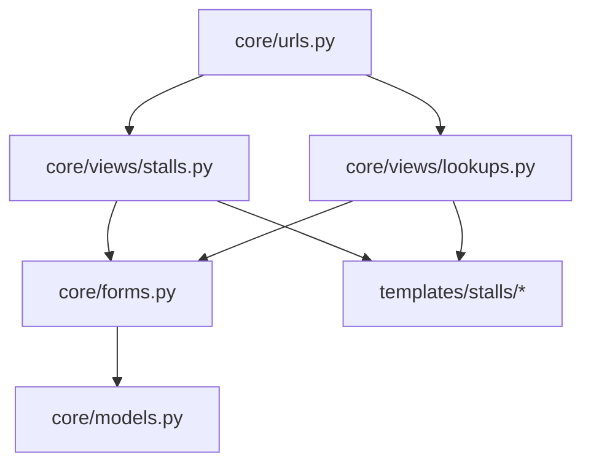
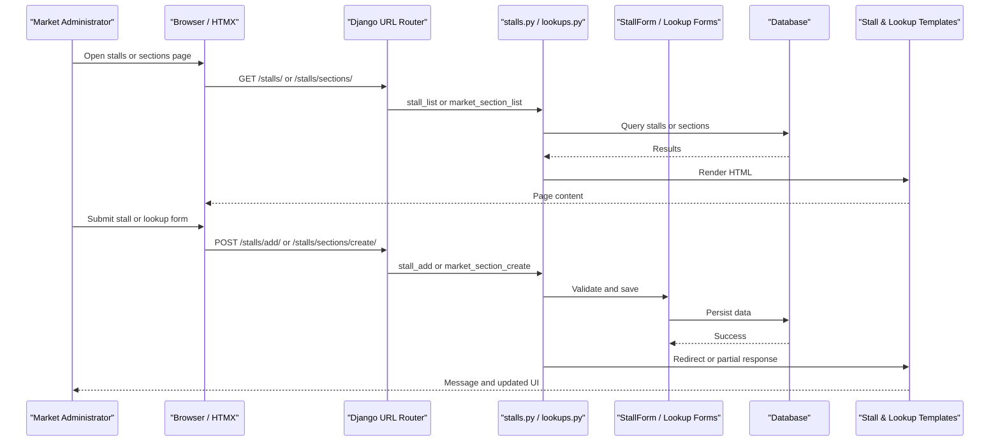
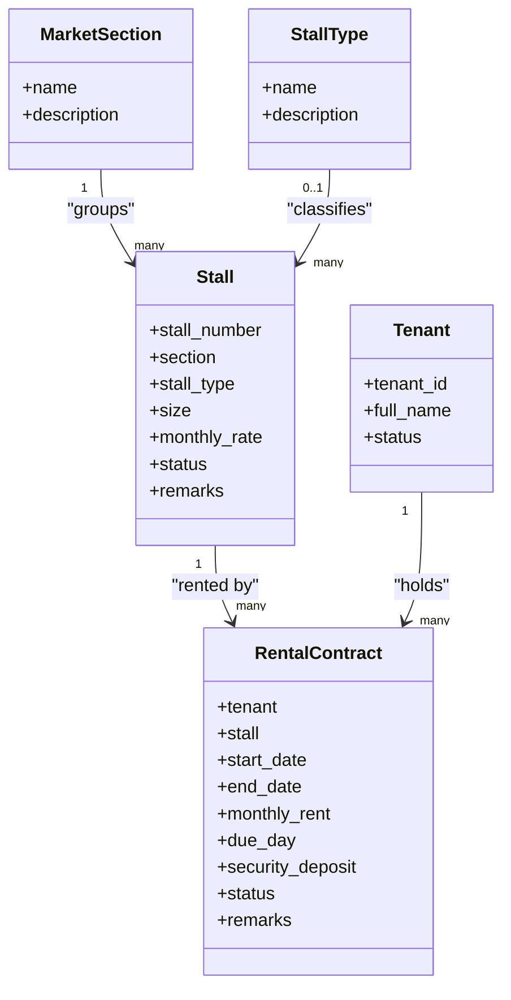
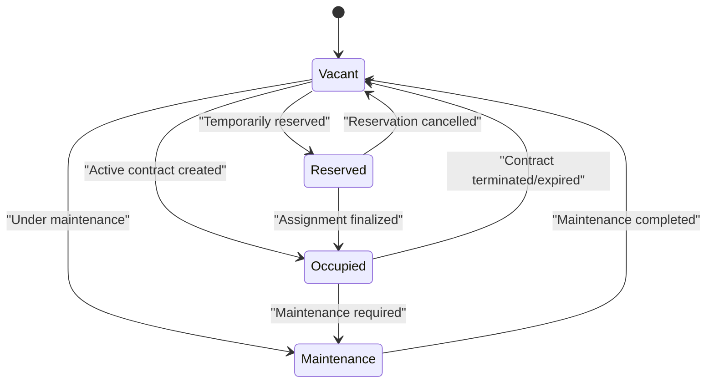
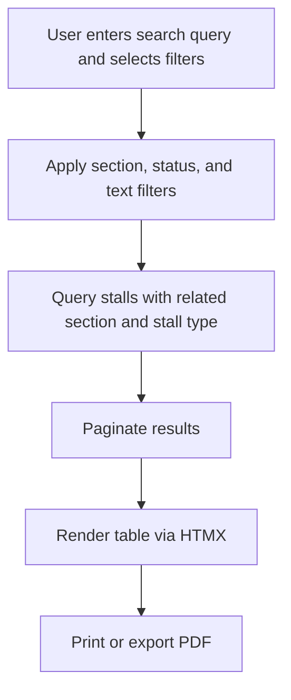
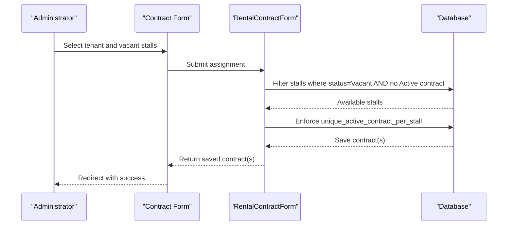
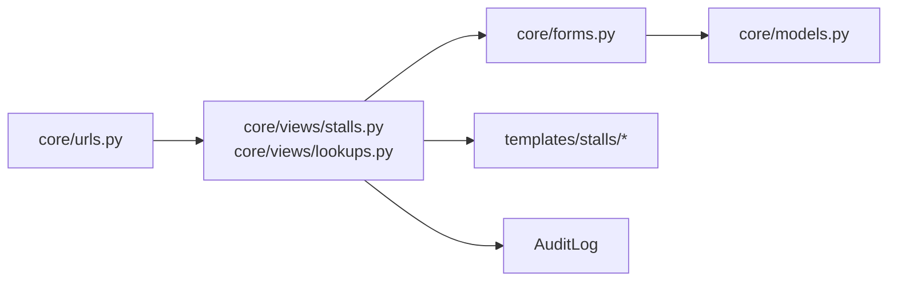

# Stalls & Sections API

<cite>
**Referenced Files in This Document**
- [core/views/stalls.py](file://core/views/stalls.py)
- [core/views/lookups.py](file://core/views/lookups.py)
- [core/models.py](file://core/models.py)
- [core/forms.py](file://core/forms.py)
- [core/urls.py](file://core/urls.py)
- [templates/stalls/_table.html](file://templates/stalls/_table.html)
- [templates/stalls/view.html](file://templates/stalls/view.html)
- [templates/stalls/print_list.html](file://templates/stalls/print_list.html)
- [templates/stalls/stall_types.html](file://templates/stalls/stall_types.html)
</cite>

## Table of Contents
1. [Introduction](#introduction)
2. [Project Structure](#project-structure)
3. [Core Components](#core-components)
4. [Architecture Overview](#architecture-overview)
5. [Stall Management Endpoints](#stall-management-endpoints)
6. [Market Section Lookup Endpoints](#market-section-lookup-endpoints)
7. [Stall Type Lookup Endpoints](#stall-type-lookup-endpoints)
8. [Data Model and Relationships](#data-model-and-relationships)
9. [Occupancy Status and Assignment Workflow](#occupancy-status-and-assignment-workflow)
10. [Inventory, Filtering, Search, and Print](#inventory-filtering-search-and-print)
11. [Integration with Rental Contracts](#integration-with-rental-contracts)
12. [Dependency Analysis](#dependency-analysis)
13. [Performance Considerations](#performance-considerations)
14. [Troubleshooting Guide](#troubleshooting-guide)
15. [Conclusion](#conclusion)

## Introduction
This document describes the stall management and market section endpoints for the Public Market Rental and Collection Management System. It covers:

- Stall CRUD operations through `stall_list`, `stall_add`, `stall_edit`, and `stall_delete`.
- Lookup table management for market sections and stall types.
- The relationship between stalls, sections, stall types, tenants, and rental contracts.
- Occupancy status tracking and assignment workflows.
- Examples of stall inventory management, section organization, and type definitions.
- Integration between physical stall management and rental contract assignments.

The system is a Django application where URL routes map to view functions that render templates, validate forms, persist data through models, and record audit logs.

## Project Structure
The stall and section functionality spans URLs, views, forms, models, and templates:

- **URLs**: Define named routes for stall list, add, edit, delete, view, print, export, sections, and stall types.
- **Views**: Implement stall listing, creation, editing, deletion, modal handling, and lookup table management.
- **Forms**: Provide validation, dropdown wiring, availability checks, and assignment constraints.
- **Models**: Define market sections, stall types, stalls, tenants, and rental contracts.
- **Templates**: Render stall tables, forms, details, print layouts, and lookup management pages.

**Diagram sources**
- [core/urls.py:12-51](file://core/urls.py#L12-L51)
- [core/views/stalls.py:1-11](file://core/views/stalls.py#L1-L11)
- [core/views/lookups.py:1-28](file://core/views/lookups.py#L1-L28)
- [core/forms.py:11-15](file://core/forms.py#L11-L15)
- [core/models.py:71-114](file://core/models.py#L71-L114)

**Section sources**
- [core/urls.py:80-105](file://core/urls.py#L80-L105)
- [core/views/stalls.py:1-11](file://core/views/stalls.py#L1-L11)
- [core/views/lookups.py:1-28](file://core/views/lookups.py#L1-L28)

## Core Components
The core components are:

- **MarketSection**: A unique, ordered category used to group stalls.
- **StallType**: An optional classification describing the nature or business type of a stall.
- **Stall**: A physical market unit with a unique number, section, optional type, size, monthly rate, status, and remarks.
- **RentalContract**: A binding between a tenant and a stall for a defined period, enforcing one active contract per stall.
- **AuditLog**: Records user actions such as create, update, delete, and bulk assign.

Key responsibilities:

- Sections and types are reference data managed through dedicated UI endpoints.
- Stalls are created, edited, viewed, deleted, filtered, searched, and printed.
- Contracts enforce vacancy and occupancy rules and integrate with billing.

**Section sources**
- [core/models.py:71-114](file://core/models.py#L71-L114)
- [core/models.py:157-187](file://core/models.py#L157-L187)
- [core/models.py:304-316](file://core/models.py#L304-L316)

## Architecture Overview
The stall and section architecture connects HTTP requests to views, forms, models, and templates.

**Diagram sources**
- [core/urls.py:80-105](file://core/urls.py#L80-L105)
- [core/views/stalls.py:17-74](file://core/views/stalls.py#L17-L74)
- [core/views/lookups.py:33-66](file://core/views/lookups.py#L33-L66)
- [core/forms.py:201-278](file://core/forms.py#L201-L278)

## Stall Management Endpoints
The stall management endpoints provide full CRUD operations for physical stalls.

### List Stalls
- **Route**: `/stalls/`
- **Name**: `stall_list`
- **Method**: GET
- **Authentication**: Management required
- **Purpose**: Display paginated stalls with filtering by section, status, and search text.
- **Query parameters**:
  - `section`: Filter by market section ID.
  - `status`: Filter by stall status.
  - `search` or `q`: Text search across stall number, section name, stall type name, and remarks.
- **Response behavior**:
  - Returns full page when not an HTMX request.
  - Returns partial table HTML when HTMX detects an HTMX request.
- **Related template**: `templates/stalls/_table.html`

**Section sources**
- [core/urls.py:81-91](file://core/urls.py#L81-L91)
- [core/views/stalls.py:17-52](file://core/views/stalls.py#L17-L52)
- [templates/stalls/_table.html:52-72](file://templates/stalls/_table.html#L52-L72)

### Add Stall
- **Route**: `/stalls/add/`
- **Name**: `stall_add`
- **Methods**:
  - GET: Render stall creation form.
  - POST: Validate and create stall.
- **Authentication**: Management required
- **Validation**: Uses `StallForm`.
- **Success behavior**: Creates audit log, shows success message, redirects to stall list.
- **Failure behavior**: Shows validation error messages.

**Section sources**
- [core/urls.py:84](file://core/urls.py#L84)
- [core/views/stalls.py:55-74](file://core/views/stalls.py#L55-L74)
- [core/forms.py:201-258](file://core/forms.py#L201-L258)

### Edit Stall
- **Route**: `/stalls/<int:pk>/edit/`
- **Name**: `stall_edit`
- **Methods**:
  - GET: Render stall edit form.
  - POST: Validate and update stall.
- **Authentication**: Management required
- **Validation**: Uses `StallForm` bound to existing stall.
- **Success behavior**: Creates audit log, shows success message, redirects to stall list.
- **Failure behavior**: Shows validation error messages.

**Section sources**
- [core/urls.py:85](file://core/urls.py#L85)
- [core/views/stalls.py:77-97](file://core/views/stalls.py#L77-L97)
- [core/forms.py:201-258](file://core/forms.py#L201-L258)

### Delete Stall
- **Route**: `/stalls/<int:pk>/delete/`
- **Name**: `stall_delete`
- **Method**: POST
- **Authentication**: Management required
- **Behavior**: Deletes stall, creates audit log, shows success message, redirects to stall list.

**Section sources**
- [core/urls.py:86](file://core/urls.py#L86)
- [core/views/stalls.py:100-114](file://core/views/stalls.py#L100-L114)

### Additional Stall Endpoints
- **View stall**: `/stalls/<int:pk>/` → `stall_view`
- **Add via modal**: `/stalls/add-modal/` → `stall_add_modal`
- **Edit via modal**: `/stalls/<int:pk>/edit-modal/` → `stall_edit_modal`
- **Print list**: `/stalls/print/` → `stall_list_print`
- **Export PDF list**: `/stalls/export/pdf/` → `stall_list_export_pdf`
- **Print view**: `/stalls/<int:pk>/print/` → `stall_view_print`
- **Export PDF view**: `/stalls/<int:pk>/export/pdf/` → `stall_view_export_pdf`

**Section sources**
- [core/urls.py:81-91](file://core/urls.py#L81-L91)
- [core/views/stalls.py:117-274](file://core/views/stalls.py#L117-L274)

## Market Section Lookup Endpoints
Market sections are lookup records that back the stall form’s section dropdown.

### List Sections
- **Route**: `/stalls/sections/`
- **Name**: `market_section_list`
- **Method**: GET
- **Authentication**: Management required
- **Purpose**: Show all sections with stall counts and inline add/edit/delete controls.

**Section sources**
- [core/urls.py:94-98](file://core/urls.py#L94-L98)
- [core/views/lookups.py:33-49](file://core/views/lookups.py#L33-L49)

### Create Section
- **Route**: `/stalls/sections/create/`
- **Name**: `market_section_create`
- **Method**: POST
- **Authentication**: Management required
- **Validation**: Uses `MarketSectionForm`.
- **Behavior**: Creates section, logs audit entry, shows success or error message.

**Section sources**
- [core/urls.py:95](file://core/urls.py#L95)
- [core/views/lookups.py:52-66](file://core/views/lookups.py#L52-L66)
- [core/forms.py:261-268](file://core/forms.py#L261-L268)

### Update Section
- **Route**: `/stalls/sections/<int:pk>/update/`
- **Name**: `market_section_update`
- **Method**: POST
- **Authentication**: Management required
- **Validation**: Uses `MarketSectionForm` bound to existing section.

**Section sources**
- [core/urls.py:96](file://core/urls.py#L96)
- [core/views/lookups.py:69-84](file://core/views/lookups.py#L69-L84)
- [core/forms.py:261-268](file://core/forms.py#L261-L268)

### Delete Section
- **Route**: `/stalls/sections/<int:pk>/delete/`
- **Name**: `market_section_delete`
- **Method**: POST
- **Authentication**: Management required
- **Protection**: Blocks deletion if any stall references the section because stall section is CASCADE.
- **Behavior**: Logs audit entry on successful deletion.

**Section sources**
- [core/urls.py:97](file://core/urls.py#L97)
- [core/views/lookups.py:87-111](file://core/views/lookups.py#L87-L111)

### Quick Add Section
- **Route**: `/stalls/sections/quick-add/`
- **Name**: `market_section_quick_add`
- **Method**: POST
- **Authentication**: Management required
- **Purpose**: HTMX endpoint that creates or reuses a section from a single name field and returns a refreshed section select fragment.

**Section sources**
- [core/urls.py:98](file://core/urls.py#L98)
- [core/views/lookups.py:114-140](file://core/views/lookups.py#L114-L140)

## Stall Type Lookup Endpoints
Stall types are optional lookup records that classify stalls.

### List Types
- **Route**: `/stalls/stall-types/`
- **Name**: `stall_type_list`
- **Method**: GET
- **Authentication**: Management required
- **Purpose**: Show all stall types with stall counts and inline add/edit/delete controls.

**Section sources**
- [core/urls.py:101-105](file://core/urls.py#L101-L105)
- [core/views/lookups.py:145-158](file://core/views/lookups.py#L145-L158)
- [templates/stalls/stall_types.html:20-123](file://templates/stalls/stall_types.html#L20-L123)

### Create Type
- **Route**: `/stalls/stall-types/create/`
- **Name**: `stall_type_create`
- **Method**: POST
- **Authentication**: Management required
- **Validation**: Uses `StallTypeForm`.

**Section sources**
- [core/urls.py:102](file://core/urls.py#L102)
- [core/views/lookups.py:161-175](file://core/views/lookups.py#L161-L175)
- [core/forms.py:271-278](file://core/forms.py#L271-L278)

### Update Type
- **Route**: `/stalls/stall-types/<int:pk>/update/`
- **Name**: `stall_type_update`
- **Method**: POST
- **Authentication**: Management required
- **Validation**: Uses `StallTypeForm` bound to existing type.

**Section sources**
- [core/urls.py:103](file://core/urls.py#L103)
- [core/views/lookups.py:178-193](file://core/views/lookups.py#L178-L193)
- [core/forms.py:271-278](file://core/forms.py#L271-L278)

### Delete Type
- **Route**: `/stalls/stall-types/<int:pk>/delete/`
- **Name**: `stall_type_delete`
- **Method**: POST
- **Authentication**: Management required
- **Behavior**: Allowed because stall type FK uses SET_NULL; warns operator about affected stalls whose type will be cleared.

**Section sources**
- [core/urls.py:104](file://core/urls.py#L104)
- [core/views/lookups.py:196-219](file://core/views/lookups.py#L196-L219)

### Quick Add Type
- **Route**: `/stalls/stall-types/quick-add/`
- **Name**: `stall_type_quick_add`
- **Method**: POST
- **Authentication**: Management required
- **Purpose**: HTMX endpoint that creates or reuses a stall type and returns a refreshed stall type select fragment.

**Section sources**
- [core/urls.py:105](file://core/urls.py#L105)
- [core/views/lookups.py:222-240](file://core/views/lookups.py#L222-L240)

## Data Model and Relationships
The stall-related data model defines how market structure, physical stalls, and contracts relate.

**Diagram sources**
- [core/models.py:71-114](file://core/models.py#L71-L114)
- [core/models.py:117-187](file://core/models.py#L117-L187)

Key relationships:

- A stall belongs to exactly one market section.
- A stall optionally belongs to one stall type.
- A stall can have many rental contracts over time.
- Only one active rental contract is allowed per stall.
- A tenant can hold multiple stalls through multiple contracts.

**Section sources**
- [core/models.py:71-114](file://core/models.py#L71-L114)
- [core/models.py:117-187](file://core/models.py#L117-L187)

## Occupancy Status and Assignment Workflow
Stall occupancy is tracked through the stall status field and enforced through contract assignment logic.

### Stall Status Values
- **Vacant**: Available for new assignment.
- **Occupied**: Currently rented by an active tenant.
- **Reserved**: Temporarily held but not yet assigned.
- **Maintenance**: Not available due to maintenance work.

### Assignment Rules
- Only vacant stalls without an active contract appear in assignment lists.
- Creating or editing a contract validates that no other active contract exists for the same stall.
- Database constraint enforces one active contract per stall.
- Bulk assignment creates one contract per selected stall using each stall’s own monthly rate.

**Diagram sources**
- [core/models.py:93-105](file://core/models.py#L93-L105)
- [core/models.py:176-184](file://core/models.py#L176-L184)
- [core/forms.py:297-399](file://core/forms.py#L297-L399)
- [core/forms.py:652-725](file://core/forms.py#L652-L725)

**Section sources**
- [core/models.py:93-105](file://core/models.py#L93-L105)
- [core/models.py:176-184](file://core/models.py#L176-L184)
- [core/forms.py:297-399](file://core/forms.py#L297-L399)
- [core/forms.py:652-725](file://core/forms.py#L652-L725)

## Inventory, Filtering, Search, and Print
The stall list supports filtering, search, pagination, and print/export capabilities.

### Filtering and Search
- **Section filter**: Narrow results to a specific market section.
- **Status filter**: Narrow results to Vacant, Occupied, Reserved, or Maintenance.
- **Text search**: Search across stall number, section name, stall type name, and remarks.
- **Pagination**: Paginated results with HTMX-driven table updates.

### Print and Export
- **Stall list print preview**: Renders a printable table with filters and system settings.
- **Stall list PDF export**: Generates a PDF file named with the current date.
- **Individual stall print preview**: Shows stall details and contract history.
- **Individual stall PDF export**: Generates a PDF file named with the stall number and current date.

**Diagram sources**
- [core/views/stalls.py:17-52](file://core/views/stalls.py#L17-L52)
- [core/views/stalls.py:187-243](file://core/views/stalls.py#L187-L243)
- [core/views/stalls.py:246-274](file://core/views/stalls.py#L246-L274)
- [templates/stalls/print_list.html:21-33](file://templates/stalls/print_list.html#L21-L33)

**Section sources**
- [core/views/stalls.py:17-52](file://core/views/stalls.py#L17-L52)
- [core/views/stalls.py:187-274](file://core/views/stalls.py#L187-L274)
- [templates/stalls/print_list.html:21-33](file://templates/stalls/print_list.html#L21-L33)

## Integration with Rental Contracts
Stall management integrates tightly with rental contracts. A stall is a physical asset; a contract is the legal assignment of that asset to a tenant.

### Contract Creation Flow
- The contract form limits tenants to Active status.
- The contract form limits stalls to vacant stalls without an active contract.
- For new contracts, the form exposes a multi-select of assignable stalls.
- Each selected stall receives its own contract using its own monthly rate unless a single explicit rent is provided.
- Editing a contract can change the stall and status, triggering stall status synchronization.

**Diagram sources**
- [core/forms.py:281-399](file://core/forms.py#L281-L399)
- [core/models.py:176-184](file://core/models.py#L176-L184)

### Stall View and Contract History
The stall detail view loads the stall with related section and stall type, then lists contracts for that stall.

**Section sources**
- [core/views/stalls.py:117-125](file://core/views/stalls.py#L117-L125)
- [templates/stalls/view.html:1-34](file://templates/stalls/view.html#L1-L34)
- [core/forms.py:281-399](file://core/forms.py#L281-L399)
- [core/models.py:157-187](file://core/models.py#L157-L187)

## Dependency Analysis
The stall and section endpoints depend on several layers:

- **URL routing** maps to stall and lookup view functions.
- **Views** depend on forms for validation and on models for persistence.
- **Forms** depend on models for querysets, choices, and business rules.
- **Templates** depend on views for context and on models for display data.
- **Audit logging** depends on authenticated users and module descriptions.

**Diagram sources**
- [core/urls.py:12-51](file://core/urls.py#L12-L51)
- [core/views/stalls.py:1-11](file://core/views/stalls.py#L1-L11)
- [core/views/lookups.py:1-28](file://core/views/lookups.py#L1-L28)
- [core/forms.py:11-15](file://core/forms.py#L11-L15)
- [core/models.py:304-316](file://core/models.py#L304-L316)

**Section sources**
- [core/urls.py:12-51](file://core/urls.py#L12-L51)
- [core/views/stalls.py:1-11](file://core/views/stalls.py#L1-L11)
- [core/views/lookups.py:1-28](file://core/views/lookups.py#L1-L28)
- [core/forms.py:11-15](file://core/forms.py#L11-L15)
- [core/models.py:304-316](file://core/models.py#L304-L316)

## Performance Considerations
- Use `select_related` for section and stall type when listing stalls to reduce database queries.
- Keep filters selective to avoid large result sets.
- Prefer HTMX partial updates for the stall table to minimize page reloads.
- For bulk assignments, rely on form-level validation and database constraints to prevent race conditions.
- Avoid unnecessary full-page renders when partial responses are sufficient.

[No sources needed since this section provides general guidance]

## Troubleshooting Guide
Common issues and resolutions:

- **No sections configured**:
  - Symptom: Stall form cannot be submitted because no sections exist.
  - Resolution: Add at least one market section before creating stalls.

- **Duplicate tenant names**:
  - Symptom: Tenant form rejects duplicate names after normalization.
  - Resolution: Edit the existing tenant record instead of creating a duplicate.

- **Stall already has an active contract**:
  - Symptom: Contract creation fails with a validation error indicating the stall already has an active tenant.
  - Resolution: Terminate or expire the existing active contract before assigning a new one.

- **Selected stalls are no longer vacant**:
  - Symptom: Bulk assignment fails because stalls changed status between selection and submission.
  - Resolution: Refresh the page and reselect available stalls.

- **Cannot delete a section**:
  - Symptom: Delete button is disabled for a section with stalls.
  - Resolution: Reassign stalls to another section before deleting.

**Section sources**
- [core/forms.py:251-258](file://core/forms.py#L251-L258)
- [core/forms.py:156-198](file://core/forms.py#L156-L198)
- [core/forms.py:389-399](file://core/forms.py#L389-L399)
- [core/forms.py:709-717](file://core/forms.py#L709-L717)
- [core/views/lookups.py:87-111](file://core/views/lookups.py#L87-L111)

## Conclusion
The stall and section endpoints provide a complete operational surface for managing market structure and physical stalls. Market sections organize stalls into logical areas, stall types provide optional classification, and stalls track identity, pricing, and occupancy. Lookup management ensures the stall form always has valid options, while HTMX quick-add endpoints keep operators in context. Stall CRUD operations integrate with rental contracts to enforce one active tenant per stall, support search and filtering, and provide print and PDF export for reporting.

[No sources needed since this section summarizes without analyzing specific files]