# System Administration API

<cite>
**Referenced Files in This Document**
- [core/urls.py](file://core/urls.py)
- [core/views/settings_views.py](file://core/views/settings_views.py)
- [core/views/users.py](file://core/views/users.py)
- [core/views/audit.py](file://core/views/audit.py)
- [core/models.py](file://core/models.py)
- [core/forms.py](file://core/forms.py)
- [core/permissions.py](file://core/permissions.py)
- [templates/settings/view.html](file://templates/settings/view.html)
- [templates/users/_table.html](file://templates/users/_table.html)
- [templates/audit/_table.html](file://templates/audit/_table.html)
</cite>

## Table of Contents
1. [Introduction](#introduction)
2. [Project Structure](#project-structure)
3. [Core Components](#core-components)
4. [Architecture Overview](#architecture-overview)
5. [Detailed Component Analysis](#detailed-component-analysis)
6. [Dependency Analysis](#dependency-analysis)
7. [Performance Considerations](#performance-considerations)
8. [Troubleshooting Guide](#troubleshooting-guide)
9. [Conclusion](#conclusion)
10. [Appendices](#appendices)

## Introduction
This document describes the system administration endpoints for settings management, user administration, and audit log access. It explains how administrators configure system behavior, manage staff and tenant accounts, and review compliance activity. It also covers permission hierarchies, account lifecycle controls, security considerations, and data retention guidance for audit logs.

The implementation is a Django application where URL routes map to view functions that enforce administrative privileges, validate input through forms, persist changes to models, and record audit events.

## Project Structure
The administration features are implemented under the `core` app:
- URLs define the public paths for settings, users, and audit logs.
- Views implement request handling, validation, persistence, and auditing.
- Models define the data schema for system settings, user profiles, and audit entries.
- Forms provide field definitions, validation rules, and UI widgets.
- Permissions define role checks and decorators used by views.
- Templates render the admin interfaces and tables.

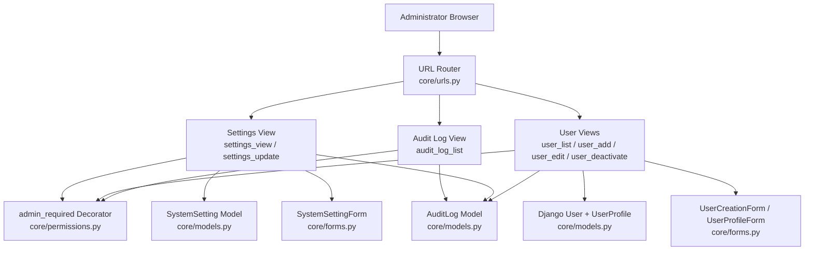

**Diagram sources**
- [core/urls.py:186-197](file://core/urls.py#L186-L197)
- [core/views/settings_views.py:9-55](file://core/views/settings_views.py#L9-L55)
- [core/views/users.py:16-164](file://core/views/users.py#L16-L164)
- [core/views/audit.py:13-60](file://core/views/audit.py#L13-L60)
- [core/models.py:42-68](file://core/models.py#L42-L68)
- [core/models.py:7-23](file://core/models.py#L7-L23)
- [core/models.py:304-316](file://core/models.py#L304-L316)
- [core/forms.py:540-560](file://core/forms.py#L540-L560)
- [core/forms.py:577-628](file://core/forms.py#L577-L628)
- [core/permissions.py:61-87](file://core/permissions.py#L61-L87)

**Section sources**
- [core/urls.py:186-197](file://core/urls.py#L186-L197)
- [core/views/settings_views.py:9-55](file://core/views/settings_views.py#L9-L55)
- [core/views/users.py:16-164](file://core/views/users.py#L16-L164)
- [core/views/audit.py:13-60](file://core/views/audit.py#L13-L60)
- [core/models.py:42-68](file://core/models.py#L42-L68)
- [core/models.py:7-23](file://core/models.py#L7-L23)
- [core/models.py:304-316](file://core/models.py#L304-L316)
- [core/forms.py:540-560](file://core/forms.py#L540-L560)
- [core/forms.py:577-628](file://core/forms.py#L577-L628)
- [core/permissions.py:61-87](file://core/permissions.py#L61-L87)

## Core Components
- Settings Management
  - Endpoints: `settings_view`, `settings_update`.
  - Purpose: Configure municipality, market, office, receipt prefix, billing defaults, penalty rules, terms and conditions, logo, and theme color.
  - Security: Restricted to administrators via `admin_required`.
  - Auditing: Every successful update creates an audit log entry.

- User Administration
  - Endpoints: `user_list`, `user_add`, `user_edit`, `user_deactivate`.
  - Purpose: List, create, edit, and activate/deactivate user accounts; assign roles through `UserProfile`.
  - Security: Restricted to administrators via `admin_required`.
  - Auditing: Create, update, deactivate, and activate actions are recorded.

- Audit Log Access
  - Endpoint: `audit_log_list`.
  - Purpose: Read-only browsing and filtering of system activity.
  - Security: Restricted to administrators via `admin_required`.
  - Filtering: By user, action, module, date range, and free-text search across multiple fields.

**Section sources**
- [core/views/settings_views.py:9-55](file://core/views/settings_views.py#L9-L55)
- [core/views/users.py:16-164](file://core/views/users.py#L16-L164)
- [core/views/audit.py:13-60](file://core/views/audit.py#L13-L60)
- [core/permissions.py:61-87](file://core/permissions.py#L61-L87)

## Architecture Overview
The administration flow follows a consistent pattern:
1. The client sends an HTTP request to a URL defined in `core/urls.py`.
2. The URL maps to a view function decorated with `@admin_required`.
3. The decorator enforces authentication and verifies that the current user has the administrator role or is a superuser.
4. The view validates input using Django forms.
5. On success, the view persists data and writes an audit log entry.
6. The view returns a redirect or renders a template.

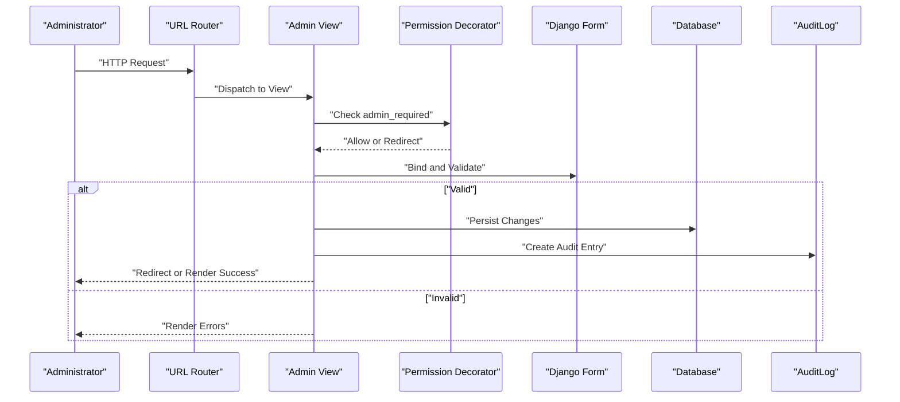

**Diagram sources**
- [core/urls.py:186-197](file://core/urls.py#L186-L197)
- [core/permissions.py:61-87](file://core/permissions.py#L61-L87)
- [core/views/settings_views.py:9-55](file://core/views/settings_views.py#L9-L55)
- [core/views/users.py:16-164](file://core/views/users.py#L16-L164)
- [core/views/audit.py:13-60](file://core/views/audit.py#L13-L60)

## Detailed Component Analysis

### Settings Management Endpoints

#### `GET /settings/` — `settings_view`
- Purpose: Display the system configuration form and current values.
- Authorization: Administrator only.
- Behavior:
  - Loads the first `SystemSetting` row.
  - Renders the settings form bound to that instance.
  - On POST, validates the form, saves changes, and records an audit log entry.
  - Uses messages to communicate success or validation errors.
- Template: `templates/settings/view.html`.

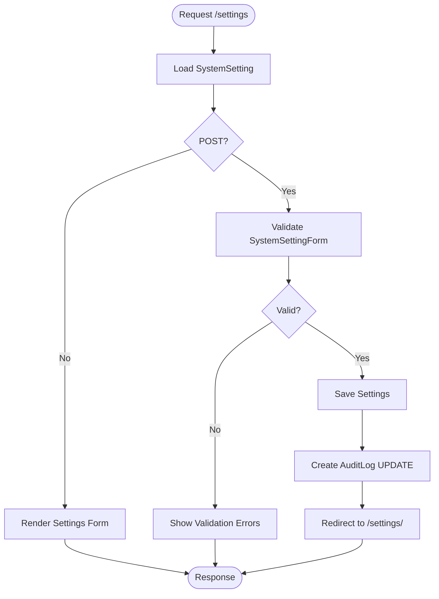

**Diagram sources**
- [core/views/settings_views.py:9-33](file://core/views/settings_views.py#L9-L33)
- [core/models.py:42-68](file://core/models.py#L42-L68)
- [core/forms.py:540-560](file://core/forms.py#L540-L560)
- [templates/settings/view.html:27-120](file://templates/settings/view.html#L27-L120)

**Section sources**
- [core/views/settings_views.py:9-33](file://core/views/settings_views.py#L9-L33)
- [core/models.py:42-68](file://core/models.py#L42-L68)
- [core/forms.py:540-560](file://core/forms.py#L540-L560)
- [templates/settings/view.html:27-120](file://templates/settings/view.html#L27-L120)

#### `POST /settings/update/` — `settings_update`
- Purpose: Accept settings updates from the settings form.
- Authorization: Administrator only.
- Behavior:
  - Loads or creates the single `SystemSetting` row.
  - Validates and saves the form.
  - Creates an audit log entry describing the update.
  - Redirects back to `/settings/`.

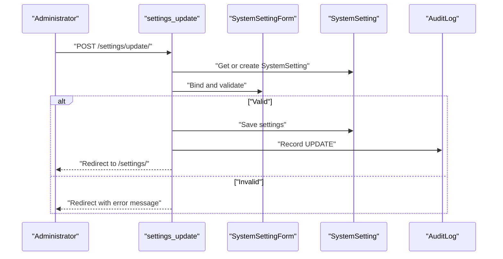

**Diagram sources**
- [core/views/settings_views.py:36-55](file://core/views/settings_views.py#L36-L55)
- [core/models.py:42-68](file://core/models.py#L42-L68)
- [core/forms.py:540-560](file://core/forms.py#L540-L560)

**Section sources**
- [core/views/settings_views.py:36-55](file://core/views/settings_views.py#L36-L55)
- [core/models.py:42-68](file://core/models.py#L42-L68)
- [core/forms.py:540-560](file://core/forms.py#L540-L560)

#### System Configuration Options
- Municipality, market, and office identification.
- Receipt prefix for official receipts.
- Default due day for billing cycles.
- Penalty type (fixed or percentage) and penalty value.
- Grace period in days before penalties apply.
- Terms and conditions printed on contracts.
- Logo upload and theme color.

These options are modeled by `SystemSetting` and exposed through `SystemSettingForm`.

**Section sources**
- [core/models.py:42-68](file://core/models.py#L42-L68)
- [core/forms.py:540-560](file://core/forms.py#L540-L560)

### User Administration Endpoints

#### `GET /users/` — `user_list`
- Purpose: List all users with pagination, role filter, and search.
- Authorization: Administrator only.
- Features:
  - Filters by role when provided.
  - Searches username, full name, email.
  - Supports HTMX partial table rendering.
  - Paginates results.

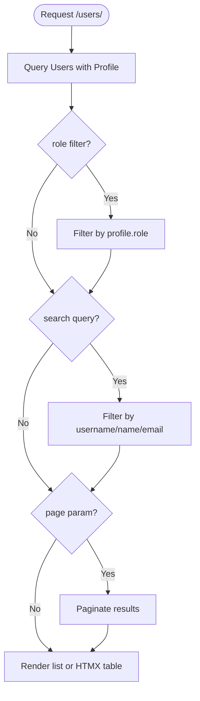

**Diagram sources**
- [core/views/users.py:16-44](file://core/views/users.py#L16-L44)
- [templates/users/_table.html:1-71](file://templates/users/_table.html#L1-L71)

**Section sources**
- [core/views/users.py:16-44](file://core/views/users.py#L16-L44)
- [templates/users/_table.html:1-71](file://templates/users/_table.html#L1-L71)

#### `GET /users/add/` — `user_add`
- Purpose: Create a new user and associated profile.
- Authorization: Administrator only.
- Rules:
  - Tenant-role accounts must be created through the Tenants workflow so they are linked to a tenant record.
  - Creates both `User` and `UserProfile`.
  - Records an audit log entry for creation.
  - Returns success or validation errors.

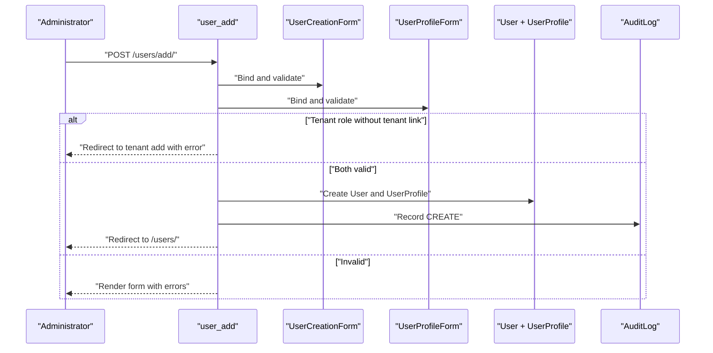

**Diagram sources**
- [core/views/users.py:47-95](file://core/views/users.py#L47-L95)
- [core/forms.py:577-628](file://core/forms.py#L577-L628)
- [core/models.py:7-23](file://core/models.py#L7-L23)

**Section sources**
- [core/views/users.py:47-95](file://core/views/users.py#L47-L95)
- [core/forms.py:577-628](file://core/forms.py#L577-L628)
- [core/models.py:7-23](file://core/models.py#L7-L23)

#### `GET /users/<pk>/edit/` — `user_edit`
- Purpose: Edit an existing user and profile.
- Authorization: Administrator only.
- Rules:
  - Prevents assigning the tenant role to an account not linked to a tenant record.
  - Updates both `User` and `UserProfile`.
  - Records an audit log entry for updates.

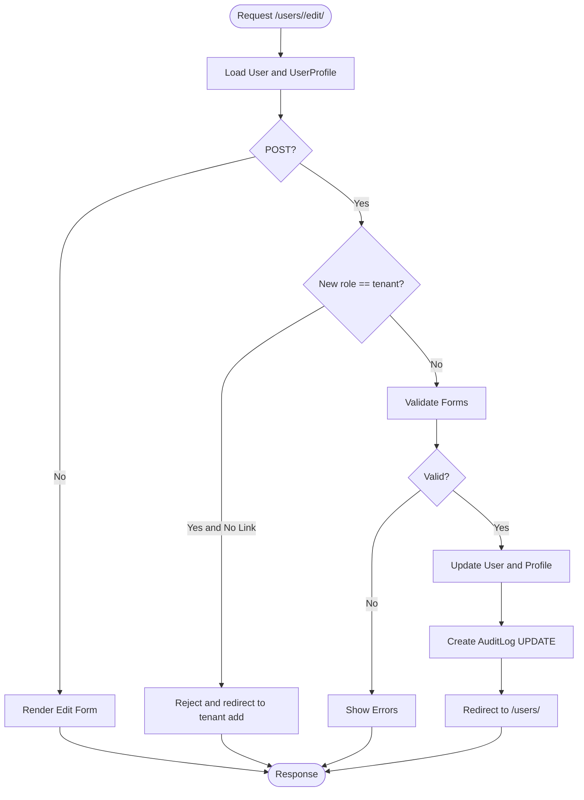

**Diagram sources**
- [core/views/users.py:98-145](file://core/views/users.py#L98-L145)

**Section sources**
- [core/views/users.py:98-145](file://core/views/users.py#L98-L145)

#### `POST /users/<pk>/deactivate/` — `user_deactivate`
- Purpose: Toggle user activation status.
- Authorization: Administrator only.
- Behavior:
  - Flips `is_active`.
  - Records either `DEACTIVATE` or `ACTIVATE` in audit logs.
  - Redirects to the user list.

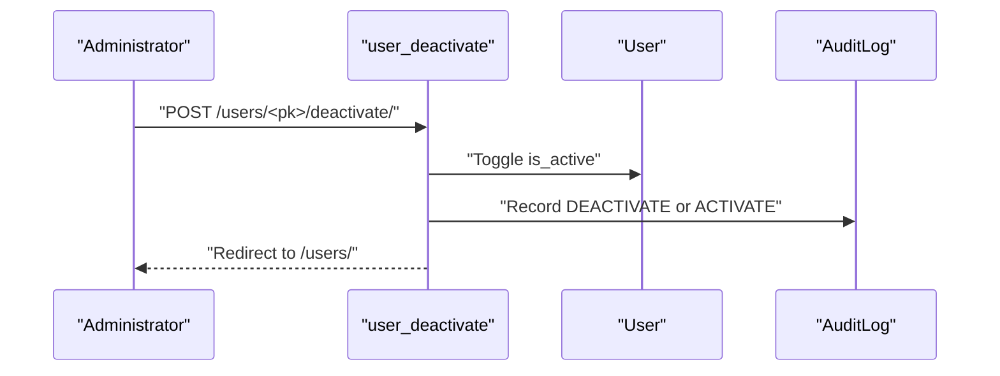

**Diagram sources**
- [core/views/users.py:148-164](file://core/views/users.py#L148-L164)

**Section sources**
- [core/views/users.py:148-164](file://core/views/users.py#L148-L164)

#### User Role Management
- Roles are stored on `UserProfile.role`:
  - `admin`, `collector`, `cashier`, `supervisor`, `treasurer`, `tenant`.
- The permission layer defines role groups and helpers:
  - `ADMIN_ROLES`, `MANAGEMENT_ROLES`, `COLLECTOR_ROLES`, `SUPERVISOR_ROLES`, `STAFF_ROLES`, `ALL_ROLES`.
  - `get_user_role`, `is_admin`, `is_staff_role`, `is_collector`, `is_management`.
  - `role_required` decorator and convenience decorators like `admin_required`.

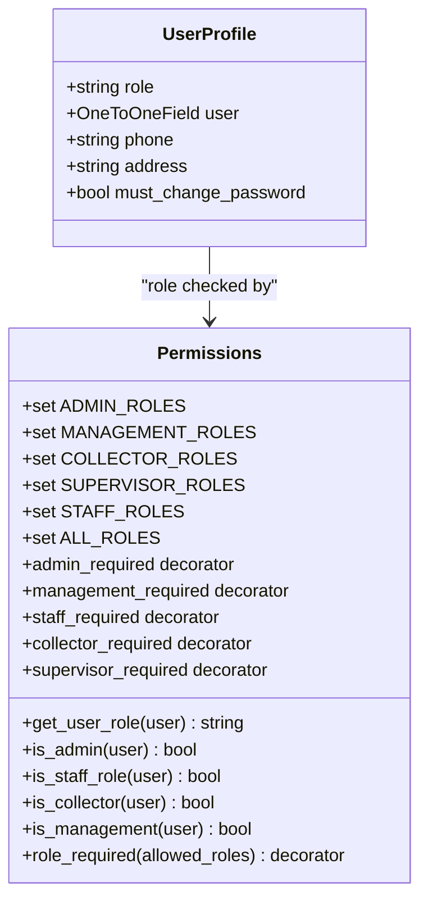

**Diagram sources**
- [core/models.py:7-23](file://core/models.py#L7-L23)
- [core/permissions.py:6-87](file://core/permissions.py#L6-L87)

**Section sources**
- [core/models.py:7-23](file://core/models.py#L7-L23)
- [core/permissions.py:6-87](file://core/permissions.py#L6-L87)

### Audit Log Access Endpoint

#### `GET /audit-logs/` — `audit_log_list`
- Purpose: Browse and filter audit log entries.
- Authorization: Administrator only.
- Filtering:
  - By user ID.
  - By action substring.
  - By module substring.
  - By date range (`date_from`, `date_to`).
  - Free-text search across username, names, action, module, description, and IP address.
- Rendering:
  - Full page template or HTMX partial table.
  - Pagination.

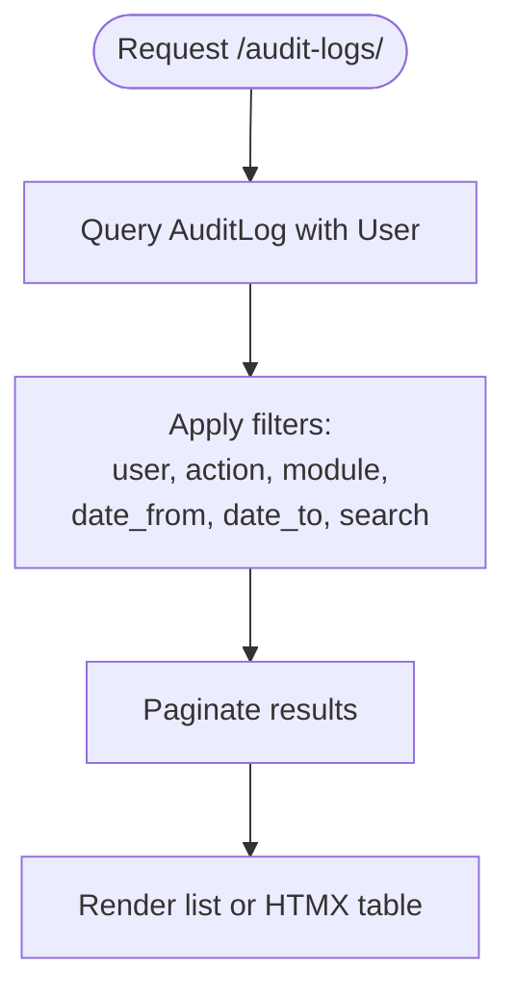

**Diagram sources**
- [core/views/audit.py:13-60](file://core/views/audit.py#L13-L60)
- [templates/audit/_table.html:1-65](file://templates/audit/_table.html#L1-L65)

**Section sources**
- [core/views/audit.py:13-60](file://core/views/audit.py#L13-L60)
- [templates/audit/_table.html:1-65](file://templates/audit/_table.html#L1-L65)

#### Audit Log Data Model
- Fields:
  - `user`: Optional reference to the actor.
  - `action`: Short label such as `CREATE`, `UPDATE`, `DEACTIVATE`, `ACTIVATE`.
  - `module`: Area affected, e.g., `User`, `SystemSettings`.
  - `description`: Human-readable explanation.
  - `ip_address`: Source IP captured from the request.
  - `created_at`: Timestamp of the event.

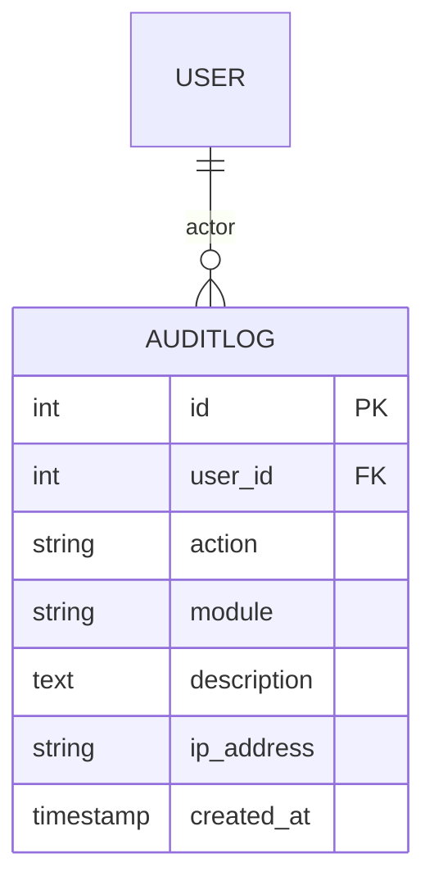

**Diagram sources**
- [core/models.py:304-316](file://core/models.py#L304-L316)

**Section sources**
- [core/models.py:304-316](file://core/models.py#L304-L316)

## Dependency Analysis
- URL routing connects endpoints to views.
- Views depend on:
  - `core.permissions.admin_required` for authorization.
  - `core.forms` for validation and UI widgets.
  - `core.models` for data persistence.
  - Django’s built-in `User` model for authentication.
- Templates render admin interfaces and rely on context variables passed by views.

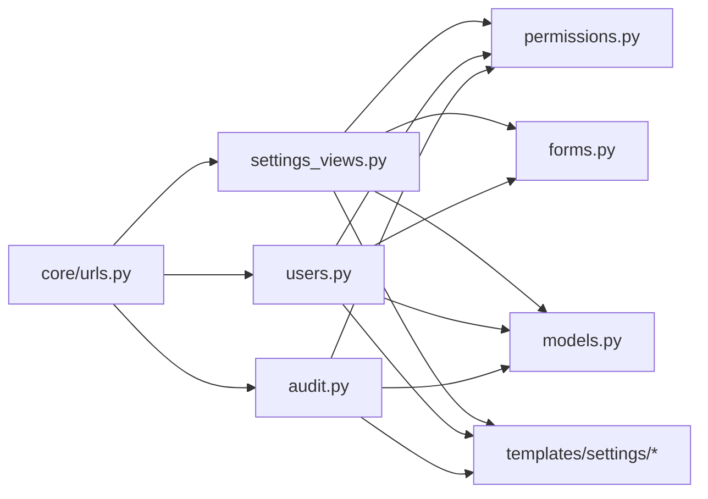

**Diagram sources**
- [core/urls.py:186-197](file://core/urls.py#L186-L197)
- [core/views/settings_views.py:9-55](file://core/views/settings_views.py#L9-L55)
- [core/views/users.py:16-164](file://core/views/users.py#L16-L164)
- [core/views/audit.py:13-60](file://core/views/audit.py#L13-L60)
- [core/permissions.py:61-87](file://core/permissions.py#L61-L87)
- [core/forms.py:540-560](file://core/forms.py#L540-L560)
- [core/forms.py:577-628](file://core/forms.py#L577-L628)
- [core/models.py:42-68](file://core/models.py#L42-L68)
- [core/models.py:7-23](file://core/models.py#L7-L23)
- [core/models.py:304-316](file://core/models.py#L304-L316)
- [templates/settings/view.html:27-120](file://templates/settings/view.html#L27-L120)
- [templates/users/_table.html:1-71](file://templates/users/_table.html#L1-L71)
- [templates/audit/_table.html:1-65](file://templates/audit/_table.html#L1-L65)

**Section sources**
- [core/urls.py:186-197](file://core/urls.py#L186-L197)
- [core/views/settings_views.py:9-55](file://core/views/settings_views.py#L9-L55)
- [core/views/users.py:16-164](file://core/views/users.py#L16-L164)
- [core/views/audit.py:13-60](file://core/views/audit.py#L13-L60)
- [core/permissions.py:61-87](file://core/permissions.py#L61-L87)
- [core/forms.py:540-560](file://core/forms.py#L540-L560)
- [core/forms.py:577-628](file://core/forms.py#L577-L628)
- [core/models.py:42-68](file://core/models.py#L42-L68)
- [core/models.py:7-23](file://core/models.py#L7-L23)
- [core/models.py:304-316](file://core/models.py#L304-L316)
- [templates/settings/view.html:27-120](file://templates/settings/view.html#L27-L120)
- [templates/users/_table.html:1-71](file://templates/users/_table.html#L1-L71)
- [templates/audit/_table.html:1-65](file://templates/audit/_table.html#L1-L65)

## Performance Considerations
- Use pagination for large user and audit log lists to avoid heavy queries.
- Prefer selective filtering rather than broad searches when possible.
- Avoid unnecessary file uploads for settings unless required.
- Cache frequently read system settings if performance becomes critical.
- Keep audit log queries efficient by indexing commonly filtered fields such as `created_at`, `user_id`, `action`, and `module`.

[No sources needed since this section provides general guidance]

## Troubleshooting Guide

### Cannot Access Settings or User Pages
- Cause: Insufficient permissions.
- Resolution: Ensure the logged-in user has the `admin` role or is a superuser.
- Reference: `admin_required` decorator restricts access to administrators.

**Section sources**
- [core/permissions.py:61-87](file://core/permissions.py#L61-L87)

### Tenant Role Assignment Fails
- Cause: Attempting to assign the tenant role outside the tenant creation workflow.
- Resolution: Create tenant accounts through the Tenants endpoint so the account is linked to a tenant record.
- Reference: `user_add` and `user_edit` reject unlinked tenant role assignments.

**Section sources**
- [core/views/users.py:47-95](file://core/views/users.py#L47-L95)
- [core/views/users.py:98-145](file://core/views/users.py#L98-L145)

### Settings Update Does Not Persist
- Cause: Form validation errors.
- Resolution: Review form fields and correct invalid inputs.
- Reference: `SystemSettingForm` validates municipality, market, office, receipt prefix, billing defaults, penalty rules, terms, logo, and theme color.

**Section sources**
- [core/forms.py:540-560](file://core/forms.py#L540-L560)
- [core/views/settings_views.py:9-55](file://core/views/settings_views.py#L9-L55)

### Audit Logs Missing Entries
- Cause: Actions may not have triggered audit logging, or filters are too restrictive.
- Resolution: Verify that the action path writes an audit log and adjust filters accordingly.
- Reference: Settings updates, user creation, updates, deactivation, and activation write audit entries.

**Section sources**
- [core/views/settings_views.py:9-55](file://core/views/settings_views.py#L9-L55)
- [core/views/users.py:47-164](file://core/views/users.py#L47-L164)
- [core/views/audit.py:13-60](file://core/views/audit.py#L13-L60)

## Conclusion
The system administration API provides secure, audited endpoints for configuring system settings, managing user accounts and roles, and reviewing activity logs. Administrators can set billing and penalty policies, provision and control staff and tenant accounts, and investigate compliance events. Proper use of these endpoints ensures controlled system configuration, clear account lifecycles, and reliable audit trails.

[No sources needed since this section summarizes without analyzing specific files]

## Appendices

### API Summary

#### Settings Management
- `GET /settings/`
  - Description: Display system settings form.
  - Authorization: Administrator.
  - Response: HTML form with current settings.
- `POST /settings/update/`
  - Description: Save system settings.
  - Authorization: Administrator.
  - Side Effects: Persists settings and creates audit log entry.

**Section sources**
- [core/urls.py:186-188](file://core/urls.py#L186-L188)
- [core/views/settings_views.py:9-55](file://core/views/settings_views.py#L9-L55)

#### User Administration
- `GET /users/`
  - Description: List users with pagination, role filter, and search.
  - Authorization: Administrator.
- `GET /users/add/`
  - Description: Create user and profile.
  - Authorization: Administrator.
  - Constraints: Tenant role requires tenant linkage.
- `GET /users/<pk>/edit/`
  - Description: Edit user and profile.
  - Authorization: Administrator.
  - Constraints: Tenant role requires tenant linkage.
- `POST /users/<pk>/deactivate/`
  - Description: Toggle user activation.
  - Authorization: Administrator.

**Section sources**
- [core/urls.py:193-197](file://core/urls.py#L193-L197)
- [core/views/users.py:16-164](file://core/views/users.py#L16-L164)

#### Audit Log Access
- `GET /audit-logs/`
  - Description: Browse and filter audit logs.
  - Authorization: Administrator.
  - Filters: user, action, module, date_from, date_to, search.

**Section sources**
- [core/urls.py:190-191](file://core/urls.py#L190-L191)
- [core/views/audit.py:13-60](file://core/views/audit.py#L13-L60)

### Examples

#### System Setup
- Navigate to `/settings/`.
- Fill municipality, market, office, receipt prefix, default due day, penalty type/value, grace period, terms and conditions, logo, and theme color.
- Submit to save and generate an audit log entry.

**Section sources**
- [templates/settings/view.html:27-120](file://templates/settings/view.html#L27-L120)
- [core/views/settings_views.py:9-55](file://core/views/settings_views.py#L9-L55)

#### User Provisioning
- Go to `/users/add/`.
- Enter username, name, email, password, and select a role.
- Submit to create the user and profile; ensure tenant role is assigned only through the tenant workflow.
- Review the audit log for the creation event.

**Section sources**
- [core/views/users.py:47-95](file://core/views/users.py#L47-L95)
- [core/views/audit.py:13-60](file://core/views/audit.py#L13-L60)

#### Audit Trail Analysis
- Open `/audit-logs/`.
- Filter by user, action, module, date range, or keyword.
- Investigate settings updates, user changes, and activation toggles.

**Section sources**
- [core/views/audit.py:13-60](file://core/views/audit.py#L13-L60)

### Security Considerations
- Administrative endpoints require administrator privileges.
- Superusers bypass role checks but should still be used judiciously.
- Sensitive operations are audited with actor, action, module, description, and IP address.
- Enforce strong passwords and consider additional authentication measures for production environments.

**Section sources**
- [core/permissions.py:61-87](file://core/permissions.py#L61-L87)
- [core/models.py:304-316](file://core/models.py#L304-L316)

### Data Retention Policies for Audit Logs
- Audit logs capture important administrative actions and should be retained according to organizational policy.
- Implement periodic archival or rotation strategies to manage database size.
- Restrict direct deletion of audit logs to maintain compliance integrity.

[No sources needed since this section provides general guidance]