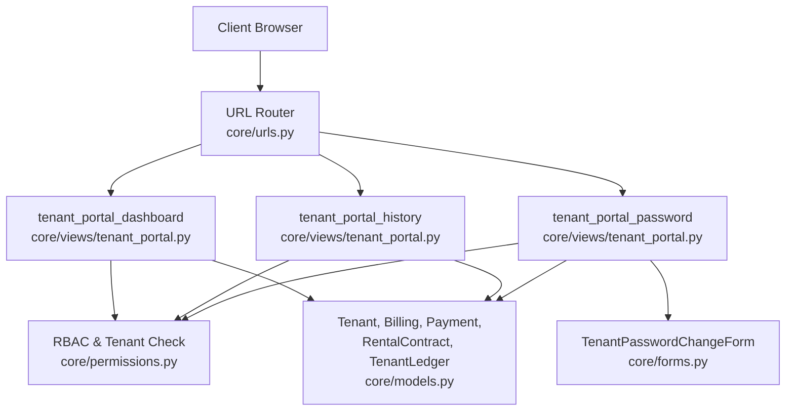
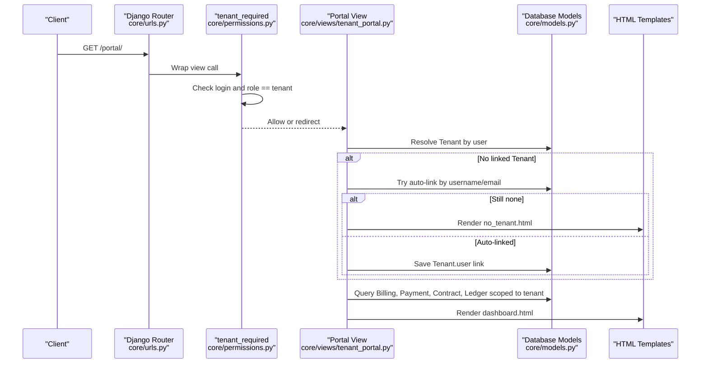
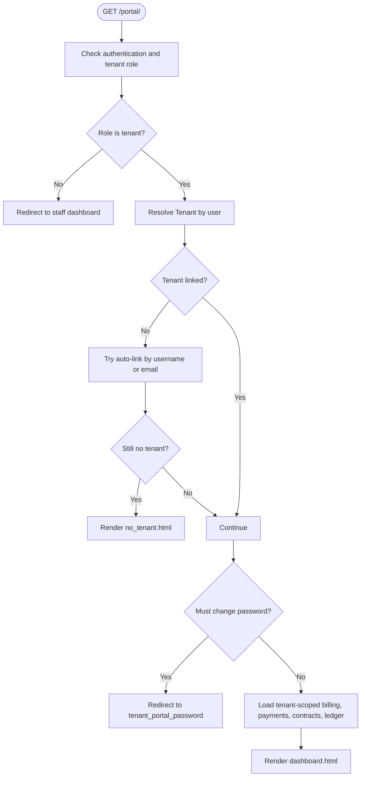
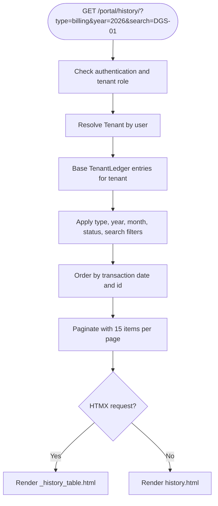
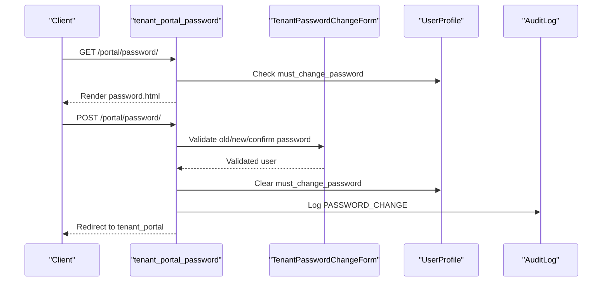
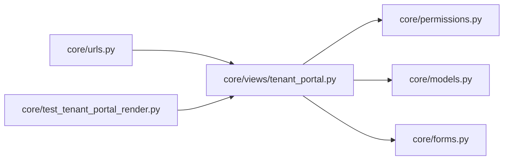
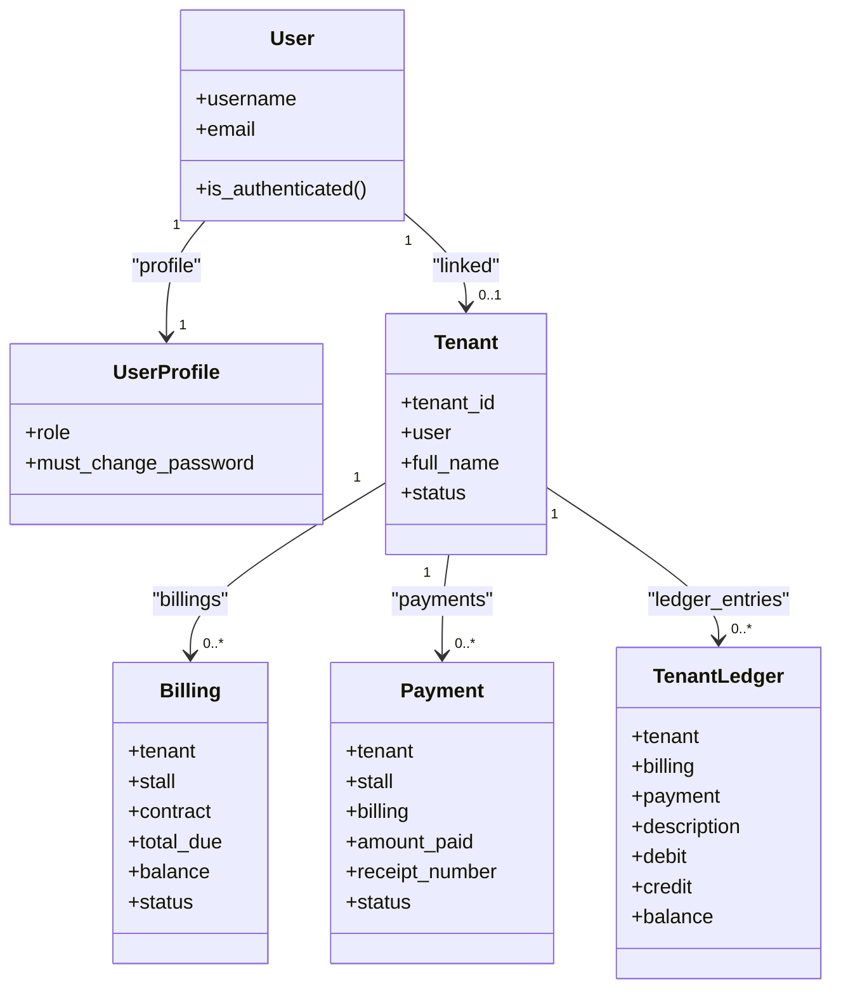

# Tenant Portal API

<cite>
**Referenced Files in This Document**
- [core/views/tenant_portal.py](file://core/views/tenant_portal.py)
- [core/permissions.py](file://core/permissions.py)
- [core/models.py](file://core/models.py)
- [core/forms.py](file://core/forms.py)
- [core/urls.py](file://core/urls.py)
- [core/test_tenant_portal_render.py](file://core/test_tenant_portal_render.py)
</cite>

## Table of Contents
1. [Introduction](#introduction)
2. [Project Structure](#project-structure)
3. [Core Components](#core-components)
4. [Architecture Overview](#architecture-overview)
5. [Detailed Component Analysis](#detailed-component-analysis)
6. [Dependency Analysis](#dependency-analysis)
7. [Performance Considerations](#performance-considerations)
8. [Security and Data Isolation](#security-and-data-isolation)
9. [Troubleshooting Guide](#troubleshooting-guide)
10. [Conclusion](#conclusion)

## Introduction
This document describes the tenant self-service portal endpoints for the Market Rental System. It focuses on three endpoints:

- `tenant_portal_dashboard` — read-only tenant dashboard showing balance, active contracts, upcoming due dates, payment milestones, and recent ledger entries.
- `tenant_portal_history` — paginated, filterable transaction history for the logged-in tenant.
- `tenant_portal_password` — self-service password change with forced reset when a temporary password is still active.

The portal is intentionally restricted to users with the `tenant` role and enforces strict data isolation so tenants can only view their own billing, payments, and ledger records.

## Project Structure
The tenant portal is implemented as Django views under `core.views.tenant_portal`, protected by decorators and helpers in `core.permissions`, and wired into URL routing through `core.urls`. The relevant domain models live in `core.models`, and the password form is defined in `core.forms`.

**Diagram sources**
- [core/urls.py:56-63](file://core/urls.py#L56-L63)
- [core/views/tenant_portal.py:102-171](file://core/views/tenant_portal.py#L102-L171)
- [core/views/tenant_portal.py:174-239](file://core/views/tenant_portal.py#L174-L239)
- [core/views/tenant_portal.py:242-279](file://core/views/tenant_portal.py#L242-L279)
- [core/permissions.py:102-124](file://core/permissions.py#L102-L124)
- [core/models.py:117-277](file://core/models.py#L117-L277)
- [core/forms.py:631-649](file://core/forms.py#L631-L649)

**Section sources**
- [core/urls.py:56-63](file://core/urls.py#L56-L63)
- [core/views/tenant_portal.py:1-18](file://core/views/tenant_portal.py#L1-L18)

## Core Components
The tenant portal consists of three main components:

| Endpoint | URL Pattern | HTTP Methods | Purpose | RBAC Requirement |
|---|---|---:|---|---|
| Tenant Dashboard | `/portal/` | GET | Render tenant financial summary, active contract, upcoming bills, payment milestones, and recent ledger entries. | Tenant role only. |
| Tenant History | `/portal/history/` | GET | Render paginated tenant transaction history with optional filters for type, year, month, status, and search text. | Tenant role only. |
| Tenant Password | `/portal/password/` | GET, POST | Allow tenants to change their password; force redirect if a temporary password is still active. | Tenant role only. |

All three endpoints are decorated with `@tenant_required`, which ensures that only authenticated users with the `tenant` role may access them. Non-tenant accounts, including administrators, are redirected to the staff dashboard with an error message.

**Section sources**
- [core/urls.py:60-63](file://core/urls.py#L60-L63)
- [core/views/tenant_portal.py:102-171](file://core/views/tenant_portal.py#L102-L171)
- [core/views/tenant_portal.py:174-239](file://core/views/tenant_portal.py#L174-L239)
- [core/views/tenant_portal.py:242-279](file://core/views/tenant_portal.py#L242-L279)
- [core/permissions.py:102-118](file://core/permissions.py#L102-L118)

## Architecture Overview
The tenant portal follows a layered request flow:

1. A client requests one of the portal URLs.
2. Django resolves the route from `core/urls.py`.
3. The view is wrapped by `@tenant_required`, which checks authentication and role.
4. The view resolves the linked `Tenant` record using `get_request_tenant`.
5. If no link exists, the view attempts a safe auto-link based on username or email.
6. If a tenant is still missing, the view renders a “no tenant” page.
7. If the account has a temporary password, the dashboard and history redirect to the password change page.
8. The view queries tenant-scoped data from `Billing`, `Payment`, `RentalContract`, and `TenantLedger`.
9. The view renders either a full HTML page or an HTMX fragment for the history table.

**Diagram sources**
- [core/urls.py:60-63](file://core/urls.py#L60-L63)
- [core/permissions.py:102-124](file://core/permissions.py#L102-L124)
- [core/views/tenant_portal.py:28-66](file://core/views/tenant_portal.py#L28-L66)
- [core/views/tenant_portal.py:102-171](file://core/views/tenant_portal.py#L102-L171)
- [core/models.py:117-277](file://core/models.py#L117-L277)

## Detailed Component Analysis

### Tenant Portal Dashboard
The dashboard endpoint provides a read-only overview of the tenant’s financial situation.

#### Endpoint Definition
- **Name:** `tenant_portal_dashboard`
- **URL name:** `tenant_portal`
- **Path:** `/portal/`
- **HTTP method:** GET
- **Response:** Full HTML page rendering `tenant_portal/dashboard.html`.

#### Access Control
- Requires authentication.
- Requires `role == 'tenant'`.
- Admins and other staff roles are redirected to the dashboard with an error message.

#### Data Scope
- All queries use the resolved `Tenant` object tied to `request.user`.
- Billings, payments, contracts, and ledger entries are filtered by `tenant`.
- There is no cross-tenant filtering logic because the view never accepts a tenant identifier from the request.

#### Key Data Elements
| Element | Source Model | Description |
|---|---|---|
| `tenant` | `Tenant` | Linked tenant profile. |
| `active_contract` | `RentalContract` | First active contract for the tenant. |
| `active_stalls` | `RentalContract` | Active contracts ordered by stall number. |
| `total_billed` | `Billing` | Sum of `total_due` across all billings. |
| `total_paid` | `Payment` | Sum of `amount_paid` for paid or partial payments. |
| `outstanding_balance` | `Billing` | Sum of `balance` for unpaid, partial, or overdue billings. |
| `overdue_balance` | `Billing` | Sum of `balance` for overdue billings. |
| `overdue_count` | `Billing` | Count of overdue billings. |
| `fully_paid` | `Payment` | Recent fully paid payments. |
| `partial_paid` | `Payment` | Recent partial payments. |
| `upcoming` | `Billing` | Upcoming or overdue billings with due date at or after today. |
| `recent_ledger` | `TenantLedger` | Most recent ledger entries. |

#### Example Dashboard Query Behavior
A typical dashboard request performs these operations:

1. Resolve the tenant linked to the current user.
2. Attempt auto-link if no tenant is found.
3. Redirect to password change if `must_change_password` is true.
4. Compute financial totals from `Billing` and `Payment`.
5. Load active contracts and stalls.
6. Load recent payments and upcoming billings.
7. Load recent ledger entries.
8. Render the dashboard template.

**Diagram sources**
- [core/views/tenant_portal.py:102-171](file://core/views/tenant_portal.py#L102-L171)
- [core/views/tenant_portal.py:28-78](file://core/views/tenant_portal.py#L28-L78)

**Section sources**
- [core/views/tenant_portal.py:102-171](file://core/views/tenant_portal.py#L102-L171)
- [core/models.py:117-277](file://core/models.py#L117-L277)

### Tenant Portal History
The history endpoint exposes the tenant’s complete transaction ledger with pagination and filtering.

#### Endpoint Definition
- **Name:** `tenant_portal_history`
- **URL name:** `tenant_portal_history`
- **Path:** `/portal/history/`
- **HTTP methods:** GET
- **Response:** Full HTML page or HTMX fragment depending on request headers.

#### Request Parameters
| Parameter | Type | Description |
|---|---|---|
| `type` | String | Filter by `billing` (debit) or `payment` (credit). |
| `year` | Integer | Filter by `transaction_date__year`. |
| `month` | Integer | Filter by `transaction_date__month`. |
| `status` | String | Filter by billing or payment status. |
| `search` | String | Search description, stall number, or receipt number. |
| `page` | Integer | Page number for pagination. |

#### Response Behavior
- Normal GET requests render `tenant_portal/history.html`.
- Requests with HTMX headers render `tenant_portal/_history_table.html`.
- Results are limited to 15 entries per page.
- Available years are derived from existing ledger transactions.

#### Example History Query Flow

**Diagram sources**
- [core/views/tenant_portal.py:174-239](file://core/views/tenant_portal.py#L174-L239)

**Section sources**
- [core/views/tenant_portal.py:174-239](file://core/views/tenant_portal.py#L174-L239)
- [core/models.py:261-277](file://core/models.py#L261-L277)

### Tenant Portal Password
The password endpoint allows tenants to change their password and logs the action.

#### Endpoint Definition
- **Name:** `tenant_portal_password`
- **URL name:** `tenant_portal_password`
- **Path:** `/portal/password/`
- **HTTP methods:** GET, POST
- **Response:** Renders `tenant_portal/password.html`.

#### Forced Password Change
- If the user’s profile has `must_change_password` set to true, the dashboard and history redirect to this endpoint.
- On successful POST, the system clears the flag and keeps the session valid.

#### Validation and Audit
- Uses `TenantPasswordChangeForm`, which inherits Django’s password change validation.
- On success, creates an audit log entry with action `PASSWORD_CHANGE`.

**Diagram sources**
- [core/views/tenant_portal.py:242-279](file://core/views/tenant_portal.py#L242-L279)
- [core/forms.py:631-649](file://core/forms.py#L631-L649)
- [core/models.py:7-20](file://core/models.py#L7-L20)
- [core/models.py:304-316](file://core/models.py#L304-L316)

**Section sources**
- [core/views/tenant_portal.py:242-279](file://core/views/tenant_portal.py#L242-L279)
- [core/forms.py:631-649](file://core/forms.py#L631-L649)
- [core/models.py:7-20](file://core/models.py#L7-L20)
- [core/models.py:304-316](file://core/models.py#L304-L316)

## Dependency Analysis
The tenant portal depends on several core modules:

**Diagram sources**
- [core/views/tenant_portal.py:15-17](file://core/views/tenant_portal.py#L15-L17)
- [core/urls.py:54-63](file://core/urls.py#L54-L63)
- [core/test_tenant_portal_render.py:120-136](file://core/test_tenant_portal_render.py#L120-L136)

**Section sources**
- [core/views/tenant_portal.py:15-17](file://core/views/tenant_portal.py#L15-L17)
- [core/urls.py:54-63](file://core/urls.py#L54-L63)

## Performance Considerations
- The dashboard uses `select_related` for related objects such as `stall`, `contract`, `billing`, `collected_by`, and `payment` to reduce N+1 queries.
- The history endpoint applies filters before pagination, reducing the dataset size before slicing results.
- Pagination is fixed at 15 entries per page for the history table.
- Financial summaries aggregate values directly from the database rather than computing them in Python loops.

[No sources needed since this section provides general guidance]

## Security and Data Isolation
The tenant portal enforces two layers of security:

1. **Role-based access control:** Only users with the `tenant` role can access the portal endpoints.
2. **Data isolation:** All data queries are scoped to the `Tenant` record linked to the authenticated user.

#### RBAC Enforcement
- `tenant_required` decorator blocks non-tenant roles.
- `get_user_role` reads the role from `UserProfile.role`.
- Superusers are explicitly excluded from the portal because it is not a staff management area.

#### Data Isolation Mechanism
- Views resolve the tenant via `get_request_tenant(request.user)`.
- Queries filter by `tenant=tenant` for `Billing`, `Payment`, and `TenantLedger`.
- Contracts and stalls are loaded only for the resolved tenant.
- There is no endpoint parameter that allows a tenant to specify another tenant’s ID.

#### Cross-Tenant Protection
Tests assert that a tenant cannot see another tenant’s information in the dashboard response. This validates that the implementation does not leak data across tenants.

**Diagram sources**
- [core/models.py:7-20](file://core/models.py#L7-L20)
- [core/models.py:117-154](file://core/models.py#L117-L154)
- [core/models.py:190-277](file://core/models.py#L190-L277)

**Section sources**
- [core/permissions.py:32-43](file://core/permissions.py#L32-L43)
- [core/permissions.py:102-124](file://core/permissions.py#L102-L124)
- [core/views/tenant_portal.py:80-99](file://core/views/tenant_portal.py#L80-L99)
- [core/test_tenant_portal_render.py:127-136](file://core/test_tenant_portal_render.py#L127-L136)

## Troubleshooting Guide

### Tenant Cannot Access Portal
**Symptoms:**
- Redirected to the staff dashboard.
- Error message indicating the area is reserved for tenant accounts.

**Likely Causes:**
- Logged-in user has a role other than `tenant`.
- Logged-in user is a superuser; the portal deliberately excludes non-tenant accounts.

**Resolution:**
- Ensure the user’s `UserProfile.role` is `tenant`.
- Use the staff dashboard for administrative tasks.

**Section sources**
- [core/permissions.py:102-118](file://core/permissions.py#L102-L118)

### Tenant Account Has No Linked Tenant Record
**Symptoms:**
- Dashboard shows a “no tenant” state.
- Auto-link attempt fails.

**Likely Causes:**
- Account was created manually without going through the canonical tenant creation flow.
- Legacy tenant record exists but its `user` foreign key was never set.

**Resolution:**
- Verify whether exactly one unassigned tenant matches the username or email.
- If multiple candidates exist, do not auto-link; fix the linkage through admin or tenant management.

**Section sources**
- [core/views/tenant_portal.py:28-66](file://core/views/tenant_portal.py#L28-L66)
- [core/views/tenant_portal.py:69-71](file://core/views/tenant_portal.py#L69-L71)

### Tenant Is Forced to Change Password
**Symptoms:**
- Dashboard redirects to the password change page.
- History redirects to the password change page.
- Message instructs the tenant to set a new password.

**Likely Causes:**
- `UserProfile.must_change_password` is true.
- Temporary password was generated during account setup.

**Resolution:**
- Submit a valid password change through `/portal/password/`.
- After success, the flag is cleared and normal portal access resumes.

**Section sources**
- [core/views/tenant_portal.py:74-78](file://core/views/tenant_portal.py#L74-L78)
- [core/views/tenant_portal.py:110-112](file://core/views/tenant_portal.py#L110-L112)
- [core/views/tenant_portal.py:182-184](file://core/views/tenant_portal.py#L182-L184)
- [core/views/tenant_portal.py:252-261](file://core/views/tenant_portal.py#L252-L261)

### History Page Shows Unexpected Filters
**Symptoms:**
- History table appears empty.
- Filters do not seem to apply.

**Likely Causes:**
- Incorrect query parameters.
- No ledger entries match the selected year, month, type, status, or search term.

**Resolution:**
- Remove filters one by one to identify the restrictive filter.
- Confirm that ledger entries exist for the tenant and selected time range.

**Section sources**
- [core/views/tenant_portal.py:196-219](file://core/views/tenant_portal.py#L196-L219)

## Conclusion
The tenant self-service portal provides secure, read-only access for tenants to review their own financial data. The three endpoints—dashboard, history, and password—are protected by role-based access control and enforce strict tenant-scoped data isolation. The implementation avoids cross-tenant data leakage by resolving the tenant from the authenticated user and filtering all queries accordingly. For operational reliability, the portal also supports automatic tenant linking, forced password changes, and audit logging for sensitive actions.