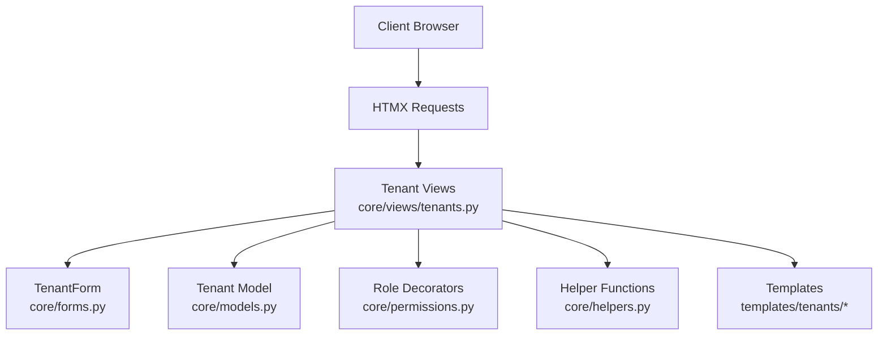
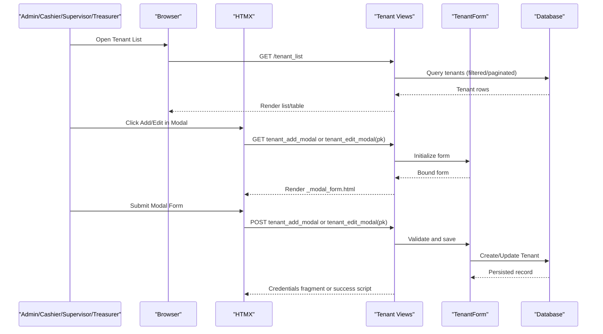
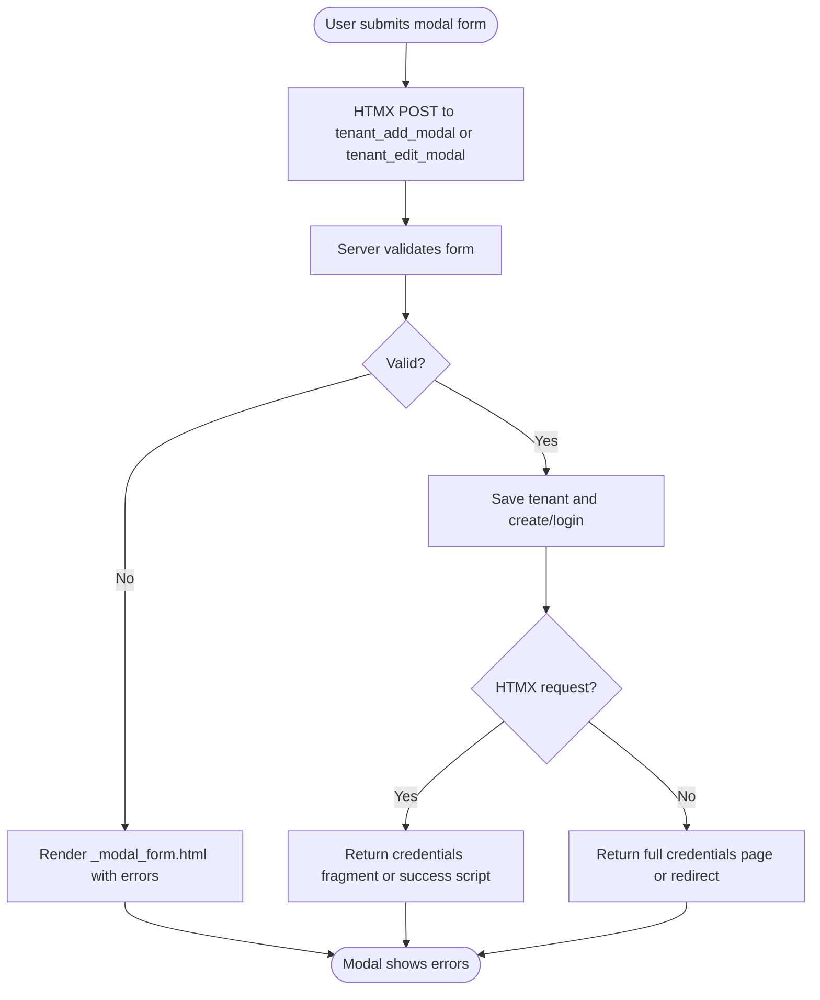
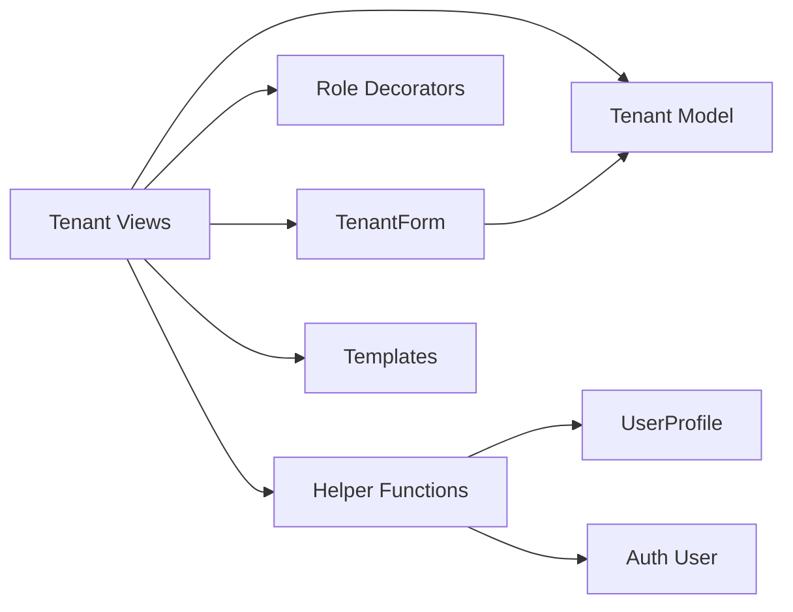

# Tenants API

<cite>
**Referenced Files in This Document**
- [tenants.py](file://core/views/tenants.py)
- [models.py](file://core/models.py)
- [forms.py](file://core/forms.py)
- [permissions.py](file://core/permissions.py)
- [_modal_form.html](file://templates/tenants/_modal_form.html)
- [_table.html](file://templates/tenants/_table.html)
- [helpers.py](file://core/helpers.py)
</cite>

## Table of Contents
1. [Introduction](#introduction)
2. [Project Structure](#project-structure)
3. [Core Components](#core-components)
4. [Architecture Overview](#architecture-overview)
5. [Detailed Component Analysis](#detailed-component-analysis)
6. [Dependency Analysis](#dependency-analysis)
7. [Performance Considerations](#performance-considerations)
8. [Troubleshooting Guide](#troubleshooting-guide)
9. [Conclusion](#conclusion)

## Introduction
This document describes the tenant management endpoints for the Market Rental System. It covers:
- CRUD operations: listing, adding, editing, and terminating tenants.
- Bulk deletion of multiple tenants.
- Specialized endpoints for search and HTMX modal-based add/edit flows.
- Request/response schemas for tenant data, including business information, contact details, and valid ID uploads.
- HTMX modal interactions for dynamic form submission without full page reloads.
- Validation rules enforced by the tenant form and model.
- Permission requirements for each operation.

The system is a Django application where views render HTML templates and optionally return JSON or partial fragments for HTMX-driven UI updates.

## Project Structure
Tenant-related functionality lives primarily under `core/views/tenants.py`, with data models in `core/models.py`, form validation in `core/forms.py`, role-based access control in `core/permissions.py`, and UI fragments in `templates/tenants`.

**Diagram sources**
- [tenants.py:23-363](file://core/views/tenants.py#L23-L363)
- [forms.py:49-198](file://core/forms.py#L49-L198)
- [models.py:117-154](file://core/models.py#L117-L154)
- [permissions.py:61-87](file://core/permissions.py#L61-L87)
- [_modal_form.html:12-39](file://templates/tenants/_modal_form.html#L12-L39)

**Section sources**
- [tenants.py:23-363](file://core/views/tenants.py#L23-L363)
- [models.py:117-154](file://core/models.py#L117-L154)
- [forms.py:49-198](file://core/forms.py#L49-L198)
- [permissions.py:61-87](file://core/permissions.py#L61-L87)
- [_modal_form.html:12-39](file://templates/tenants/_modal_form.html#L12-L39)

## Core Components
- **Tenant model**: Stores identity, address, contact, identification, business, status, and timestamps.
- **TenantForm**: Validates and normalizes tenant input, composes full name and address, generates tenant IDs, and prevents duplicates.
- **Tenant views**: Provide list, add, edit, terminate, bulk delete, search, and modal add/edit endpoints.
- **Permissions**: Enforce role-based access using decorators such as `management_required` and `admin_required`.
- **Helpers**: Generate secure tenant logins, strong passwords, and tenant IDs; support PDF rendering and financial helpers not directly used by tenant CRUD but part of the broader system.

**Section sources**
- [models.py:117-154](file://core/models.py#L117-L154)
- [forms.py:49-198](file://core/forms.py#L49-L198)
- [tenants.py:23-363](file://core/views/tenants.py#L23-L363)
- [permissions.py:61-87](file://core/permissions.py#L61-L87)
- [helpers.py:18-122](file://core/helpers.py#L18-L122)

## Architecture Overview
The tenant management flow uses Django views decorated with role-based permissions. HTMX enables partial page updates for table pagination, filtering, and modal forms.

**Diagram sources**
- [tenants.py:23-363](file://core/views/tenants.py#L23-L363)
- [_modal_form.html:12-39](file://templates/tenants/_modal_form.html#L12-L39)

## Detailed Component Analysis

### Endpoint Reference

| Endpoint | Method | URL Pattern | Role Required | Description | Request Body | Response |
|---|---:|---|---|---|---|---|
| `tenant_list` | GET | `/tenants/list/` | Management roles | Lists tenants with optional status filter and search query. Supports HTMX partial table swaps and pagination. | Query params: `status`, `search`, `page` | HTML list view or `_table.html` fragment when HTMX |
| `tenant_add` | GET/POST | `/tenants/add/` | Management roles | Full-page add form. On successful creation, returns credentials page with generated username/password. | Form fields per `TenantForm` | HTML form or credentials page |
| `tenant_edit` | GET/POST | `/tenants/edit/<pk>/` | Management roles | Full-page edit form. Updates tenant and redirects to list on success. | Form fields per `TenantForm` | HTML form or redirect |
| `tenant_delete` | POST | `/tenants/delete/<pk>/` | Admin only | Terminates a tenant by setting status to `Terminated` and deactivating linked portal login. | CSRF token | Redirect to tenant list |
| `tenant_bulk_delete` | POST | `/tenants/bulk-delete/` | Admin only | Hard-deletes selected tenants that have no payment history. Skips tenants with payments or partially paid billings. | CSRF token + `selected_tenants[]` | Redirect to tenant list with messages |
| `tenant_search` | GET | `/tenants/search/?q=` | Management roles | Returns active tenants matching name, ID, or business name. JSON array unless HTMX returns search results fragment. | Query param: `q` | JSON array or `_search_results.html` fragment |
| `tenant_add_modal` | GET/POST | `/tenants/add-modal/` | Management roles | HTMX modal add form. On success, returns credentials fragment or re-renders form with errors. | Form fields per `TenantForm` | `_modal_form.html` or `_credentials_fragment.html` |
| `tenant_edit_modal` | GET/POST | `/tenants/edit-modal/<pk>/` | Management roles | HTMX modal edit form. On success, returns script to close modal and refresh list. | Form fields per `TenantForm` | `_modal_form.html` or success script |

**Section sources**
- [tenants.py:23-363](file://core/views/tenants.py#L23-L363)
- [permissions.py:61-87](file://core/permissions.py#L61-L87)

### Data Schema: Tenant
The tenant data model defines the following fields:

| Field | Type | Required | Notes |
|---|---|---:|---|
| `tenant_id` | CharField (unique) | Yes | Auto-generated in format `TEN-###`; unique across tenants |
| `user` | OneToOne to User | No | Optional portal login account created automatically |
| `full_name` | CharField | Yes | Composed from first/middle/last name during save |
| `first_name` | CharField | Yes | Validated via form |
| `middle_name` | CharField | No | Optional |
| `last_name` | CharField | Yes | Validated via form |
| `address` | TextField | Yes | Composed from street/barangay/municipality/province |
| `street` | CharField | Yes | Address component |
| `barangay` | CharField | Yes | Address component |
| `municipality` | CharField | Yes | Address component |
| `province` | CharField | Yes | Address component |
| `contact_number` | CharField | Yes | Phone number |
| `email` | EmailField | No | Optional email |
| `valid_id_type` | CharField | No | Dropdown choices for identification type |
| `valid_id_number` | CharField | No | ID number |
| `valid_id_image` | ImageField | No | Upload JPG/PNG of valid ID |
| `business_name` | CharField | No | Business trade name |
| `business_type` | CharField | No | Dropdown choices defined in form |
| `emergency_contact_name` | CharField | No | Emergency contact name |
| `emergency_contact_number` | CharField | No | Emergency contact phone |
| `status` | CharField | Yes | Choices: Active, Inactive, Suspended, Terminated |
| `date_registered` | DateField | Auto | Set on creation |
| `notes` | TextField | No | Optional notes |
| `created_at` | DateTimeField | Auto | Record creation timestamp |
| `updated_at` | DateTimeField | Auto | Last update timestamp |

**Section sources**
- [models.py:117-154](file://core/models.py#L117-L154)

### Request Schemas

#### Tenant List (`tenant_list`)
- **Method**: GET
- **Query Parameters**:
  - `status`: Filter by tenant status (e.g., `Active`, `Inactive`, `Suspended`, `Terminated`)
  - `search`: Free-text search across `full_name`, `tenant_id`, `business_name`
  - `page`: Pagination page number
- **Response**:
  - HTML list view with context variables: `page_obj`, `status_filter`, `search_query`, `pagination_target`, `can_bulk_delete`
  - HTMX response: `_table.html` fragment containing paginated tenant rows

#### Tenant Add (`tenant_add`)
- **Method**: GET/POST
- **Request Body**:
  - `first_name`, `middle_name`, `last_name`
  - `street`, `barangay`, `municipality`, `province`
  - `contact_number`, `email`
  - `valid_id_type`, `valid_id_number`, `valid_id_image`
  - `business_name`, `business_type`
  - `emergency_contact_name`, `emergency_contact_number`
  - `status`, `notes`
  - CSRF token
- **Response**:
  - GET: HTML form
  - POST success: Credentials page with generated username and password
  - POST failure: Re-rendered form with validation errors

#### Tenant Edit (`tenant_edit`)
- **Method**: GET/POST
- **URL Parameter**: `pk` (tenant primary key)
- **Request Body**: Same as tenant add
- **Response**:
  - GET: HTML form pre-filled with existing tenant data
  - POST success: Redirect to tenant list with success message
  - POST failure: Re-rendered form with validation errors

#### Tenant Delete (`tenant_delete`)
- **Method**: POST
- **URL Parameter**: `pk` (tenant primary key)
- **Request Body**: CSRF token
- **Behavior**:
  - Sets tenant status to `Terminated`
  - Deactivates linked portal user account if present
  - Logs audit entry
- **Response**: Redirect to tenant list

#### Tenant Bulk Delete (`tenant_bulk_delete`)
- **Method**: POST
- **Request Body**:
  - CSRF token
  - `selected_tenants[]`: Array of tenant primary keys
- **Behavior**:
  - Parses and deduplicates selected IDs
  - Locks rows when supported by database backend
  - Preloads payment and billing history to block deletion for tenants with financial records
  - Deletes tenants without financial history; deletes linked portal user
  - Creates single audit log summarizing deleted and blocked tenants
- **Response**: Redirect to tenant list with success/warning/error messages

#### Tenant Search (`tenant_search`)
- **Method**: GET
- **Query Parameter**: `q` (search string)
- **Response**:
  - JSON array of objects with fields: `id`, `tenant_id`, `full_name`, `business_name`
  - HTMX response: `_search_results.html` fragment

#### Tenant Add Modal (`tenant_add_modal`)
- **Method**: GET/POST
- **Request Body**: Same as tenant add
- **Response**:
  - GET: `_modal_form.html` with empty form
  - POST success: `_credentials_fragment.html` with generated credentials
  - POST failure: `_modal_form.html` with validation errors

#### Tenant Edit Modal (`tenant_edit_modal`)
- **Method**: GET/POST
- **URL Parameter**: `pk` (tenant primary key)
- **Request Body**: Same as tenant add
- **Response**:
  - GET: `_modal_form.html` with pre-filled form
  - POST success: Script to close modal, show toast, and reload list
  - POST failure: `_modal_form.html` with validation errors

**Section sources**
- [tenants.py:23-363](file://core/views/tenants.py#L23-L363)

### Validation Rules
- **Duplicate Prevention**: The form checks for existing tenants with normalized names (case-insensitive, whitespace-tolerant). If a duplicate is found, it raises a non-field error instructing the user to edit the existing record.
- **Name Composition**: `full_name` is composed from `first_name`, `middle_name`, and `last_name` during save.
- **Address Composition**: `address` is composed from `street`, `barangay`, `municipality`, and `province`.
- **Tenant ID Generation**: If not set, a sequential `TEN-###` ID is generated based on the highest existing numeric suffix.
- **Business Type Choices**: Restricted to predefined options in the form.
- **Email Validation**: Uses Django’s built-in email field validation.
- **Status Choices**: Restricted to Active, Inactive, Suspended, Terminated.

**Section sources**
- [forms.py:49-198](file://core/forms.py#L49-L198)

### Permission Requirements
- **Management Roles**: `admin`, `cashier`, `supervisor`, `treasurer` can access list, add, edit, search, and modal endpoints.
- **Admin Only**: Termination and bulk deletion require admin role.
- **Decorator Enforcement**:
  - `@management_required`: Protects tenant list, add, edit, search, and modal endpoints.
  - `@admin_required`: Protects tenant delete and bulk delete endpoints.

**Section sources**
- [permissions.py:61-87](file://core/permissions.py#L61-L87)
- [tenants.py:23-363](file://core/views/tenants.py#L23-L363)

### HTMX Modal Interactions
- **Modal Form Submission**:
  - Forms use `hx-post` to submit to `tenant_add_modal` or `tenant_edit_modal`.
  - `hx-target="#modal-content"` replaces the modal body with the server response.
  - `hx-encoding="multipart/form-data"` supports file uploads (valid ID image).
- **Success Handling**:
  - Add modal: Replaces modal content with credentials fragment.
  - Edit modal: Returns script to close modal, show success toast, and reload the page.
- **Error Handling**:
  - Re-renders `_modal_form.html` with validation errors displayed inline.

**Diagram sources**
- [_modal_form.html:12-39](file://templates/tenants/_modal_form.html#L12-L39)
- [tenants.py:305-363](file://core/views/tenants.py#L305-L363)

**Section sources**
- [_modal_form.html:12-39](file://templates/tenants/_modal_form.html#L12-L39)
- [tenants.py:305-363](file://core/views/tenants.py#L305-L363)

### Examples

#### Tenant Creation Workflow
1. Admin opens tenant list and clicks “Add Tenant”.
2. HTMX loads `_modal_form.html` into the modal.
3. Admin fills out required fields: first name, last name, street, barangay, municipality, province, contact number, business type, status.
4. Optional fields: middle name, email, valid ID type/number/image, emergency contact, notes.
5. On submit, server validates and saves tenant, generates `TEN-###` ID, creates portal login with secure temporary password.
6. Modal displays credentials fragment with username and password for sharing.

**Section sources**
- [tenants.py:54-81](file://core/views/tenants.py#L54-L81)
- [tenants.py:305-333](file://core/views/tenants.py#L305-L333)
- [helpers.py:92-122](file://core/helpers.py#L92-L122)

#### Search Queries
- Use `GET /tenants/search/?q=<query>` to retrieve up to 20 active tenants matching name, ID, or business name.
- Response is JSON array with `id`, `tenant_id`, `full_name`, `business_name`.
- HTMX can also return `_search_results.html` fragment for inline display.

**Section sources**
- [tenants.py:290-302](file://core/views/tenants.py#L290-L302)

#### Bulk Deletion Operations
1. Admin selects multiple tenants using checkboxes in the list table.
2. Bulk bar appears with count and “Delete Selected” button.
3. On submit, server parses `selected_tenants[]`, deduplicates, locks rows if supported.
4. For each tenant:
   - If tenant has payments or partially paid billings, skip and add to blocked list.
   - Otherwise, delete tenant and linked portal user.
5. Single audit log summarizes deleted and blocked tenants.
6. Messages inform admin of outcomes.

**Section sources**
- [tenants.py:127-263](file://core/views/tenants.py#L127-L263)
- [_table.html:3-26](file://templates/tenants/_table.html#L3-L26)

## Dependency Analysis
Tenant management depends on several core components:

**Diagram sources**
- [tenants.py:1-16](file://core/views/tenants.py#L1-L16)
- [forms.py:11-15](file://core/forms.py#L11-L15)
- [helpers.py:92-122](file://core/helpers.py#L92-L122)

**Section sources**
- [tenants.py:1-16](file://core/views/tenants.py#L1-L16)
- [forms.py:11-15](file://core/forms.py#L11-L15)
- [helpers.py:92-122](file://core/helpers.py#L92-L122)

## Performance Considerations
- **Pagination**: Tenant list uses Django’s `Paginator` to limit results to 10 per page, reducing memory usage and improving load times.
- **HTMX Partial Rendering**: Modal forms and table updates use HTMX to avoid full page reloads, improving UX and reducing bandwidth.
- **Bulk Delete Optimization**: Bulk deletion preloads payment and billing history using efficient queries to avoid N+1 problems. Row locking is conditionally applied based on database capabilities.
- **Audit Logging**: Each significant action logs to `AuditLog`, which should be monitored for performance impact in high-volume environments.

[No sources needed since this section provides general guidance]

## Troubleshooting Guide
- **Duplicate Tenant Error**: If form validation fails due to duplicate name, check existing tenants and edit instead of creating a new record.
- **File Upload Issues**: Ensure `valid_id_image` is a supported format (JPG/PNG) and within size limits. Check server upload configuration.
- **Permission Denied**: Verify user role matches required permissions. Management roles cannot terminate or bulk delete; only admins can.
- **Bulk Delete Blocked**: Tenants with payment history cannot be hard-deleted. Use termination or void payments first.
- **HTMX Modal Not Closing**: After successful edit, ensure client-side script `closeModal()` is available and modal container `#modal-content` exists.

**Section sources**
- [forms.py:156-198](file://core/forms.py#L156-L198)
- [tenants.py:107-124](file://core/views/tenants.py#L107-L124)
- [tenants.py:127-263](file://core/views/tenants.py#L127-L263)
- [tenants.py:336-363](file://core/views/tenants.py#L336-L363)

## Conclusion
The tenant management API provides comprehensive CRUD operations, bulk actions, and specialized search functionality. HTMX enables seamless modal interactions for add/edit workflows. Robust validation ensures data integrity, while role-based permissions enforce security. Administrators can manage tenant lifecycles efficiently, with safeguards against accidental deletion of financially active records.

[No sources needed since this section summarizes without analyzing specific files]