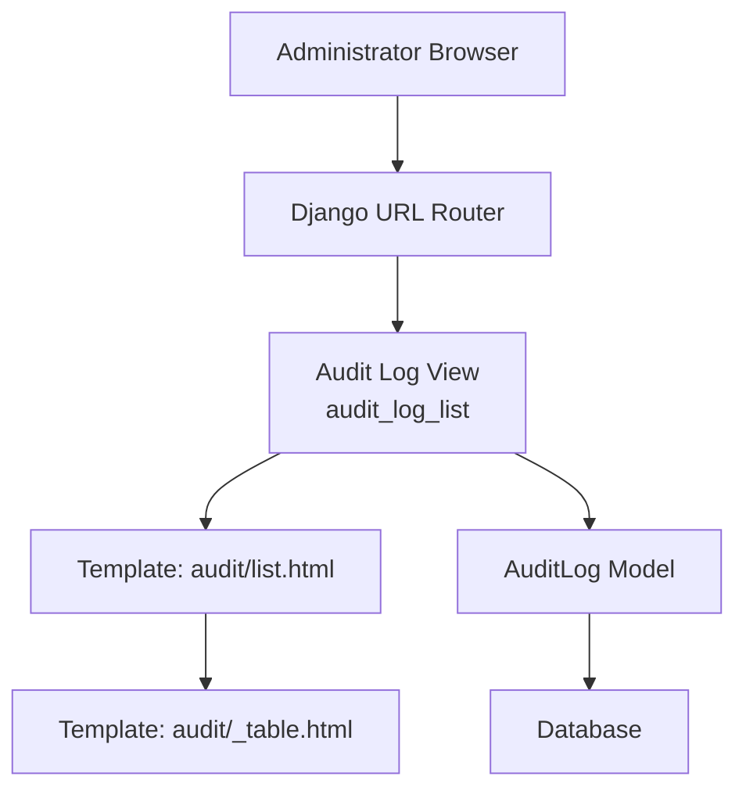
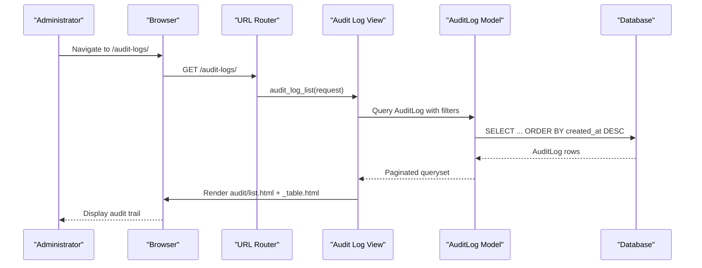
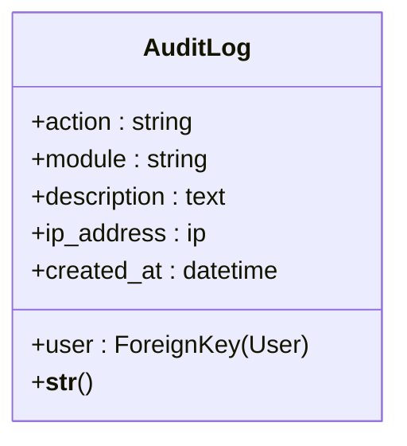
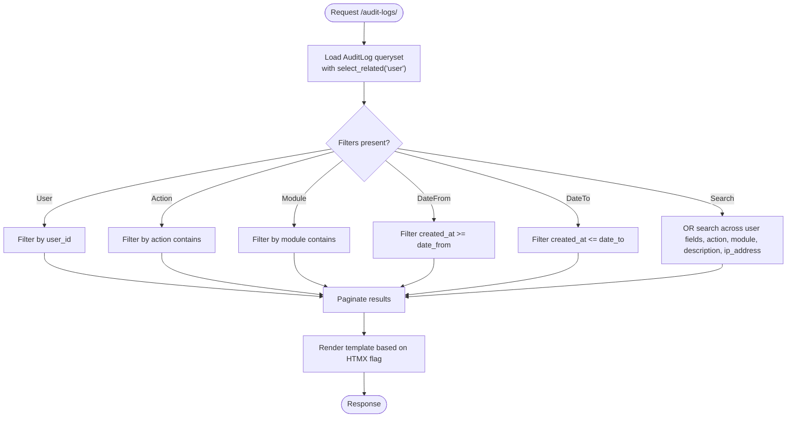
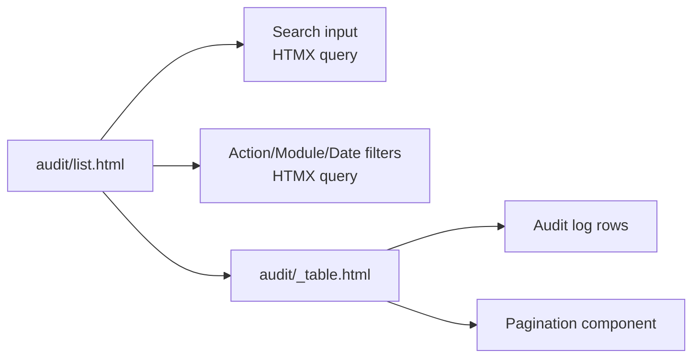
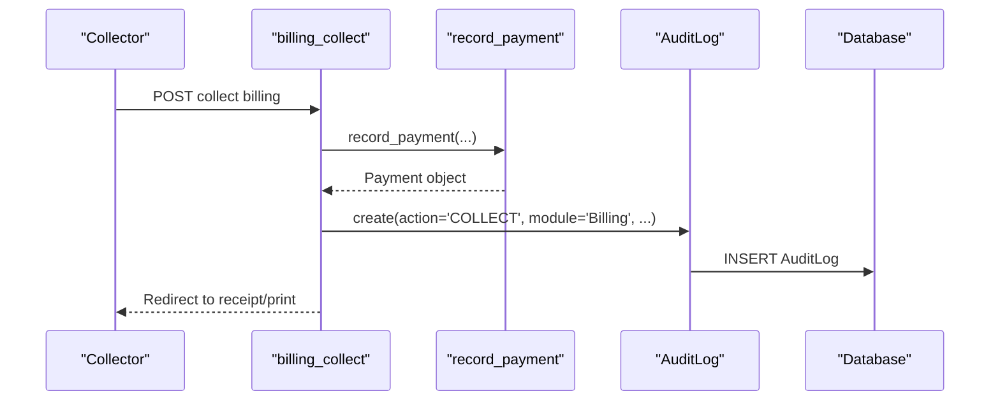
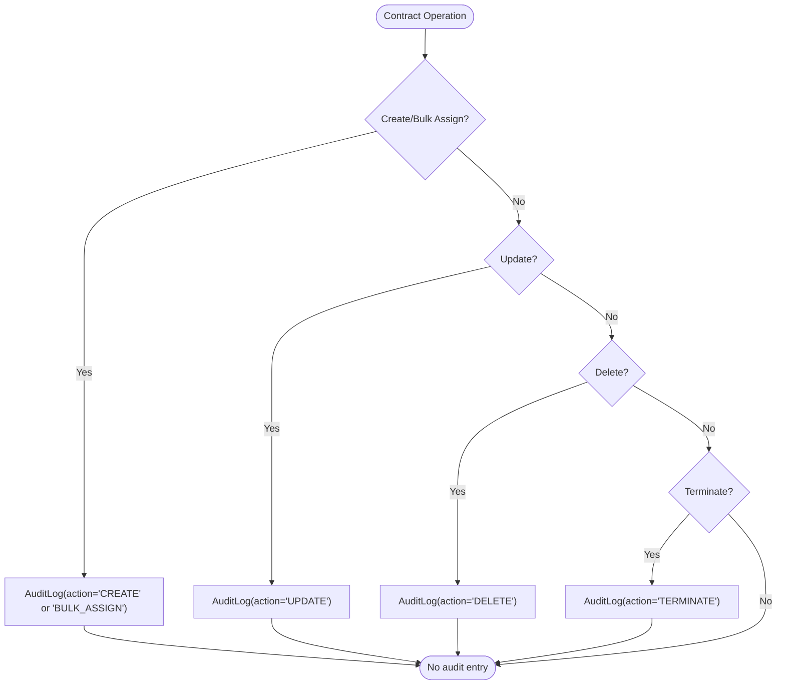
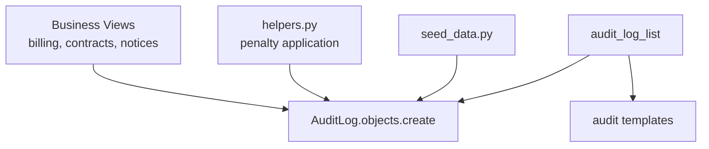

# Audit & Compliance

<cite>
**Referenced Files in This Document**
- [core/models.py](file://core/models.py)
- [core/views/audit.py](file://core/views/audit.py)
- [core/urls.py](file://core/urls.py)
- [templates/audit/list.html](file://templates/audit/list.html)
- [templates/audit/_table.html](file://templates/audit/_table.html)
- [core/views/billing.py](file://core/views/billing.py)
- [core/views/contracts.py](file://core/views/contracts.py)
- [core/views/notices.py](file://core/views/notices.py)
- [core/helpers.py](file://core/helpers.py)
- [core/management/commands/seed_data.py](file://core/management/commands/seed_data.py)
</cite>

## Table of Contents
1. [Introduction](#introduction)
2. [Project Structure](#project-structure)
3. [Core Components](#core-components)
4. [Architecture Overview](#architecture-overview)
5. [Detailed Component Analysis](#detailed-component-analysis)
6. [Dependency Analysis](#dependency-analysis)
7. [Performance Considerations](#performance-considerations)
8. [Troubleshooting Guide](#troubleshooting-guide)
9. [Compliance and Forensic Guidance](#compliance-and-forensic-guidance)
10. [Conclusion](#conclusion)

## Introduction
The Audit & Compliance module provides a centralized, read-only audit trail for the Market Rental System. It records critical operations such as tenant contract changes, billing generation and collection, payment recording, notice lifecycle events, system configuration updates, and administrative actions. The audit log supports compliance investigations, internal controls, and forensic analysis by capturing who performed an action, what changed, when it happened, from which IP address, and why through descriptive context.

Administrators can navigate, filter, search, and paginate audit logs through a dedicated interface. The system also seeds sample audit entries during data seeding to demonstrate typical activity patterns.

## Project Structure
The audit capability is implemented across models, views, URLs, templates, and business logic modules:

- **Data model**: `AuditLog` stores structured audit entries.
- **View layer**: `audit_log_list` renders the audit trail with filtering and pagination.
- **URL routing**: `/audit-logs/` exposes the audit list endpoint.
- **Templates**: `audit/list.html` and `audit/_table.html` render the UI and table rows.
- **Business integration**: Billing, contracts, notices, helpers, and seed commands write audit entries at key points.

**Diagram sources**
- [core/urls.py:190-191](file://core/urls.py#L190-L191)
- [core/views/audit.py:13-60](file://core/views/audit.py#L13-L60)
- [templates/audit/list.html:1-42](file://templates/audit/list.html#L1-L42)
- [templates/audit/_table.html:1-65](file://templates/audit/_table.html#L1-L65)
- [core/models.py:304-316](file://core/models.py#L304-L316)

**Section sources**
- [core/models.py:304-316](file://core/models.py#L304-L316)
- [core/views/audit.py:1-60](file://core/views/audit.py#L1-L60)
- [core/urls.py:190-191](file://core/urls.py#L190-L191)
- [templates/audit/list.html:1-42](file://templates/audit/list.html#L1-L42)
- [templates/audit/_table.html:1-65](file://templates/audit/_table.html#L1-L65)

## Core Components
- **AuditLog model**: Stores user reference, action type, module name, description, IP address, and timestamp.
- **Audit view**: Provides filtered, paginated listing of audit logs with HTMX-powered live search and filters.
- **Audit templates**: Render the page header, filter bar, table columns, badges, and pagination.
- **Business integrations**: Create audit entries for billing generation/collection, contract creation/update/deletion/termination, notice creation/marking served, auto penalties, and seed data.

Key responsibilities:
- Capture immutable evidence of critical operations.
- Provide administrators with a searchable, filterable, and paginated audit trail.
- Support compliance reporting by exposing consistent fields and descriptive context.

**Section sources**
- [core/models.py:304-316](file://core/models.py#L304-L316)
- [core/views/audit.py:13-60](file://core/views/audit.py#L13-L60)
- [templates/audit/list.html:1-42](file://templates/audit/list.html#L1-L42)
- [templates/audit/_table.html:1-65](file://templates/audit/_table.html#L1-L65)

## Architecture Overview
The audit architecture follows a simple but robust pattern:

1. Business operations (billing, contracts, notices, helpers, seed commands) call `AuditLog.objects.create(...)` with contextual details.
2. The audit view queries `AuditLog`, applies filters, and returns paginated results.
3. Templates render the audit table with badges and metadata.

**Diagram sources**
- [core/urls.py:190-191](file://core/urls.py#L190-L191)
- [core/views/audit.py:13-60](file://core/views/audit.py#L13-L60)
- [core/models.py:304-316](file://core/models.py#L304-L316)

## Detailed Component Analysis

### AuditLog Data Model
The `AuditLog` model captures essential audit fields:

| Field | Type | Purpose |
|---|---|---|
| `user` | ForeignKey to Django User | Identifies the actor performing the action |
| `action` | CharField | Describes the operation type (e.g., CREATE, UPDATE, DELETE, TERMINATE, COLLECT, GENERATE, MARK_SERVED, AUTO_PENALTY) |
| `module` | CharField | Indicates the domain area (e.g., Billing, RentalContract, Notice) |
| `description` | TextField | Human-readable explanation of the event |
| `ip_address` | GenericIPAddressField | Source IP address of the request |
| `created_at` | DateTimeField | Timestamp of the audit entry |

Complexity considerations:
- Reads are optimized with `select_related('user')` to avoid N+1 queries.
- Ordering defaults to newest first (`-created_at`).
- No built-in retention or archival policy is defined in the model; retention must be implemented externally or via additional management commands.

**Diagram sources**
- [core/models.py:304-316](file://core/models.py#L304-L316)

**Section sources**
- [core/models.py:304-316](file://core/models.py#L304-L316)

### Audit Log Listing View
The audit listing view:
- Requires admin access via a decorator.
- Loads all audit logs with related user data.
- Applies optional filters: user ID, action substring, module substring, date range, and free-text search across username, full name, action, module, description, and IP address.
- Paginates results into pages of 15 items.
- Supports HTMX partial reloads for live filtering without full page refresh.

Filtering behavior:
- Exact match on user ID.
- Case-insensitive substring matches on action and module.
- Date range filters using `created_at__date__gte` and `created_at__date__lte`.
- Multi-field OR search using Django Q objects.

**Diagram sources**
- [core/views/audit.py:13-60](file://core/views/audit.py#L13-L60)

**Section sources**
- [core/views/audit.py:1-60](file://core/views/audit.py#L1-L60)

### Audit Templates
- `audit/list.html`: Renders the page title, subtitle, live search input, and filter inputs for action, module, and date range. Uses HTMX to update the table wrapper without reloading the page.
- `audit/_table.html`: Renders the activity table with columns for Date/Time, User, Action, Module, Description, and IP Address. Includes badge styling for different action types and pagination.

UI capabilities:
- Live search with debounce delay.
- Clear filters link.
- Read-only badge indicating non-modifiable audit trail.
- Empty state message when no logs match.

**Diagram sources**
- [templates/audit/list.html:1-42](file://templates/audit/list.html#L1-L42)
- [templates/audit/_table.html:1-65](file://templates/audit/_table.html#L1-L65)

**Section sources**
- [templates/audit/list.html:1-42](file://templates/audit/list.html#L1-L42)
- [templates/audit/_table.html:1-65](file://templates/audit/_table.html#L1-L65)

### Business Integrations That Write Audit Logs

#### Billing Operations
Billing generation and collection create audit entries:
- Single billing generation: action `GENERATE`, module `Billing`.
- Bulk billing generation: action `GENERATE_ALL`, module `Billing`.
- Manual billing creation/edit: actions `CREATE`/`UPDATE`, module `Billing`.
- Payment collection: action `COLLECT`, module `Billing`, includes receipt number and outcome.

**Diagram sources**
- [core/views/billing.py:415-470](file://core/views/billing.py#L415-L470)
- [core/views/billing.py:226-232](file://core/views/billing.py#L226-L232)
- [core/views/billing.py:299-305](file://core/views/billing.py#L299-L305)
- [core/views/billing.py:350-356](file://core/views/billing.py#L350-L356)
- [core/views/billing.py:391-397](file://core/views/billing.py#L391-L397)

**Section sources**
- [core/views/billing.py:226-232](file://core/views/billing.py#L226-L232)
- [core/views/billing.py:299-305](file://core/views/billing.py#L299-L305)
- [core/views/billing.py:350-356](file://core/views/billing.py#L350-L356)
- [core/views/billing.py:391-397](file://core/views/billing.py#L391-L397)
- [core/views/billing.py:415-470](file://core/views/billing.py#L415-L470)

#### Contract Operations
Rental contract lifecycle creates audit entries:
- Creation (single or bulk): actions `CREATE`/`BULK_ASSIGN`, module `RentalContract`.
- Update: action `UPDATE`, module `RentalContract`.
- Deletion: action `DELETE`, module `RentalContract`.
- Termination: action `TERMINATE`, module `RentalContract`.

**Diagram sources**
- [core/views/contracts.py:104-127](file://core/views/contracts.py#L104-L127)
- [core/views/contracts.py:170-176](file://core/views/contracts.py#L170-L176)
- [core/views/contracts.py:200-206](file://core/views/contracts.py#L200-L206)
- [core/views/contracts.py:238-244](file://core/views/contracts.py#L238-L244)

**Section sources**
- [core/views/contracts.py:104-127](file://core/views/contracts.py#L104-L127)
- [core/views/contracts.py:170-176](file://core/views/contracts.py#L170-L176)
- [core/views/contracts.py:200-206](file://core/views/contracts.py#L200-L206)
- [core/views/contracts.py:238-244](file://core/views/contracts.py#L238-L244)

#### Notice Operations
Notice lifecycle creates audit entries:
- Creation: action `CREATE`, module `Notice`.
- Marking served: action `MARK_SERVED`, module `Notice`.

**Section sources**
- [core/views/notices.py:75-81](file://core/views/notices.py#L75-L81)
- [core/views/notices.py:110-116](file://core/views/notices.py#L110-L116)

#### Auto Penalties
Overdue penalty application creates audit entries:
- Action `AUTO_PENALTY`, module `Billing`, describing the applied penalty amount and affected billing.

**Section sources**
- [core/helpers.py:480-485](file://core/helpers.py#L480-L485)

#### Seed Data
Seed command inserts representative audit entries to populate the trail during development or testing:
- Examples include settings updates, tenant creation, contract approval, payment collection, contract termination, and notice service marking.

**Section sources**
- [core/management/commands/seed_data.py:501-526](file://core/management/commands/seed_data.py#L501-L526)

## Dependency Analysis
The audit system depends on:
- Django ORM for querying and creating audit entries.
- Authentication and authorization decorators to restrict access to the audit view.
- HTMX for interactive filtering without full page reloads.
- Business modules that explicitly write audit entries at critical points.

**Diagram sources**
- [core/views/billing.py:226-232](file://core/views/billing.py#L226-L232)
- [core/views/contracts.py:104-127](file://core/views/contracts.py#L104-L127)
- [core/views/notices.py:75-81](file://core/views/notices.py#L75-L81)
- [core/helpers.py:480-485](file://core/helpers.py#L480-L485)
- [core/management/commands/seed_data.py:501-526](file://core/management/commands/seed_data.py#L501-L526)
- [core/views/audit.py:13-60](file://core/views/audit.py#L13-L60)

**Section sources**
- [core/views/audit.py:13-60](file://core/views/audit.py#L13-L60)
- [core/views/billing.py:226-232](file://core/views/billing.py#L226-L232)
- [core/views/contracts.py:104-127](file://core/views/contracts.py#L104-L127)
- [core/views/notices.py:75-81](file://core/views/notices.py#L75-L81)
- [core/helpers.py:480-485](file://core/helpers.py#L480-L485)
- [core/management/commands/seed_data.py:501-526](file://core/management/commands/seed_data.py#L501-L526)

## Performance Considerations
- Use `select_related('user')` to reduce database round-trips when rendering many audit rows.
- Keep filters specific to avoid broad substring searches across large tables.
- Prefer exact user ID filtering over free-text search when investigating specific actors.
- Avoid overly wide date ranges; narrow to investigation windows.
- Consider adding database indexes on frequently filtered fields (`action`, `module`, `created_at`) if performance degrades with growth.

[No sources needed since this section provides general guidance]

## Troubleshooting Guide
Common issues and resolutions:
- **No audit logs appear**: Ensure business operations call `AuditLog.objects.create(...)` and that the user has admin permissions to access the audit view.
- **Filters return empty results**: Verify filter parameters and date formats; confirm that the underlying data exists and matches the filter criteria.
- **Slow loading with many logs**: Narrow search terms, use exact user filters, and limit date ranges. Consider indexing high-cardinality fields.
- **Missing IP addresses**: Some background tasks may not have a request context; ensure IP capture occurs where possible or accept null values.

**Section sources**
- [core/views/audit.py:13-60](file://core/views/audit.py#L13-L60)

## Compliance and Forensic Guidance

### Audit Trail Navigation
- Access the audit trail via `/audit-logs/`.
- Use the search box to find keywords across users, actions, modules, descriptions, and IPs.
- Apply filters for action type, module, and date range to focus investigations.
- Use pagination to navigate large result sets.

### Filtering and Reporting
- Filter by user ID to isolate an actor’s activities.
- Filter by action to identify destructive or sensitive operations (e.g., DELETE, TERMINATE, VOID).
- Filter by module to focus on billing, contracts, or notices.
- Use date ranges to align with regulatory reporting periods.
- Export functionality: The current audit view does not provide direct export endpoints; however, the system includes PDF/Excel export utilities for other reports. To integrate audit exports, extend the audit view with export handlers similar to existing report exporters.

### Regulatory Compliance
- The audit log captures who, what, when, and where (IP), supporting accountability and traceability required by financial regulations.
- Descriptive messages provide context for auditors reviewing billing adjustments, payment collections, contract terminations, and notice servicing.

### Internal Controls
- Restrict audit view access to administrators to prevent tampering or unauthorized inspection.
- Maintain immutable audit entries; do not expose edit/delete endpoints for audit logs.
- Regularly review high-risk actions (terminations, voids, deletions) and correlate with operational approvals.

### Forensic Analysis
- Correlate timestamps and IP addresses to reconstruct sequences of events.
- Combine audit logs with ledger entries, payments, and billing records to validate financial integrity.
- Investigate anomalies such as unexpected penalties, rapid contract changes, or unusual collection patterns.

### Retention Policies and Archival
- The current model does not define automatic retention or archival policies. Implement external processes to:
  - Archive old audit logs to cold storage after a defined period.
  - Purge or anonymize logs per legal requirements.
  - Compress archived datasets for cost-effective storage.
  - Maintain chain-of-custody documentation for exported audit datasets.

### Integration with External Audit Systems
- Export audit logs periodically to SIEM or compliance platforms via CSV/JSON pipelines.
- Forward critical events (e.g., TERMINATE, VOID, DELETE) to alerting systems for real-time monitoring.
- Map audit fields to external schemas (actor, event_type, resource, timestamp, source_ip, context).

[No sources needed since this section provides general guidance]

## Conclusion
The Audit & Compliance module delivers a focused, administrator-only audit trail that records critical system operations across billing, contracts, notices, penalties, and seed data. Its design emphasizes clarity, security, and usability: structured fields, rich descriptions, IP capture, and powerful filtering support compliance investigations and forensic analysis. While export and retention features require extension, the foundation is solid and extensible for organizational needs.

[No sources needed since this section summarizes without analyzing specific files]