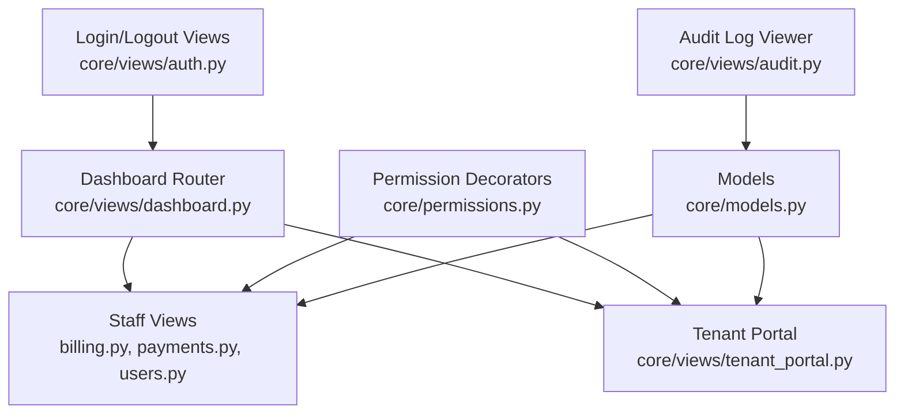
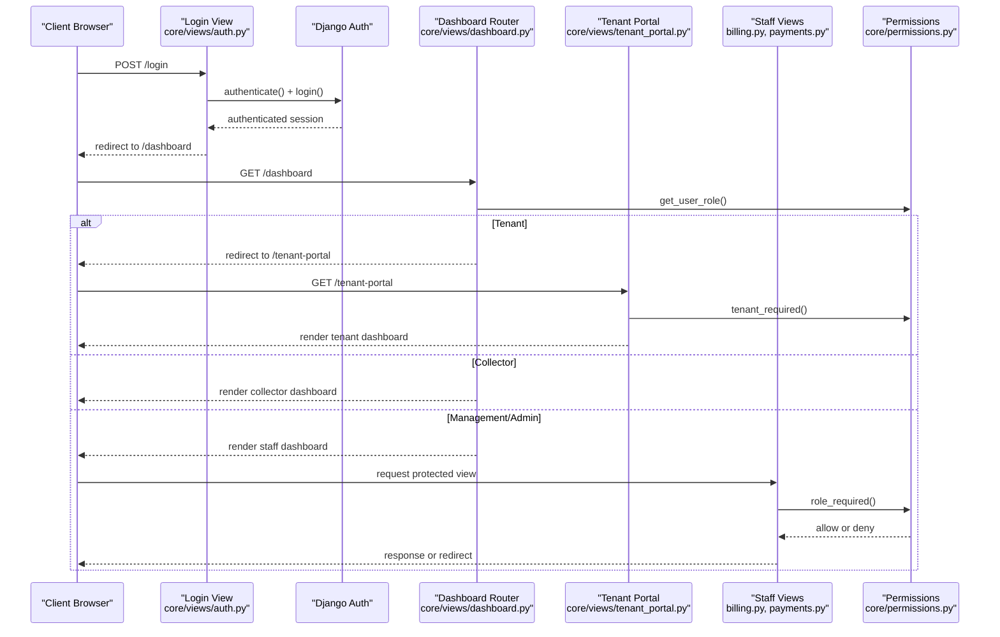
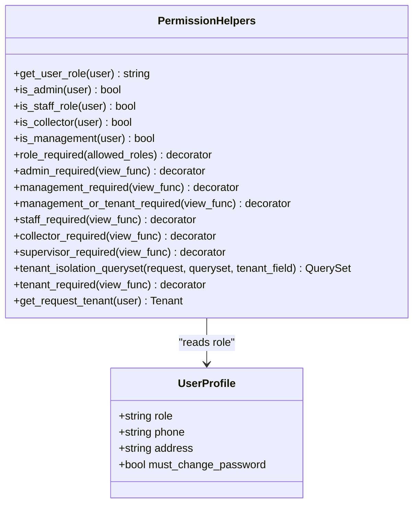
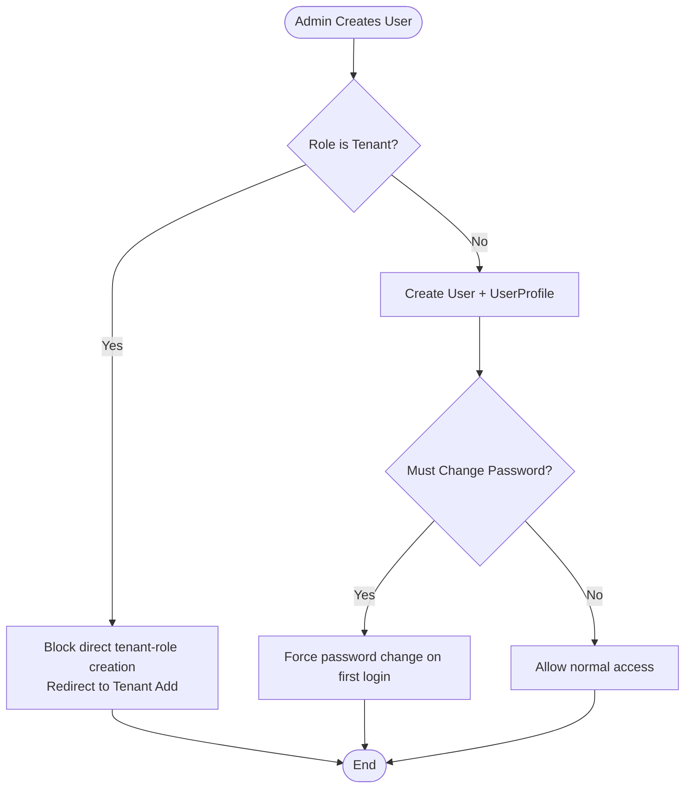
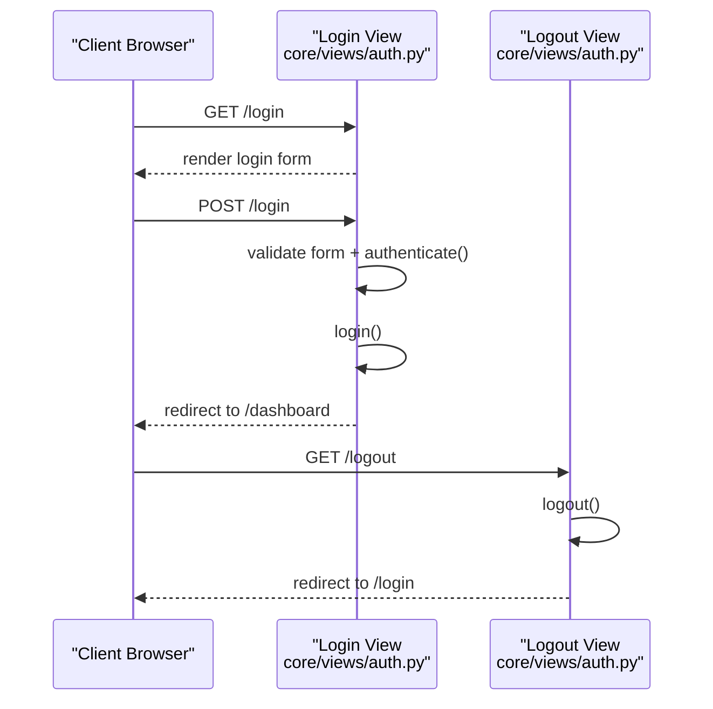
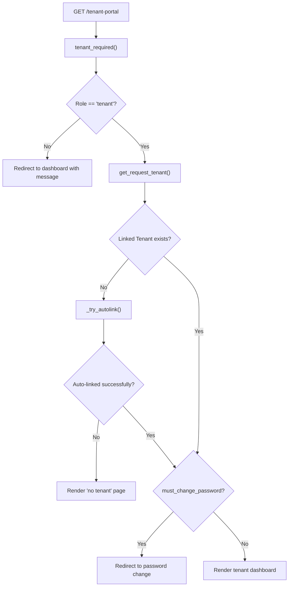
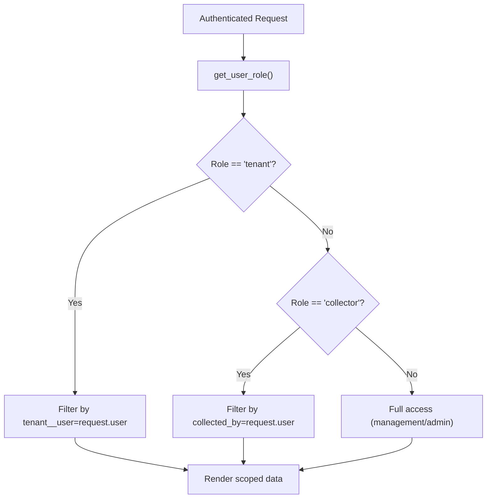
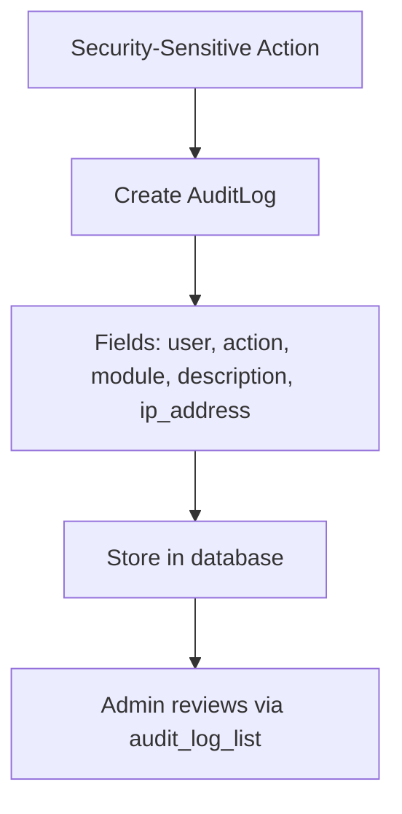
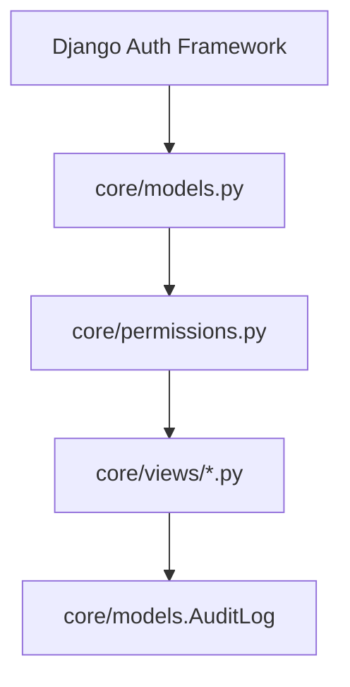

# Authentication & Authorization

<cite>
**Referenced Files in This Document**   
- [core/models.py](file://core\models.py)
- [core/permissions.py](file://core\permissions.py)
- [core/views/auth.py](file://core\views\auth.py)
- [core/views/dashboard.py](file://core\views\dashboard.py)
- [core/views/tenant_portal.py](file://core\views\tenant_portal.py)
- [core/views/users.py](file://core\views\users.py)
- [core/views/billing.py](file://core\views\billing.py)
- [core/views/payments.py](file://core\views\payments.py)
- [core/views/audit.py](file://core\views\audit.py)
- [core/forms.py](file://core\forms.py)
</cite>

## Table of Contents
1. [Introduction](#introduction)
2. [Project Structure](#project-structure)
3. [Core Components](#core-components)
4. [Architecture Overview](#architecture-overview)
5. [Detailed Component Analysis](#detailed-component-analysis)
6. [Dependency Analysis](#dependency-analysis)
7. [Performance Considerations](#performance-considerations)
8. [Troubleshooting Guide](#troubleshooting-guide)
9. [Conclusion](#conclusion)

## Introduction
This document explains the authentication and authorization system for the market rental application. It covers:
- Role-based access control with six roles: Administrator, Market Collector, Cashier, Supervisor, Treasurer, and Tenant.
- The permission decorator system used to enforce role checks across views.
- User profile extensions, password management policies, and account lifecycle controls.
- Session handling, login/logout flows, and tenant portal authentication separate from staff authentication.
- Data isolation mechanisms that prevent unauthorized record access.
- Password policies, account activation/deactivation, and audit logging for security events.

The implementation is built on Django’s built-in authentication model extended by a `UserProfile` model, explicit role sets, and view-level decorators.

## Project Structure
Authentication and authorization logic is primarily implemented in:
- `core/models.py`: Defines `UserProfile`, `Tenant`, `AuditLog`, and related business models.
- `core/permissions.py`: Defines canonical role groups, helper functions, and decorators.
- `core/views/auth.py`: Handles login and logout.
- `core/views/dashboard.py`: Routes authenticated users based on role.
- `core/views/tenant_portal.py`: Implements tenant-only self-service portal.
- `core/views/users.py`: Admin-only user account management.
- `core/views/billing.py` and `core/views/payments.py`: Enforce collector/management permissions and data scoping.
- `core/views/audit.py`: Provides an admin-only audit log viewer.
- `core/forms.py`: Includes forms for user creation and tenant password changes.

**Diagram sources**
- [core/views/auth.py:9-35](file://core\views\auth.py#L9-L35)
- [core/views/dashboard.py:41-60](file://core\views\dashboard.py#L41-L60)
- [core/views/tenant_portal.py:102-171](file://core\views\tenant_portal.py#L102-L171)
- [core/permissions.py:61-87](file://core\permissions.py#L61-L87)
- [core/models.py:7-23](file://core\models.py#L7-L23)

**Section sources**
- [core/models.py:7-23](file://core\models.py#L7-L23)
- [core/permissions.py:6-30](file://core\permissions.py#L6-L30)
- [core/views/auth.py:9-35](file://core\views\auth.py#L9-L35)
- [core/views/dashboard.py:41-60](file://core\views\dashboard.py#L41-L60)

## Core Components
- **User Profile and Roles**: A one-to-one extension of Django’s `User` model stores role, contact details, address, and a flag requiring password change.
- **Role Sets**: Canonical sets define Administrator, Management, Collector, Supervisor, Staff, and Tenant roles.
- **Permission Decorators**: Centralized decorators enforce login and role requirements before allowing access to protected views.
- **Tenant Isolation**: Helpers restrict tenant queries to their own records and provide a dedicated tenant-only decorator.
- **Audit Logging**: Security-sensitive actions are recorded with user, action, module, description, and IP address.

Key responsibilities:
- `UserProfile` defines available roles and stores per-user metadata.
- `get_user_role` normalizes role retrieval and superuser fallback.
- `role_required` and convenience decorators (`admin_required`, `management_required`, `collector_required`, etc.) protect views.
- `tenant_isolation_queryset` and `tenant_required` isolate tenant data and portal access.
- `AuditLog` captures administrative and operational events.

**Section sources**
- [core/models.py:7-23](file://core\models.py#L7-L23)
- [core/models.py:304-316](file://core\models.py#L304-L316)
- [core/permissions.py:6-30](file://core\permissions.py#L6-L30)
- [core/permissions.py:32-87](file://core\permissions.py#L32-L87)
- [core/permissions.py:89-124](file://core\permissions.py#L89-L124)

## Architecture Overview
The authentication flow begins at the login view, which authenticates credentials via Django’s form and logs the user in. After login, the dashboard routes users based on role: tenants go to the tenant portal; collectors see a collection-focused workspace; other staff see market-wide dashboards.

Authorization is enforced through decorators applied to views. For example:
- Billing generation requires management roles.
- Payment collection requires collector roles.
- Tenant portal access requires tenant role explicitly.

Data isolation ensures tenants only see their own billings, payments, and ledger entries.

**Diagram sources**
- [core/views/auth.py:9-29](file://core\views\auth.py#L9-L29)
- [core/views/dashboard.py:41-60](file://core\views\dashboard.py#L41-L60)
- [core/views/tenant_portal.py:102-171](file://core\views\tenant_portal.py#L102-L171)
- [core/permissions.py:32-87](file://core\permissions.py#L32-L87)

## Detailed Component Analysis

### Role-Based Access Control (RBAC)
The system defines six roles:
- Administrator
- Market Collector
- Cashier
- Supervisor
- Treasurer
- Tenant

Canonical role sets:
- `ADMIN_ROLES`: {'admin'}
- `MANAGEMENT_ROLES`: {'admin', 'cashier', 'supervisor', 'treasurer'}
- `COLLECTOR_ROLES`: {'admin', 'collector', 'cashier'}
- `SUPERVISOR_ROLES`: {'admin', 'supervisor', 'treasurer'}
- `STAFF_ROLES`: management roles plus collector
- `ALL_ROLES`: staff plus tenant

Helper functions:
- `get_user_role(user)`: returns the user’s role from `UserProfile`; falls back to `'admin'` for superusers without a profile.
- `is_admin(user)`: true if role is admin or user is superuser.
- `is_staff_role(user)`: true if role is in staff set.
- `is_collector(user)`: true only for collector role (explicitly excludes superuser).
- `is_management(user)`: true for management roles or superuser.

Decorators:
- `role_required(allowed_roles)`: enforces login and role check; redirects unauthorized users with a message.
- Convenience decorators: `admin_required`, `management_required`, `management_or_tenant_required`, `staff_required`, `collector_required`, `supervisor_required`.

Usage patterns:
- Billing generation/editing uses `@management_required`.
- Payment collection uses `@collector_required`.
- Tenant portal uses `@tenant_required`.
- User administration uses `@admin_required`.

**Diagram sources**
- [core/permissions.py:6-30](file://core\permissions.py#L6-L30)
- [core/permissions.py:32-87](file://core\permissions.py#L32-L87)
- [core/models.py:7-23](file://core\models.py#L7-L23)

**Section sources**
- [core/permissions.py:6-30](file://core\permissions.py#L6-L30)
- [core/permissions.py:32-87](file://core\permissions.py#L32-L87)
- [core/models.py:7-23](file://core\models.py#L7-L23)

### Permission Decorator System
The central decorator `role_required` wraps each view with:
- Login requirement via `@login_required`.
- Role resolution using `get_user_role`.
- Superuser bypass.
- Unauthorized redirection to dashboard with a user-facing error message.

Convenience decorators map specific role sets to common access patterns:
- `admin_required`: restricted to administrators.
- `management_required`: restricted to administrative staff excluding collectors.
- `management_or_tenant_required`: allows both management roles and tenants (with tenant-scoped data).
- `staff_required`: allows all staff including collectors.
- `collector_required`: allows collectors and cashiers/admins.
- `supervisor_required`: allows supervisors/treasurers/admins.

These decorators are applied consistently across billing, payments, users, and audit views.

**Section sources**
- [core/permissions.py:61-87](file://core\permissions.py#L61-L87)
- [core/views/billing.py:174-246](file://core\views\billing.py#L174-L246)
- [core/views/payments.py:250-294](file://core\views\payments.py#L250-L294)
- [core/views/users.py:16-44](file://core\views\users.py#L16-L44)
- [core/views/audit.py:13-60](file://core\views\audit.py#L13-L60)

### User Profile Extensions and Account Lifecycle
`UserProfile` extends Django’s `User` with:
- Role selection from predefined choices.
- Phone and address fields.
- `must_change_password` flag to force initial password setup.

Account lifecycle:
- Administrators create staff accounts via admin-only user views.
- Tenant accounts are created through the tenant creation workflow; direct creation of tenant-role accounts via the generic user form is blocked to ensure proper linking to a `Tenant` record.
- Administrators can activate/deactivate accounts; deactivation toggles `User.is_active` and logs the action.

Password policy:
- Tenants with `must_change_password=True` are redirected to a self-service password change page upon first portal access.
- After changing password, the flag is cleared and the session remains valid.

**Diagram sources**
- [core/views/users.py:47-95](file://core\views\users.py#L47-L95)
- [core/views/users.py:98-145](file://core\views\users.py#L98-L145)
- [core/views/tenant_portal.py:74-78](file://core\views\tenant_portal.py#L74-L78)
- [core/views/tenant_portal.py:242-279](file://core\views\tenant_portal.py#L242-L279)

**Section sources**
- [core/models.py:7-23](file://core\models.py#L7-L23)
- [core/views/users.py:47-95](file://core\views\users.py#L47-L95)
- [core/views/users.py:98-145](file://core\views\users.py#L98-L145)
- [core/views/users.py:148-164](file://core\views\users.py#L148-L164)
- [core/views/tenant_portal.py:74-78](file://core\views\tenant_portal.py#L74-L78)
- [core/views/tenant_portal.py:242-279](file://core\views\tenant_portal.py#L242-L279)
- [core/forms.py:577-628](file://core\forms.py#L577-L628)
- [core/forms.py:631-649](file://core\forms.py#L631-L649)

### Session Handling, Login, and Logout Flows
Login flow:
- Validates credentials using Django’s `AuthenticationForm`.
- Logs the user in and displays a welcome message.
- Supports optional `next` parameter to redirect after login.
- Renders system settings for branding context.

Logout flow:
- Clears the session and displays an informational message.
- Redirects to the login page.

Session persistence:
- When tenants change their password, the session hash is updated to keep them logged in.

**Diagram sources**
- [core/views/auth.py:9-29](file://core\views\auth.py#L9-L29)
- [core/views/auth.py:32-35](file://core\views\auth.py#L32-L35)
- [core/views/tenant_portal.py:252-268](file://core\views\tenant_portal.py#L252-L268)

**Section sources**
- [core/views/auth.py:9-35](file://core\views\auth.py#L9-L35)
- [core/views/tenant_portal.py:252-268](file://core\views\tenant_portal.py#L252-L268)

### Tenant Portal Authentication Separate from Staff Authentication
The tenant portal is a read-only, strictly isolated self-service area:
- Only users with role `'tenant'` can access it.
- Non-tenant accounts (including admins) are redirected with an explanatory message.
- If a tenant-role login has no linked `Tenant` record, the portal attempts safe auto-linking by matching username or email against unlinked tenant records.
- The portal forces password change if required and shows tenant-specific financial summaries, upcoming due dates, payment history, and ledger entries.

**Diagram sources**
- [core/permissions.py:102-118](file://core\permissions.py#L102-L118)
- [core/views/tenant_portal.py:28-66](file://core\views\tenant_portal.py#L28-L66)
- [core/views/tenant_portal.py:102-171](file://core\views\tenant_portal.py#L102-L171)

**Section sources**
- [core/permissions.py:102-118](file://core\permissions.py#L102-L118)
- [core/views/tenant_portal.py:28-66](file://core\views\tenant_portal.py#L28-L66)
- [core/views/tenant_portal.py:102-171](file://core\views\tenant_portal.py#L102-L171)

### Data Isolation Mechanisms
Data isolation prevents cross-tenant access and limits visibility based on role:
- `tenant_isolation_queryset(request, queryset, tenant_field='tenant__user')`: filters querysets to the current tenant when the user is a tenant.
- Tenant views explicitly filter by `tenant=tenant` or `tenant__user=request.user`.
- Billing list and print/export views apply tenant filtering when the user is a tenant.
- Payment views use `_apply_payment_scope` to limit tenants to their own payments and collectors to their own collections.
- Receipt viewing denies access if a tenant tries to view another tenant’s receipt or a collector tries to view receipts they did not collect.

**Diagram sources**
- [core/permissions.py:89-99](file://core\permissions.py#L89-L99)
- [core/views/billing.py:62-78](file://core\views\billing.py#L62-L78)
- [core/views/payments.py:157-183](file://core\views\payments.py#L157-L183)

**Section sources**
- [core/permissions.py:89-99](file://core\permissions.py#L89-L99)
- [core/views/billing.py:62-78](file://core\views\billing.py#L62-L78)
- [core/views/payments.py:157-183](file://core\views\payments.py#L157-L183)

### Password Policies and Self-Service Changes
- Tenant password changes use `TenantPasswordChangeForm`, which inherits Django’s password validation and reuses old/new/confirm fields.
- On successful change, the session hash is updated to maintain login state.
- The `must_change_password` flag is cleared after the tenant sets a new password.
- Administrators can force this behavior by setting the flag during user creation or editing.

Best practices reflected:
- Use Django’s built-in password validators.
- Keep sessions valid after password changes.
- Log password changes for auditability.

**Section sources**
- [core/forms.py:631-649](file://core\forms.py#L631-L649)
- [core/views/tenant_portal.py:242-279](file://core\views\tenant_portal.py#L242-L279)

### Audit Logging for Security Events
Audit logging captures critical operations:
- User creation, update, activation, and deactivation.
- Billing generation and collection.
- Payment recording, editing, and voiding.
- Tenant portal password changes.
- Auto-linking of tenant logins.

Each log entry includes:
- User who performed the action.
- Action type.
- Module affected.
- Human-readable description.
- IP address.

An admin-only audit log viewer supports filtering by user, action, module, date range, and search terms.

**Diagram sources**
- [core/models.py:304-316](file://core\models.py#L304-L316)
- [core/views/users.py:76-82](file://core\views\users.py#L76-L82)
- [core/views/users.py:125-131](file://core\views\users.py#L125-L131)
- [core/views/users.py:156-162](file://core\views\users.py#L156-L162)
- [core/views/billing.py:226-232](file://core\views\billing.py#L226-L232)
- [core/views/billing.py:460-466](file://core\views\billing.py#L460-L466)
- [core/views/payments.py:269-275](file://core\views\payments.py#L269-L275)
- [core/views/payments.py:441-443](file://core\views\payments.py#L441-L443)
- [core/views/payments.py:498-504](file://core\views\payments.py#L498-L504)
- [core/views/payments.py:541-547](file://core\views\payments.py#L541-L547)
- [core/views/tenant_portal.py:56-65](file://core\views\tenant_portal.py#L56-L65)
- [core/views/tenant_portal.py:262-268](file://core\views\tenant_portal.py#L262-L268)
- [core/views/audit.py:13-60](file://core\views\audit.py#L13-L60)

**Section sources**
- [core/models.py:304-316](file://core\models.py#L304-L316)
- [core/views/users.py:76-82](file://core\views\users.py#L76-L82)
- [core/views/users.py:125-131](file://core\views\users.py#L125-L131)
- [core/views/users.py:156-162](file://core\views\users.py#L156-L162)
- [core/views/billing.py:226-232](file://core\views\billing.py#L226-L232)
- [core/views/billing.py:460-466](file://core\views\billing.py#L460-L466)
- [core/views/payments.py:269-275](file://core\views\payments.py#L269-L275)
- [core/views/payments.py:441-443](file://core\views\payments.py#L441-L443)
- [core/views/payments.py:498-504](file://core\views\payments.py#L498-L504)
- [core/views/payments.py:541-547](file://core\views\payments.py#L541-L547)
- [core/views/tenant_portal.py:56-65](file://core\views\tenant_portal.py#L56-L65)
- [core/views/tenant_portal.py:262-268](file://core\views\tenant_portal.py#L262-L268)
- [core/views/audit.py:13-60](file://core\views\audit.py#L13-L60)

## Dependency Analysis
The authentication and authorization subsystem depends on:
- Django’s authentication framework for credential validation and session management.
- `core.models.UserProfile` for role storage and user metadata.
- `core.permissions` for centralized role checks and decorators.
- Business views for enforcing access control and data isolation.
- `core.models.AuditLog` for recording security events.

**Diagram sources**
- [core/models.py:7-23](file://core\models.py#L7-L23)
- [core/permissions.py:6-30](file://core\permissions.py#L6-L30)
- [core/views/auth.py:9-35](file://core\views\auth.py#L9-L35)
- [core/views/billing.py:6-9](file://core\views\billing.py#L6-L9)
- [core/views/payments.py:1-4](file://core\views\payments.py#L1-L4)

**Section sources**
- [core/models.py:7-23](file://core\models.py#L7-L23)
- [core/permissions.py:6-30](file://core\permissions.py#L6-L30)
- [core/views/auth.py:9-35](file://core\views\auth.py#L9-L35)
- [core/views/billing.py:6-9](file://core\views\billing.py#L6-L9)
- [core/views/payments.py:1-4](file://core\views\payments.py#L1-L4)

## Performance Considerations
- Use `select_related` in tenant portal and billing/payment views to reduce N+1 queries.
- Apply pagination for large lists (users, billings, payments, audit logs).
- Avoid unnecessary recomputation; penalty calculations and overdue updates are best-effort and wrapped in try/except blocks.
- Batch operations (e.g., batch collection) generate consolidated receipts and minimize repeated UI interactions.

[No sources needed since this section provides general guidance]

## Troubleshooting Guide
Common issues and resolutions:
- **Tenant login without linked tenant record**: The portal attempts auto-linking by matching username or email; if ambiguous or already linked elsewhere, it renders a “no tenant” page. Ensure tenant creation goes through the proper tenant workflow.
- **Unauthorized access messages**: Verify the user’s role and decorator usage. Tenants cannot access staff-only pages; collectors cannot view receipts they did not collect.
- **Password change loop**: If `must_change_password` remains set, tenants will be redirected repeatedly. Clear the flag after a successful password change.
- **Audit log gaps**: Confirm that security-sensitive views create `AuditLog` entries and that the admin has permission to view them.

**Section sources**
- [core/views/tenant_portal.py:28-66](file://core\views\tenant_portal.py#L28-L66)
- [core/views/tenant_portal.py:102-171](file://core\views\tenant_portal.py#L102-L171)
- [core/views/payments.py:157-183](file://core\views\payments.py#L157-L183)
- [core/views/audit.py:13-60](file://core\views\audit.py#L13-L60)

## Conclusion
The authentication and authorization system implements robust RBAC with six distinct roles, centralized permission decorators, and strict data isolation for tenants. It supports secure login/logout flows, tenant portal separation, password policy enforcement, account lifecycle management, and comprehensive audit logging. These mechanisms collectively ensure that users can only access resources appropriate to their role and scope, while maintaining an auditable trail of security-sensitive actions.

[No sources needed since this section summarizes without analyzing specific files]