# Billing Generation

<cite>
**Referenced Files in This Document**   
- [core/views/billing.py](file://core/views/billing.py)
- [core/helpers.py](file://core/helpers.py)
- [core/models.py](file://core/models.py)
- [templates/billing/generate.html](file://templates/billing/generate.html)
- [templates/billing/generate_all.html](file://templates/billing/generate_all.html)
</cite>

## Table of Contents
1. [Introduction](#introduction)
2. [Project Structure](#project-structure)
3. [Core Components](#core-components)
4. [Architecture Overview](#architecture-overview)
5. [Detailed Component Analysis](#detailed-component-analysis)
6. [Dependency Analysis](#dependency-analysis)
7. [Performance Considerations](#performance-considerations)
8. [Troubleshooting Guide](#troubleshooting-guide)
9. [Conclusion](#conclusion)

## Introduction
This document explains the billing generation functionality for active rental contracts. It covers:
- Automatic monthly billing creation through idempotent helpers.
- Manual billing generation for a single contract.
- Bulk billing generation for all active contracts.
- Due date calculation that safely handles month-end edge cases.
- Contract validation, billing record population, and tenant ledger integration.
- Audit logging and duplicate billing protection.

The system is designed so collectors see billings immediately after contracts are created, while administrators can also generate billings manually or in bulk. All financial calculations use precise decimal arithmetic, and every important action is recorded in an audit log.

## Project Structure
Billing generation spans three main layers:
- Views: HTTP entry points for manual and bulk generation.
- Helpers: Idempotent billing creation, due date safety, penalty computation, and payment/ledger services.
- Models: Core entities such as `RentalContract`, `Billing`, `TenantLedger`, `Payment`, and `AuditLog`.

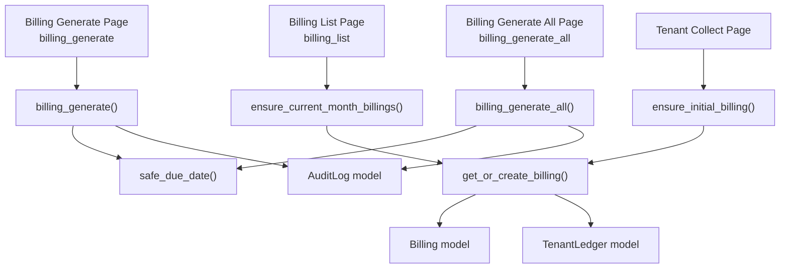

**Diagram sources**
- [core/views/billing.py:62-70](file://core/views/billing.py#L62-L70)
- [core/views/billing.py:174-246](file://core/views/billing.py#L174-L246)
- [core/views/billing.py:249-315](file://core/views/billing.py#L249-L315)
- [core/helpers.py:125-129](file://core/helpers.py#L125-L129)
- [core/helpers.py:155-205](file://core/helpers.py#L155-L205)
- [core/helpers.py:208-235](file://core/helpers.py#L208-L235)
- [core/helpers.py:238-257](file://core/helpers.py#L238-L257)

**Section sources**
- [core/views/billing.py:1-23](file://core/views/billing.py#L1-L23)
- [core/helpers.py:1-15](file://core/helpers.py#L1-L15)
- [core/models.py:157-218](file://core/models.py#L157-L218)

## Core Components
- `safe_due_date(year, month, due_day)`: Computes a safe due date by clamping the contract’s due day to the actual last day of the target month.
- `get_or_create_billing(contract, billing_month, billing_year, auto_created=True)`: Idempentically creates a billing and its initial ledger entry.
- `ensure_initial_billing(contract)`: Backfills billings from the contract start month up to the current month, respecting end dates.
- `ensure_current_month_billings()`: Ensures every active contract has a billing for the current month/year.
- `billing_generate(request)`: Manual single-contract billing generation with duplicate checks, penalty calculation, ledger creation, and audit logging.
- `billing_generate_all(request)`: Bulk generation across all active contracts with duplicate skipping and aggregate audit logging.

Key data fields populated during billing creation:
- `rental_amount`: taken from the contract’s monthly rent.
- `penalty_amount`: computed using grace period and penalty settings.
- `total_due`: sum of rental amount and penalty amount.
- `amount_paid`: zero at creation.
- `balance`: initially equal to total due.
- `due_date`: calculated via `safe_due_date`.
- `status`: set to `Unpaid` at creation.

**Section sources**
- [core/views/billing.py:54-59](file://core/views/billing.py#L54-L59)
- [core/helpers.py:125-129](file://core/helpers.py#L125-L129)
- [core/helpers.py:155-205](file://core/helpers.py#L155-L205)
- [core/helpers.py:208-257](file://core/helpers.py#L208-L257)
- [core/views/billing.py:174-246](file://core/views/billing.py#L174-L246)
- [core/views/billing.py:249-315](file://core/views/billing.py#L249-L315)
- [core/models.py:190-218](file://core/models.py#L190-L218)

## Architecture Overview
The billing generation architecture combines request-driven views with idempotent helper functions and consistent model usage.

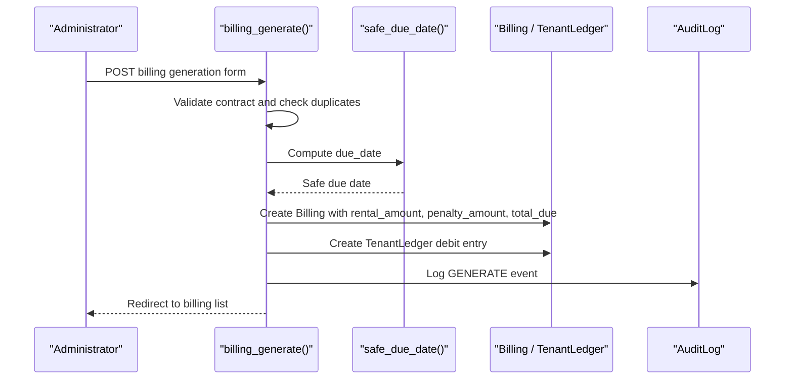

**Diagram sources**
- [core/views/billing.py:174-246](file://core/views/billing.py#L174-L246)
- [core/views/billing.py:54-59](file://core/views/billing.py#L54-L59)
- [core/models.py:190-218](file://core/models.py#L190-L218)
- [core/models.py:261-277](file://core/models.py#L261-L277)
- [core/models.py:304-316](file://core/models.py#L304-L316)

## Detailed Component Analysis

### Automatic Monthly Billing Creation
Automatic billing ensures collectors always have billings to collect without requiring manual intervention.

#### ensure_current_month_billings()
- Scans all active contracts.
- Skips contracts starting in future months or already ended before the current month.
- Uses `get_or_create_billing()` to create one billing per active contract for the current month/year.
- Returns the count of newly created billings.
- Called automatically on billing list and print/export endpoints for eligible roles.

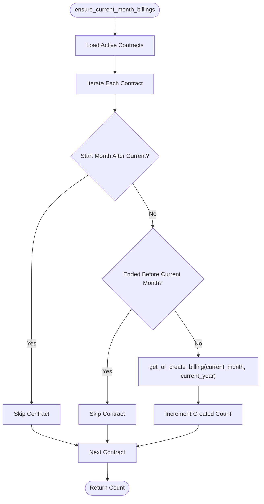

**Diagram sources**
- [core/helpers.py:238-257](file://core/helpers.py#L238-L257)
- [core/helpers.py:155-205](file://core/helpers.py#L155-L205)

**Section sources**
- [core/helpers.py:238-257](file://core/helpers.py#L238-L257)
- [core/views/billing.py:62-70](file://core/views/billing.py#L62-L70)
- [core/views/billing.py:637-644](file://core/views/billing.py#L637-L644)
- [core/views/billing.py:683-689](file://core/views/billing.py#L683-L689)

#### ensure_initial_billing()
- Backfills billings from the contract’s start month up to the current month.
- If the start date is in the future, only the start month is created.
- Stops iterating when the contract ends before the current month.
- Calls `get_or_create_billing()` for each month, ensuring idempotency.
- Used on tenant collection pages to guarantee historical months exist.

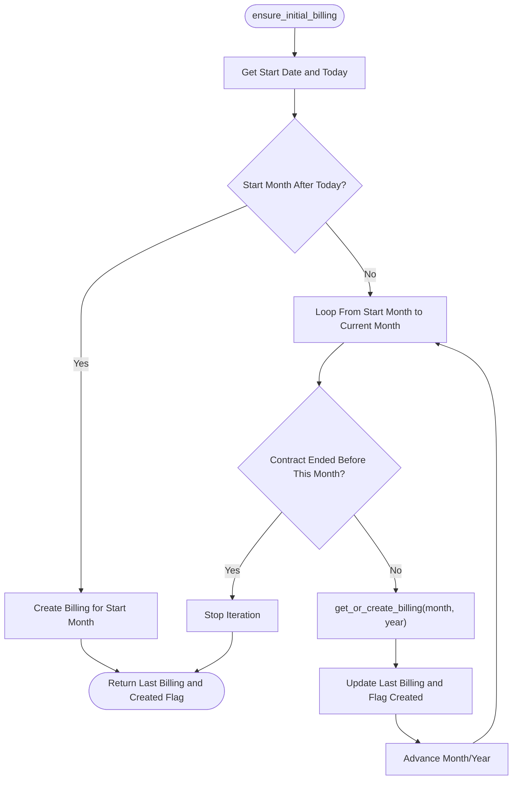

**Diagram sources**
- [core/helpers.py:208-235](file://core/helpers.py#L208-L235)
- [core/helpers.py:155-205](file://core/helpers.py#L155-L205)

**Section sources**
- [core/helpers.py:208-235](file://core/helpers.py#L208-L235)
- [core/views/billing.py:526-533](file://core/views/billing.py#L526-L533)

### Manual Billing Generation Through billing_generate()
The manual flow validates inputs, prevents duplicates, computes penalties, creates the billing, posts a ledger entry, and logs the action.

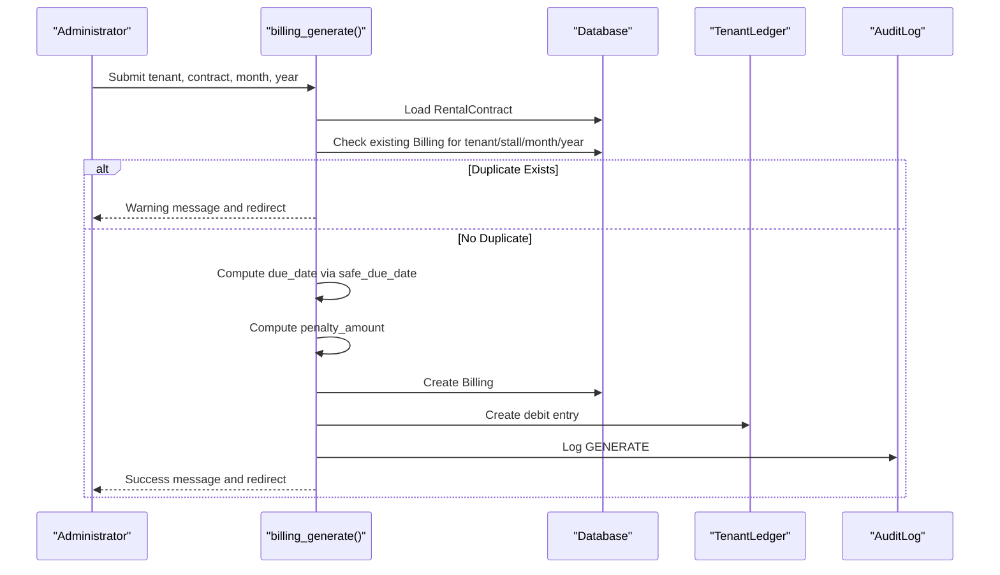

**Diagram sources**
- [core/views/billing.py:174-246](file://core/views/billing.py#L174-L246)
- [core/views/billing.py:54-59](file://core/views/billing.py#L54-L59)
- [core/models.py:190-218](file://core/models.py#L190-L218)
- [core/models.py:261-277](file://core/models.py#L261-L277)
- [core/models.py:304-316](file://core/models.py#L304-L316)

**Section sources**
- [core/views/billing.py:174-246](file://core/views/billing.py#L174-L246)
- [templates/billing/generate.html:76-120](file://templates/billing/generate.html#L76-L120)

### Bulk Billing Generation Through billing_generate_all()
Bulk generation iterates over all active contracts, skips existing billings, and creates new ones consistently.

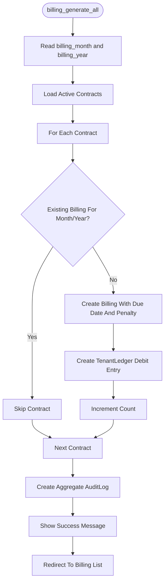

**Diagram sources**
- [core/views/billing.py:249-315](file://core/views/billing.py#L249-L315)
- [core/views/billing.py:54-59](file://core/views/billing.py#L54-L59)
- [core/models.py:190-218](file://core/models.py#L190-L218)
- [core/models.py:261-277](file://core/models.py#L261-L277)
- [core/models.py:304-316](file://core/models.py#L304-L316)

**Section sources**
- [core/views/billing.py:249-315](file://core/views/billing.py#L249-L315)
- [templates/billing/generate_all.html:36-58](file://templates/billing/generate_all.html#L36-L58)

### Due Date Calculation Using safe_due_date()
The due date must be valid even when the contract’s due day exceeds the number of days in the target month.

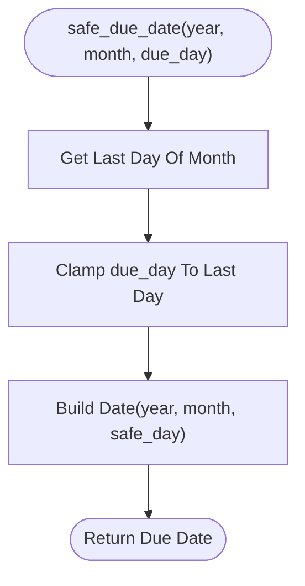

**Diagram sources**
- [core/views/billing.py:54-59](file://core/views/billing.py#L54-L59)
- [core/helpers.py:125-129](file://core/helpers.py#L125-L129)

**Section sources**
- [core/views/billing.py:54-59](file://core/views/billing.py#L54-L59)
- [core/helpers.py:125-129](file://core/helpers.py#L125-L129)

### Contract Validation and Billing Record Creation
Contract validation and billing creation follow these rules:
- The view loads the selected `RentalContract`.
- A duplicate billing check uses tenant, stall, billing month, and billing year.
- The due date is computed safely.
- The rental amount comes from the contract’s monthly rent.
- The penalty amount is computed based on penalty settings and grace period.
- Total due equals rental amount plus penalty amount.
- A billing record is created with proper field population.
- A tenant ledger debit entry is created.
- An audit log entry records the generation event.

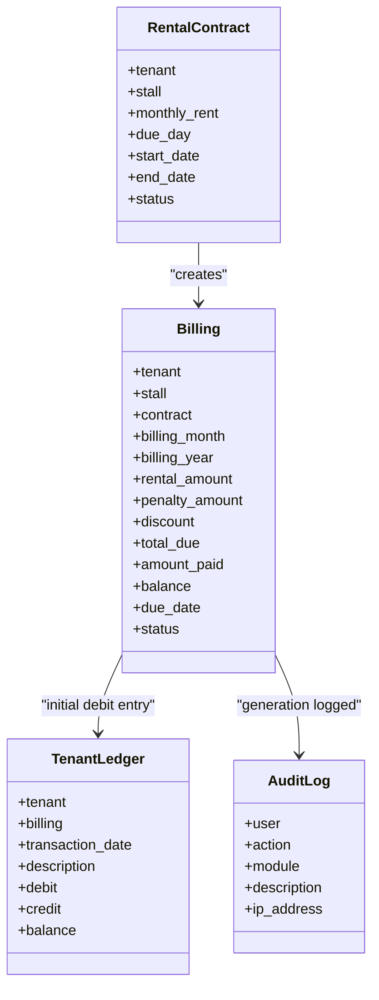

**Diagram sources**
- [core/models.py:157-187](file://core/models.py#L157-L187)
- [core/models.py:190-218](file://core/models.py#L190-L218)
- [core/models.py:261-277](file://core/models.py#L261-L277)
- [core/models.py:304-316](file://core/models.py#L304-L316)
- [core/views/billing.py:174-246](file://core/views/billing.py#L174-L246)

**Section sources**
- [core/views/billing.py:174-246](file://core/views/billing.py#L174-L246)
- [core/models.py:157-218](file://core/models.py#L157-L218)
- [core/models.py:261-316](file://core/models.py#L261-L316)

### Integration With Tenant Ledger Entries
Every generated billing creates a corresponding ledger entry:
- Description includes billing period and stall number.
- Debit equals total due.
- Credit is zero at billing creation.
- Balance reflects the initial outstanding amount.
- Later payments update the ledger credit and recalculate running balances.

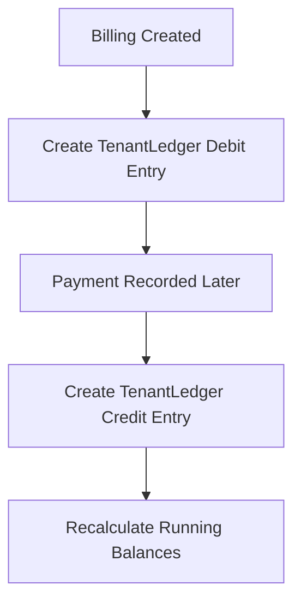

**Diagram sources**
- [core/views/billing.py:216-224](file://core/views/billing.py#L216-L224)
- [core/views/billing.py:288-296](file://core/views/billing.py#L288-L296)
- [core/helpers.py:195-205](file://core/helpers.py#L195-L205)
- [core/helpers.py:260-273](file://core/helpers.py#L260-L273)
- [core/helpers.py:407-420](file://core/helpers.py#L407-L420)

**Section sources**
- [core/views/billing.py:216-224](file://core/views/billing.py#L216-L224)
- [core/views/billing.py:288-296](file://core/views/billing.py#L288-L296)
- [core/helpers.py:195-205](file://core/helpers.py#L195-L205)
- [core/helpers.py:260-273](file://core/helpers.py#L260-L273)
- [core/helpers.py:407-420](file://core/helpers.py#L407-L420)

### Audit Logging Mechanism
Billing generation events are recorded with:
- User who performed the action.
- Action type: `GENERATE` for single billing, `GENERATE_ALL` for bulk.
- Module: `Billing`.
- Human-readable description including tenant, stall, and billing period.
- IP address when available.

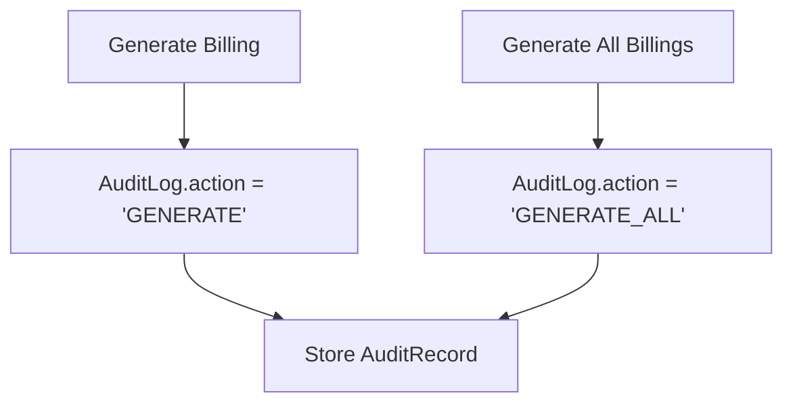

**Diagram sources**
- [core/views/billing.py:226-232](file://core/views/billing.py#L226-L232)
- [core/views/billing.py:299-305](file://core/views/billing.py#L299-L305)
- [core/models.py:304-316](file://core/models.py#L304-L316)

**Section sources**
- [core/views/billing.py:226-232](file://core/views/billing.py#L226-L232)
- [core/views/billing.py:299-305](file://core/views/billing.py#L299-L305)
- [core/models.py:304-316](file://core/models.py#L304-L316)

### Error Handling For Duplicate Billings
Duplicate protection occurs at multiple levels:
- Manual generation checks for an existing billing and shows a warning instead of creating another.
- Bulk generation skips contracts where a billing already exists for the selected month/year.
- Idempotent helpers rely on database uniqueness constraints and explicit existence checks.
- The `Billing` model enforces uniqueness across tenant, stall, billing month, and billing year.

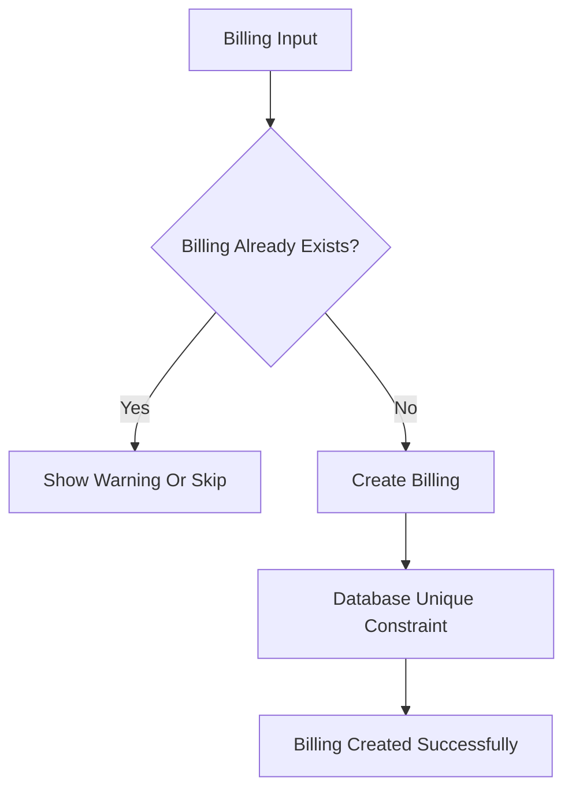

**Diagram sources**
- [core/views/billing.py:186-192](file://core/views/billing.py#L186-L192)
- [core/views/billing.py:259-264](file://core/views/billing.py#L259-L264)
- [core/helpers.py:167-172](file://core/helpers.py#L167-L172)
- [core/models.py:213-215](file://core/models.py#L213-L215)

**Section sources**
- [core/views/billing.py:186-192](file://core/views/billing.py#L186-L192)
- [core/views/billing.py:259-264](file://core/views/billing.py#L259-L264)
- [core/helpers.py:167-172](file://core/helpers.py#L167-L172)
- [core/models.py:213-215](file://core/models.py#L213-L215)

## Dependency Analysis
Billing generation depends on models, helpers, and views working together.

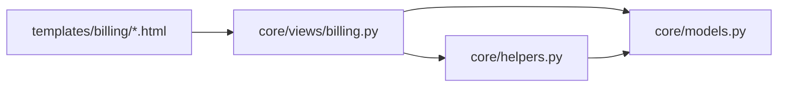

**Diagram sources**
- [core/views/billing.py:1-23](file://core/views/billing.py#L1-L23)
- [core/helpers.py:1-15](file://core/helpers.py#L1-L15)
- [core/models.py:1-5](file://core/models.py#L1-L5)
- [templates/billing/generate.html:76-120](file://templates/billing/generate.html#L76-L120)
- [templates/billing/generate_all.html:36-58](file://templates/billing/generate_all.html#L36-L58)

**Section sources**
- [core/views/billing.py:1-23](file://core/views/billing.py#L1-L23)
- [core/helpers.py:1-15](file://core/helpers.py#L1-L15)
- [core/models.py:1-5](file://core/models.py#L1-L5)

## Performance Considerations
- Use select_related for tenant and stall relationships to reduce query overhead during iteration.
- Avoid unnecessary billing creation by checking existence before inserts.
- Keep automatic billing calls idempotent so repeated page loads do not multiply work.
- Prefer batch operations where possible, but maintain transactional consistency for critical flows.
- Decimal arithmetic prevents floating-point drift and avoids expensive rework caused by rounding errors.

[No sources needed since this section provides general guidance]

## Troubleshooting Guide
Common issues and resolutions:
- **Duplicate billing warning**: Occurs when a billing already exists for the same tenant, stall, month, and year. Remove the duplicate input or choose a different billing period.
- **Missing billings for past months**: Use tenant collection pages or call `ensure_initial_billing()` to backfill historical billings.
- **Incorrect due date**: Verify the contract’s due day and confirm `safe_due_date` is used; month-end dates are clamped to the last day of the month.
- **Penalty not applied**: Confirm the due date is past the grace period and that penalty settings are configured correctly.
- **Ledger imbalance**: Trigger ledger recalculation through payment recording or helper functions that update running balances.
- **Audit log missing**: Ensure the generating view path is used and that the user performing the action is authenticated.

**Section sources**
- [core/views/billing.py:186-192](file://core/views/billing.py#L186-L192)
- [core/views/billing.py:259-264](file://core/views/billing.py#L259-L264)
- [core/helpers.py:208-235](file://core/helpers.py#L208-L235)
- [core/helpers.py:260-273](file://core/helpers.py#L260-L273)
- [core/helpers.py:407-420](file://core/helpers.py#L407-L420)

## Conclusion
The billing generation system provides reliable, idempotent creation of monthly billings for active rental contracts. Automatic helpers ensure collectors always have billings to process, while manual and bulk generation give administrators control. Due date calculation handles month-end edge cases, billing records are consistently populated, tenant ledgers stay synchronized, and audit logs preserve accountability. Duplicate protection and robust error handling make the workflow safe for repeated execution and real-world usage.

[No sources needed since this section summarizes without analyzing specific files]