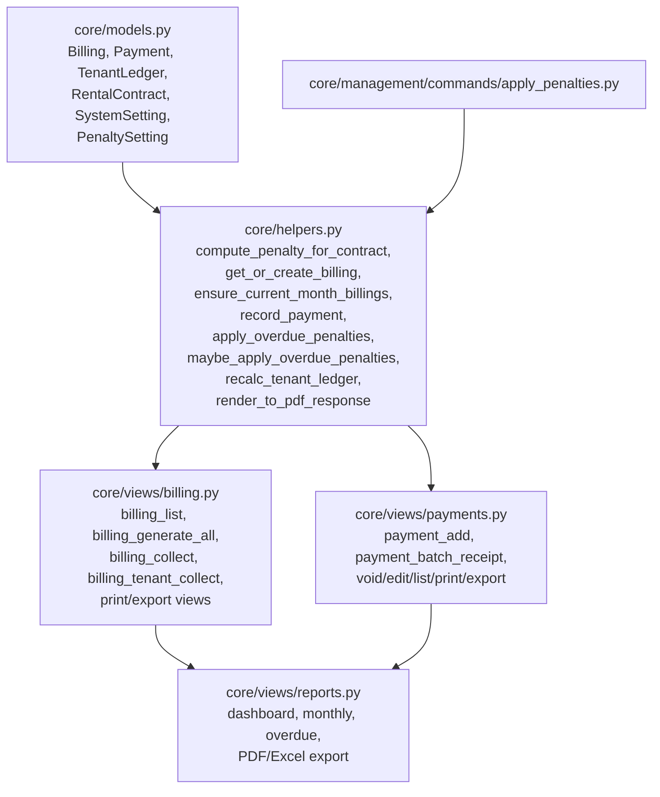
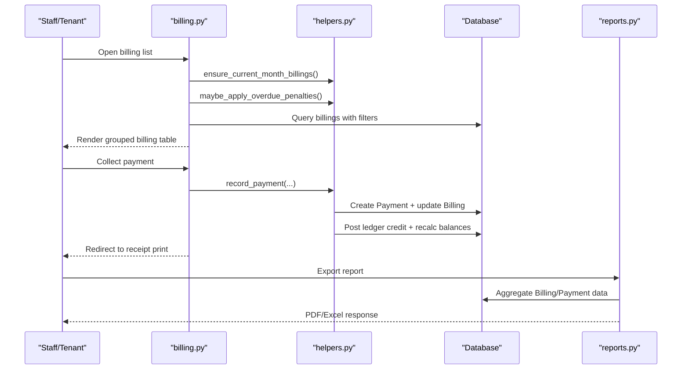
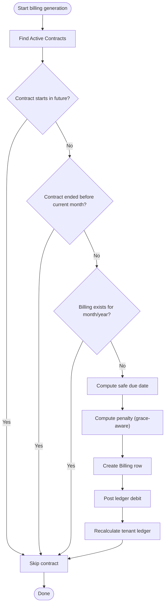
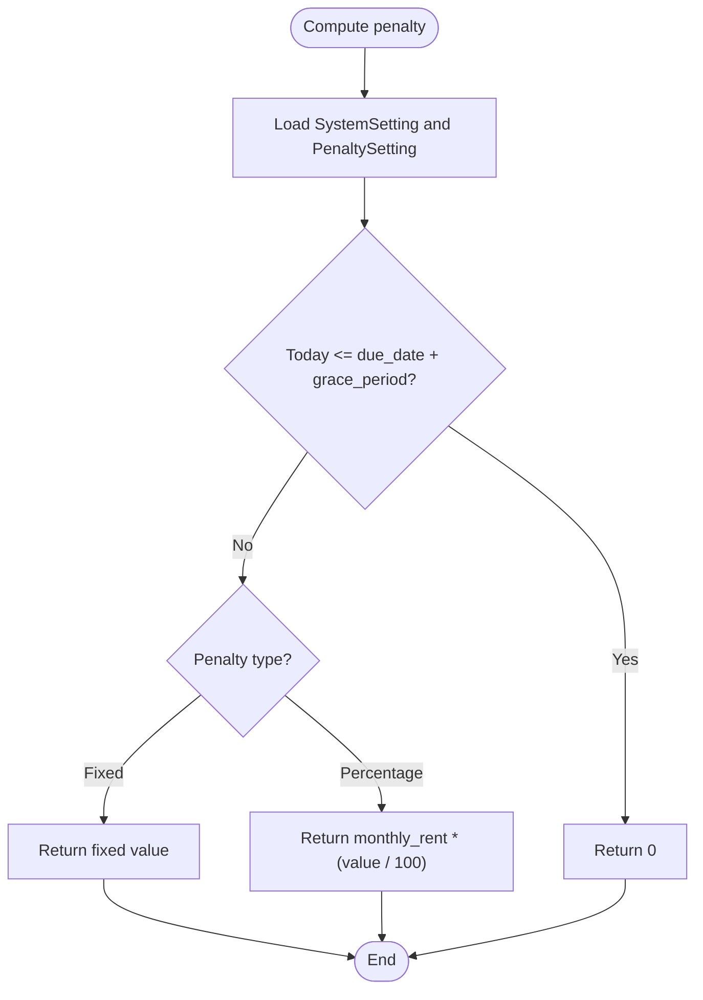
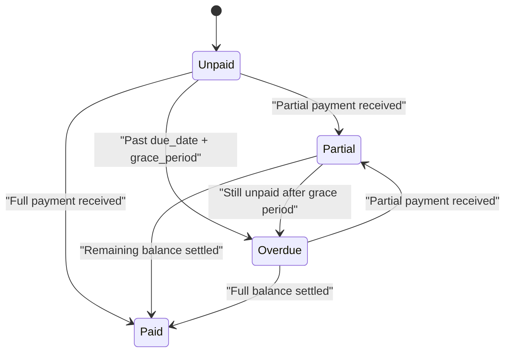
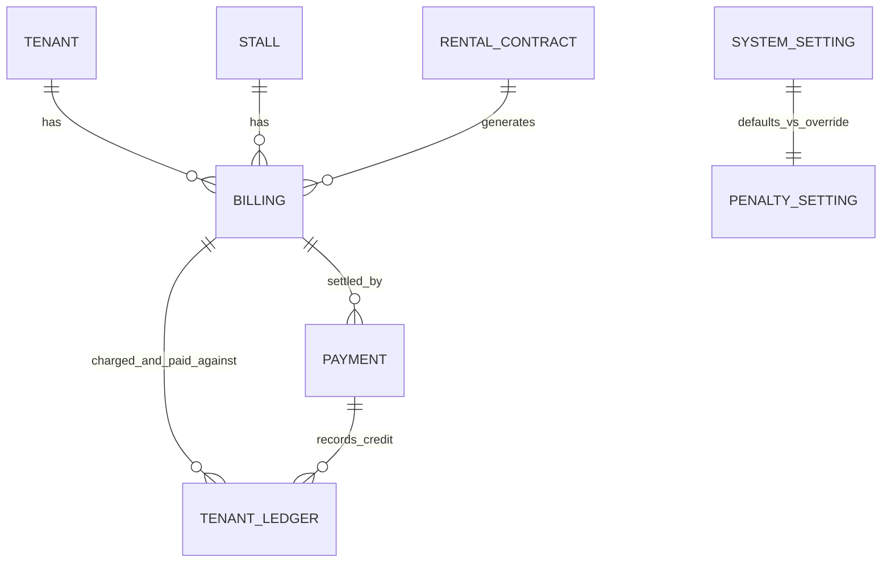
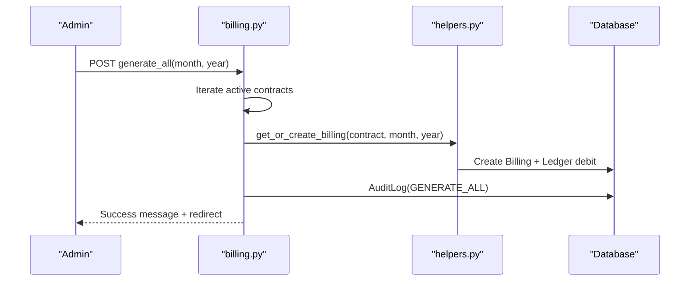
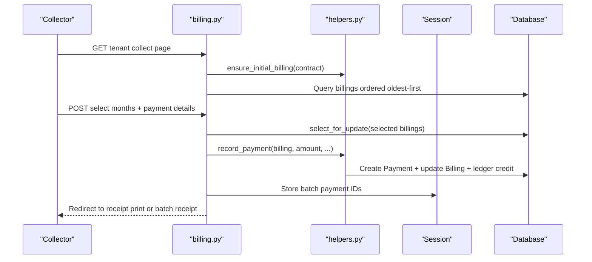
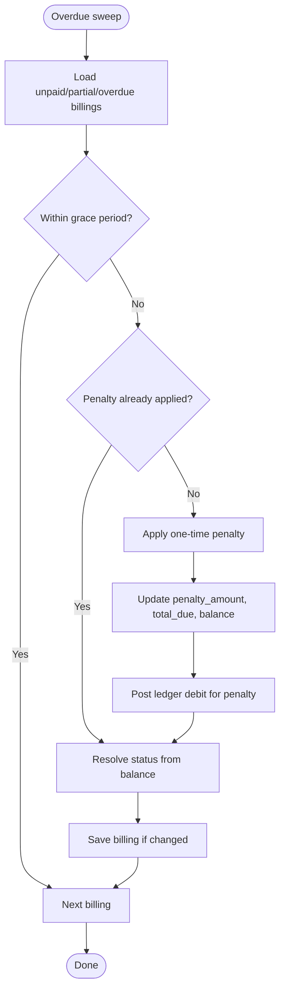
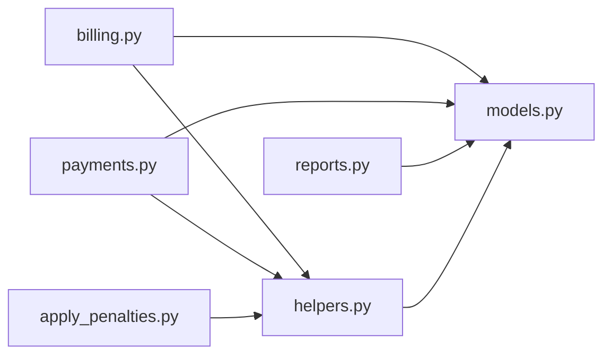

# Billing System

<cite>
**Referenced Files in This Document**
- [models.py](file://core/models.py)
- [helpers.py](file://core/helpers.py)
- [billing.py](file://core/views/billing.py)
- [payments.py](file://core/views/payments.py)
- [reports.py](file://core/views/reports.py)
- [apply_penalties.py](file://core/management/commands/apply_penalties.py)
- [PENALTY_GUIDE.md](file://PENALTY_GUIDE.md)
</cite>

## Table of Contents
1. [Introduction](#introduction)
2. [Project Structure](#project-structure)
3. [Core Components](#core-components)
4. [Architecture Overview](#architecture-overview)
5. [Detailed Component Analysis](#detailed-component-analysis)
6. [Dependency Analysis](#dependency-analysis)
7. [Performance Considerations](#performance-considerations)
8. [Troubleshooting Guide](#troubleshooting-guide)
9. [Conclusion](#conclusion)
10. [Appendices](#appendices)

## Introduction
This document explains the Billing System module for the Market Rental System. It covers how monthly bills are generated for active rental contracts, how penalties are computed after grace periods, how billing status is tracked, and how payments and ledgers stay consistent. It also documents grouped collection workflows, manual adjustments, overdue identification, export/print capabilities, reporting integration, reconciliation behavior, and error handling.

The system supports:
- Automatic monthly billing generation for active contracts.
- Fixed or percentage-based penalties applied after a configurable grace period.
- Billing statuses: Unpaid, Partial, Paid, Overdue.
- Tight linkage between billings, payments, tenant ledgers, audit logs, notices, and reports.
- Grouped collector interfaces for one-tenant batch collections.
- PDF and Excel export for billing lists, receipts, and reports.

## Project Structure
The Billing System lives primarily in the `core` application:
- Data model definitions are in `core/models.py`.
- Shared business logic, penalty computation, payment posting, ledger recalculation, and PDF rendering helpers are in `core/helpers.py`.
- Billing views, list grouping, print/export, and collector collection flows are in `core/views/billing.py`.
- Payment entry, receipt printing, batch receipts, voiding, and editing are in `core/views/payments.py`.
- Reporting endpoints that consume billing/payment data are in `core/views/reports.py`.
- A management command provides a CLI trigger for overdue penalties.
- A plain-language penalty guide is provided in `PENALTY_GUIDE.md`.

**Diagram sources**
- [models.py:157-336](file://core/models.py#L157-L336)
- [helpers.py:132-595](file://core/helpers.py#L132-L595)
- [billing.py:29-765](file://core/views/billing.py#L29-L765)
- [payments.py:20-653](file://core/views/payments.py#L20-L653)
- [reports.py:40-775](file://core/views/reports.py#L40-L775)
- [apply_penalties.py:1-14](file://core/management/commands/apply_penalties.py#L1-L14)

**Section sources**
- [models.py:157-336](file://core/models.py#L157-L336)
- [helpers.py:132-595](file://core/helpers.py#L132-L595)
- [billing.py:29-765](file://core/views/billing.py#L29-L765)
- [payments.py:20-653](file://core/views/payments.py#L20-L653)
- [reports.py:40-775](file://core/views/reports.py#L40-L775)
- [apply_penalties.py:1-14](file://core/management/commands/apply_penalties.py#L1-L14)

## Core Components
The Billing System revolves around these core entities and services:

- **RentalContract**: Defines the active contract, stall, tenant, monthly rent, due day, and status. Active contracts are eligible for automatic billing.
- **SystemSetting**: Holds market-wide defaults such as default due day, penalty type (fixed or percentage), penalty value, and grace period.
- **PenaltySetting**: Optional per-contract override for penalty type, value, grace period, and due day.
- **Billing**: Represents one month’s charge for a tenant/stall/contract combination. Tracks rental amount, penalty amount, discount, total due, amount paid, balance, due date, and status.
- **Payment**: Records each official receipt against a billing, including method, date, collected-by user, and status.
- **TenantLedger**: Maintains an auditable running balance per tenant, with debit entries for charges and credit entries for payments.
- **AuditLog**: Records important actions such as billing generation, collection, penalty application, and payment edits.

Key responsibilities:
- Generate one billing per active contract per month.
- Compute penalties only after the due date plus grace period.
- Keep billing totals derived from valid payments.
- Maintain consistent ledger balances.
- Provide collector-friendly grouped collection and consolidated receipts.
- Support print/PDF/Excel exports and reporting.

**Section sources**
- [models.py:42-69](file://core/models.py#L42-L69)
- [models.py:157-188](file://core/models.py#L157-L188)
- [models.py:190-219](file://core/models.py#L190-L219)
- [models.py:221-259](file://core/models.py#L221-L259)
- [models.py:261-278](file://core/models.py#L261-L278)
- [models.py:319-336](file://core/models.py#L319-L336)

## Architecture Overview
The Billing System follows a layered approach:
- Views handle HTTP requests, authorization, filtering, grouping, and UI flow.
- Helpers encapsulate financial logic: penalty calculation, billing creation, payment posting, ledger recalculation, overdue sweeps, and PDF rendering.
- Models define the authoritative data schema and constraints.
- Reports consume billing and payment data to produce dashboards and exports.
- Management commands provide scheduled or manual triggers for penalty accrual.

**Diagram sources**
- [billing.py:62-171](file://core/views/billing.py#L62-L171)
- [billing.py:415-489](file://core/views/billing.py#L415-L489)
- [helpers.py:238-257](file://core/helpers.py#L238-L257)
- [helpers.py:351-420](file://core/helpers.py#L351-L420)
- [reports.py:40-775](file://core/views/reports.py#L40-L775)

## Detailed Component Analysis

### Automatic Monthly Billing Generation
Automatic billing ensures every active contract has a current-month billing without manual intervention. The process:
- Scans active contracts.
- Skips contracts starting in future months or already ended before the current month.
- Creates a billing if none exists for the current month/year.
- Computes due date using the contract’s due day, safely handling end-of-month cases.
- Computes initial penalty based on current date and grace period.
- Posts a ledger debit for the total due.
- Recalculates the tenant’s running ledger balance.

There are two main entry points:
- `ensure_current_month_billings()` is called automatically when staff open the billing list.
- `ensure_initial_billing(contract)` is used when collecting for a specific tenant to backfill missing months from the contract start up to the current month.

Manual generation is also available via:
- Single-billing generation form.
- Bulk generation for all active contracts for a selected month/year.

**Diagram sources**
- [helpers.py:155-205](file://core/helpers.py#L155-L205)
- [helpers.py:208-257](file://core/helpers.py#L208-L257)
- [billing.py:174-315](file://core/views/billing.py#L174-L315)

**Section sources**
- [helpers.py:125-152](file://core/helpers.py#L125-L152)
- [helpers.py:155-257](file://core/helpers.py#L155-L257)
- [billing.py:174-315](file://core/views/billing.py#L174-L315)

### Penalty Computation Engine
Penalties are governed by:
- Global defaults in `SystemSetting`: penalty type, penalty value, and grace period.
- Optional per-contract overrides in `PenaltySetting`.

Rules:
- If today is within the due date plus grace period, no penalty applies.
- If penalty type is fixed, the penalty equals the configured value.
- If penalty type is percentage, the penalty equals monthly rent multiplied by the percentage.
- Penalties are idempotent: they are applied only once per billing.

Two implementations exist:
- `compute_penalty_for_contract()` in helpers is the canonical service used by automated processes.
- `compute_penalty()` in billing views mirrors this logic for manual generation forms.

**Diagram sources**
- [helpers.py:132-152](file://core/helpers.py#L132-L152)
- [billing.py:29-51](file://core/views/billing.py#L29-L51)
- [PENALTY_GUIDE.md:1-221](file://PENALTY_GUIDE.md#L1-L221)

**Section sources**
- [helpers.py:132-152](file://core/helpers.py#L132-L152)
- [billing.py:29-51](file://core/views/billing.py#L29-L51)
- [PENALTY_GUIDE.md:1-221](file://PENALTY_GUIDE.md#L1-L221)

### Billing Status Tracking and Due Date Management
Billing statuses:
- Unpaid: No payment recorded; balance equals total due.
- Partial: Some payment recorded but not enough to settle.
- Paid: Valid payments cover the total due.
- Overdue: Past due date plus grace period and still unpaid.

Status resolution:
- After any payment edit or void, the system recomputes billing totals from valid payments.
- During overdue sweeps, billings past grace period are marked Overdue if their balance remains positive.

Due date management:
- Due dates are computed from the contract’s due day, adjusted to the last day of the month if needed.
- Grace period extends the effective due date before penalties apply.

**Diagram sources**
- [models.py:190-219](file://core/models.py#L190-L219)
- [helpers.py:321-348](file://core/helpers.py#L321-L348)
- [helpers.py:423-500](file://core/helpers.py#L423-L500)

**Section sources**
- [models.py:190-219](file://core/models.py#L190-L219)
- [helpers.py:321-348](file://core/helpers.py#L321-L348)
- [helpers.py:423-500](file://core/helpers.py#L423-L500)

### Linkage Between Billings, Payments, and Ledgers
Every billing links to:
- A tenant, stall, and active rental contract.
- One or more payments.
- One or more ledger entries.

Payments link to:
- The billing they settle.
- The tenant and stall.
- The collector who recorded them.
- An official receipt number and optional shared receipt for batch collections.

Ledger entries link to:
- The tenant and billing.
- Optionally the payment that caused the credit.
- Debit/credit amounts and running balance.

Reconciliation rules:
- `record_payment()` is the single source of truth for creating payments, updating billing totals, posting ledger credits, and recalculating running balances.
- Editing or voiding a payment recomputes the affected billing(s) and tenant ledger chain.
- Running balances are recalculated chronologically to maintain consistency.

**Diagram sources**
- [models.py:157-336](file://core/models.py#L157-L336)

**Section sources**
- [helpers.py:351-420](file://core/helpers.py#L351-L420)
- [payments.py:460-550](file://core/views/payments.py#L460-L550)

### Billing Generation Workflows
There are three primary workflows:

1. Automatic current-month generation:
   - Triggered when staff open the billing list.
   - Ensures every active contract has a billing for the current month/year.
   - Applies overdue penalties if applicable.

2. Manual single billing generation:
   - Admin selects tenant, contract, month, and year.
   - System checks for duplicates, computes due date and penalty, creates billing and ledger debit, then audits the action.

3. Bulk billing generation:
   - Admin selects month/year.
   - System iterates active contracts, skips existing billings, and generates new ones.
   - Audits the bulk operation.

**Diagram sources**
- [billing.py:249-315](file://core/views/billing.py#L249-L315)
- [helpers.py:155-205](file://core/helpers.py#L155-L205)

**Section sources**
- [billing.py:174-315](file://core/views/billing.py#L174-L315)
- [helpers.py:155-257](file://core/helpers.py#L155-L257)

### Grouped Collection Interfaces
The collector interface groups billings by tenant so collectors can see the full history and outstanding months at a glance. Key features:
- Backfills missing billings for the tenant’s contracts.
- Lists all billings oldest-first.
- Allows selecting multiple months for batch collection.
- Uses `select_for_update` to prevent concurrent double-collection.
- Generates a shared official receipt number for batch collections while keeping internal receipt numbers unique.
- Redirects to either a single-receipt print view or a consolidated batch receipt page.

**Diagram sources**
- [billing.py:498-634](file://core/views/billing.py#L498-L634)
- [payments.py:20-99](file://core/views/payments.py#L20-L99)

**Section sources**
- [billing.py:498-634](file://core/views/billing.py#L498-L634)
- [payments.py:20-99](file://core/views/payments.py#L20-L99)

### Manual Billing Adjustments
Administrators can manually create or edit billings through modal forms:
- Creating a manual billing posts a ledger debit and audits the action.
- Editing a billing updates the corresponding ledger debit and recalculates the tenant ledger chain.
- These operations are designed to keep financial records consistent even when manual changes occur.

**Section sources**
- [billing.py:335-412](file://core/views/billing.py#L335-L412)

### Integration with the Penalty System and Overdue Identification
Overdue identification and penalty application are handled by:
- `apply_overdue_penalties()`: scans unpaid/partial/overdue billings, applies one-time penalties after grace period, marks status Overdue if balance remains positive, posts ledger debits for penalties, and recalculates affected tenant ledgers.
- `maybe_apply_overdue_penalties()`: throttles the sweep to once per day per cache instance during request processing.
- `core/management/commands/apply_penalties.py`: CLI wrapper for scheduled runs.

The system ensures:
- Penalties are applied only once per billing.
- Status transitions are consistent with balance.
- Ledger entries reflect penalty charges.
- Audit logs capture automatic penalty applications.

**Diagram sources**
- [helpers.py:423-500](file://core/helpers.py#L423-L500)
- [apply_penalties.py:1-14](file://core/management/commands/apply_penalties.py#L1-L14)

**Section sources**
- [helpers.py:423-520](file://core/helpers.py#L423-L520)
- [apply_penalties.py:1-14](file://core/management/commands/apply_penalties.py#L1-L14)
- [PENALTY_GUIDE.md:1-221](file://PENALTY_GUIDE.md#L1-L221)

### Billing Export Capabilities, Print Functionality, and Reporting Integrations
Export and print capabilities include:
- Billing list print and PDF export.
- Individual billing print and PDF export.
- Payment receipt print and PDF export.
- Batch receipt print and PDF export for grouped collections.
- Report dashboard, monthly, weekly, annual, section, collector, paid/unpaid tenants, overdue accounts, occupancy, vacant stalls, and ledger reports.
- PDF export via WeasyPrint with fallbacks to xhtml2pdf or browser-printable HTML.
- Excel export via openpyxl for many report types.

Reporting integrations:
- Dashboard aggregates billed, collected, balance, counts, and collection rate.
- Overdue report queries billings with status Overdue.
- Unpaid tenants report includes Unpaid, Partial, and Overdue billings.
- Section and collector reports aggregate billing and payment data.

**Section sources**
- [billing.py:637-765](file://core/views/billing.py#L637-L765)
- [payments.py:331-416](file://core/views/payments.py#L331-L416)
- [payments.py:553-653](file://core/views/payments.py#L553-L653)
- [reports.py:40-775](file://core/views/reports.py#L40-L775)
- [helpers.py:522-595](file://core/helpers.py#L522-L595)

### Billing Reconciliation Processes
Reconciliation is enforced through:
- Authoritative recomputation of billing totals from valid payments.
- Running ledger balance recalculation across chronological entries.
- Voiding payments removes ledger entries and recomputes affected billing and tenant ledger chains.
- Editing payments updates ledger credits and recalculates both old and new tenant ledgers when necessary.

These mechanisms ensure that:
- Billing balances always match the sum of valid payments.
- Ledger balances remain consistent after edits, voids, and penalties.
- Financial reports reflect accurate aggregated data.

**Section sources**
- [helpers.py:260-273](file://core/helpers.py#L260-L273)
- [helpers.py:321-348](file://core/helpers.py#L321-L348)
- [payments.py:460-550](file://core/views/payments.py#L460-L550)

### Error Handling for Failed Billings
Error handling strategies:
- Auto-generation and overdue sweeps are wrapped in best-effort blocks so failures do not break user-facing pages.
- Throttling prevents repeated penalty sweeps within the same day.
- Receipt number generation retries on rare integrity errors.
- PDF rendering falls back gracefully when WeasyPrint or xhtml2pdf is unavailable, offering a browser-printable preview.
- Validation errors in forms return messages and re-render forms.

**Section sources**
- [billing.py:62-70](file://core/views/billing.py#L62-L70)
- [billing.py:637-644](file://core/views/billing.py#L637-L644)
- [helpers.py:503-520](file://core/helpers.py#L503-L520)
- [helpers.py:373-400](file://core/helpers.py#L373-L400)
- [helpers.py:522-595](file://core/helpers.py#L522-L595)

## Dependency Analysis
The Billing System depends on:
- Django ORM for data access and transactions.
- Decimal arithmetic for financial precision.
- Cache for throttling overdue sweeps.
- WeasyPrint/xhtml2pdf for PDF generation.
- openpyxl for Excel exports.
- Templates for rendering lists, receipts, and reports.

**Diagram sources**
- [billing.py:1-22](file://core/views/billing.py#L1-L22)
- [payments.py:1-18](file://core/views/payments.py#L1-L18)
- [reports.py:1-15](file://core/views/reports.py#L1-L15)
- [apply_penalties.py:1-14](file://core/management/commands/apply_penalties.py#L1-L14)
- [helpers.py:1-15](file://core/helpers.py#L1-L15)
- [models.py:1-15](file://core/models.py#L1-L15)

**Section sources**
- [billing.py:1-22](file://core/views/billing.py#L1-L22)
- [payments.py:1-18](file://core/views/payments.py#L1-L18)
- [reports.py:1-15](file://core/views/reports.py#L1-L15)
- [helpers.py:1-15](file://core/helpers.py#L1-L15)
- [models.py:1-15](file://core/models.py#L1-L15)

## Performance Considerations
- Use `select_related` to reduce N+1 queries when listing billings, payments, and reports.
- Avoid generating duplicate billings by checking existence before creation.
- Throttle overdue sweeps to once per day per cache instance.
- Prefer Decimal arithmetic throughout to avoid float drift.
- Limit exported datasets with filters and pagination where possible.
- Batch operations should use transactions to ensure atomicity and consistency.

[No sources needed since this section provides general guidance]

## Troubleshooting Guide
Common issues and resolutions:
- Missing billings for active contracts:
  - Ensure `ensure_current_month_billings()` is called on billing list access.
  - For tenant-specific collection, verify `ensure_initial_billing(contract)` is invoked.
- Unexpected penalties:
  - Verify SystemSetting and PenaltySetting values.
  - Confirm grace period configuration and due date calculations.
- Inconsistent billing balances:
  - Run `recalc_billing_from_payments()` after payment edits or voids.
  - Run `recalc_tenant_ledger()` to fix running balances.
- PDF export failures:
  - Install WeasyPrint dependencies or rely on browser print fallback.
  - Check xhtml2pdf fallback availability.
- Duplicate receipts:
  - `generate_receipt_number()` retries on integrity errors; check database constraints and retry logic.

**Section sources**
- [billing.py:62-70](file://core/views/billing.py#L62-L70)
- [billing.py:498-534](file://core/views/billing.py#L498-L534)
- [helpers.py:260-273](file://core/helpers.py#L260-L273)
- [helpers.py:321-348](file://core/helpers.py#L321-L348)
- [helpers.py:522-595](file://core/helpers.py#L522-L595)

## Conclusion
The Billing System provides a robust, auditable, and reconcilable framework for monthly rental billing. It automates billing generation for active contracts, applies penalties correctly after grace periods, tracks billing statuses accurately, and maintains consistent linkages between billings, payments, and ledgers. Collector-friendly grouped interfaces streamline collections, while comprehensive export and reporting capabilities support administrative oversight. Error handling and throttling ensure reliability under real-world conditions.

[No sources needed since this section summarizes without analyzing specific files]

## Appendices

### Billing Model Summary
- Fields: tenant, stall, contract, billing_month, billing_year, rental_amount, penalty_amount, discount, total_due, amount_paid, balance, due_date, status, timestamps.
- Constraints: unique per tenant/stall/month/year; ordering by newest billing first.

**Section sources**
- [models.py:190-219](file://core/models.py#L190-L219)

### Payment Model Summary
- Fields: receipt_number, tenant, stall, billing, billing_month, billing_year, rental_amount, penalty_amount, discount, total_amount_due, amount_paid, payment_date, payment_method, official_receipt_no, collected_by, status, remarks, timestamps.
- Ordering: newest payments first.

**Section sources**
- [models.py:221-259](file://core/models.py#L221-L259)

### Tenant Ledger Model Summary
- Fields: tenant, billing, transaction_date, description, debit, credit, balance, payment, timestamp.
- Purpose: running balance per tenant with chronological consistency.

**Section sources**
- [models.py:261-278](file://core/models.py#L261-L278)

### System Setting and Penalty Setting Summary
- SystemSetting: municipality/market info, receipt prefix, default due day, penalty type/value, grace period, logo/theme/terms.
- PenaltySetting: per-contract override for penalty type/value/grace/due day and activation flag.

**Section sources**
- [models.py:42-69](file://core/models.py#L42-L69)
- [models.py:319-336](file://core/models.py#L319-L336)