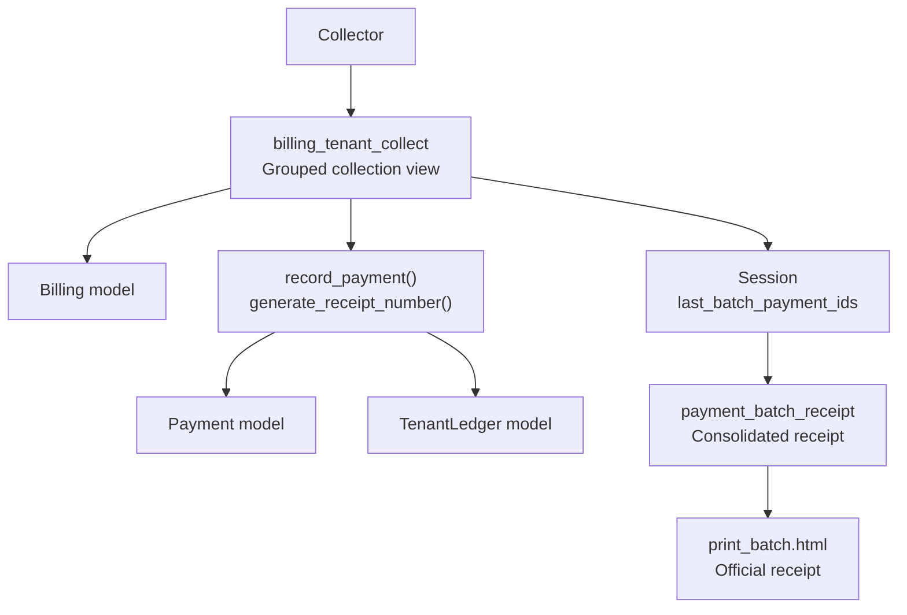
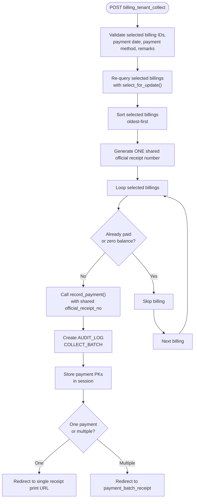
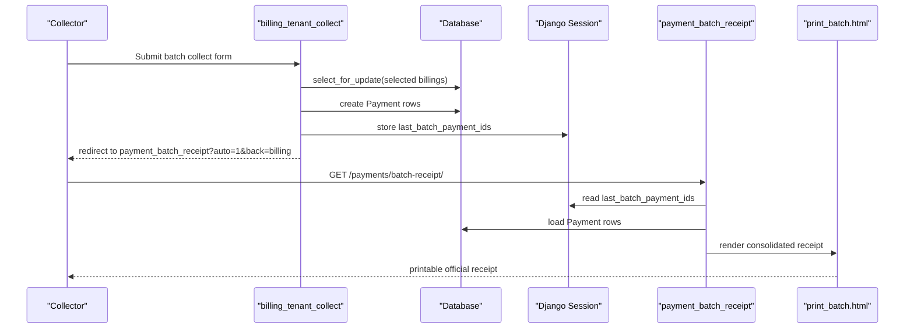
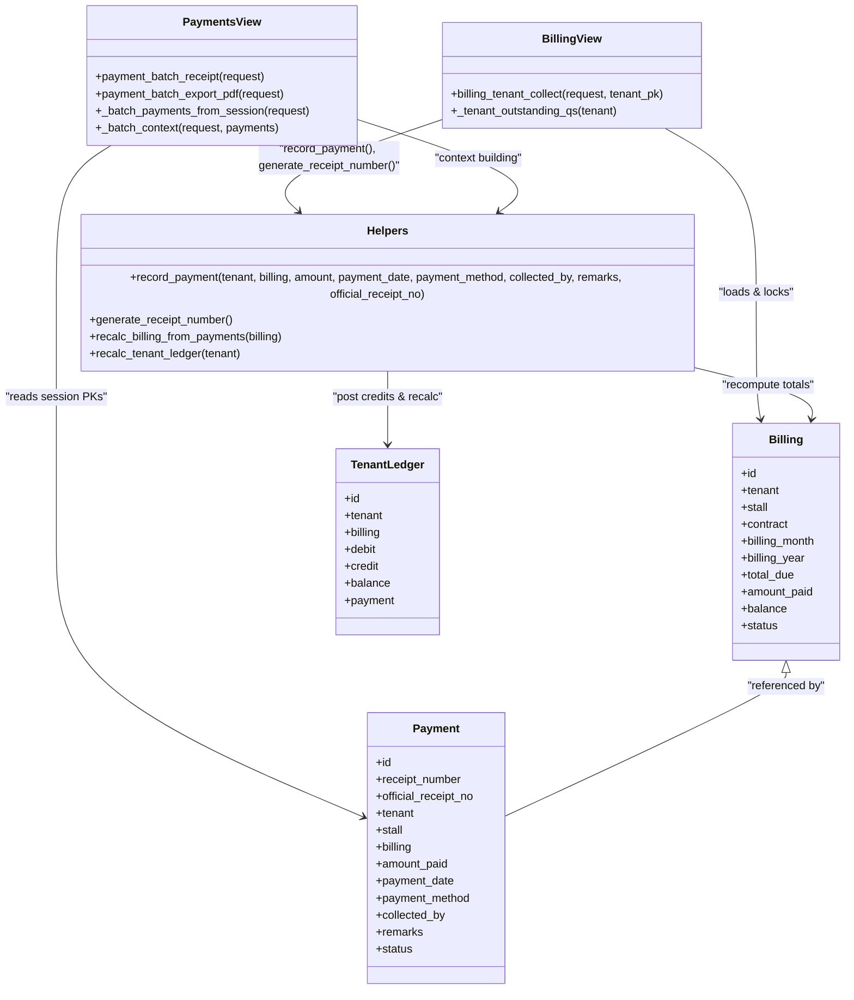
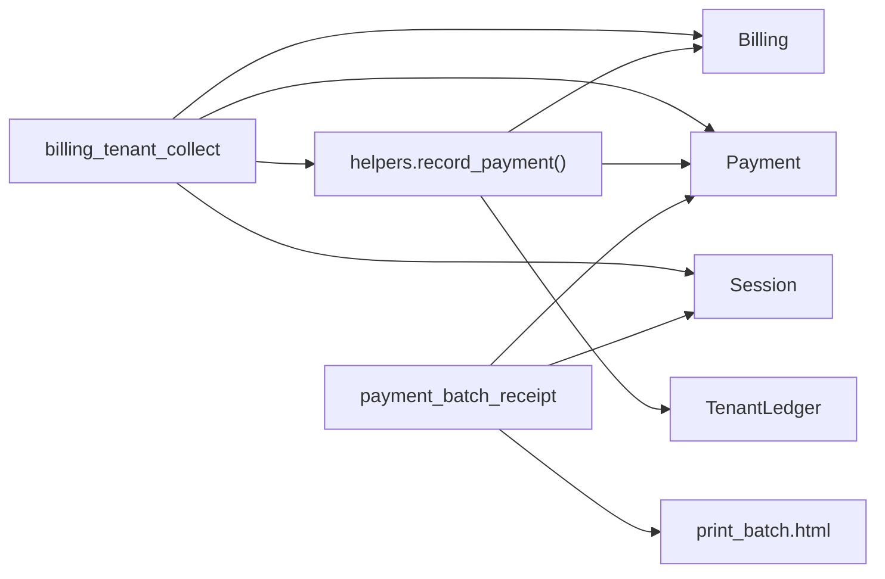

# Batch Collection

<cite>
**Referenced Files in This Document**
- [billing.py](file://core/views/billing.py)
- [payments.py](file://core/views/payments.py)
- [helpers.py](file://core/helpers.py)
- [collect_grouped.html](file://templates/billing/collect_grouped.html)
- [print_batch.html](file://templates/payments/print_batch.html)
</cite>

## Table of Contents
1. [Introduction](#introduction)
2. [Project Structure](#project-structure)
3. [Core Components](#core-components)
4. [Architecture Overview](#architecture-overview)
5. [Detailed Component Analysis](#detailed-component-analysis)
6. [Dependency Analysis](#dependency-analysis)
7. [Performance Considerations](#performance-considerations)
8. [Troubleshooting Guide](#troubleshooting-guide)
9. [Conclusion](#conclusion)

## Introduction
This document explains the batch collection workflow used by collectors to settle multiple outstanding billing months for a single tenant in one operation. The central entry point is `billing_tenant_collect()`, which renders a grouped workspace showing every billing month tied to the tenant’s contracts, lets the collector select specific months, and then creates individual payment records while issuing a single consolidated official receipt.

The design preserves the same ledger, billing status, audit trail, and receipt behavior as the single-month collection flow, but adds:
- A grouped UI with complete billing history per tenant.
- Outstanding amount calculations.
- Shared official receipt number generation for the batch.
- Atomic transaction handling with row-level locking to prevent concurrent double-settlement.
- Session-based batch receipt rendering and printing.

## Project Structure
The batch collection feature spans two view modules, shared helpers, and two templates:

| Area | File | Responsibility |
| --- | --- | --- |
| Grouped collection view | `core/views/billing.py` | Loads tenant billings, validates batch form, locks rows, creates payments, stores session data, redirects to receipt. |
| Batch receipt view | `core/views/payments.py` | Reads session-stored payment IDs, builds consolidated receipt context, enforces access control, supports PDF export. |
| Shared financial logic | `core/helpers.py` | Receipt numbering, payment recording, billing recomputation, ledger updates, overdue penalties, PDF fallback. |
| Grouped collection template | `templates/billing/collect_grouped.html` | Month-by-month table, selection controls, live totals, batch action form. |
| Consolidated receipt template | `templates/payments/print_batch.html` | Single official receipt page listing each collected month as a line item. |

**Diagram sources**
- [billing.py:511-634](file://core/views/billing.py#L511-L634)
- [payments.py:20-37](file://core/views/payments.py#L20-L37)
- [payments.py:351-373](file://core/views/payments.py#L351-L373)
- [helpers.py:276-300](file://core/helpers.py#L276-L300)
- [helpers.py:351-420](file://core/helpers.py#L351-L420)
- [print_batch.html:1-221](file://templates/payments/print_batch.html#L1-L221)

**Section sources**
- [billing.py:511-634](file://core/views/billing.py#L511-L634)
- [payments.py:20-37](file://core/views/payments.py#L20-L37)
- [payments.py:351-373](file://core/views/payments.py#L351-L373)
- [helpers.py:276-300](file://core/helpers.py#L276-L300)
- [helpers.py:351-420](file://core/helpers.py#L351-L420)
- [collect_grouped.html:1-222](file://templates/billing/collect_grouped.html#L1-L222)
- [print_batch.html:1-221](file://templates/payments/print_batch.html#L1-L221)

## Core Components

### `billing_tenant_collect()`
This function provides the grouped collection interface for one tenant. Its responsibilities are:

1. Load the tenant and ensure historical billings exist for all active contracts.
2. Query every billing month for the tenant, ordered oldest first.
3. Compute outstanding billings and total outstanding balance.
4. On POST:
   - Validate selected billing IDs.
   - Parse and validate payment date.
   - Normalize payment method and remarks.
   - Re-query selected billings under `select_for_update()` inside an atomic transaction.
   - Sort selected billings oldest-first.
   - Generate one shared official receipt number.
   - Create one `Payment` per selected month through `record_payment()`.
   - Log a batch collection audit entry.
   - Store payment primary keys in the session.
   - Redirect to either the single-receipt print URL or the batch receipt URL.

Key implementation details:
- The view is decorated with `@collector_required` and `@transaction.atomic`.
- Concurrent safety comes from re-fetching selected billings with `Billing.objects.select_for_update().filter(pk__in=selected_ids, tenant=tenant)`.
- The shared official receipt number is generated once via `generate_receipt_number()` and passed as `official_receipt_no` to each payment.
- Individual `receipt_number` values remain unique per payment, while `official_receipt_no` groups them visually on the printed receipt.

**Section sources**
- [billing.py:511-634](file://core/views/billing.py#L511-L634)

### Form Processing for Selecting Multiple Billings
The grouped collection template renders a month-by-month table where:

- Only rows with a positive balance and a non-Paid status show a selectable checkbox.
- A header checkbox toggles all outstanding rows.
- “Select all outstanding” and “Clear” buttons help collectors quickly choose months.
- Live JavaScript calculates the selected count and total based on each row’s `data-balance` attribute.
- The submit button is disabled until at least one month is selected.
- The form posts to the same `billing_tenant_collect` URL with:
  - `billing_ids`: list of selected billing primary keys.
  - `payment_date`: defaulting to today.
  - `payment_method`: chosen from available choices.
  - `remarks`: optional collector note.

The template also shows:
- Tenant name, ID, contact, and business name.
- Total months displayed.
- Count of unpaid months.
- Summed outstanding balance.

**Section sources**
- [collect_grouped.html:21-50](file://templates/billing/collect_grouped.html#L21-L50)
- [collect_grouped.html:63-175](file://templates/billing/collect_grouped.html#L63-L175)
- [collect_grouped.html:179-219](file://templates/billing/collect_grouped.html#L179-L219)

### Shared Receipt Number Generation
Batch collection generates one official receipt number before creating any payments. This ensures that the consolidated receipt printed later has a single OR identifier even though multiple payment rows are created.

Important distinctions:
- `receipt_number`: unique per `Payment` row.
- `official_receipt_no`: shared across all payments created in the same batch.
- The shared OR is what appears prominently on the consolidated receipt and audit log.

**Section sources**
- [billing.py:568-573](file://core/views/billing.py#L568-L573)
- [helpers.py:276-300](file://core/helpers.py#L276-L300)

### Atomic Transaction Handling and Concurrency Safety
The batch collection process uses two layers of concurrency protection:

1. View-level atomic transaction:
   - The entire POST handler runs inside `@transaction.atomic`.
   - If any step fails, the whole batch is rolled back.

2. Row-level locking:
   - Selected billings are re-fetched with `select_for_update()` inside the transaction.
   - This prevents another collector from settling the same month(s) concurrently.

Additionally, `record_payment()` itself:
- Locks the target billing row with `select_for_update()`.
- Creates the payment inside its own atomic block.
- Recomputes billing totals authoritatively from valid payments.
- Posts a ledger credit and recalculates the tenant’s running ledger balance.
- Retries receipt number generation on rare integrity errors.

**Diagram sources**
- [billing.py:539-624](file://core/views/billing.py#L539-L624)
- [helpers.py:351-420](file://core/helpers.py#L351-L420)

**Section sources**
- [billing.py:511-624](file://core/views/billing.py#L511-L624)
- [helpers.py:351-420](file://core/helpers.py#L351-L420)

### Consolidation Logic: Individual Payments, Single Official Receipt
Although the collector sees one batch action, the system creates one `Payment` per selected billing month. Each payment:
- Records the full outstanding balance for that month.
- Updates the corresponding `Billing` row.
- Posts a ledger credit.
- Receives a unique internal receipt number.
- Shares the batch’s official receipt number.

After creation, the view:
- Calculates the total collected amount.
- Builds a period string from the collected months.
- Logs a `COLLECT_BATCH` audit entry mentioning the number of months, periods, total amount, and shared OR.
- Stores the payment IDs in the session so the batch receipt page can render them.

If no payable months remain after filtering already-paid rows, the user receives an informational message and is redirected back to the grouped collection page.

**Section sources**
- [billing.py:575-624](file://core/views/billing.py#L575-L624)

### Session-Based Batch Receipt Handling
The batch receipt flow is coordinated through the request session:

1. `billing_tenant_collect()` stores the list of created payment primary keys under the key `last_batch_payment_ids`.
2. `payment_batch_receipt()` reads those IDs from the session.
3. It loads the actual `Payment` objects with related tenant, stall, billing, and collector information.
4. It enforces access control:
   - Tenants can only see their own receipts.
   - Non-superuser collectors can only see receipts they recorded.
5. It builds a consolidated receipt context containing:
   - All collected payments.
   - Shared official receipt number.
   - Tenant and stall summary.
   - Period range.
   - Totals for rental, penalty, discount, due, and paid amounts.
   - Remaining balance.
   - Amount in words.
   - Auto-print flag when arriving from batch collection.

**Diagram sources**
- [billing.py:557-624](file://core/views/billing.py#L557-L624)
- [payments.py:20-37](file://core/views/payments.py#L20-L37)
- [payments.py:351-373](file://core/views/payments.py#L351-L373)

**Section sources**
- [billing.py:616-624](file://core/views/billing.py#L616-L624)
- [payments.py:20-37](file://core/views/payments.py#L20-L37)
- [payments.py:351-373](file://core/views/payments.py#L351-L373)

### Integration with Payment Batch Receipt Printing
The consolidated receipt template prints one official receipt covering multiple billing months. Its structure includes:

- Header with municipality, market, office, and receipt title.
- Official receipt number and issue date.
- Payee section with tenant name, tenant ID, stall numbers, and payment method.
- Line-item table with one row per collected month.
- Column totals for rental, penalty, discount, total due, and amount paid.
- Grand totals for total due, total paid, and remaining balance.
- Amount in words.
- Remarks field.
- Settlement status indicator.
- Signature lines for collector and tenant.
- Footer explaining that this is a consolidated receipt.

When accessed from batch collection, the page automatically triggers the browser print dialog. There is also a separate PDF export endpoint that uses the same template and context.

**Section sources**
- [print_batch.html:1-221](file://templates/payments/print_batch.html#L1-L221)
- [payments.py:376-396](file://core/views/payments.py#L376-L396)

## Architecture Overview
The batch collection architecture connects UI, view logic, shared helpers, database models, session storage, and receipt rendering.

**Diagram sources**
- [billing.py:498-634](file://core/views/billing.py#L498-L634)
- [payments.py:20-37](file://core/views/payments.py#L20-L37)
- [payments.py:351-396](file://core/views/payments.py#L351-L396)
- [helpers.py:276-300](file://core/helpers.py#L276-L300)
- [helpers.py:321-348](file://core/helpers.py#L321-L348)
- [helpers.py:351-420](file://core/helpers.py#L351-L420)

## Detailed Component Analysis

### Grouped Collection Workspace
The grouped workspace is designed for collectors who need to review a tenant’s complete billing history before collecting.

Key behaviors:
- Backfill missing billings for the tenant’s contracts using `ensure_initial_billing()`.
- Display every billing month tied to the tenant, ordered by year, month, and stall.
- Highlight unpaid rows and allow selection only for open balances.
- Show month, stall, due amount, paid amount, balance, due date, and status.
- Provide quick-select controls for outstanding rows.
- Calculate selected count and total live in the browser.
- Require at least one selection before submission.

Outstanding calculation:
- The backend filters billings with a positive balance and a non-Paid status.
- The total outstanding is computed as the sum of those balances.

UI examples:
- Tenant header shows full name, tenant ID, contact, and business name.
- Summary cards show total months, unpaid count, and total balance.
- Step 1 displays the month-by-month breakdown.
- Step 2 collects payment method, date, remarks, and submits the batch.

**Section sources**
- [billing.py:524-537](file://core/views/billing.py#L524-L537)
- [billing.py:539-555](file://core/views/billing.py#L539-L555)
- [collect_grouped.html:21-50](file://templates/billing/collect_grouped.html#L21-L50)
- [collect_grouped.html:63-175](file://templates/billing/collect_grouped.html#L63-L175)
- [collect_grouped.html:179-219](file://templates/billing/collect_grouped.html#L179-L219)

### Batch Processing Results
After successful batch processing:
- Each selected month becomes a separate payment.
- Each payment updates its billing row and ledger entry.
- A single audit log entry records the batch operation.
- The user sees a success message including the number of months, total amount, and shared official receipt number.
- For one payment, the classic single-receipt flow is preserved.
- For multiple payments, the user is redirected to the batch receipt page with auto-print enabled.

Example result scenarios:
- Settling three overdue months produces three payment rows, one audit log, and one consolidated official receipt.
- If all selected months are already paid, the system informs the collector and returns to the grouped collection page.
- If invalid input is submitted, error messages are shown and the collector remains on the grouped collection page.

**Section sources**
- [billing.py:575-624](file://core/views/billing.py#L575-L624)

### Consolidated Receipt Rendering
The consolidated receipt template renders one official receipt document that lists each collected month as a line item.

Important fields:
- Official receipt number: shared across the batch.
- Date issued and time issued.
- Period covered: single month or month range.
- Tenant name and tenant ID.
- Stall numbers: one badge per stall if multiple stalls are involved.
- Payment method.
- Monthly line items with rental, penalty, discount, total due, and amount paid.
- Totals and remaining balance.
- Amount in words.
- Remarks.
- Settlement status.
- Collector and tenant signature areas.

Auto-print behavior:
- When accessed from batch collection, the page listens for the load event and opens the print dialog automatically.
- The PDF export endpoint uses the same template without auto-print.

**Section sources**
- [print_batch.html:1-221](file://templates/payments/print_batch.html#L1-L221)
- [payments.py:351-396](file://core/views/payments.py#L351-L396)

## Dependency Analysis
The batch collection workflow depends on several components:

| Dependency | Role | Coupling Notes |
| --- | --- | --- |
| `Billing` model | Source of outstanding months | Loaded with related stall, section, and contract for display and ordering. |
| `Payment` model | Created per selected month | Holds both unique receipt number and shared official receipt number. |
| `TenantLedger` model | Financial audit trail | Updated with credit entries and recalculated running balance. |
| `record_payment()` | Central payment posting | Ensures consistent billing recomputation and ledger updates. |
| `generate_receipt_number()` | Receipt numbering | Produces monthly sequence-based receipt identifiers. |
| Django session | Batch receipt coordination | Stores payment IDs between batch collection and receipt rendering. |
| Templates | User-facing presentation | Separate templates for grouped collection and consolidated receipt. |

**Diagram sources**
- [billing.py:511-634](file://core/views/billing.py#L511-L634)
- [payments.py:20-37](file://core/views/payments.py#L20-L37)
- [payments.py:351-373](file://core/views/payments.py#L351-L373)
- [helpers.py:351-420](file://core/helpers.py#L351-L420)

**Section sources**
- [billing.py:511-634](file://core/views/billing.py#L511-L634)
- [payments.py:20-37](file://core/views/payments.py#L20-L37)
- [payments.py:351-373](file://core/views/payments.py#L351-L373)
- [helpers.py:351-420](file://core/helpers.py#L351-L420)

## Performance Considerations
- **Query optimization**: The grouped collection query selects related stall, section, and contract data to avoid N+1 queries during rendering.
- **Ordering stability**: Billings are ordered by year, month, and stall to keep grouping predictable.
- **Row locking cost**: `select_for_update()` serializes concurrent modifications to the same billings, improving correctness at the cost of brief lock contention.
- **Decimal arithmetic**: Financial calculations use `Decimal` throughout to avoid floating-point drift.
- **Idempotent backfill**: `ensure_initial_billing()` is safe to call repeatedly and avoids duplicate billings.
- **Single receipt number generation**: Generating one shared OR per batch reduces redundant work and keeps the printed receipt coherent.
- **Session scope**: Storing only payment IDs keeps session payload small; actual payment data is loaded from the database when rendering the receipt.

[No sources needed since this section provides general guidance]

## Troubleshooting Guide

### No Months Available for Collection
Symptoms:
- Grouped collection page shows no billings.
- Message indicates no billing months recorded.

Likely causes:
- Tenant has no active contract.
- Contracts have not been processed into billings yet.

Resolution:
- Verify the tenant has an active contract.
- Allow `ensure_initial_billing()` to backfill missing months on page load.

**Section sources**
- [billing.py:526-533](file://core/views/billing.py#L526-L533)
- [collect_grouped.html:53-60](file://templates/billing/collect_grouped.html#L53-L60)

### Nothing to Collect After Selection
Symptoms:
- Success message says nothing to collect.
- Redirects back to grouped collection.

Likely causes:
- Selected months were already paid.
- Balances became zero before processing.

Resolution:
- Refresh the grouped collection page to see updated statuses.
- Ensure another collector did not settle the same months concurrently.

**Section sources**
- [billing.py:592-594](file://core/views/billing.py#L592-L594)

### Invalid Payment Date
Symptoms:
- Error message about invalid payment date.
- Redirects back to grouped collection.

Likely causes:
- Malformed date value in the form.

Resolution:
- Use the provided date picker or enter a valid `YYYY-MM-DD` date.

**Section sources**
- [billing.py:545-550](file://core/views/billing.py#L545-L550)

### No Batch Receipt Available
Symptoms:
- Batch receipt page shows an informational message.
- Redirects to billing list.

Likely causes:
- Session does not contain recent batch payment IDs.
- Another collector viewed the batch receipt page instead of the originating collector.

Resolution:
- Perform a new batch collection.
- Access the batch receipt immediately after collection.

**Section sources**
- [payments.py:351-363](file://core/views/payments.py#L351-L363)

### Access Denied on Batch Receipt
Symptoms:
- Error message about viewing only own receipts or receipts you recorded.
- Redirects to dashboard or payment list.

Likely causes:
- Tenant trying to view another tenant’s receipt.
- Collector trying to view receipts recorded by another collector.

Resolution:
- Tenants should only view their own receipts.
- Collectors should only view receipts they personally recorded.

**Section sources**
- [payments.py:364-372](file://core/views/payments.py#L364-L372)

## Conclusion
The batch collection workflow provides a practical, auditable, and financially consistent way to settle multiple outstanding billing months for a tenant. It combines a clear grouped UI with robust backend logic:

- The grouped workspace shows complete billing history and outstanding totals.
- Form validation and live selection improve collector experience.
- Atomic transactions and row-level locking prevent concurrent double-settlement.
- Individual payments preserve ledger integrity while sharing one official receipt number.
- Session-based batch receipt rendering delivers a single consolidated official receipt.
- Access controls ensure tenants and collectors only view authorized receipts.

This design keeps batch collection aligned with the single-month collection flow while adding efficiency and clarity for collectors managing multiple overdue months.

[No sources needed since this section summarizes without analyzing specific files]