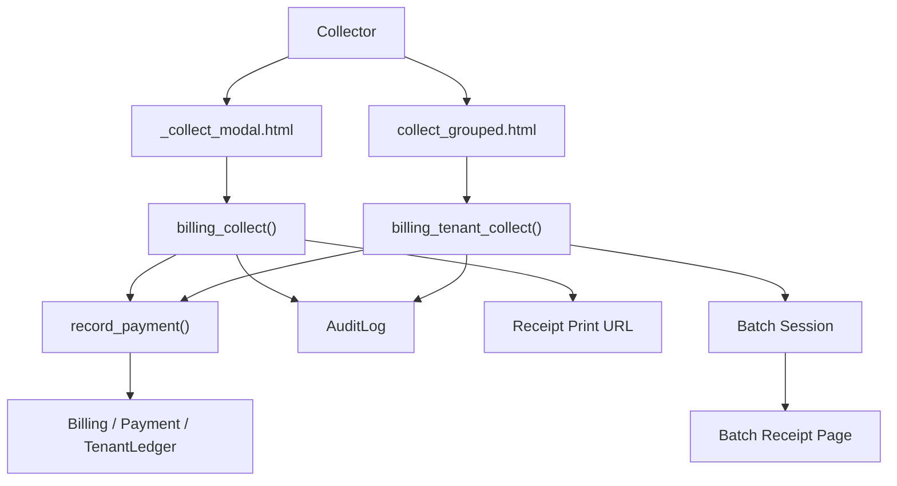
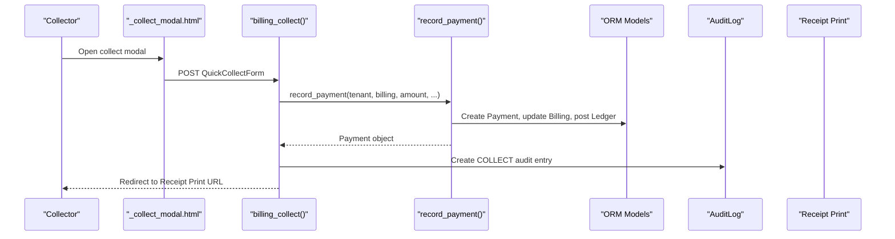
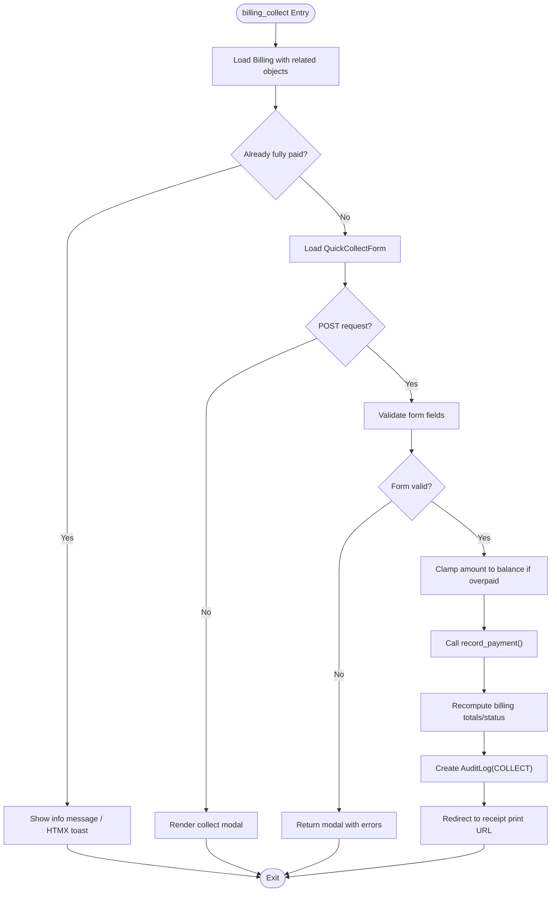
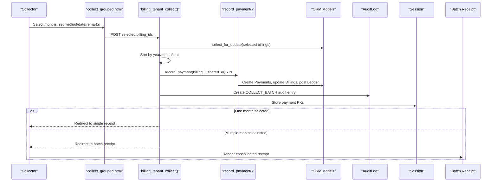
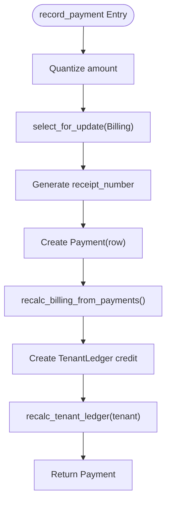
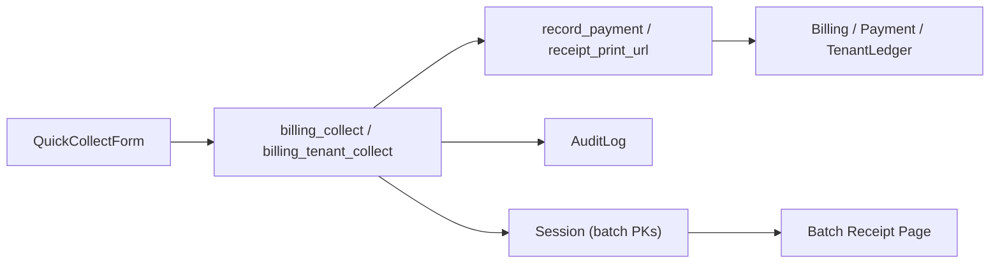

# Collection Workflows

<cite>
**Referenced Files in This Document**
- [billing.py](file://core/views/billing.py)
- [helpers.py](file://core/helpers.py)
- [payments.py](file://core/views/payments.py)
- [forms.py](file://core/forms.py)
- [models.py](file://core/models.py)
- [_collect_modal.html](file://templates/billing/_collect_modal.html)
- [collect_grouped.html](file://templates/billing/collect_grouped.html)
</cite>

## Table of Contents
1. [Introduction](#introduction)
2. [Project Structure](#project-structure)
3. [Core Components](#core-components)
4. [Architecture Overview](#architecture-overview)
5. [Detailed Component Analysis](#detailed-component-analysis)
6. [Dependency Analysis](#dependency-analysis)
7. [Performance Considerations](#performance-considerations)
8. [Troubleshooting Guide](#troubleshooting-guide)
9. [Conclusion](#conclusion)

## Introduction
This document explains the collection workflows for individual and batch rental payments. It covers:
- Single billing collection through `billing_collect()` with QuickCollectForm integration.
- Grouped tenant collection through `billing_tenant_collect()`, allowing collectors to settle multiple outstanding months in one transaction.
- Batch processing logic that creates consolidated receipts while maintaining individual payment records.
- Payment amount validation, partial payment handling, and transaction safety using `transaction.atomic`.
- Audit trail creation for all collection activities.
- Integration with receipt generation systems for both single and batch receipts.

## Project Structure
The collection workflow spans views, forms, helpers, models, and templates:
- Views handle HTTP requests, orchestrate business logic, and redirect to receipts.
- Forms validate collector input such as amount, method, date, and remarks.
- Helpers provide the authoritative payment posting function and receipt utilities.
- Models define Billing, Payment, TenantLedger, and AuditLog.
- Templates render the modal collect form and grouped collection workspace.

**Diagram sources**
- [billing.py:415-489](file://core/views/billing.py#L415-L489)
- [billing.py:511-624](file://core/views/billing.py#L511-L624)
- [helpers.py:351-420](file://core/helpers.py#L351-L420)
- [payments.py:20-37](file://core/views/payments.py#L20-L37)
- [_collect_modal.html:41-90](file://templates/billing/_collect_modal.html#L41-L90)
- [collect_grouped.html:63-175](file://templates/billing/collect_grouped.html#L63-L175)

**Section sources**
- [billing.py:415-489](file://core/views/billing.py#L415-L489)
- [billing.py:511-624](file://core/views/billing.py#L511-L624)
- [helpers.py:351-420](file://core/helpers.py#L351-L420)
- [payments.py:20-37](file://core/views/payments.py#L20-L37)
- [_collect_modal.html:41-90](file://templates/billing/_collect_modal.html#L41-L90)
- [collect_grouped.html:63-175](file://templates/billing/collect_grouped.html#L63-L175)

## Core Components
- `billing_collect(request, pk)`: Single-billing collection view. Integrates QuickCollectForm, validates amount, posts payment via `record_payment`, updates billing totals and status, writes an audit log, and redirects to the printable receipt.
- `billing_tenant_collect(request, tenant_pk)`: Grouped collection workspace. Lists billings per tenant, allows selecting multiple months, locks rows under a transaction, generates a shared official receipt number, calls `record_payment` for each selected month, writes a batch audit log, stores created payment IDs in session, and redirects to either a single receipt or the batch receipt page.
- `record_payment(...)`: Centralized payment posting service. Locks the target billing row, creates a Payment, recomputes billing totals from valid payments, posts a ledger credit, recalculates running balances, and returns the created Payment.
- QuickCollectForm: Validates amount (must be greater than zero, clamped to balance), sets defaults for amount and date, and exposes payment method, date, and remarks fields.
- AuditLog: Records user actions including collection events with descriptive messages and IP addresses.
- Receipt utilities: `generate_receipt_number()`, `receipt_print_url()`, and batch receipt session handling for consolidated printing.

**Section sources**
- [billing.py:415-489](file://core/views/billing.py#L415-L489)
- [billing.py:511-624](file://core/views/billing.py#L511-L624)
- [helpers.py:351-420](file://core/helpers.py#L351-L420)
- [forms.py:728-774](file://core/forms.py#L728-L774)
- [models.py:304-316](file://core/models.py#L304-L316)
- [helpers.py:276-318](file://core/helpers.py#L276-L318)
- [payments.py:20-37](file://core/views/payments.py#L20-L37)

## Architecture Overview
The collection architecture follows a clear separation of concerns:
- UI layer: Modal and grouped templates present data and capture collector input.
- Controller layer: Billing views enforce permissions, validate inputs, and coordinate business operations.
- Service layer: `record_payment` is the single source of truth for creating payments, updating billings, and posting ledger entries.
- Persistence layer: Django ORM models represent Billing, Payment, TenantLedger, and AuditLog.
- Reporting layer: Receipt generation uses helper utilities and session state to produce single or consolidated printed receipts.

**Diagram sources**
- [_collect_modal.html:41-90](file://templates/billing/_collect_modal.html#L41-L90)
- [billing.py:415-489](file://core/views/billing.py#L415-L489)
- [helpers.py:351-420](file://core/helpers.py#L351-L420)
- [models.py:304-316](file://core/models.py#L304-L316)

## Detailed Component Analysis

### Single Billing Collection: `billing_collect()`
Responsibilities:
- Load the Billing instance with related tenant, stall, section, and contract.
- Guard against already-paid billings.
- Integrate QuickCollectForm for amount, method, date, and remarks.
- Clamp overpayment to the outstanding balance.
- Post payment via `record_payment`, which is the authoritative operation for Payment, Billing totals/status, and TenantLedger credit.
- Write an AuditLog entry describing the collection outcome and receipt number.
- Redirect to the printable receipt; HTMX flows close the modal and navigate to the receipt.

Validation and outcomes:
- Amount must be greater than zero.
- Overpayment beyond balance plus small tolerance raises a form error.
- If entered amount equals or exceeds balance, billing becomes Paid; otherwise Partial.

Transaction safety:
- The view is wrapped in `@transaction.atomic`.
- `record_payment` locks the billing row with `select_for_update` and performs database operations inside its own atomic block.

**Diagram sources**
- [billing.py:415-489](file://core/views/billing.py#L415-L489)
- [forms.py:728-774](file://core/forms.py#L728-L774)
- [helpers.py:351-420](file://core/helpers.py#L351-L420)

**Section sources**
- [billing.py:415-489](file://core/views/billing.py#L415-L489)
- [forms.py:728-774](file://core/forms.py#L728-L774)
- [helpers.py:351-420](file://core/helpers.py#L351-L420)

### Grouped Tenant Collection: `billing_tenant_collect()`
Responsibilities:
- Load the Tenant and ensure initial billings exist for contracts.
- List all billings for the tenant, oldest first, and compute outstanding totals.
- Accept POST with selected billing IDs, payment date, method, and remarks.
- Re-query selected billings with `select_for_update` inside the transaction to prevent concurrent double-settlement.
- Sort billings by year, month, and stall to ensure consistent partial application order.
- Generate a single shared official receipt number for the entire batch.
- Call `record_payment` for each selected month, creating individual Payment rows but sharing the same OR on the consolidated receipt.
- Write a batch AuditLog entry summarizing periods collected and total amount.
- Store created payment PKs in session and redirect to either a single receipt or the batch receipt page.

Batch receipt behavior:
- A single consolidated receipt displays every selected month as line items.
- Internal receipt numbers remain unique per row; the shared official receipt number surfaces to users.

**Diagram sources**
- [billing.py:511-624](file://core/views/billing.py#L511-L624)
- [payments.py:20-37](file://core/views/payments.py#L20-L37)
- [collect_grouped.html:63-175](file://templates/billing/collect_grouped.html#L63-L175)

**Section sources**
- [billing.py:511-624](file://core/views/billing.py#L511-L624)
- [payments.py:20-37](file://core/views/payments.py#L20-L37)
- [collect_grouped.html:63-175](file://templates/billing/collect_grouped.html#L63-L175)

### Payment Posting Service: `record_payment()`
Responsibilities:
- Quantize amount to two decimal places.
- Lock the target Billing row with `select_for_update`.
- Generate a unique receipt number (unless overridden for batch).
- Create a Payment row with correct billing context and status based on pre_balance.
- Recompute Billing totals and status authoritatively from valid payments.
- Post a TenantLedger credit reflecting the amount applied to the billing.
- Recalculate running tenant ledger balances.
- Retry receipt number generation on rare integrity errors.

Partial payment handling:
- If amount is less than pre_balance, Payment status is Partial.
- If amount meets or exceeds pre_balance, Payment status is Paid.
- Applied amount is clamped to pre_balance so the ledger never over-settles.

**Diagram sources**
- [helpers.py:351-420](file://core/helpers.py#L351-L420)

**Section sources**
- [helpers.py:351-420](file://core/helpers.py#L351-L420)

### Form Validation: QuickCollectForm
Key validations:
- Amount must be greater than zero.
- Amount exceeding balance plus a small tolerance triggers a validation error.
- Defaults:
  - Amount defaults to outstanding balance when available; otherwise total_due.
  - Payment date defaults to today.

UI feedback:
- The modal shows live detection of Full vs Partial settlement based on the entered amount.

**Section sources**
- [forms.py:728-774](file://core/forms.py#L728-L774)
- [_collect_modal.html:41-90](file://templates/billing/_collect_modal.html#L41-L90)

### Audit Trail Creation
Collection activities are recorded with detailed descriptions:
- Single collection: Action `COLLECT`, module `Billing`, includes amount, outcome, tenant name, stall, month/year, and receipt number.
- Batch collection: Action `COLLECT_BATCH`, module `Billing`, includes count of months, period list, tenant name, total amount, and consolidated OR.

AuditLog model fields include user, action, module, description, ip_address, and created_at.

**Section sources**
- [billing.py:460-466](file://core/views/billing.py#L460-L466)
- [billing.py:600-610](file://core/views/billing.py#L600-L610)
- [models.py:304-316](file://core/models.py#L304-L316)

### Receipt Generation Integration
Single receipt:
- After successful collection, the view redirects to `receipt_print_url(payment, back="billing")`.
- The URL enables auto-printing and safe back navigation.

Batch receipt:
- The batch view stores created payment PKs in session under a known key.
- The batch receipt page reads these PKs and renders a consolidated receipt with line items for each selected month.
- All payments share the same official receipt number generated at batch time.

**Section sources**
- [helpers.py:308-318](file://core/helpers.py#L308-L318)
- [billing.py:470-481](file://core/views/billing.py#L470-L481)
- [billing.py:618-624](file://core/views/billing.py#L618-L624)
- [payments.py:20-37](file://core/views/payments.py#L20-L37)

## Dependency Analysis
Component relationships:
- Views depend on forms for input validation and helpers for payment posting and receipt utilities.
- Helpers encapsulate core financial logic and interact directly with models.
- Templates render UI and submit to views.
- AuditLog is written by views after successful collections.
- Session is used to pass batch payment IDs to the receipt rendering flow.

**Diagram sources**
- [forms.py:728-774](file://core/forms.py#L728-L774)
- [billing.py:415-489](file://core/views/billing.py#L415-L489)
- [billing.py:511-624](file://core/views/billing.py#L511-L624)
- [helpers.py:351-420](file://core/helpers.py#L351-L420)
- [payments.py:20-37](file://core/views/payments.py#L20-L37)

**Section sources**
- [forms.py:728-774](file://core/forms.py#L728-L774)
- [billing.py:415-489](file://core/views/billing.py#L415-L489)
- [billing.py:511-624](file://core/views/billing.py#L511-L624)
- [helpers.py:351-420](file://core/helpers.py#L351-L420)
- [payments.py:20-37](file://core/views/payments.py#L20-L37)

## Performance Considerations
- Use of `select_for_update` prevents race conditions during concurrent collections on the same billing.
- Sorting billings by year, month, and stall ensures deterministic partial application order.
- Decimal arithmetic is used throughout to avoid floating-point drift in financial calculations.
- Batch receipt consolidation reduces repeated receipt generation overhead by reusing a shared official receipt number.
- Transaction boundaries minimize inconsistent states across Payment, Billing, and TenantLedger updates.

[No sources needed since this section provides general guidance]

## Troubleshooting Guide
Common issues and resolutions:
- Already paid billing: The view detects fully paid billings and shows an informational message or HTMX toast instead of allowing another collection.
- Invalid amount: QuickCollectForm rejects amounts not greater than zero or exceeding balance plus tolerance.
- Invalid payment date: The grouped collection view validates the date format and returns an error message if invalid.
- No selections: The grouped collection view requires at least one billing month to be selected before collecting.
- Concurrent settlements: The use of `select_for_update` within a transaction prevents double-settlement of the same month.
- Receipt not printing: Ensure the redirect goes to `receipt_print_url`; the URL includes auto-print parameters and a whitelisted back target.

**Section sources**
- [billing.py:424-429](file://core/views/billing.py#L424-L429)
- [forms.py:765-774](file://core/forms.py#L765-L774)
- [billing.py:545-550](file://core/views/billing.py#L545-L550)
- [billing.py:539-543](file://core/views/billing.py#L539-L543)
- [billing.py:557-564](file://core/views/billing.py#L557-L564)
- [helpers.py:308-318](file://core/helpers.py#L308-L318)

## Conclusion
The collection workflows provide robust, auditable, and consistent payment processing for both single and batch scenarios. Single billing collection integrates QuickCollectForm to simplify collector input and automatically determines full versus partial settlement. Grouped tenant collection enables efficient multi-month settlement while preserving individual payment records and generating a consolidated receipt. Transactional safety, precise decimal arithmetic, and comprehensive audit logging ensure data integrity and traceability across all collection activities.