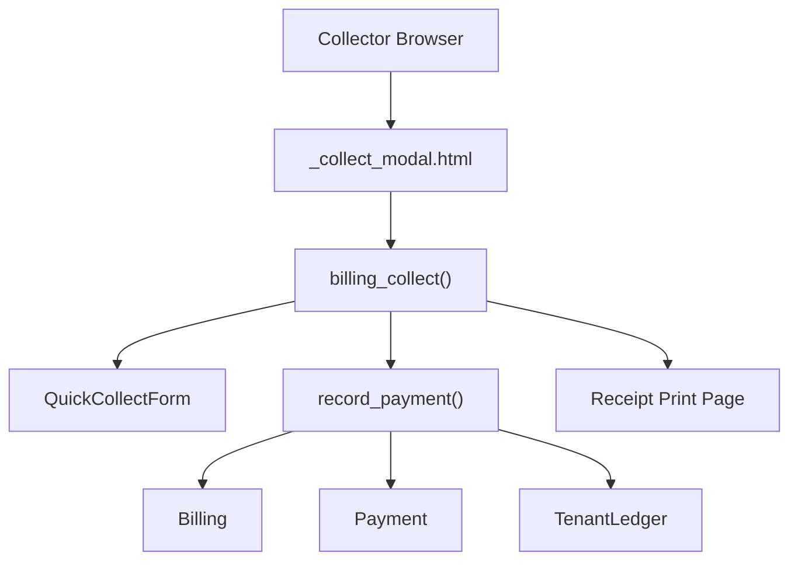
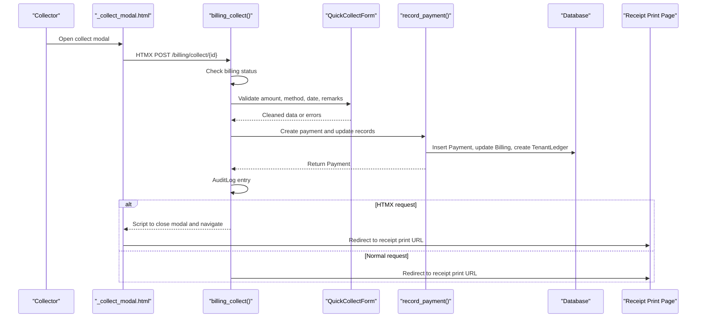
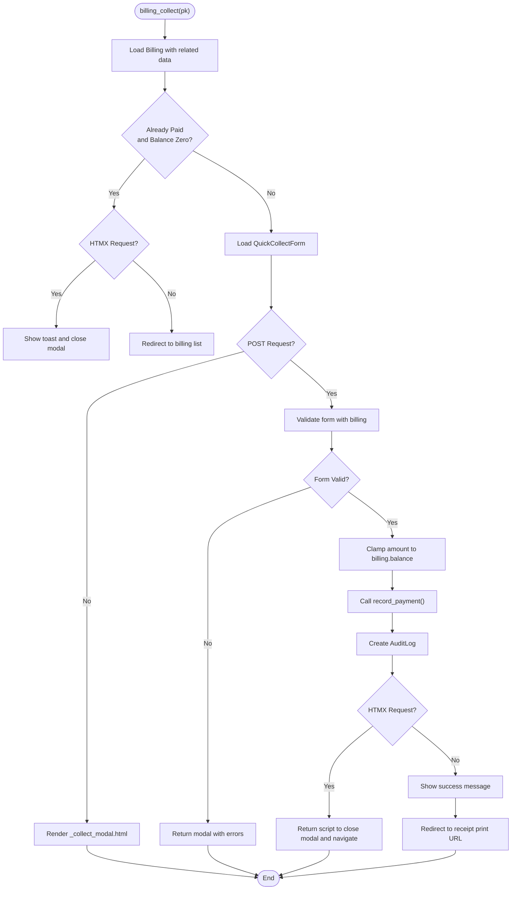
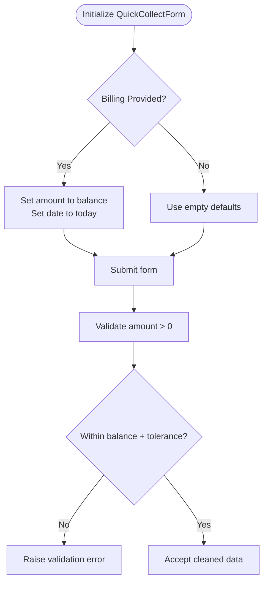
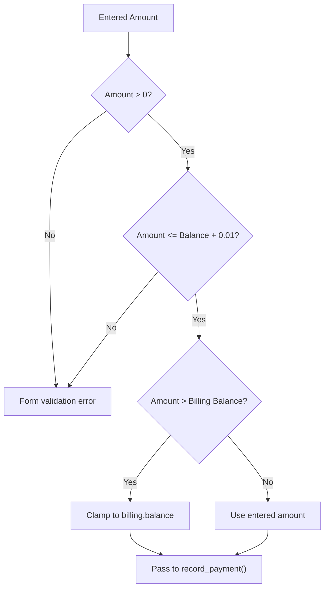
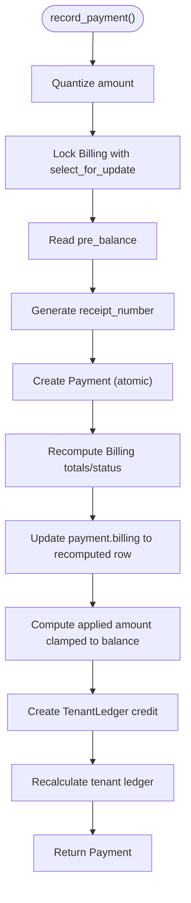
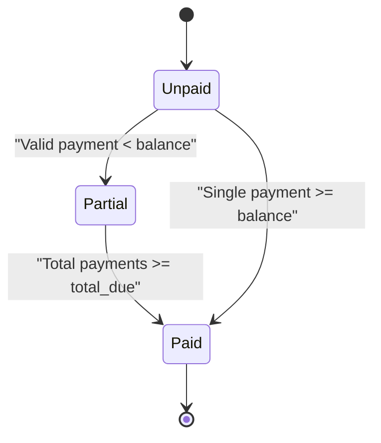
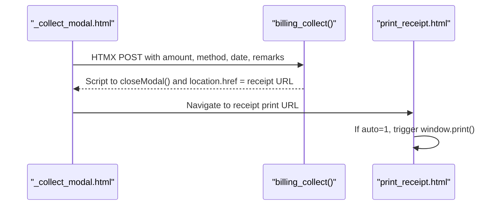
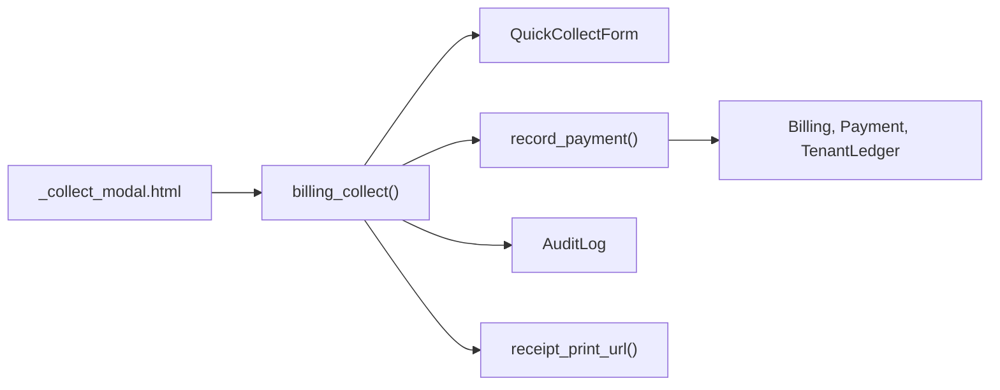

# Individual Collection

<cite>
**Referenced Files in This Document**   
- [billing.py](file://core/views/billing.py)
- [forms.py](file://core/forms.py)
- [helpers.py](file://core/helpers.py)
- [_collect_modal.html](file://templates/billing/_collect_modal.html)
- [print_receipt.html](file://templates/payments/print_receipt.html)
</cite>

## Table of Contents
1. [Introduction](#introduction)
2. [Project Structure](#project-structure)
3. [Core Components](#core-components)
4. [Architecture Overview](#architecture-overview)
5. [Detailed Component Analysis](#detailed-component-analysis)
6. [Dependency Analysis](#dependency-analysis)
7. [Performance Considerations](#performance-considerations)
8. [Troubleshooting Guide](#troubleshooting-guide)
9. [Conclusion](#conclusion)

## Introduction
This document explains the individual billing collection workflow used by collectors to record a single rental payment against an existing Billing record. The focus is on:

- The `billing_collect()` view function that handles one-off collection.
- The `QuickCollectForm` used for amount, method, date, and remarks.
- Payment amount validation against the outstanding billing balance.
- Automatic status updates through the shared `record_payment()` service.
- HTMX modal integration for a seamless user experience.
- Automatic redirect to the receipt printing page after successful collection.

The goal is to make this workflow easy to understand for both technical readers and non-technical users who operate the system as collectors or cashiers.

## Project Structure
The individual collection feature spans four main areas:

| Area | Responsibility | Key File |
|---|---|---|
| View layer | Handles HTTP requests, authorization, form processing, audit logging, and redirects | `core/views/billing.py` |
| Form layer | Validates collector input for quick collection | `core/forms.py` |
| Service layer | Centralizes payment posting, billing recomputation, and ledger updates | `core/helpers.py` |
| Templates | Renders the modal UI and triggers automatic receipt printing | `templates/billing/_collect_modal.html`, `templates/payments/print_receipt.html` |

**Diagram sources**
- [billing.py:415-489](file://core/views/billing.py#L415-L489)
- [forms.py:728-774](file://core/forms.py#L728-L774)
- [helpers.py:351-420](file://core/helpers.py#L351-L420)
- [_collect_modal.html:41-90](file://templates/billing/_collect_modal.html#L41-L90)
- [print_receipt.html:47-52](file://templates/payments/print_receipt.html#L47-L52)

**Section sources**
- [billing.py:415-489](file://core/views/billing.py#L415-L489)
- [forms.py:728-774](file://core/forms.py#L728-L774)
- [helpers.py:351-420](file://core/helpers.py#L351-L420)
- [_collect_modal.html:1-131](file://templates/billing/_collect_modal.html#L1-L131)
- [print_receipt.html:45-52](file://templates/payments/print_receipt.html#L45-L52)

## Core Components
The individual collection workflow is built around three core components:

1. **`billing_collect()` view**: Entry point for collecting a single billing. It enforces collector access, validates the request, delegates financial posting to `record_payment()`, logs an audit entry, and redirects to the receipt print page.
2. **`QuickCollectForm`**: A simplified form with fields for amount, payment method, payment date, and optional remarks. It defaults the amount to the outstanding balance and rejects invalid amounts.
3. **`record_payment()` service**: The single source of truth for creating a `Payment`, updating `Billing` totals and status, creating a `TenantLedger` credit entry, and recalculating tenant ledger balances.

Key responsibilities:

| Component | Main Responsibilities |
|---|---|
| `billing_collect()` | Authorization, pre-checks, form handling, audit logging, HTMX response, redirect to receipt |
| `QuickCollectForm` | Amount validation, default values, method/date/remarks handling |
| `record_payment()` | Payment creation, billing recomputation, ledger credit, concurrency safety |

**Section sources**
- [billing.py:415-489](file://core/views/billing.py#L415-L489)
- [forms.py:728-774](file://core/forms.py#L728-L774)
- [helpers.py:351-420](file://core/helpers.py#L351-L420)

## Architecture Overview
The individual collection flow follows a clear request-to-receipt path:

**Diagram sources**
- [billing.py:415-489](file://core/views/billing.py#L415-L489)
- [forms.py:728-774](file://core/forms.py#L728-L774)
- [helpers.py:351-420](file://core/helpers.py#L351-L420)
- [_collect_modal.html:41-90](file://templates/billing/_collect_modal.html#L41-L90)
- [print_receipt.html:47-52](file://templates/payments/print_receipt.html#L47-L52)

## Detailed Component Analysis

### `billing_collect()` View Function
The `billing_collect()` view is the central controller for individual collection. It is protected by the collector role and runs inside a transactional context.

Important behaviors:

- Loads the Billing record with related tenant, stall, section, and contract information.
- Rejects collection if the billing is already fully paid.
- Uses `QuickCollectForm` for validated input.
- Clamps the submitted amount to the billing balance so overpayment cannot exceed the outstanding balance.
- Delegates all financial mutations to `record_payment()`.
- Creates an audit log describing the collected amount, outcome, tenant, stall, period, and receipt number.
- Returns an HTMX script that closes the modal and navigates to the receipt print page when the request comes from HTMX.
- Otherwise, shows a success message and redirects to the receipt print page.

**Diagram sources**
- [billing.py:415-489](file://core/views/billing.py#L415-L489)

**Section sources**
- [billing.py:415-489](file://core/views/billing.py#L415-L489)

### `QuickCollectForm` Usage and Validation
`QuickCollectForm` is designed for speed and clarity. It exposes only what a collector needs during a quick collection:

| Field | Purpose | Default Behavior |
|---|---|---|
| `amount_paid` | Amount to collect | Defaults to the outstanding balance; can be lower for partial payments |
| `payment_method` | Payment method selection | Defaults to Cash using `Payment.PAYMENT_METHOD_CHOICES` |
| `payment_date` | Date of payment | Defaults to today’s date |
| `remarks` | Optional note | Empty by default |

Validation rules:

- Amount must be greater than zero.
- Amount cannot exceed the billing balance plus a small tolerance.
- If the billing is not provided, amount validation is skipped because the form is unbound.

The template uses this form to show:

- The billed month and due date.
- The current balance and totals.
- A “Fill full amount” button.
- Live detection of whether the entered amount will result in a full payment or partial payment.

**Diagram sources**
- [forms.py:728-774](file://core/forms.py#L728-L774)

**Section sources**
- [forms.py:728-774](file://core/forms.py#L728-L774)
- [_collect_modal.html:41-90](file://templates/billing/_collect_modal.html#L41-L90)

### Payment Amount Validation Against Billing Balance
There are two layers of protection:

1. **Form-level validation**: `QuickCollectForm.clean_amount_paid()` ensures the amount is positive and does not exceed the billing balance plus a small tolerance.
2. **View-level clamping**: `billing_collect()` clamps any amount larger than the billing balance to exactly the balance before calling the service.

This design prevents accidental overpayment while still allowing collectors to enter the exact balance quickly.

**Diagram sources**
- [forms.py:765-774](file://core/forms.py#L765-L774)
- [billing.py:431-450](file://core/views/billing.py#L431-L450)

**Section sources**
- [forms.py:765-774](file://core/forms.py#L765-L774)
- [billing.py:431-450](file://core/views/billing.py#L431-L450)

### Integration with `record_payment()` Service Function
`record_payment()` is the authoritative place where payment data becomes permanent. It performs these steps:

1. Quantizes the amount to two decimal places.
2. Locks the target Billing row using `select_for_update()` to prevent concurrent race conditions.
3. Reads the pre-payment balance.
4. Generates a unique receipt number.
5. Creates the `Payment` record inside an atomic transaction.
6. Recomputes the Billing totals and status authoritatively from valid payments.
7. Updates the Payment object’s Billing reference to the recomputed row.
8. Posts a `TenantLedger` credit entry reflecting the amount actually applied.
9. Recalculates the tenant’s running ledger balance.
10. Returns the created Payment.

Status logic:

- If the payment amount meets or exceeds the pre-payment balance, the Payment status is set to `Paid`.
- If the payment amount is less, the Payment status is set to `Partial`.
- The Billing status is later recomputed by `recalc_billing_from_payments()` based on all valid payments.

**Diagram sources**
- [helpers.py:351-420](file://core/helpers.py#L351-L420)
- [helpers.py:321-348](file://core/helpers.py#L321-L348)

**Section sources**
- [helpers.py:351-420](file://core/helpers.py#L351-L420)
- [helpers.py:321-348](file://core/helpers.py#L321-L348)

### Automatic Status Updates
Automatic status updates happen in two places:

1. **Payment status**: Determined by comparing the payment amount to the pre-payment balance inside `record_payment()`.
2. **Billing status**: Determined by `recalc_billing_from_payments()`, which sums valid payments and sets the Billing status to `Paid`, `Partial`, or `Unpaid`.

This separation is important:

- The Payment record captures the intent of the individual transaction.
- The Billing record reflects the overall settlement state derived from all valid payments.

**Diagram sources**
- [helpers.py:321-348](file://core/helpers.py#L321-L348)
- [helpers.py:351-420](file://core/helpers.py#L351-L420)

**Section sources**
- [helpers.py:321-348](file://core/helpers.py#L321-L348)
- [helpers.py:351-420](file://core/helpers.py#L351-L420)

### HTMX Modal Integration and Automatic Redirect
The `_collect_modal.html` template renders the collection form inside a modal and submits it via HTMX:

- The form posts to the `billing_collect` URL.
- On success, HTMX receives a script that closes the modal and navigates to the receipt print URL.
- On validation failure, HTMX re-renders the modal with errors.

The receipt print page supports automatic printing:

- When the collect flow reaches the receipt page with `auto=1`, the template includes a script that calls `window.print()` after the page loads.
- The `back` parameter controls navigation back to the billing list after printing.

**Diagram sources**
- [_collect_modal.html:41-90](file://templates/billing/_collect_modal.html#L41-L90)
- [billing.py:470-481](file://core/views/billing.py#L470-L481)
- [print_receipt.html:47-52](file://templates/payments/print_receipt.html#L47-L52)

**Section sources**
- [_collect_modal.html:41-90](file://templates/billing/_collect_modal.html#L41-L90)
- [billing.py:470-481](file://core/views/billing.py#L470-L481)
- [print_receipt.html:47-52](file://templates/payments/print_receipt.html#L47-L52)

### Examples of Payment Method Selection, Date Handling, and Remark Entry

#### Payment Method Selection
- The form uses `Payment.PAYMENT_METHOD_CHOICES`.
- The default method is Cash.
- The selected method is passed to `record_payment()` and stored in the Payment record.
- The same method appears in the TenantLedger description.

#### Date Handling
- The form field is a date input.
- The default date is today’s date.
- The date is passed to `record_payment()` and stored in both Payment and TenantLedger.

#### Remark Entry
- Remarks are optional.
- Remarks are passed to `record_payment()` and stored in the Payment record.
- They are useful for recording internal notes such as an external official receipt number.

**Section sources**
- [forms.py:728-774](file://core/forms.py#L728-L774)
- [billing.py:441-450](file://core/views/billing.py#L441-L450)
- [helpers.py:377-395](file://core/helpers.py#L377-L395)

## Dependency Analysis
The individual collection workflow has clear dependencies between layers:

**Diagram sources**
- [billing.py:415-489](file://core/views/billing.py#L415-L489)
- [forms.py:728-774](file://core/forms.py#L728-L774)
- [helpers.py:351-420](file://core/helpers.py#L351-L420)

Key dependency relationships:

| Dependency | Direction | Reason |
|---|---|---|
| Template → View | HTMX POST | Submits collection data |
| View → Form | Validation | Ensures safe collector input |
| View → Service | Financial mutation | Centralizes database changes |
| Service → Models | Persistence | Creates and updates domain records |
| View → Audit | Compliance | Records collector actions |
| View → Receipt | UX completion | Ensures collection ends with printable proof |

**Section sources**
- [billing.py:415-489](file://core/views/billing.py#L415-L489)
- [forms.py:728-774](file://core/forms.py#L728-L774)
- [helpers.py:351-420](file://core/helpers.py#L351-L420)

## Performance Considerations
The individual collection workflow is optimized for correctness and concurrency rather than raw throughput. Important performance-related characteristics include:

- **Transaction safety**: Both the view and the service use atomic transactions to ensure consistent state.
- **Row locking**: `record_payment()` locks the Billing row with `select_for_update()` to prevent concurrent collectors from settling the same bill incorrectly.
- **Retry loop**: Receipt number generation retries up to five times on integrity errors.
- **Authoritative recomputation**: Billing totals are recomputed from valid payments instead of relying on cached fields.
- **Minimal form surface**: `QuickCollectForm` reduces user interaction and validation overhead.

These choices reduce the risk of double collections, inconsistent balances, and incorrect billing status under concurrent load.

[No sources needed since this section provides general guidance]

## Troubleshooting Guide

### Common Issues and Resolutions

| Symptom | Likely Cause | Resolution |
|---|---|---|
| Collector cannot submit amount | Amount is zero or negative | Enter a positive amount |
| Form rejects amount | Amount exceeds balance plus tolerance | Enter an amount within the outstanding balance |
| Billing remains unpaid after payment | Payment did not reach `record_payment()` or failed validation | Check form errors and view logs |
| Billing status is Partial but should be Paid | Multiple partial payments exist and total is below total due | Complete remaining balance |
| HTMX modal does not close | Server returned HTML instead of expected script | Inspect server response and ensure HTMX headers are present |
| Receipt does not auto-print | Missing `auto=1` query parameter | Ensure redirect uses receipt print URL with `auto=1` |
| Overpayment warning appears | Entered amount exceeds balance plus tolerance | Enter exact balance or a smaller partial amount |

**Section sources**
- [forms.py:765-774](file://core/forms.py#L765-L774)
- [billing.py:423-489](file://core/views/billing.py#L423-L489)
- [helpers.py:351-420](file://core/helpers.py#L351-L420)

## Conclusion
The individual collection workflow is intentionally simple for collectors while remaining robust under the hood. The `billing_collect()` view focuses on user flow and authorization, `QuickCollectForm` focuses on safe input, and `record_payment()` focuses on correct financial state. Together, they ensure that:

- Payments are validated before being recorded.
- Billing totals and statuses are computed authoritatively.
- Tenant ledgers remain consistent.
- Collectors receive immediate feedback through HTMX.
- Every successful collection ends on a printable receipt.

This design makes individual billing collection reliable, auditable, and user-friendly.

[No sources needed since this section summarizes without analyzing specific files]