# Export & Printing

<cite>
**Referenced Files in This Document**   
- [billing.py](file://core/views/billing.py)
- [helpers.py](file://core/helpers.py)
- [print_list.html](file://templates/billing/print_list.html)
- [print_view.html](file://templates/billing/print_view.html)
- [list.html](file://templates/billing/list.html)
- [_table.html](file://templates/billing/_table.html)
- [view.html](file://templates/billing/view.html)
- [settings_form.html](file://templates/settings/form.html)
- [settings_view.html](file://templates/settings/view.html)
</cite>

## Table of Contents
1. [Introduction](#introduction)
2. [Project Structure](#project-structure)
3. [Core Components](#core-components)
4. [Architecture Overview](#architecture-overview)
5. [Detailed Component Analysis](#detailed-component-analysis)
6. [Dependency Analysis](#dependency-analysis)
7. [Performance Considerations](#performance-considerations)
8. [Troubleshooting Guide](#troubleshooting-guide)
9. [Conclusion](#conclusion)

## Introduction
This document explains the billing export and printing functionality for the market rental system. It focuses on:

- List-level print and PDF generation through `billing_list_print()` and `billing_list_export_pdf()`.
- Individual billing detail print and PDF generation through `billing_view_print()` and `billing_view_export_pdf()`.
- Print template structure, municipality branding integration, and filter preservation.
- Pagination behavior differences between interactive list views and print/PDF views.
- The multi-fallback PDF rendering strategy implemented by `render_to_pdf_response()`.
- Filename generation patterns and how these features integrate with the broader reporting and receipt-printing system.

The goal is to help developers and operators understand how billing data becomes a printable or downloadable document while preserving filters, user context, and official branding.

## Project Structure
Billing print and export functionality spans three layers:

| Layer | Responsibility | Relevant Files |
|---|---|---|
| Views | Query billings, apply filters, prepare context, return HTML or PDF responses | `core/views/billing.py` |
| Templates | Define print-friendly layouts, headers, tables, signatures, and action buttons | `templates/billing/print_list.html`, `templates/billing/print_view.html` |
| Utilities | Render templates to PDF with fallbacks and set download filenames | `core/helpers.py` |

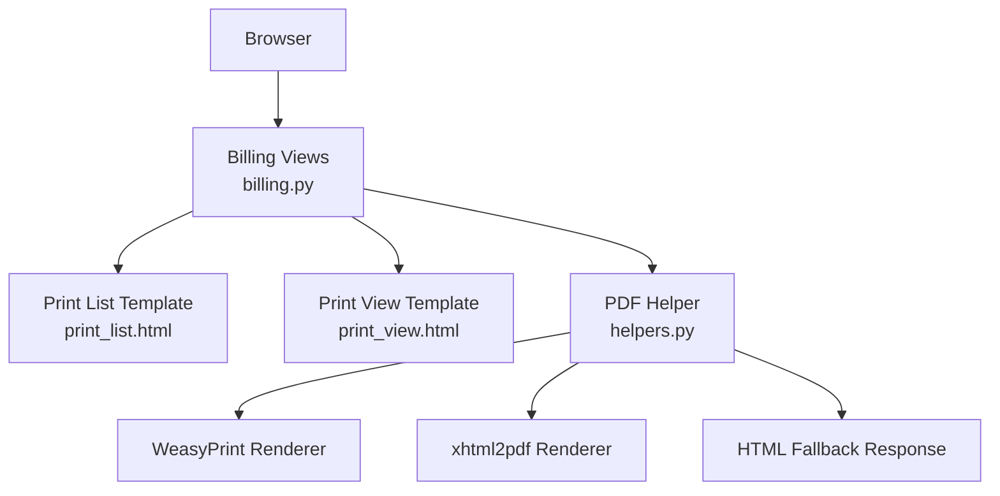

**Diagram sources**
- [billing.py:638-727](file://core/views/billing.py#L638-L727)
- [billing.py:731-764](file://core/views/billing.py#L731-L764)
- [helpers.py:522-594](file://core/helpers.py#L522-L594)
- [print_list.html:1-73](file://templates/billing/print_list.html#L1-L73)
- [print_view.html:1-59](file://templates/billing/print_view.html#L1-L59)

**Section sources**
- [billing.py:638-727](file://core/views/billing.py#L638-L727)
- [billing.py:731-764](file://core/views/billing.py#L731-L764)
- [helpers.py:522-594](file://core/helpers.py#L522-L594)
- [print_list.html:1-73](file://templates/billing/print_list.html#L1-L73)
- [print_view.html:1-59](file://templates/billing/print_view.html#L1-L59)

## Core Components
The core components are:

| Component | Purpose | Key Behavior |
|---|---|---|
| `billing_list_print()` | Returns a print-friendly HTML view of all billings | Applies filters, loads system settings, renders `billing/print_list.html` |
| `billing_list_export_pdf()` | Generates a PDF of the filtered billing list | Reuses list query and context, sets filename, delegates to `render_to_pdf_response()` |
| `billing_view_print(pk)` | Returns a print-friendly HTML view of one billing detail | Loads billing, payments, system settings, renders `billing/print_view.html` |
| `billing_view_export_pdf(pk)` | Generates a PDF of one billing detail | Reuses detail query and context, sets filename, delegates to `render_to_pdf_response()` |
| `render_to_pdf_response()` | Central PDF renderer | Renders template to string, tries WeasyPrint, then xhtml2pdf, then returns HTML fallback |
| Print templates | Provide official-looking documents | Use municipality branding, show filters, include signature blocks, hide UI controls when printing |

**Section sources**
- [billing.py:638-727](file://core/views/billing.py#L638-L727)
- [billing.py:731-764](file://core/views/billing.py#L731-L764)
- [helpers.py:522-594](file://core/helpers.py#L522-L594)
- [print_list.html:1-73](file://templates/billing/print_list.html#L1-L73)
- [print_view.html:1-59](file://templates/billing/print_view.html#L1-L59)

## Architecture Overview
The billing export and printing flow follows a consistent pattern:

1. A request reaches a billing print or export view.
2. The view ensures current-month billings exist and applies overdue penalties where appropriate.
3. The view builds a base queryset of billings and applies role-based tenant isolation.
4. Filters from the query string are applied: month, year, tenant, status, and search.
5. For list exports, the same filtering logic is reused so print and PDF outputs match.
6. Context includes billings, filters, system settings, current user, and timestamp.
7. For HTML print views, Django renders the corresponding print template.
8. For PDF exports, the template is rendered to an HTML string and passed to `render_to_pdf_response()`.
9. `render_to_pdf_response()` attempts multiple renderers and returns either a PDF or an HTML fallback.

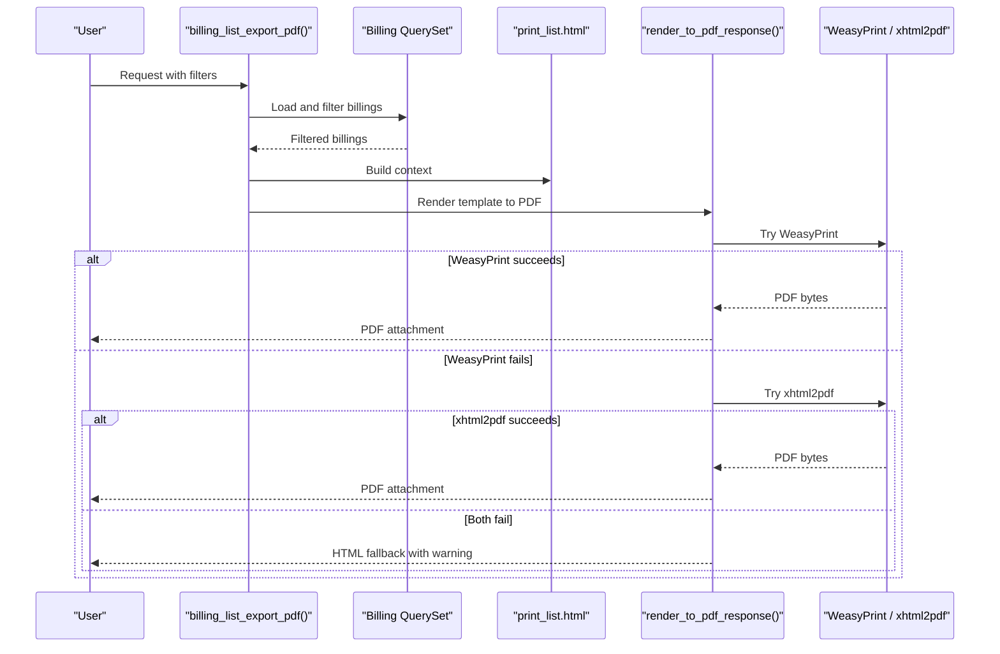

**Diagram sources**
- [billing.py:683-727](file://core/views/billing.py#L683-L727)
- [helpers.py:522-594](file://core/helpers.py#L522-L594)

**Section sources**
- [billing.py:683-727](file://core/views/billing.py#L683-L727)
- [helpers.py:522-594](file://core/helpers.py#L522-L594)

## Detailed Component Analysis

### Billing List Print and PDF Export

#### `billing_list_print(request)`
This function provides a print-ready HTML page for the full billing list.

Key responsibilities:

- Ensures current-month billings and applies overdue penalties for authorized roles.
- Loads all billings with related tenant, stall, and contract data.
- Restricts results to the current tenant when the logged-in user is a tenant.
- Applies query-string filters: month, year, tenant, status, and search.
- Builds a context including billings, filters, system settings, user, and current time.
- Renders `billing/print_list.html`.

Filter preservation:

- Month, year, tenant, status, and search values are read directly from the request.
- These values are passed into the template context.
- The print template displays active filters in the header metadata.

Pagination handling:

- This print view does not paginate; it renders the entire filtered queryset.
- This differs from the interactive `billing_list()` view, which groups billings per tenant and uses pagination.

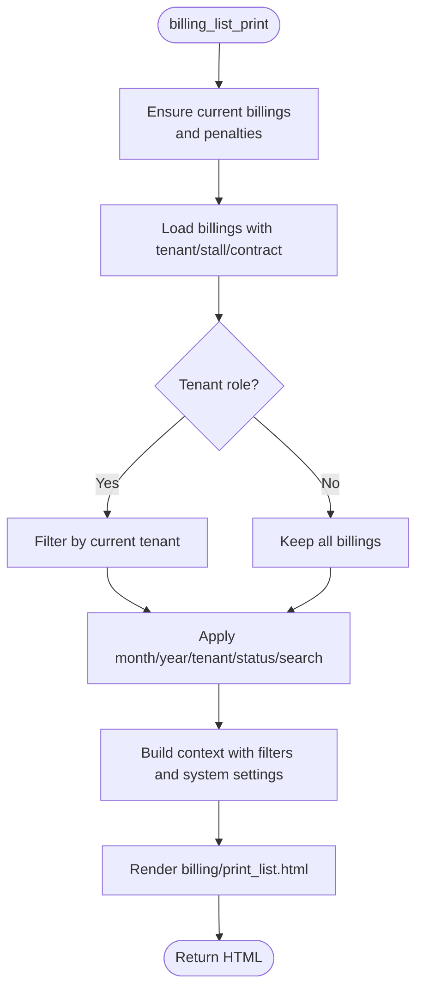

**Diagram sources**
- [billing.py:638-680](file://core/views/billing.py#L638-L680)

**Section sources**
- [billing.py:638-680](file://core/views/billing.py#L638-L680)

#### `billing_list_export_pdf(request)`
This function generates a PDF version of the billing list.

Key responsibilities:

- Reuses the same filtering and context-building logic as the print view.
- Creates a filename using today’s date: `billing_list_YYYY-MM-DD.pdf`.
- Calls `render_to_pdf_response()` with the print-list template and generated filename.

Filename pattern:

- Format: `billing_list_<today>.pdf`.
- Example: `billing_list_2026-01-15.pdf`.

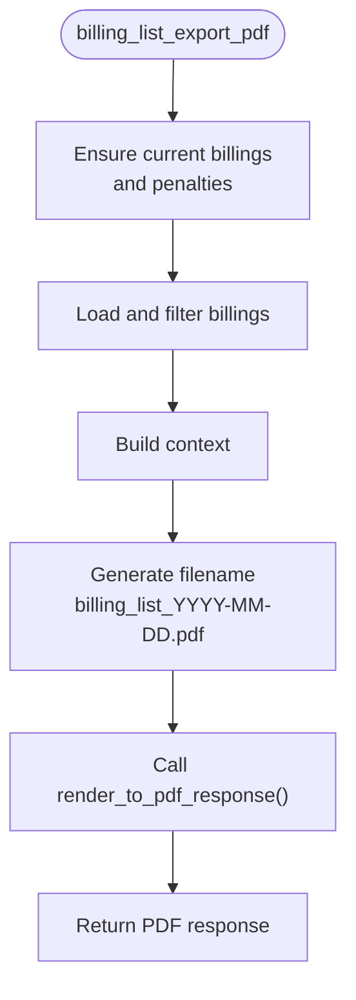

**Diagram sources**
- [billing.py:683-727](file://core/views/billing.py#L683-L727)

**Section sources**
- [billing.py:683-727](file://core/views/billing.py#L683-L727)

### Billing Detail Print and PDF Export

#### `billing_view_print(pk)`
This function provides a print-ready HTML page for a single billing record.

Key responsibilities:

- Loads the billing with related tenant, stall, section, and contract.
- Enforces tenant isolation: tenants can only view their own billing records.
- Loads payment history for the billing.
- Adds system settings, current user, and timestamp to the context.
- Renders `billing/print_view.html`.

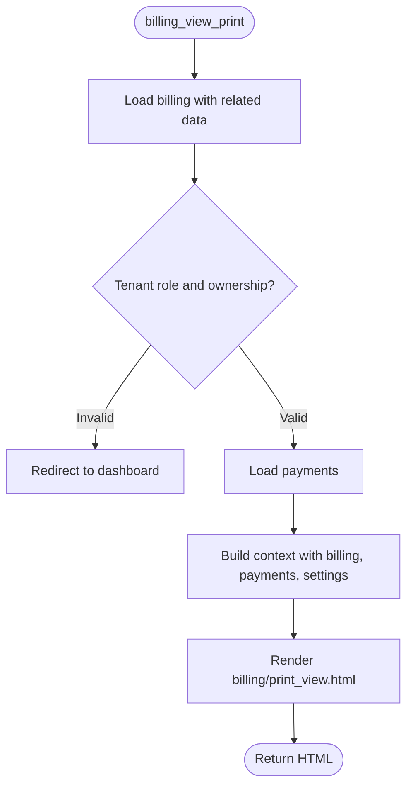

**Diagram sources**
- [billing.py:731-745](file://core/views/billing.py#L731-L745)

**Section sources**
- [billing.py:731-745](file://core/views/billing.py#L731-L745)

#### `billing_view_export_pdf(pk)`
This function generates a PDF version of a single billing detail.

Key responsibilities:

- Reuses the same loading and authorization logic as the print view.
- Creates a descriptive filename that includes billing period, tenant ID, and today’s date.
- Calls `render_to_pdf_response()` with the print-detail template and generated filename.

Filename pattern:

- Format: `billing_MM-YYYY_tenantID_YYYY-MM-DD.pdf`.
- Example: `billing_01-2026_T001_2026-01-15.pdf`.

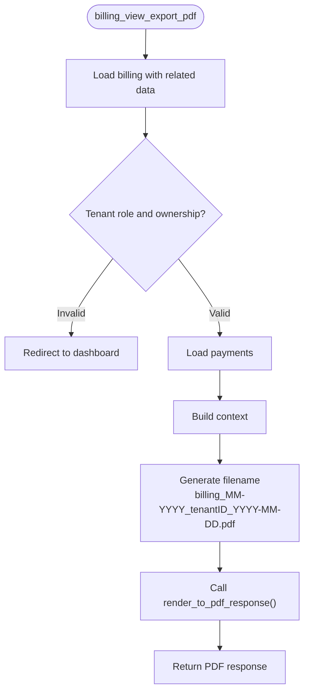

**Diagram sources**
- [billing.py:748-764](file://core/views/billing.py#L748-L764)

**Section sources**
- [billing.py:748-764](file://core/views/billing.py#L748-L764)

### Print Template Structure

#### List Print Template: `billing/print_list.html`
The list print template defines a clean, print-oriented layout.

Important characteristics:

- Uses Tailwind CSS classes and inline styles optimized for printing.
- Hides non-print actions such as Print, Export PDF, and Close buttons using `.no-print`.
- Displays municipality branding from `system_settings.municipality_name` and `system_settings.market_name`.
- Shows office name from `system_settings.office_name`.
- Prints generated timestamp, operator username, and active filters.
- Renders a table with tenant, stall, period, due, paid, balance, due date, and status.
- Includes prepared-by and verified-by signature blocks.

Filter display:

- Active filters are shown in the header metadata line.
- The template shows month, year, and status filters when present.

Pagination:

- The print template receives the full filtered queryset, not a paginated object.
- Therefore, large datasets are printed as one continuous table.

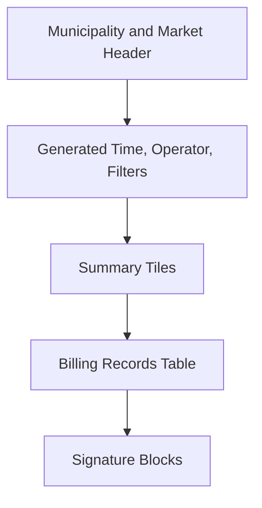

**Diagram sources**
- [print_list.html:1-73](file://templates/billing/print_list.html#L1-L73)

**Section sources**
- [print_list.html:1-73](file://templates/billing/print_list.html#L1-L73)

#### Detail Print Template: `billing/print_view.html`
The detail print template defines a focused, official-looking billing document.

Important characteristics:

- Uses print-specific CSS and hides UI controls.
- Displays municipality branding and office name.
- Shows billing period, tenant, stall, section, due date, and status.
- Presents financial summary: total due, rent, penalty, paid amount, and balance.
- Lists payment history with receipt number, date, method, amount, and status.
- Includes prepared-by and verified-by signature blocks.

Branding integration:

- Municipality and market names come from `system_settings`.
- Office name appears under the main header.

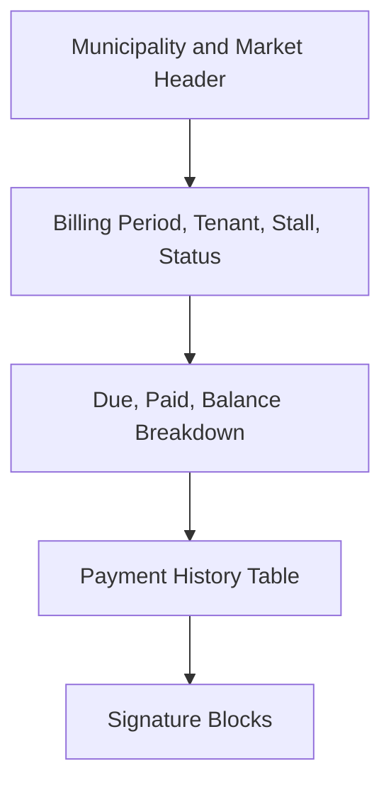

**Diagram sources**
- [print_view.html:1-59](file://templates/billing/print_view.html#L1-L59)

**Section sources**
- [print_view.html:1-59](file://templates/billing/print_view.html#L1-L59)

### System Setting Integration for Municipality Branding
System settings provide the official identity used across receipts, reports, notices, and billing prints.

Relevant fields used by print templates:

| Field | Usage |
|---|---|
| `municipality_name` | Main header title alongside market name |
| `market_name` | Identifies the public market |
| `office_name` | Subtitle under the municipality/market header |

Configuration entry points:

- Settings form and settings view expose municipality, market, office, and receipt prefix configuration.
- The settings UI states that changes appear on receipts, contracts, and reports.

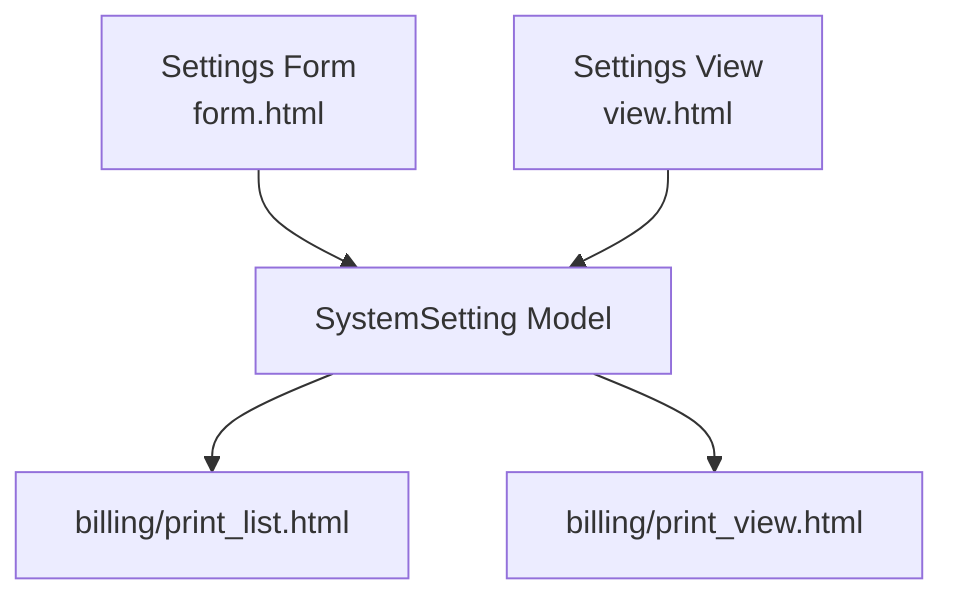

**Diagram sources**
- [settings_form.html:30-54](file://templates/settings/form.html#L30-L54)
- [settings_view.html:1-54](file://templates/settings/view.html#L1-L54)
- [print_list.html:31-36](file://templates/billing/print_list.html#L31-L36)
- [print_view.html:30-35](file://templates/billing/print_view.html#L30-L35)

**Section sources**
- [settings_form.html:30-54](file://templates/settings/form.html#L30-L54)
- [settings_view.html:1-54](file://templates/settings/view.html#L1-L54)
- [print_list.html:31-36](file://templates/billing/print_list.html#L31-L36)
- [print_view.html:30-35](file://templates/billing/print_view.html#L30-L35)

### `render_to_pdf_response()` Utility
`render_to_pdf_response()` is the central utility for converting rendered HTML into downloadable PDFs.

Rendering strategy:

1. **Render template to HTML string**: Uses Django’s `render_to_string()` with the provided template and context.
2. **Try WeasyPrint first**: Preferred renderer because it supports modern HTML/CSS.
   - If available, writes PDF bytes and returns an `HttpResponse` with `application/pdf` content type and a `Content-Disposition` attachment header.
3. **Fallback to xhtml2pdf**: Pure-Python renderer that works better on Windows without GTK dependencies.
   - If successful and output is valid, returns a PDF response.
4. **Final fallback to HTML preview**: If both renderers fail, returns an HTML response containing:
   - A warning explaining that WeasyPrint is unavailable.
   - Instructions to use browser Print → Save as PDF.
   - Optional xhtml2pdf error details.
   - The original rendered HTML appended below the warning.

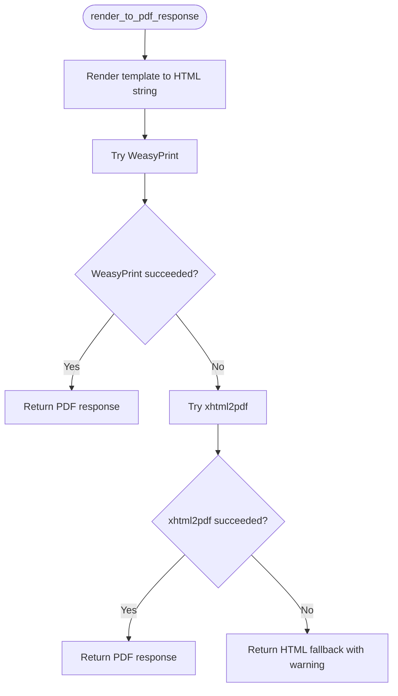

**Diagram sources**
- [helpers.py:522-594](file://core/helpers.py#L522-L594)

**Section sources**
- [helpers.py:522-594](file://core/helpers.py#L522-L594)

### Examples of Filter Preservation in Print Views
Both list print and list PDF export preserve filters consistently:

| Filter | Source | Behavior |
|---|---|---|
| Month | `request.GET.get('month')` | Filters billings by `billing_month` |
| Year | `request.GET.get('year')` | Filters billings by `billing_year` |
| Tenant | `request.GET.get('tenant')` | Filters billings by `tenant_id` |
| Status | `request.GET.get('status')` | Filters billings by `status` |
| Search | `request.GET.get('search')` | Searches tenant name, tenant ID, business name, stall number, and section name |

In the list print view, these values are included in the context and displayed in the header metadata. In the list PDF export, the same context is passed to the PDF generator, ensuring the downloaded document reflects the active filters.

**Section sources**
- [billing.py:648-679](file://core/views/billing.py#L648-L679)
- [billing.py:694-725](file://core/views/billing.py#L694-L725)
- [print_list.html:31-41](file://templates/billing/print_list.html#L31-L41)

### Pagination Handling for Large Datasets
Pagination behavior differs between interactive and print/PDF flows:

| View Type | Pagination | Reason |
|---|---|---|
| Interactive list (`billing_list`) | Paginated | Groups billings per tenant and uses `Paginator` with 10 items per page |
| Print list (`billing_list_print`) | Not paginated | Prints the full filtered dataset |
| PDF list export (`billing_list_export_pdf`) | Not paginated | Downloads the full filtered dataset |
| Detail print/export | Not applicable | One billing at a time |

For large datasets, this means print and PDF outputs may contain many rows. Operators should use filters before exporting to reduce output size.

**Section sources**
- [billing.py:152-171](file://core/views/billing.py#L152-L171)
- [billing.py:638-680](file://core/views/billing.py#L638-L680)
- [billing.py:683-727](file://core/views/billing.py#L683-L727)

### Filename Generation Patterns
The system generates predictable filenames for billing exports:

| Export | Filename Pattern | Example |
|---|---|---|
| Billing list PDF | `billing_list_YYYY-MM-DD.pdf` | `billing_list_2026-01-15.pdf` |
| Billing detail PDF | `billing_MM-YYYY_tenantID_YYYY-MM-DD.pdf` | `billing_01-2026_T001_2026-01-15.pdf` |

These filenames include:

- Report type.
- Billing period where relevant.
- Tenant identifier.
- Today’s ISO-formatted date.

**Section sources**
- [billing.py:726-727](file://core/views/billing.py#L726-L727)
- [billing.py:763-764](file://core/views/billing.py#L763-L764)

### Integration with the Broader Reporting System
Billing print and export share common patterns with other reporting features:

- Print templates follow a consistent visual style: municipality header, official title, structured tables, and signature blocks.
- System settings supply branding across receipts, reports, notices, and billing documents.
- PDF generation uses the same `render_to_pdf_response()` utility used elsewhere in the application.
- Filenames follow a readable, date-stamped convention suitable for archival and retrieval.

Other modules, such as stalls, also use `render_to_pdf_response()` for PDF exports, reinforcing a unified approach to reporting.

**Section sources**
- [helpers.py:522-594](file://core/helpers.py#L522-L594)
- [stalls.py:262-274](file://core/views/stalls.py#L262-L274)

## Dependency Analysis
The following diagram shows how billing print/export depends on models, helpers, and templates.

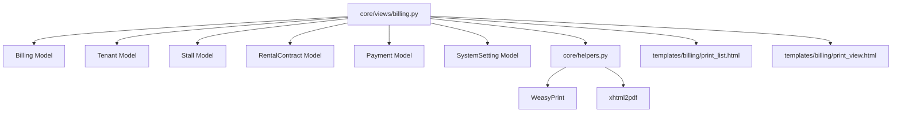

**Diagram sources**
- [billing.py:16-22](file://core/views/billing.py#L16-L22)
- [billing.py:638-764](file://core/views/billing.py#L638-L764)
- [helpers.py:522-594](file://core/helpers.py#L522-L594)

**Section sources**
- [billing.py:16-22](file://core/views/billing.py#L16-L22)
- [billing.py:638-764](file://core/views/billing.py#L638-L764)
- [helpers.py:522-594](file://core/helpers.py#L522-L594)

## Performance Considerations
- Full dataset rendering: Print and PDF list views do not paginate, so large result sets increase server-side rendering time and output size.
- Select-related queries: Billings are loaded with related tenant, stall, and contract data to avoid N+1 queries during template rendering.
- Penalties and billings initialization: Print/export views attempt to ensure current-month billings and apply overdue penalties, which adds database operations even though exceptions are swallowed to keep the page functional.
- PDF renderer selection: WeasyPrint is preferred for quality but requires system libraries; xhtml2pdf is slower and less CSS-complete; HTML fallback avoids crashes but does not produce a native PDF.

Recommendations:

- Encourage users to apply filters before exporting.
- Monitor environments where WeasyPrint is unavailable and consider installing required system libraries or switching to Linux for production.
- Avoid unnecessary repeated calls to billing initialization if performance becomes an issue in high-traffic scenarios.

[No sources needed since this section provides general guidance]

## Troubleshooting Guide

### PDF Download Returns HTML Instead of PDF
Symptoms:

- Clicking Export PDF opens an HTML page instead of downloading a PDF file.
- The page contains a yellow warning about WeasyPrint being unavailable.

Likely causes:

- WeasyPrint is not installed or its system dependencies (GTK, Pango, GObject) are missing.
- xhtml2pdf is also unavailable or produced invalid output.
- The environment is Windows without the expected runtime libraries.

Resolution steps:

1. Check whether WeasyPrint is installed and importable.
2. Install GTK runtime on Windows if WeasyPrint is desired.
3. Verify xhtml2pdf is installed if relying on the pure-Python fallback.
4. As a temporary workaround, use the browser’s Print → Save as PDF option presented by the HTML fallback.

**Section sources**
- [helpers.py:522-594](file://core/helpers.py#L522-L594)

### Exported PDF Does Not Show Municipality Branding
Symptoms:

- Printed or exported billing documents show default placeholders instead of municipality and market names.

Likely causes:

- No `SystemSetting` record exists.
- The configured municipality, market, or office name is empty.

Resolution steps:

1. Open the system settings page.
2. Set municipality name, market name, and office name.
3. Save the settings.
4. Regenerate the print or PDF document.

**Section sources**
- [settings_form.html:30-54](file://templates/settings/form.html#L30-L54)
- [settings_view.html:1-54](file://templates/settings/view.html#L1-L54)
- [print_list.html:31-36](file://templates/billing/print_list.html#L31-L36)
- [print_view.html:30-35](file://templates/billing/print_view.html#L30-L35)

### Filters Are Missing from Printed Output
Symptoms:

- The printed billing list does not reflect selected month, year, tenant, status, or search filters.

Likely causes:

- The link to print or export was opened without query parameters.
- The URL did not include the filter parameters.

Resolution steps:

1. Use the Print or Export PDF links from the billing list.
2. Confirm the URL includes filter parameters such as `?month=...&year=...&tenant=...&status=...&search=...`.
3. Reopen the print or export page after applying filters.

**Section sources**
- [billing.py:648-679](file://core/views/billing.py#L648-L679)
- [billing.py:694-725](file://core/views/billing.py#L694-L725)
- [print_list.html:31-41](file://templates/billing/print_list.html#L31-L41)

### Tenant Cannot See Another Tenant’s Billing Detail
Symptoms:

- A tenant attempting to open another tenant’s billing detail is redirected to the dashboard.

Behavior:

- `billing_view_print()` and `billing_view_export_pdf()` enforce tenant isolation.
- If the logged-in tenant does not own the billing, an error message is added and the user is redirected.

Resolution:

- Log in as the correct tenant or as an authorized management user.

**Section sources**
- [billing.py:731-745](file://core/views/billing.py#L731-L745)
- [billing.py:748-764](file://core/views/billing.py#L748-L764)

## Conclusion
The billing export and printing system provides two parallel experiences:

- Interactive list views with grouping and pagination.
- Print-friendly HTML and PDF outputs that render the full filtered dataset.

The design emphasizes consistency:

- Shared filtering logic between print and PDF.
- Municipality branding sourced from system settings.
- Predictable filenames for archival purposes.
- A resilient PDF rendering pipeline with multiple fallbacks.

For reliable operation, configure system settings, apply filters before exporting, and ensure the server environment supports the preferred PDF renderer. When renderer libraries are unavailable, the HTML fallback preserves usability by guiding users to save the page as a PDF through the browser.

[No sources needed since this section summarizes without analyzing specific files]