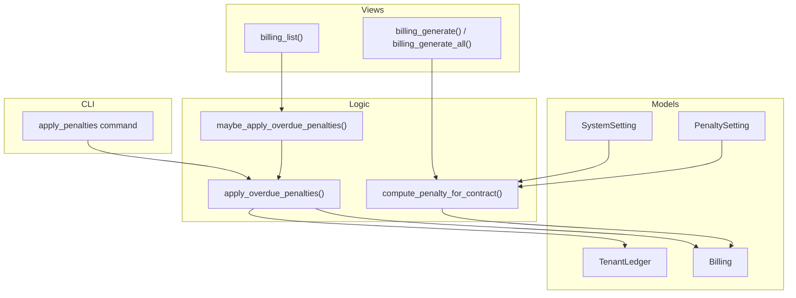
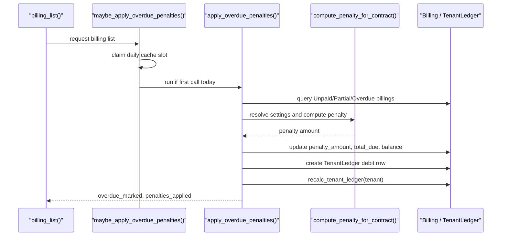
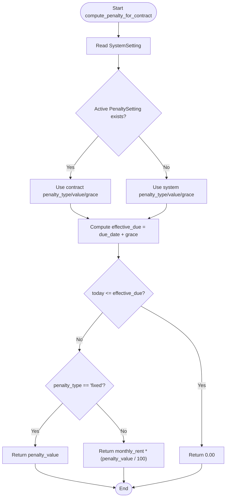
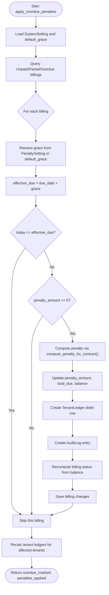
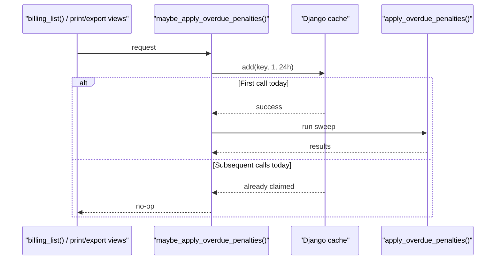
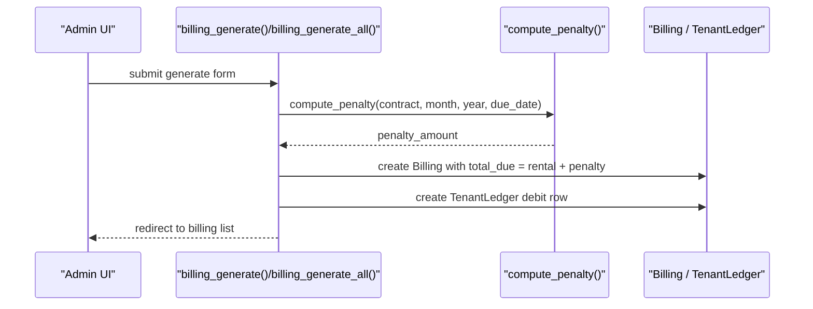
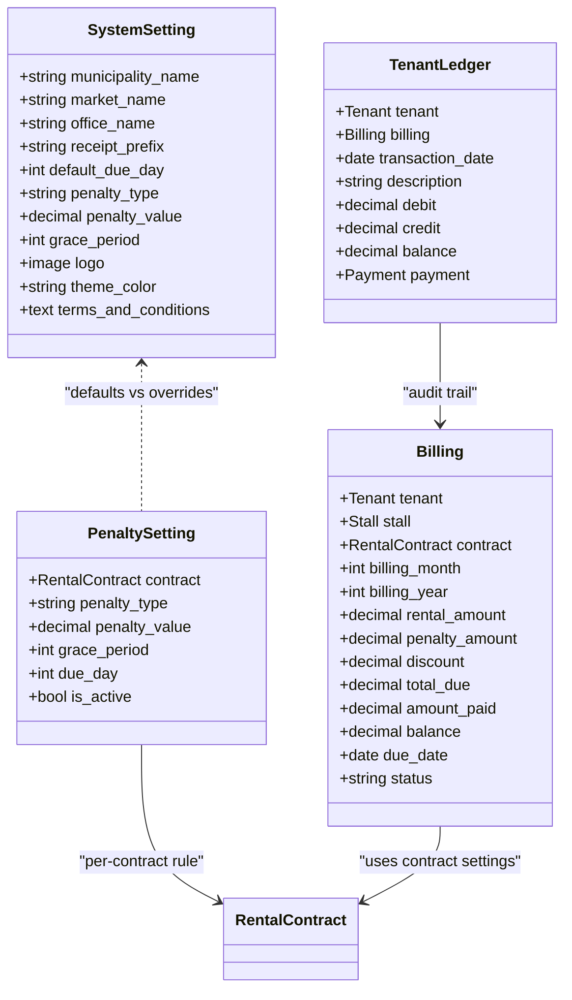
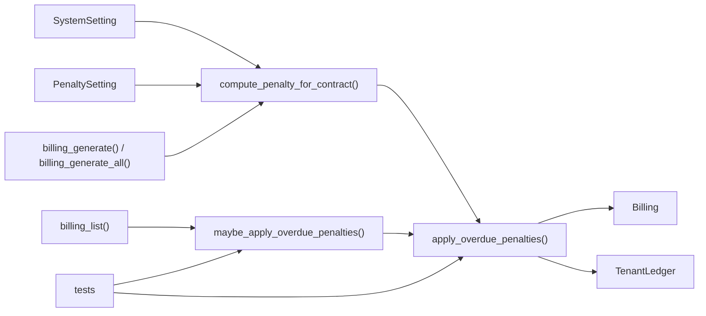

# Penalty Computation Engine

<cite>
**Referenced Files in This Document**
- [core/helpers.py](file://core/helpers.py)
- [core/views/billing.py](file://core/views/billing.py)
- [core/models.py](file://core/models.py)
- [core/management/commands/apply_penalties.py](file://core/management/commands/apply_penalties.py)
- [core/test_overdue_penalties.py](file://core/test_overdue_penalties.py)
- [PENALTY_GUIDE.md](file://PENALTY_GUIDE.md)
</cite>

## Table of Contents
1. [Introduction](#introduction)
2. [Project Structure](#project-structure)
3. [Core Components](#core-components)
4. [Architecture Overview](#architecture-overview)
5. [Detailed Component Analysis](#detailed-component-analysis)
6. [Dependency Analysis](#dependency-analysis)
7. [Performance Considerations](#performance-considerations)
8. [Troubleshooting Guide](#troubleshooting-guide)
9. [Conclusion](#conclusion)

## Introduction
This document explains the penalty computation engine used by the market rental system to calculate and apply late penalties on unpaid billing records. It focuses on:

- The core penalty calculation logic that resolves contract-specific or system-wide settings.
- The two supported penalty types: fixed amounts and percentage-based calculations.
- Grace period logic that prevents penalties during the initial grace period after due dates.
- How penalties are applied to billing records and how they affect total_due and balance.
- The periodic application mechanism through maybe_apply_overdue_penalties() and its role in maintaining billing accuracy.

The documentation is designed for both technical readers and non-technical users who need to understand why and how penalties are added to bills.

## Project Structure
The penalty engine spans several layers:

- Models define system-wide defaults, per-contract overrides, and billing fields affected by penalties.
- Helper functions implement the authoritative penalty math and the automated sweep.
- Billing views compute penalties when generating billings and trigger periodic penalty application.
- A management command provides a manual entry point for applying overdue penalties.
- Tests validate idempotency, grace period behavior, and throttling.

**Diagram sources**
- [core/models.py:42-68](file://core/models.py#L42-L68)
- [core/models.py:319-335](file://core/models.py#L319-L335)
- [core/models.py:190-218](file://core/models.py#L190-L218)
- [core/helpers.py:132-152](file://core/helpers.py#L132-L152)
- [core/helpers.py:423-500](file://core/helpers.py#L423-L500)
- [core/helpers.py:503-520](file://core/helpers.py#L503-L520)
- [core/views/billing.py:29-51](file://core/views/billing.py#L29-L51)
- [core/views/billing.py:63-70](file://core/views/billing.py#L63-L70)
- [core/views/billing.py:174-246](file://core/views/billing.py#L174-L246)
- [core/management/commands/apply_penalties.py:1-13](file://core/management/commands/apply_penalties.py#L1-L13)

**Section sources**
- [core/models.py:42-68](file://core/models.py#L42-L68)
- [core/models.py:190-218](file://core/models.py#L190-L218)
- [core/models.py:319-335](file://core/models.py#L319-L335)
- [core/helpers.py:132-152](file://core/helpers.py#L132-L152)
- [core/helpers.py:423-500](file://core/helpers.py#L423-L500)
- [core/helpers.py:503-520](file://core/helpers.py#L503-L520)
- [core/views/billing.py:29-51](file://core/views/billing.py#L29-L51)
- [core/views/billing.py:63-70](file://core/views/billing.py#L63-L70)
- [core/views/billing.py:174-246](file://core/views/billing.py#L174-L246)
- [core/management/commands/apply_penalties.py:1-13](file://core/management/commands/apply_penalties.py#L1-L13)

## Core Components
The penalty engine is built around these key components:

- SystemSetting: stores market-wide defaults such as penalty_type, penalty_value, and grace_period.
- PenaltySetting: allows per-contract overrides of penalty type, value, and grace period.
- Billing: holds rental_amount, penalty_amount, total_due, amount_paid, balance, due_date, and status.
- TenantLedger: records audit trail entries including penalty debits.
- compute_penalty_for_contract(): central function that computes the one-time penalty based on resolved settings and grace period.
- apply_overdue_penalties(): scans unpaid or overdue billings, applies penalties once, updates totals, and maintains ledger consistency.
- maybe_apply_overdue_penalties(): throttles the sweep to run at most once per day per cache instance.
- billing views: compute penalties when generating billings and trigger periodic penalty application.
- apply_penalties management command: manual CLI wrapper for applying overdue penalties without throttling.

**Section sources**
- [core/models.py:42-68](file://core/models.py#L42-L68)
- [core/models.py:190-218](file://core/models.py#L190-L218)
- [core/models.py:319-335](file://core/models.py#L319-L335)
- [core/helpers.py:132-152](file://core/helpers.py#L132-L152)
- [core/helpers.py:423-500](file://core/helpers.py#L423-L500)
- [core/helpers.py:503-520](file://core/helpers.py#L503-L520)
- [core/views/billing.py:29-51](file://core/views/billing.py#L29-L51)
- [core/views/billing.py:63-70](file://core/views/billing.py#L63-L70)
- [core/management/commands/apply_penalties.py:1-13](file://core/management/commands/apply_penalties.py#L1-L13)

## Architecture Overview
The penalty engine integrates configuration, calculation, application, and auditing into a cohesive flow:

- Configuration resolution:
  - If a contract has an active PenaltySetting, it overrides system defaults.
  - Otherwise, SystemSetting values are used.
- Calculation:
  - If today is within due_date + grace_period, penalty is zero.
  - For fixed type, penalty equals penalty_value.
  - For percentage type, penalty equals monthly_rent × (penalty_value / 100).
- Application:
  - Only one penalty per billing; repeated runs do not double-charge.
  - Updates billing.penalty_amount, billing.total_due, and billing.balance.
  - Creates a TenantLedger debit row for audit trail.
  - Recalculates tenant ledger running balances.
- Throttling:
  - maybe_apply_overdue_penalties() ensures the sweep runs at most once per day per instance.
- Entry points:
  - Automatic: billing_list(), billing print/export views.
  - Manual: apply_penalties management command.

**Diagram sources**
- [core/views/billing.py:63-70](file://core/views/billing.py#L63-L70)
- [core/helpers.py:503-520](file://core/helpers.py#L503-L520)
- [core/helpers.py:423-500](file://core/helpers.py#L423-L500)
- [core/helpers.py:132-152](file://core/helpers.py#L132-L152)
- [core/models.py:190-218](file://core/models.py#L190-L218)

## Detailed Component Analysis

### Penalty Calculation Logic: compute_penalty_for_contract()
This function is the single source of truth for penalty math. It:

- Reads SystemSetting as the global default.
- Checks for an active PenaltySetting on the contract; if present, uses it instead.
- Computes effective_due = due_date + grace_period.
- Returns zero if today is within the grace period.
- Applies fixed or percentage logic:
  - Fixed: penalty equals penalty_value.
  - Percentage: penalty equals monthly_rent × (penalty_value / 100), quantized to two decimals.

**Diagram sources**
- [core/helpers.py:132-152](file://core/helpers.py#L132-L152)

**Section sources**
- [core/helpers.py:132-152](file://core/helpers.py#L132-L152)

### Periodic Penalty Application: apply_overdue_penalties()
This function performs the automated sweep:

- Loads SystemSetting and determines default_grace if no settings exist.
- Queries billings with status Unpaid, Partial, or Overdue.
- For each billing:
  - Resolves grace from PenaltySetting or default_grace.
  - Skips if today is within effective_due.
  - If penalty_amount is still zero, computes penalty via compute_penalty_for_contract().
  - Updates billing.penalty_amount, total_due, and balance.
  - Creates a TenantLedger debit row describing the overdue penalty.
  - Records an AuditLog entry.
  - Recomputes billing status based on updated balance.
- After processing all billings, recalculates tenant ledgers for affected tenants.

**Diagram sources**
- [core/helpers.py:423-500](file://core/helpers.py#L423-L500)
- [core/helpers.py:132-152](file://core/helpers.py#L132-L152)
- [core/models.py:190-218](file://core/models.py#L190-L218)

**Section sources**
- [core/helpers.py:423-500](file://core/helpers.py#L423-L500)

### Throttled Trigger: maybe_apply_overdue_penalties()
This function wraps the sweep behind a daily cache key:

- Uses a cache.add(key, 1, timeout=24 hours) to ensure only one run per day per instance.
- Calls apply_overdue_penalties(today).
- Catches exceptions and deletes the cache key to allow retry on next request.

**Diagram sources**
- [core/helpers.py:503-520](file://core/helpers.py#L503-L520)
- [core/views/billing.py:63-70](file://core/views/billing.py#L63-L70)

**Section sources**
- [core/helpers.py:503-520](file://core/helpers.py#L503-L520)
- [core/views/billing.py:63-70](file://core/views/billing.py#L63-L70)

### Billing Views Integration: compute_penalty() and Generation Flows
The billing views include a local compute_penalty() function used when manually generating billings:

- Resolves settings similarly to compute_penalty_for_contract().
- Honors grace period before computing penalty.
- Supports fixed and percentage types.
- Used in billing_generate() and billing_generate_all() to set penalty_amount and total_due.

Additionally, billing_list() triggers ensure_current_month_billings() and maybe_apply_overdue_penalties() to keep billings current and penalties applied automatically.

**Diagram sources**
- [core/views/billing.py:29-51](file://core/views/billing.py#L29-L51)
- [core/views/billing.py:174-246](file://core/views/billing.py#L174-L246)

**Section sources**
- [core/views/billing.py:29-51](file://core/views/billing.py#L29-L51)
- [core/views/billing.py:63-70](file://core/views/billing.py#L63-L70)
- [core/views/billing.py:174-246](file://core/views/billing.py#L174-L246)

### Management Command: apply_penalties
A thin CLI wrapper over apply_overdue_penalties():

- Invokes apply_overdue_penalties() directly without throttling.
- Prints summary counts for overdue marked and penalties applied.

**Section sources**
- [core/management/commands/apply_penalties.py:1-13](file://core/management/commands/apply_penalties.py#L1-L13)

### Data Model Relationships
The models involved in penalty computation and application:

- SystemSetting: global defaults for penalty_type, penalty_value, grace_period.
- PenaltySetting: per-contract override for penalty_type, penalty_value, grace_period, due_day, is_active.
- Billing: fields updated by penalties include penalty_amount, total_due, balance, status.
- TenantLedger: records penalty debits and running balances.

**Diagram sources**
- [core/models.py:42-68](file://core/models.py#L42-L68)
- [core/models.py:319-335](file://core/models.py#L319-L335)
- [core/models.py:190-218](file://core/models.py#L190-L218)

**Section sources**
- [core/models.py:42-68](file://core/models.py#L42-L68)
- [core/models.py:190-218](file://core/models.py#L190-L218)
- [core/models.py:319-335](file://core/models.py#L319-L335)

## Dependency Analysis
Key dependencies and relationships:

- compute_penalty_for_contract() depends on SystemSetting and PenaltySetting to resolve settings.
- apply_overdue_penalties() depends on Billing, TenantLedger, and AuditLog to update state and maintain audit trails.
- maybe_apply_overdue_penalties() depends on Django cache for throttling.
- billing views depend on helpers for penalty computation and periodic application.
- Tests assert expected behavior for grace periods, idempotency, and throttling.

**Diagram sources**
- [core/helpers.py:132-152](file://core/helpers.py#L132-L152)
- [core/helpers.py:423-500](file://core/helpers.py#L423-L500)
- [core/helpers.py:503-520](file://core/helpers.py#L503-L520)
- [core/views/billing.py:29-51](file://core/views/billing.py#L29-L51)
- [core/views/billing.py:63-70](file://core/views/billing.py#L63-L70)
- [core/test_overdue_penalties.py:1-96](file://core/test_overdue_penalties.py#L1-L96)

**Section sources**
- [core/helpers.py:132-152](file://core/helpers.py#L132-L152)
- [core/helpers.py:423-500](file://core/helpers.py#L423-L500)
- [core/helpers.py:503-520](file://core/helpers.py#L503-L520)
- [core/views/billing.py:29-51](file://core/views/billing.py#L29-L51)
- [core/views/billing.py:63-70](file://core/views/billing.py#L63-L70)
- [core/test_overdue_penalties.py:1-96](file://core/test_overdue_penalties.py#L1-L96)

## Performance Considerations
- Decimal arithmetic is used throughout to avoid float drift in financial totals.
- The sweep queries billings with select_related to reduce N+1 queries.
- maybe_apply_overdue_penalties() throttles execution to once per day per instance using cache.add.
- Ledger recalculation is performed only for affected tenants to minimize overhead.
- Idempotency guard ensures penalties are applied only once per billing, preventing redundant writes.

[No sources needed since this section provides general guidance]

## Troubleshooting Guide
Common issues and resolutions:

- Penalties not appearing:
  - Ensure SystemSetting exists; without it, penalties default to zero.
  - Verify PenaltySetting is active if contract-specific rules are intended.
  - Confirm today is beyond due_date + grace_period.
- Double-charging concerns:
  - The sweep checks billing.penalty_amount == 0 before applying; repeated runs should not double-charge.
  - Tests assert idempotency across multiple runs.
- Grace period confusion:
  - Within grace period, penalty remains zero and billing status may remain Unpaid or Partial.
  - Once past grace, status becomes Overdue and penalty is applied once.
- Throttling behavior:
  - maybe_apply_overdue_penalties() runs only once per day per instance; subsequent same-day triggers are no-ops.
  - If you need immediate back-filling, use the apply_penalties management command.

**Section sources**
- [core/helpers.py:132-152](file://core/helpers.py#L132-L152)
- [core/helpers.py:423-500](file://core/helpers.py#L423-L500)
- [core/helpers.py:503-520](file://core/helpers.py#L503-L520)
- [core/test_overdue_penalties.py:47-95](file://core/test_overdue_penalties.py#L47-L95)
- [PENALTY_GUIDE.md:1-221](file://PENALTY_GUIDE.md#L1-L221)

## Conclusion
The penalty computation engine provides a robust, auditable mechanism for calculating and applying late penalties:

- Settings resolution supports both system-wide defaults and per-contract overrides.
- Two penalty types—fixed and percentage—are computed consistently.
- Grace period logic protects tenants from penalties during the initial cushion period.
- Penalties are applied idempotently to billing records, updating total_due and balance while recording ledger entries.
- maybe_apply_overdue_penalties() ensures periodic application without overloading the system.
- Tests and documentation confirm expected behavior, making the engine reliable for daily operations.

[No sources needed since this section summarizes without analyzing specific files]