# Status Tracking & Management

<cite>
**Referenced Files in This Document**   
- [core/models.py](file://core/models.py)
- [core/helpers.py](file://core/helpers.py)
- [core/views/billing.py](file://core/views/billing.py)
- [templates/billing/list.html](file://templates/billing/list.html)
- [templates/billing/_table.html](file://templates/billing/_table.html)
- [templates/billing/collect_grouped.html](file://templates/billing/collect_grouped.html)
- [templates/includes/status_badge.html](file://templates/includes/status_badge.html)
- [core/views/reports.py](file://core/views/reports.py)
</cite>

## Table of Contents
1. [Introduction](#introduction)
2. [Project Structure](#project-structure)
3. [Core Components](#core-components)
4. [Architecture Overview](#architecture-overview)
5. [Detailed Component Analysis](#detailed-component-analysis)
6. [Dependency Analysis](#dependency-analysis)
7. [Performance Considerations](#performance-considerations)
8. [Troubleshooting Guide](#troubleshooting-guide)
9. [Conclusion](#conclusion)

## Introduction
This document explains how billing status tracking and management works in the market rental system. It covers:

- The billing status lifecycle: Unpaid, Partial, Paid, and Overdue.
- Automatic transitions driven by payment activity and due date calculations.
- Filtering the billing list by status, month, year, tenant, and search terms.
- Grouping logic that consolidates multiple billings per tenant into visual cards.
- Status badge rendering and overdue account identification.
- Integration with reporting systems for unpaid, paid, and overdue accounts.
- Tenant isolation so tenant users only see their own billings.

The goal is to make the billing workflow predictable, auditable, and easy to operate for collectors, supervisors, and tenants.

## Project Structure
Billing status tracking spans models, helpers, views, templates, and reports:

- Models define Billing, Payment, TenantLedger, RentalContract, SystemSetting, and related entities.
- Helpers implement idempotent billing creation, penalty computation, payment recording, ledger recomputation, and overdue accrual.
- Views provide the grouped billing list, collection workflows, print/export endpoints, and tenant-specific collection workspace.
- Templates render filters, grouped tenant cards, status badges, and batch collection forms.
- Reports expose unpaid, paid, and overdue summaries for management.

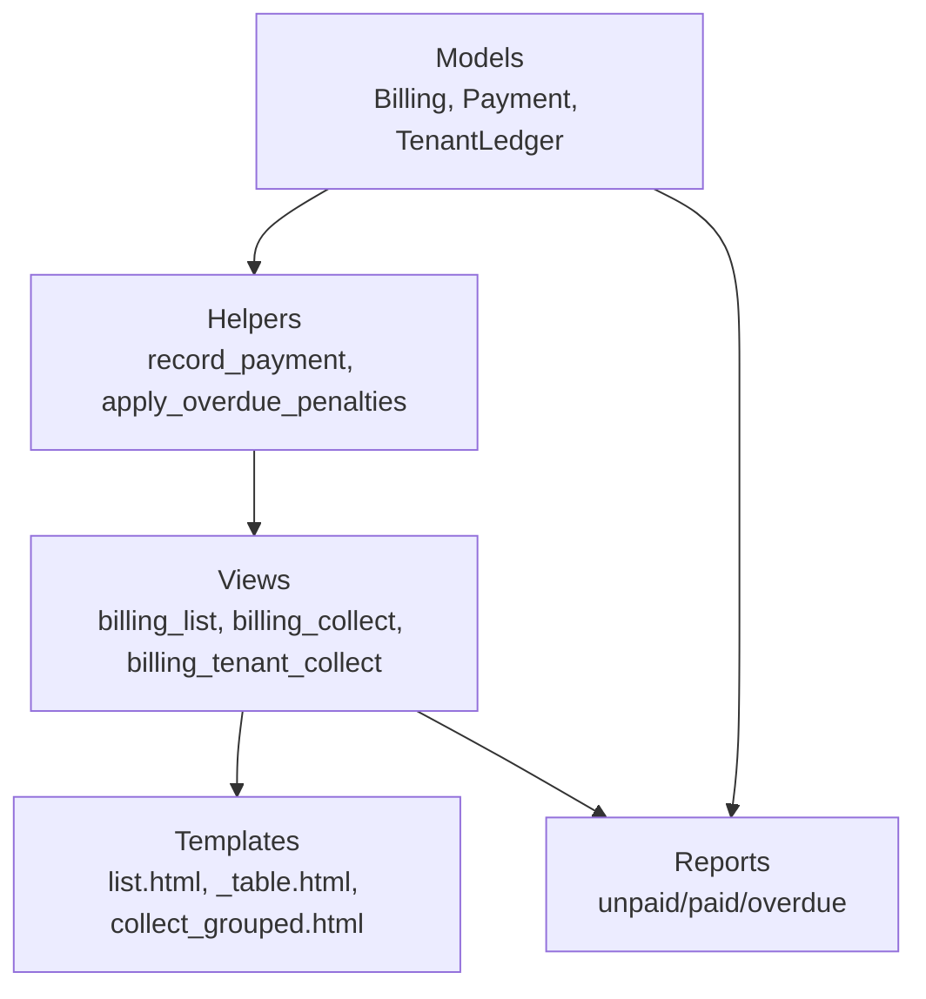

**Diagram sources**
- [core/models.py:190-258](file://core/models.py#L190-L258)
- [core/helpers.py:155-205](file://core/helpers.py#L155-L205)
- [core/helpers.py:321-420](file://core/helpers.py#L321-L420)
- [core/helpers.py:423-520](file://core/helpers.py#L423-L520)
- [core/views/billing.py:62-171](file://core/views/billing.py#L62-L171)
- [core/views/billing.py:415-489](file://core/views/billing.py#L415-L489)
- [core/views/billing.py:511-634](file://core/views/billing.py#L511-L634)
- [templates/billing/list.html:60-94](file://templates/billing/list.html#L60-L94)
- [templates/billing/_table.html:48-153](file://templates/billing/_table.html#L48-L153)
- [templates/billing/collect_grouped.html:64-175](file://templates/billing/collect_grouped.html#L64-L175)
- [core/views/reports.py:317-363](file://core/views/reports.py#L317-L363)

**Section sources**
- [core/models.py:190-258](file://core/models.py#L190-L258)
- [core/helpers.py:155-205](file://core/helpers.py#L155-L205)
- [core/views/billing.py:62-171](file://core/views/billing.py#L62-L171)
- [templates/billing/list.html:60-94](file://templates/billing/list.html#L60-L94)

## Core Components
The core components for billing status tracking are:

- Billing model: stores billing period, amounts, balance, due date, and status.
- Payment model: records each collection against a billing.
- TenantLedger model: maintains running debit/credit balances per tenant.
- Helpers: compute penalties, create billings idempotently, record payments, update billing totals and status, and apply overdue penalties.
- Views: render filtered and grouped billing lists, handle single and batch collections, and support print/export.
- Templates: render filters, grouped tenant cards, status badges, and batch collection UI.
- Reports: expose unpaid, paid, and overdue summaries.

Key responsibilities:

- Billing lifecycle is authoritative: status is derived from payment totals and due dates.
- Penalties and grace periods are configurable via SystemSetting or contract-level penalty settings.
- Grouped view improves collector workflow by showing one card per tenant with chronological months underneath.
- Tenant isolation ensures tenant-role users only see their own billings.

**Section sources**
- [core/models.py:190-258](file://core/models.py#L190-L258)
- [core/helpers.py:155-205](file://core/helpers.py#L155-L205)
- [core/helpers.py:321-420](file://core/helpers.py#L321-L420)
- [core/helpers.py:423-520](file://core/helpers.py#L423-L520)
- [core/views/billing.py:62-171](file://core/views/billing.py#L62-L171)
- [templates/billing/_table.html:48-153](file://templates/billing/_table.html#L48-L153)

## Architecture Overview
The billing status architecture follows a clear flow:

1. Billings are created automatically for active contracts using helper functions.
2. Payments are recorded through a single service function that updates Payment, Billing totals, and TenantLedger entries.
3. Billing status is recomputed authoritatively based on valid payments.
4. Overdue penalties are applied after the grace period; status becomes Overdue when balance remains positive.
5. The billing list groups billings by tenant for better overview and supports filtering by status, month, year, tenant, and search.
6. Reports integrate with billing statuses to produce unpaid, paid, and overdue summaries.

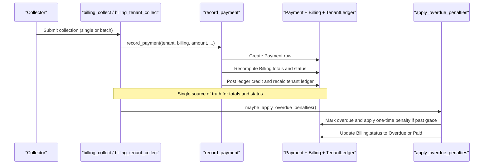

**Diagram sources**
- [core/views/billing.py:415-489](file://core/views/billing.py#L415-L489)
- [core/views/billing.py:511-634](file://core/views/billing.py#L511-L634)
- [core/helpers.py:351-420](file://core/helpers.py#L351-L420)
- [core/helpers.py:423-520](file://core/helpers.py#L423-L520)

## Detailed Component Analysis

### Billing Status Lifecycle
The Billing model defines four statuses:

- Unpaid: no payments applied yet.
- Partial: some payments applied but balance remains positive.
- Paid: total payments equal or exceed total due.
- Overdue: past due date plus grace period with remaining balance.

Transitions occur automatically:

- When a payment is recorded, the system recomputes Billing.amount_paid and Billing.balance, then sets status to Paid, Partial, or Unpaid accordingly.
- When overdue penalties are applied, any billing with a positive balance beyond the grace period is marked Overdue. If the balance is zero, it is marked Paid.

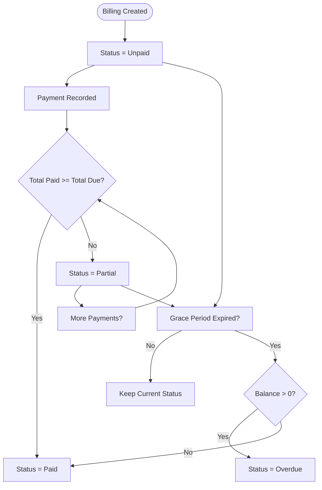

**Diagram sources**
- [core/helpers.py:321-348](file://core/helpers.py#L321-L348)
- [core/helpers.py:423-500](file://core/helpers.py#L423-L500)

**Section sources**
- [core/models.py:190-218](file://core/models.py#L190-L218)
- [core/helpers.py:321-348](file://core/helpers.py#L321-L348)
- [core/helpers.py:423-500](file://core/helpers.py#L423-L500)

### Due Date Calculation and Penalty Computation
Due dates are computed safely per month:

- The due day comes from the contract’s due_day field.
- If the due day exceeds the month’s last day, the system uses the last day of the month.
- Penalties are computed based on contract-level or system-level settings, honoring the configured grace period.

Penalty types include fixed and percentage-based values. Penalties are only applied after the grace period has elapsed.

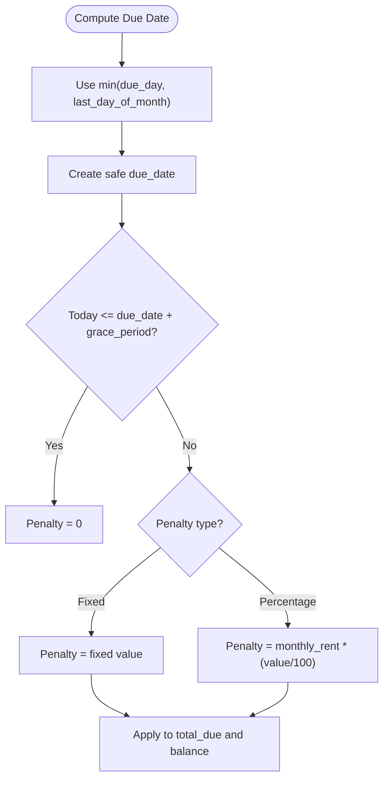

**Diagram sources**
- [core/views/billing.py:54-59](file://core/views/billing.py#L54-L59)
- [core/helpers.py:125-152](file://core/helpers.py#L125-L152)

**Section sources**
- [core/views/billing.py:54-59](file://core/views/billing.py#L54-L59)
- [core/helpers.py:125-152](file://core/helpers.py#L125-L152)

### Billing List Filtering
The billing list supports filtering by:

- Month: selects billings for a specific billing_month.
- Year: selects billings for a specific billing_year.
- Tenant: selects billings for a specific tenant_id.
- Status: selects billings matching Unpaid, Paid, Partial, or Overdue.
- Search: matches tenant name, ID, business name, stall number, section name, or contract ID.

Filters are combined and applied before grouping. The list also computes totals for due, paid, and balance across the filtered set.

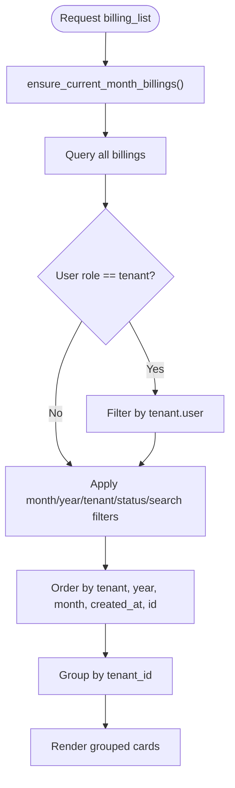

**Diagram sources**
- [core/views/billing.py:62-171](file://core/views/billing.py#L62-L171)
- [templates/billing/list.html:60-94](file://templates/billing/list.html#L60-L94)

**Section sources**
- [core/views/billing.py:62-171](file://core/views/billing.py#L62-L171)
- [templates/billing/list.html:60-94](file://templates/billing/list.html#L60-L94)

### Grouping Logic and Visual Cards
The billing list collapses multiple billings per tenant into one visual card:

- Each group tracks tenant info, stalls, billings, totals, unpaid count, and oldest/newest periods.
- The template renders a header card per tenant with outstanding balance and a link to the tenant’s collection workspace.
- Under each card, chronological months are listed with quick actions for collection or viewing details.

This design reduces noise and makes it easier for collectors to review and settle multiple months per tenant.

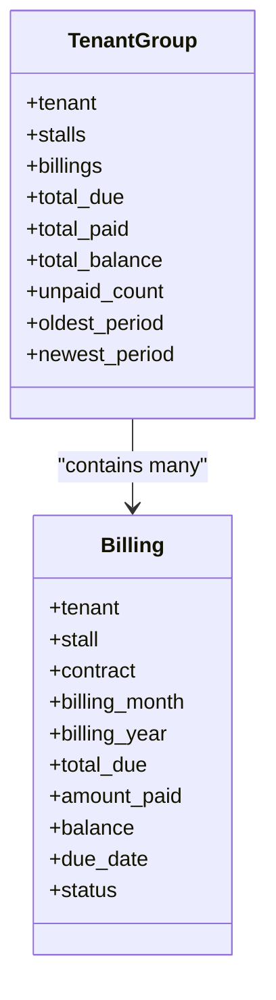

**Diagram sources**
- [core/views/billing.py:119-151](file://core/views/billing.py#L119-L151)
- [templates/billing/_table.html:48-153](file://templates/billing/_table.html#L48-L153)

**Section sources**
- [core/views/billing.py:119-151](file://core/views/billing.py#L119-L151)
- [templates/billing/_table.html:48-153](file://templates/billing/_table.html#L48-L153)

### Status Badge Rendering
Status badges are rendered consistently across the billing list and collection workspace:

- The shared template maps status values to visual classes: success, muted, warning, danger, info.
- For billing statuses:
  - Unpaid and Overdue render as danger.
  - Partial renders as warning.
  - Paid renders as success.

This provides immediate visual cues for collectors and tenants.

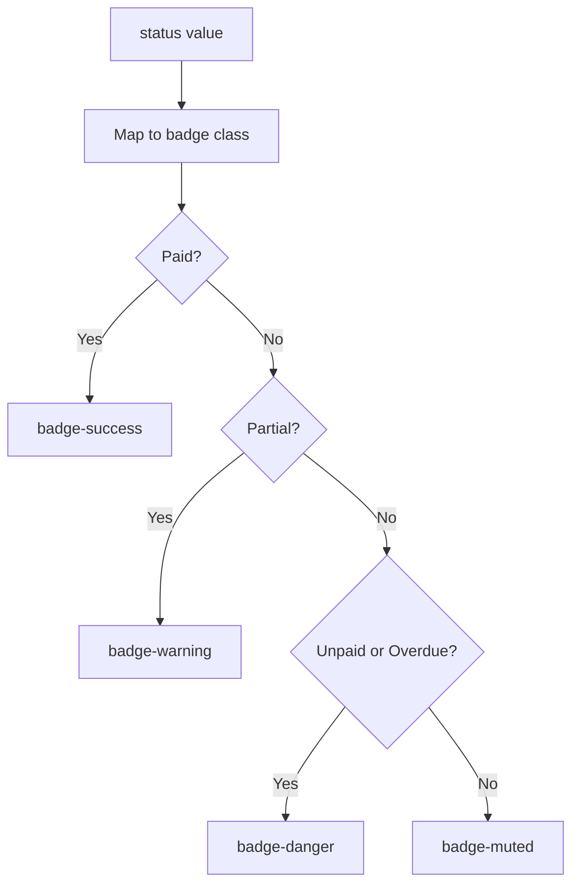

**Diagram sources**
- [templates/includes/status_badge.html:1-7](file://templates/includes/status_badge.html#L1-L7)

**Section sources**
- [templates/includes/status_badge.html:1-7](file://templates/includes/status_badge.html#L1-L7)
- [templates/billing/_table.html:115-125](file://templates/billing/_table.html#L115-L125)
- [templates/billing/collect_grouped.html:107-125](file://templates/billing/collect_grouped.html#L107-L125)

### Overdue Account Identification
Overdue accounts are identified through two mechanisms:

- Request-time accrual: the billing list triggers a throttled overdue check once per day.
- Manual command: an admin command applies overdue penalties explicitly.

When overdue penalties are applied:

- The system checks whether today is past due_date plus grace_period.
- If a penalty has not been applied yet, it calculates and adds the penalty to total_due and balance.
- It posts a ledger entry for the penalty and logs an audit action.
- It sets Billing.status to Overdue if balance remains positive, or Paid if balance is zero.

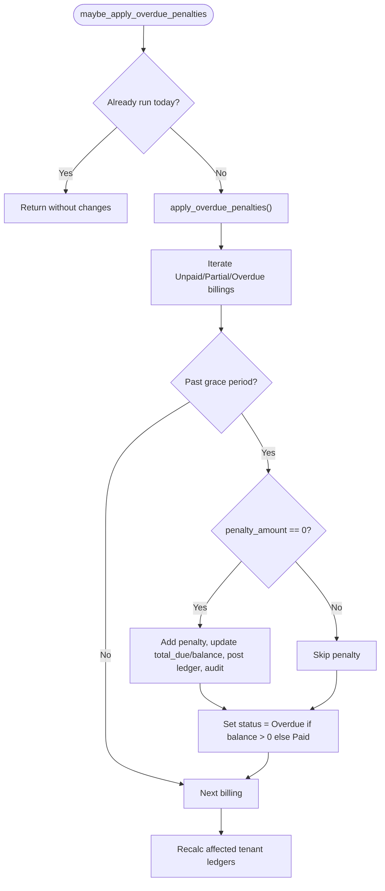

**Diagram sources**
- [core/helpers.py:503-520](file://core/helpers.py#L503-L520)
- [core/helpers.py:423-500](file://core/helpers.py#L423-L500)

**Section sources**
- [core/helpers.py:423-500](file://core/helpers.py#L423-L500)
- [core/helpers.py:503-520](file://core/helpers.py#L503-L520)

### Collection Workflows and Status Transitions
Two main collection flows exist:

- Single billing collection: collector enters amount and confirms; the system creates a Payment, updates Billing totals and status, posts a ledger credit, and redirects to the receipt page.
- Batch tenant collection: collector selects multiple months; the system settles each selected month in order, generates a consolidated official receipt number, and redirects to the batch receipt page.

In both cases:

- The amount determines outcome: less than balance results in Partial; equal or greater results in Paid.
- The billing status is recomputed authoritatively from all valid payments.
- Ledger balances are recalculated to maintain consistency.

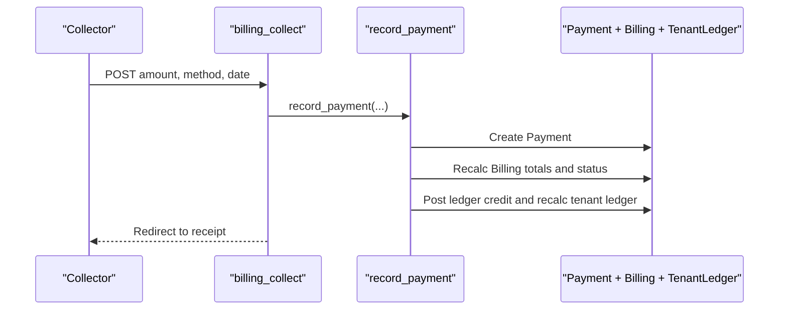

**Diagram sources**
- [core/views/billing.py:415-489](file://core/views/billing.py#L415-L489)
- [core/helpers.py:351-420](file://core/helpers.py#L351-L420)

**Section sources**
- [core/views/billing.py:415-489](file://core/views/billing.py#L415-L489)
- [core/views/billing.py:511-634](file://core/views/billing.py#L511-L634)
- [core/helpers.py:351-420](file://core/helpers.py#L351-L420)

### Tenant Isolation Features
Tenant isolation ensures tenant-role users only see their own billings:

- In the billing list, if the user role is tenant, the queryset is filtered by tenant.user.
- In billing view endpoints, tenant users are restricted to their own billing records.
- In tenant profile views, tenant users can only view their own tenant profile.

This prevents cross-tenant data exposure and aligns with least-privilege access.

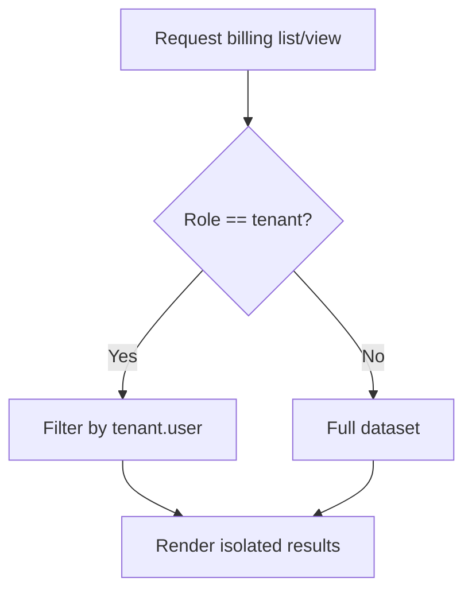

**Diagram sources**
- [core/views/billing.py:76-78](file://core/views/billing.py#L76-L78)
- [core/views/billing.py:319-332](file://core/views/billing.py#L319-L332)
- [core/views/tenants.py:266-287](file://core/views/tenants.py#L266-L287)

**Section sources**
- [core/views/billing.py:76-78](file://core/views/billing.py#L76-L78)
- [core/views/billing.py:319-332](file://core/views/billing.py#L319-L332)
- [core/views/tenants.py:266-287](file://core/views/tenants.py#L266-L287)

### Integration with Reporting Systems
Reporting views integrate directly with billing statuses:

- Unpaid Tenants Report: filters billings by month/year and status in {Unpaid, Partial, Overdue}.
- Paid Tenants Report: filters billings by month/year and status Paid.
- Overdue Accounts Report: filters billings by status Overdue.

These reports aggregate totals and counts, providing management visibility into collection performance and risk.

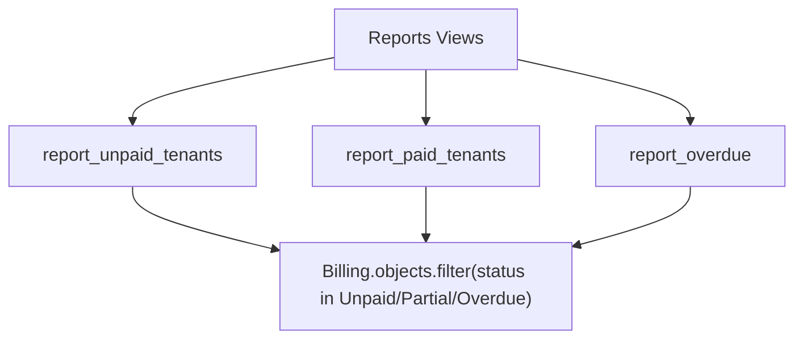

**Diagram sources**
- [core/views/reports.py:317-363](file://core/views/reports.py#L317-L363)

**Section sources**
- [core/views/reports.py:317-363](file://core/views/reports.py#L317-L363)

## Dependency Analysis
The billing status system has clear dependencies:

- Views depend on helpers for billing creation, payment recording, and overdue accrual.
- Templates depend on models and context variables for rendering grouped cards and status badges.
- Reports depend on Billing queries filtered by status and period.
- Models define the canonical state machine for billing status.

Potential coupling points:

- Overdue accrual runs at request time and must be robust; errors are swallowed to avoid breaking pages.
- Payment recording locks the billing row to prevent concurrent clobbering.
- Grouping logic depends on stable ordering to ensure consistent visual presentation.

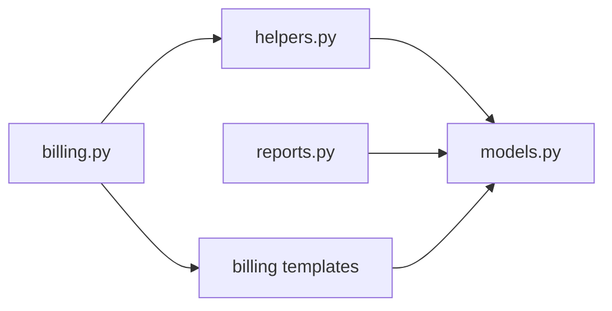

**Diagram sources**
- [core/views/billing.py:62-171](file://core/views/billing.py#L62-L171)
- [core/helpers.py:351-420](file://core/helpers.py#L351-L420)
- [core/models.py:190-258](file://core/models.py#L190-L258)
- [core/views/reports.py:317-363](file://core/views/reports.py#L317-L363)

**Section sources**
- [core/views/billing.py:62-171](file://core/views/billing.py#L62-L171)
- [core/helpers.py:351-420](file://core/helpers.py#L351-L420)
- [core/models.py:190-258](file://core/models.py#L190-L258)
- [core/views/reports.py:317-363](file://core/views/reports.py#L317-L363)

## Performance Considerations
- Use select_related in billing queries to reduce N+1 queries when rendering grouped cards.
- Avoid heavy computations in hot paths; overdue accrual is throttled once per day.
- Prefer Decimal arithmetic throughout to prevent float drift in financial totals.
- Batch operations should use atomic transactions to ensure consistency.
- Pagination limits grouped results to improve list responsiveness.

[No sources needed since this section provides general guidance]

## Troubleshooting Guide
Common issues and resolutions:

- Billing not appearing: ensure current month billings are ensured and contracts are Active.
- Status stuck on Unpaid after payment: verify record_payment was called and Billing totals were recomputed.
- Overdue not applied: check grace period configuration and confirm maybe_apply_overdue_penalties ran.
- Duplicate receipts: generate_receipt_number retries on collision; ensure unique constraints are enforced.
- Ledger imbalance: use recalc_tenant_ledger to restore running balance consistency.

Operational tips:

- Use the manual command to apply overdue penalties when needed.
- Inspect AuditLog entries for billing generation, collection, and penalty application.
- Validate SystemSetting values for penalty type, value, and grace period.

**Section sources**
- [core/helpers.py:423-520](file://core/helpers.py#L423-L520)
- [core/views/billing.py:62-70](file://core/views/billing.py#L62-L70)
- [core/helpers.py:276-300](file://core/helpers.py#L276-L300)
- [core/helpers.py:260-273](file://core/helpers.py#L260-L273)

## Conclusion
The billing status tracking and management system provides a robust, automated workflow:

- Billings start as Unpaid and transition to Partial or Paid based on payment activity.
- Overdue status and penalties are applied automatically after the grace period.
- The grouped billing list improves collector efficiency and clarity.
- Tenant isolation protects data privacy for tenant users.
- Reporting integrations offer visibility into unpaid, paid, and overdue accounts.

By following these patterns, operators can confidently manage billing lifecycles, maintain accurate financial records, and deliver a smooth collection experience.