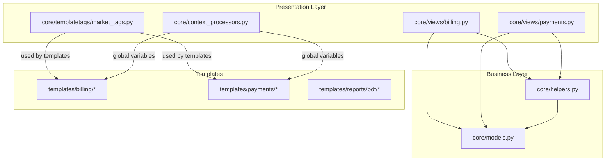
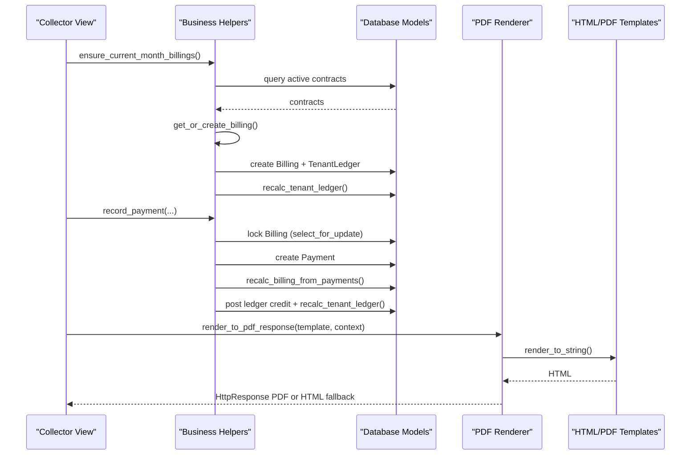
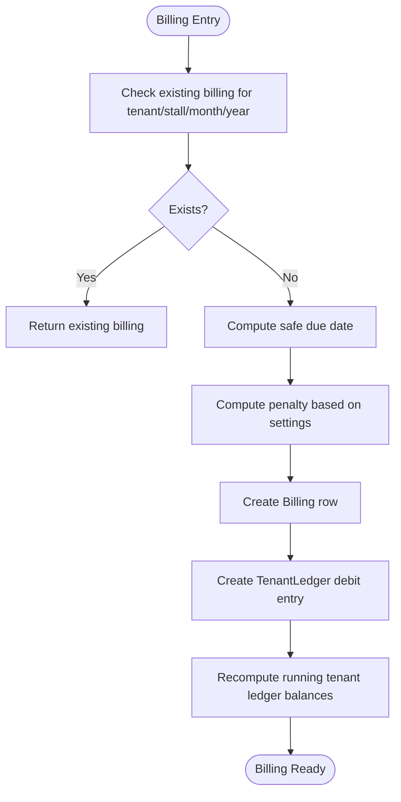
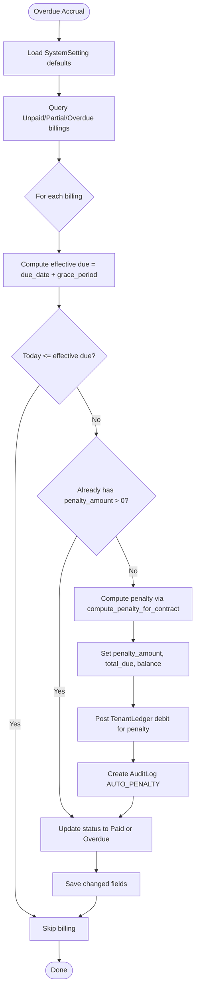
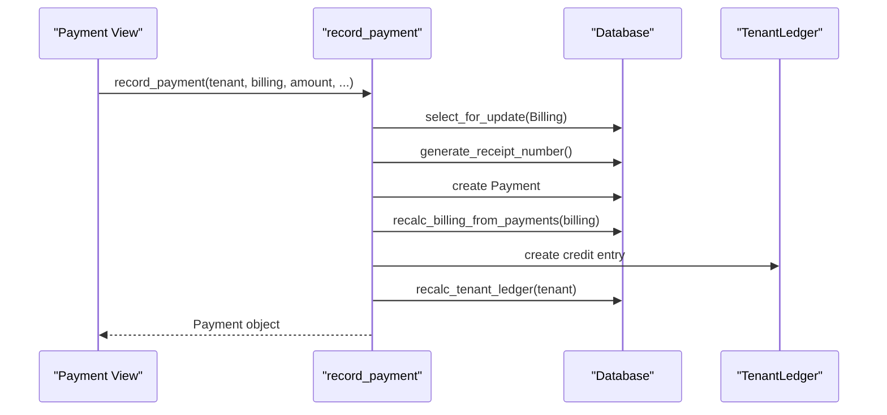
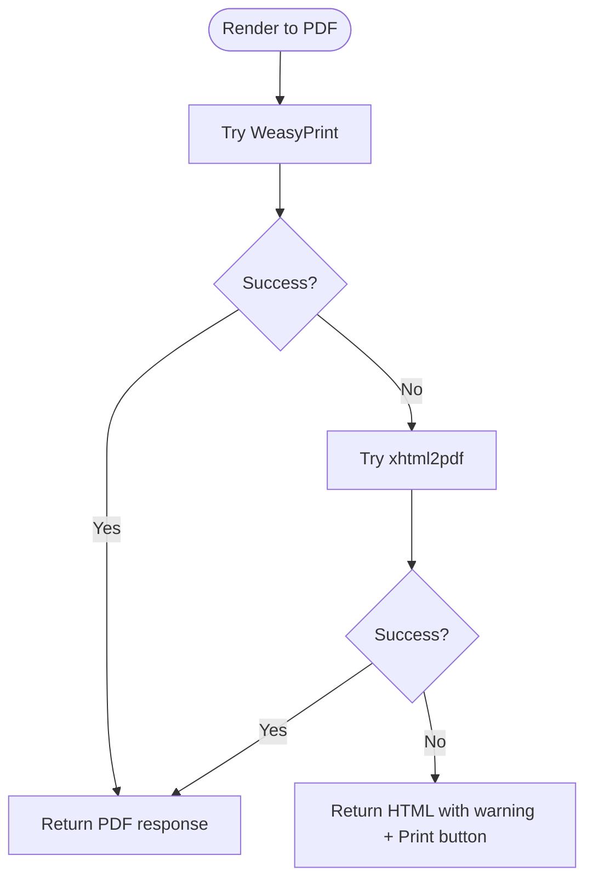
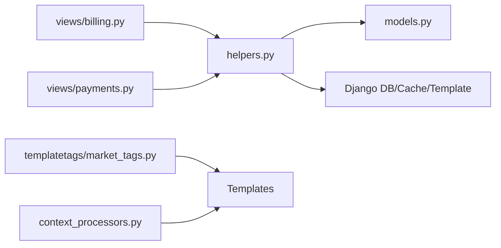

# Business Logic & Helpers

<cite>
**Referenced Files in This Document**
- [helpers.py](file://core/helpers.py)
- [market_tags.py](file://core/templatetags/market_tags.py)
- [context_processors.py](file://core/context_processors.py)
- [models.py](file://core/models.py)
- [billing.py](file://core/views/billing.py)
- [payments.py](file://core/views/payments.py)
</cite>

## Table of Contents
1. [Introduction](#introduction)
2. [Project Structure](#project-structure)
3. [Core Components](#core-components)
4. [Architecture Overview](#architecture-overview)
5. [Detailed Component Analysis](#detailed-component-analysis)
6. [Dependency Analysis](#dependency-analysis)
7. [Performance Considerations](#performance-considerations)
8. [Troubleshooting Guide](#troubleshooting-guide)
9. [Conclusion](#conclusion)

## Introduction
This document explains the Business Logic and Helpers module that powers financial calculations, billing generation, penalty computation, payment processing, PDF rendering, receipt numbering, data formatting, template tags, and global context processors. It focuses on how business rules are separated from presentation logic, how helpers promote reuse across views, and where extension points exist for custom business behavior.

The system models tenants, stalls, contracts, billings, payments, tenant ledgers, notices, audit logs, settings, and penalty configurations. The core business logic is centralized in `core/helpers.py`, while reusable UI helpers live in `core/templatetags/market_tags.py` and global template variables are provided by `core/context_processors.py`. Views in `core/views/billing.py` and `core/views/payments.py` orchestrate user workflows but delegate financial state changes to the helper layer.

## Project Structure
The relevant parts of the project structure for this module are:

**Diagram sources**
- [helpers.py:1-595](file://core/helpers.py#L1-L595)
- [models.py:1-336](file://core/models.py#L1-L336)
- [billing.py:1-765](file://core/views/billing.py#L1-L765)
- [payments.py:1-653](file://core/views/payments.py#L1-L653)
- [market_tags.py:1-97](file://core/templatetags/market_tags.py#L1-L97)
- [context_processors.py:1-45](file://core/context_processors.py#L1-L45)

**Section sources**
- [helpers.py:1-595](file://core/helpers.py#L1-L595)
- [models.py:1-336](file://core/models.py#L1-L336)
- [billing.py:1-765](file://core/views/billing.py#L1-L765)
- [payments.py:1-653](file://core/views/payments.py#L1-L653)
- [market_tags.py:1-97](file://core/templatetags/market_tags.py#L1-L97)
- [context_processors.py:1-45](file://core/context_processors.py#L1-L45)

## Core Components
The Business Logic and Helpers module provides:

- Financial calculation utilities: safe due dates, penalty computation, billing totals, ledger balance recomputation.
- Billing lifecycle helpers: idempotent billing creation, initial billing backfill, current-month billing assurance.
- Payment processing service: atomic payment posting, billing reconciliation, ledger credit posting, receipt number generation.
- Overdue penalty automation: scheduled-like accrual with grace periods, one-time penalty application, status updates, and audit logging.
- PDF generation with multi-fallback rendering: WeasyPrint preferred, xhtml2pdf fallback, browser print preview fallback.
- Receipt utilities: monthly-prefixed unique receipt numbers, printable receipt URL construction, safe back-url handling.
- Template helpers: arithmetic tags, currency and percentage formatters, string splitting, text line splitting, status badge mapping.
- Global context processors: system settings exposure, user role flags, static asset cache-busting version.

These components keep business rules out of views and templates, making them testable, reusable, and easier to extend.

**Section sources**
- [helpers.py:125-595](file://core/helpers.py#L125-L595)
- [market_tags.py:6-97](file://core/templatetags/market_tags.py#L6-L97)
- [context_processors.py:9-45](file://core/context_processors.py#L9-L45)

## Architecture Overview
The architecture separates concerns into layers:

- Models define domain entities and constraints.
- Helpers encapsulate business rules and transactional services.
- Views handle HTTP requests, authorization, filtering, pagination, and redirect flows.
- Templates render HTML or PDF content using template tags and context processors.

**Diagram sources**
- [billing.py:62-70](file://core/views/billing.py#L62-L70)
- [billing.py:415-489](file://core/views/billing.py#L415-L489)
- [payments.py:250-294](file://core/views/payments.py#L250-L294)
- [helpers.py:155-205](file://core/helpers.py#L155-L205)
- [helpers.py:351-420](file://core/helpers.py#L351-L420)
- [helpers.py:522-595](file://core/helpers.py#L522-L595)

## Detailed Component Analysis

### Financial Calculations and Billing Generation
Key responsibilities:
- Safe due date computation handles month-end edge cases.
- Idempotent billing creation avoids duplicates and creates corresponding ledger entries.
- Initial billing backfill supports contract start-to-current-month generation.
- Current-month billing assurance ensures collectors always see billable months.

Important behaviors:
- `safe_due_date` clamps the configured due day to the last day of the month.
- `get_or_create_billing` computes rental amount, penalty amount, total due, and writes a ledger debit entry.
- `ensure_initial_billing` iterates months between contract start and today, skipping ended contracts.
- `ensure_current_month_billings` guarantees every active contract has a current-month billing.

Complexity considerations:
- Ledger recomputation scans all entries per tenant in chronological order; it is O(n) per tenant and uses Decimal arithmetic to avoid floating-point drift.

Extension points:
- Penalty computation can be extended through contract-level penalty settings or system-wide defaults.
- Billing creation can be customized by overriding helper calls in views or adding pre/post hooks around billing creation.

**Section sources**
- [helpers.py:125-152](file://core/helpers.py#L125-L152)
- [helpers.py:155-205](file://core/helpers.py#L155-L205)
- [helpers.py:208-257](file://core/helpers.py#L208-L257)
- [helpers.py:260-273](file://core/helpers.py#L260-L273)
- [billing.py:174-246](file://core/views/billing.py#L174-L246)
- [billing.py:249-315](file://core/views/billing.py#L249-L315)

#### Billing Creation Flow

**Diagram sources**
- [helpers.py:155-205](file://core/helpers.py#L155-L205)

### Penalty Computation and Overdue Automation
Key responsibilities:
- Determine penalty type and value from contract-specific active settings or system defaults.
- Honor grace period before applying penalties.
- Apply one-time overdue penalties only when no penalty has been accrued yet.
- Update billing status to Overdue when past effective due date.
- Log automatic penalty actions and maintain ledger consistency.

Algorithm highlights:
- Grace period is added to the due date; if today is within grace, penalty is zero.
- Fixed penalty returns the configured fixed amount.
- Percentage penalty calculates percentage of monthly rent.
- Batch overdue accrual locks affected rows authoritatively and recalculates affected tenant ledgers.

Error handling:
- Best-effort throttled trigger prevents repeated daily runs and swallows exceptions so page loads remain stable even if penalty accrual fails.

Extension points:
- Add new penalty types by extending the penalty decision logic.
- Integrate external notification systems when Overdue status changes.

**Section sources**
- [helpers.py:132-152](file://core/helpers.py#L132-L152)
- [helpers.py:423-500](file://core/helpers.py#L423-L500)
- [helpers.py:503-520](file://core/helpers.py#L503-L520)
- [billing.py:29-51](file://core/views/billing.py#L29-L51)

#### Overdue Penalty Accrual Flow

**Diagram sources**
- [helpers.py:423-500](file://core/helpers.py#L423-L500)

### Payment Processing Utilities
Key responsibilities:
- Single source of truth for recording payments.
- Atomic transactional operations with row locking to prevent race conditions.
- Authoritative billing reconciliation from valid payments.
- Ledger credit posting and running balance recomputation.
- Retry mechanism for rare receipt number collisions.

Important behaviors:
- `record_payment` locks the target billing, generates a receipt number, creates the Payment, reconciles billing totals, posts a ledger credit, and recomputes tenant ledger balances.
- `recalc_billing_from_payments` aggregates valid payments and sets billing status to Paid, Partial, or Unpaid accordingly.
- Batch collections share an official receipt number while keeping internal receipt numbers unique.

Concurrency safety:
- Uses `select_for_update` and `transaction.atomic` to serialize concurrent collections against the same billing.

Extension points:
- Extend payment validation or add additional payment methods.
- Integrate external payment gateways by wrapping the payment creation flow.

**Section sources**
- [helpers.py:276-300](file://core/helpers.py#L276-L300)
- [helpers.py:321-348](file://core/helpers.py#L321-L348)
- [helpers.py:351-420](file://core/helpers.py#L351-L420)
- [payments.py:250-294](file://core/views/payments.py#L250-L294)
- [payments.py:419-457](file://core/views/payments.py#L419-L457)

#### Payment Recording Sequence

**Diagram sources**
- [helpers.py:351-420](file://core/helpers.py#L351-L420)

### PDF Generation with Multi-Fallback Rendering
Key responsibilities:
- Render a Django template to HTML and convert it to PDF.
- Prefer WeasyPrint for best CSS fidelity.
- Fall back to xhtml2pdf when WeasyPrint is unavailable or fails.
- Provide a browser-print-friendly HTML fallback with instructions when both libraries fail.

Behavior details:
- Builds base URL from request when available.
- Returns an `HttpResponse` with `application/pdf` content type and attachment filename.
- On failure, wraps original HTML with a warning message and Print button.

Operational guidance:
- Production Linux environments typically support WeasyPrint natively.
- Windows environments may require GTK runtime or rely on browser-based PDF export.

Extension points:
- Add additional PDF engines or customize fallback messages.
- Inject custom headers or caching policies for generated PDFs.

**Section sources**
- [helpers.py:522-595](file://core/helpers.py#L522-L595)
- [billing.py:683-727](file://core/views/billing.py#L683-L727)
- [payments.py:376-396](file://core/views/payments.py#L376-L396)
- [payments.py:400-416](file://core/views/payments.py#L400-L416)

#### PDF Rendering Fallback Flow

**Diagram sources**
- [helpers.py:522-595](file://core/helpers.py#L522-L595)

### Receipt Number Generation and URL Utilities
Key responsibilities:
- Generate sequential receipt numbers with a configurable prefix and monthly sequence.
- Build printable receipt URLs with safe back targets.
- Resolve collector back URLs from whitelisted keys.

Design notes:
- Monthly sequence is derived from the highest existing suffix for the current period, preventing off-by-one shifts caused by receipts created in earlier months.
- Back URL whitelist prevents open redirects.

Extension points:
- Customize receipt prefix via system settings.
- Extend whitelist for additional back targets.

**Section sources**
- [helpers.py:276-318](file://core/helpers.py#L276-L318)

### Template Tags for Reusable UI Components
Key responsibilities:
- Arithmetic operations: multiply, subtract, add, divide.
- Formatting filters: currency, percentage.
- Data helpers: split strings, split multi-line text into lines.
- Status badge mapping: map status strings to CSS classes.

Usage patterns:
- Use arithmetic tags in templates to perform simple calculations without view logic.
- Use currency filter to display formatted peso amounts.
- Use badge filter to render consistent status badges across lists and reports.

Robustness:
- Arithmetic tags return safe defaults on invalid inputs.
- Badge mapping falls back to a muted class for unknown statuses.

Extension points:
- Add new arithmetic operations or formatting filters.
- Extend badge palette for new statuses.

**Section sources**
- [market_tags.py:6-97](file://core/templatetags/market_tags.py#L6-L97)

### Context Processors for Global Template Variables
Key responsibilities:
- Expose system settings globally to templates.
- Provide user role flags for navigation and access control.
- Provide static asset cache-busting version for built CSS files.

Behavior details:
- `system_settings` loads the first SystemSetting row.
- `user_roles` exposes `user_role`, `is_collector`, and `can_manage_records`.
- `static_version` reads file modification time to force browser refresh of updated assets.

Extension points:
- Add more global variables such as feature flags or environment hints.
- Cache system settings if read frequency becomes a bottleneck.

**Section sources**
- [context_processors.py:9-45](file://core/context_processors.py#L9-L45)

## Dependency Analysis
The business logic depends on models for persistence and on Django utilities for transactions, caching, and template rendering. Views depend on helpers for authoritative state changes.

**Diagram sources**
- [billing.py:1-22](file://core/views/billing.py#L1-L22)
- [payments.py:1-18](file://core/views/payments.py#L1-L18)
- [helpers.py:1-16](file://core/helpers.py#L1-L16)
- [models.py:1-336](file://core/models.py#L1-L336)

Coupling and cohesion:
- Helpers have high cohesion around financial operations and low coupling to views.
- Views coordinate user flows and delegate state mutations to helpers.
- Template tags and context processors are loosely coupled and focused on presentation concerns.

Potential circular dependencies:
- Some helpers import models lazily inside functions to avoid import cycles at startup.
- Views import helpers directly; helpers do not import views.

External integration points:
- PDF rendering integrates with WeasyPrint and xhtml2pdf.
- Caching integrates with Django’s cache backend for throttling overdue accrual.

**Section sources**
- [helpers.py:1-16](file://core/helpers.py#L1-L16)
- [billing.py:1-22](file://core/views/billing.py#L1-L22)
- [payments.py:1-18](file://core/views/payments.py#L1-L18)

## Performance Considerations
- Use Decimal throughout financial calculations to avoid floating-point precision issues.
- Lock billing rows with `select_for_update` during payment recording to prevent race conditions.
- Recompute tenant ledger balances after significant changes to maintain consistency.
- Throttle overdue penalty accrual with a per-day cache key to avoid repeated heavy computations.
- Prefer batch operations and selective field updates to reduce database write overhead.
- Use `select_related` in views to minimize N+1 queries when rendering lists and receipts.

Optimization opportunities:
- Cache frequently accessed system settings if read volume increases.
- Precompute and store derived totals where appropriate, while ensuring they are invalidated on related changes.
- Index billing and payment queries by tenant, stall, and billing period for faster filtering.

Caching strategies:
- Daily cache slot for overdue accrual prevents multiple runs per day.
- Static asset versioning reduces stale CSS caching in browsers.

[No sources needed since this section provides general guidance]

## Troubleshooting Guide
Common issues and resolutions:

- PDF generation fails on Windows:
  - Install GTK runtime for WeasyPrint or use the browser Print → Save as PDF fallback.
  - Check error messages embedded in the HTML fallback for missing libraries.

- Duplicate billings appear:
  - Ensure billing creation goes through `get_or_create_billing` or uses unique constraints.
  - Verify that auto-generation is idempotent and called safely.

- Payments mark bills incorrectly:
  - Confirm that `record_payment` is used instead of manual Payment creation.
  - Validate that `recalc_billing_from_payments` is invoked after edits or voids.

- Ledger balances drift:
  - Run `recalc_tenant_ledger` after any change to debits, credits, voids, or penalties.
  - Check that ledger entries are ordered chronologically and balances are recomputed.

- Overdue penalties not applied:
  - Ensure `maybe_apply_overdue_penalties` is triggered on relevant pages or via a scheduler.
  - Verify grace period and penalty settings in SystemSetting or contract penalty settings.

- Receipt numbers collide:
  - The helper retries on IntegrityError; check database uniqueness constraints and retry limits.

**Section sources**
- [helpers.py:522-595](file://core/helpers.py#L522-L595)
- [helpers.py:351-420](file://core/helpers.py#L351-L420)
- [helpers.py:423-500](file://core/helpers.py#L423-L500)
- [billing.py:62-70](file://core/views/billing.py#L62-L70)
- [payments.py:521-550](file://core/views/payments.py#L521-L550)

## Conclusion
The Business Logic and Helpers module centralizes financial rules, billing generation, penalty computation, payment processing, PDF rendering, receipt numbering, and presentation helpers. By separating business logic from views and templates, the system achieves clearer separation of concerns, improved testability, and stronger code reuse. Extension points exist for custom penalty rules, additional PDF engines, new template tags, and expanded global context variables. Proper use of Decimal arithmetic, transactional integrity, and cautious caching ensures correctness and performance in real-world market rental operations.

[No sources needed since this section summarizes without analyzing specific files]