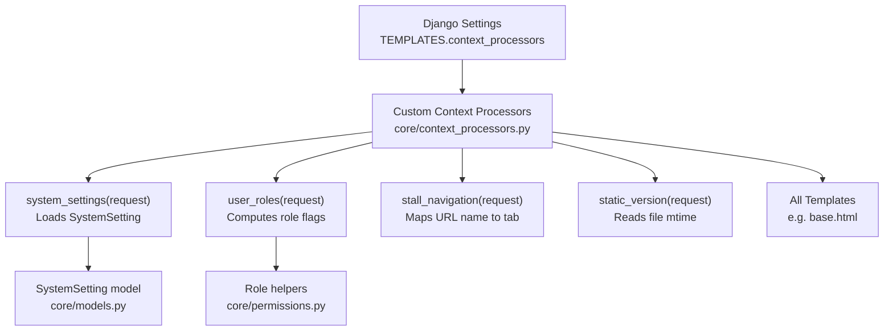
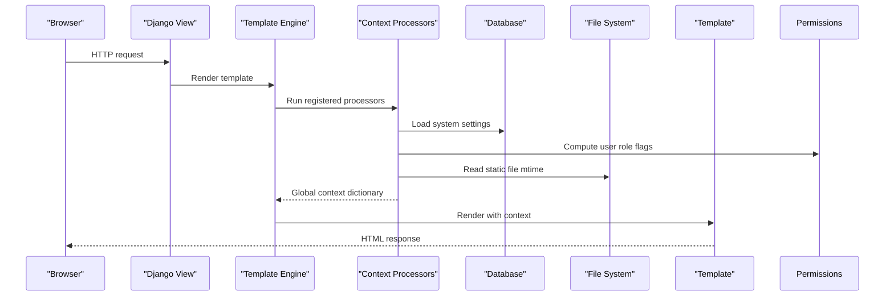
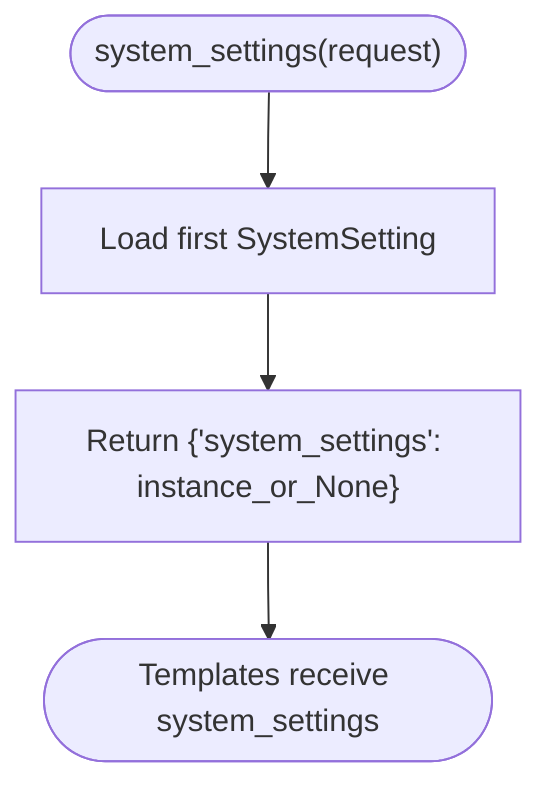
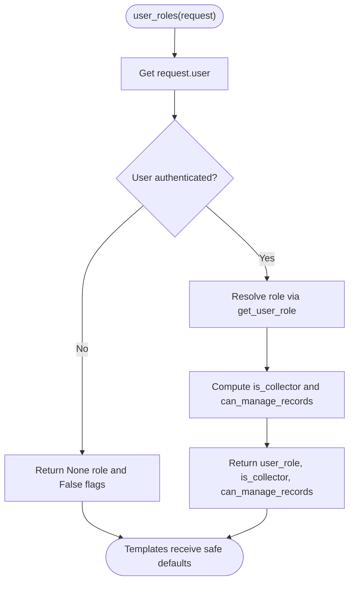
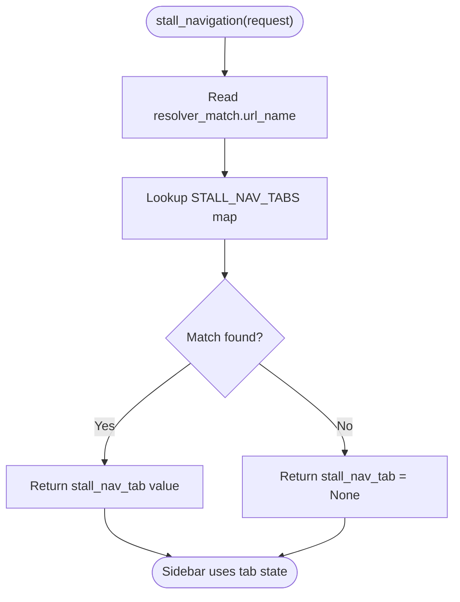
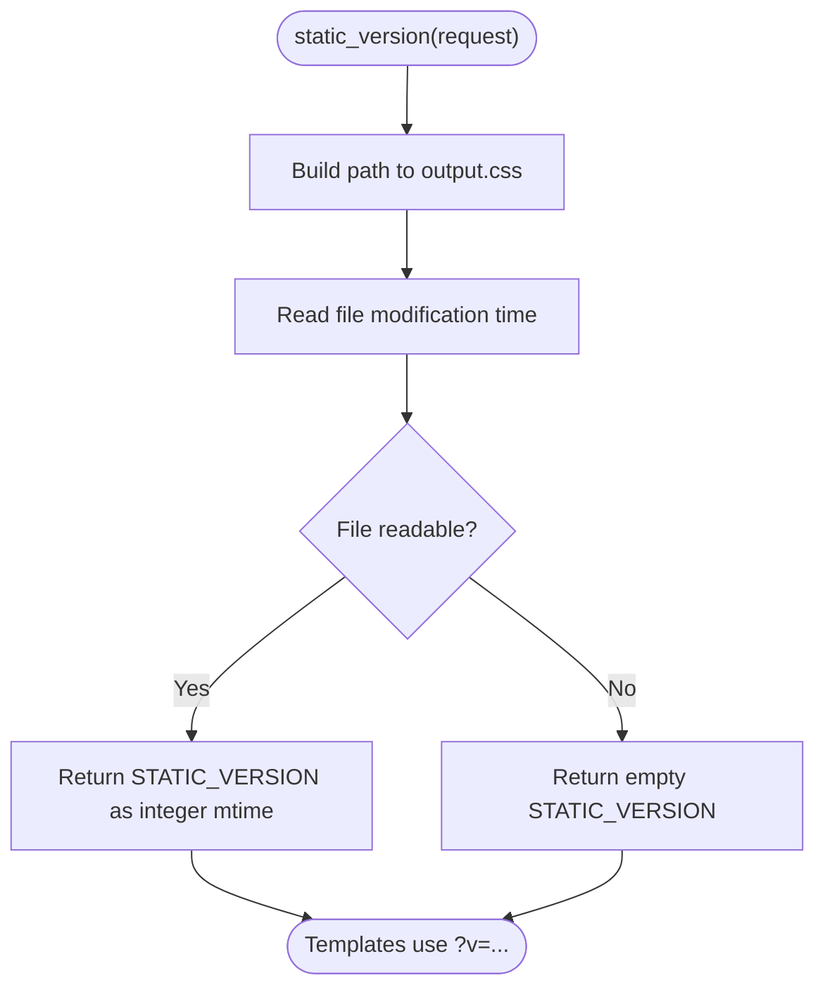
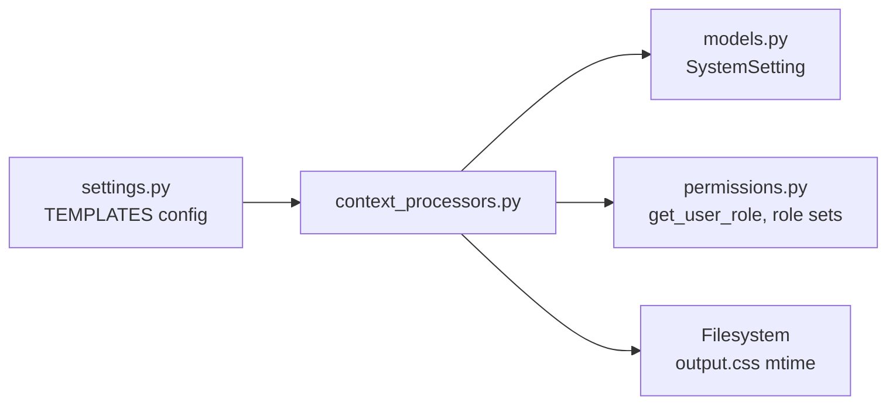

# Context Processors & Global Variables

<cite>
**Referenced Files in This Document**
- [context_processors.py](file://core/context_processors.py)
- [settings.py](file://market_rental/settings.py)
- [models.py](file://core/models.py)
- [permissions.py](file://core/permissions.py)
- [base.html](file://templates/base.html)
</cite>

## Table of Contents
1. [Introduction](#introduction)
2. [Project Structure](#project-structure)
3. [Core Components](#core-components)
4. [Architecture Overview](#architecture-overview)
5. [Detailed Component Analysis](#detailed-component-analysis)
6. [Dependency Analysis](#dependency-analysis)
7. [Performance Considerations](#performance-considerations)
8. [Troubleshooting Guide](#troubleshooting-guide)
9. [Conclusion](#conclusion)

## Introduction
This document explains how the application injects global variables into every rendered template through Django context processors. It focuses on:

- How context processors make system settings, user roles, navigation state, and static asset versions available everywhere.
- Why centralized context management improves consistency, security, and maintainability.
- How templates consume these variables.
- How to add a new context processor safely.
- Performance considerations for loading global data on every request.

Context processors are especially useful when the same information is needed across many views and templates without passing it explicitly from each view.

## Project Structure
The relevant implementation lives in four main places:

| Area | Responsibility |
| --- | --- |
| `core/context_processors.py` | Defines the custom context processors that expose global template variables. |
| `market_rental/settings.py` | Registers those processors so they run for every template render. |
| `core/models.py` | Defines the `SystemSetting` model used by the system settings processor. |
| `core/permissions.py` | Provides role helpers used by the user roles processor. |
| `templates/base.html` | Example template consuming the injected variables. |

**Diagram sources**
- [settings.py:53-70](file://market_rental/settings.py#L53-L70)
- [context_processors.py:9-88](file://core/context_processors.py#L9-L88)
- [models.py:42-68](file://core/models.py#L42-L68)
- [permissions.py:32-59](file://core/permissions.py#L32-L59)
- [base.html:10-12](file://templates/base.html#L10-L12)

**Section sources**
- [settings.py:53-70](file://market_rental/settings.py#L53-L70)
- [context_processors.py:1-89](file://core/context_processors.py#L1-L89)

## Core Components
The application registers four custom context processors:

| Processor | Injected Variable(s) | Purpose |
| --- | --- | --- |
| `system_settings` | `system_settings` | Loads the single active system configuration record so templates can display municipality, market, office, logo, theme color, penalty rules, and contract terms. |
| `user_roles` | `user_role`, `is_collector`, `can_manage_records` | Derives safe, template-friendly role flags from the current authenticated user. |
| `stall_navigation` | `stall_nav_tab` | Determines which Stalls sidebar group should be open and which sub-link should be highlighted. |
| `static_version` | `STATIC_VERSION` | Reads the modification time of the built CSS file so templates can append cache-busting query strings. |

These processors are registered centrally in the template engine configuration, so every template has access to them automatically.

**Section sources**
- [settings.py:53-70](file://market_rental/settings.py#L53-L70)
- [context_processors.py:9-88](file://core/context_processors.py#L9-L88)

## Architecture Overview
The request-to-template flow for context processing is straightforward:

**Diagram sources**
- [settings.py:53-70](file://market_rental/settings.py#L53-L70)
- [context_processors.py:9-88](file://core/context_processors.py#L9-L88)
- [models.py:42-68](file://core/models.py#L42-L68)
- [permissions.py:32-59](file://core/permissions.py#L32-L59)

## Detailed Component Analysis

### System Settings Processor
The `system_settings` processor loads the first `SystemSetting` record and exposes it as `system_settings`. This centralizes branding, penalties, grace periods, receipt prefixes, and contract terms so templates do not need to fetch or hard-code this data.

Key behaviors:
- Uses a simple database lookup for the first setting row.
- Returns `None` if no setting exists, allowing templates to provide defaults.
- Supports fields such as municipality name, market name, office name, logo, theme color, penalty type/value, grace period, and contract terms.

Template usage examples (described rather than shown):
- Displaying municipality and market names in headers.
- Rendering contract terms using a line-based filter.
- Applying default values when no system setting is configured.

**Diagram sources**
- [context_processors.py:9-11](file://core/context_processors.py#L9-L11)
- [models.py:42-68](file://core/models.py#L42-L68)

**Section sources**
- [context_processors.py:9-11](file://core/context_processors.py#L9-L11)
- [models.py:42-68](file://core/models.py#L42-L68)

### User Roles Processor
The `user_roles` processor computes three template-safe variables:

| Variable | Meaning |
| --- | --- |
| `user_role` | The authenticated user’s role string, or `None` for unauthenticated users. |
| `is_collector` | True only for field collectors who are not superusers. |
| `can_manage_records` | True for administrative roles or superusers. |

This design keeps UI logic out of views and lets templates decide whether to show administrative links, collection-only menus, or tenant-only sections.

**Diagram sources**
- [context_processors.py:14-29](file://core/context_processors.py#L14-L29)
- [permissions.py:32-59](file://core/permissions.py#L32-L59)

**Section sources**
- [context_processors.py:14-29](file://core/context_processors.py#L14-L29)
- [permissions.py:32-59](file://core/permissions.py#L32-L59)

### Stall Navigation Processor
The `stall_navigation` processor maps URL names to a small set of navigation states:

| State | Meaning |
| --- | --- |
| `list` | Stall list or related stall actions. |
| `add` | Adding stalls. |
| `sections` | Market section management. |
| `types` | Stall type management. |
| `None` | Outside the Stalls group. |

This allows the sidebar to stay open for the correct group and highlight exactly one sub-link per page.

**Diagram sources**
- [context_processors.py:39-73](file://core/context_processors.py#L39-L73)

**Section sources**
- [context_processors.py:32-73](file://core/context_processors.py#L32-L73)

### Static Version Processor
The `static_version` processor reads the modification time of the built CSS file and returns it as `STATIC_VERSION`. In development mode, templates append this value as a query string to force browsers to reload updated assets instead of serving stale cached copies.

**Diagram sources**
- [context_processors.py:76-88](file://core/context_processors.py#L76-L88)

**Section sources**
- [context_processors.py:76-88](file://core/context_processors.py#L76-L88)

### Template Usage Examples
Templates consume the injected variables directly. For example:

- `base.html` uses `STATIC_VERSION` to append cache-busting query strings to static assets.
- `base.html` displays municipality and market names from `system_settings`.
- Role-based templates use `can_manage_records` and `is_collector` to conditionally render administrative or collector-only navigation.

These usages demonstrate why centralized context is valuable: the same global data is consistently available without repeating logic in views.

**Section sources**
- [base.html:10-12](file://templates/base.html#L10-L12)
- [base.html:40-41](file://templates/base.html#L40-L41)

## Dependency Analysis
The context processors depend on several core modules:

| Processor | Dependencies |
| --- | --- |
| `system_settings` | `SystemSetting` model from `core.models`. |
| `user_roles` | `request.user`, `get_user_role`, and role sets from `core.permissions`. |
| `stall_navigation` | Request resolver match and an explicit URL-name-to-tab mapping. |
| `static_version` | Django settings `BASE_DIR` and the filesystem. |

**Diagram sources**
- [context_processors.py:3-6](file://core/context_processors.py#L3-L6)
- [settings.py:53-70](file://market_rental/settings.py#L53-L70)
- [models.py:42-68](file://core/models.py#L42-L68)
- [permissions.py:32-59](file://core/permissions.py#L32-L59)

**Section sources**
- [context_processors.py:1-89](file://core/context_processors.py#L1-L89)
- [settings.py:53-70](file://market_rental/settings.py#L53-L70)

## Performance Considerations
Global context processors run on every template render, so their cost adds up under load.

Current characteristics:

| Processor | Cost Profile | Notes |
| --- | --- | --- |
| `system_settings` | Database read | Always queries the first `SystemSetting`; could benefit from caching. |
| `user_roles` | Lightweight role computation | Depends on the authenticated user; minimal overhead. |
| `stall_navigation` | Dictionary lookup | Very cheap; depends on URL resolution. |
| `static_version` | Filesystem stat call | Reads file metadata once per request; may be unnecessary in production where static files are hashed. |

Recommendations:

1. **Cache system settings**: Cache the single `SystemSetting` object with a short-lived cache key tied to setting changes.
2. **Avoid expensive work in processors**: Keep processors focused on lightweight data preparation.
3. **Use conditional rendering in templates**: Do not perform heavy computations in templates just because data is globally available.
4. **Separate environment-specific behavior**: In production, consider skipping filesystem-based cache busting if static files already include content hashes.
5. **Monitor template render times**: If global data becomes expensive, profile template rendering and move logic to views or services where appropriate.

[No sources needed since this section provides general guidance]

## Troubleshooting Guide

### System Settings Not Showing
**Symptoms:**
- Municipality, market, or office names are missing or show defaults.
- Contract terms are blank.

**Likely causes:**
- No `SystemSetting` record exists.
- The record exists but required fields are empty.

**Actions:**
- Verify that at least one `SystemSetting` row exists.
- Check that fields like municipality name, market name, and office name are populated.
- Confirm templates use fallback defaults when `system_settings` is `None`.

**Section sources**
- [context_processors.py:9-11](file://core/context_processors.py#L9-L11)
- [models.py:42-68](file://core/models.py#L42-L68)

### Role-Based Navigation Missing
**Symptoms:**
- Administrative links do not appear for expected users.
- Collector-only pages are visible to other roles.

**Likely causes:**
- User does not have a proper profile role.
- Superuser handling differs from normal role checks.
- Template conditions rely on `can_manage_records` or `is_collector`.

**Actions:**
- Inspect the user’s profile role.
- Confirm `get_user_role` resolves correctly.
- Review template conditions using `can_manage_records` and `is_collector`.

**Section sources**
- [context_processors.py:14-29](file://core/context_processors.py#L14-L29)
- [permissions.py:32-59](file://core/permissions.py#L32-L59)

### Sidebar Not Highlighting Correctly
**Symptoms:**
- The Stalls group stays collapsed.
- The wrong sub-link appears active.

**Likely causes:**
- URL name is not mapped in `STALL_NAV_TABS`.
- Resolver match is unavailable or unexpected.

**Actions:**
- Add the URL name to the explicit mapping.
- Ensure the URL pattern has a meaningful `name` attribute.
- Check that `stall_nav_tab` is used for both group open state and active link highlighting.

**Section sources**
- [context_processors.py:32-73](file://core/context_processors.py#L32-L73)

### Static Assets Not Updating
**Symptoms:**
- Updated CSS is not reflected in the browser.
- Hard refresh is required.

**Likely causes:**
- `STATIC_VERSION` is empty.
- Built CSS file is missing or unreadable.
- Production static files already include content hashes.

**Actions:**
- Rebuild static assets so `output.css` exists.
- Verify the file path and permissions.
- In production, prefer hashed static filenames over query-string cache busting.

**Section sources**
- [context_processors.py:76-88](file://core/context_processors.py#L76-L88)

## Conclusion
Context processors provide a clean, centralized way to make global data available to all templates. In this project, they deliver:

- System-wide configuration through `system_settings`.
- Safe, template-friendly role flags through `user_roles`.
- Consistent sidebar state through `stall_navigation`.
- Reliable static asset cache busting through `static_version`.

Centralizing this logic reduces duplication, improves consistency, and makes it easier to evolve global behavior without changing every view. When adding new global data, follow the existing patterns: keep processors lightweight, document the injected variables clearly, and consider caching or environment-specific optimizations for performance.

[No sources needed since this section summarizes without analyzing specific files]