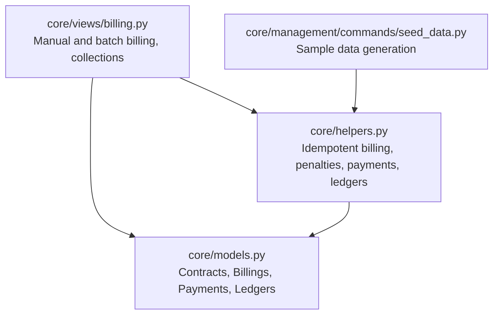
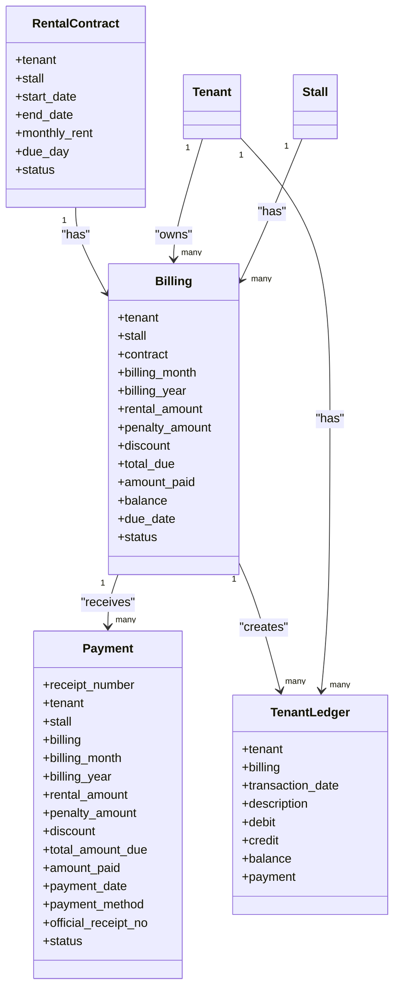
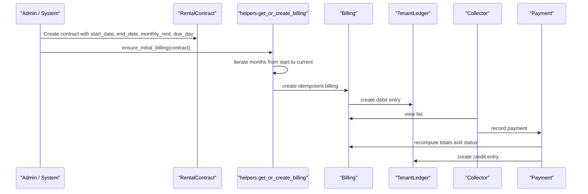
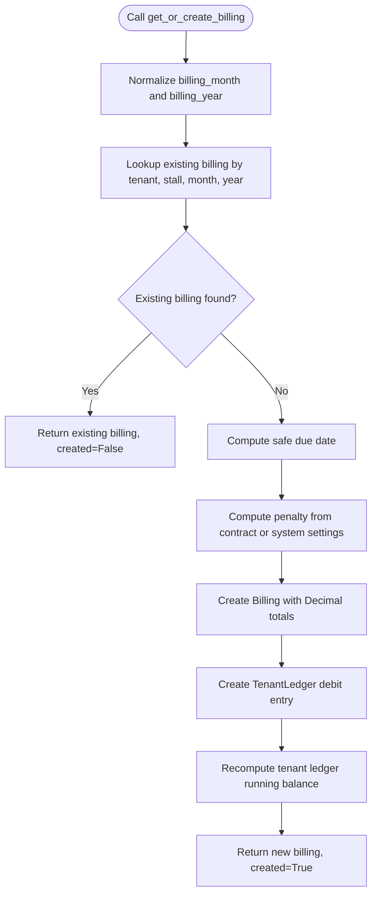
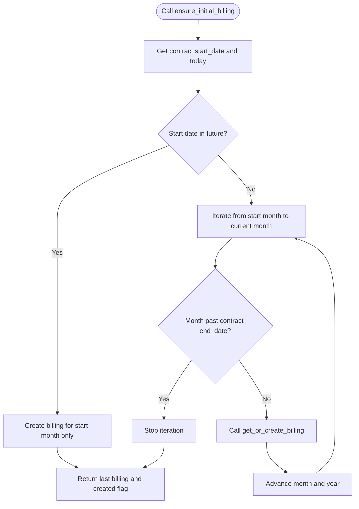
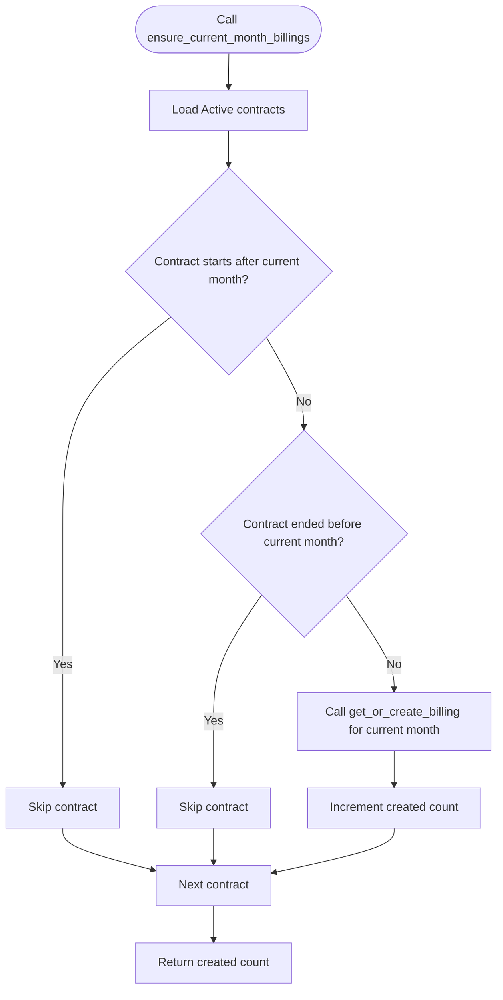
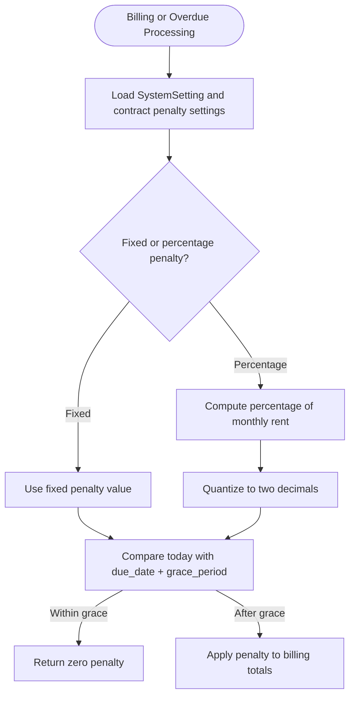
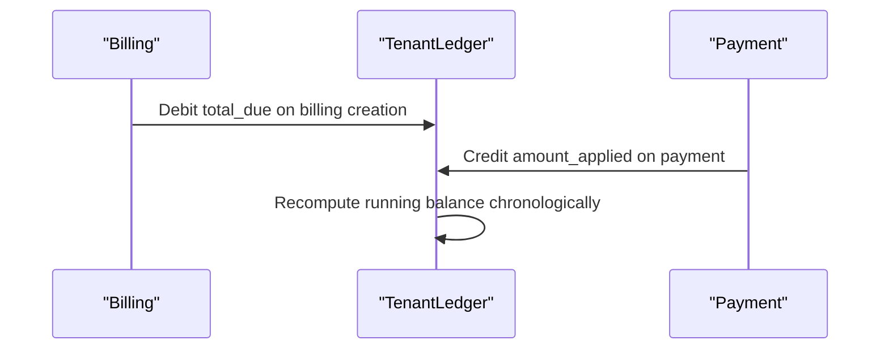
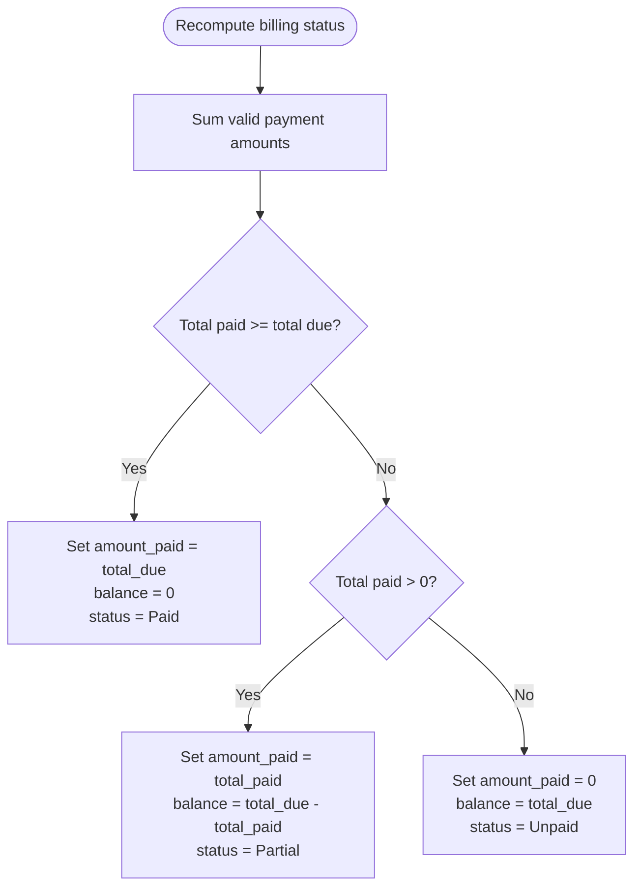
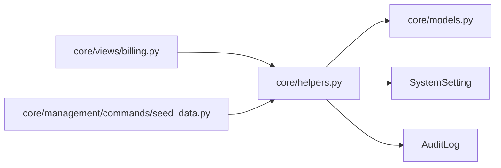

# Billing Generation & Management

<cite>
**Referenced Files in This Document**
- [core/models.py](file://core/models.py)
- [core/helpers.py](file://core/helpers.py)
- [core/views/billing.py](file://core/views/billing.py)
- [core/management/commands/seed_data.py](file://core/management/commands/seed_data.py)
</cite>

## Table of Contents
1. [Introduction](#introduction)
2. [Project Structure](#project-structure)
3. [Core Components](#core-components)
4. [Architecture Overview](#architecture-overview)
5. [Detailed Component Analysis](#detailed-component-analysis)
6. [Dependency Analysis](#dependency-analysis)
7. [Performance Considerations](#performance-considerations)
8. [Troubleshooting Guide](#troubleshooting-guide)
9. [Conclusion](#conclusion)

## Introduction
This document explains the billing generation and management logic used by the market rental system. It focuses on:

- Idempotent billing creation through `get_or_create_billing`.
- Automatic backfilling from contract start date through the current month via `ensure_initial_billing`.
- Maintenance of active contract billings for the current month through `ensure_current_month_billings`.
- Penalty integration during billing creation and overdue accrual.
- The relationship between billing records, payments, and tenant ledger entries.
- Decimal arithmetic precision and automatic status assignment based on payment amounts.

The goal is to make these flows understandable for both technical readers and non-technical users who need to understand how monthly rent billing works after a contract is created.

## Project Structure
Billing-related behavior lives primarily in three places:

| Area | Responsibility |
|---|---|
| Data models | Define `RentalContract`, `Billing`, `Payment`, `TenantLedger`, `SystemSetting`, and penalty configuration. |
| Helpers | Provide idempotent billing creation, initial billing backfill, current-month maintenance, payment recording, overdue penalty application, and ledger recomputation. |
| Views | Provide manual billing generation, bulk generation, collection workflows, grouping, printing, and export. |
| Seed command | Demonstrates programmatic use of `get_or_create_billing` when seeding sample data. |

**Diagram sources**
- [core/models.py:157-277](file://core/models.py#L157-L277)
- [core/helpers.py:155-500](file://core/helpers.py#L155-L500)
- [core/views/billing.py:174-315](file://core/views/billing.py#L174-L315)
- [core/management/commands/seed_data.py:389-396](file://core/management/commands/seed_data.py#L389-L396)

**Section sources**
- [core/models.py:157-277](file://core/models.py#L157-L277)
- [core/helpers.py:155-500](file://core/helpers.py#L155-L500)
- [core/views/billing.py:174-315](file://core/views/billing.py#L174-L315)
- [core/management/commands/seed_data.py:389-396](file://core/management/commands/seed_data.py#L389-L396)

## Core Components
The billing lifecycle depends on four main entities:

| Entity | Purpose | Key Fields | Important Constraints |
|---|---|---|---|
| `RentalContract` | Represents an active or historical rental agreement for a tenant and stall. | `tenant`, `stall`, `start_date`, `end_date`, `monthly_rent`, `due_day`, `status` | Enforces one active contract per stall. |
| `Billing` | Represents one monthly obligation for a tenant-stall period. | `billing_month`, `billing_year`, `rental_amount`, `penalty_amount`, `total_due`, `amount_paid`, `balance`, `due_date`, `status` | Unique constraint on tenant-stall-month-year. |
| `Payment` | Records money applied to a billing. | `receipt_number`, `billing`, `amount_paid`, `payment_date`, `payment_method`, `status` | Unique receipt number; linked to a billing. |
| `TenantLedger` | Tracks running debit/credit balance per tenant. | `debit`, `credit`, `balance`, `transaction_date`, `billing`, `payment` | Chronological running balance recomputed per tenant. |

**Diagram sources**
- [core/models.py:157-277](file://core/models.py#L157-L277)

**Section sources**
- [core/models.py:157-277](file://core/models.py#L157-L277)

## Architecture Overview
At a high level, billing generation follows this flow:

1. A contract is created with a start date, end date, monthly rent, and due day.
2. Initial billings are generated from the contract start month up to the current month.
3. For each billing, the system computes the due date, rental amount, and any applicable penalty.
4. A billing record is created with an initial ledger debit.
5. Payments reduce the billing balance and update the ledger credit chain.
6. Overdue penalties are applied after the grace period expires.
7. Billing status is automatically assigned as Unpaid, Partial, Paid, or Overdue based on balances and payment history.

**Diagram sources**
- [core/helpers.py:208-257](file://core/helpers.py#L208-L257)
- [core/helpers.py:155-205](file://core/helpers.py#L155-L205)
- [core/helpers.py:351-420](file://core/helpers.py#L351-L420)
- [core/models.py:157-277](file://core/models.py#L157-L277)

## Detailed Component Analysis

### Idempotent Billing Creation: `get_or_create_billing`
`get_or_create_billing` is the core function that creates a billing for a specific contract, month, and year without creating duplicates.

Key behaviors:

- Normalizes month and year to integers.
- Looks for an existing billing using tenant, stall, billing month, and billing year.
- Returns the existing billing if found, preventing duplicate billings.
- Computes due date safely, handling months where the configured due day exceeds the last calendar day.
- Computes penalty using contract-specific or system-wide settings.
- Creates the billing with:
  - `rental_amount` from contract monthly rent.
  - `penalty_amount` from penalty calculation.
  - `discount` initialized to zero.
  - `total_due` as rental plus penalty.
  - `amount_paid` initialized to zero.
  - `balance` initialized to total due.
  - `due_date` computed from contract due day.
  - `status` initialized to Unpaid.
- Creates a corresponding tenant ledger debit entry.
- Recomputes the tenant ledger running balance.

**Diagram sources**
- [core/helpers.py:155-205](file://core/helpers.py#L155-L205)
- [core/helpers.py:125-152](file://core/helpers.py#L125-L152)
- [core/helpers.py:260-273](file://core/helpers.py#L260-L273)

**Section sources**
- [core/helpers.py:155-205](file://core/helpers.py#L155-L205)
- [core/helpers.py:125-152](file://core/helpers.py#L125-L152)
- [core/helpers.py:260-273](file://core/helpers.py#L260-L273)

### Initial Billing Backfill: `ensure_initial_billing`
`ensure_initial_billing` ensures that a contract has billings from its start month up to the current month.

Key behaviors:

- If the contract start date is in the future, it creates only the start month.
- Otherwise, it iterates month-by-month from the contract start month to the current month.
- Skips months beyond the contract end date.
- Calls `get_or_create_billing` for each month, so repeated calls are safe.
- Returns the last processed billing and whether any new billing was created.
- Wraps execution in exception handling so failures do not break calling code.

**Diagram sources**
- [core/helpers.py:208-235](file://core/helpers.py#L208-L235)

**Section sources**
- [core/helpers.py:208-235](file://core/helpers.py#L208-L235)

### Current-Month Billing Maintenance: `ensure_current_month_billings`
`ensure_current_month_billings` guarantees that every Active contract has a billing for the current month and year.

Key behaviors:

- Iterates over all Active contracts.
- Skips contracts whose start month is in the future.
- Skips contracts whose end month is before the current month.
- Calls `get_or_create_billing` for the current month.
- Returns the count of newly created billings.
- Designed to be called frequently, such as when loading the billing list, because it is idempotent.

**Diagram sources**
- [core/helpers.py:238-257](file://core/helpers.py#L238-L257)

**Section sources**
- [core/helpers.py:238-257](file://core/helpers.py#L238-L257)

### Penalty Integration During Billing Creation
Penalties can be integrated at two points:

1. **Initial billing creation**: When `get_or_create_billing` creates a billing, it computes the penalty based on:
   - Contract-level penalty settings if active.
   - System-wide penalty settings otherwise.
   - Grace period rules.
   - Fixed or percentage penalty types.

2. **Overdue accrual**: When `apply_overdue_penalties` runs, it marks past-due billings as Overdue and applies a one-time penalty if none has been applied yet.

Important details:

- Penalties are calculated using `Decimal` arithmetic to avoid floating-point drift.
- Percentage penalties are quantized to two decimal places.
- Grace period delays penalty accrual until after the due date plus grace days.
- Overdue penalties are idempotent: they are only added while `penalty_amount` is zero.

**Diagram sources**
- [core/helpers.py:132-152](file://core/helpers.py#L132-L152)
- [core/helpers.py:423-500](file://core/helpers.py#L423-L500)

**Section sources**
- [core/helpers.py:132-152](file://core/helpers.py#L132-L152)
- [core/helpers.py:423-500](file://core/helpers.py#L423-L500)

### Relationship Between Billing Records and Tenant Ledger Entries
Every billing creation and payment affects the tenant ledger:

- **Billing creation**: Creates a debit entry representing the total due.
- **Payment creation**: Creates a credit entry representing the amount applied.
- **Ledger recomputation**: After changes, the system recalculates the running balance chronologically.

This design keeps the ledger consistent even when billings are edited, payments are voided, or penalties are applied later.

**Diagram sources**
- [core/helpers.py:195-205](file://core/helpers.py#L195-L205)
- [core/helpers.py:409-420](file://core/helpers.py#L409-L420)
- [core/helpers.py:260-273](file://core/helpers.py#L260-L273)

**Section sources**
- [core/helpers.py:195-205](file://core/helpers.py#L195-L205)
- [core/helpers.py:409-420](file://core/helpers.py#L409-L420)
- [core/helpers.py:260-273](file://core/helpers.py#L260-L273)

### Billing Lifecycle Examples

#### Example 1: Contract Creation Through Monthly Cycles
1. An admin creates a contract with:
   - Start date: January 2025.
   - End date: December 2025.
   - Monthly rent: fixed amount.
   - Due day: configured per contract or system setting.
2. `ensure_initial_billing` runs and creates billings for January through the current month.
3. Each billing has:
   - Correct due date.
   - Rental amount from contract.
   - Penalty amount if past grace period.
   - Initial ledger debit.
4. As months pass, `ensure_current_month_billings` ensures the current month billing exists.
5. Payments reduce balance and update status.

#### Example 2: Manual Billing Generation
The billing generation view supports manual creation for a selected tenant, contract, month, and year. It:

- Checks for an existing billing for that tenant-stall-month-year combination.
- Computes due date and penalty.
- Creates the billing.
- Creates a ledger debit.
- Logs an audit entry.

This path is useful for testing, corrections, or administrative backfill outside normal automation.

#### Example 3: Bulk Billing Generation
The bulk generation view creates billings for all Active contracts for a selected month and year. It:

- Skips months already billed.
- Computes due date and penalty per contract.
- Creates billings and ledger debits.
- Logs an audit entry.

#### Example 4: Collection and Status Assignment
When a collector collects payment:

- The system locks the billing row.
- Creates a payment record.
- Recomputes billing totals from valid payments.
- Assigns status:
  - Paid if total paid equals or exceeds total due.
  - Partial if some payment exists but balance remains.
  - Unpaid if no payment applied.
- Creates a ledger credit.
- Recomputes tenant ledger running balance.

**Section sources**
- [core/helpers.py:208-257](file://core/helpers.py#L208-L257)
- [core/views/billing.py:174-315](file://core/views/billing.py#L174-L315)
- [core/helpers.py:321-420](file://core/helpers.py#L321-L420)

### Decimal Arithmetic Precision
All financial calculations use Python’s `Decimal` type to avoid floating-point rounding errors.

Precision-sensitive areas include:

| Operation | Precision Handling |
|---|---|
| Rental amount | Converted from contract field to `Decimal`. |
| Penalty amount | Quantized to two decimal places for percentage penalties. |
| Total due | Sum of rental and penalty, quantized to two decimals. |
| Amount paid | Clamped and quantized to two decimals. |
| Balance | Computed as total due minus amount paid, quantized to two decimals. |
| Ledger running balance | Accumulated with `Decimal` and quantized per row. |

This approach ensures that displayed totals, receipts, reports, and database values remain financially accurate.

**Section sources**
- [core/helpers.py:176-178](file://core/helpers.py#L176-L178)
- [core/helpers.py:150-152](file://core/helpers.py#L150-L152)
- [core/helpers.py:368-368](file://core/helpers.py#L368-L368)
- [core/helpers.py:341-341](file://core/helpers.py#L341-L341)
- [core/helpers.py:267-270](file://core/helpers.py#L267-L270)

### Automatic Status Assignment Based on Payment Amounts
Billing status is determined authoritatively by comparing total paid amounts against total due:

| Condition | Resulting Status |
|---|---|
| Total paid equals or exceeds total due | Paid |
| Some payment exists but balance remains | Partial |
| No payment applied | Unpaid |
| Past due date plus grace period with outstanding balance | Overdue |

Status updates occur:

- After payment recording through `recalc_billing_from_payments`.
- During overdue processing through `apply_overdue_penalties`.

**Diagram sources**
- [core/helpers.py:321-348](file://core/helpers.py#L321-L348)

**Section sources**
- [core/helpers.py:321-348](file://core/helpers.py#L321-L348)

## Dependency Analysis
The billing system has clear layering:

- Views depend on helpers for business logic.
- Helpers depend on models for persistence.
- Seed command demonstrates helper usage during data setup.
- Overdue penalty application integrates with system settings and audit logging.

**Diagram sources**
- [core/views/billing.py:16-22](file://core/views/billing.py#L16-L22)
- [core/helpers.py:15-15](file://core/helpers.py#L15-L15)
- [core/management/commands/seed_data.py:389-396](file://core/management/commands/seed_data.py#L389-L396)

**Section sources**
- [core/views/billing.py:16-22](file://core/views/billing.py#L16-L22)
- [core/helpers.py:15-15](file://core/helpers.py#L15-L15)
- [core/management/commands/seed_data.py:389-396](file://core/management/commands/seed_data.py#L389-L396)

## Performance Considerations
- **Idempotency**: `get_or_create_billing` prevents duplicate work and duplicate rows.
- **Unique constraints**: The billing unique constraint on tenant-stall-month-year protects data integrity under concurrent access.
- **Row locking**: Payment recording uses `select_for_update` to prevent race conditions when multiple collectors settle the same billing.
- **Ledger recomputation**: Running balances are recomputed only when needed, reducing unnecessary writes.
- **Throttled overdue processing**: Overdue penalty application is cached per day to avoid repeated heavy scans.
- **Query optimization**: Views use `select_related` to reduce N+1 queries when rendering billing lists and grouped collections.

[No sources needed since this section provides general guidance]

## Troubleshooting Guide

### Duplicate Billing Appears
**Likely cause**: A manual billing generator bypassed the unique constraint check or used inconsistent tenant/still/month/year values.

**What to check**:
- Verify the tenant-stall-month-year combination.
- Confirm that `unique_together` includes tenant, stall, billing month, and billing year.
- Prefer `get_or_create_billing` for programmatic creation.

**Section sources**
- [core/models.py:213-215](file://core/models.py#L213-L215)
- [core/helpers.py:167-172](file://core/helpers.py#L167-L172)

### Billing Not Created for Current Month
**Likely cause**: Contract start month is in the future, contract ended before current month, or billing generation was not triggered.

**What to check**:
- Contract status is Active.
- Contract start month is not after current month.
- Contract end month is not before current month.
- `ensure_current_month_billings` is called during billing list or print/export workflows.

**Section sources**
- [core/helpers.py:238-257](file://core/helpers.py#L238-L257)
- [core/views/billing.py:62-70](file://core/views/billing.py#L62-L70)

### Penalty Not Applied
**Likely cause**:
- Grace period still active.
- No active penalty settings on contract or system.
- Penalty already applied.

**What to check**:
- Due date plus grace period has passed.
- Contract has active penalty settings or system settings exist.
- `penalty_amount` is zero before applying overdue penalties.

**Section sources**
- [core/helpers.py:132-152](file://core/helpers.py#L132-L152)
- [core/helpers.py:423-500](file://core/helpers.py#L423-L500)

### Ledger Balance Incorrect After Edit or Payment
**Likely cause**: A change was made without recomputing the tenant ledger.

**What to check**:
- Editing a billing should trigger ledger recomputation.
- Payment recording always recomputes ledger balances.
- Overdue penalty application recomputes affected tenants.

**Section sources**
- [core/helpers.py:260-273](file://core/helpers.py#L260-L273)
- [core/helpers.py:409-420](file://core/helpers.py#L409-L420)
- [core/helpers.py:498-499](file://core/helpers.py#L498-L499)

### Rounding Differences in Totals
**Likely cause**: Non-Decimal arithmetic or missing quantization.

**What to check**:
- All monetary fields use `Decimal`.
- Percentage penalties are quantized.
- Balances are quantized after subtraction.

**Section sources**
- [core/helpers.py:150-152](file://core/helpers.py#L150-L152)
- [core/helpers.py:176-178](file://core/helpers.py#L176-L178)
- [core/helpers.py:341-341](file://core/helpers.py#L341-L341)

## Conclusion
The billing generation and management system is built around idempotent creation, strict uniqueness, Decimal precision, and consistent ledger tracking. `get_or_create_billing` ensures no duplicate billings exist for the same tenant-stall-month combination. `ensure_initial_billing` backfills billings from contract start to the current month, while `ensure_current_month_billings` maintains active contract billings for the current period. Penalties integrate naturally during billing creation and overdue processing, and billing status is automatically derived from payment totals. Together, these components provide a reliable foundation for monthly rental billing, collection, reporting, and auditability.