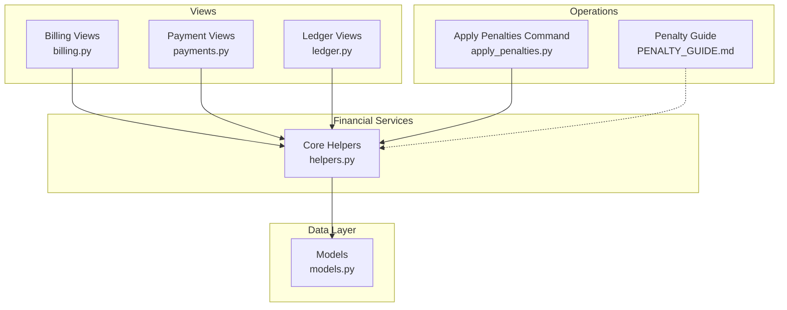
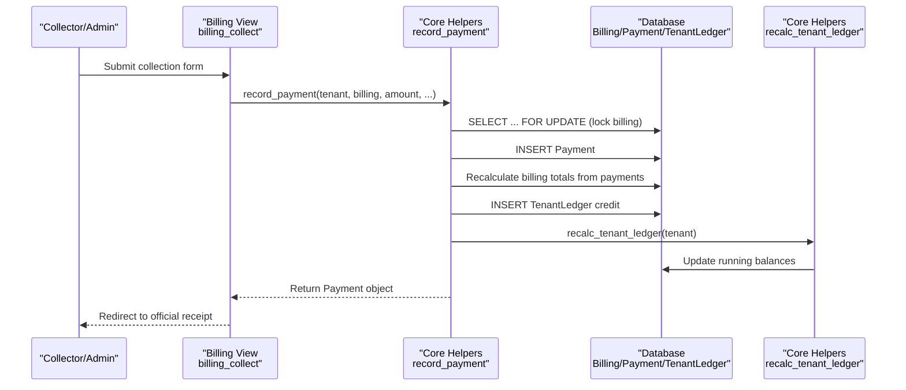
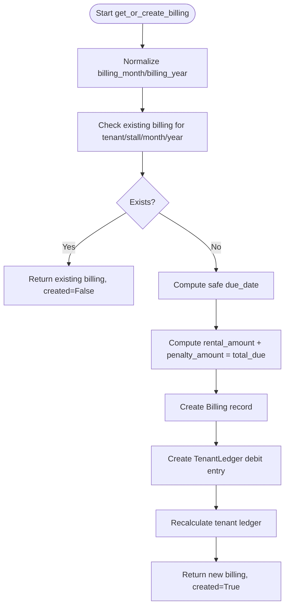
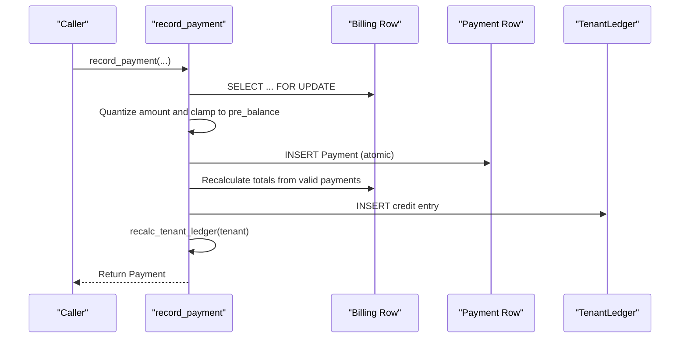
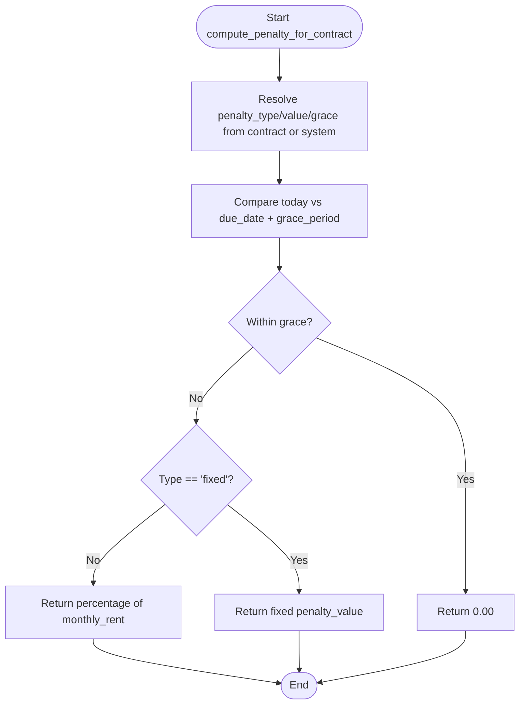
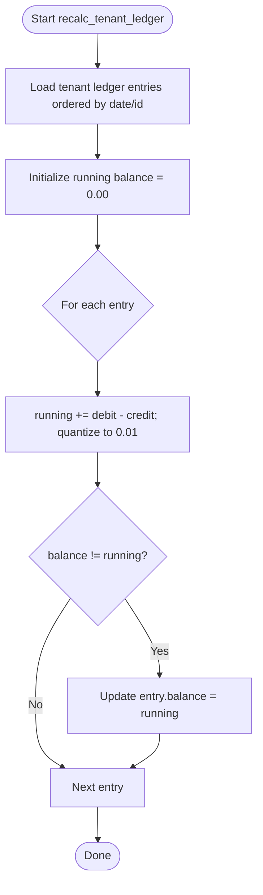
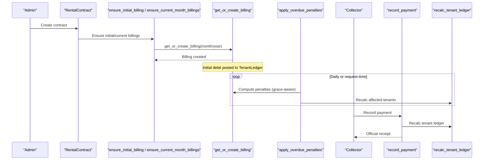
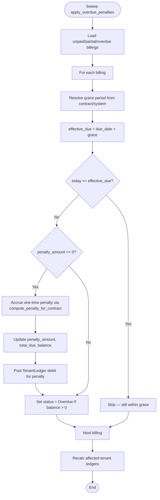
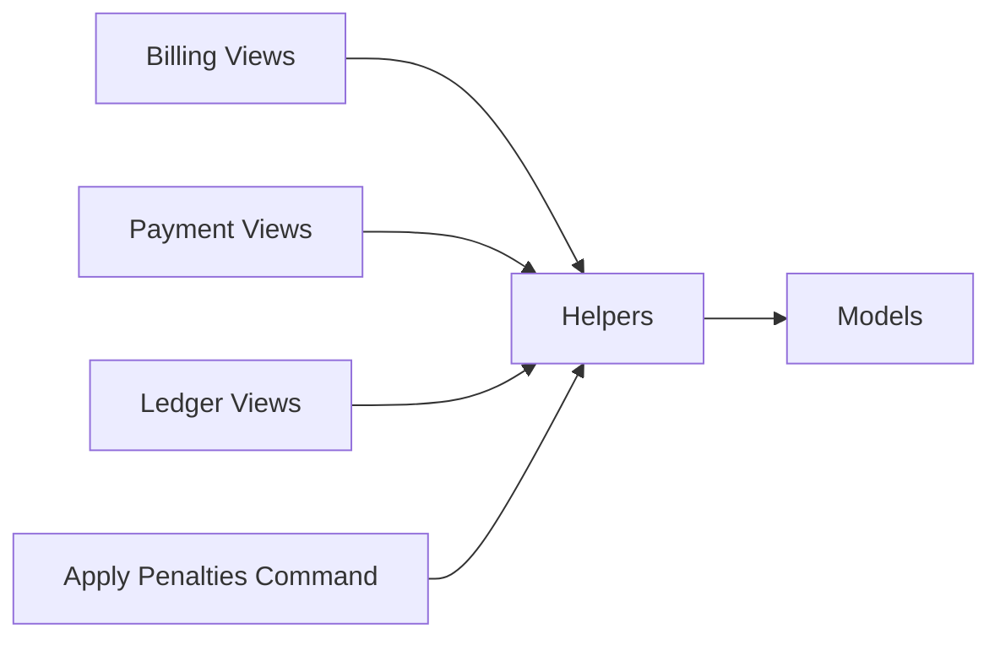

# Financial Operations & Calculations

<cite>
**Referenced Files in This Document**
- [core/helpers.py](file://core/helpers.py)
- [core/models.py](file://core/models.py)
- [core/views/billing.py](file://core/views/billing.py)
- [core/views/payments.py](file://core/views/payments.py)
- [core/views/ledger.py](file://core/views/ledger.py)
- [core/management/commands/apply_penalties.py](file://core/management/commands/apply_penalties.py)
- [PENALTY_GUIDE.md](file://PENALTY_GUIDE.md)
</cite>

## Table of Contents
1. [Introduction](#introduction)
2. [Project Structure](#project-structure)
3. [Core Components](#core-components)
4. [Architecture Overview](#architecture-overview)
5. [Detailed Component Analysis](#detailed-component-analysis)
6. [Dependency Analysis](#dependency-analysis)
7. [Performance Considerations](#performance-considerations)
8. [Troubleshooting Guide](#troubleshooting-guide)
9. [Conclusion](#conclusion)

## Introduction
This document explains the financial operations and calculations module that powers billing generation, payment recording, penalty computation, and tenant ledger management. It focuses on:
- Billing lifecycle from contract creation to payment settlement.
- Penalty calculation with grace periods and idempotent accrual.
- Running balance recalculation for auditability.
- Decimal arithmetic for financial precision.
- Transaction atomicity and concurrency control using `select_for_update`.
- The single source of truth pattern for financial data consistency.
- Error recovery mechanisms such as retry loops and best-effort throttling.

The goal is to make these financial workflows understandable for both technical and non-technical readers while preserving implementation accuracy.

## Project Structure
The financial logic is primarily implemented in a shared helper module and consumed by views and management commands. The key files are:
- `core/helpers.py`: Core financial functions including billing, payments, penalties, and ledger recalculation.
- `core/models.py`: Data models for tenants, contracts, billings, payments, ledgers, settings, and audit logs.
- `core/views/billing.py`: Collector and admin workflows for generating billings and collecting payments.
- `core/views/payments.py`: Payment entry, editing, voiding, and receipt printing.
- `core/views/ledger.py`: Tenant-ledger listing and reporting.
- `core/management/commands/apply_penalties.py`: CLI command to apply overdue penalties.
- `PENALTY_GUIDE.md`: Plain-English explanation of penalty rules and behavior.

**Diagram sources**
- [core/views/billing.py:18-22](file://core/views/billing.py#L18-L22)
- [core/views/payments.py:15-18](file://core/views/payments.py#L15-L18)
- [core/views/ledger.py:8-9](file://core/views/ledger.py#L8-L9)
- [core/management/commands/apply_penalties.py:1-14](file://core/management/commands/apply_penalties.py#L1-L14)
- [core/helpers.py:15-15](file://core/helpers.py#L15-L15)
- [PENALTY_GUIDE.md:202-213](file://PENALTY_GUIDE.md#L202-L213)

**Section sources**
- [core/helpers.py:1-595](file://core/helpers.py#L1-L595)
- [core/models.py:1-336](file://core/models.py#L1-L336)
- [core/views/billing.py:1-765](file://core/views/billing.py#L1-L765)
- [core/views/payments.py:1-653](file://core/views/payments.py#L1-L653)
- [core/views/ledger.py:1-183](file://core/views/ledger.py#L1-L183)
- [core/management/commands/apply_penalties.py:1-14](file://core/management/commands/apply_penalties.py#L1-L14)
- [PENALTY_GUIDE.md:1-221](file://PENALTY_GUIDE.md#L1-L221)

## Core Components
This section documents the core financial functions and their responsibilities.

- Billing generation (`get_or_create_billing`): Idempotent creation of monthly billings per contract, computing due dates, rental amounts, penalties, totals, and initial ledger entries. It ensures no duplicate billings exist for the same tenant, stall, month, and year.
- Payment recording (`record_payment`): Single source of truth for posting a payment. It locks the target billing row, creates a unique payment record, recomputes billing totals authoritatively, posts a ledger credit, and recalculates the running tenant ledger balance.
- Penalty computation (`compute_penalty_for_contract`): Centralized formula resolver that determines whether a late penalty applies based on system or contract-specific settings, grace period, and due date.
- Ledger management (`recalc_tenant_ledger`): Recomputes running balances across all ledger entries for a tenant in chronological order, ensuring debit/credit chain consistency after edits, voids, or penalties.

Key design principles:
- Decimal arithmetic throughout to avoid floating-point drift.
- Transaction atomicity around critical financial writes.
- Concurrency safety via `select_for_update` on billing rows.
- Idempotency guards to prevent double-charging penalties and duplicate billings.
- Single source of truth for billing state derived from valid payments.

**Section sources**
- [core/helpers.py:132-152](file://core/helpers.py#L132-L152)
- [core/helpers.py:155-205](file://core/helpers.py#L155-L205)
- [core/helpers.py:321-348](file://core/helpers.py#L321-L348)
- [core/helpers.py:351-420](file://core/helpers.py#L351-L420)
- [core/helpers.py:260-273](file://core/helpers.py#L260-L273)

## Architecture Overview
The financial architecture follows a service-oriented approach where views orchestrate user interactions and delegate financial operations to `core.helpers`. Models represent the authoritative data store, and management commands trigger background-like processes (e.g., penalty accrual).

**Diagram sources**
- [core/views/billing.py:415-489](file://core/views/billing.py#L415-L489)
- [core/helpers.py:351-420](file://core/helpers.py#L351-L420)
- [core/helpers.py:321-348](file://core/helpers.py#L321-L348)
- [core/helpers.py:260-273](file://core/helpers.py#L260-L273)

## Detailed Component Analysis

### Billing Generation: `get_or_create_billing`
Responsibilities:
- Normalize billing month/year and locate existing billing records.
- Compute due date safely, handling month-end edge cases.
- Calculate rental amount, penalty amount, total due, and initial balance.
- Create the billing record and an initial ledger debit entry.
- Recalculate the tenant ledger to maintain consistent running balances.

Concurrency and idempotency:
- Uses database-level uniqueness constraints to prevent duplicates.
- Safe for concurrent calls because it checks existence before creating.

Decimal usage:
- All monetary values are converted to `Decimal` and quantized to two decimal places.

**Diagram sources**
- [core/helpers.py:155-205](file://core/helpers.py#L155-L205)
- [core/helpers.py:125-129](file://core/helpers.py#L125-L129)
- [core/helpers.py:132-152](file://core/helpers.py#L132-L152)

**Section sources**
- [core/helpers.py:155-205](file://core/helpers.py#L155-L205)
- [core/helpers.py:125-129](file://core/helpers.py#L125-L129)
- [core/helpers.py:132-152](file://core/helpers.py#L132-L152)

### Payment Recording: `record_payment`
Responsibilities:
- Clamp payment amount to outstanding balance to prevent over-settlement.
- Lock the target billing row with `select_for_update`.
- Generate a unique receipt number and create the payment record within an atomic transaction.
- Recompute billing totals authoritatively from all valid payments.
- Post a ledger credit reflecting the actual applied amount.
- Recalculate the tenant ledger running balance.

Concurrency and error recovery:
- Retries receipt number generation up to five times on integrity errors.
- Ensures billing state is always derived from valid payments, not cached fields.

**Diagram sources**
- [core/helpers.py:351-420](file://core/helpers.py#L351-L420)
- [core/helpers.py:321-348](file://core/helpers.py#L321-L348)

**Section sources**
- [core/helpers.py:351-420](file://core/helpers.py#L351-L420)
- [core/helpers.py:321-348](file://core/helpers.py#L321-L348)

### Penalty Computation: `compute_penalty_for_contract`
Responsibilities:
- Resolve penalty settings from contract overrides or system defaults.
- Determine grace period and effective due date.
- Apply fixed or percentage penalty formulas only after grace period expires.
- Return zero if no penalty applies.

Idempotency:
- Called during billing creation and penalty accrual; repeated runs do not compound penalties because accrual is guarded by checking current `penalty_amount`.

**Diagram sources**
- [core/helpers.py:132-152](file://core/helpers.py#L132-L152)

**Section sources**
- [core/helpers.py:132-152](file://core/helpers.py#L132-L152)
- [PENALTY_GUIDE.md:15-25](file://PENALTY_GUIDE.md#L15-L25)
- [PENALTY_GUIDE.md:44-63](file://PENALTY_GUIDE.md#L44-L63)

### Ledger Management: `recalc_tenant_ledger`
Responsibilities:
- Iterate through tenant ledger entries in chronological order.
- Compute running balance as cumulative debits minus credits.
- Update any stale balance fields to ensure consistency.

Usage:
- Invoked after billing creation, payment recording, and penalty accrual.
- Ensures the ledger remains a reliable audit trail even after edits or voids.

**Diagram sources**
- [core/helpers.py:260-273](file://core/helpers.py#L260-L273)

**Section sources**
- [core/helpers.py:260-273](file://core/helpers.py#L260-L273)

### Billing Lifecycle: Contract Creation to Payment Settlement
End-to-end flow:
1. Contract creation triggers initial billing generation for relevant months.
2. Billings are auto-created for active contracts at list entry points.
3. Overdue penalties are applied after grace periods expire.
4. Collectors record payments through a single source of truth function.
5. Payments update billing totals and post ledger credits.
6. Ledgers are recalculated to reflect accurate running balances.

**Diagram sources**
- [core/helpers.py:208-257](file://core/helpers.py#L208-L257)
- [core/helpers.py:155-205](file://core/helpers.py#L155-L205)
- [core/helpers.py:423-500](file://core/helpers.py#L423-L500)
- [core/helpers.py:351-420](file://core/helpers.py#L351-L420)
- [core/helpers.py:260-273](file://core/helpers.py#L260-L273)

**Section sources**
- [core/helpers.py:208-257](file://core/helpers.py#L208-L257)
- [core/helpers.py:155-205](file://core/helpers.py#L155-L205)
- [core/helpers.py:423-500](file://core/helpers.py#L423-L500)
- [core/helpers.py:351-420](file://core/helpers.py#L351-L420)
- [core/helpers.py:260-273](file://core/helpers.py#L260-L273)

### Penalty Calculation Algorithms with Grace Periods
Key behaviors:
- Penalty applies only after `today > due_date + grace_period`.
- Supports fixed and percentage penalty types.
- One-time charge per billing; repeated sweeps do not compound.
- System defaults can be overridden per contract.

Operational notes:
- The sweep marks billings overdue and accrues penalties when conditions are met.
- A throttled trigger ensures at most one run per day per cache instance.

**Diagram sources**
- [core/helpers.py:423-500](file://core/helpers.py#L423-L500)
- [core/helpers.py:132-152](file://core/helpers.py#L132-L152)

**Section sources**
- [core/helpers.py:423-500](file://core/helpers.py#L423-L500)
- [core/helpers.py:132-152](file://core/helpers.py#L132-L152)
- [PENALTY_GUIDE.md:29-40](file://PENALTY_GUIDE.md#L29-L40)
- [PENALTY_GUIDE.md:131-140](file://PENALTY_GUIDE.md#L131-L140)

### Running Balance Recalculation
Purpose:
- Maintain a consistent running balance across all ledger entries for a tenant.
- Correct stale balances after edits, voids, or penalty accruals.

Algorithm:
- Order entries chronologically.
- Accumulate debits and credits to compute running balance.
- Update any mismatched balance fields.

**Section sources**
- [core/helpers.py:260-273](file://core/helpers.py#L260-L273)

## Dependency Analysis
The financial module has clear dependencies between views, helpers, and models. Views depend on helpers for financial operations; helpers depend on models for persistence.

**Diagram sources**
- [core/views/billing.py:18-22](file://core/views/billing.py#L18-L22)
- [core/views/payments.py:15-18](file://core/views/payments.py#L15-L18)
- [core/views/ledger.py:8-9](file://core/views/ledger.py#L8-L9)
- [core/management/commands/apply_penalties.py:1-14](file://core/management/commands/apply_penalties.py#L1-L14)
- [core/helpers.py:15-15](file://core/helpers.py#L15-L15)

**Section sources**
- [core/views/billing.py:18-22](file://core/views/billing.py#L18-L22)
- [core/views/payments.py:15-18](file://core/views/payments.py#L15-L18)
- [core/views/ledger.py:8-9](file://core/views/ledger.py#L8-L9)
- [core/management/commands/apply_penalties.py:1-14](file://core/management/commands/apply_penalties.py#L1-L14)
- [core/helpers.py:15-15](file://core/helpers.py#L15-L15)

## Performance Considerations
- Use `select_related` in views to reduce N+1 queries when loading related entities like tenants, stalls, and contracts.
- Batch operations should minimize repeated ledger recalculations; prefer targeted recalculations for affected tenants.
- Receipt number generation scans existing records; consider indexing by prefix patterns if volume grows significantly.
- Penalty sweeps iterate billings; ensure appropriate filtering and indexes on status, due_date, and billing_month/year.

[No sources needed since this section provides general guidance]

## Troubleshooting Guide
Common issues and resolutions:
- Duplicate billings: Ensure `get_or_create_billing` is used instead of direct inserts; verify unique constraints on tenant/stall/month/year.
- Incorrect billing totals: Always use `recalc_billing_from_payments` to derive totals from valid payments; avoid manual updates to `amount_paid` or `balance`.
- Stale ledger balances: Call `recalc_tenant_ledger` after any edit, void, or penalty accrual.
- Double penalties: Confirm idempotency guard in `apply_overdue_penalties`; check that `penalty_amount` is non-zero after first accrual.
- Concurrency conflicts: Ensure payment collection uses `select_for_update` on billing rows; wrap critical sections in `transaction.atomic`.
- Receipt collisions: `record_payment` retries receipt number generation up to five times on integrity errors.

**Section sources**
- [core/helpers.py:351-420](file://core/helpers.py#L351-L420)
- [core/helpers.py:423-500](file://core/helpers.py#L423-L500)
- [core/helpers.py:321-348](file://core/helpers.py#L321-L348)
- [core/helpers.py:260-273](file://core/helpers.py#L260-L273)

## Conclusion
The financial operations module enforces precision, consistency, and reliability through:
- Decimal arithmetic for all monetary calculations.
- Transactional atomicity and row-level locking to handle concurrency safely.
- Idempotent billing and penalty processes to prevent duplicate charges.
- A single source of truth for billing state derived from valid payments.
- Robust ledger recalculation to maintain auditability.

These patterns collectively ensure that billing generation, payment recording, penalty computation, and ledger management remain consistent under real-world operational conditions.