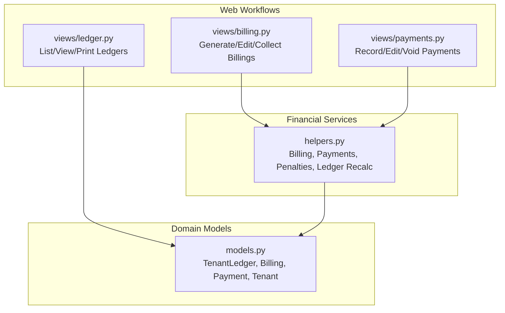
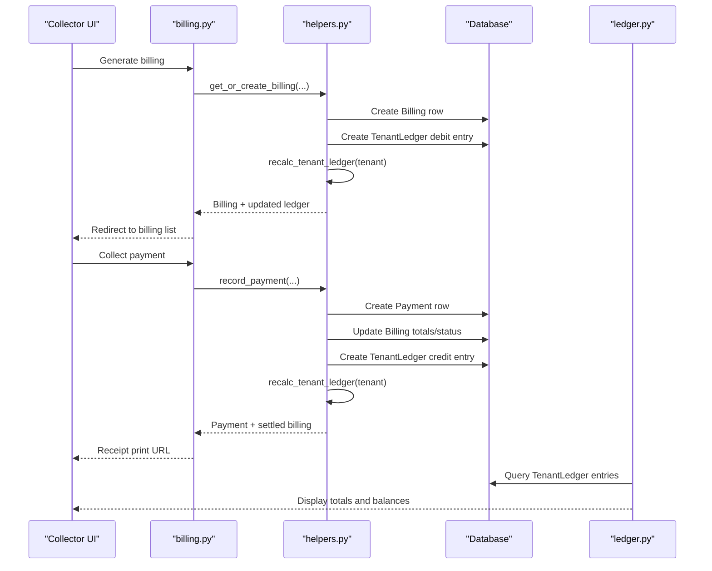
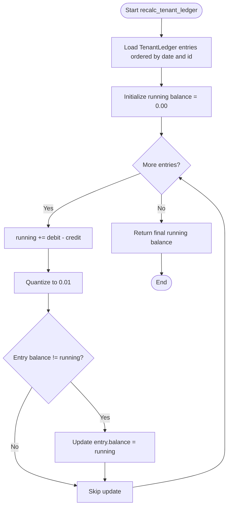
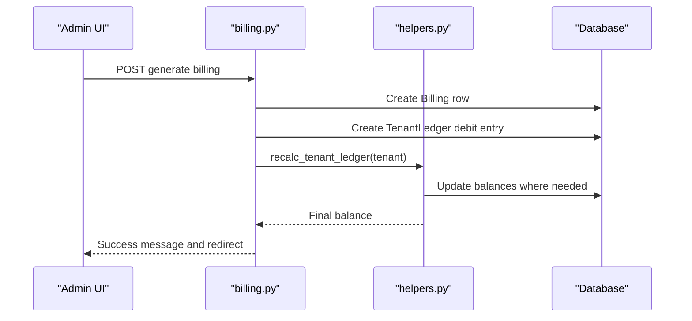
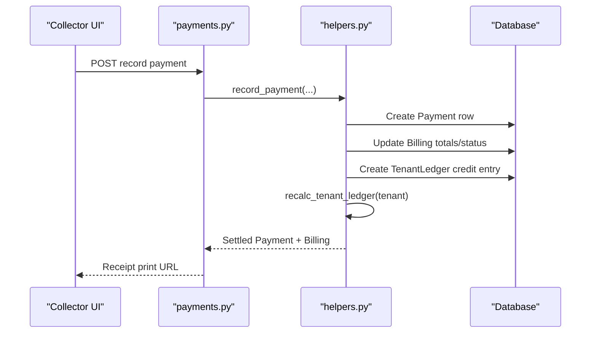
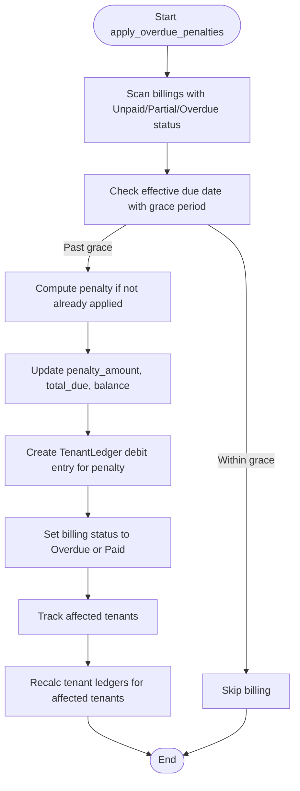
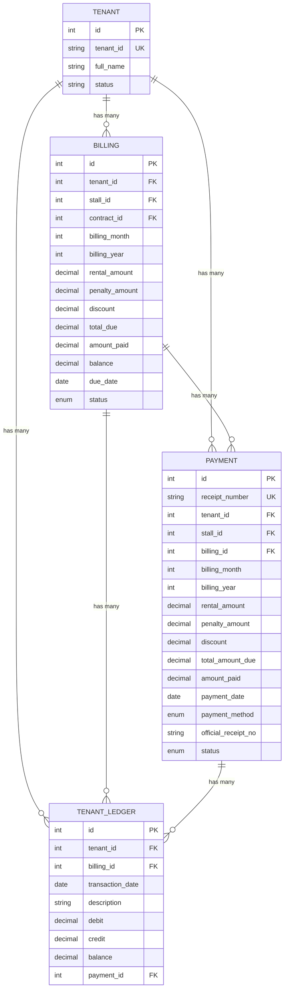
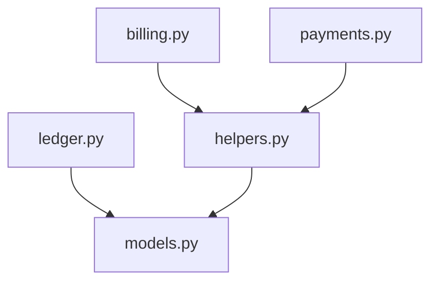

# Ledger Management & Balance Calculation

<cite>
**Referenced Files in This Document**
- [helpers.py](file://core/helpers.py)
- [models.py](file://core/models.py)
- [billing.py](file://core/views/billing.py)
- [payments.py](file://core/views/payments.py)
- [ledger.py](file://core/views/ledger.py)
- [test_seed_data.py](file://core/test_seed_data.py)
</cite>

## Table of Contents
1. [Introduction](#introduction)
2. [Project Structure](#project-structure)
3. [Core Components](#core-components)
4. [Architecture Overview](#architecture-overview)
5. [Detailed Component Analysis](#detailed-component-analysis)
6. [Dependency Analysis](#dependency-analysis)
7. [Performance Considerations](#performance-considerations)
8. [Troubleshooting Guide](#troubleshooting-guide)
9. [Conclusion](#conclusion)

## Introduction
This document explains the ledger management and running balance calculation system used by the market rental application. It focuses on how tenant-ledger entries are created, how `recalc_tenant_ledger` recomputes chronological running balances, and how billing transactions, payment credits, and penalty debits remain consistent across the accounting system. It also covers Decimal precision, automatic correction when entries are edited or voided, performance considerations for large tenant histories, and integration points with billing, payments, penalties, reporting, and audit operations.

## Project Structure
The ledger logic is primarily implemented in the core financial helpers and views:

- `core.helpers`: Central financial services including billing creation, payment recording, overdue penalty accrual, and ledger recalculation.
- `core.models`: Database models for tenants, contracts, billings, payments, and tenant-ledger entries.
- `core.views.billing`: Billing generation, editing, collection, and batch collection workflows that create debit ledger entries and trigger recalculation.
- `core.views.payments`: Payment recording, editing, and voiding workflows that create credit ledger entries and trigger recalculation.
- `core.views.ledger`: Ledger listing, viewing, printing, and PDF export endpoints that display computed totals and balances.

**Diagram sources**
- [helpers.py:155-205](file://core/helpers.py#L155-L205)
- [helpers.py:321-420](file://core/helpers.py#L321-L420)
- [helpers.py:423-500](file://core/helpers.py#L423-L500)
- [models.py:190-278](file://core/models.py#L190-L278)
- [billing.py:174-246](file://core/views/billing.py#L174-L246)
- [billing.py:373-412](file://core/views/billing.py#L373-L412)
- [payments.py:250-294](file://core/views/payments.py#L250-L294)
- [payments.py:460-550](file://core/views/payments.py#L460-L550)
- [ledger.py:51-82](file://core/views/ledger.py#L51-L82)

**Section sources**
- [helpers.py:155-205](file://core/helpers.py#L155-L205)
- [helpers.py:321-420](file://core/helpers.py#L321-L420)
- [helpers.py:423-500](file://core/helpers.py#L423-L500)
- [models.py:190-278](file://core/models.py#L190-L278)
- [billing.py:174-246](file://core/views/billing.py#L174-L246)
- [billing.py:373-412](file://core/views/billing.py#L373-L412)
- [payments.py:250-294](file://core/views/payments.py#L250-L294)
- [payments.py:460-550](file://core/views/payments.py#L460-L550)
- [ledger.py:51-82](file://core/views/ledger.py#L51-L82)

## Core Components
The ledger system revolves around these key components:

- **TenantLedger**: Chronological record of a tenant’s financial activity. Each entry has a transaction date, description, debit, credit, and running balance. It links to a Billing and optionally to a Payment.
- **Billing**: Represents a monthly charge for a stall under a contract. It tracks rental amount, penalty amount, discount, total due, amount paid, balance, due date, and status.
- **Payment**: Records an actual collection against a billing, including receipt number, payment method, official receipt number, and status.
- **Financial helpers**: Provide idempotent billing creation, authoritative payment recording, overdue penalty accrual, and ledger recalculation.

Key responsibilities:
- Debit entries represent charges (rental billing and penalties).
- Credit entries represent payments applied to outstanding balances.
- Running balance reflects cumulative debits minus cumulative credits per tenant.
- All monetary arithmetic uses `Decimal` to avoid floating-point drift.

**Section sources**
- [models.py:190-278](file://core/models.py#L190-L278)
- [helpers.py:155-205](file://core/helpers.py#L155-L205)
- [helpers.py:321-420](file://core/helpers.py#L321-L420)
- [helpers.py:423-500](file://core/helpers.py#L423-L500)

## Architecture Overview
The ledger architecture ensures consistency between three primary flows:

1. **Billing Generation Flow**: Creates a Billing and posts a debit ledger entry, then recalculates the tenant’s running balance.
2. **Payment Recording Flow**: Creates a Payment, updates Billing totals/status authoritatively, posts a credit ledger entry, and recalculates the tenant’s running balance.
3. **Penalty Accrual Flow**: Marks overdue billings, applies one-time penalties as debit ledger entries, updates billing status, and recalculates affected tenant ledgers.

**Diagram sources**
- [billing.py:174-246](file://core/views/billing.py#L174-L246)
- [helpers.py:155-205](file://core/helpers.py#L155-L205)
- [helpers.py:321-420](file://core/helpers.py#L321-L420)
- [ledger.py:51-82](file://core/views/ledger.py#L51-L82)

## Detailed Component Analysis

### Running Balance Recalculation: `recalc_tenant_ledger`
`recalc_tenant_ledger` recomputes the running balance for all ledger entries of a tenant in chronological order. It:

- Orders entries by `transaction_date` and primary key to ensure deterministic sequence.
- Initializes a running balance at zero.
- Adds each entry’s debit and subtracts its credit.
- Quantizes the running balance to two decimal places after each step.
- Updates only entries whose stored balance differs from the recomputed value.
- Returns the final running balance after processing all entries.

**Diagram sources**
- [helpers.py:260-273](file://core/helpers.py#L260-L273)

**Section sources**
- [helpers.py:260-273](file://core/helpers.py#L260-L273)

### Billing Generation and Debit Ledger Entries
Billing generation creates a Billing row and posts a corresponding debit entry in the tenant ledger. The helper function `get_or_create_billing` is idempotent and safe for concurrent calls. It:

- Normalizes billing month/year.
- Computes due date using contract due day and month length safety.
- Calculates rental amount and penalty amount.
- Sets total due, amount paid, balance, due date, and initial status.
- Creates a TenantLedger debit entry with the total due.
- Calls `recalc_tenant_ledger` to ensure the entire chain is consistent.

Manual billing generation in `billing_generate` and `billing_generate_all` also creates debit ledger entries directly, while modal creation in `billing_add_modal` does the same. Editing a billing updates the linked debit ledger entry and triggers recalculation.

**Diagram sources**
- [billing.py:174-246](file://core/views/billing.py#L174-L246)
- [billing.py:335-370](file://core/views/billing.py#L335-L370)
- [billing.py:373-412](file://core/views/billing.py#L373-L412)
- [helpers.py:155-205](file://core/helpers.py#L155-L205)

**Section sources**
- [billing.py:174-246](file://core/views/billing.py#L174-L246)
- [billing.py:335-370](file://core/views/billing.py#L335-L370)
- [billing.py:373-412](file://core/views/billing.py#L373-L412)
- [helpers.py:155-205](file://core/helpers.py#L155-L205)

### Payment Recording and Credit Ledger Entries
Payment recording is centralized in `record_payment`. It is the single source of truth for posting a rental payment and includes:

- Decimal normalization and clamping of overpayments to the outstanding balance.
- Locking the target Billing row with `select_for_update` to prevent concurrent settlement races.
- Creating a Payment row with a unique receipt number and optional official receipt number.
- Recomputing the Billing totals and status authoritatively via `recalc_billing_from_payments`.
- Posting a credit ledger entry reflecting the amount actually applied to the billing.
- Calling `recalc_tenant_ledger` to recompute the tenant’s running balance.

Editing a payment updates the related ledger entry and recalculates both old and new tenant ledgers if necessary. Voiding a payment removes its ledger entries, recomputes the billing, and recalculates the tenant ledger.

**Diagram sources**
- [payments.py:250-294](file://core/views/payments.py#L250-L294)
- [payments.py:419-457](file://core/views/payments.py#L419-L457)
- [payments.py:460-550](file://core/views/payments.py#L460-L550)
- [helpers.py:321-420](file://core/helpers.py#L321-L420)

**Section sources**
- [payments.py:250-294](file://core/views/payments.py#L250-L294)
- [payments.py:419-457](file://core/views/payments.py#L419-L457)
- [payments.py:460-550](file://core/views/payments.py#L460-L550)
- [helpers.py:321-420](file://core/helpers.py#L321-L420)

### Penalty Application and Debit Ledger Entries
Overdue penalties are applied through `apply_overdue_penalties`, which:

- Scans billings with unpaid or partial status.
- Determines effective due dates considering grace periods.
- Applies a one-time penalty only if none has been accrued yet.
- Updates billing fields such as penalty amount, total due, and balance.
- Creates a TenantLedger debit entry for the penalty.
- Updates billing status to Overdue or Paid based on balance.
- Recalculates the tenant ledger for affected tenants.

A best-effort throttled trigger `maybe_apply_overdue_penalties` runs at most once per day per cache instance to keep overdue status current without external scheduling.

**Diagram sources**
- [helpers.py:423-500](file://core/helpers.py#L423-L500)

**Section sources**
- [helpers.py:423-500](file://core/helpers.py#L423-L500)

### Ledger Views and Reporting
The ledger views provide listing, viewing, printing, and PDF export functionality. They:

- Filter and paginate TenantLedger entries.
- Aggregate total debits and credits.
- Compute a simple running balance as total debits minus total credits for display purposes.
- Render templates for web and PDF output.

These views rely on the database-stored balances recomputed by `recalc_tenant_ledger`, ensuring displayed totals reflect the latest state.

**Section sources**
- [ledger.py:51-82](file://core/views/ledger.py#L51-L82)
- [ledger.py:85-109](file://core/views/ledger.py#L85-L109)
- [ledger.py:112-133](file://core/views/ledger.py#L112-L133)

### Data Model Relationships
The ledger model connects tenants, billings, and payments into a coherent accounting graph.

**Diagram sources**
- [models.py:190-278](file://core/models.py#L190-L278)

**Section sources**
- [models.py:190-278](file://core/models.py#L190-L278)

## Dependency Analysis
The ledger system depends on several modules and functions:

- `core.helpers` provides the authoritative financial operations:
  - `get_or_create_billing`: Idempotent billing creation and debit ledger posting.
  - `record_payment`: Authoritative payment recording, billing recomputation, and credit ledger posting.
  - `apply_overdue_penalties`: Overdue marking and penalty accrual with debit ledger posting.
  - `recalc_tenant_ledger`: Running balance recomputation.
  - `recalc_billing_from_payments`: Authoritative billing totals/status recomputation.
- `core.views.billing` integrates billing generation, editing, and collection with ledger operations.
- `core.views.payments` integrates payment recording, editing, and voiding with ledger operations.
- `core.views.ledger` displays ledger data aggregated from the database.

**Diagram sources**
- [billing.py:174-246](file://core/views/billing.py#L174-L246)
- [billing.py:373-412](file://core/views/billing.py#L373-L412)
- [payments.py:250-294](file://core/views/payments.py#L250-L294)
- [payments.py:460-550](file://core/views/payments.py#L460-L550)
- [helpers.py:155-205](file://core/helpers.py#L155-L205)
- [helpers.py:321-420](file://core/helpers.py#L321-L420)
- [helpers.py:423-500](file://core/helpers.py#L423-L500)
- [models.py:190-278](file://core/models.py#L190-L278)

**Section sources**
- [billing.py:174-246](file://core/views/billing.py#L174-L246)
- [billing.py:373-412](file://core/views/billing.py#L373-L412)
- [payments.py:250-294](file://core/views/payments.py#L250-L294)
- [payments.py:460-550](file://core/views/payments.py#L460-L550)
- [helpers.py:155-205](file://core/helpers.py#L155-L205)
- [helpers.py:321-420](file://core/helpers.py#L321-L420)
- [helpers.py:423-500](file://core/helpers.py#L423-L500)
- [models.py:190-278](file://core/models.py#L190-L278)

## Performance Considerations
- **Chronological ordering**: `recalc_tenant_ledger` orders entries by `transaction_date` and primary key, ensuring stable computation even when multiple entries share the same date.
- **Selective updates**: Only entries with mismatched balances are updated, reducing write overhead during recalculation.
- **Decimal quantization**: Balances are quantized to two decimal places after each step, preventing cumulative float drift but adding small CPU cost; this is essential for financial accuracy.
- **Concurrent safety**: Payment recording locks the Billing row with `select_for_update` and retries receipt number generation on collision, protecting against race conditions during collections.
- **Batch operations**: Batch collection creates multiple payments and receipts in a controlled flow, sharing an official receipt number while keeping internal receipt numbers unique.
- **Throttled penalty accrual**: `maybe_apply_overdue_penalties` runs at most once per day per cache instance, avoiding repeated heavy scans.
- **Large tenant histories**: For tenants with many ledger entries, consider:
  - Indexing `tenant_id`, `transaction_date`, and `id` on `TenantLedger` to speed up ordered queries.
  - Partitioning or archiving historical ledger entries if storage and query latency become concerns.
  - Avoiding unnecessary full recalculation by limiting recalculation scope to affected tenants after edits or voids.

[No sources needed since this section provides general guidance]

## Troubleshooting Guide
Common issues and their resolution paths:

- **Incorrect running balance after edit**: Ensure any edit to a billing or payment triggers `recalc_tenant_ledger`. Editing a billing updates the linked debit entry and recalculates; editing a payment updates or creates the credit entry and recalculates both old and new tenant ledgers if necessary.
- **Voided payment still affecting balance**: Voiding removes the payment’s ledger entries and recalculates the tenant ledger. Verify that the void operation completed successfully and that no orphaned ledger entries remain.
- **Duplicate billing entries**: Use idempotent billing creation (`get_or_create_billing`) or check existing billings before manual generation. The system enforces uniqueness on tenant/stall/month/year.
- **Overpayment handling**: Overpayments are clamped to the outstanding balance for ledger and billing application, while the full received amount remains recorded on the Payment row.
- **Decimal precision errors**: All monetary values use `Decimal` and are quantized to two decimal places. Avoid converting to float during calculations.
- **Concurrency conflicts**: Payment recording retries receipt number generation and locks the Billing row. If IntegrityError persists, retry the operation or investigate duplicate receipt prefixes.

**Section sources**
- [billing.py:373-412](file://core/views/billing.py#L373-L412)
- [payments.py:460-550](file://core/views/payments.py#L460-L550)
- [helpers.py:321-420](file://core/helpers.py#L321-L420)
- [helpers.py:260-273](file://core/helpers.py#L260-L273)

## Conclusion
The ledger management and running balance calculation system ensures financial integrity across billing, payments, and penalties. `recalc_tenant_ledger` is the cornerstone that maintains chronological balance consistency, while `record_payment`, `get_or_create_billing`, and `apply_overdue_penalties` integrate seamlessly to post debits and credits and keep the accounting graph coherent. Decimal precision, selective updates, concurrency safeguards, and throttled accrual contribute to reliability and performance. The ledger views present accurate totals and balances derived from the database, enabling collectors, administrators, and tenants to trust the financial state of the system.

[No sources needed since this section summarizes without analyzing specific files]