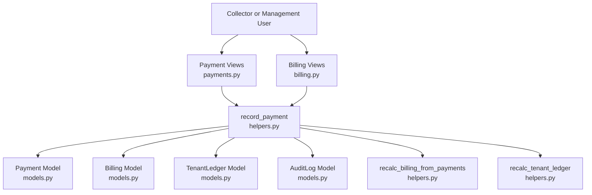
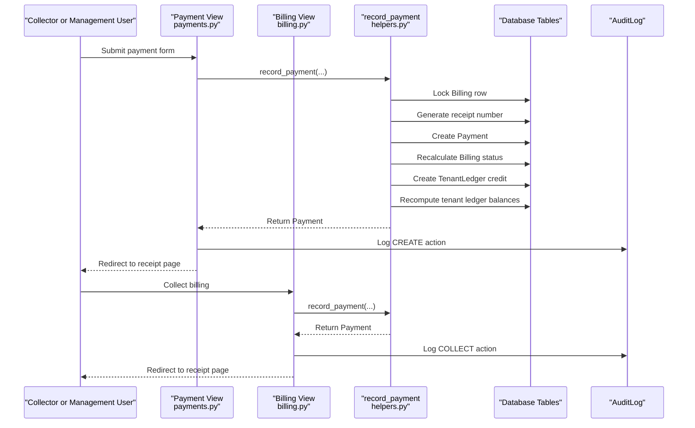
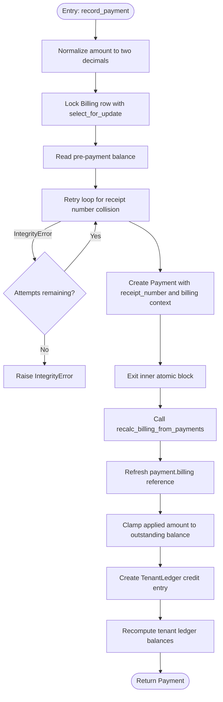
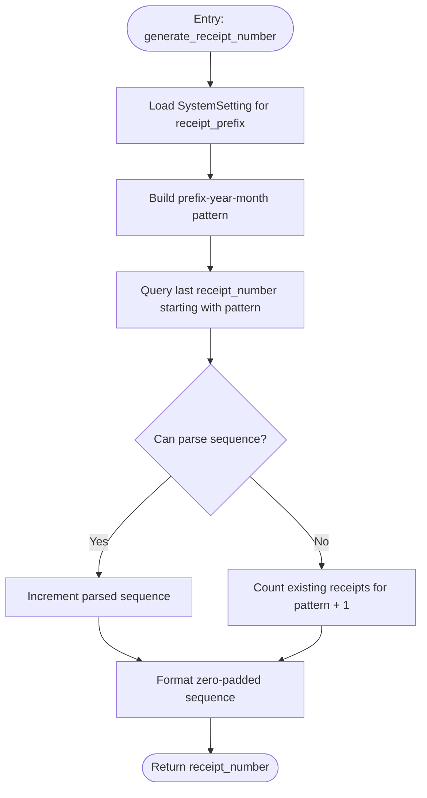
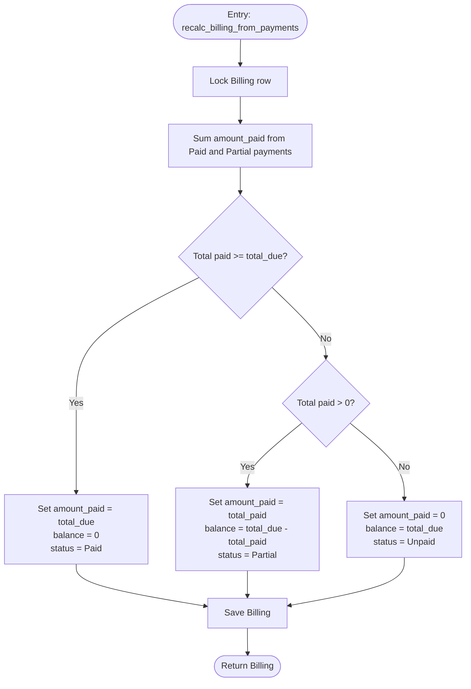
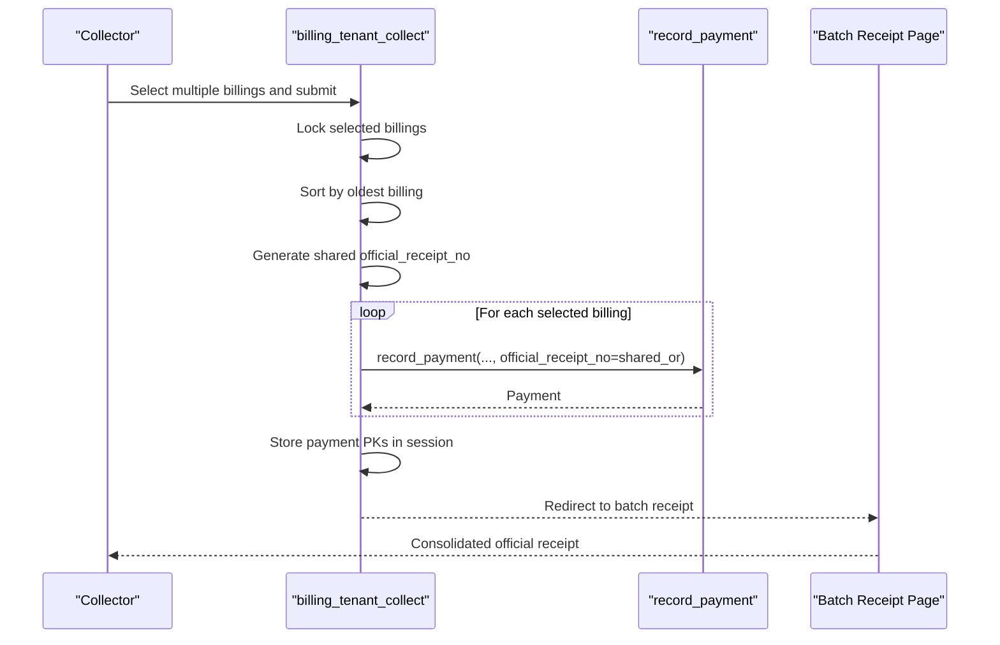
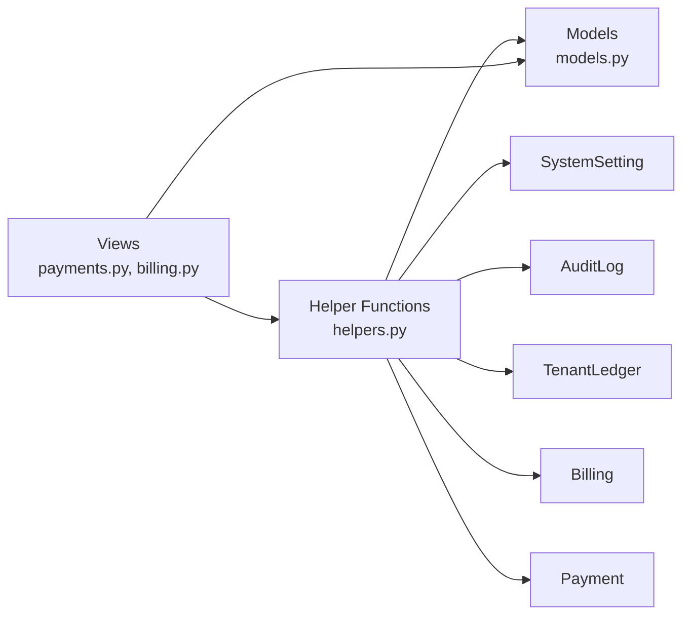

# Payment Processing & Recording

<cite>
**Referenced Files in This Document**   
- [helpers.py](file://core/helpers.py)
- [models.py](file://core/models.py)
- [payments.py](file://core/views/payments.py)
- [billing.py](file://core/views/billing.py)
</cite>

## Table of Contents
1. [Introduction](#introduction)
2. [Project Structure](#project-structure)
3. [Core Components](#core-components)
4. [Architecture Overview](#architecture-overview)
5. [Detailed Component Analysis](#detailed-component-analysis)
6. [Dependency Analysis](#dependency-analysis)
7. [Performance Considerations](#performance-considerations)
8. [Troubleshooting Guide](#troubleshooting-guide)
9. [Conclusion](#conclusion)

## Introduction
This document explains the payment processing and recording system for the rental market application. The central entry point for posting rental payments is the `record_payment` function, which acts as the single source of truth for creating a payment, updating billing totals and status, writing ledger entries, and maintaining financial consistency under concurrent access.

The system supports:
- Partial and full payment handling.
- Receipt number generation with collision retry.
- Automatic billing status updates through `recalc_billing_from_payments`.
- Payment method tracking and collector attribution.
- Integration with audit logging for financial accountability.
- Batch settlement where multiple months share one official receipt while keeping internal receipt numbers unique.

## Project Structure
Payment-related logic spans four main areas:

| Area | Responsibility | Key Files |
|---|---|---|
| Domain models | Billing, Payment, TenantLedger, AuditLog, SystemSetting | [models.py](file://core/models.py) |
| Core service functions | Receipt numbering, billing recalculation, payment posting, ledger recomputation | [helpers.py](file://core/helpers.py) |
| Payment views | Payment creation, editing, voiding, listing, receipts, batch printing | [payments.py](file://core/views/payments.py) |
| Billing views | Quick collection, grouped tenant collection, batch OR handling | [billing.py](file://core/views/billing.py) |

**Diagram sources**
- [payments.py:250-294](file://core/views/payments.py#L250-L294)
- [billing.py:415-489](file://core/views/billing.py#L415-L489)
- [helpers.py:351-420](file://core/helpers.py#L351-L420)
- [models.py:190-277](file://core/models.py#L190-L277)

**Section sources**
- [helpers.py:276-420](file://core/helpers.py#L276-L420)
- [models.py:190-316](file://core/models.py#L190-L316)
- [payments.py:250-550](file://core/views/payments.py#L250-L550)
- [billing.py:415-624](file://core/views/billing.py#L415-L624)

## Core Components
The payment subsystem is built around these core components:

| Component | Purpose | Important Behavior |
|---|---|---|
| `record_payment` | Posts a rental payment atomically | Locks the target billing row, creates a `Payment`, recalculates billing status, writes a ledger credit, and recomputes the tenant ledger balance chain. |
| `generate_receipt_number` | Produces per-month sequential receipt numbers | Uses a configurable prefix, current year-month, and zero-padded sequence; retries on uniqueness collisions. |
| `recalc_billing_from_payments` | Recomputes billing totals from valid payments | Locks the billing row, sums paid amounts, and sets `Unpaid`, `Partial`, or `Paid`. |
| `Payment` model | Stores each payment record | Tracks receipt number, amount, method, collector, billing linkage, and status. |
| `Billing` model | Represents monthly rental obligations | Tracks due amount, paid amount, balance, due date, and settlement status. |
| `TenantLedger` model | Maintains chronological debit/credit history | Provides running balances per tenant and links to payments and billings. |
| `AuditLog` model | Records financial actions | Captures user, action, module, description, and IP address. |

**Section sources**
- [helpers.py:276-420](file://core/helpers.py#L276-L420)
- [models.py:190-316](file://core/models.py#L190-L316)

## Architecture Overview
At runtime, payment posting follows a controlled flow that separates UI concerns from financial guarantees:

1. A collector or management user submits a payment through a payment form or billing collection interface.
2. The view validates input and delegates all financial mutation to `record_payment`.
3. `record_payment` locks the billing row, generates a receipt number, creates the payment, recalculates billing state, posts a ledger credit, and recomputes the tenant ledger.
4. The view records an audit log and redirects to the receipt page.

**Diagram sources**
- [payments.py:250-294](file://core/views/payments.py#L250-L294)
- [billing.py:415-489](file://core/views/billing.py#L415-L489)
- [helpers.py:351-420](file://core/helpers.py#L351-L420)

## Detailed Component Analysis

### `record_payment`: Single Source of Truth for Payment Posting
`record_payment` is the authoritative function for posting rental payments. It must be called inside an atomic transaction because it performs multiple database mutations across `Payment`, `Billing`, and `TenantLedger`.

Key responsibilities:
- Normalize the incoming amount to two decimal places.
- Lock the target `Billing` row using `select_for_update` to prevent concurrent collectors from clobbering each other’s totals.
- Generate a unique receipt number via `generate_receipt_number`.
- Create the `Payment` row with billing context, payment metadata, and initial status.
- Recalculate billing totals authoritatively via `recalc_billing_from_payments`.
- Clamp applied payment to the outstanding balance so the ledger never over-settles a bill.
- Create a `TenantLedger` credit entry linked to the payment.
- Recompute the tenant’s running ledger balances.

**Diagram sources**
- [helpers.py:351-420](file://core/helpers.py#L351-L420)

Important implementation details:
- Concurrency safety comes from locking the billing row before reading its balance and creating the payment.
- Receipt number collisions are handled by catching `IntegrityError` and retrying up to five times.
- The payment status is initially set based on whether the submitted amount covers the pre-payment balance.
- After recalculation, the billing may change from partial to fully paid, and the payment object is refreshed to reflect the recomputed billing row.
- The ledger credit uses the clamped applied amount rather than the raw submitted amount when overpayment occurs.

**Section sources**
- [helpers.py:351-420](file://core/helpers.py#L351-L420)

### `generate_receipt_number`: Monthly Sequential Receipt Numbers
Receipt numbers follow a structured format:
- Prefix from `SystemSetting.receipt_prefix`, defaulting to `RCP`.
- Current year and month.
- Zero-padded six-digit sequence.

The function finds the highest existing receipt number for the current period and increments it. If parsing fails, it falls back to counting existing receipts for the same prefix and period.

Collision handling:
- The function itself does not retry; `record_payment` wraps receipt generation and payment creation in a retry loop that catches `IntegrityError`.
- This design keeps receipt generation simple while ensuring robustness at the transaction boundary.

**Diagram sources**
- [helpers.py:276-300](file://core/helpers.py#L276-L300)

**Section sources**
- [helpers.py:276-300](file://core/helpers.py#L276-L300)
- [helpers.py:373-399](file://core/helpers.py#L373-L399)

### `recalc_billing_from_payments`: Authoritative Billing Status Updates
`recalc_billing_from_payments` is the only place that decides whether a billing is unpaid, partial, or paid. It:
- Locks the billing row.
- Sums `amount_paid` from valid payments with status `Paid` or `Partial`.
- Compares total paid against `total_due`.
- Sets `amount_paid`, `balance`, and `status` accordingly.
- Saves the billing row.

This function is used both by `record_payment` after every payment and by edit/void workflows to keep billing state consistent after changes.

**Diagram sources**
- [helpers.py:321-348](file://core/helpers.py#L321-L348)

**Section sources**
- [helpers.py:321-348](file://core/helpers.py#L321-L348)

### Payment Validation and Entry Points
Payment validation is split between Django forms and view-level guards:

| Entry Point | Validation | Financial Action |
|---|---|---|
| `payment_add` | Validates `PaymentForm` | Calls `record_payment`, logs audit, redirects to receipt. |
| `payment_add_modal` | Validates `PaymentForm` | Calls `record_payment`, logs audit, returns HTMX redirect or message. |
| `billing_collect` | Validates `QuickCollectForm` | Clamps amount to billing balance, calls `record_payment`, logs audit, redirects to receipt. |
| `billing_tenant_collect` | Validates selected billings, date, and payment method | Generates shared official receipt number, settles oldest first, calls `record_payment` per billing, logs batch audit. |

Important validation behaviors:
- Forms enforce required fields and basic data integrity.
- Billing collection explicitly caps the collected amount at the outstanding balance to avoid accidental overpayment.
- Batch collection re-queries selected billings with `select_for_update` to prevent double settlement during page load.
- Payment method values are validated against the model choices and fall back to `Cash` if invalid.

**Section sources**
- [payments.py:250-294](file://core/views/payments.py#L250-L294)
- [payments.py:419-457](file://core/views/payments.py#L419-L457)
- [billing.py:415-489](file://core/views/billing.py#L415-L489)
- [billing.py:511-624](file://core/views/billing.py#L511-L624)

### Partial vs Full Payment Handling
The system distinguishes partial and full payments in two layers:

1. **Initial payment status**: `record_payment` sets the payment status to `Paid` if the submitted amount covers the pre-payment balance, otherwise `Partial`.
2. **Authoritative billing status**: `recalc_billing_from_payments` recomputes billing status from all valid payments, so subsequent payments can move a billing from `Partial` to `Paid`.

Examples:
- A billing with a balance of ₱1,000 receives a ₱600 payment → payment status is `Partial`, billing status becomes `Partial`, remaining balance is ₱400.
- The same billing later receives a ₱400 payment → billing status becomes `Paid`, and the final payment reflects full settlement.
- An overpayment attempt (e.g., submitting ₱1,200 for a ₱1,000 balance) is clamped to the outstanding balance for ledger purposes, preventing negative balances.

**Section sources**
- [helpers.py:368-408](file://core/helpers.py#L368-L408)
- [helpers.py:321-348](file://core/helpers.py#L321-L348)
- [billing.py:431-450](file://core/views/billing.py#L431-L450)

### Payment Method Tracking
Payment methods are stored on the `Payment` model and include:
- Cash
- GCash
- Bank Transfer
- Check

The value is passed from the form into `record_payment` and recorded in both the payment and the ledger description. Batch collection validates the selected method against the model choices and defaults to `Cash` if invalid.

**Section sources**
- [models.py:221-258](file://core/models.py#L221-L258)
- [helpers.py:407-418](file://core/helpers.py#L407-L418)
- [billing.py:552-555](file://core/views/billing.py#L552-L555)

### Ledger Entries and Running Balances
Every successful payment creates a `TenantLedger` credit entry:
- Description includes the receipt number and payment method.
- Debit is zero; credit equals the applied amount.
- The entry is linked to the payment and billing.
- After insertion, `recalc_tenant_ledger` recomputes the running balance chain for the tenant.

This ensures that financial reporting, reconciliation, and historical analysis remain consistent even after edits or voids.

**Section sources**
- [helpers.py:407-419](file://core/helpers.py#L407-L419)
- [helpers.py:260-273](file://core/helpers.py#L260-L273)
- [models.py:261-277](file://core/models.py#L261-L277)

### Audit Logging Integration
Financial actions are logged through `AuditLog`:
- Payment creation logs `CREATE` with receipt number, tenant name, and amount.
- Billing collection logs `COLLECT` with outcome and receipt number.
- Batch collection logs `COLLECT_BATCH` with month list, total collected, and consolidated official receipt number.
- Payment editing and voiding also create audit entries.

The audit trail provides accountability for who posted payments, when, and under what circumstances.

**Section sources**
- [payments.py:269-275](file://core/views/payments.py#L269-L275)
- [payments.py:437-443](file://core/views/payments.py#L437-L443)
- [billing.py:460-466](file://core/views/billing.py#L460-L466)
- [billing.py:600-610](file://core/views/billing.py#L600-L610)

### Batch Settlement and Official Receipt Numbering
Batch collection allows a collector to settle multiple months for one tenant in a single workflow:
- Selected billings are locked with `select_for_update`.
- Billings are settled oldest first.
- One official receipt number is generated once and shared across all created payments.
- Each payment still gets a unique internal `receipt_number` to satisfy database constraints.
- The printed batch receipt consolidates all line items under one official receipt.

**Diagram sources**
- [billing.py:511-624](file://core/views/billing.py#L511-L624)
- [payments.py:351-396](file://core/views/payments.py#L351-L396)

**Section sources**
- [billing.py:511-624](file://core/views/billing.py#L511-L624)
- [payments.py:351-396](file://core/views/payments.py#L351-L396)

## Dependency Analysis
The payment subsystem has clear layering:

**Diagram sources**
- [payments.py:1-18](file://core/views/payments.py#L1-L18)
- [billing.py:1-22](file://core/views/billing.py#L1-L22)
- [helpers.py:1-15](file://core/helpers.py#L1-L15)
- [models.py:190-316](file://core/models.py#L190-L316)

Coupling and cohesion observations:
- Views depend on helper functions rather than directly mutating billing or ledger state, improving cohesion and testability.
- Helper functions depend on models but encapsulate business rules such as concurrency control, receipt generation, and billing recalculation.
- Audit logging is integrated at the view layer for human-readable context, while financial correctness lives in helpers.

Potential risks:
- Direct model usage in views outside payment posting should be avoided to maintain `record_payment` as the single source of truth.
- Batch operations must continue to use `select_for_update` to prevent race conditions during multi-billing settlement.

**Section sources**
- [helpers.py:351-420](file://core/helpers.py#L351-L420)
- [payments.py:250-550](file://core/views/payments.py#L250-L550)
- [billing.py:415-624](file://core/views/billing.py#L415-L624)

## Performance Considerations
- `select_for_update` serializes concurrent modifications to the same billing row, reducing corruption risk at the cost of brief lock contention.
- Receipt number generation queries the latest receipt for the current period; this is lightweight but depends on proper indexing of `receipt_number`.
- Ledger recomputation walks tenant ledger entries chronologically; large tenant histories may benefit from efficient queries and appropriate indexes.
- Batch collection processes billings sequentially within a transaction; very large batches should be monitored for lock duration.

[No sources needed since this section provides general guidance]

## Troubleshooting Guide
Common issues and their likely causes:

| Symptom | Likely Cause | Resolution |
|---|---|---|
| Duplicate receipt number error | Rare collision during concurrent payment posting | The retry loop handles this automatically; repeated failures indicate excessive concurrency or index problems. |
| Billing remains Partial after full payment | Payment was voided or edited without recomputation | Ensure edit/void flows call `recalc_billing_from_payments` and ledger recomputation. |
| Negative billing balance | Overpayment applied without clamping | Verify that billing collection clamps amount to outstanding balance and that `record_payment` applies clamping for ledger credits. |
| Missing audit log | Payment posted outside standard views | Use `record_payment` from supported views or manually create `AuditLog` entries for custom integrations. |
| Batch receipt shows only last payment | Session did not store all payment PKs | Confirm that `billing_tenant_collect` stores `BATCH_RECEIPT_SESSION_KEY` and that the batch receipt view reads it correctly. |

**Section sources**
- [helpers.py:373-399](file://core/helpers.py#L373-L399)
- [helpers.py:401-419](file://core/helpers.py#L401-L419)
- [billing.py:557-619](file://core/views/billing.py#L557-L619)
- [payments.py:460-550](file://core/views/payments.py#L460-L550)

## Conclusion
The payment processing system centers on `record_payment` as the authoritative function for posting rental payments. It enforces concurrency safety through `select_for_update`, generates unique receipt numbers with collision retry, clamps applied amounts to prevent over-settlement, and maintains consistent billing and ledger state through `recalc_billing_from_payments` and `recalc_tenant_ledger`.

The design separates user-facing workflows from financial guarantees, integrates audit logging for accountability, and supports both single-payment and batch settlement scenarios. When extending the system, new payment-related logic should route through `record_payment` to preserve consistency, auditability, and correctness.

[No sources needed since this section summarizes without analyzing specific files]