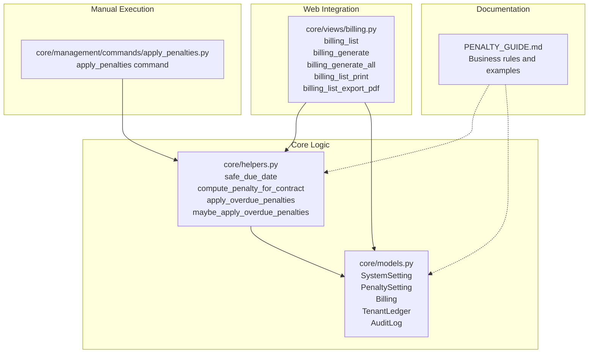
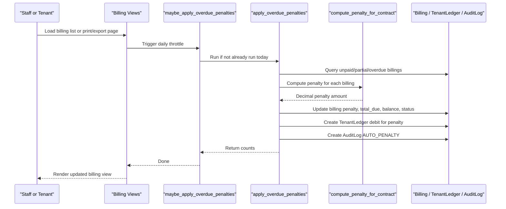
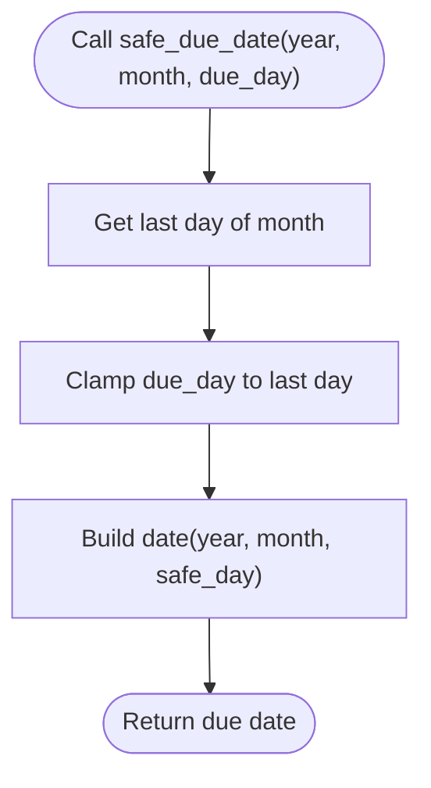
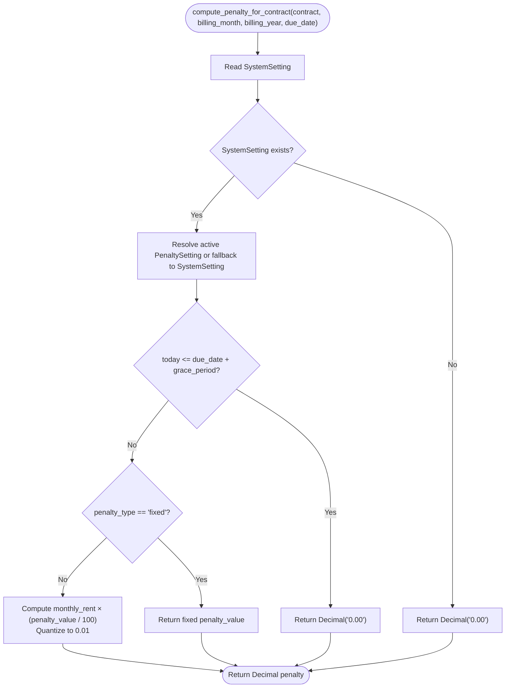
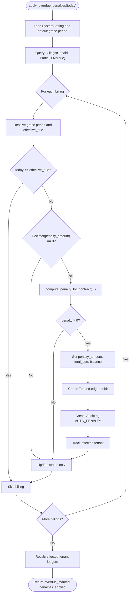
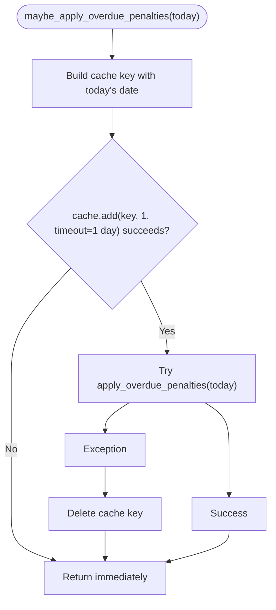
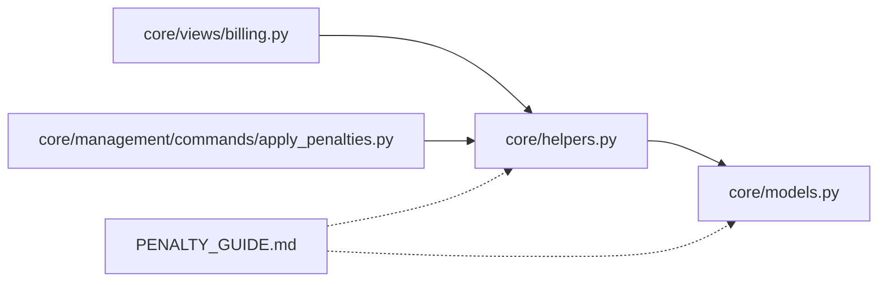

# Penalty Computation & Application

<cite>
**Referenced Files in This Document**
- [helpers.py](file://core/helpers.py)
- [models.py](file://core/models.py)
- [billing.py](file://core/views/billing.py)
- [apply_penalties.py](file://core/management/commands/apply_penalties.py)
- [PENALTY_GUIDE.md](file://PENALTY_GUIDE.md)
</cite>

## Table of Contents
1. [Introduction](#introduction)
2. [Project Structure](#project-structure)
3. [Core Components](#core-components)
4. [Architecture Overview](#architecture-overview)
5. [Detailed Component Analysis](#detailed-component-analysis)
6. [Dependency Analysis](#dependency-analysis)
7. [Performance Considerations](#performance-considerations)
8. [Troubleshooting Guide](#troubleshooting-guide)
9. [Conclusion](#conclusion)

## Introduction
This document explains the penalty computation and application system for the market rental platform. It focuses on how late penalties are calculated, when they are applied, how grace periods are handled, how batch processing works, and how audit and ledger records are created. The goal is to make the behavior clear for both developers and non-technical users who need to understand why a penalty appears on a bill and how it is enforced.

At a high level:
- Penalties can be **fixed** or **percentage-based**.
- A contract can override system-wide defaults.
- Penalties only start after the due date plus a configured grace period.
- Each billing receives at most one penalty charge.
- Penalties are recorded in the tenant ledger and an audit log entry.
- Batch processing is throttled so it runs at most once per day per cache instance.

## Project Structure
The penalty logic lives primarily in the core helpers and models, with integration points in the billing views and a management command for manual execution.

**Diagram sources**
- [helpers.py:125-152](file://core/helpers.py#L125-L152)
- [helpers.py:423-520](file://core/helpers.py#L423-L520)
- [models.py:42-68](file://core/models.py#L42-L68)
- [models.py:190-218](file://core/models.py#L190-L218)
- [models.py:261-277](file://core/models.py#L261-L277)
- [models.py:304-316](file://core/models.py#L304-L316)
- [models.py:319-335](file://core/models.py#L319-L335)
- [billing.py:62-70](file://core/views/billing.py#L62-L70)
- [billing.py:174-235](file://core/views/billing.py#L174-L235)
- [billing.py:249-315](file://core/views/billing.py#L249-L315)
- [billing.py:637-689](file://core/views/billing.py#L637-L689)
- [apply_penalties.py:1-14](file://core/management/commands/apply_penalties.py#L1-L14)

**Section sources**
- [helpers.py:125-152](file://core/helpers.py#L125-L152)
- [helpers.py:423-520](file://core/helpers.py#L423-L520)
- [models.py:42-68](file://core/models.py#L42-L68)
- [models.py:190-218](file://core/models.py#L190-L218)
- [models.py:261-277](file://core/models.py#L261-L277)
- [models.py:304-316](file://core/models.py#L304-L316)
- [models.py:319-335](file://core/models.py#L319-L335)
- [billing.py:62-70](file://core/views/billing.py#L62-L70)
- [billing.py:174-235](file://core/views/billing.py#L174-L235)
- [billing.py:249-315](file://core/views/billing.py#L249-L315)
- [billing.py:637-689](file://core/views/billing.py#L637-L689)
- [apply_penalties.py:1-14](file://core/management/commands/apply_penalties.py#L1-L14)

## Core Components
The penalty system has four main responsibilities:

| Responsibility | Implementation | Purpose |
|---|---|---|
| Safe due-date calculation | `safe_due_date` | Handles months with different lengths and prevents invalid dates. |
| Penalty formula resolution | `compute_penalty_for_contract` | Chooses between fixed and percentage penalties using contract-specific or system-wide settings. |
| Batch overdue processing | `apply_overdue_penalties` | Scans unpaid billings, applies one-time penalties, updates status, creates ledger entries, and writes audit logs. |
| Throttled request-time trigger | `maybe_apply_overdue_penalties` | Ensures the sweep runs at most once per day per cache instance. |

Key data structures involved:

| Model | Relevant Fields | Role in Penalty System |
|---|---|---|
| `SystemSetting` | `penalty_type`, `penalty_value`, `grace_period`, `default_due_day` | Global defaults for penalty policy. |
| `PenaltySetting` | `contract`, `penalty_type`, `penalty_value`, `grace_period`, `due_day`, `is_active` | Per-contract override of global policy. |
| `Billing` | `rental_amount`, `penalty_amount`, `total_due`, `balance`, `due_date`, `status` | Stores computed penalty and settlement state. |
| `TenantLedger` | `tenant`, `billing`, `transaction_date`, `description`, `debit`, `credit`, `balance` | Records penalty charges and payment credits. |
| `AuditLog` | `user`, `action`, `module`, `description` | Tracks automatic penalty application for compliance. |

**Section sources**
- [helpers.py:125-152](file://core/helpers.py#L125-L152)
- [helpers.py:423-520](file://core/helpers.py#L423-L520)
- [models.py:42-68](file://core/models.py#L42-L68)
- [models.py:190-218](file://core/models.py#L190-L218)
- [models.py:261-277](file://core/models.py#L261-L277)
- [models.py:304-316](file://core/models.py#L304-L316)
- [models.py:319-335](file://core/models.py#L319-L335)

## Architecture Overview
The penalty system integrates three layers:

1. **Policy layer**: `SystemSetting` and `PenaltySetting` define whether penalties are fixed or percentage-based, their values, and grace periods.
2. **Computation layer**: `safe_due_date` and `compute_penalty_for_contract` calculate the effective due date and penalty amount.
3. **Application layer**: `apply_overdue_penalties` processes billings in batch; `maybe_apply_overdue_penalties` throttles this process; billing views and the CLI command invoke it.

**Diagram sources**
- [billing.py:62-70](file://core/views/billing.py#L62-L70)
- [billing.py:637-689](file://core/views/billing.py#L637-L689)
- [helpers.py:503-520](file://core/helpers.py#L503-L520)
- [helpers.py:423-500](file://core/helpers.py#L423-L500)
- [helpers.py:132-152](file://core/helpers.py#L132-L152)
- [models.py:190-218](file://core/models.py#L190-L218)
- [models.py:261-277](file://core/models.py#L261-L277)
- [models.py:304-316](file://core/models.py#L304-L316)

## Detailed Component Analysis

### Safe Due Date Handling
`safe_due_date` ensures that a due date is always valid even when the configured due day exceeds the number of days in the target month. For example, if the due day is 31 but the month has only 30 days, the function uses the last day of the month.

Behavior summary:
- Input: year, month, due_day.
- Output: a valid `date` object for the last safe day of the month.
- Used by: billing creation and penalty evaluation.

**Diagram sources**
- [helpers.py:125-129](file://core/helpers.py#L125-L129)

**Section sources**
- [helpers.py:125-129](file://core/helpers.py#L125-L129)

### Penalty Calculation: `compute_penalty_for_contract`
This function is the single source of truth for penalty math. It resolves settings and computes the penalty based on the current date, due date, grace period, and penalty type.

Decision flow:

1. Read the global `SystemSetting`. If none exists, return zero penalty.
2. Check for an active `PenaltySetting` on the contract. If present, use its type, value, and grace period. Otherwise, fall back to `SystemSetting`.
3. Compare today with `due_date + grace_period`. If today is within or before the grace period, return zero.
4. If penalty type is `fixed`, return the fixed value.
5. If penalty type is `percentage`, compute `monthly_rent × (penalty_value ÷ 100)` and quantize to two decimal places.
6. Default to zero for unknown types.

**Diagram sources**
- [helpers.py:132-152](file://core/helpers.py#L132-L152)
- [models.py:42-68](file://core/models.py#L42-L68)
- [models.py:319-335](file://core/models.py#L319-L335)

Important design notes:
- Contract-level penalty settings take precedence over system-wide settings.
- The function returns a `Decimal`, which avoids floating-point rounding issues.
- Percentage penalties are explicitly quantized to two decimal places.

**Section sources**
- [helpers.py:132-152](file://core/helpers.py#L132-L152)
- [models.py:42-68](file://core/models.py#L42-L68)
- [models.py:319-335](file://core/models.py#L319-L335)

### Batch Overdue Processing: `apply_overdue_penalties`
This function processes all unpaid, partial, or already-overdue billings and applies penalties where appropriate.

Processing steps:

1. Determine the default grace period from `SystemSetting`.
2. Query billings with statuses `Unpaid`, `Partial`, or `Overdue`.
3. For each billing:
   - Resolve the effective grace period: prefer the contract’s active penalty setting, otherwise use the system default.
   - Calculate the effective due date as `billing.due_date + grace_period`.
   - If today is still within the grace period, skip the billing.
   - If `penalty_amount` is zero, compute the penalty using `compute_penalty_for_contract`.
   - If the computed penalty is greater than zero:
     - Set `penalty_amount`.
     - Recalculate `total_due` and `balance`.
     - Create a `TenantLedger` debit entry for the penalty.
     - Record an `AuditLog` entry with action `AUTO_PENALTY`.
     - Track affected tenants for later ledger recalculation.
   - Recompute billing status: `Paid` if balance is zero or less, otherwise `Overdue`.
   - Save only changed fields.
4. After iterating, recalculate running balances for affected tenants.
5. Return counts of overdue-marked billings and penalties applied.

**Diagram sources**
- [helpers.py:423-500](file://core/helpers.py#L423-L500)
- [helpers.py:132-152](file://core/helpers.py#L132-L152)
- [models.py:190-218](file://core/models.py#L190-L218)
- [models.py:261-277](file://core/models.py#L261-L277)
- [models.py:304-316](file://core/models.py#L304-L316)

Idempotency guarantee:
- A penalty is only added when `penalty_amount` is zero.
- Repeated runs do not double-charge the same billing.

**Section sources**
- [helpers.py:423-500](file://core/helpers.py#L423-L500)
- [helpers.py:132-152](file://core/helpers.py#L132-L152)
- [models.py:190-218](file://core/models.py#L190-L218)
- [models.py:261-277](file://core/models.py#L261-L277)
- [models.py:304-316](file://core/models.py#L304-L316)

### Throttling Mechanism: `maybe_apply_overdue_penalties`
This function wraps `apply_overdue_penalties` behind a daily cache key. Its purpose is to ensure the sweep runs at most once per day per cache instance without requiring an external scheduler.

Behavior summary:
- Key format: `apply_overdue_penalties:<YYYY-MM-DD>`.
- Uses `cache.add` to claim the day’s slot atomically.
- If the key already exists, the function returns immediately.
- On success, calls `apply_overdue_penalties`.
- On exception, deletes the key so the next request can retry.
- Never raises exceptions to avoid breaking the requesting page.

**Diagram sources**
- [helpers.py:503-520](file://core/helpers.py#L503-L520)

Integration points:
- Called from `billing_list` for staff roles.
- Called from `billing_list_print` and `billing_list_export_pdf`.
- Also wired into other billing-related flows through the same helper import pattern.

**Section sources**
- [helpers.py:503-520](file://core/helpers.py#L503-L520)
- [billing.py:62-70](file://core/views/billing.py#L62-L70)
- [billing.py:637-689](file://core/views/billing.py#L637-L689)

### Manual Command: `apply_penalties`
The Django management command provides a thin wrapper around `apply_overdue_penalties`. It is unthrottled and useful for testing, back-fills, or manual reconciliation.

Usage:
- Run via the project’s management command interface.
- Prints the number of overdue billings marked and penalties applied.

**Section sources**
- [apply_penalties.py:1-14](file://core/management/commands/apply_penalties.py#L1-L14)
- [helpers.py:423-500](file://core/helpers.py#L423-L500)

### Billing Generation and Penalty Integration
When billings are generated manually or automatically, the system computes the due date and penalty amount at creation time.

Key behaviors:
- `safe_due_date` determines the due date from the contract’s `due_day`.
- `compute_penalty_for_contract` calculates the penalty based on current date and settings.
- `total_due` is `rental_amount + penalty_amount`.
- A `TenantLedger` debit entry is created for the initial billing.
- The billing status starts as `Unpaid`.

Note: The billing views also contain a local `compute_penalty` helper that mirrors the business rule, while the canonical implementation used by the helpers module is `compute_penalty_for_contract`.

**Section sources**
- [billing.py:29-51](file://core/views/billing.py#L29-L51)
- [billing.py:54-59](file://core/views/billing.py#L54-L59)
- [billing.py:174-235](file://core/views/billing.py#L174-L235)
- [billing.py:249-315](file://core/views/billing.py#L249-L315)
- [helpers.py:125-152](file://core/helpers.py#L125-L152)

## Dependency Analysis
The penalty system has clear boundaries and minimal coupling:

- `helpers.py` depends on `models.py` for `SystemSetting`, `Billing`, `TenantLedger`, and `AuditLog`.
- `billing.py` imports `maybe_apply_overdue_penalties` and related helpers.
- `apply_penalties.py` imports `apply_overdue_penalties`.
- Business documentation in `PENALTY_GUIDE.md` describes the intended behavior and developer notes.

**Diagram sources**
- [helpers.py:15-15](file://core/helpers.py#L15-L15)
- [helpers.py:423-520](file://core/helpers.py#L423-L520)
- [billing.py:18-21](file://core/views/billing.py#L18-L21)
- [billing.py:62-70](file://core/views/billing.py#L62-L70)
- [apply_penalties.py:1-14](file://core/management/commands/apply_penalties.py#L1-L14)

**Section sources**
- [helpers.py:15-15](file://core/helpers.py#L15-L15)
- [helpers.py:423-520](file://core/helpers.py#L423-L520)
- [billing.py:18-21](file://core/views/billing.py#L18-L21)
- [billing.py:62-70](file://core/views/billing.py#L62-L70)
- [apply_penalties.py:1-14](file://core/management/commands/apply_penalties.py#L1-L14)

## Performance Considerations
- **Batch scanning**: `apply_overdue_penalties` queries all unpaid, partial, and overdue billings. For large datasets, consider indexing `Billing.status`, `Billing.due_date`, and foreign keys such as `tenant`, `stall`, and `contract`.
- **Selective updates**: The function uses `update_fields` to minimize database writes.
- **Ledger recalculation**: Only affected tenants are recalculated after penalties are applied.
- **Throttling**: `maybe_apply_overdue_penalties` prevents repeated daily sweeps across requests.
- **Decimal precision**: All monetary calculations use `Decimal` and are quantized to two decimal places to avoid float drift.

[No sources needed since this section provides general guidance]

## Troubleshooting Guide

### Penalty Not Appearing
Possible causes:
- No `SystemSetting` exists.
- Today is still within the grace period.
- The contract’s active penalty setting is missing or misconfigured.
- The billing was already penalized (`penalty_amount` is not zero).

Checks:
- Verify `SystemSetting.penalty_type`, `penalty_value`, and `grace_period`.
- Verify `PenaltySetting.is_active` and values.
- Confirm `today > due_date + grace_period`.
- Inspect `Billing.penalty_amount`.

**Section sources**
- [helpers.py:132-152](file://core/helpers.py#L132-L152)
- [helpers.py:423-500](file://core/helpers.py#L423-L500)
- [models.py:42-68](file://core/models.py#L42-L68)
- [models.py:319-335](file://core/models.py#L319-L335)

### Double-Charging Concerns
The system prevents double-charging by only applying a penalty when `penalty_amount` is zero. If you see duplicate penalties:
- Check whether the billing row was manually edited to reset `penalty_amount`.
- Review whether the billing was recreated instead of updated.
- Use the manual command to reconcile and inspect audit logs.

**Section sources**
- [helpers.py:457-485](file://core/helpers.py#L457-L485)

### Missing Ledger Entry
If a penalty was applied but no ledger entry exists:
- Confirm that the penalty amount was greater than zero.
- Check whether the sweep completed successfully.
- Look for exceptions in the throttling wrapper.
- Use `recalc_tenant_ledger` to rebuild running balances.

**Section sources**
- [helpers.py:469-478](file://core/helpers.py#L469-L478)
- [helpers.py:498-500](file://core/helpers.py#L498-L500)
- [helpers.py:260-273](file://core/helpers.py#L260-L273)

### Audit Log Missing
Automatic penalties create an `AuditLog` with action `AUTO_PENALTY`. If missing:
- Confirm the penalty was actually applied.
- Check whether the first superuser exists for the audit log user field.
- Verify that the sweep ran and did not raise an exception.

**Section sources**
- [helpers.py:480-485](file://core/helpers.py#L480-L485)
- [models.py:304-316](file://core/models.py#L304-L316)

### Grace Period Misunderstanding
Common confusion:
- The due date alone does not trigger a penalty.
- The grace period adds extra days after the due date.
- Only after `due_date + grace_period` does the system consider the billing eligible for penalty application.

**Section sources**
- [helpers.py:125-152](file://core/helpers.py#L125-L152)
- [helpers.py:447-454](file://core/helpers.py#L447-L454)
- [PENALTY_GUIDE.md:29-40](file://PENALTY_GUIDE.md#L29-L40)

## Conclusion
The penalty computation and application system is designed to be predictable, auditable, and financially precise:

- Penalties are either fixed or percentage-based.
- Contract-level settings override system-wide defaults.
- Grace periods protect tenants from immediate penalties.
- One-time penalty accrual prevents double-charging.
- Batch processing updates billing status, amounts, and ledger entries.
- Audit logging captures automatic penalty applications.
- Throttling ensures the sweep runs at most once per day per cache instance.
- Decimal arithmetic ensures consistent financial totals.

For non-technical users, the practical rule is simple: pay by the due date plus the grace period to avoid a one-time late penalty. For technical users, the canonical implementation lives in `core.helpers`, with integration points in billing views and a manual management command.

[No sources needed since this section summarizes without analyzing specific files]