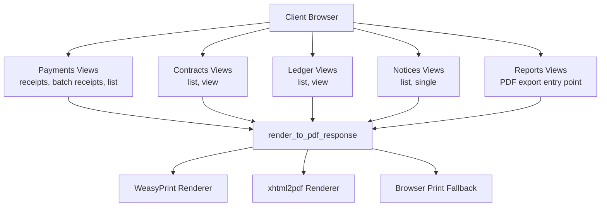
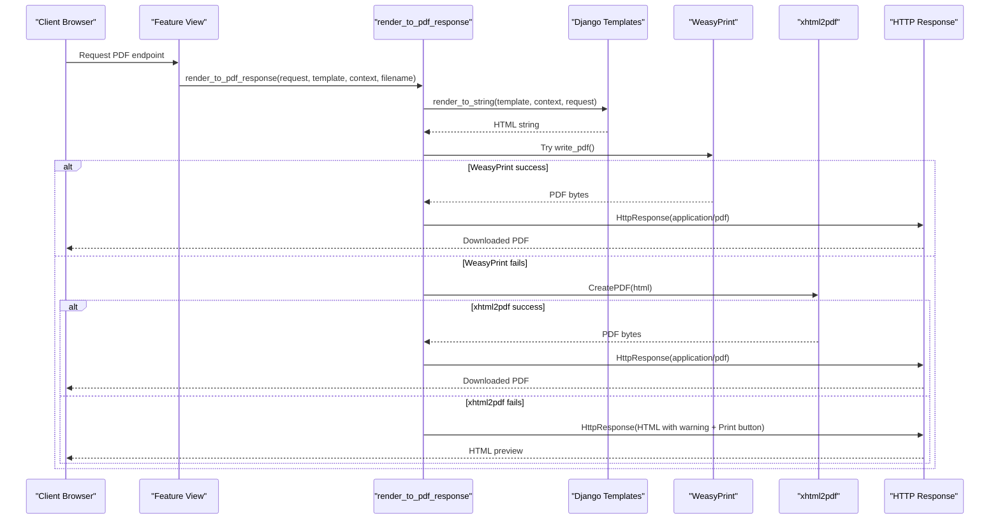
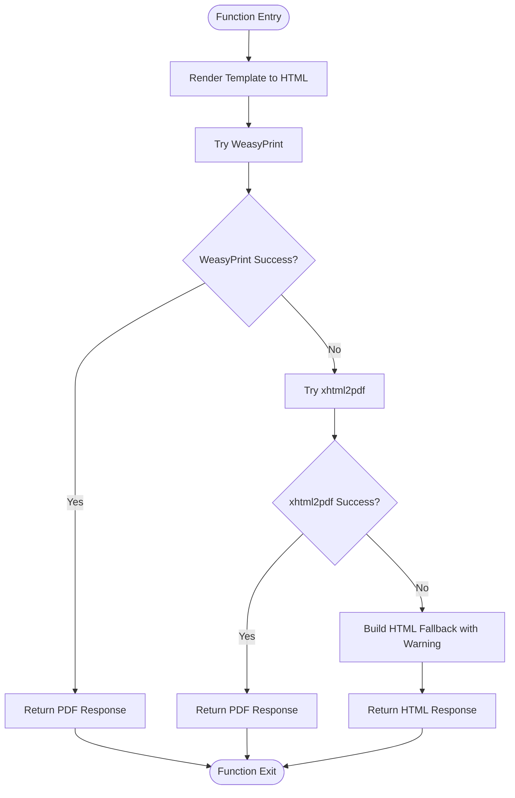
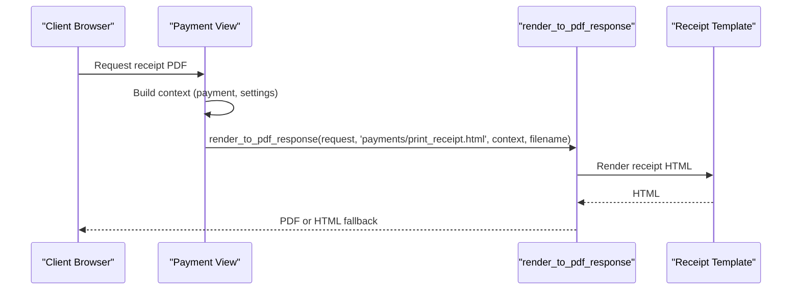
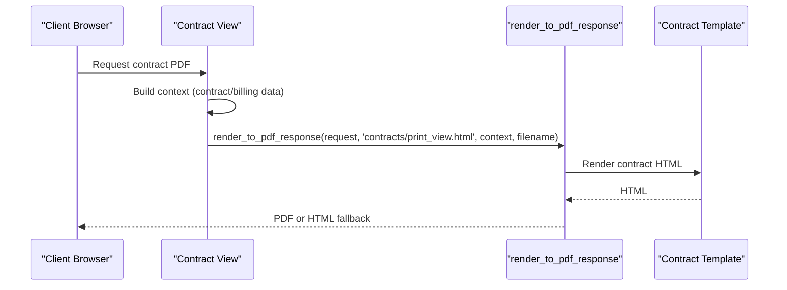
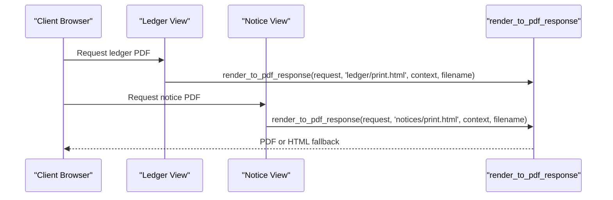
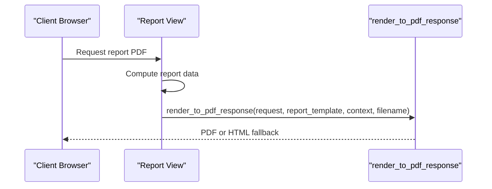
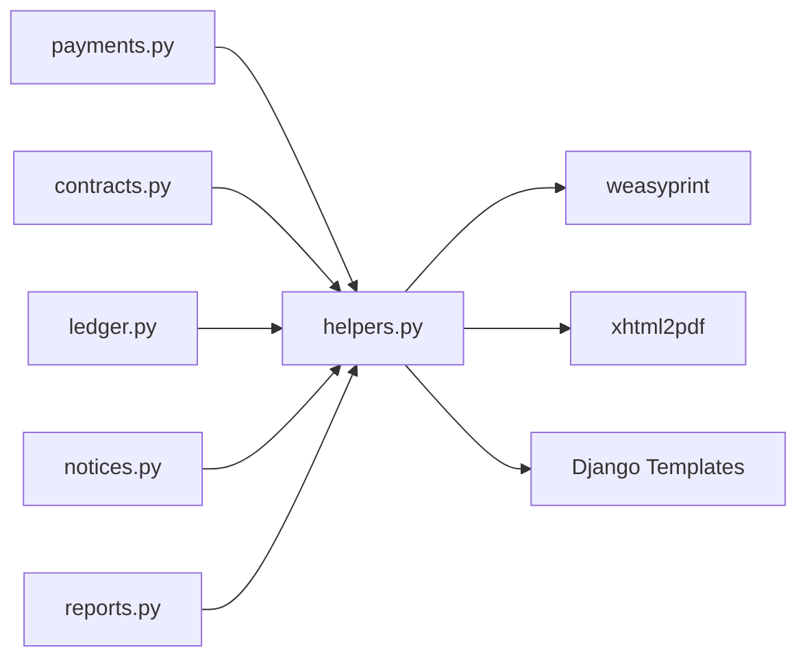

# PDF Generation & Document Rendering

<cite>
**Referenced Files in This Document**
- [helpers.py](file://core/helpers.py)
- [payments.py](file://core/views/payments.py)
- [contracts.py](file://core/views/contracts.py)
- [ledger.py](file://core/views/ledger.py)
- [notices.py](file://core/views/notices.py)
- [reports.py](file://core/views/reports.py)
</cite>

## Table of Contents
1. [Introduction](#introduction)
2. [Project Structure](#project-structure)
3. [Core Components](#core-components)
4. [Architecture Overview](#architecture-overview)
5. [Detailed Component Analysis](#detailed-component-analysis)
6. [Dependency Analysis](#dependency-analysis)
7. [Performance Considerations](#performance-considerations)
8. [Troubleshooting Guide](#troubleshooting-guide)
9. [Conclusion](#conclusion)

## Introduction
This document explains the PDF generation and document rendering system used across the application. It focuses on the multi-fallback rendering pipeline that prioritizes WeasyPrint for high-quality HTML/CSS-to-PDF conversion, falls back to xhtml2pdf for Windows environments where WeasyPrint may be unavailable, and finally provides a browser-based print fallback when both renderers fail. The documentation covers the central `render_to_pdf_response` function, template rendering context, base URL handling for static assets, error handling strategies, and practical examples for generating official receipts, billing statements, and report documents. It also includes platform-specific considerations, CSS compatibility guidance, and performance optimization techniques for large document generation.

## Project Structure
The PDF generation capability is implemented as a reusable helper and consumed by multiple feature views:
- Core helper: `core/helpers.py` defines the unified PDF response generator with a three-stage fallback pipeline.
- Feature views: `core/views/payments.py`, `core/views/contracts.py`, `core/views/ledger.py`, `core/views/notices.py`, and `core/views/reports.py` prepare data contexts and call the helper to produce downloadable PDFs or HTML previews.

**Diagram sources**
- [helpers.py:522-594](file://core/helpers.py#L522-L594)
- [payments.py:394-416](file://core/views/payments.py#L394-L416)
- [contracts.py:397-428](file://core/views/contracts.py#L397-L428)
- [ledger.py:133-182](file://core/views/ledger.py#L133-L182)
- [notices.py:189-204](file://core/views/notices.py#L189-L204)
- [reports.py:452-452](file://core/views/reports.py#L452-L452)

**Section sources**
- [helpers.py:522-594](file://core/helpers.py#L522-L594)
- [payments.py:394-416](file://core/views/payments.py#L394-L416)
- [contracts.py:397-428](file://core/views/contracts.py#L397-L428)
- [ledger.py:133-182](file://core/views/ledger.py#L133-L182)
- [notices.py:189-204](file://core/views/notices.py#L189-L204)
- [reports.py:452-452](file://core/views/reports.py#L452-L452)

## Core Components
- Multi-fallback renderer: A single helper function renders templates to PDF using a prioritized sequence:
  - WeasyPrint (preferred for best CSS fidelity).
  - xhtml2pdf (pure Python fallback suitable for Windows without GTK).
  - Browser print fallback (HTML preview with a Print button when both renderers fail).
- Template rendering: Uses Django’s template engine with request-aware context to resolve URLs and static assets.
- Base URL handling: Automatically derives the site base URL from the incoming request when not explicitly provided, enabling correct resolution of static assets during PDF generation.
- Error handling: Catches import and runtime errors from each renderer and gracefully degrades to the next stage while preserving diagnostic information in the final HTML fallback.

Key responsibilities:
- Centralize PDF generation logic to avoid duplication across views.
- Provide consistent Content-Disposition headers for downloads.
- Ensure graceful degradation under different deployment environments.

**Section sources**
- [helpers.py:522-594](file://core/helpers.py#L522-L594)

## Architecture Overview
The PDF generation architecture follows a layered approach:
- View layer prepares domain-specific context and calls the helper.
- Helper layer orchestrates template rendering and selects the appropriate renderer.
- Renderer layer performs HTML-to-PDF conversion via WeasyPrint or xhtml2pdf.
- Fallback layer returns an HTML page with instructions to use the browser’s Print dialog to save as PDF.

**Diagram sources**
- [helpers.py:522-594](file://core/helpers.py#L522-L594)

## Detailed Component Analysis

### Multi-Fallback Renderer: render_to_pdf_response
This function implements the core rendering pipeline:
- Renders the specified template with the provided context and optional request.
- Attempts WeasyPrint first; if successful, returns a PDF response.
- If WeasyPrint fails (commonly due to missing system libraries on Windows), attempts xhtml2pdf.
- If both renderers fail, returns an HTML page with a helpful message and a Print button to leverage the browser’s native PDF saving capability.

Important behaviors:
- Base URL derivation: When not provided, it builds the absolute base URL from the request to ensure static assets are resolved correctly during PDF generation.
- Error capture: Captures exceptions from each renderer and includes concise diagnostics in the HTML fallback for troubleshooting.
- Filename control: Sets the downloaded file name via Content-Disposition.

**Diagram sources**
- [helpers.py:522-594](file://core/helpers.py#L522-L594)

**Section sources**
- [helpers.py:522-594](file://core/helpers.py#L522-L594)

### Official Receipt Generation
Official receipts are generated through payment-related views that prepare receipt context and delegate to the helper:
- Single receipt export: Builds context including payment details and system settings, then calls the helper with the receipt template.
- Batch receipt export: Aggregates multiple payments into a single PDF, naming the file based on the official receipt number and tenant identifier.

Typical usage patterns:
- Prepare context with payment objects, tenant/stall details, collector information, and system-wide settings.
- Generate a descriptive filename incorporating receipt identifiers and dates.
- Call the helper to return either a PDF or HTML fallback.

**Diagram sources**
- [payments.py:400-416](file://core/views/payments.py#L400-L416)
- [payments.py:394-396](file://core/views/payments.py#L394-L396)
- [helpers.py:522-594](file://core/helpers.py#L522-L594)

**Section sources**
- [payments.py:394-416](file://core/views/payments.py#L394-L416)
- [helpers.py:522-594](file://core/helpers.py#L522-L594)

### Billing Statements and Contract Documents
Billing statements and contract documents follow the same pattern:
- Views assemble context with billing or contract data.
- They call the helper with the corresponding print templates.
- The helper returns a PDF when possible, otherwise an HTML fallback.

Examples:
- Contract list export: Generates a printable list of contracts.
- Contract view export: Generates a detailed contract document.

**Diagram sources**
- [contracts.py:397-428](file://core/views/contracts.py#L397-L428)
- [helpers.py:522-594](file://core/helpers.py#L522-L594)

**Section sources**
- [contracts.py:397-428](file://core/views/contracts.py#L397-L428)
- [helpers.py:522-594](file://core/helpers.py#L522-L594)

### Ledger and Notice Documents
Ledger and notice exports similarly rely on the helper:
- Ledger views generate ledger reports and lists.
- Notice views generate notice lists and individual notices.

**Diagram sources**
- [ledger.py:133-182](file://core/views/ledger.py#L133-L182)
- [notices.py:189-204](file://core/views/notices.py#L189-L204)
- [helpers.py:522-594](file://core/helpers.py#L522-L594)

**Section sources**
- [ledger.py:133-182](file://core/views/ledger.py#L133-L182)
- [notices.py:189-204](file://core/views/notices.py#L189-L204)
- [helpers.py:522-594](file://core/helpers.py#L522-L594)

### Report Export Entry Point
Report exports include a dedicated PDF export endpoint that coordinates report data and delegates to the helper for PDF generation. While the repository also contains Excel export functionality, the PDF export path integrates with the same multi-fallback renderer to maintain consistency across document types.

**Diagram sources**
- [reports.py:452-452](file://core/views/reports.py#L452-L452)
- [helpers.py:522-594](file://core/helpers.py#L522-L594)

**Section sources**
- [reports.py:452-452](file://core/views/reports.py#L452-L452)
- [helpers.py:522-594](file://core/helpers.py#L522-L594)

## Dependency Analysis
The PDF generation system has clear dependency boundaries:
- Feature views depend on the helper for PDF output.
- The helper depends on:
  - Django template engine for HTML rendering.
  - Optional external renderers: WeasyPrint and xhtml2pdf.
  - Standard library modules for in-memory byte streams.

**Diagram sources**
- [payments.py:394-416](file://core/views/payments.py#L394-L416)
- [contracts.py:397-428](file://core/views/contracts.py#L397-L428)
- [ledger.py:133-182](file://core/views/ledger.py#L133-L182)
- [notices.py:189-204](file://core/views/notices.py#L189-L204)
- [reports.py:452-452](file://core/views/reports.py#L452-L452)
- [helpers.py:522-594](file://core/helpers.py#L522-L594)

**Section sources**
- [payments.py:394-416](file://core/views/payments.py#L394-L416)
- [contracts.py:397-428](file://core/views/contracts.py#L397-L428)
- [ledger.py:133-182](file://core/views/ledger.py#L133-L182)
- [notices.py:189-204](file://core/views/notices.py#L189-L204)
- [reports.py:452-452](file://core/views/reports.py#L452-L452)
- [helpers.py:522-594](file://core/helpers.py#L522-L594)

## Performance Considerations
To optimize large document generation:
- Prefer WeasyPrint in production environments where it is available; it offers superior CSS support and faster rendering for complex layouts.
- Minimize template size and complexity:
  - Avoid heavy inline styles; prefer minimal, print-friendly CSS.
  - Use server-side pagination or chunking for very large datasets before rendering.
- Cache expensive computations:
  - Precompute aggregates and summaries used in reports and receipts.
  - Reuse querysets with select_related/prefetch_related to reduce database hits.
- Control memory usage:
  - Stream large responses where possible.
  - Avoid loading entire datasets into memory unnecessarily.
- Platform readiness:
  - On Linux servers, install WeasyPrint dependencies to avoid fallbacks.
  - On Windows development machines, expect xhtml2pdf fallback; test CSS compatibility accordingly.

[No sources needed since this section provides general guidance]

## Troubleshooting Guide
Common issues and resolutions:
- WeasyPrint unavailable:
  - Symptom: ImportError or OSError during WeasyPrint initialization.
  - Resolution: Install required system libraries (e.g., GTK/Pango) or run on Linux where WeasyPrint works natively.
- xhtml2pdf failures:
  - Symptom: Errors during PDF creation or empty/small output.
  - Resolution: Validate HTML/CSS compatibility; simplify unsupported CSS features; check for missing fonts or images.
- Browser fallback:
  - Symptom: HTML page with a warning and Print button instead of a PDF.
  - Resolution: Use the browser’s Print dialog to save as PDF; verify that the underlying template renders correctly in the browser.

Operational tips:
- Inspect the warning message embedded in the HTML fallback to identify which renderer failed and why.
- Test PDF generation locally on Windows and remotely on Linux to validate cross-platform behavior.
- Keep static asset paths absolute or relative to the base URL to ensure correct resolution during rendering.

**Section sources**
- [helpers.py:522-594](file://core/helpers.py#L522-L594)

## Conclusion
The PDF generation system provides a robust, multi-fallback rendering pipeline that ensures reliable document output across diverse environments. By prioritizing WeasyPrint, falling back to xhtml2pdf, and offering a browser-based print option, the application maintains usability and quality regardless of platform constraints. Views across receipts, contracts, ledgers, notices, and reports consistently leverage the helper to deliver consistent behavior. Following the CSS compatibility guidelines and performance recommendations will further improve reliability and efficiency for large document generation.

[No sources needed since this section summarizes without analyzing specific files]