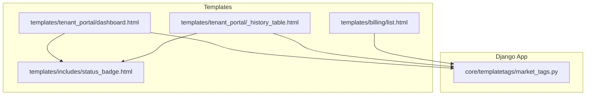
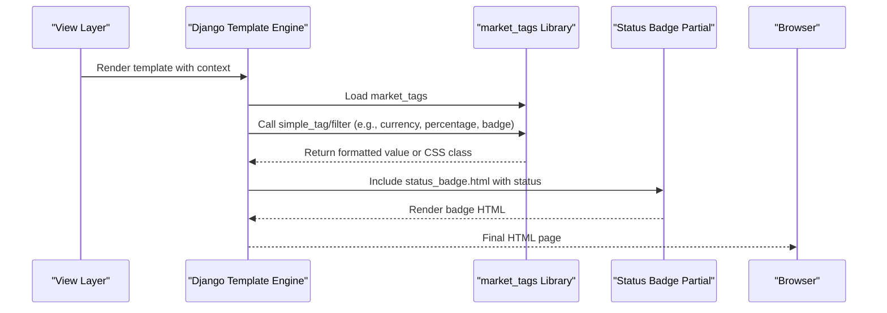
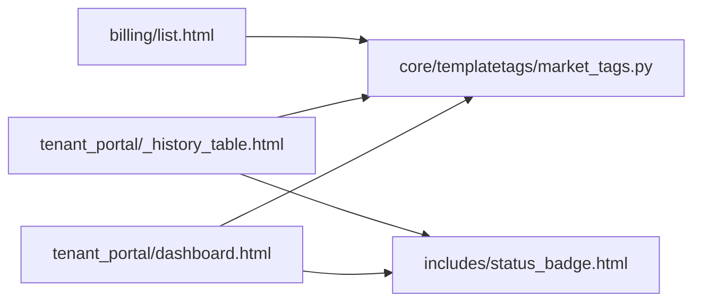

# Template Tags & UI Components

<cite>
**Referenced Files in This Document**   
- [market_tags.py](file://core/templatetags/market_tags.py)
- [list.html](file://templates/billing/list.html)
- [_history_table.html](file://templates/tenant_portal/_history_table.html)
- [dashboard.html](file://templates/tenant_portal/dashboard.html)
- [status_badge.html](file://templates/includes/status_badge.html)
</cite>

## Table of Contents
1. [Introduction](#introduction)
2. [Project Structure](#project-structure)
3. [Core Components](#core-components)
4. [Architecture Overview](#architecture-overview)
5. [Detailed Component Analysis](#detailed-component-analysis)
6. [Dependency Analysis](#dependency-analysis)
7. [Performance Considerations](#performance-considerations)
8. [Troubleshooting Guide](#troubleshooting-guide)
9. [Conclusion](#conclusion)

## Introduction
This document explains the custom template tags and reusable UI components used across the application. It focuses on:
- The available template tags and filters defined in the project’s custom tag library.
- How templates load and use these tags.
- How reusable partials promote consistent UI behavior.
- Best practices for parameter validation, error handling, and safe output formatting in Django templates.

The goal is to help developers reuse logic consistently, keep templates readable, and avoid duplicating presentation logic across views and templates.

## Project Structure
Custom template logic lives under the `core` app’s templatetags module, while reusable UI fragments are stored under `templates/includes`. Templates throughout the application load the custom tag library and include shared partials to render consistent badges, tables, and layouts.

**Diagram sources**
- [market_tags.py:1-97](file://core/templatetags/market_tags.py#L1-L97)
- [list.html:1-97](file://templates/billing/list.html#L1-L97)
- [_history_table.html:1-126](file://templates/tenant_portal/_history_table.html#L1-L126)
- [dashboard.html:1-302](file://templates/tenant_portal/dashboard.html#L1-L302)
- [status_badge.html:1-7](file://templates/includes/status_badge.html#L1-L7)

**Section sources**
- [market_tags.py:1-97](file://core/templatetags/market_tags.py#L1-L97)
- [list.html:1-97](file://templates/billing/list.html#L1-L97)
- [_history_table.html:1-126](file://templates/tenant_portal/_history_table.html#L1-L126)
- [dashboard.html:1-302](file://templates/tenant_portal/dashboard.html#L1-L302)
- [status_badge.html:1-7](file://templates/includes/status_badge.html#L1-L7)

## Core Components
The application defines a single custom template tag library with arithmetic simple tags and presentation filters. These components centralize numeric formatting, string splitting, and status-to-badge mapping so that templates remain declarative and consistent.

### Custom Template Tags and Filters
| Name | Type | Parameters | Output Format | Behavior Summary |
|---|---|---|---|---|
| `add` | Simple tag | `a`, `b` | Numeric result | Adds two values after converting them to floats; returns zero on invalid input. |
| `subtract` | Simple tag | `a`, `b` | Numeric result | Subtracts `b` from `a` after float conversion; returns zero on invalid input. |
| `multiply` | Simple tag | `a`, `b` | Numeric result | Multiplies two values after float conversion; returns zero on invalid input. |
| `divide` | Simple tag | `a`, `b` | Numeric result | Divides `a` by `b`; returns zero if `b` is zero or inputs are invalid. |
| `currency` | Filter | `value` | Currency string with peso symbol and two decimals | Formats numbers as currency; returns a default formatted value when conversion fails. |
| `percentage` | Filter | `value` | Percentage string with two decimals | Formats numbers as percentages; returns a default percentage when conversion fails. |
| `split` | Filter | `value`, optional `delimiter` | List of trimmed non-empty strings | Splits a string by delimiter and removes empty items. |
| `textlines` | Filter | `value` | List of trimmed non-empty lines | Splits multi-line text into non-empty lines. |
| `badge` | Filter | `status` | CSS class string for badge styling | Maps known status values to predefined badge classes; defaults to a muted style. |

These helpers encapsulate common formatting and validation rules, reducing duplication and making templates easier to read.

**Section sources**
- [market_tags.py:6-38](file://core/templatetags/market_tags.py#L6-L38)
- [market_tags.py:41-96](file://core/templatetags/market_tags.py#L41-L96)

## Architecture Overview
The template engine loads the custom tag library at the top of each template that needs it. Views provide context data such as totals, balances, and lists of transactions. Templates then use simple tags for calculations and filters for formatting and rendering. Reusable UI fragments like the status badge partial ensure consistent visual treatment across pages.

**Diagram sources**
- [market_tags.py:1-97](file://core/templatetags/market_tags.py#L1-L97)
- [list.html:1-97](file://templates/billing/list.html#L1-L97)
- [_history_table.html:1-126](file://templates/tenant_portal/_history_table.html#L1-L126)
- [dashboard.html:1-302](file://templates/tenant_portal/dashboard.html#L1-L302)
- [status_badge.html:1-7](file://templates/includes/status_badge.html#L1-L7)

## Detailed Component Analysis

### Arithmetic Simple Tags
The arithmetic tags (`add`, `subtract`, `multiply`, `divide`) accept two arguments, convert them to floats, perform the operation, and return a numeric result. They handle invalid inputs gracefully by returning zero instead of raising exceptions. The division tag also guards against division by zero.

Usage patterns:
- Use simple tags when you need to compute values inside a template expression.
- Prefer passing already validated numeric context variables from views when possible.
- Avoid chaining multiple arithmetic tags excessively; consider precomputing derived values in views for complex calculations.

Error handling:
- Invalid or missing numeric inputs are converted safely to zero.
- Division by zero is handled explicitly to prevent runtime errors.

Best practices:
- Keep arithmetic minimal in templates; move business logic to models or services when it grows complex.
- Document expected parameter types in templates via comments or naming conventions.

**Section sources**
- [market_tags.py:6-38](file://core/templatetags/market_tags.py#L6-L38)

### Presentation Filters
The presentation filters format data for display:
- `currency`: Formats numbers as currency strings with a peso symbol and two decimal places.
- `percentage`: Formats numbers as percentage strings with two decimal places.
- `split`: Splits a delimited string into a list of trimmed non-empty items.
- `textlines`: Splits multi-line text into non-empty lines.
- `badge`: Maps status strings to CSS classes for consistent badge styling.

Usage patterns:
- Apply `currency` and `percentage` directly to numeric context variables.
- Use `split` and `textlines` to transform structured strings into lists for iteration.
- Use `badge` to map domain statuses to UI classes consistently.

Error handling:
- Formatting filters catch invalid numeric inputs and return safe default outputs.
- String operations handle empty or None-like values gracefully.

Best practices:
- Centralize formatting rules in filters to maintain consistency.
- Extend the status palette in `badge` when new statuses are introduced.

**Section sources**
- [market_tags.py:41-96](file://core/templatetags/market_tags.py#L41-L96)

### Reusable UI Components
The status badge partial renders a consistent badge element based on a provided status. It maps several status values to semantic CSS classes, ensuring uniform appearance across templates.

Key points:
- Accepts a `status` variable via ``.
- Uses conditional logic to select appropriate badge classes.
- Provides a fallback class for unknown statuses.

Integration examples:
- Tenant portal history includes the status badge for billing and payment entries.
- Dashboard displays upcoming bills with their status using the same partial.

Best practices:
- Keep the status-to-class mapping centralized in the partial.
- Update both the partial and any filter mapping (`badge`) when introducing new statuses.

**Section sources**
- [status_badge.html:1-7](file://templates/includes/status_badge.html#L1-L7)
- [_history_table.html:68-82](file://templates/tenant_portal/_history_table.html#L68-L82)
- [dashboard.html:170-183](file://templates/tenant_portal/dashboard.html#L170-L183)

### Template Usage Patterns
Common usage patterns observed in the codebase:
- Loading the custom tag library at the top of templates with ``.
- Using filters inline with context variables, e.g., formatting currency and percentages.
- Including reusable partials for consistent UI elements like badges and pagination.

Examples:
- Billing list loads the tag library and uses filters for formatting and iteration helpers.
- Tenant portal dashboard and history templates load the tag library and include the status badge partial.

**Section sources**
- [list.html:1-97](file://templates/billing/list.html#L1-L97)
- [_history_table.html:1-126](file://templates/tenant_portal/_history_table.html#L1-L126)
- [dashboard.html:1-302](file://templates/tenant_portal/dashboard.html#L1-L302)

## Dependency Analysis
The dependency relationships between templates and the custom tag library are straightforward:
- Templates depend on the `market_tags` library for arithmetic and formatting.
- Templates depend on the status badge partial for consistent UI rendering.
- The tag library has no external dependencies beyond Django’s template framework.

**Diagram sources**
- [list.html:1-97](file://templates/billing/list.html#L1-L97)
- [_history_table.html:1-126](file://templates/tenant_portal/_history_table.html#L1-L126)
- [dashboard.html:1-302](file://templates/tenant_portal/dashboard.html#L1-L302)
- [market_tags.py:1-97](file://core/templatetags/market_tags.py#L1-L97)
- [status_badge.html:1-7](file://templates/includes/status_badge.html#L1-L7)

**Section sources**
- [list.html:1-97](file://templates/billing/list.html#L1-L97)
- [_history_table.html:1-126](file://templates/tenant_portal/_history_table.html#L1-L126)
- [dashboard.html:1-302](file://templates/tenant_portal/dashboard.html#L1-L302)
- [market_tags.py:1-97](file://core/templatetags/market_tags.py#L1-L97)
- [status_badge.html:1-7](file://templates/includes/status_badge.html#L1-L7)

## Performance Considerations
- Arithmetic simple tags perform lightweight conversions and operations; they are suitable for small-scale computations in templates.
- For heavy calculations, prefer moving logic to views or model methods to keep templates fast and readable.
- Reusing partials reduces duplication and improves maintainability without significant performance cost.
- Avoid excessive nested template logic; keep templates declarative and rely on filters/tags for simple transformations.

[No sources needed since this section provides general guidance]

## Troubleshooting Guide
Common issues and resolutions:
- **Invalid numeric inputs**: Arithmetic tags return zero for invalid inputs; verify context variables passed to templates.
- **Division by zero**: The divide tag handles zero denominators safely; check upstream logic if unexpected zeros appear.
- **Formatting failures**: Currency and percentage filters return safe defaults when conversion fails; inspect the source data type.
- **Missing status mappings**: If a new status appears, update both the `badge` filter and the status badge partial to ensure consistent styling.
- **Template not loading tags**: Ensure `` is present at the top of templates using custom tags.

**Section sources**
- [market_tags.py:6-96](file://core/templatetags/market_tags.py#L6-L96)
- [status_badge.html:1-7](file://templates/includes/status_badge.html#L1-L7)

## Conclusion
The custom template tags and reusable UI components centralize formatting, validation, and presentation logic, promoting consistency and reusability across the application. By leveraging simple tags for arithmetic and filters for formatting, templates remain clean and maintainable. Reusable partials like the status badge ensure uniform UI behavior. Following the best practices outlined here will help extend the system safely and keep the codebase organized.

[No sources needed since this section summarizes without analyzing specific files]