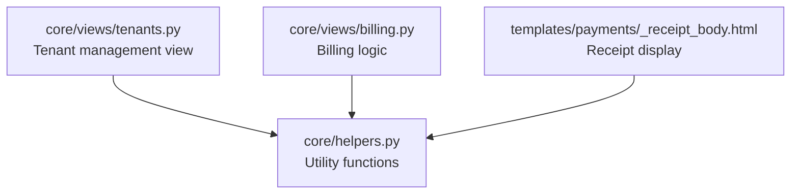
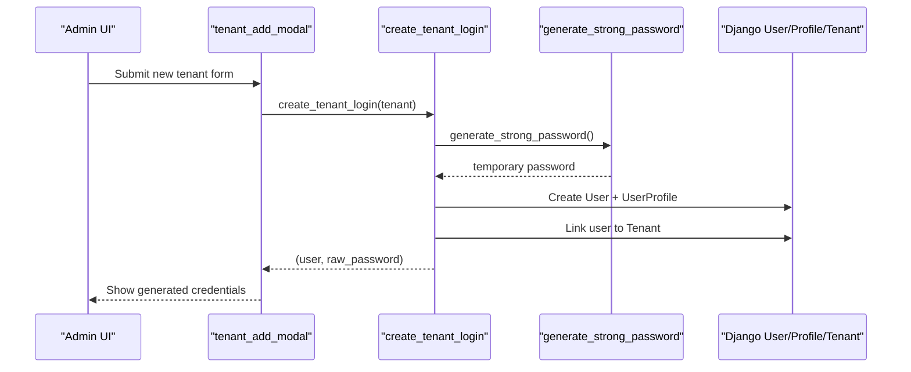
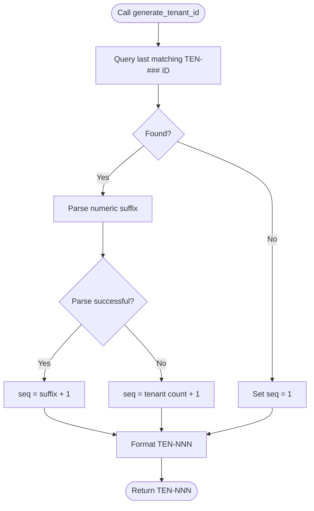
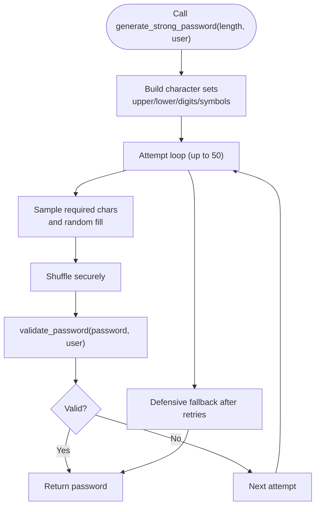
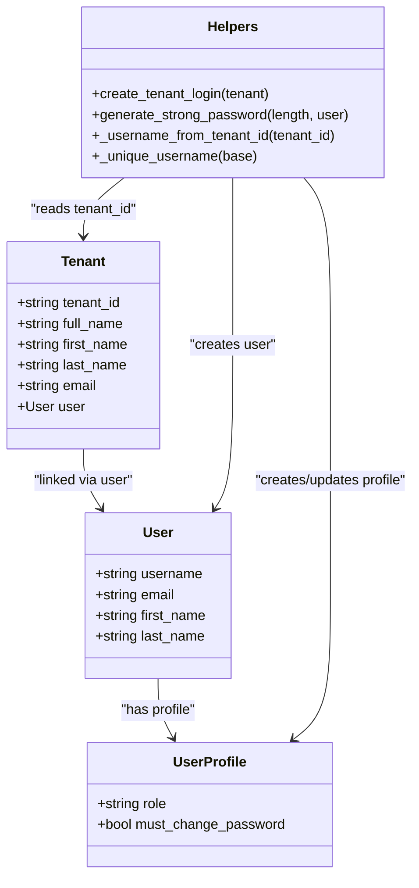
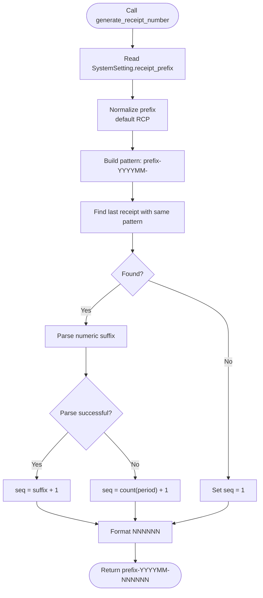
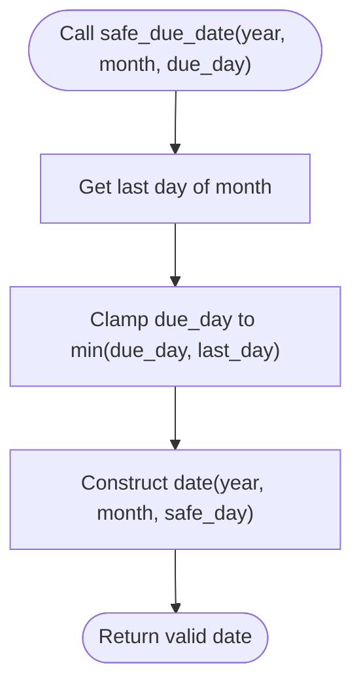
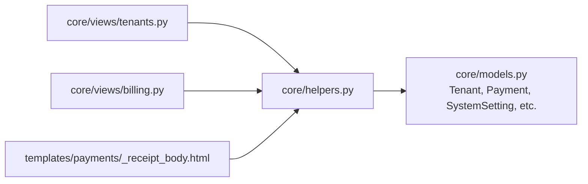

# Utility Functions & Data Generation

<cite>
**Referenced Files in This Document**
- [helpers.py](file://core/helpers.py)
- [tenants.py](file://core/views/tenants.py)
- [billing.py](file://core/views/billing.py)
- [_receipt_body.html](file://templates/payments/_receipt_body.html)
</cite>

## Table of Contents
1. [Introduction](#introduction)
2. [Project Structure](#project-structure)
3. [Core Components](#core-components)
4. [Architecture Overview](#architecture-overview)
5. [Detailed Component Analysis](#detailed-component-analysis)
6. [Dependency Analysis](#dependency-analysis)
7. [Performance Considerations](#performance-considerations)
8. [Troubleshooting Guide](#troubleshooting-guide)
9. [Conclusion](#conclusion)

## Introduction
This document explains the utility functions and data generation helpers used across the market rental system, focusing on:
- Tenant ID generation
- Secure password creation
- Tenant account provisioning
- Receipt number formatting
- Safe due date calculation

It covers naming conventions, security considerations, uniqueness guarantees, edge case handling, usage patterns, and integration points within the application workflow.

## Project Structure
The utilities are primarily implemented in a shared helper module and consumed by views and templates during tenant management and payment workflows.

**Diagram sources**
- [helpers.py:18-129](file://core/helpers.py#L18-L129)
- [tenants.py:305-322](file://core/views/tenants.py#L305-L322)
- [billing.py:54-59](file://core/views/billing.py#L54-L59)
- [_receipt_body.html:21-29](file://templates/payments/_receipt_body.html#L21-L29)

**Section sources**
- [helpers.py:18-129](file://core/helpers.py#L18-L129)
- [tenants.py:305-322](file://core/views/tenants.py#L305-L322)
- [billing.py:54-59](file://core/views/billing.py#L54-L59)
- [_receipt_body.html:21-29](file://templates/payments/_receipt_body.html#L21-L29)

## Core Components
The following utilities are central to identity, security, and financial numbering:

- `generate_tenant_id`: Produces sequential tenant IDs using the `TEN-###` convention.
- `generate_strong_password`: Creates secure temporary passwords that satisfy Django’s password validators.
- `create_tenant_login`: Provisions a tenant login with a secure username and temporary password, forcing a password change on first use.
- `generate_receipt_number`: Generates unique receipt numbers as `<prefix>-YYYYMM-NNNNNN`.
- `safe_due_date`: Safely computes due dates even when the requested day exceeds the month length.

**Section sources**
- [helpers.py:43-129](file://core/helpers.py#L43-L129)

## Architecture Overview
These utilities integrate into two main workflows:

1. Tenant creation flow:
   - A tenant is created through the tenant management view.
   - The view calls `create_tenant_login`, which derives a username from the tenant ID, generates a strong password, creates the user and profile, and links them back to the tenant.

2. Payment and receipt flow:
   - During payment recording, the system generates a receipt number and persists it on the payment record.
   - The receipt template displays the generated receipt number for official documentation.

**Diagram sources**
- [tenants.py:305-322](file://core/views/tenants.py#L305-L322)
- [helpers.py:92-122](file://core/helpers.py#L92-L122)
- [helpers.py:43-67](file://core/helpers.py#L43-L67)

## Detailed Component Analysis

### Tenant ID Generation: `generate_tenant_id`
Purpose:
- Generate the next sequential tenant ID in the `TEN-###` format.
- Ensure uniqueness by deriving the sequence from the highest existing numeric suffix rather than row count.

Naming Convention:
- Prefix: `TEN-`
- Sequence: Three-digit zero-padded number starting at 001.

Uniqueness Guarantee:
- Queries the database for the last matching ID pattern and increments its numeric part.
- Falls back to counting tenants if parsing fails.

Edge Cases:
- If no valid IDs exist, starts at `TEN-001`.
- If the last ID cannot be parsed, uses tenant count plus one.

Usage Pattern:
- Call this function when creating a new tenant to obtain a stable identifier.

Security Considerations:
- No secrets involved; purely deterministic and auditable.

Integration Points:
- Used during tenant creation to assign a consistent ID before login provisioning.

**Diagram sources**
- [helpers.py:70-89](file://core/helpers.py#L70-L89)

**Section sources**
- [helpers.py:70-89](file://core/helpers.py#L70-L89)

### Secure Password Creation: `generate_strong_password`
Purpose:
- Generate a cryptographically secure temporary password that satisfies Django’s password validation rules.

Security Considerations:
- Uses Python’s `secrets` module for randomness.
- Excludes ambiguous characters (e.g., I, O, l, 0, 1) to reduce transcription errors.
- Ensures inclusion of uppercase letters, lowercase letters, digits, and symbols.
- Validates against Django’s configured password policy via `validate_password`.
- Retries up to 50 times to find a compliant password; includes a defensive fallback.

Complexity:
- Time complexity depends on validator checks; typically constant per attempt.
- Space complexity is proportional to password length.

Usage Pattern:
- Called internally when provisioning tenant accounts.

Integration Points:
- Invoked by `create_tenant_login` to produce the initial temporary password.

**Diagram sources**
- [helpers.py:43-67](file://core/helpers.py#L43-L67)

**Section sources**
- [helpers.py:43-67](file://core/helpers.py#L43-L67)

### Tenant Account Creation: `create_tenant_login`
Purpose:
- Create or reuse a tenant login linked to a tenant record.
- Derive a clean username from the tenant ID.
- Generate a strong temporary password.
- Mark the account to force a password change on first login.
- Return the created user object and the raw temporary password.

Username Derivation:
- If the tenant ID already starts with `TEN`, use it directly.
- Otherwise, prefix with `TENANT`.
- Sanitize to allow only Django-valid username characters.
- Enforce uniqueness by appending a numeric suffix if needed.

Account Lifecycle:
- Creates a Django user with email and name fields.
- Creates or updates a user profile with role set to `tenant`.
- Sets `must_change_password` to true.
- Links the user back to the tenant record.

Usage Pattern:
- Called automatically when adding a tenant through the tenant management view.

Integration Points:
- View `tenant_add_modal` invokes this function and logs audit information.

**Diagram sources**
- [helpers.py:18-40](file://core/helpers.py#L18-L40)
- [helpers.py:92-122](file://core/helpers.py#L92-L122)
- [tenants.py:305-322](file://core/views/tenants.py#L305-L322)

**Section sources**
- [helpers.py:18-40](file://core/helpers.py#L18-L40)
- [helpers.py:92-122](file://core/helpers.py#L92-L122)
- [tenants.py:305-322](file://core/views/tenants.py#L305-L322)

### Receipt Number Formatting: `generate_receipt_number`
Purpose:
- Generate unique receipt numbers formatted as `<prefix>-YYYYMM-NNNNNN`.
- Ensure monthly sequences are derived from the highest existing suffix for the current period.

Naming Convention:
- Prefix: Configured via system settings (`receipt_prefix`), defaulting to `RCP`.
- Period: Current year and month (`YYYYMM`).
- Sequence: Six-digit zero-padded number starting at 000001.

Uniqueness Guarantee:
- Queries payments whose receipt numbers start with the current period pattern.
- Increments the numeric suffix from the last matching receipt.
- Falls back to counting receipts in the period if parsing fails.

Edge Cases:
- If no receipts exist for the period, starts at 000001.
- If the last receipt number cannot be parsed, counts existing receipts for the period.

Usage Pattern:
- Called inside the payment recording process to assign a receipt number to each payment.

Integration Points:
- Displayed in the receipt template under “Receipt No”.

**Diagram sources**
- [helpers.py:276-300](file://core/helpers.py#L276-L300)

**Section sources**
- [helpers.py:276-300](file://core/helpers.py#L276-L300)
- [_receipt_body.html:21-29](file://templates/payments/_receipt_body.html#L21-L29)

### Date Utilities: `safe_due_date`
Purpose:
- Compute a safe due date for billing periods, handling months with fewer days than the requested due day.

Behavior:
- Determines the last day of the given month.
- Clamps the requested due day to the last day if it exceeds the month length.
- Returns a valid `date` object.

Edge Cases:
- February in leap years vs non-leap years.
- Months with 30 days vs 31 days.
- Requested due day greater than the month’s maximum.

Usage Pattern:
- Used when creating billings to ensure due dates are always valid.

Integration Points:
- Billing logic uses this function to compute due dates for each billing period.

**Diagram sources**
- [helpers.py:125-129](file://core/helpers.py#L125-L129)
- [billing.py:54-59](file://core/views/billing.py#L54-L59)

**Section sources**
- [helpers.py:125-129](file://core/helpers.py#L125-L129)
- [billing.py:54-59](file://core/views/billing.py#L54-L59)

## Dependency Analysis
The utilities depend on Django models and settings, and are consumed by views and templates.

**Diagram sources**
- [helpers.py:1-15](file://core/helpers.py#L1-L15)
- [tenants.py:305-322](file://core/views/tenants.py#L305-L322)
- [billing.py:54-59](file://core/views/billing.py#L54-L59)
- [_receipt_body.html:21-29](file://templates/payments/_receipt_body.html#L21-L29)

**Section sources**
- [helpers.py:1-15](file://core/helpers.py#L1-L15)
- [tenants.py:305-322](file://core/views/tenants.py#L305-L322)
- [billing.py:54-59](file://core/views/billing.py#L54-L59)
- [_receipt_body.html:21-29](file://templates/payments/_receipt_body.html#L21-L29)

## Performance Considerations
- `generate_tenant_id` and `generate_receipt_number` perform database queries to determine the next sequence. Indexes on `tenant_id` and `receipt_number` can improve performance.
- `generate_strong_password` performs multiple attempts to satisfy validators; keep password length reasonable to avoid excessive retries.
- `safe_due_date` is lightweight and has negligible overhead.

[No sources needed since this section provides general guidance]

## Troubleshooting Guide
Common issues and resolutions:

- Duplicate usernames during tenant login creation:
  - The `_unique_username` helper appends numeric suffixes until a unique username is found.
  - Check for existing users with similar base names.

- Invalid due dates:
  - Use `safe_due_date` to avoid invalid dates when the requested due day exceeds the month length.

- Receipt number collisions:
  - The system retries receipt number generation in case of integrity errors during concurrent payments.

- Password validation failures:
  - Ensure Django’s password validators are properly configured; `generate_strong_password` validates against these rules.

**Section sources**
- [helpers.py:32-40](file://core/helpers.py#L32-L40)
- [helpers.py:125-129](file://core/helpers.py#L125-L129)
- [helpers.py:43-67](file://core/helpers.py#L43-L67)

## Conclusion
The utility functions documented here provide robust identity generation, secure credential provisioning, and reliable financial numbering. They enforce naming conventions, ensure uniqueness, handle edge cases gracefully, and integrate seamlessly into tenant and payment workflows. Proper configuration of system settings and adherence to Django’s security policies will further strengthen the system’s reliability and security posture.

[No sources needed since this section summarizes without analyzing specific files]