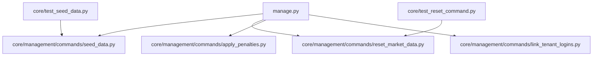
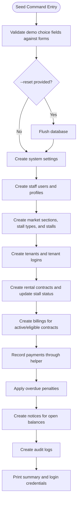
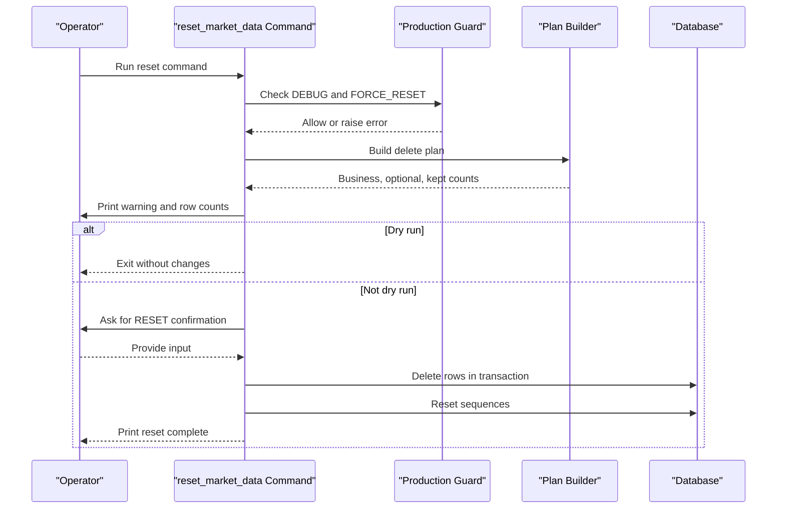
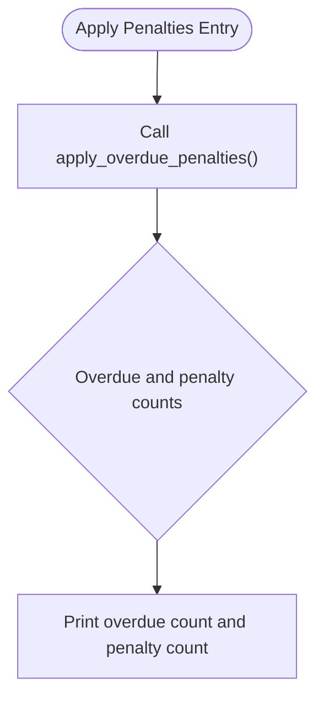
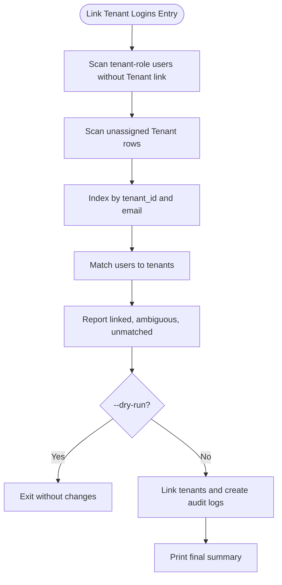
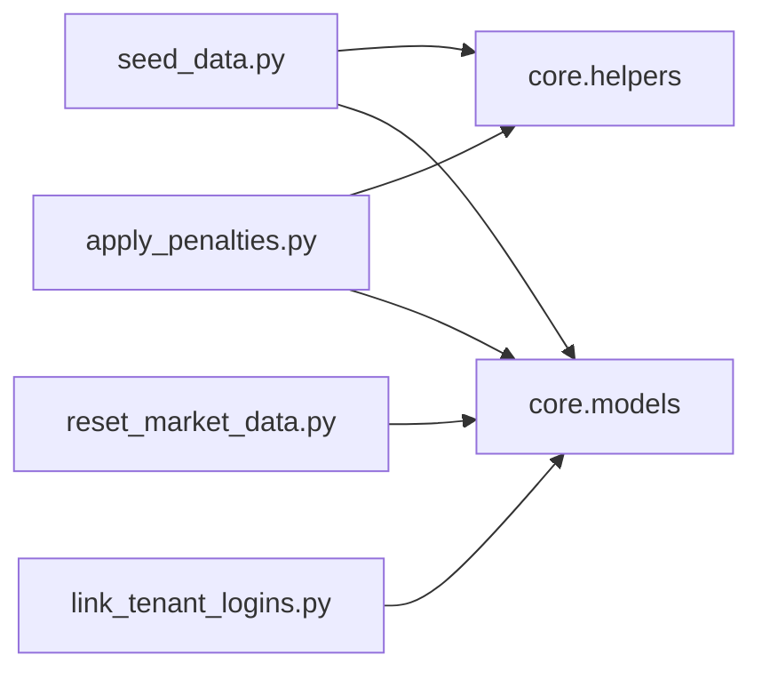

# Command Line Tools

<cite>
**Referenced Files in This Document**
- [seed_data.py](file://core/management/commands/seed_data.py)
- [reset_market_data.py](file://core/management/commands/reset_market_data.py)
- [apply_penalties.py](file://core/management/commands/apply_penalties.py)
- [link_tenant_logins.py](file://core/management/commands/link_tenant_logins.py)
- [test_seed_data.py](file://core/test_seed_data.py)
- [test_reset_command.py](file://core/test_reset_command.py)
</cite>

## Table of Contents
1. [Introduction](#introduction)
2. [Project Structure](#project-structure)
3. [Core Components](#core-components)
4. [Architecture Overview](#architecture-overview)
5. [Detailed Component Analysis](#detailed-component-analysis)
6. [Dependency Analysis](#dependency-analysis)
7. [Performance Considerations](#performance-considerations)
8. [Troubleshooting Guide](#troubleshooting-guide)
9. [Conclusion](#conclusion)

## Introduction
This document explains the Command Line Tools module for the Public Market Rental System. It covers four Django management commands used during development, maintenance, and data repair:

- `seed_data`: Creates a realistic sample dataset including tenants, stalls, sections, contracts, billings, payments, notices, and audit logs.
- `reset_market_data`: Safely clears market, tenant, billing, payment, and related business data while preserving audit trails, system settings, and admin accounts unless explicitly requested otherwise.
- `apply_penalties`: Applies overdue status and retroactive penalties to unpaid billings based on configured grace periods and penalty rules.
- `link_tenant_logins`: Repairs orphan tenant-role user accounts by linking them to matching Tenant records so portal access works correctly.

These tools are intended for local development, testing, staging reprovisioning, and controlled maintenance operations. They are not exposed as HTTP endpoints.

## Project Structure
The command-line tools live under the core application’s management commands directory. Each command is a separate file implementing a Django `BaseCommand`.

**Diagram sources**
- [seed_data.py:193-229](file://core/management/commands/seed_data.py#L193-L229)
- [reset_market_data.py:61-122](file://core/management/commands/reset_market_data.py#L61-L122)
- [apply_penalties.py:6-13](file://core/management/commands/apply_penalties.py#L6-L13)
- [link_tenant_logins.py:25-45](file://core/management/commands/link_tenant_logins.py#L25-L45)
- [test_seed_data.py:27-33](file://core/test_seed_data.py#L27-L33)
- [test_reset_command.py:25-87](file://core/test_reset_command.py#L25-L87)

**Section sources**
- [seed_data.py:193-229](file://core/management/commands/seed_data.py#L193-L229)
- [reset_market_data.py:61-122](file://core/management/commands/reset_market_data.py#L61-L122)
- [apply_penalties.py:6-13](file://core/management/commands/apply_penalties.py#L6-L13)
- [link_tenant_logins.py:25-45](file://core/management/commands/link_tenant_logins.py#L25-L45)

## Core Components
The command-line tools provide four distinct responsibilities:

| Command | Purpose | Key Parameters | Typical Use Case |
|---|---|---|---|
| `seed_data` | Populate the database with sample tenants, stalls, contracts, billings, payments, notices, and audit logs | `--reset` | Development setup, demo runs, integration tests |
| `reset_market_data` | Clear business data safely with confirmation and environment guards | `--yes`, `--dry-run`, `--users`, `--audit`, `--clear-settings` | Dev refresh, staging rebuild, cleanup before reseed |
| `apply_penalties` | Mark overdue billings and apply penalties according to configuration | None | Scheduled maintenance, collection automation |
| `link_tenant_logins` | Link tenant-role users to Tenant records when they were created without proper linkage | `--dry-run`, `--verbose` | Data repair after legacy user creation flows |

**Section sources**
- [seed_data.py:193-229](file://core/management/commands/seed_data.py#L193-L229)
- [reset_market_data.py:61-122](file://core/management/commands/reset_market_data.py#L61-L122)
- [apply_penalties.py:6-13](file://core/management/commands/apply_penalties.py#L6-L13)
- [link_tenant_logins.py:25-45](file://core/management/commands/link_tenant_logins.py#L25-L45)

## Architecture Overview
The commands interact with shared domain models and helpers rather than duplicating business logic.

```mermaid
graph TB
subgraph "Management Commands"
Seed["seed_data.py"]
Reset["reset_market_data.py"]
Penalty["apply_penalties.py"]
Link["link_tenant_logins.py"]
end
subgraph "Shared Helpers"
Helpers["core.helpers"]
end
subgraph "Domain Models"
TenantModel["Tenant"]
StallModel["Stall"]
ContractModel["RentalContract"]
BillingModel["Billing"]
PaymentModel["Payment"]
LedgerModel["TenantLedger"]
NoticeModel["Notice"]
AuditModel["AuditLog"]
UserModel["User / UserProfile"]
SettingsModel["SystemSetting"]
SectionModel["MarketSection"]
TypeModel["StallType"]
PenaltySettingModel["PenaltySetting"]
end
Seed --> Helpers
Seed --> TenantModel
Seed --> StallModel
Seed --> ContractModel
Seed --> BillingModel
Seed --> PaymentModel
Seed --> NoticeModel
Seed --> AuditModel
Seed --> UserModel
Seed --> SettingsModel
Seed --> SectionModel
Seed --> TypeModel
Seed --> PenaltySettingModel
Reset --> TenantModel
Reset --> StallModel
Reset --> ContractModel
Reset --> BillingModel
Reset --> PaymentModel
Reset --> LedgerModel
Reset --> NoticeModel
Reset --> UserModel
Reset --> SettingsModel
Reset --> SectionModel
Reset --> TypeModel
Reset --> AuditModel
Penalty --> Helpers
Penalty --> BillingModel
Link --> TenantModel
Link --> UserModel
Link --> AuditModel
```

**Diagram sources**
- [seed_data.py:16-34](file://core/management/commands/seed_data.py#L16-L34)
- [reset_market_data.py:36-58](file://core/management/commands/reset_market_data.py#L36-L58)
- [apply_penalties.py:3-10](file://core/management/commands/apply_penalties.py#L3-L10)
- [link_tenant_logins.py:18-22](file://core/management/commands/link_tenant_logins.py#L18-L22)

## Detailed Component Analysis

### Seed Data Command
The seed command creates a complete, financially consistent sample dataset. It validates that demo values match form choices, then builds system settings, staff users, market structure, tenants, contracts, billings, payments, notices, and audit logs.

#### Command Parameters
| Parameter | Type | Default | Description |
|---|---|---:|---|
| `--reset` | Flag | `False` | Flushes the entire database before seeding fresh data |

#### Usage Examples
- Fresh development setup:
  - `python manage.py seed_data --reset`
- Idempotent reseed (no flush):
  - `python manage.py seed_data`

#### Expected Output
- A success message showing counts for tenants, stalls, contracts, billings, payments, overdue marks, penalties accrued, and notices.
- Staff login usernames and passwords.
- Tenant login pattern using tenant IDs with a shared tenant password.

#### Seeded Data Model
The seed process creates:

- **System settings**: municipality name, market name, office name, receipt prefix, default due day, penalty type, penalty value, grace period, and theme color.
- **Staff users**: administrator, collector, cashier, supervisor, and treasurer roles with associated profiles.
- **Market structure**: market sections, stall types, and stalls with monthly rates and statuses.
- **Tenants**: multiple tenants with split name fields, composed full names, addresses, contact information, identification details, business information, and emergency contacts.
- **Contracts**: active, expired, terminated, and pending rental contracts tied to tenants and stalls.
- **Billings**: monthly billings generated through helper functions so debits and balances remain consistent.
- **Payments**: full, partial, and unpaid scenarios recorded through the payment helper.
- **Notices**: demand notices, overdue notices, payment reminders, and vacancy notices.
- **Audit logs**: representative administrative actions.

**Diagram sources**
- [seed_data.py:196-229](file://core/management/commands/seed_data.py#L196-L229)
- [seed_data.py:258-339](file://core/management/commands/seed_data.py#L258-L339)
- [seed_data.py:341-429](file://core/management/commands/seed_data.py#L341-L429)
- [seed_data.py:431-527](file://core/management/commands/seed_data.py#L431-L527)

#### Data Consistency Guarantees
- Tenant identity fields and composed values follow the same composition rules as the tenant form.
- Business types and valid ID types must match form choices; otherwise the command fails early.
- Active contracts are unique per stall and drive stall occupancy status.
- Billing totals reflect posted payments.
- Tenant ledger balances close against outstanding billing totals.
- Receipt numbers are unique and prefixed according to system settings.
- Running the command twice does not duplicate tenants, stalls, contracts, or payments.

**Section sources**
- [seed_data.py:193-229](file://core/management/commands/seed_data.py#L193-L229)
- [seed_data.py:231-247](file://core/management/commands/seed_data.py#L231-L247)
- [seed_data.py:258-339](file://core/management/commands/seed_data.py#L258-L339)
- [seed_data.py:341-429](file://core/management/commands/seed_data.py#L341-L429)
- [seed_data.py:431-527](file://core/management/commands/seed_data.py#L431-L527)
- [test_seed_data.py:27-132](file://core/test_seed_data.py#L27-L132)

### Reset Market Data Command
The reset command is intentionally destructive but includes strong safety controls. It removes market, tenant, billing, payment, ledger, notice, contract, stall, section, and stall-type rows while preserving audit logs, system settings, and admin users unless explicitly requested.

#### Command Parameters
| Parameter | Type | Default | Description |
|---|---|---:|---|
| `--yes` | Flag | `False` | Skips interactive confirmation for scripted use |
| `--dry-run` | Flag | `False` | Prints row counts that would be deleted without modifying the database |
| `--users` | Flag | `False` | Deletes tenant-linked User and UserProfile rows |
| `--audit` | Flag | `False` | Clears AuditLog rows |
| `--clear-settings` | Flag | `False` | Clears SystemSetting rows |

#### Safety Controls
- No HTTP route exposes this logic.
- Interactive confirmation requires typing `RESET`.
- Non-interactive shells require `--yes`.
- Production-shaped deployments refuse to run unless `FORCE_RESET=1` is set in the environment.
- `DEBUG=False` is treated as production.
- All deletions occur inside a single transaction.
- Sequence counters are reset where supported so subsequent seeds start from predictable IDs.

#### Usage Examples
- Preview what will be deleted:
  - `python manage.py reset_market_data --dry-run`
- Interactive reset in a safe development environment:
  - `python manage.py reset_market_data`
- Scripted reset with optional flags:
  - `python manage.py reset_market_data --users --audit --yes`
- Force reset in non-DEBUG environments:
  - Set `FORCE_RESET=1` in the environment, then run the command normally.

#### Execution Flow

**Diagram sources**
- [reset_market_data.py:68-122](file://core/management/commands/reset_market_data.py#L68-L122)
- [reset_market_data.py:126-159](file://core/management/commands/reset_market_data.py#L126-L159)
- [reset_market_data.py:163-227](file://core/management/commands/reset_market_data.py#L163-L227)

#### Preserved vs Deleted Data
| Category | Tables | Behavior |
|---|---|---|
| Always deleted | TenantLedger, Payment, Billing, Notice, PenaltySetting, RentalContract, Tenant, Stall, MarketSection, StallType | Removed in leaf-first order |
| Optional deletion | Tenant Users, AuditLog, SystemSetting | Controlled by flags |
| Always kept | Superuser accounts | Never removed even with `--users` |

**Section sources**
- [reset_market_data.py:1-29](file://core/management/commands/reset_market_data.py#L1-L29)
- [reset_market_data.py:61-122](file://core/management/commands/reset_market_data.py#L61-L122)
- [reset_market_data.py:126-159](file://core/management/commands/reset_market_data.py#L126-L159)
- [reset_market_data.py:163-248](file://core/management/commands/reset_market_data.py#L163-L248)
- [test_reset_command.py:25-181](file://core/test_reset_command.py#L25-L181)

### Apply Penalties Command
The penalty command is a thin wrapper around the shared overdue penalty helper. It marks unpaid billings as overdue and applies penalties according to configured grace periods and penalty rules.

#### Command Parameters
None. The command uses current system settings and existing billing data.

#### Usage Examples
- Manual execution:
  - `python manage.py apply_penalties`
- Automated execution via scheduler:
  - Schedule the command daily or hourly depending on collection policy.

#### Expected Output
A success message reporting how many billings were marked overdue and how many penalties were applied.

**Diagram sources**
- [apply_penalties.py:6-13](file://core/management/commands/apply_penalties.py#L6-L13)

**Section sources**
- [apply_penalties.py:1-14](file://core/management/commands/apply_penalties.py#L1-L14)

### Link Tenant Logins Command
The link command repairs orphan tenant-role user accounts. It finds users with role `tenant` but no linked Tenant record, matches them against unassigned Tenant rows by username or email, and links them safely.

#### Command Parameters
| Parameter | Type | Default | Description |
|---|---|---:|---|
| `--dry-run` | Flag | `False` | Reports what would be linked without writing |
| `--verbose` | Flag | `False` | Prints skipped rows and reasons |

#### Matching Rules
- Prefers exact case-insensitive match between username and Tenant ID.
- Falls back to email match only if username path yields no candidates.
- Never overwrites an existing Tenant user link.
- Never links when multiple Tenant candidates exist.
- Never invents a Tenant row for a User without a counterpart.

#### Usage Examples
- Preview linking:
  - `python manage.py link_tenant_logins --dry-run`
- Full repair with detailed output:
  - `python manage.py link_tenant_logins --verbose`

#### Execution Flow

**Diagram sources**
- [link_tenant_logins.py:43-169](file://core/management/commands/link_tenant_logins.py#L43-L169)

**Section sources**
- [link_tenant_logins.py:1-169](file://core/management/commands/link_tenant_logins.py#L1-L169)

## Dependency Analysis
The commands depend on shared models and helpers rather than duplicating business logic.

**Diagram sources**
- [seed_data.py:16-34](file://core/management/commands/seed_data.py#L16-L34)
- [reset_market_data.py:36-58](file://core/management/commands/reset_market_data.py#L36-L58)
- [apply_penalties.py:3-10](file://core/management/commands/apply_penalties.py#L3-L10)
- [link_tenant_logins.py:18-22](file://core/management/commands/link_tenant_logins.py#L18-L22)

**Section sources**
- [seed_data.py:16-34](file://core/management/commands/seed_data.py#L16-L34)
- [reset_market_data.py:36-58](file://core/management/commands/reset_market_data.py#L36-L58)
- [apply_penalties.py:3-10](file://core/management/commands/apply_penalties.py#L3-L10)
- [link_tenant_logins.py:18-22](file://core/management/commands/link_tenant_logins.py#L18-L22)

## Performance Considerations
- `seed_data` performs multiple database writes but uses idempotent creation patterns such as get-or-create and existence checks. Re-running it without `--reset` should not duplicate core entities.
- `reset_market_data` deletes rows through querysets so cascade behavior and post-delete signals remain intact. It also resets sequence counters where supported.
- `apply_penalties` delegates work to a shared helper, keeping the command lightweight and suitable for scheduled execution.
- `link_tenant_logins` indexes candidate tenants by tenant ID and email to avoid repeated scans and reduce ambiguity detection cost.

[No sources needed since this section provides general guidance]

## Troubleshooting Guide

### Common Issues and Resolutions

| Issue | Likely Cause | Resolution |
|---|---|---|
| Seed command raises a validation error about business type or valid ID type | Demo data does not match form choices | Update the demo data or form choices so they align |
| Seed command duplicates data unexpectedly | Running without understanding idempotency | Use `--reset` only when you want a clean database; otherwise rely on idempotent creation |
| Reset command refuses to run | Deployment has `DEBUG=False` and no force flag | Set `FORCE_RESET=1` or run in a debug environment |
| Reset command asks for confirmation | Interactive mode without `--yes` | Type `RESET` or pass `--yes` for scripts |
| Reset command deletes more than expected | Missing flags | Review `--users`, `--audit`, and `--clear-settings` behavior |
| Tenant cannot access portal | Orphan tenant-role user without Tenant link | Run `link_tenant_logins --dry-run` first, then execute without `--dry-run` |
| Link command reports ambiguous matches | Multiple Tenant rows match the same username or email | Resolve manually by reviewing tenant IDs and emails |
| Penalty command shows zero changes | No unpaid or overdue billings meet grace-period rules | Verify billing status, due dates, and penalty settings |

### Environment-Specific Notes
- Development: Use `seed_data --reset` to start fresh, then `reset_market_data --dry-run` to preview teardown.
- Testing: Tests exercise both seed consistency and reset safety rails.
- Staging: Use `reset_market_data --dry-run` before any destructive operation.
- Production: Do not run these commands unless explicitly authorized. The reset command blocks non-DEBUG deployments unless `FORCE_RESET=1` is set.

**Section sources**
- [seed_data.py:231-247](file://core/management/commands/seed_data.py#L231-L247)
- [reset_market_data.py:126-159](file://core/management/commands/reset_market_data.py#L126-L159)
- [link_tenant_logins.py:80-106](file://core/management/commands/link_tenant_logins.py#L80-L106)
- [test_seed_data.py:27-132](file://core/test_seed_data.py#L27-L132)
- [test_reset_command.py:100-181](file://core/test_reset_command.py#L100-L181)

## Conclusion
The Command Line Tools module provides safe, auditable, and repeatable operations for managing market rental data. `seed_data` builds a comprehensive test dataset, `reset_market_data` offers a guarded teardown path, `apply_penalties` centralizes overdue processing, and `link_tenant_logins` repairs common user-link inconsistencies. Together, they support development workflows, testing, maintenance automation, and controlled data repair while preserving important operational safeguards.

[No sources needed since this section summarizes without analyzing specific files]