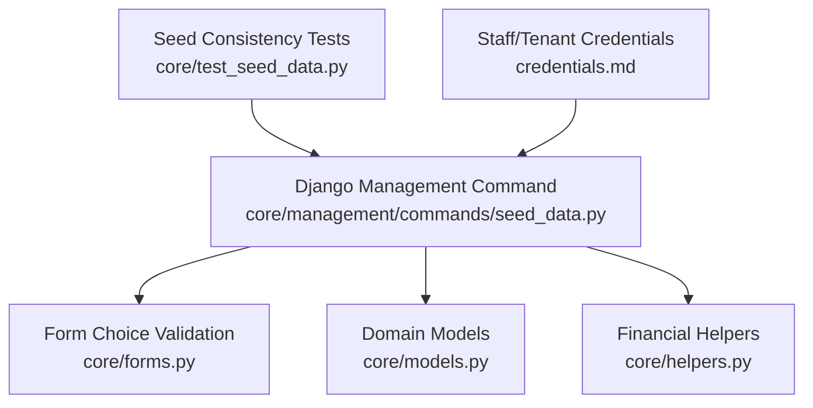
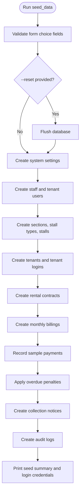
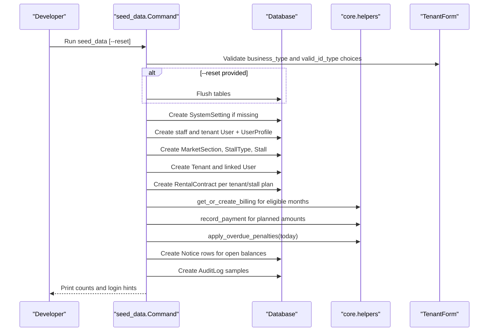
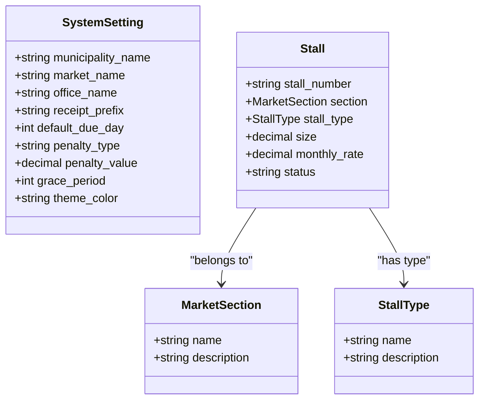
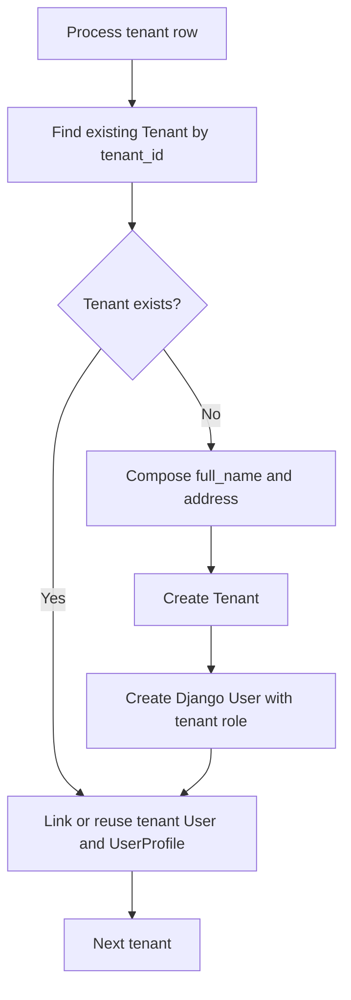
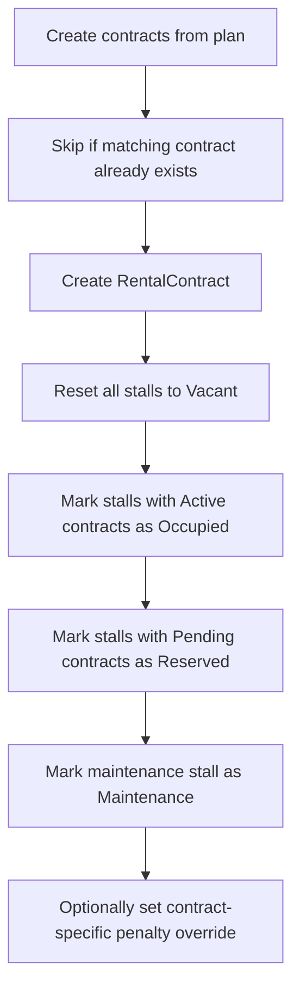
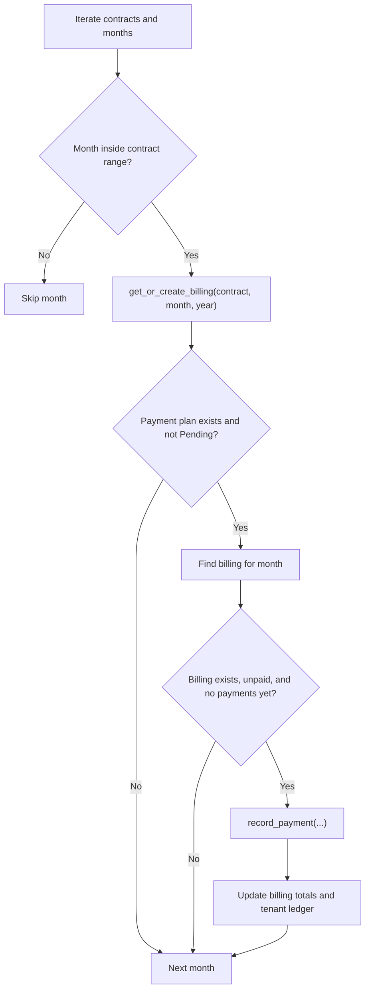
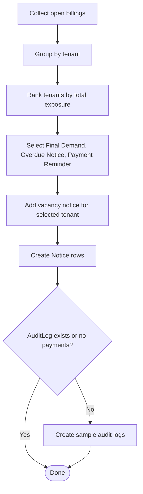
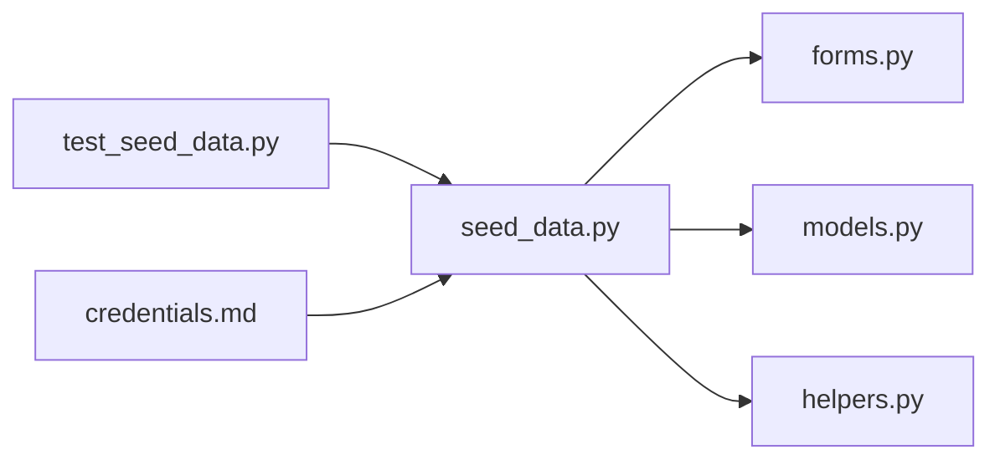

# Data Seeding Command

<cite>
**Referenced Files in This Document**
- [seed_data.py](file://core/management/commands/seed_data.py)
- [models.py](file://core/models.py)
- [helpers.py](file://core/helpers.py)
- [forms.py](file://core/forms.py)
- [test_seed_data.py](file://core/test_seed_data.py)
- [credentials.md](file://credentials.md)
</cite>

## Table of Contents
1. [Introduction](#introduction)
2. [Project Structure](#project-structure)
3. [Core Components](#core-components)
4. [Architecture Overview](#architecture-overview)
5. [Detailed Component Analysis](#detailed-component-analysis)
6. [Dependency Analysis](#dependency-analysis)
7. [Performance Considerations](#performance-considerations)
8. [Troubleshooting Guide](#troubleshooting-guide)
9. [Conclusion](#conclusion)

## Introduction
The `seed_data` management command prepares the Public Market Rental System with a realistic, financially consistent dataset for development and testing. It creates system settings, staff and tenant accounts, market sections, stall types, stalls, tenants, rental contracts, billings, payments, overdue penalties, notices, and audit logs. The command is idempotent: running it more than once does not duplicate core rows, and financial totals remain consistent through shared helpers that manage billing, payments, and ledger balances.

This document explains how to run the command, what data it produces, how the seeded records relate to each other, and how to troubleshoot common issues.

## Project Structure
The seeding logic lives under the Django management commands layer and depends on the project’s models, forms, and financial helpers.

**Diagram sources**
- [seed_data.py:193-229](file://core/management/commands/seed_data.py#L193-L229)
- [models.py:42-336](file://core/models.py#L42-L336)
- [helpers.py:125-500](file://core/helpers.py#L125-L500)
- [forms.py:49-154](file://core/forms.py#L49-L154)
- [test_seed_data.py:27-132](file://core/test_seed_data.py#L27-L132)
- [credentials.md:1-29](file://credentials.md#L1-L29)

**Section sources**
- [seed_data.py:193-229](file://core/management/commands/seed_data.py#L193-L229)
- [models.py:42-336](file://core/models.py#L42-L336)

## Core Components
The command implements a single Django management command class responsible for orchestrating the full seed workflow. Its responsibilities include:

- Validating that demo data matches current form choices.
- Optionally flushing the database before seeding.
- Creating system configuration.
- Creating staff and tenant user accounts.
- Creating market structure: sections, stall types, and stalls.
- Creating tenants with split name/address fields and linked logins.
- Creating rental contracts tied to tenants and stalls.
- Generating monthly billings within contract date ranges.
- Recording sample payments through the payment helper.
- Running overdue penalty accrual.
- Creating collection notices based on open balances.
- Writing representative audit logs.

### Command Options and Flags
| Option | Type | Default | Behavior |
|--------|------|---------|----------|
| `--reset` | Boolean flag | Off | Flushes every table before seeding, then inserts a fresh dataset. |

There are no additional flags for selective seeding by data type. The command always seeds all supported categories: system settings, users, market structure, tenants, contracts, billings, payments, penalties, notices, and audit logs.

**Section sources**
- [seed_data.py:196-205](file://core/management/commands/seed_data.py#L196-L205)
- [seed_data.py:201-229](file://core/management/commands/seed_data.py#L201-L229)

## Architecture Overview
The command follows a layered orchestration pattern: it validates inputs, builds reference data first, then constructs business entities that depend on those references, and finally runs financial reconciliation steps.

**Diagram sources**
- [seed_data.py:201-229](file://core/management/commands/seed_data.py#L201-L229)
- [seed_data.py:258-380](file://core/management/commands/seed_data.py#L258-L380)
- [seed_data.py:382-429](file://core/management/commands/seed_data.py#L382-L429)
- [seed_data.py:431-527](file://core/management/commands/seed_data.py#L431-L527)

## Detailed Component Analysis

### Seed Workflow Orchestration
The command entry point validates form choices, optionally flushes the database, computes recent months, and calls internal methods in a fixed order. After completion, it prints counts for tenants, stalls, contracts, billings, payments, overdue marks, penalties, and notices, followed by staff and tenant login hints.

Key behaviors:
- Form choice validation prevents demo data from drifting away from live dropdown options.
- Database flush is only triggered by `--reset`.
- Months are computed relative to today so historical billing and payment patterns remain meaningful.
- Financial operations use shared helpers rather than direct model creation for billing and payments.

**Diagram sources**
- [seed_data.py:196-229](file://core/management/commands/seed_data.py#L196-L229)
- [seed_data.py:231-247](file://core/management/commands/seed_data.py#L231-L247)
- [seed_data.py:258-380](file://core/management/commands/seed_data.py#L258-L380)
- [seed_data.py:382-429](file://core/management/commands/seed_data.py#L382-L429)
- [seed_data.py:431-527](file://core/management/commands/seed_data.py#L431-L527)
- [helpers.py:155-205](file://core/helpers.py#L155-L205)
- [helpers.py:351-420](file://core/helpers.py#L351-L420)
- [helpers.py:423-500](file://core/helpers.py#L423-L500)

**Section sources**
- [seed_data.py:196-229](file://core/management/commands/seed_data.py#L196-L229)

### Reference Data Creation
Reference data includes system settings, staff users, market sections, stall types, and stalls. These rows are created using safe lookup patterns so repeated runs do not duplicate them.

Important details:
- System settings are created only when none exist.
- Staff users are created with roles such as admin, collector, cashier, supervisor, and treasurer.
- Market sections and stall types are inserted via lookup tables.
- Stalls are assigned to sections and types, sized, priced, and marked with derived statuses.

**Diagram sources**
- [models.py:42-69](file://core/models.py#L42-L69)
- [models.py:71-115](file://core/models.py#L71-L115)
- [seed_data.py:258-307](file://core/management/commands/seed_data.py#L258-L307)

**Section sources**
- [seed_data.py:258-307](file://core/management/commands/seed_data.py#L258-L307)
- [models.py:42-115](file://core/models.py#L42-L115)

### Tenant and Login Creation
Tenants are created with split name and address fields, composed values, contact information, identification details, business information, and an active status. Each tenant also receives a Django `User` account with a tenant role profile.

Key points:
- Tenant IDs follow a predictable pattern.
- Full names and addresses are composed consistently with the tenant form save behavior.
- Business type and valid ID type must match current form choices.
- Tenant logins use a shared password for convenience in development and test environments.

**Diagram sources**
- [seed_data.py:309-339](file://core/management/commands/seed_data.py#L309-L339)
- [forms.py:49-154](file://core/forms.py#L49-L154)
- [models.py:117-155](file://core/models.py#L117-L155)

**Section sources**
- [seed_data.py:309-339](file://core/management/commands/seed_data.py#L309-L339)
- [forms.py:49-154](file://core/forms.py#L49-L154)
- [models.py:117-155](file://core/models.py#L117-L155)

### Contract and Stall Status Logic
Contracts link tenants to stalls and define start dates, end dates, monthly rent, due day, security deposit, and status. Active contracts drive stall occupancy state.

Important rules:
- Only one active contract is allowed per stall.
- Stall status is derived from contracts: occupied for active, reserved for pending, maintenance for a designated stall, and vacant otherwise.
- Expired and terminated contracts remain for historical context.

**Diagram sources**
- [seed_data.py:341-380](file://core/management/commands/seed_data.py#L341-L380)
- [models.py:157-188](file://core/models.py#L157-L188)

**Section sources**
- [seed_data.py:341-380](file://core/management/commands/seed_data.py#L341-L380)
- [models.py:157-188](file://core/models.py#L157-L188)

### Billing and Payment Generation
Billings are generated for each non-pending contract across recent months bounded by contract start and end dates. Payments are recorded through the shared payment helper, which ensures receipts, billing totals, balances, and ledger entries stay consistent.

Behavior highlights:
- Billings are created idempotently.
- Payments are skipped if a billing already has payments or is fully settled.
- Partial payments settle 60% of the outstanding balance.
- Overdue penalties are applied after payments.
- Receipt numbers are unique and prefixed according to system settings.

**Diagram sources**
- [seed_data.py:382-429](file://core/management/commands/seed_data.py#L382-L429)
- [helpers.py:155-205](file://core/helpers.py#L155-L205)
- [helpers.py:351-420](file://core/helpers.py#L351-L420)

**Section sources**
- [seed_data.py:382-429](file://core/management/commands/seed_data.py#L382-L429)
- [helpers.py:155-205](file://core/helpers.py#L155-L205)
- [helpers.py:351-420](file://core/helpers.py#L351-L420)

### Notices and Audit Logs
Notices are created for tenants with open balances, prioritized by exposure and limited to one notice per tenant for readability. A vacancy notice is added for a specific tenant whose contract has lapsed. Audit logs are written only when none exist and payments were created.

**Diagram sources**
- [seed_data.py:431-527](file://core/management/commands/seed_data.py#L431-L527)

**Section sources**
- [seed_data.py:431-527](file://core/management/commands/seed_data.py#L431-L527)

## Dependency Analysis
The seed command depends on several layers:

- **Forms**: Used to validate that demo tenant data matches current business type and valid ID type choices.
- **Models**: Define tenants, stalls, contracts, billings, payments, notices, audit logs, system settings, and profiles.
- **Helpers**: Provide authoritative financial operations for billing creation, payment recording, overdue penalty application, and ledger recalculation.
- **Tests**: Assert expected counts, uniqueness, financial consistency, and idempotence.
- **Credentials documentation**: Summarizes staff and tenant login information produced by the seed process.

**Diagram sources**
- [seed_data.py:15-34](file://core/management/commands/seed_data.py#L15-L34)
- [seed_data.py:196-229](file://core/management/commands/seed_data.py#L196-L229)
- [test_seed_data.py:27-132](file://core/test_seed_data.py#L27-L132)
- [credentials.md:1-29](file://credentials.md#L1-L29)

**Section sources**
- [seed_data.py:15-34](file://core/management/commands/seed_data.py#L15-L34)
- [test_seed_data.py:27-132](file://core/test_seed_data.py#L27-L132)
- [credentials.md:1-29](file://credentials.md#L1-L29)

## Performance Considerations
- The command performs multiple database writes but uses idempotent lookups and bulk-friendly patterns where possible.
- Financial helpers lock billing rows during payment posting to avoid inconsistent totals.
- Overdue penalty application iterates over relevant billings and updates ledgers; repeated runs are safe because penalties are applied only once per billing period.
- For large datasets, consider:
  - Using `--reset` only when a clean database is required.
  - Running the command outside peak hours.
  - Ensuring the database connection and storage backend can handle sequential writes.
  - Avoiding concurrent manual edits while seeding.
  - Monitoring transaction sizes and database locks during payment posting.

[No sources needed since this section provides general guidance]

## Troubleshooting Guide

### Common Issues and Resolutions

| Issue | Likely Cause | Resolution |
|-------|--------------|------------|
| Duplicate tenant or stall rows after re-running | Manual edits or partial seeding | Use `--reset` to flush and rebuild a clean dataset. |
| Form choice validation error | Demo data contains a business type or valid ID type not present in the current form | Update the demo data or adjust the form choices so they match. |
| Billing totals do not match payments | Direct database edits bypassed the payment helper | Recreate data through the command or use the payment helper to reconcile. |
| Overdue penalties appear doubled | Manual changes to billing penalty fields | Re-run the command with `--reset`, or rely on the idempotent penalty logic in the helper. |
| Permission errors creating staff or tenant users | Database user lacks write permissions | Ensure the Django database user has create/update privileges. |
| IntegrityError on receipt number | Extremely rare collision during concurrent payment posting | The helper retries receipt generation; ensure transactions are atomic and avoid concurrent manual inserts. |
| Notices missing or empty | No open billings or system settings missing | Run the command again; verify system settings exist before notice creation. |

### Validation Failures
The command validates tenant form choices before inserting data. If the demo data drifts from the live form, it raises a clear error listing allowed values. Fix either the demo data or the form definitions.

**Section sources**
- [seed_data.py:231-243](file://core/management/commands/seed_data.py#L231-L243)
- [forms.py:49-154](file://core/forms.py#L49-L154)

### Idempotence and Test Guarantees
The tests assert that:
- Reference catalogs are seeded with expected counts.
- Tenant records store split names and composed values correctly.
- Every tenant has a matching login.
- Active contracts are unique per stall and drive stall status.
- Billing totals match posted payments.
- Tenant ledger balances close against outstanding totals.
- Receipt numbers are unique and prefixed.
- Open balances produce printable notices.
- Running the command twice does not duplicate rows.

Use these assertions as a health check when validating your seeded environment.

**Section sources**
- [test_seed_data.py:27-132](file://core/test_seed_data.py#L27-L132)

## Conclusion
The `seed_data` command is the recommended way to prepare a complete, financially consistent development or test environment for the Public Market Rental System. It creates all necessary reference data, business entities, and financial records, while enforcing consistency through shared helpers and form validations. Use `--reset` for a clean slate, rely on the command’s idempotent design for repeated runs, and consult the troubleshooting guide when encountering conflicts or permission issues.

[No sources needed since this section summarizes without analyzing specific files]