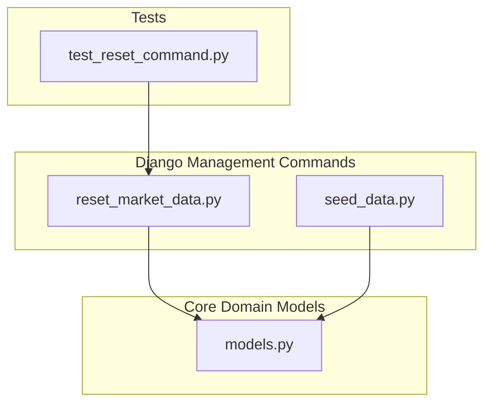
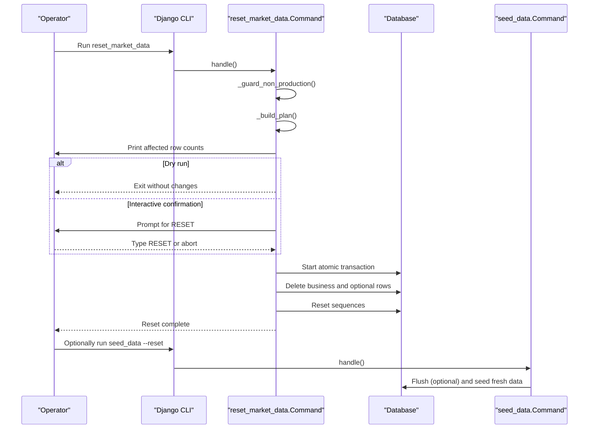
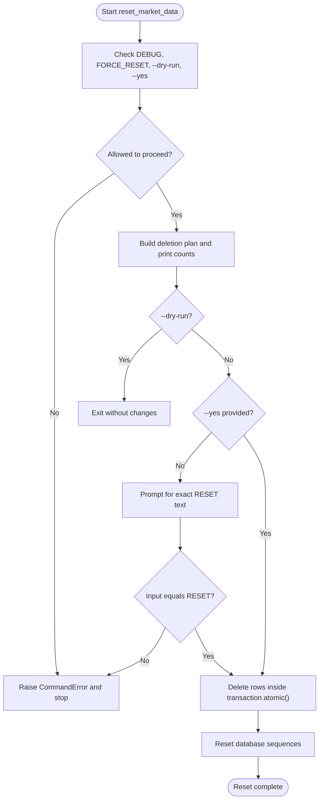
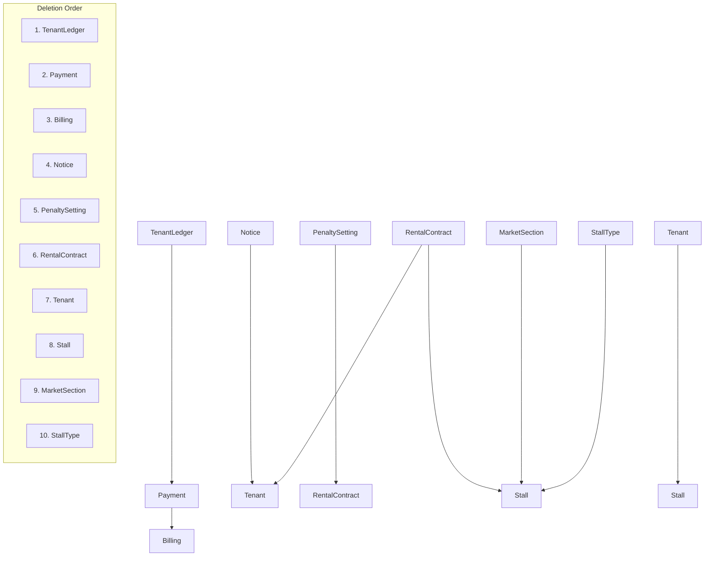
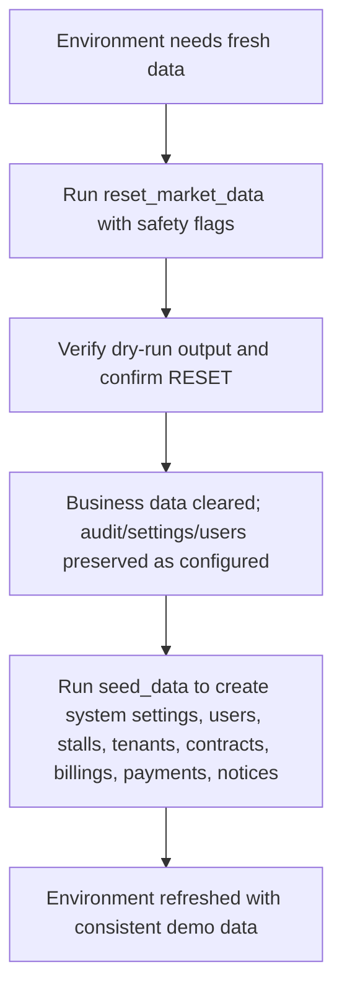
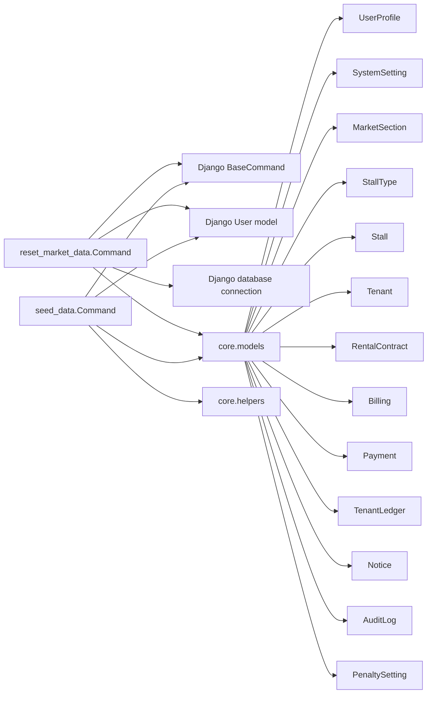

# Market Data Reset Command

<cite>
**Referenced Files in This Document**
- [reset_market_data.py](file://core/management/commands/reset_market_data.py)
- [seed_data.py](file://core/management/commands/seed_data.py)
- [models.py](file://core/models.py)
- [test_reset_command.py](file://core/test_reset_command.py)
</cite>

## Table of Contents
1. [Introduction](#introduction)
2. [Project Structure](#project-structure)
3. [Core Components](#core-components)
4. [Architecture Overview](#architecture-overview)
5. [Detailed Component Analysis](#detailed-component-analysis)
6. [Dependency Analysis](#dependency-analysis)
7. [Performance Considerations](#performance-considerations)
8. [Troubleshooting Guide](#troubleshooting-guide)
9. [Conclusion](#conclusion)
10. [Appendices](#appendices)

## Introduction
This document explains the market data reset management command and how it fits into a complete environment refresh workflow. The command is designed to safely clear tenant, financial, and market-related records while preserving audit trails, system settings, and administrative accounts by default. It includes strict safety checks, confirmation prompts, dry-run previews, transactional execution, and database-sequence resets so that subsequent seeding starts from predictable IDs.

The command is not exposed as an HTTP endpoint; it is only available through the Django management shell. This design reduces accidental execution from web requests and makes it suitable for controlled operations in development, staging, and production environments when operators explicitly opt in.

## Project Structure
The reset functionality lives under the core application’s management commands. The related seeding command is also under the same directory and is commonly used after a reset to repopulate the database with consistent demo data.

**Diagram sources**
- [reset_market_data.py:31-40](file://core/management/commands/reset_market_data.py#L31-L40)
- [seed_data.py:10-34](file://core/management/commands/seed_data.py#L10-L34)
- [models.py:7-336](file://core/models.py#L7-L336)
- [test_reset_command.py:19-22](file://core/test_reset_command.py#L19-L22)

**Section sources**
- [reset_market_data.py:1-29](file://core/management/commands/reset_market_data.py#L1-L29)
- [seed_data.py:1-6](file://core/management/commands/seed_data.py#L1-L6)

## Core Components
The reset command is implemented as a Django management command class. Its responsibilities include:
- Validating the environment and refusing unsafe runs against non-debug databases unless explicitly overridden.
- Building a deletion plan that separates business tables, optional tables, and preserved tables.
- Printing a clear summary of what will be deleted, what is opt-in, and what is kept.
- Requiring an explicit interactive confirmation or scripted `--yes` flag.
- Executing deletions inside a single atomic transaction.
- Resetting database sequences where supported so seeded data starts at low IDs.

The seed command creates system settings, users, market structure, tenants, contracts, billings, payments, notices, and audit logs. When used with its own reset option, it flushes the database before seeding, but it does not use the same safety controls as the dedicated reset command.

**Section sources**
- [reset_market_data.py:61-122](file://core/management/commands/reset_market_data.py#L61-L122)
- [seed_data.py:193-229](file://core/management/commands/seed_data.py#L193-L229)

## Architecture Overview
At runtime, the reset command follows a guarded, plan-driven, transactional flow. The seed command can be chained afterward to rebuild a clean dataset.

**Diagram sources**
- [reset_market_data.py:93-122](file://core/management/commands/reset_market_data.py#L93-L122)
- [reset_market_data.py:126-144](file://core/management/commands/reset_market_data.py#L126-L144)
- [reset_market_data.py:146-159](file://core/management/commands/reset_market_data.py#L146-L159)
- [reset_market_data.py:213-247](file://core/management/commands/reset_market_data.py#L213-L247)
- [seed_data.py:201-229](file://core/management/commands/seed_data.py#L201-L229)

## Detailed Component Analysis

### Reset Command Parameters
| Parameter | Behavior | Safety Impact |
|---|---|---|
| `--yes`, `-y` | Skips the interactive `RESET` confirmation prompt. Useful for scripts. | Increases risk if used accidentally; should be combined with explicit environment control. |
| `--dry-run` | Prints row counts that would be deleted and exits without modifying the database. | Safest way to preview impact. Production guard allows dry runs even when `DEBUG=False`. |
| `--users` | Deletes tenant-linked `User` and `UserProfile` rows. Superusers are never deleted. | Removes tenant login accounts; staff and admin accounts remain intact. |
| `--audit` | Deletes `AuditLog` rows. Off by default because audits are the legal trail. | Can remove compliance evidence; use only when legally and operationally justified. |
| `--clear-settings` | Deletes `SystemSetting` rows such as LGU branding, penalty rules, and contract terms. | Resets system configuration; may require reconfiguration after reset. |

**Section sources**
- [reset_market_data.py:68-89](file://core/management/commands/reset_market_data.py#L68-L89)

### Safety Checks and Confirmation Prompts
The command enforces multiple layers of protection:

1. **No HTTP route**: The destructive logic is only reachable via the management command interface.
2. **Production guard**: If `DEBUG=False`, the command refuses to run unless `FORCE_RESET=1` is set in the environment or `--yes` is passed.
3. **Interactive confirmation**: Without `--yes`, the operator must type the exact uppercase word `RESET`. Any other input aborts the operation.
4. **Dry-run bypass**: `--dry-run` skips mutation and always passes the production guard.
5. **Atomic execution**: All deletions occur inside a single transaction, so a crash or error mid-process rolls back the entire operation.
6. **Superuser protection**: Superuser accounts are never deleted, even with `--users`.
7. **Tenant-user filtering**: Only users linked to tenant profiles are removed when `--users` is used.

**Diagram sources**
- [reset_market_data.py:93-122](file://core/management/commands/reset_market_data.py#L93-L122)
- [reset_market_data.py:126-144](file://core/management/commands/reset_market_data.py#L126-L144)
- [reset_market_data.py:146-159](file://core/management/commands/reset_market_data.py#L146-L159)
- [reset_market_data.py:213-247](file://core/management/commands/reset_market_data.py#L213-L247)

**Section sources**
- [reset_market_data.py:14-23](file://core/management/commands/reset_market_data.py#L14-L23)
- [reset_market_data.py:126-159](file://core/management/commands/reset_market_data.py#L126-L159)
- [test_reset_command.py:152-180](file://core/test_reset_command.py#L152-L180)

### Order of Operations and Referential Integrity
The command deletes business models in a leaf-first order to keep audit summaries accurate and avoid dangling foreign keys during teardown. The ordered list is:

1. `TenantLedger`
2. `Payment`
3. `Billing`
4. `Notice`
5. `PenaltySetting`
6. `RentalContract`
7. `Tenant`
8. `Stall`
9. `MarketSection`
10. `StallType`

This ordering aligns with the model relationships: ledger entries depend on payments and billings; payments and notices depend on tenants; contracts depend on tenants and stalls; billings depend on contracts; penalties depend on contracts.

**Diagram sources**
- [reset_market_data.py:43-58](file://core/management/commands/reset_market_data.py#L43-L58)
- [models.py:71-336](file://core/models.py#L71-L336)

**Section sources**
- [reset_market_data.py:43-58](file://core/management/commands/reset_market_data.py#L43-L58)
- [models.py:93-336](file://core/models.py#L93-L336)

### What Gets Preserved Versus Deleted
| Category | Default Behavior | Opt-In Flag | Notes |
|---|---|---|---|
| Business data | Deleted | N/A | Includes tenants, contracts, billings, payments, ledgers, notices, stalls, sections, stall types. |
| Audit logs | Preserved | `--audit` | Legal trail; deleting removes historical accountability records. |
| System settings | Preserved | `--clear-settings` | Includes municipality/market branding, receipt prefix, penalty defaults, and contract terms. |
| Tenant user accounts | Preserved | `--users` | Removes `User` and `UserProfile` rows where role is tenant. |
| Staff and admin users | Preserved | N/A | Non-tenant users survive even with `--users`. |
| Superusers | Always preserved | N/A | Never deleted by the reset command. |

**Section sources**
- [reset_market_data.py:3-12](file://core/management/commands/reset_market_data.py#L3-L12)
- [reset_market_data.py:177-203](file://core/management/commands/reset_market_data.py#L177-L203)
- [test_reset_command.py:109-150](file://core/test_reset_command.py#L109-L150)

### Database Sequence Reset
After deleting rows, the command attempts to reset autoincrement counters so that subsequent seed data starts at low IDs. The behavior differs by database vendor:

- SQLite: Clears the sequence table.
- PostgreSQL: Sets each business table’s serial sequence to 1.
- MySQL: Leaves counters high; this is considered acceptable for development resets.

**Section sources**
- [reset_market_data.py:224-247](file://core/management/commands/reset_market_data.py#L224-L247)

### Relationship to the Seed Command
The seed command creates realistic demo data and can optionally flush the database first using Django’s built-in flush command. However, it does not implement the same safety controls as the reset command:

- `seed_data --reset` calls `flush`, which clears all data without the same explicit confirmation and preservation semantics.
- The recommended safe workflow is to run `reset_market_data` first, then run `seed_data` without its own reset flag, so the reset command’s safeguards apply.

**Diagram sources**
- [reset_market_data.py:93-122](file://core/management/commands/reset_market_data.py#L93-L122)
- [seed_data.py:196-229](file://core/management/commands/seed_data.py#L196-L229)

**Section sources**
- [seed_data.py:196-229](file://core/management/commands/seed_data.py#L196-L229)

## Dependency Analysis
The reset command depends on Django’s management framework, authentication models, database connection utilities, and the core domain models. The seed command shares many of those models and helper functions for billing and payments.

**Diagram sources**
- [reset_market_data.py:31-40](file://core/management/commands/reset_market_data.py#L31-L40)
- [seed_data.py:10-34](file://core/management/commands/seed_data.py#L10-L34)
- [models.py:7-336](file://core/models.py#L7-L336)

**Section sources**
- [reset_market_data.py:31-40](file://core/management/commands/reset_market_data.py#L31-L40)
- [seed_data.py:10-34](file://core/management/commands/seed_data.py#L10-L34)
- [models.py:7-336](file://core/models.py#L7-L336)

## Performance Considerations
- The command uses bulk queryset deletion rather than raw SQL truncation, preserving cascade behavior and post-delete signals. This is safer but can be slower on very large datasets.
- Row counts are computed before deletion, which adds read overhead but provides accurate reporting.
- Sequence resets add extra database queries, especially on PostgreSQL where each business table is processed individually.
- For extremely large production databases, prefer a controlled backup-and-reload strategy instead of repeated full resets.

[No sources needed since this section provides general guidance]

## Troubleshooting Guide

### Common Errors and Resolutions
| Symptom | Likely Cause | Resolution |
|---|---|---|
| Command refuses to run | `DEBUG=False` without `FORCE_RESET=1` or `--yes` | Verify the target database name and vendor, then either enable debug mode for local testing or explicitly set `FORCE_RESET=1` in the environment. |
| Non-interactive shell error | Running in a script without `--yes` | Add `--yes` for automated runs, or run interactively and type `RESET`. |
| Wrong confirmation text | Typed something other than uppercase `RESET` | Retry and type exactly `RESET`. |
| Data still exists after reset | Dry run was used | Remove `--dry-run` and confirm the operation. |
| Tenant logins still exist | Forgot `--users` | Run again with `--users` if tenant accounts should be removed. |
| Audit logs still exist | Forgot `--audit` | Run again with `--audit` if historical logs must be cleared. |
| System settings missing after reset | Used `--clear-settings` | Reconfigure system settings or rerun seed data if demo settings are expected. |
| IDs start at high numbers after seed | Database sequence not reset | Use the reset command; note that MySQL may leave counters high. |

**Section sources**
- [reset_market_data.py:126-159](file://core/management/commands/reset_market_data.py#L126-L159)
- [reset_market_data.py:224-247](file://core/management/commands/reset_market_data.py#L224-L247)
- [test_reset_command.py:100-180](file://core/test_reset_command.py#L100-L180)

### Rollback and Recovery Procedures
- **Mid-operation failure**: Because deletions run inside `transaction.atomic()`, a crash or exception rolls back all changes. After recovery, verify whether any partial state remains by checking key tables.
- **Accidental deletion**: Restore from a pre-reset database backup. Do not rely on undoing individual deletes manually.
- **Partial seed failure**: If seeding fails after reset, rerun the seed command. The seed command uses idempotent creation patterns for many entities, but financial rows are written carefully to avoid duplicating payments or balances.
- **Sequence mismatch**: If IDs jump unexpectedly, rerun the reset command or perform a manual sequence reset appropriate for your database vendor.

**Section sources**
- [reset_market_data.py:119-122](file://core/management/commands/reset_market_data.py#L119-L122)
- [seed_data.py:398-429](file://core/management/commands/seed_data.py#L398-L429)

## Conclusion
The market data reset command is a deliberately strict operational tool. It protects operators by requiring explicit confirmation, preventing accidental runs against production-like environments, clearly listing affected data, and executing deletions atomically. By default, it preserves audit logs, system settings, and administrative accounts, while giving operators fine-grained control over whether tenant users, audit logs, and system settings are also cleared.

For a complete environment refresh, the recommended workflow is:
1. Back up the database.
2. Run a dry run to review affected tables.
3. Confirm the reset with the required prompt or scripted flag.
4. Verify that only the intended data was deleted.
5. Run the seed command to repopulate the environment with consistent demo data.

**Section sources**
- [reset_market_data.py:1-29](file://core/management/commands/reset_market_data.py#L1-L29)
- [reset_market_data.py:93-122](file://core/management/commands/reset_market_data.py#L93-L122)
- [seed_data.py:201-229](file://core/management/commands/seed_data.py#L201-L229)

## Appendices

### Backup Procedures Before Reset
Before running the reset command in any non-development environment:
1. Identify the active database connection name and vendor.
2. Create a full logical or physical backup depending on your deployment.
3. Record current row counts for critical tables: tenants, contracts, billings, payments, ledgers, notices, stalls, sections, stall types, audit logs, system settings, and users.
4. Store the backup securely with a timestamp and operator identity.
5. Test the restore procedure separately so you know recovery works before relying on it.
6. Keep the backup until the reset and seed process have been verified.

[No sources needed since this section provides general guidance]

### Environment-Specific Examples

#### Development
- Typical goal: Clean slate with demo data.
- Recommended steps:
  - Run a dry run to see affected tables.
  - Run the reset command with `--yes` if automation is needed.
  - Run the seed command to populate demo data.
- Warnings:
  - Even in development, do not assume data is disposable if it contains sensitive test information.

#### Staging
- Typical goal: Reproduce production-like data conditions without affecting live users.
- Recommended steps:
  - Treat the database as production-like.
  - Set `FORCE_RESET=1` only when authorized.
  - Use `--dry-run` first.
  - Confirm interactively unless fully automated with documented approval.
  - Preserve audit logs unless compliance allows deletion.
  - Reconfigure system settings if `--clear-settings` is used.
- Warnings:
  - Staging may contain near-production data; treat backups and access controls seriously.

#### Production
- Typical goal: Controlled refresh only when absolutely necessary.
- Recommended steps:
  - Obtain formal approval.
  - Perform a full backup and validate restore.
  - Stop write traffic if possible.
  - Set `FORCE_RESET=1` only through a controlled deployment mechanism.
  - Avoid `--users`, `--audit`, and `--clear-settings` unless explicitly required.
  - Run the seed command only if the environment is meant to be repopulated.
- Warnings:
  - This command is destructive.
  - Do not rely on `DEBUG=False` alone as a security boundary.
  - Audit logs and system settings may be legally or operationally required.

**Section sources**
- [reset_market_data.py:14-23](file://core/management/commands/reset_market_data.py#L14-L23)
- [reset_market_data.py:126-144](file://core/management/commands/reset_market_data.py#L126-L144)
- [test_reset_command.py:167-180](file://core/test_reset_command.py#L167-L180)