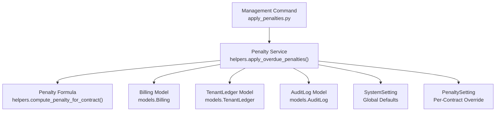
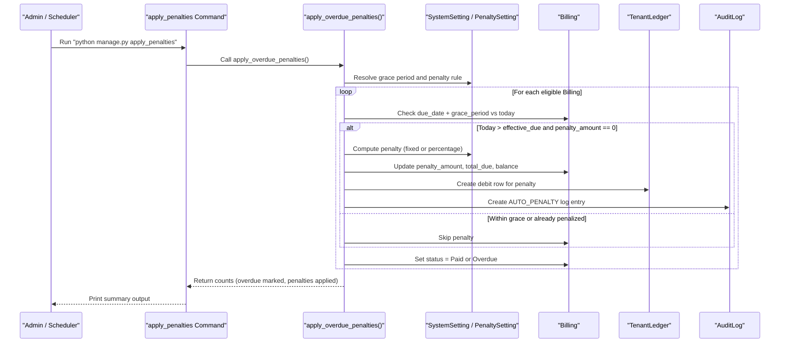
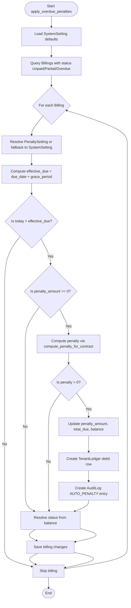
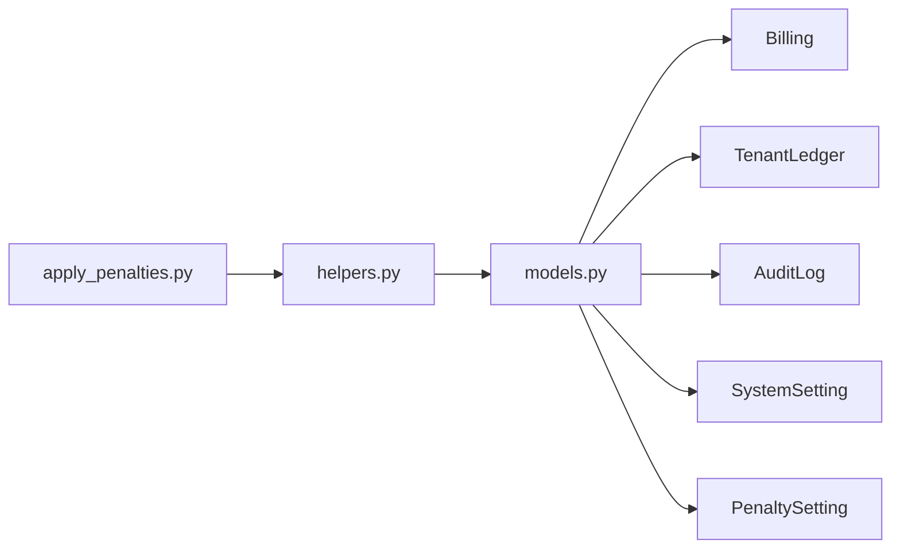

# Penalty Application Command

<cite>
**Referenced Files in This Document**
- [apply_penalties.py](file://core/management/commands/apply_penalties.py)
- [helpers.py](file://core/helpers.py)
- [models.py](file://core/models.py)
- [PENALTY_GUIDE.md](file://PENALTY_GUIDE.md)
- [test_overdue_penalties.py](file://core/test_overdue_penalties.py)
</cite>

## Table of Contents
1. [Introduction](#introduction)
2. [Project Structure](#project-structure)
3. [Core Components](#core-components)
4. [Architecture Overview](#architecture-overview)
5. [Detailed Component Analysis](#detailed-component-analysis)
6. [Dependency Analysis](#dependency-analysis)
7. [Performance Considerations](#performance-considerations)
8. [Troubleshooting Guide](#troubleshooting-guide)
9. [Conclusion](#conclusion)
10. [Appendices](#appendices)

## Introduction
This document explains the penalty application management command and the automated penalty calculation system behind it. It covers how overdue billings are detected, how grace periods are evaluated, how penalties are computed, and how results are recorded in billing records, tenant ledgers, and audit logs. It also documents command behavior, configuration sources, scheduling options, examples, and troubleshooting guidance.

The system is intentionally simple: a late penalty is charged once per billing after the due date plus a configured grace period. Penalties can be fixed amounts or percentages of rent. There is no daily compounding or monthly stacking.

## Project Structure
The penalty application feature spans a thin management command, shared helper logic, core models, user-facing documentation, and tests.

**Diagram sources**
- [apply_penalties.py:6-13](file://core/management/commands/apply_penalties.py#L6-L13)
- [helpers.py:132-152](file://core/helpers.py#L132-L152)
- [helpers.py:423-500](file://core/helpers.py#L423-L500)
- [models.py:42-68](file://core/models.py#L42-L68)
- [models.py:190-218](file://core/models.py#L190-L218)
- [models.py:261-277](file://core/models.py#L261-L277)
- [models.py:304-316](file://core/models.py#L304-L316)
- [models.py:319-335](file://core/models.py#L319-L335)

**Section sources**
- [apply_penalties.py:1-14](file://core/management/commands/apply_penalties.py#L1-L14)
- [helpers.py:132-152](file://core/helpers.py#L132-L152)
- [helpers.py:423-500](file://core/helpers.py#L423-L500)
- [models.py:42-68](file://core/models.py#L42-L68)
- [models.py:190-218](file://core/models.py#L190-L218)
- [models.py:261-277](file://core/models.py#L261-L277)
- [models.py:304-316](file://core/models.py#L304-L316)
- [models.py:319-335](file://core/models.py#L319-L335)

## Core Components
- Management command: `python manage.py apply_penalties` invokes the penalty service without throttling.
- Penalty service: `apply_overdue_penalties()` evaluates all unpaid, partial, or already-overdue billings, applies grace-period logic, computes one-time penalties, updates billing totals, posts ledger entries, and writes audit log rows.
- Penalty formula: `compute_penalty_for_contract()` resolves global or per-contract settings and calculates the penalty amount.
- Configuration models:
  - `SystemSetting`: market-wide defaults for penalty type, value, grace period, and default due day.
  - `PenaltySetting`: per-contract override for active rules.
- Result models:
  - `Billing`: stores penalty amount, total due, balance, due date, and status.
  - `TenantLedger`: records each penalty as a debit entry with running balances.
  - `AuditLog`: records automatic penalty application events.

Key behaviors:
- Grace period evaluation: penalty fires only when today is strictly after `due_date + grace_period`.
- One-time penalty: penalties are applied only when `penalty_amount` is zero; repeated runs do not compound.
- Idempotency: the sweep is safe to run multiple times.
- Status resolution: bills with non-positive balance become Paid; otherwise they are Overdue.

**Section sources**
- [apply_penalties.py:6-13](file://core/management/commands/apply_penalties.py#L6-L13)
- [helpers.py:132-152](file://core/helpers.py#L132-L152)
- [helpers.py:423-500](file://core/helpers.py#L423-L500)
- [models.py:42-68](file://core/models.py#L42-L68)
- [models.py:190-218](file://core/models.py#L190-L218)
- [models.py:261-277](file://core/models.py#L261-L277)
- [models.py:304-316](file://core/models.py#L304-L316)
- [models.py:319-335](file://core/models.py#L319-L335)

## Architecture Overview
The command is a thin wrapper around the penalty service. The service reads configuration from global and per-contract settings, evaluates each billing against its due date and grace period, computes the penalty, updates billing fields, posts a ledger debit, and creates an audit log entry.

**Diagram sources**
- [apply_penalties.py:6-13](file://core/management/commands/apply_penalties.py#L6-L13)
- [helpers.py:132-152](file://core/helpers.py#L132-L152)
- [helpers.py:423-500](file://core/helpers.py#L423-L500)
- [models.py:42-68](file://core/models.py#L42-L68)
- [models.py:190-218](file://core/models.py#L190-L218)
- [models.py:261-277](file://core/models.py#L261-L277)
- [models.py:304-316](file://core/models.py#L304-L316)
- [models.py:319-335](file://core/models.py#L319-L335)

## Detailed Component Analysis

### Management Command: `apply_penalties`
Responsibilities:
- Provide a manual entry point for penalty processing.
- Invoke the penalty service and print a summary showing how many billings were marked overdue and how many penalties were applied.

Behavioral notes:
- The command does not accept additional arguments such as tenant filters, date ranges, or contract types.
- It is unthrottled, unlike the request-time trigger that uses a daily cache key.

Command usage example:
- Manual execution: `python manage.py apply_penalties`

Output example:
- A success message indicating counts for overdue marking and penalties applied.

**Section sources**
- [apply_penalties.py:6-13](file://core/management/commands/apply_penalties.py#L6-L13)

### Penalty Service: `apply_overdue_penalties`
Responsibilities:
- Iterate over billings with statuses Unpaid, Partial, or Overdue.
- Evaluate grace period using either per-contract or global settings.
- Apply a one-time penalty only when the effective due date has passed and the billing has no existing penalty.
- Update billing fields and status.
- Post a TenantLedger debit for each penalty.
- Create an AuditLog entry for each automatic penalty.
- Recompute tenant ledger balances for affected tenants.

Grace period evaluation:
- Effective due date = `billing.due_date + grace_period`.
- If `today <= effective_due`, skip the billing.

Penalty application:
- Only when `penalty_amount` is zero.
- Uses `compute_penalty_for_contract` to calculate the penalty.
- Updates `penalty_amount`, `total_due`, and `balance`.

Status resolution:
- If `balance <= 0`, set status to Paid.
- Otherwise, set status to Overdue.

Audit trail:
- Creates an AuditLog row with action `AUTO_PENALTY`, module `Billing`, and a description including billing ID, tenant name, stall number, and billing month/year.

Ledger consistency:
- After applying penalties, recomputes running balances for affected tenants through `recalc_tenant_ledger`.

Return values:
- Returns `(overdue_marked, penalties_applied)` counts.

**Section sources**
- [helpers.py:423-500](file://core/helpers.py#L423-L500)

### Penalty Formula: `compute_penalty_for_contract`
Responsibilities:
- Resolve penalty configuration:
  - Prefer the first active `PenaltySetting` for the contract.
  - Fall back to `SystemSetting` if no active per-contract rule exists.
- Determine whether the penalty should be zero based on grace period.
- Calculate penalty amount:
  - Fixed mode: return the configured value.
  - Percentage mode: return `monthly_rent × (penalty_value / 100)`, quantized to two decimals.

Configuration precedence:
- Per-contract active rule overrides global defaults.

Grace period check:
- If `today <= due_date + grace_period`, return zero.

No maximum penalty cap:
- The implementation does not enforce a maximum penalty cap.

**Section sources**
- [helpers.py:132-152](file://core/helpers.py#L132-L152)
- [models.py:42-68](file://core/models.py#L42-L68)
- [models.py:319-335](file://core/models.py#L319-L335)

### Data Models Involved
- `SystemSetting`:
  - Stores market-wide penalty type, penalty value, grace period, and default due day.
- `PenaltySetting`:
  - Stores per-contract penalty type, value, grace period, due day, and active flag.
- `Billing`:
  - Stores rental amount, penalty amount, discount, total due, amount paid, balance, due date, and status.
- `TenantLedger`:
  - Records debits and credits per billing with running balance.
- `AuditLog`:
  - Records system actions like automatic penalty application.

**Section sources**
- [models.py:42-68](file://core/models.py#L42-L68)
- [models.py:190-218](file://core/models.py#L190-L218)
- [models.py:261-277](file://core/models.py#L261-L277)
- [models.py:304-316](file://core/models.py#L304-L316)
- [models.py:319-335](file://core/models.py#L319-L335)

### Calculation Logic Flowchart

**Diagram sources**
- [helpers.py:423-500](file://core/helpers.py#L423-L500)
- [helpers.py:132-152](file://core/helpers.py#L132-L152)
- [models.py:190-218](file://core/models.py#L190-L218)
- [models.py:261-277](file://core/models.py#L261-L277)
- [models.py:304-316](file://core/models.py#L304-L316)

### Command Options and Targeting
Current command capabilities:
- No command-line arguments are defined.
- Cannot target specific tenants, date ranges, or contract types directly through the command.

Recommended operational approaches:
- Use the command for full sweeps during testing or back-fills.
- Use the throttled request-time trigger for normal operation, which runs at most once per day per instance.
- To target subsets, extend the command with options and filter the billing query accordingly.

**Section sources**
- [apply_penalties.py:6-13](file://core/management/commands/apply_penalties.py#L6-L13)
- [helpers.py:503-519](file://core/helpers.py#L503-L519)

### Examples

#### Example: Running Penalties for Overdue Accounts
- Execute the command manually: `python manage.py apply_penalties`.
- Expected outcome:
  - All billings past their effective due date receive a one-time penalty if none was previously applied.
  - Billing status becomes Overdue unless fully paid.
  - TenantLedger receives a debit row for each penalty.
  - AuditLog records an automatic penalty event.

Verification steps:
- Inspect Billing records for updated penalty_amount, total_due, balance, and status.
- Inspect TenantLedger for new debit entries.
- Inspect AuditLog for AUTO_PENALTY entries.

**Section sources**
- [apply_penalties.py:6-13](file://core/management/commands/apply_penalties.py#L6-L13)
- [helpers.py:423-500](file://core/helpers.py#L423-L500)

#### Example: Batch Processing Multiple Tenants
- The command processes all eligible billings across all tenants by default.
- Each billing is evaluated independently using its own contract’s penalty settings and due date.

Operational note:
- Because there are no filtering options, batch processing affects every billing matching the eligibility criteria.

**Section sources**
- [helpers.py:438-440](file://core/helpers.py#L438-L440)
- [helpers.py:446-496](file://core/helpers.py#L446-L496)

#### Example: Generating Penalty Reports
- While the command itself does not generate reports, you can use the system’s reporting features to analyze penalty outcomes:
  - Billing list and views show penalty_amount, total_due, balance, and status.
  - TenantLedger shows penalty debits.
  - AuditLog shows automatic penalty events.
- Export or print reports from the relevant UI pages to capture penalty application results.

**Section sources**
- [models.py:190-218](file://core/models.py#L190-L218)
- [models.py:261-277](file://core/models.py#L261-L277)
- [models.py:304-316](file://core/models.py#L304-L316)

### Penalty Calculation Rules Summary
- Grace period: penalty starts only after `due_date + grace_period`.
- Fixed penalty: flat amount from configuration.
- Percentage penalty: `monthly_rent × (penalty_value / 100)`, rounded to two decimals.
- One-time charge: penalties are not compounded or stacked.
- Maximum penalty cap: not implemented in the current code.
- Configuration precedence: per-contract active rule overrides global defaults.

**Section sources**
- [helpers.py:132-152](file://core/helpers.py#L132-L152)
- [PENALTY_GUIDE.md:44-63](file://PENALTY_GUIDE.md#L44-L63)
- [PENALTY_GUIDE.md:167-178](file://PENALTY_GUIDE.md#L167-L178)

### Scheduling Automation
Automatic triggers:
- Request-time throttling: `maybe_apply_overdue_penalties()` ensures the sweep runs at most once per day per cache instance.
- Manual trigger: `apply_penalties` command runs without throttling.

Scheduling recommendations:
- Cron job: schedule `python manage.py apply_penalties` nightly or at your preferred interval.
- Task scheduler: integrate with Celery, Django-Q, or another task queue to run the command periodically.
- Keep the request-time throttle enabled so page loads also keep penalties current between scheduled runs.

**Section sources**
- [helpers.py:503-519](file://core/helpers.py#L503-L519)
- [PENALTY_GUIDE.md:192-198](file://PENALTY_GUIDE.md#L192-L198)

### Troubleshooting Guide

Common issues and resolutions:

- Calculation discrepancies:
  - Verify `SystemSetting` values for penalty type, penalty value, and grace period.
  - Check for an active `PenaltySetting` on the contract that may override global defaults.
  - Confirm the billing’s due date and billing month/year match expectations.

- Missing penalty settings:
  - If no `SystemSetting` exists, the penalty formula returns zero.
  - Ensure at least one global setting record exists before running penalties.

- Database transaction failures:
  - The penalty service updates Billing, TenantLedger, and AuditLog within normal database operations.
  - If transactions fail, inspect database constraints and permissions.
  - Re-run the command after fixing data issues; idempotency prevents double-charging.

- No penalties applied:
  - Confirm today is strictly after `due_date + grace_period`.
  - Confirm the billing’s penalty_amount is still zero.
  - Confirm the billing status is Unpaid, Partial, or Overdue.

- Idempotency verification:
  - Running the command multiple times should not increase penalty_amount beyond the first application.
  - Tests verify that repeated runs produce zero additional penalties.

**Section sources**
- [helpers.py:132-152](file://core/helpers.py#L132-L152)
- [helpers.py:423-500](file://core/helpers.py#L423-L500)
- [test_overdue_penalties.py:60-83](file://core/test_overdue_penalties.py#L60-L83)

## Dependency Analysis
The penalty application flow depends on configuration models, billing records, ledger entries, and audit logs. The command delegates all logic to the helper functions.

**Diagram sources**
- [apply_penalties.py:6-13](file://core/management/commands/apply_penalties.py#L6-L13)
- [helpers.py:132-152](file://core/helpers.py#L132-L152)
- [helpers.py:423-500](file://core/helpers.py#L423-L500)
- [models.py:42-68](file://core/models.py#L42-L68)
- [models.py:190-218](file://core/models.py#L190-L218)
- [models.py:261-277](file://core/models.py#L261-L277)
- [models.py:304-316](file://core/models.py#L304-L316)
- [models.py:319-335](file://core/models.py#L319-L335)

**Section sources**
- [apply_penalties.py:6-13](file://core/management/commands/apply_penalties.py#L6-L13)
- [helpers.py:132-152](file://core/helpers.py#L132-L152)
- [helpers.py:423-500](file://core/helpers.py#L423-L500)
- [models.py:42-68](file://core/models.py#L42-L68)
- [models.py:190-218](file://core/models.py#L190-L218)
- [models.py:261-277](file://core/models.py#L261-L277)
- [models.py:304-316](file://core/models.py#L304-L316)
- [models.py:319-335](file://core/models.py#L319-L335)

## Performance Considerations
- The sweep iterates all eligible billings; large datasets may benefit from indexing on billing status, due_date, and contract relationships.
- The request-time throttle limits automatic runs to once per day per cache instance, reducing redundant work.
- Decimal arithmetic is used throughout to avoid floating-point drift in financial calculations.
- Ledger recalculation runs only for affected tenants after penalties are applied.

[No sources needed since this section provides general guidance]

## Troubleshooting Guide
See the detailed troubleshooting section above for common issues related to calculation discrepancies, missing settings, and transaction failures. Additional checks:
- Validate that `SystemSetting` exists and contains valid penalty configuration.
- Confirm active `PenaltySetting` rules on contracts where overrides are expected.
- Review AuditLog entries to confirm whether automatic penalties were attempted.
- Use the test suite patterns to validate grace period behavior and idempotency.

**Section sources**
- [helpers.py:132-152](file://core/helpers.py#L132-L152)
- [helpers.py:423-500](file://core/helpers.py#L423-L500)
- [test_overdue_penalties.py:60-95](file://core/test_overdue_penalties.py#L60-L95)

## Conclusion
The penalty application command provides a straightforward, idempotent mechanism for applying one-time late penalties to overdue billings. It respects grace periods, supports both fixed and percentage-based penalties, and maintains consistent accounting through billing updates, ledger debits, and audit logs. For production environments, combine scheduled command runs with the built-in request-time throttle to ensure penalties are applied reliably and efficiently.

[No sources needed since this section summarizes without analyzing specific files]

## Appendices

### Appendix A: Configuration Reference
- Global defaults:
  - Penalty Type: Fixed or Percentage.
  - Penalty Value: Flat amount or percentage rate.
  - Grace Period: Days after due date before penalty applies.
  - Default Due Day: Day-of-month used for billing due dates.
- Per-contract overrides:
  - Active PenaltySetting takes precedence over global defaults.

**Section sources**
- [models.py:42-68](file://core/models.py#L42-L68)
- [models.py:319-335](file://core/models.py#L319-L335)
- [PENALTY_GUIDE.md:181-190](file://PENALTY_GUIDE.md#L181-L190)

### Appendix B: User-Facing Guidance
- Explain to tenants that penalties are one-time charges after the due date plus grace period.
- Clarify that percentage penalties scale with rent while fixed penalties are flat.
- Emphasize that penalties do not compound or stack monthly.

**Section sources**
- [PENALTY_GUIDE.md:156-178](file://PENALTY_GUIDE.md#L156-L178)