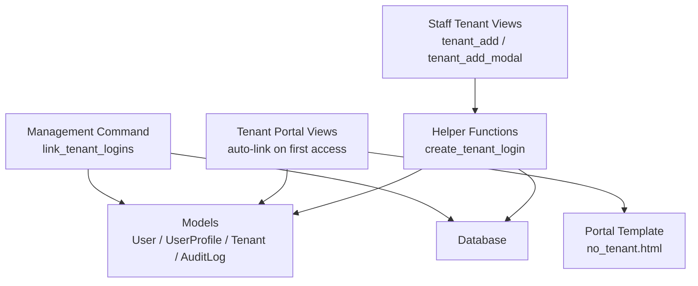
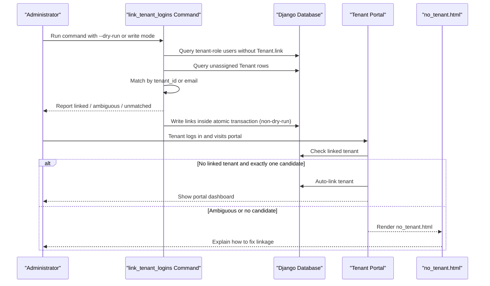
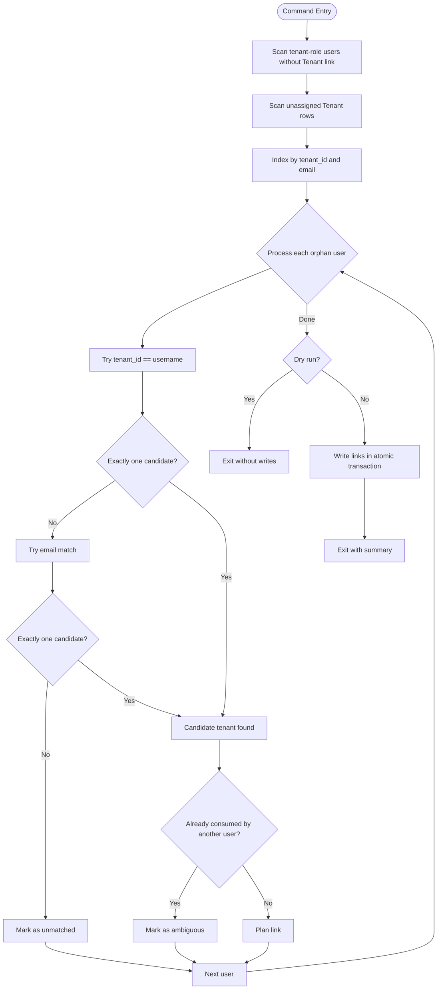
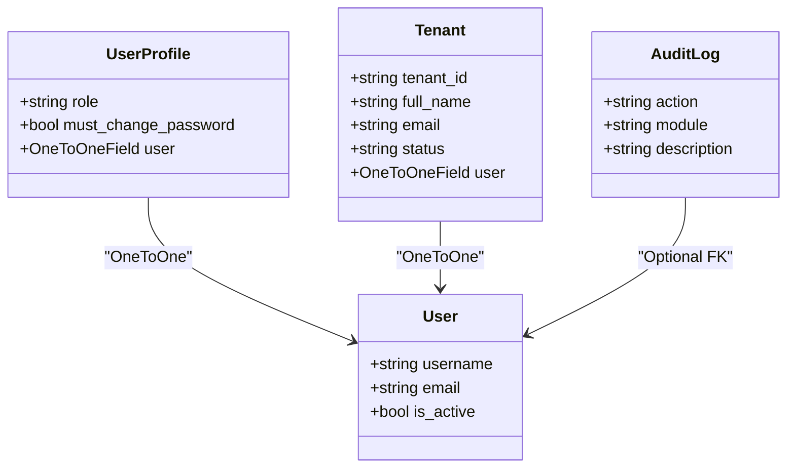
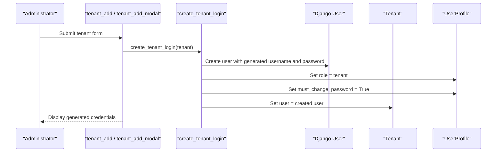
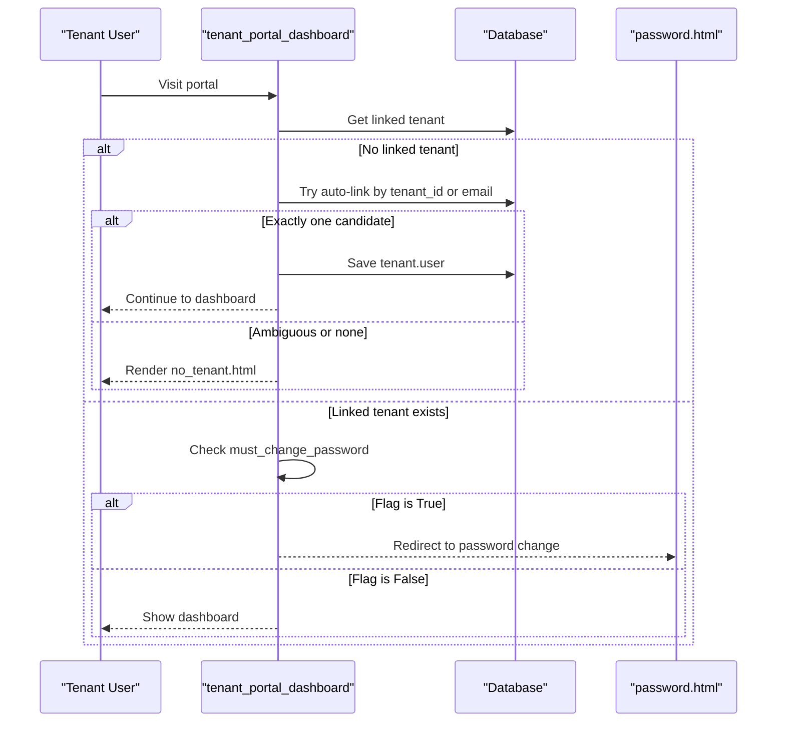
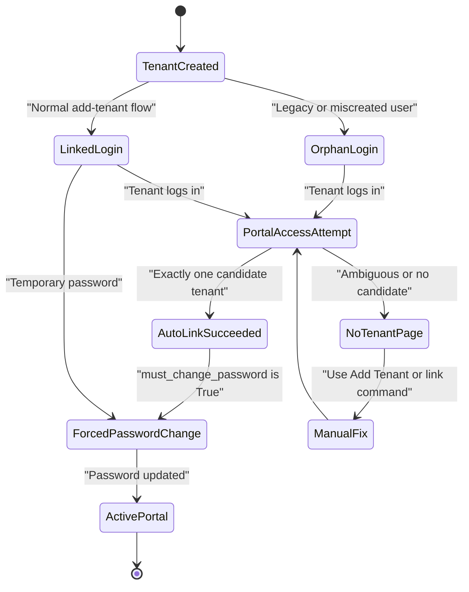
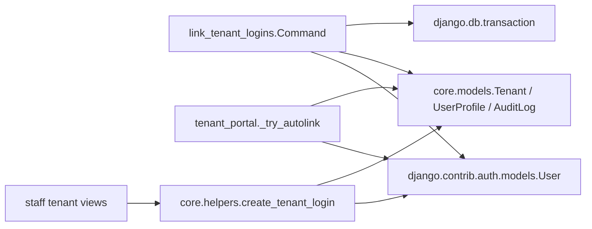

# Tenant Login Linking Command

<cite>
**Referenced Files in This Document**
- [link_tenant_logins.py](file://core/management/commands/link_tenant_logins.py)
- [models.py](file://core/models.py)
- [helpers.py](file://core/helpers.py)
- [tenant_portal.py](file://core/views/tenant_portal.py)
- [tenants.py](file://core/views/tenants.py)
- [test_credentials_flow.py](file://core/test_credentials_flow.py)
- [no_tenant.html](file://templates/tenant_portal/no_tenant.html)
</cite>

## Table of Contents
1. [Introduction](#introduction)
2. [Project Structure](#project-structure)
3. [Core Components](#core-components)
4. [Architecture Overview](#architecture-overview)
5. [Detailed Component Analysis](#detailed-component-analysis)
6. [Dependency Analysis](#dependency-analysis)
7. [Performance Considerations](#performance-considerations)
8. [Troubleshooting Guide](#troubleshooting-guide)
9. [Conclusion](#conclusion)

## Introduction
This document explains the tenant login linking management command and its surrounding account lifecycle for the market rental system. The command repairs a specific data inconsistency: tenant-role Django user accounts that exist without being linked to their corresponding `Tenant` records. When this happens, tenants cannot access the portal and instead see an “unlinked” state.

The command is intentionally conservative. It does not create new tenants, overwrite existing links, or link ambiguous matches. Instead, it scans for orphan tenant-role users and unassigned tenant rows, attempts safe one-to-one matching by username or email, reports results, and then writes changes atomically when not in dry-run mode.

It works alongside:
- The canonical tenant creation flow, which creates both the tenant record and a linked portal login with a temporary password.
- The tenant portal’s automatic first-access repair logic, which can also link an orphan user if exactly one candidate tenant exists.
- The forced initial password change workflow, which ensures tenants replace temporary credentials before using the portal.

## Project Structure
The tenant login linking feature spans management commands, core models, helper utilities, tenant views, and templates.

**Diagram sources**
- [link_tenant_logins.py:25-168](file://core/management/commands/link_tenant_logins.py#L25-L168)
- [models.py:7-23](file://core/models.py#L7-L23)
- [models.py:117-154](file://core/models.py#L117-L154)
- [models.py:304-316](file://core/models.py#L304-L316)
- [tenant_portal.py:28-66](file://core/views/tenant_portal.py#L28-L66)
- [tenants.py:54-81](file://core/views/tenants.py#L54-L81)
- [tenants.py:305-333](file://core/views/tenants.py#L305-L333)
- [helpers.py:92-122](file://core/helpers.py#L92-L122)
- [no_tenant.html:30-76](file://templates/tenant_portal/no_tenant.html#L30-L76)

**Section sources**
- [link_tenant_logins.py:1-168](file://core/management/commands/link_tenant_logins.py#L1-L168)
- [models.py:7-23](file://core/models.py#L7-L23)
- [models.py:117-154](file://core/models.py#L117-L154)
- [models.py:304-316](file://core/models.py#L304-L316)
- [tenant_portal.py:28-66](file://core/views/tenant_portal.py#L28-L66)
- [tenants.py:54-81](file://core/views/tenants.py#L54-L81)
- [tenants.py:305-333](file://core/views/tenants.py#L305-L333)
- [helpers.py:92-122](file://core/helpers.py#L92-L122)
- [no_tenant.html:30-76](file://templates/tenant_portal/no_tenant.html#L30-L76)

## Core Components
The tenant login linking capability is centered around four main parts:

| Component | Responsibility | Key Behavior |
|---|---|---|
| Management command | Scans and repairs orphan tenant-role logins | Matches usernames or emails to unassigned tenants; supports dry-run and verbose reporting |
| Tenant model | Represents the business tenant entity | Holds `tenant_id`, personal/business fields, optional linked `user`, and status |
| User profile model | Extends Django’s `User` with role and password policy flags | Stores `role='tenant'` and `must_change_password` |
| Helper function | Creates tenant logins during normal onboarding | Generates secure username/password, sets role, forces initial password change, and links tenant |

**Section sources**
- [link_tenant_logins.py:25-41](file://core/management/commands/link_tenant_logins.py#L25-L41)
- [models.py:7-23](file://core/models.py#L7-L23)
- [models.py:117-154](file://core/models.py#L117-L154)
- [helpers.py:92-122](file://core/helpers.py#L92-L122)

## Architecture Overview
The system has two complementary ways to connect a tenant-role user to a tenant record:

1. **Command-driven linking**: Run `link_tenant_logins` to scan and fix historical orphans.
2. **Portal-driven auto-linking**: On first portal access, if a tenant-role user has no linked tenant but exactly one candidate tenant exists, the portal automatically links them.

Both approaches share the same safety rules:
- Do not overwrite an existing tenant-user link.
- Do not link when multiple candidates match.
- Do not create a tenant row for a user that has no counterpart.

**Diagram sources**
- [link_tenant_logins.py:43-168](file://core/management/commands/link_tenant_logins.py#L43-L168)
- [tenant_portal.py:28-66](file://core/views/tenant_portal.py#L28-L66)
- [tenant_portal.py:102-112](file://core/views/tenant_portal.py#L102-L112)
- [no_tenant.html:30-76](file://templates/tenant_portal/no_tenant.html#L30-L76)

## Detailed Component Analysis

### Management Command: `link_tenant_logins`
The command is designed as a one-shot repair tool for orphan tenant-role logins. Its primary goal is to make existing tenant-role users able to access `/portal/` by linking them to the correct `Tenant` record.

#### Command Options
| Option | Type | Purpose |
|---|---|---|
| `--dry-run` | Boolean flag | Reports what would be linked without writing to the database |
| `--verbose` | Boolean flag | Prints skipped rows and reasons, including ambiguous matches and unmatched users |

#### Matching Rules
The command builds two indexes from unassigned tenants:
- A mapping from normalized `tenant_id` to candidate tenants.
- A mapping from normalized email to candidate tenants.

For each orphan tenant-role user:
1. Try exact case-insensitive match between the user’s username and tenant ID.
2. If no username-based candidate exists, try email-based matching.
3. Require exactly one candidate tenant.
4. Skip ambiguous matches.
5. Skip users with no matching tenant.

#### Output Categories
| Category | Meaning |
|---|---|
| Linked | One clear candidate tenant found; will be linked |
| Ambiguous | Multiple candidate tenants found; requires manual review |
| Unmatched | No candidate tenant found; user remains orphaned until resolved |

#### Data Changes
When not in dry-run mode and at least one link is planned:
- Each matched tenant’s `user` field is set to the orphan user.
- An audit log entry is created describing the linkage.
- All changes are wrapped in an atomic transaction so partial runs do not corrupt state.

**Diagram sources**
- [link_tenant_logins.py:43-168](file://core/management/commands/link_tenant_logins.py#L43-L168)

**Section sources**
- [link_tenant_logins.py:1-168](file://core/management/commands/link_tenant_logins.py#L1-L168)

### Tenant Model and User Profile
The tenant identity and portal access are represented by two related models:

| Model | Important Fields | Role in Linking |
|---|---|---|
| `UserProfile` | `user`, `role`, `must_change_password` | Identifies tenant-role users and enforces initial password change |
| `Tenant` | `tenant_id`, `user`, `full_name`, `email`, `status` | Links the business tenant to a portal user |
| `AuditLog` | `action`, `module`, `description` | Records command-driven and portal-driven linkage events |

**Diagram sources**
- [models.py:7-23](file://core/models.py#L7-L23)
- [models.py:117-154](file://core/models.py#L117-L154)
- [models.py:304-316](file://core/models.py#L304-L316)

**Section sources**
- [models.py:7-23](file://core/models.py#L7-L23)
- [models.py:117-154](file://core/models.py#L117-L154)
- [models.py:304-316](file://core/models.py#L304-L316)

### Tenant Creation and Login Provisioning
The canonical way to onboard a tenant is through the staff tenant creation interface. When a tenant is added:
1. The tenant record is saved.
2. `create_tenant_login` is called.
3. A secure username is derived from the tenant ID.
4. A strong temporary password is generated.
5. A Django `User` is created with role `tenant`.
6. `must_change_password` is set to `True`.
7. The tenant’s `user` field is linked.
8. The admin sees generated credentials once.

**Diagram sources**
- [tenants.py:54-81](file://core/views/tenants.py#L54-L81)
- [tenants.py:305-333](file://core/views/tenants.py#L305-L333)
- [helpers.py:92-122](file://core/helpers.py#L92-L122)

**Section sources**
- [tenants.py:54-81](file://core/views/tenants.py#L54-L81)
- [tenants.py:305-333](file://core/views/tenants.py#L305-L333)
- [helpers.py:92-122](file://core/helpers.py#L92-L122)

### Portal Auto-Linking and Initial Password Enforcement
If a tenant-role user logs in but has no linked tenant, the portal tries to repair the relationship automatically:
- It looks for unassigned tenants whose `tenant_id` matches the username.
- If that fails and the user has an email, it tries matching by email.
- If exactly one candidate exists, it links the tenant and logs the event.
- If zero or more than one candidate exists, it leaves the tenant unlinked.

After successful linkage, the portal checks whether the user still has `must_change_password` enabled. If so, the tenant is redirected to the password change page before accessing the dashboard.

**Diagram sources**
- [tenant_portal.py:28-66](file://core/views/tenant_portal.py#L28-L66)
- [tenant_portal.py:102-112](file://core/views/tenant_portal.py#L102-L112)
- [tenant_portal.py:242-279](file://core/views/tenant_portal.py#L242-L279)
- [no_tenant.html:30-76](file://templates/tenant_portal/no_tenant.html#L30-L76)

**Section sources**
- [tenant_portal.py:28-66](file://core/views/tenant_portal.py#L28-L66)
- [tenant_portal.py:102-112](file://core/views/tenant_portal.py#L102-L112)
- [tenant_portal.py:242-279](file://core/views/tenant_portal.py#L242-L279)
- [no_tenant.html:30-76](file://templates/tenant_portal/no_tenant.html#L30-L76)

### Account Lifecycle
The complete tenant account lifecycle includes these stages:

1. **Tenant creation**: Staff adds a tenant through the tenant form.
2. **Login provisioning**: A Django user is created with a secure temporary password.
3. **Role assignment**: The user profile is assigned role `tenant`.
4. **Initial password requirement**: `must_change_password` is set to `True`.
5. **First portal access**:
   - If no tenant is linked, the portal attempts auto-linking.
   - If linkage fails, the tenant sees guidance in `no_tenant.html`.
   - If linkage succeeds, the tenant is prompted to change the password.
6. **Password update**: The tenant submits a new password; the system validates it and clears the forced-change flag.
7. **Full portal access**: After password update, the tenant can view billing, payments, contracts, and ledger history.

**Diagram sources**
- [helpers.py:92-122](file://core/helpers.py#L92-L122)
- [tenant_portal.py:28-66](file://core/views/tenant_portal.py#L28-L66)
- [tenant_portal.py:102-112](file://core/views/tenant_portal.py#L102-L112)
- [tenant_portal.py:242-279](file://core/views/tenant_portal.py#L242-L279)
- [no_tenant.html:30-76](file://templates/tenant_portal/no_tenant.html#L30-L76)

**Section sources**
- [helpers.py:92-122](file://core/helpers.py#L92-L122)
- [tenant_portal.py:28-66](file://core/views/tenant_portal.py#L28-L66)
- [tenant_portal.py:102-112](file://core/views/tenant_portal.py#L102-L112)
- [tenant_portal.py:242-279](file://core/views/tenant_portal.py#L242-L279)
- [no_tenant.html:30-76](file://templates/tenant_portal/no_tenant.html#L30-L76)

## Dependency Analysis
The command depends on Django’s authentication framework and the project’s core models. It does not depend on email services, external APIs, or third-party credential managers.

**Diagram sources**
- [link_tenant_logins.py:18-22](file://core/management/commands/link_tenant_logins.py#L18-L22)
- [link_tenant_logins.py:43-168](file://core/management/commands/link_tenant_logins.py#L43-L168)
- [tenant_portal.py:28-66](file://core/views/tenant_portal.py#L28-L66)
- [tenants.py:54-81](file://core/views/tenants.py#L54-L81)
- [helpers.py:92-122](file://core/helpers.py#L92-L122)

**Section sources**
- [link_tenant_logins.py:18-22](file://core/management/commands/link_tenant_logins.py#L18-L22)
- [tenant_portal.py:28-66](file://core/views/tenant_portal.py#L28-L66)
- [tenants.py:54-81](file://core/views/tenants.py#L54-L81)
- [helpers.py:92-122](file://core/helpers.py#L92-L122)

## Performance Considerations
The command is optimized for batch operations:
- It loads orphan users and unassigned tenants into memory.
- It builds lookup dictionaries keyed by normalized tenant IDs and emails.
- It avoids repeated database queries per user by pre-indexing candidates.
- It uses `select_related` to reduce query overhead when fetching users with profiles.
- It performs all writes in a single atomic transaction.

For large datasets:
- Keep the number of orphan users and unassigned tenants manageable.
- Use `--dry-run` first to estimate workload.
- Avoid running the command concurrently with tenant creation or portal auto-linking unless database isolation is guaranteed.

[No sources needed since this section provides general guidance]

## Troubleshooting Guide

### Duplicate Account Creation
**Symptoms:**
- Multiple Django users appear for the same tenant.
- The command reports ambiguous matches.
- Portal auto-linking refuses to link because more than one candidate exists.

**Likely Causes:**
- Legacy admin-created users with usernames that match multiple tenant IDs.
- Case-insensitive tenant ID collisions.
- Repeated manual user creation outside the tenant form.

**Resolution Steps:**
1. Run the command with `--dry-run` to preview matches.
2. Inspect ambiguous matches with `--verbose`.
3. Resolve duplicates manually by consolidating users or correcting tenant IDs.
4. Re-run the command after cleanup.

**Section sources**
- [link_tenant_logins.py:80-106](file://core/management/commands/link_tenant_logins.py#L80-L106)
- [link_tenant_logins.py:126-132](file://core/management/commands/link_tenant_logins.py#L126-L132)

### Email Delivery Failures
**Current Behavior:**
- The command does not send emails.
- The tenant creation helper does not send emails.
- The portal password change flow does not send emails.
- There is no built-in email notification preference option for this command.

**Implications:**
- Tenants must receive credentials through operational channels such as printed credentials, direct communication, or administrative workflows.
- If email notifications are required, they should be implemented as an extension rather than assuming the current command sends mail.

**Recommendation:**
- Treat credential delivery as an administrative responsibility.
- If integrating email later, add explicit options for sending notifications and handle delivery failures gracefully.

**Section sources**
- [link_tenant_logins.py:31-41](file://core/management/commands/link_tenant_logins.py#L31-L41)
- [helpers.py:92-122](file://core/helpers.py#L92-L122)
- [tenants.py:54-81](file://core/views/tenants.py#L54-L81)

### Permission Assignment Problems
**Symptoms:**
- A tenant-role user cannot access the portal.
- The user sees the no-tenant page even though a tenant exists.
- The user has a different role such as admin, collector, or supervisor.

**Likely Causes:**
- The user was created via the Users page instead of the Tenants page.
- The user profile role is not `tenant`.
- The tenant’s `user` field points to a different user.

**Resolution Steps:**
1. Verify the user’s profile role is `tenant`.
2. Confirm the tenant’s `user` field points to the intended login.
3. Use the command to repair orphans only when the user has role `tenant` and no linked tenant.
4. If the user has a non-tenant role, correct the role through the appropriate admin workflow.

**Section sources**
- [models.py:7-23](file://core/models.py#L7-L23)
- [link_tenant_logins.py:47-53](file://core/management/commands/link_tenant_logins.py#L47-L53)
- [no_tenant.html:43-59](file://templates/tenant_portal/no_tenant.html#L43-L59)

### Access Control Integration
The portal enforces tenant isolation:
- Only authenticated tenant-role users can access portal endpoints.
- Data is scoped to the linked tenant.
- Cross-tenant access is prevented by permission checks and tenant-scoped queries.

Security considerations:
- Temporary passwords are enforced until changed.
- Passwords are validated against Django’s password validators.
- Linking operations are audited.
- Auto-linking is conservative and never overwrites existing links.

**Section sources**
- [tenant_portal.py:102-112](file://core/views/tenant_portal.py#L102-L112)
- [helpers.py:43-67](file://core/helpers.py#L43-L67)
- [helpers.py:92-122](file://core/helpers.py#L92-L122)
- [link_tenant_logins.py:151-163](file://core/management/commands/link_tenant_logins.py#L151-L163)

### Examples of Operations

#### Link Existing Tenants to System Accounts
Use the command to repair historical orphans:
1. Preview changes: run with `--dry-run`.
2. Review ambiguous and unmatched users with `--verbose`.
3. Execute again without `--dry-run` to apply links.

Expected outcomes:
- Linked users gain portal access.
- Ambiguous matches require manual resolution.
- Unmatched users remain orphans until a matching tenant exists.

**Section sources**
- [link_tenant_logins.py:31-41](file://core/management/commands/link_tenant_logins.py#L31-L41)
- [link_tenant_logins.py:108-168](file://core/management/commands/link_tenant_logins.py#L108-L168)

#### Create New Tenant Logins
Use the staff tenant creation flow:
1. Open the Add Tenant page.
2. Fill tenant details.
3. Submit the form.
4. Copy the generated username and temporary password.
5. Instruct the tenant to log in and change the password.

**Section sources**
- [tenants.py:54-81](file://core/views/tenants.py#L54-L81)
- [helpers.py:92-122](file://core/helpers.py#L92-L122)
- [test_credentials_flow.py:47-60](file://core/test_credentials_flow.py#L47-L60)

#### Update Existing Credentials
Tenants update their own credentials through the portal:
1. Log in with the temporary password.
2. Be redirected to the password change page if `must_change_password` is true.
3. Submit a new password that passes validation.
4. Receive confirmation and return to the portal.

**Section sources**
- [tenant_portal.py:242-279](file://core/views/tenant_portal.py#L242-L279)
- [test_credentials_flow.py:72-95](file://core/test_credentials_flow.py#L72-L95)

#### Batch Operations for Onboarding Multiple Tenants
The command supports batch linking:
- It processes all orphan tenant-role users in one run.
- It groups results into linked, ambiguous, and unmatched categories.
- It writes all changes atomically.

Recommended batch workflow:
1. Export or inspect tenant and user lists.
2. Run `--dry-run` to validate expected links.
3. Fix data issues causing ambiguity or missing matches.
4. Run the command in write mode.
5. Verify audit logs and portal access.

**Section sources**
- [link_tenant_logins.py:43-168](file://core/management/commands/link_tenant_logins.py#L43-L168)

## Conclusion
The tenant login linking command is a focused repair utility for a well-defined consistency problem: tenant-role Django users without linked tenant records. It complements the normal tenant onboarding flow by fixing legacy or accidental mismatches while preserving safety guarantees.

Key takeaways:
- Use the command to link existing orphans, not to create new tenants.
- Prefer the staff tenant creation flow for new tenants.
- Expect temporary passwords and forced initial password changes.
- Treat email delivery as an administrative process unless explicitly extended.
- Use dry-run and verbose output to avoid accidental or incorrect links.
- Rely on portal auto-linking for simple cases, but use the command for bulk or complex scenarios.

[No sources needed since this section summarizes without analyzing specific files]