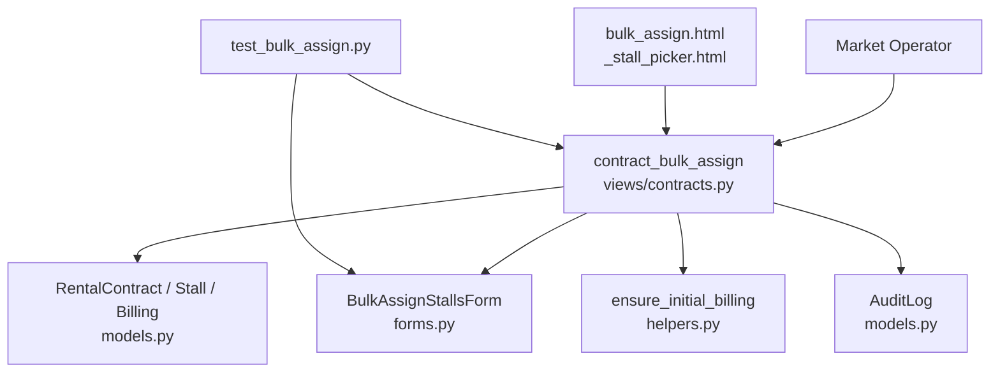
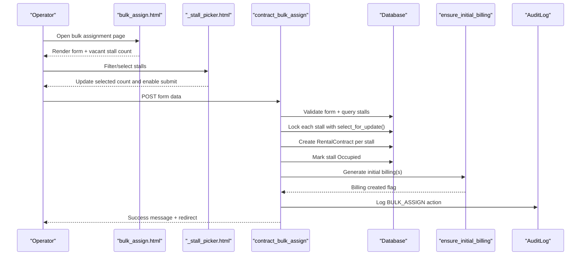
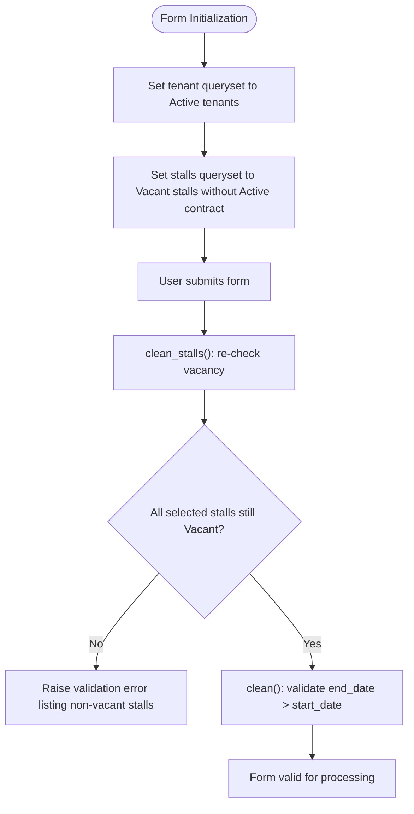
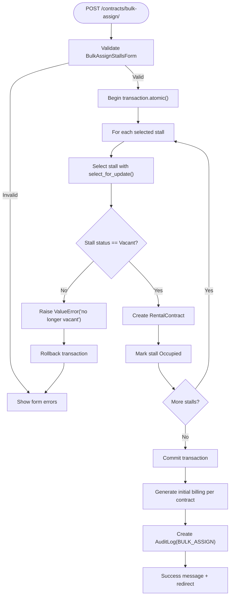
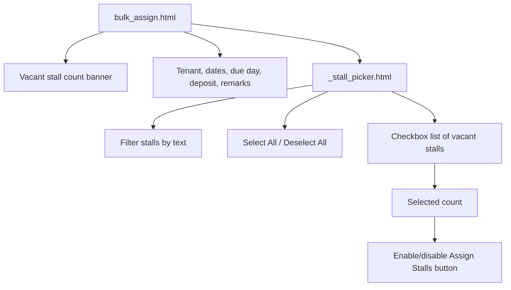
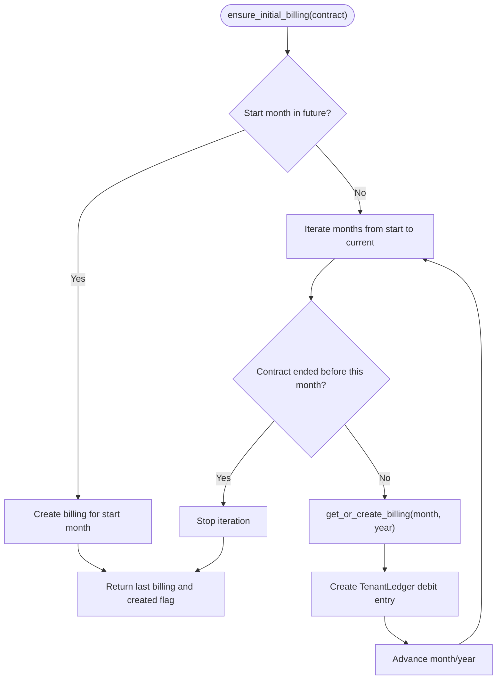
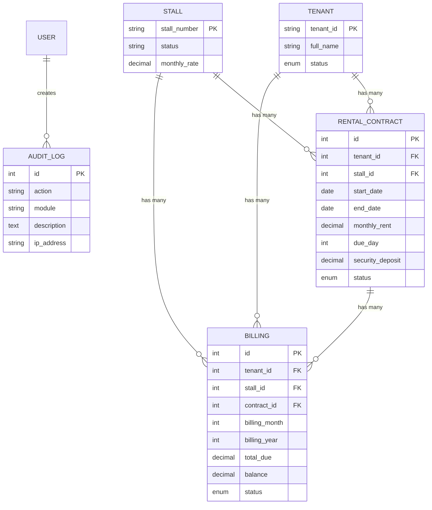
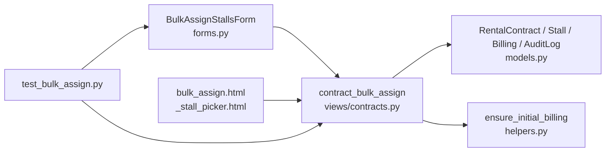

# Bulk Contract Operations

<cite>
**Referenced Files in This Document**   
- [forms.py](file://core/forms.py)
- [contracts.py](file://core/views/contracts.py)
- [bulk_assign.html](file://templates/contracts/bulk_assign.html)
- [_stall_picker.html](file://templates/contracts/_stall_picker.html)
- [helpers.py](file://core/helpers.py)
- [models.py](file://core/models.py)
- [test_bulk_assign.py](file://core/test_bulk_assign.py)
</cite>

## Table of Contents
1. [Introduction](#introduction)
2. [Project Structure](#project-structure)
3. [Core Components](#core-components)
4. [Architecture Overview](#architecture-overview)
5. [Detailed Component Analysis](#detailed-component-analysis)
6. [Dependency Analysis](#dependency-analysis)
7. [Performance Considerations](#performance-considerations)
8. [Troubleshooting Guide](#troubleshooting-guide)
9. [Conclusion](#conclusion)

## Introduction
This document explains the bulk contract assignment feature that allows one tenant to be assigned to multiple vacant stalls in a single transaction. It covers the form validation, atomic database operations, stall locking, automatic billing generation, audit logging, UI components, error handling, and performance considerations for large-scale assignments.

The implementation is centered around:
- A dedicated bulk assignment form.
- A view that processes the form inside an atomic transaction.
- Per-stall row locking to prevent concurrent modifications.
- Automatic creation of initial billings after contracts are created.
- Audit logging for every successful bulk operation.

## Project Structure
Bulk assignment spans forms, views, templates, helpers, models, and tests:

**Diagram sources**
- [contracts.py:432-529](file://core/views/contracts.py#L432-L529)
- [forms.py:652-725](file://core/forms.py#L652-L725)
- [helpers.py:208-235](file://core/helpers.py#L208-L235)
- [models.py:157-187](file://core/models.py#L157-L187)
- [models.py:190-215](file://core/models.py#L190-L215)
- [models.py:304-316](file://core/models.py#L304-L316)
- [bulk_assign.html:1-102](file://templates/contracts/bulk_assign.html#L1-L102)
- [_stall_picker.html:1-70](file://templates/contracts/_stall_picker.html#L1-L70)
- [test_bulk_assign.py:16-163](file://core/test_bulk_assign.py#L16-L163)

**Section sources**
- [contracts.py:432-529](file://core/views/contracts.py#L432-L529)
- [forms.py:652-725](file://core/forms.py#L652-L725)
- [bulk_assign.html:1-102](file://templates/contracts/bulk_assign.html#L1-L102)
- [_stall_picker.html:1-70](file://templates/contracts/_stall_picker.html#L1-L70)
- [helpers.py:208-235](file://core/helpers.py#L208-L235)
- [models.py:157-187](file://core/models.py#L157-L187)
- [models.py:190-215](file://core/models.py#L190-L215)
- [models.py:304-316](file://core/models.py#L304-L316)
- [test_bulk_assign.py:16-163](file://core/test_bulk_assign.py#L16-L163)

## Core Components
- **BulkAssignStallsForm**: Validates tenant selection, required start date, optional end date, due day, security deposit, remarks, and at least one selectable stall. It filters stalls to only those marked Vacant without an Active contract.
- **contract_bulk_assign view**: Processes POST submissions, locks each stall atomically, creates one contract per stall, updates stall status, generates initial billings, logs the operation, and shows success or error messages.
- **Template layer**: Renders the bulk assignment page with a stall checklist, filter, select-all control, selected-count indicator, and submit gating.
- **Billing helper**: Creates idempotent monthly billings from the contract start month up to the current month, including ledger entries.
- **Models**: Define stalls, tenants, contracts, billings, and audit logs used by the workflow.

**Section sources**
- [forms.py:652-725](file://core/forms.py#L652-L725)
- [contracts.py:432-529](file://core/views/contracts.py#L432-L529)
- [bulk_assign.html:1-102](file://templates/contracts/bulk_assign.html#L1-L102)
- [_stall_picker.html:1-70](file://templates/contracts/_stall_picker.html#L1-L70)
- [helpers.py:208-235](file://core/helpers.py#L208-L235)
- [models.py:93-114](file://core/models.py#L93-L114)
- [models.py:117-154](file://core/models.py#L117-L154)
- [models.py:157-187](file://core/models.py#L157-L187)
- [models.py:190-215](file://core/models.py#L190-L215)
- [models.py:304-316](file://core/models.py#L304-L316)

## Architecture Overview
The bulk assignment flow is request-driven and transactional:

**Diagram sources**
- [bulk_assign.html:1-102](file://templates/contracts/bulk_assign.html#L1-L102)
- [_stall_picker.html:1-70](file://templates/contracts/_stall_picker.html#L1-L70)
- [contracts.py:432-529](file://core/views/contracts.py#L432-L529)
- [helpers.py:208-235](file://core/helpers.py#L208-L235)
- [models.py:304-316](file://core/models.py#L304-L316)

## Detailed Component Analysis

### BulkAssignStallsForm
Responsibilities:
- Restrict tenant choices to active tenants.
- Restrict stall choices to stalls whose status is Vacant and which do not have an Active contract.
- Require at least one stall.
- Re-validate vacancy at submission time to reduce race conditions.
- Enforce end-date rules relative to start date.

Key behaviors:
- The stalls field uses a multi-checkbox widget.
- The help text communicates that each selected stall receives its own contract at its own rate.
- Validation errors surface clearly when stalls become occupied between render and submission.

**Diagram sources**
- [forms.py:652-725](file://core/forms.py#L652-L725)

**Section sources**
- [forms.py:652-725](file://core/forms.py#L652-L725)
- [test_bulk_assign.py:16-81](file://core/test_bulk_assign.py#L16-L81)

### contract_bulk_assign View
Responsibilities:
- Accept GET requests to render the bulk assignment form.
- Accept POST requests to process bulk assignments.
- Pre-fill the tenant if requested via query parameter.
- Provide a vacant stall count matching the form’s stall queryset.
- Wrap stall locking, contract creation, and stall status updates in `transaction.atomic()`.
- Use `select_for_update()` to lock each stall before checking and updating it.
- Generate initial billings outside the lock to keep the critical section small.
- Record an audit log entry with action `BULK_ASSIGN`.
- Display user-friendly success or error messages.

Atomic pattern:
- All stall checks, contract creations, and status updates occur within one transaction.
- If any stall is no longer vacant during locking, the entire batch fails and rolls back.

Stall locking pattern:
- Each stall is fetched with `select_for_update()` before being read or updated.
- This prevents another request from claiming the same stall concurrently.

Automatic billing:
- After contracts are committed, `ensure_initial_billing` is called for each contract.
- Billing generation is isolated from the stall-locking transaction to reduce contention.

Audit logging:
- On success, an audit log records the operator, action, module, description, and IP address.

Error handling:
- `ValueError` raised when a locked stall is not vacant results in an error message and re-renders the bound form so the operator’s selections remain visible.
- Other exceptions are caught and surfaced as generic assignment failures.

**Diagram sources**
- [contracts.py:432-529](file://core/views/contracts.py#L432-L529)

**Section sources**
- [contracts.py:432-529](file://core/views/contracts.py#L432-L529)
- [test_bulk_assign.py:103-163](file://core/test_bulk_assign.py#L103-L163)

### UI Components
#### bulk_assign.html
- Displays the page title and instructions.
- Shows a banner with the number of currently vacant stalls.
- Renders the full form: tenant, dates, due day, security deposit, remarks, and stall selection.
- Includes cancel and submit buttons; submit is disabled until stalls are selected.

#### _stall_picker.html
- Provides a search box to filter stalls.
- Provides a “Select All” toggle.
- Renders checkboxes for each available stall.
- Updates the selected count dynamically.
- Disables the submit button when no stalls are selected.

Real-time validation feedback:
- Client-side script enables/disables submit based on selection count.
- Server-side validation surfaces errors such as “at least one vacant stall” or stalls that became occupied.

**Diagram sources**
- [bulk_assign.html:1-102](file://templates/contracts/bulk_assign.html#L1-L102)
- [_stall_picker.html:1-70](file://templates/contracts/_stall_picker.html#L1-L70)

**Section sources**
- [bulk_assign.html:1-102](file://templates/contracts/bulk_assign.html#L1-L102)
- [_stall_picker.html:1-70](file://templates/contracts/_stall_picker.html#L1-L70)

### Automatic Billing Generation
After contracts are created, the system generates initial billings:
- For future-start contracts, only the start month is billed.
- For past or current-start contracts, billings are generated from the start month through the current month.
- Each billing includes rental amount, penalty calculation, total due, balance, due date, and ledger entries.
- Billing creation is idempotent: duplicate calls for the same tenant/stall/month/year return the existing record.

**Diagram sources**
- [helpers.py:208-235](file://core/helpers.py#L208-L235)
- [helpers.py:155-205](file://core/helpers.py#L155-L205)

**Section sources**
- [helpers.py:155-235](file://core/helpers.py#L155-L235)
- [contracts.py:475-484](file://core/views/contracts.py#L475-L484)

### Data Model Relationships Relevant to Bulk Assignment

**Diagram sources**
- [models.py:93-114](file://core/models.py#L93-L114)
- [models.py:117-154](file://core/models.py#L117-L154)
- [models.py:157-187](file://core/models.py#L157-L187)
- [models.py:190-215](file://core/models.py#L190-L215)
- [models.py:304-316](file://core/models.py#L304-L316)

## Dependency Analysis
The bulk assignment feature depends on several modules:

**Diagram sources**
- [forms.py:652-725](file://core/forms.py#L652-L725)
- [contracts.py:432-529](file://core/views/contracts.py#L432-L529)
- [models.py:157-187](file://core/models.py#L157-L187)
- [models.py:190-215](file://core/models.py#L190-L215)
- [models.py:304-316](file://core/models.py#L304-L316)
- [helpers.py:208-235](file://core/helpers.py#L208-L235)
- [bulk_assign.html:1-102](file://templates/contracts/bulk_assign.html#L1-L102)
- [_stall_picker.html:1-70](file://templates/contracts/_stall_picker.html#L1-L70)
- [test_bulk_assign.py:16-163](file://core/test_bulk_assign.py#L16-L163)

**Section sources**
- [forms.py:652-725](file://core/forms.py#L652-L725)
- [contracts.py:432-529](file://core/views/contracts.py#L432-L529)
- [helpers.py:208-235](file://core/helpers.py#L208-L235)
- [models.py:157-187](file://core/models.py#L157-L187)
- [models.py:190-215](file://core/models.py#L190-L215)
- [models.py:304-316](file://core/models.py#L304-L316)
- [bulk_assign.html:1-102](file://templates/contracts/bulk_assign.html#L1-L102)
- [_stall_picker.html:1-70](file://templates/contracts/_stall_picker.html#L1-L70)
- [test_bulk_assign.py:16-163](file://core/test_bulk_assign.py#L16-L163)

## Performance Considerations
- **Transaction scope**: The critical section holds database locks while creating contracts and marking stalls occupied. Keep this section minimal; billing generation is intentionally performed after the transaction commit to avoid holding locks during potentially expensive billing work.
- **Per-stall locking**: Using `select_for_update()` per stall serializes access to each stall row. Large batches increase lock duration proportionally to the number of stalls.
- **Query efficiency**: The form’s stall queryset excludes stalls with Active contracts, reducing invalid selections and server-side re-validation overhead.
- **Billing generation cost**: Initial billing may create multiple monthly records for long-running contracts. This is acceptable but should be considered when assigning many stalls with long start-to-current ranges.
- **UI responsiveness**: The stall picker provides client-side filtering and selection counting to improve perceived performance, though final validation remains server-side.
- **Timeout handling**: There is no explicit request timeout configuration in the bulk assignment view. Long-running operations could be affected by web server or database timeouts. Consider adding application-level timeouts or background task processing for very large batches.

[No sources needed since this section provides general guidance]

## Troubleshooting Guide
Common issues and their handling:

- **No stalls selected**:
  - The form requires at least one stall.
  - The UI disables submit until at least one stall is checked.
  - Server returns a validation error indicating at least one vacant stall is required.

- **Stalls become occupied during processing**:
  - The form performs a submission-time vacancy check.
  - The view locks each stall with `select_for_update()` and raises an error if the stall is no longer vacant.
  - The entire batch rolls back, ensuring no partial assignments.
  - The operator sees an error message and retains their previous selections for correction.

- **Stall has an Active contract but status column says Vacant**:
  - The form excludes stalls with Active contracts regardless of the status column.
  - Such stalls cannot be selected, preventing data drift.

- **Billing generation failure**:
  - Billing generation is wrapped in exception handling and does not fail the whole assignment.
  - Successful contracts are still created and logged; billing issues are silently ignored in the current implementation.

- **Audit log missing**:
  - Audit logs are created only after successful completion of the atomic block and billing generation loop.
  - Failed assignments do not produce a `BULK_ASSIGN` audit entry.

**Section sources**
- [forms.py:709-725](file://core/forms.py#L709-L725)
- [contracts.py:451-510](file://core/views/contracts.py#L451-L510)
- [helpers.py:208-235](file://core/helpers.py#L208-L235)
- [test_bulk_assign.py:131-163](file://core/test_bulk_assign.py#L131-L163)

## Conclusion
The bulk contract assignment feature provides a safe, auditable way to assign one tenant to multiple vacant stalls in a single transaction. It combines form-level validation, atomic transactions, per-stall locking, automatic billing generation, and clear user feedback. For large-scale operations, consider monitoring lock contention, billing generation costs, and request timeouts. The test suite validates key behaviors including multi-stall creation, occupancy enforcement, rollback behavior, and audit logging.

[No sources needed since this section summarizes without analyzing specific files]