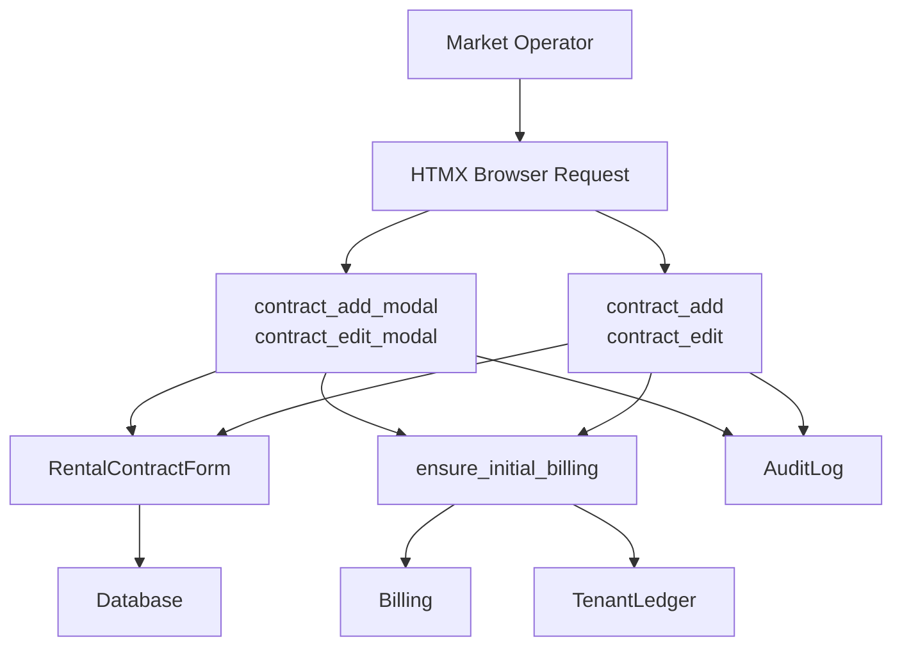
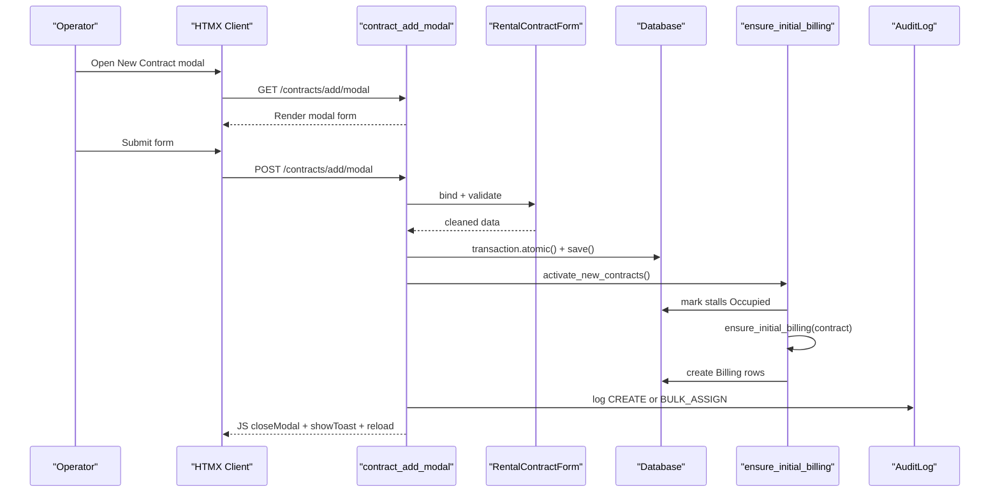
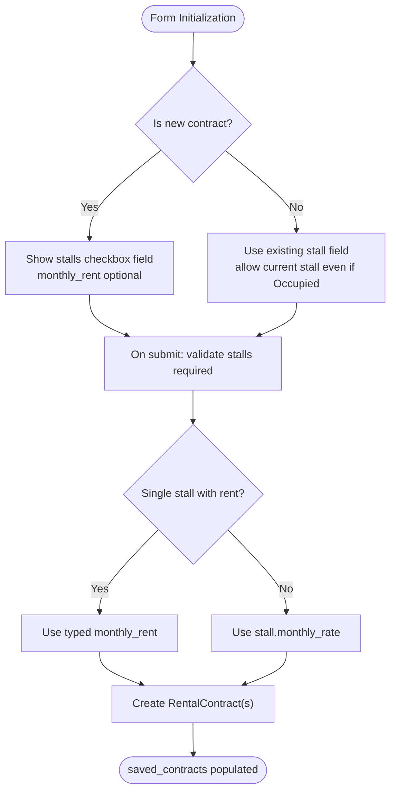
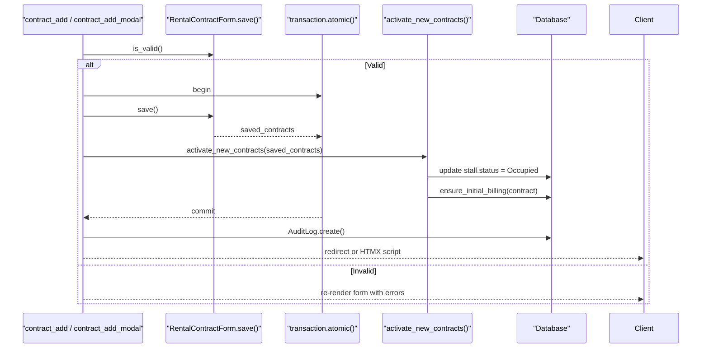
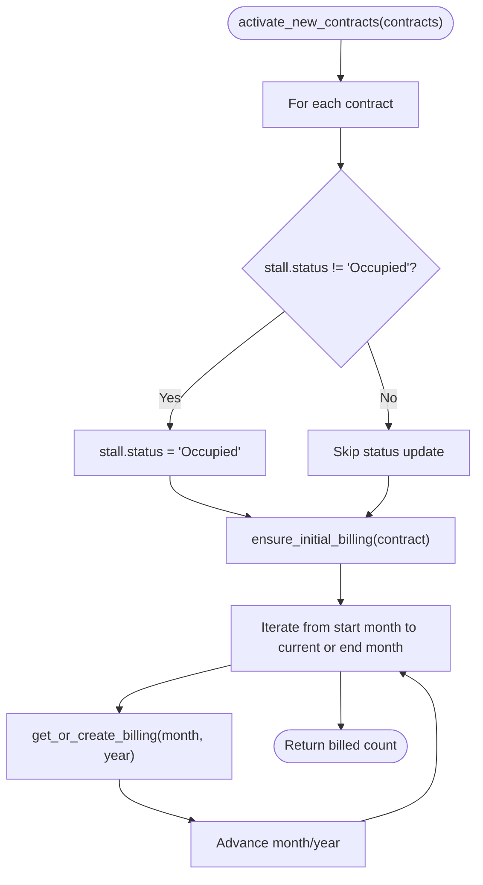
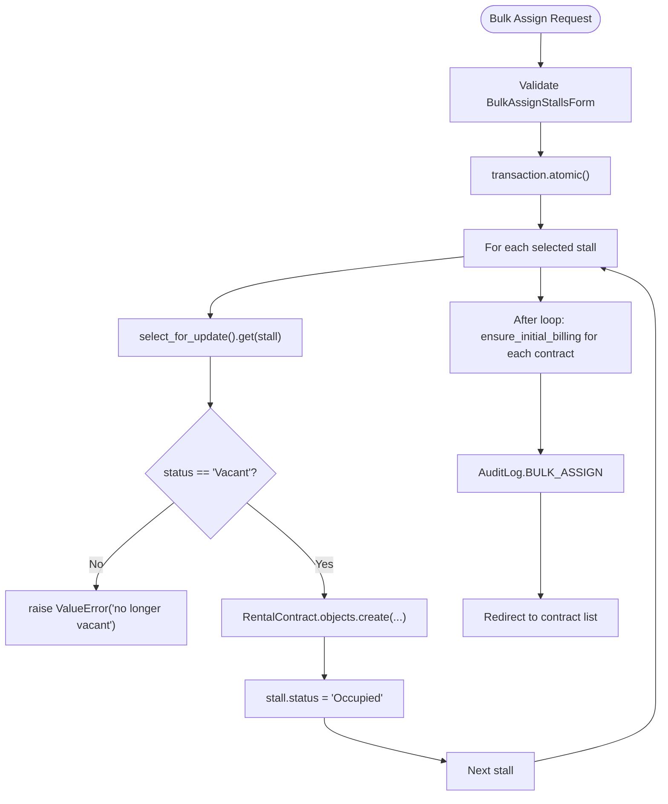
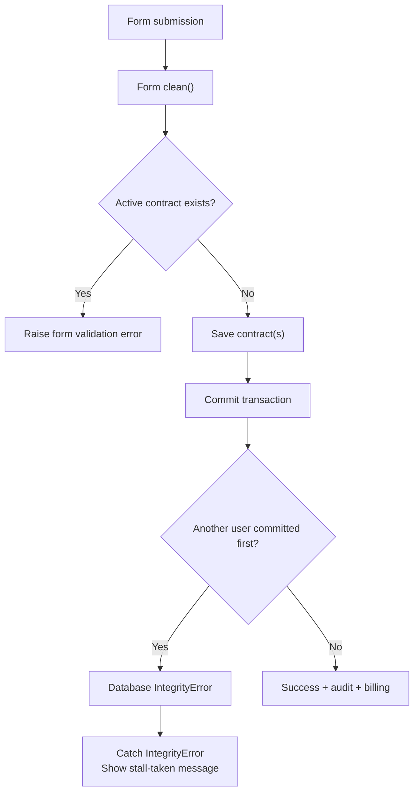
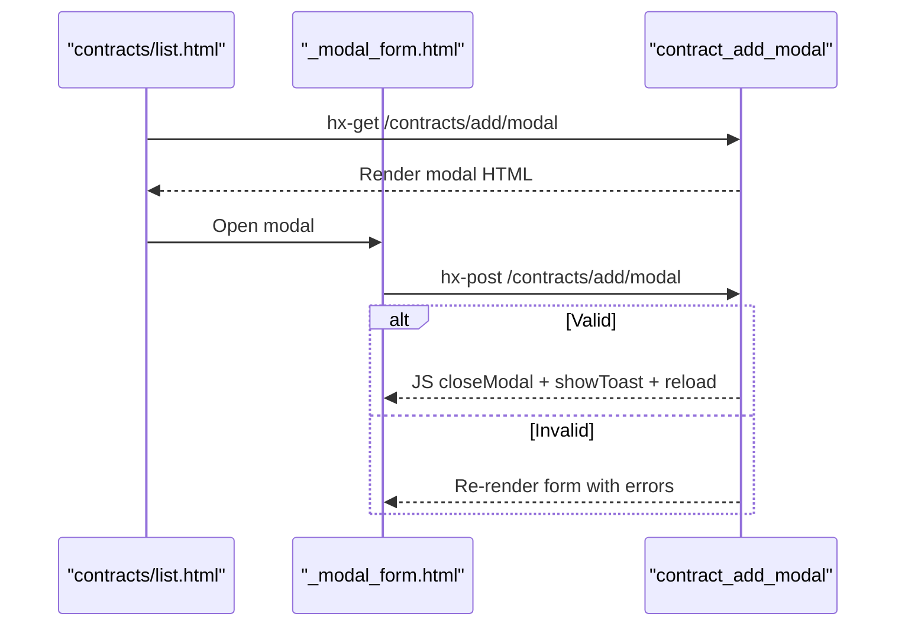
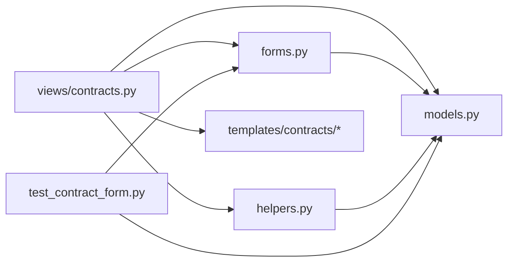

# Contract Creation & Assignment

<cite>
**Referenced Files in This Document**
- [contracts.py](file://core/views/contracts.py)
- [forms.py](file://core/forms.py)
- [models.py](file://core/models.py)
- [helpers.py](file://core/helpers.py)
- [_modal_form.html](file://templates/contracts/_modal_form.html)
- [list.html](file://templates/contracts/list.html)
- [test_contract_form.py](file://core/test_contract_form.py)
</cite>

## Table of Contents
1. [Introduction](#introduction)
2. [Project Structure](#project-structure)
3. [Core Components](#core-components)
4. [Architecture Overview](#architecture-overview)
5. [Detailed Component Analysis](#detailed-component-analysis)
6. [Dependency Analysis](#dependency-analysis)
7. [Performance Considerations](#performance-considerations)
8. [Troubleshooting Guide](#troubleshooting-guide)
9. [Conclusion](#conclusion)

## Introduction
This document explains how the system creates and assigns rental contracts, focusing on:
- Validation performed by `RentalContractForm`, including tenant-stall relationship enforcement and business rules.
- The end-to-end contract creation workflow from form submission to database persistence.
- Transaction handling, integrity error management, and concurrent access protection.
- Automatic stall status updates from Vacant to Occupied.
- Initial billing generation through `ensure_initial_billing()`.
- Differences between single contract creation and bulk assignment.
- Date range validation, rental amount computation from stall `monthly_rate`, and security deposit handling.
- HTMX modal integration for a seamless user experience without full page reloads.

## Project Structure
The contract feature spans views, forms, models, helpers, templates, and tests:
- Views handle HTTP requests, form binding, transaction boundaries, audit logging, and HTMX responses.
- Forms encapsulate business validation, choice filtering, and per-stall contract construction.
- Models define entities such as `Tenant`, `Stall`, `RentalContract`, `Billing`, and `AuditLog`.
- Helpers provide idempotent billing creation, ledger updates, and PDF utilities.
- Templates render the modal form and list actions.
- Tests validate rental rate fallback, duplicate stall rejection, and concurrency behavior.

**Diagram sources**
- [contracts.py:88-135](file://core/views/contracts.py#L88-L135)
- [contracts.py:249-294](file://core/views/contracts.py#L249-L294)
- [forms.py:281-399](file://core/forms.py#L281-L399)
- [helpers.py:155-235](file://core/helpers.py#L155-L235)
- [models.py:157-218](file://core/models.py#L157-L218)

**Section sources**
- [contracts.py:1-530](file://core/views/contracts.py#L1-L530)
- [forms.py:281-725](file://core/forms.py#L281-L725)
- [models.py:93-218](file://core/models.py#L93-L218)
- [helpers.py:155-235](file://core/helpers.py#L155-L235)
- [_modal_form.html:1-95](file://templates/contracts/_modal_form.html#L1-L95)
- [list.html:26-38](file://templates/contracts/list.html#L26-L38)

## Core Components
- `RentalContractForm`: Validates tenant selection, stall availability, active-contract uniqueness, date ranges, and rental amount logic. It supports both single-still contracts and multi-stall assignments.
- `BulkAssignStallsForm`: Dedicated form for assigning one tenant to multiple vacant stalls with explicit vacancy checks and date validation.
- Contract views: `contract_add`, `contract_add_modal`, `contract_edit`, `contract_edit_modal`, and `contract_bulk_assign` implement persistence, status updates, billing generation, audit logging, and HTMX responses.
- `activate_new_contracts`: Centralizes stall occupation and initial billing creation after successful contract saves.
- `ensure_initial_billing`: Idempotently generates monthly billings from the contract start month up to the current or end month.
- Models: `RentalContract` enforces one active contract per stall via a conditional unique constraint; `Billing` is uniquely constrained by tenant, stall, month, and year.

**Section sources**
- [forms.py:281-399](file://core/forms.py#L281-L399)
- [forms.py:652-725](file://core/forms.py#L652-L725)
- [contracts.py:20-36](file://core/views/contracts.py#L20-L36)
- [contracts.py:88-135](file://core/views/contracts.py#L88-L135)
- [contracts.py:249-294](file://core/views/contracts.py#L249-L294)
- [contracts.py:431-529](file://core/views/contracts.py#L431-L529)
- [helpers.py:155-235](file://core/helpers.py#L155-L235)
- [models.py:157-218](file://core/models.py#L157-L218)

## Architecture Overview
The contract creation architecture follows a layered flow:
1. The operator opens a modal or full-page form.
2. The view binds and validates the form.
3. On success, the view persists contracts inside an atomic transaction.
4. After saving, the system marks stalls occupied and auto-generates initial billings.
5. Audit logs record the action.
6. HTMX returns either a refreshed modal fragment or JavaScript that closes the modal and reloads the list.

**Diagram sources**
- [contracts.py:249-294](file://core/views/contracts.py#L249-L294)
- [contracts.py:20-36](file://core/views/contracts.py#L20-L36)
- [helpers.py:208-235](file://core/helpers.py#L208-L235)
- [_modal_form.html:18-18](file://templates/contracts/_modal_form.html#L18-L18)

## Detailed Component Analysis

### RentalContractForm Validation and Business Rules
`RentalContractForm` performs several validations:
- Tenant must be Active.
- For new contracts, the form exposes a multi-select of vacant stalls not already under an Active contract.
- For edits, the currently assigned stall remains selectable even if it is Occupied.
- A typed `monthly_rent` is honored only for single-stall submissions; otherwise each stall uses its own `monthly_rate`.
- The form rejects a stall that already has an Active contract when creating or editing a contract with status Active.
- Security deposit defaults to zero if blank.
- The form stores all created contracts in `saved_contracts` so the view can iterate them for post-save operations.

**Diagram sources**
- [forms.py:297-363](file://core/forms.py#L297-L363)
- [forms.py:389-399](file://core/forms.py#L389-L399)

Key validation behaviors:
- Tenant-stall relationship enforcement: Only Active tenants are offered; only vacant stalls without an Active contract are offered for new assignments.
- Business rule validation: One Active contract per stall is enforced both at the form level and by a database-level conditional unique constraint.
- Date range validation: The form does not explicitly enforce `end_date > start_date`; this is handled by `BulkAssignStallsForm.clean()`.
- Rental amount computation: For multi-stall submissions, each contract inherits the selected stall’s `monthly_rate`; for a single stall, a typed rent overrides the stall rate.
- Security deposit handling: Defaults to zero when blank; stored per contract.

**Section sources**
- [forms.py:281-399](file://core/forms.py#L281-L399)
- [models.py:157-184](file://core/models.py#L157-L184)
- [test_contract_form.py:173-221](file://core/test_contract_form.py#L173-L221)

### Contract Creation Workflow: From Submission to Persistence
Two entry points exist:
- Full-page creation: `contract_add`
- HTMX modal creation: `contract_add_modal`

Both follow the same core steps:
1. Bind and validate `RentalContractForm`.
2. Persist contracts inside `transaction.atomic()`.
3. Call `activate_new_contracts()` to occupy stalls and generate initial billings.
4. Handle `IntegrityError` when another user claims a stall concurrently.
5. Create an `AuditLog` entry.
6. Redirect or return HTMX response.

**Diagram sources**
- [contracts.py:88-135](file://core/views/contracts.py#L88-L135)
- [contracts.py:249-294](file://core/views/contracts.py#L249-L294)
- [contracts.py:20-36](file://core/views/contracts.py#L20-L36)

**Section sources**
- [contracts.py:88-135](file://core/views/contracts.py#L88-L135)
- [contracts.py:249-294](file://core/views/contracts.py#L249-L294)

### Stall Status Updates and Initial Billing Generation
After contracts are saved:
- `activate_new_contracts()` iterates over created contracts.
- If a stall is not already Occupied, it is set to Occupied.
- `ensure_initial_billing(contract)` is called for each contract.
- Billing generation is idempotent: duplicate billings for the same tenant, stall, month, and year are prevented by model constraints.

`ensure_initial_billing()` computes:
- Start month from `contract.start_date`.
- Current month from today.
- Iterates months until the current month or until the contract ends.
- Skips months beyond the contract’s `end_date`.
- Creates a `Billing` row and corresponding `TenantLedger` debit entry.

**Diagram sources**
- [contracts.py:20-36](file://core/views/contracts.py#L20-L36)
- [helpers.py:208-235](file://core/helpers.py#L208-L235)
- [helpers.py:155-205](file://core/helpers.py#L155-L205)

**Section sources**
- [contracts.py:20-36](file://core/views/contracts.py#L20-L36)
- [helpers.py:155-235](file://core/helpers.py#L155-L235)

### Bulk Assignment vs Single Contract Creation
Single contract creation:
- Uses `RentalContractForm`.
- Supports selecting one or more stalls via checkboxes.
- Honors a typed `monthly_rent` only for a single stall; otherwise falls back to each stall’s `monthly_rate`.
- Persists contracts atomically and then activates them.

Bulk assignment:
- Uses `BulkAssignStallsForm`.
- Explicitly locks each stall using `select_for_update()` before checking vacancy and creating the contract.
- Rejects stalls that are no longer vacant at submission time.
- Creates one `RentalContract` per selected stall, inheriting the stall’s `monthly_rate`.
- Generates initial billings outside the lock to keep the critical section small.

**Diagram sources**
- [contracts.py:431-529](file://core/views/contracts.py#L431-L529)
- [forms.py:652-725](file://core/forms.py#L652-L725)

**Section sources**
- [contracts.py:431-529](file://core/views/contracts.py#L431-L529)
- [forms.py:652-725](file://core/forms.py#L652-L725)

### Date Range Validation, Rental Amount Computation, and Security Deposit Handling
- Date range validation:
  - `BulkAssignStallsForm.clean()` ensures `end_date` is later than `start_date`.
  - `RentalContractForm` does not add explicit date range validation; the view relies on form-level validation and model defaults.
- Rental amount computation:
  - For multi-stall submissions in `RentalContractForm`, each contract uses the selected stall’s `monthly_rate`.
  - For a single stall, a typed `monthly_rent` is honored.
  - In bulk assignment, each contract always uses the locked stall’s `monthly_rate`.
- Security deposit handling:
  - Defaults to zero when blank.
  - Stored per contract.
  - In bulk assignment, the per-stall security deposit is applied to each created contract.

**Section sources**
- [forms.py:335-363](file://core/forms.py#L335-L363)
- [forms.py:671-695](file://core/forms.py#L671-L695)
- [forms.py:719-725](file://core/forms.py#L719-L725)
- [test_contract_form.py:173-183](file://core/test_contract_form.py#L173-L183)

### Concurrent Access Protection and IntegrityError Handling
Concurrency protections include:
- Database-level constraint: `unique_active_contract_per_stall` prevents two Active contracts for the same stall.
- Form-level check: `RentalContractForm.clean()` raises a validation error if an Active contract already exists for the selected stall.
- View-level `IntegrityError` handling: Both `contract_add` and `contract_add_modal` catch `IntegrityError` and return a user-friendly message indicating the stall was taken.
- Bulk assignment locking: `select_for_update()` locks each stall row during vacancy checks and contract creation, preventing race conditions where two operators assign the same stall simultaneously.

**Diagram sources**
- [forms.py:389-399](file://core/forms.py#L389-L399)
- [models.py:178-184](file://core/models.py#L178-L184)
- [contracts.py:93-102](file://core/views/contracts.py#L93-L102)
- [contracts.py:254-265](file://core/views/contracts.py#L254-L265)
- [contracts.py:452-473](file://core/views/contracts.py#L452-L473)

**Section sources**
- [forms.py:389-399](file://core/forms.py#L389-L399)
- [models.py:178-184](file://core/models.py#L178-L184)
- [contracts.py:93-102](file://core/views/contracts.py#L93-L102)
- [contracts.py:254-265](file://core/views/contracts.py#L254-L265)
- [contracts.py:452-473](file://core/views/contracts.py#L452-L473)

### HTMX Modal Integration
The modal workflow provides a seamless UX:
- The list page includes a “New Contract” button that triggers an HTMX GET to `contract_add_modal`.
- The modal template posts to `contract_add_modal` using `hx-post`.
- On success, the modal view returns JavaScript that closes the modal, shows a toast, and reloads the page.
- On validation failure, the modal re-renders the form fragment with errors.

**Diagram sources**
- [list.html:31-36](file://templates/contracts/list.html#L31-L36)
- [_modal_form.html:18-18](file://templates/contracts/_modal_form.html#L18-L18)
- [contracts.py:249-294](file://core/views/contracts.py#L249-L294)

**Section sources**
- [list.html:31-36](file://templates/contracts/list.html#L31-L36)
- [_modal_form.html:1-95](file://templates/contracts/_modal_form.html#L1-L95)
- [contracts.py:249-294](file://core/views/contracts.py#L249-L294)

## Dependency Analysis
The contract creation and assignment feature depends on:
- Forms for validation and data binding.
- Views for request handling, transactions, and HTMX responses.
- Models for entity definitions and constraints.
- Helpers for billing generation and ledger updates.
- Templates for UI rendering.

**Diagram sources**
- [contracts.py:1-13](file://core/views/contracts.py#L1-L13)
- [forms.py:11-15](file://core/forms.py#L11-L15)
- [helpers.py:15-15](file://core/helpers.py#L15-L15)
- [models.py:157-218](file://core/models.py#L157-L218)

**Section sources**
- [contracts.py:1-13](file://core/views/contracts.py#L1-L13)
- [forms.py:11-15](file://core/forms.py#L11-L15)
- [helpers.py:15-15](file://core/helpers.py#L15-L15)
- [models.py:157-218](file://core/models.py#L157-L218)

## Performance Considerations
- Use `select_related` in list and view queries to reduce N+1 queries.
- Keep the atomic transaction scope minimal: persist contracts first, then generate billings outside the lock where possible.
- Avoid unnecessary database writes: stall status updates use `update_fields=['status']`.
- Idempotent billing creation prevents duplicate work and protects against concurrent calls.
- Bulk assignment locks only the stall row being processed, reducing contention across other stalls.

[No sources needed since this section provides general guidance]

## Troubleshooting Guide
Common issues and resolutions:
- Stall already taken:
  - Cause: Another user claimed the stall between form render and submission.
  - Resolution: Refresh the form and re-select available stalls. The view catches `IntegrityError` and displays a clear message.
- Duplicate active contract:
  - Cause: Attempting to create or edit a contract for a stall that already has an Active contract.
  - Resolution: Choose a different stall or terminate the existing contract. The form and database constraint prevent duplicates.
- End date earlier than start date:
  - Cause: Invalid date range in bulk assignment.
  - Resolution: Adjust the end date to be later than the start date.
- Missing initial billing:
  - Cause: Exception during billing generation.
  - Resolution: Check contract dates and stall status; billing generation is wrapped in exception handling and returns safely.
- HTMX modal not closing:
  - Cause: Server returned an unexpected response or JavaScript error.
  - Resolution: Inspect browser console and network tab; verify the modal view returns the expected script on success.

**Section sources**
- [contracts.py:98-102](file://core/views/contracts.py#L98-L102)
- [contracts.py:259-265](file://core/views/contracts.py#L259-L265)
- [forms.py:719-725](file://core/forms.py#L719-L725)
- [helpers.py:208-235](file://core/helpers.py#L208-L235)

## Conclusion
The contract creation and assignment system combines robust form validation, transactional persistence, database constraints, and helper-driven billing generation to ensure data integrity and operational consistency. Single contract creation and bulk assignment share common principles but differ in concurrency control and rental rate handling. HTMX modal integration delivers a smooth user experience without full page reloads. Operators should rely on the provided validation messages and error handling to resolve common issues such as stall conflicts and invalid date ranges.

[No sources needed since this section summarizes without analyzing specific files]