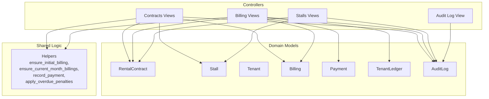
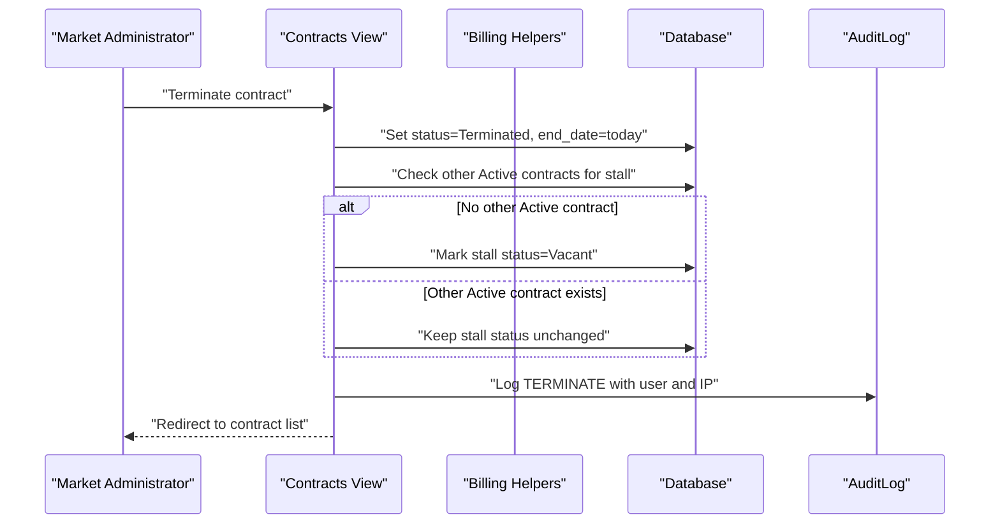
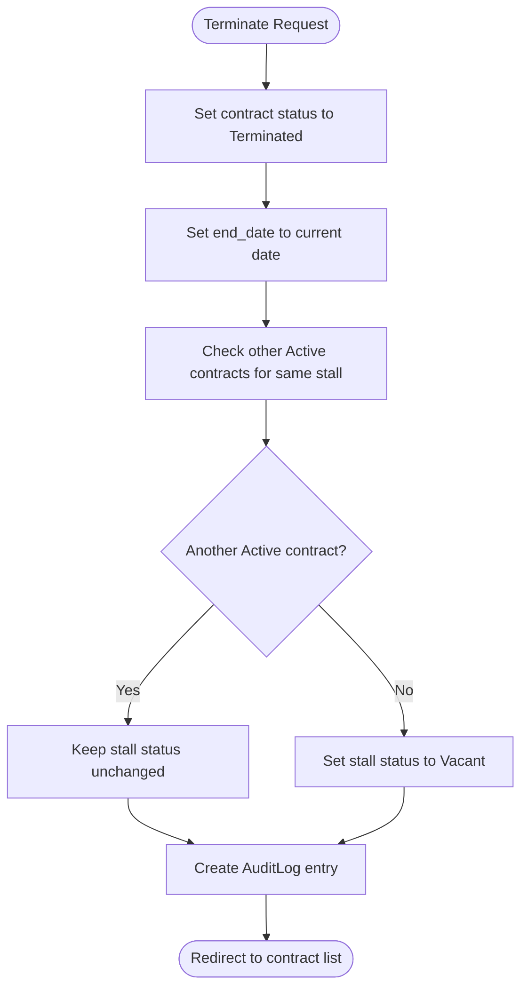
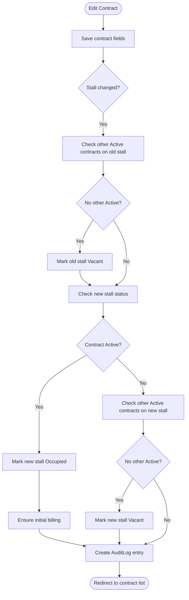
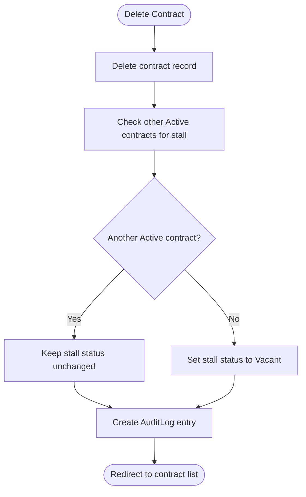
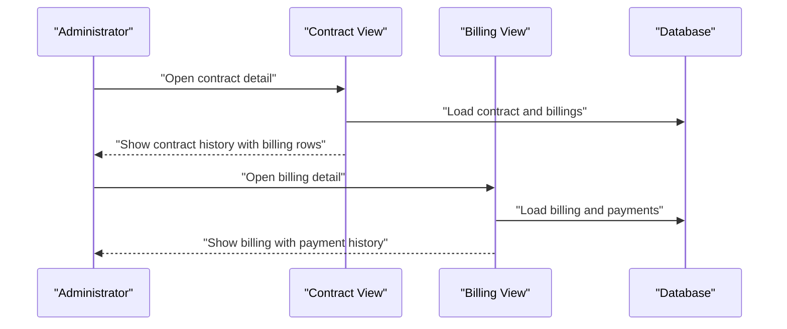
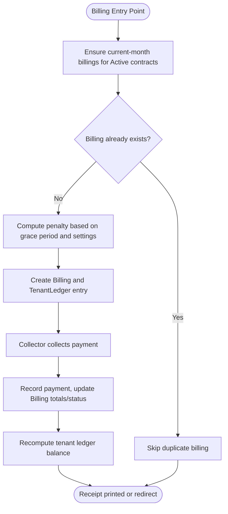
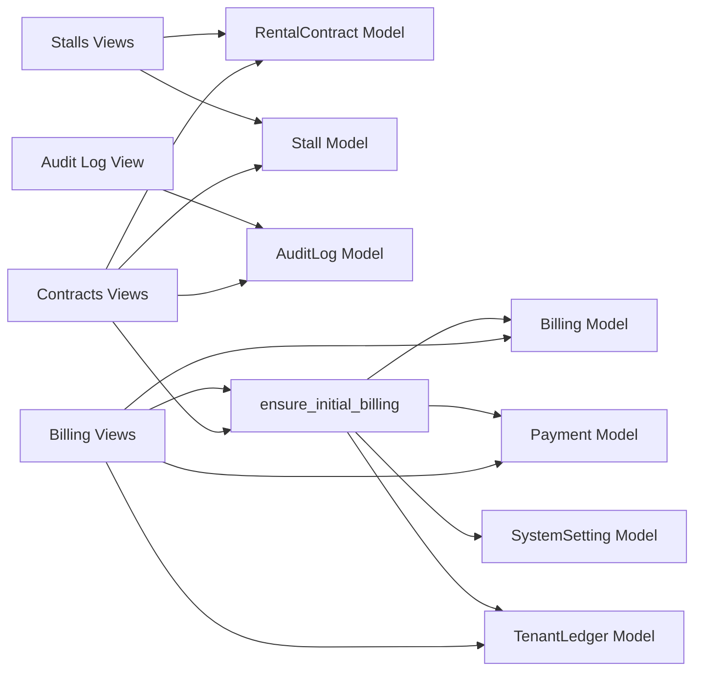

# Contract Lifecycle Management

<cite>
**Referenced Files in This Document**   
- [core/models.py](file://core/models.py)
- [core/views/contracts.py](file://core/views/contracts.py)
- [core/views/billing.py](file://core/views/billing.py)
- [core/views/stalls.py](file://core/views/stalls.py)
- [core/views/audit.py](file://core/views/audit.py)
- [core/helpers.py](file://core/helpers.py)
</cite>

## Table of Contents
1. [Introduction](#introduction)
2. [Project Structure](#project-structure)
3. [Core Components](#core-components)
4. [Architecture Overview](#architecture-overview)
5. [Detailed Component Analysis](#detailed-component-analysis)
6. [Dependency Analysis](#dependency-analysis)
7. [Performance Considerations](#performance-considerations)
8. [Troubleshooting Guide](#troubleshooting-guide)
9. [Conclusion](#conclusion)

## Introduction
This document explains the contract lifecycle management implemented in the market rental system. It covers the four contract statuses, their business meaning, status change workflows, stall occupancy synchronization, editing and deletion behavior, billing generation and collection integration, history viewing, and audit trail logging with user attribution and IP tracking.

The implementation is centered on:
- A `RentalContract` model with a constrained active-per-stall rule.
- View handlers for listing, creating, editing, terminating, deleting, and viewing contracts.
- Billing helpers that auto-generate monthly billings for active contracts.
- Stall status synchronization between contracts and physical stalls.
- Audit logging for lifecycle changes.

## Project Structure
Contract lifecycle logic spans several modules:

| Area | Responsibility |
|---|---|
| Data models | Defines contract, stall, tenant, billing, payment, ledger, notice, and audit entities. |
| Contract views | Handles CRUD, termination, bulk assignment, printing, and export. |
| Billing views | Generates billings, collects payments, applies overdue penalties, and prints receipts. |
| Helpers | Provides idempotent billing creation, current-month backfill, payment recording, penalty computation, and PDF rendering. |
| Stall views | Manages stall records and exposes stall view endpoints used by related features. |
| Audit views | Exposes an admin-only audit log list with filtering and search. |

**Diagram sources**
- [core/models.py:93-187](file://core/models.py#L93-L187)
- [core/models.py:190-316](file://core/models.py#L190-L316)
- [core/views/contracts.py:1-530](file://core/views/contracts.py#L1-L530)
- [core/views/billing.py:1-765](file://core/views/billing.py#L1-L765)
- [core/views/stalls.py:1-275](file://core/views/stalls.py#L1-L275)
- [core/views/audit.py:1-61](file://core/views/audit.py#L1-L61)
- [core/helpers.py:155-520](file://core/helpers.py#L155-L520)

**Section sources**
- [core/models.py:93-187](file://core/models.py#L93-L187)
- [core/models.py:190-316](file://core/models.py#L190-L316)
- [core/views/contracts.py:1-530](file://core/views/contracts.py#L1-L530)
- [core/views/billing.py:1-765](file://core/views/billing.py#L1-L765)
- [core/views/stalls.py:1-275](file://core/views/stalls.py#L1-L275)
- [core/views/audit.py:1-61](file://core/views/audit.py#L1-L61)
- [core/helpers.py:155-520](file://core/helpers.py#L155-L520)

## Core Components
The contract lifecycle is driven by these core components:

- **RentalContract**: Represents a tenant’s lease over a specific stall. It includes start/end dates, monthly rent, due day, security deposit, remarks, timestamps, and a status field. A database constraint enforces at most one Active contract per stall.
- **Stall**: Physical market unit with number, section, type, size, monthly rate, and status such as Vacant, Occupied, Reserved, or Maintenance.
- **Billing**: Monthly financial record tied to a tenant, stall, and contract. It tracks amounts, penalties, discounts, paid totals, balance, due date, and status.
- **Payment**: Official receipt entry linked to a billing, including amount, method, collector, and status.
- **TenantLedger**: Running financial ledger entries for tenants, updated when billings are created or payments are recorded.
- **AuditLog**: Immutable record of important actions, including user, action type, module, description, IP address, and timestamp.

Key lifecycle implications:
- Active contracts occupy stalls and generate billings.
- Terminated contracts set an end date and may free the stall if no other Active contract remains.
- Pending and Expired contracts do not create new Active occupancy.
- Editing can reassign stalls and trigger billing regeneration for Active contracts.
- Deletion removes the contract and may mark the stall Vacant.

**Section sources**
- [core/models.py:93-187](file://core/models.py#L93-L187)
- [core/models.py:190-316](file://core/models.py#L190-L316)
- [core/models.py:304-316](file://core/models.py#L304-L316)

## Architecture Overview
The contract lifecycle integrates three main flows:

1. **Contract Creation and Activation**
   - Creates one or more contracts.
   - Marks selected stalls Occupied.
   - Auto-generates initial billings from the contract start month up to the current month.
   - Logs creation and billing activity.

2. **Contract Termination**
   - Sets contract status to Terminated.
   - Sets end_date to the current date.
   - If no other Active contract exists for the same stall, marks the stall Vacant.
   - Logs termination with user and IP.

3. **Contract Editing and Reassignment**
   - Updates contract fields.
   - If the stall changes:
     - Old stall becomes Vacant if no other Active contract remains.
     - New stall becomes Occupied when the contract is Active; otherwise it may become Vacant if no other Active contract remains.
   - For Active contracts, ensures initial billing exists.
   - Logs updates with user and IP.

**Diagram sources**
- [core/views/contracts.py:226-246](file://core/views/contracts.py#L226-L246)
- [core/models.py:157-187](file://core/models.py#L157-L187)
- [core/models.py:304-316](file://core/models.py#L304-L316)

**Section sources**
- [core/views/contracts.py:226-246](file://core/views/contracts.py#L226-L246)
- [core/helpers.py:208-257](file://core/helpers.py#L208-L257)
- [core/models.py:157-187](file://core/models.py#L157-L187)

## Detailed Component Analysis

### Contract Statuses and Business Implications
The system defines four contract statuses:

| Status | Meaning | Operational Impact |
|---|---|---|
| Active | The contract is currently valid and enforceable. | Stall is marked Occupied. Current-month billing is ensured. Payments can be collected against generated billings. |
| Expired | The contract has passed its intended period without renewal. | Does not create new Active occupancy. Existing billings remain for historical accounting. |
| Terminated | The contract was ended early by administrative action. | End date is set to today. Stall may become Vacant if no other Active contract remains. |
| Pending | The contract is prepared but not yet active. | Does not occupy the stall and does not auto-generate billings until activated. |

The Active status is protected by a database-level unique constraint that allows only one Active contract per stall. This prevents double-occupancy at the data layer.

**Section sources**
- [core/models.py:157-187](file://core/models.py#L157-L187)

### Status Transition Workflows

#### Termination Workflow
When a contract is terminated:
1. The contract status is changed to Terminated.
2. The end_date is set to the current date.
3. The system checks whether any other Active contract exists for the same stall.
4. If none exists, the stall status is set to Vacant.
5. An audit log entry is created with the action, module, description, user, and IP address.

**Diagram sources**
- [core/views/contracts.py:226-246](file://core/views/contracts.py#L226-L246)
- [core/models.py:304-316](file://core/models.py#L304-L316)

**Section sources**
- [core/views/contracts.py:226-246](file://core/views/contracts.py#L226-L246)

#### Contract Editing and Stall Reassignment
Editing a contract performs stall-status synchronization:
- If the stall changes:
  - The old stall becomes Vacant if no other Active contract remains.
  - The new stall becomes Occupied when the contract is Active.
  - If the contract is not Active, the new stall may become Vacant if no other Active contract remains.
- If the contract is Active, the system ensures initial billing exists.
- An audit log entry records the update with user and IP.

**Diagram sources**
- [core/views/contracts.py:139-183](file://core/views/contracts.py#L139-L183)
- [core/helpers.py:208-235](file://core/helpers.py#L208-L235)
- [core/models.py:304-316](file://core/models.py#L304-L316)

**Section sources**
- [core/views/contracts.py:139-183](file://core/views/contracts.py#L139-L183)

#### Contract Deletion and Stall Occupancy
Deleting a contract:
1. Removes the contract record.
2. Checks whether any other Active contract remains for the same stall.
3. If none remains, marks the stall Vacant.
4. Logs the deletion with user and IP.

**Diagram sources**
- [core/views/contracts.py:187-208](file://core/views/contracts.py#L187-L208)
- [core/models.py:304-316](file://core/models.py#L304-L316)

**Section sources**
- [core/views/contracts.py:187-208](file://core/views/contracts.py#L187-L208)

### Contract Editing Capabilities and Automatic Billing Regeneration
Editing supports:
- Updating contract terms such as dates, rent, due day, deposit, and remarks.
- Reassigning the contract to another stall.
- Synchronizing stall occupancy based on Active status.
- Automatically ensuring initial billing for Active contracts.

Automatic billing regeneration uses the helper function that creates billings from the contract start month through the current month, skipping months after the contract end date. This keeps collectors able to collect from newly edited Active contracts without manual intervention.

**Section sources**
- [core/views/contracts.py:139-183](file://core/views/contracts.py#L139-L183)
- [core/helpers.py:208-235](file://core/helpers.py#L208-L235)

### Contract History Viewing with Billing Records and Payment History
The contract view loads:
- The contract details.
- All associated billings ordered by year and month.

The billing view loads:
- The billing details.
- Associated payments ordered by payment date.

This provides complete contract history visibility:
- Contract-level history shows all billed periods.
- Billing-level history shows payment receipts and collection details.

**Diagram sources**
- [core/views/contracts.py:212-222](file://core/views/contracts.py#L212-L222)
- [core/views/billing.py:318-332](file://core/views/billing.py#L318-L332)

**Section sources**
- [core/views/contracts.py:212-222](file://core/views/contracts.py#L212-L222)
- [core/views/billing.py:318-332](file://core/views/billing.py#L318-L332)

### How Contract Status Affects Billing Generation and Collection
Billing generation is tightly coupled to contract status:

- **Active contracts**:
  - Initial billings are auto-generated from the start month to the current month.
  - Current-month billings are ensured when collectors access billing lists.
  - Payments can be collected, updating billing status and ledger balances.

- **Expired or Terminated contracts**:
  - Do not create new Active occupancy.
  - Existing billings remain for historical accounting.
  - Past-due billings may still accrue penalties and be marked Overdue.

- **Pending contracts**:
  - Do not occupy stalls.
  - Do not auto-generate billings until activated.

The billing workflow includes:
- Idempotent billing creation per tenant, stall, month, and year.
- Penalty computation using system settings or contract-specific penalty settings.
- Payment recording that locks the billing row, updates totals, posts ledger credits, and recomputes running balances.
- Overdue penalty application that marks past-due billings and accrues penalties once.

**Diagram sources**
- [core/helpers.py:238-257](file://core/helpers.py#L238-L257)
- [core/helpers.py:155-205](file://core/helpers.py#L155-L205)
- [core/helpers.py:351-420](file://core/helpers.py#L351-L420)
- [core/helpers.py:423-500](file://core/helpers.py#L423-L500)
- [core/views/billing.py:174-246](file://core/views/billing.py#L174-L246)
- [core/views/billing.py:415-489](file://core/views/billing.py#L415-L489)

**Section sources**
- [core/helpers.py:155-257](file://core/helpers.py#L155-L257)
- [core/helpers.py:351-500](file://core/helpers.py#L351-L500)
- [core/views/billing.py:174-246](file://core/views/billing.py#L174-L246)
- [core/views/billing.py:415-489](file://core/views/billing.py#L415-L489)

### Audit Trail Logging for Lifecycle Changes
Every major lifecycle action logs:
- User who performed the action.
- Action type such as CREATE, UPDATE, DELETE, TERMINATE, GENERATE, COLLECT, or BULK_ASSIGN.
- Module name such as RentalContract or Billing.
- Human-readable description.
- IP address from the request.
- Timestamp automatically added by the model.

The audit log view provides filtering by user, action, module, date range, and free-text search across username, names, action, module, description, and IP address.

**Section sources**
- [core/models.py:304-316](file://core/models.py#L304-L316)
- [core/views/contracts.py:103-127](file://core/views/contracts.py#L103-L127)
- [core/views/contracts.py:170-176](file://core/views/contracts.py#L170-L176)
- [core/views/contracts.py:200-206](file://core/views/contracts.py#L200-L206)
- [core/views/contracts.py:238-244](file://core/views/contracts.py#L238-L244)
- [core/views/billing.py:226-232](file://core/views/billing.py#L226-L232)
- [core/views/billing.py:299-305](file://core/views/billing.py#L299-L305)
- [core/views/billing.py:460-466](file://core/views/billing.py#L460-L466)
- [core/views/billing.py:600-610](file://core/views/billing.py#L600-L610)
- [core/views/audit.py:13-60](file://core/views/audit.py#L13-L60)

## Dependency Analysis
The following diagram shows how contract lifecycle operations depend on models, helpers, and views.

**Diagram sources**
- [core/views/contracts.py:1-530](file://core/views/contracts.py#L1-L530)
- [core/views/billing.py:1-765](file://core/views/billing.py#L1-L765)
- [core/views/stalls.py:1-275](file://core/views/stalls.py#L1-L275)
- [core/views/audit.py:1-61](file://core/views/audit.py#L1-L61)
- [core/models.py:42-68](file://core/models.py#L42-L68)
- [core/models.py:93-316](file://core/models.py#L93-L316)
- [core/helpers.py:155-520](file://core/helpers.py#L155-L520)

**Section sources**
- [core/views/contracts.py:1-530](file://core/views/contracts.py#L1-L530)
- [core/views/billing.py:1-765](file://core/views/billing.py#L1-L765)
- [core/views/stalls.py:1-275](file://core/views/stalls.py#L1-L275)
- [core/views/audit.py:1-61](file://core/views/audit.py#L1-L61)
- [core/models.py:42-316](file://core/models.py#L42-L316)
- [core/helpers.py:155-520](file://core/helpers.py#L155-L520)

## Performance Considerations
- **Database constraints**: The unique constraint on stall and Active contract prevents accidental double-occupancy and reduces validation overhead in views.
- **Idempotent billing**: Billing creation is safe under concurrent calls because duplicates are prevented by a unique combination of tenant, stall, month, and year.
- **Transaction safety**: Bulk assignment locks stall rows during creation to avoid race conditions. Payment recording locks the billing row to prevent inconsistent settlement.
- **Ledger recalculation**: Running balances are recomputed after billing creation and payment posting to maintain consistency.
- **Penalty throttling**: Overdue penalty application is cached per day to avoid repeated heavy scans.

[No sources needed since this section provides general guidance]

## Troubleshooting Guide
Common issues and resolutions:

| Issue | Likely Cause | Resolution |
|---|---|---|
| Stall remains Occupied after termination | Another Active contract still exists for the stall. | Verify other Active contracts for the stall before expecting Vacant status. |
| Duplicate billing appears | Manual generation attempted for an existing month. | Use the generate endpoint which checks for existing billings and warns instead of duplicating. |
| Billing not visible for new contract | Current-month billing was not ensured. | Access the billing list or use ensure_current_month_billings to backfill. |
| Payment does not settle billing | Amount entered exceeds outstanding balance or partial payment applied. | Confirm the amount equals the remaining balance for full settlement. |
| Audit log missing | Action did not call AuditLog creation. | Review the relevant view handler to confirm logging is present. |
| PDF print fails | Missing PDF library dependencies. | Use browser Print → Save as PDF fallback or install required libraries. |

**Section sources**
- [core/views/contracts.py:187-208](file://core/views/contracts.py#L187-L208)
- [core/views/contracts.py:226-246](file://core/views/contracts.py#L226-L246)
- [core/views/billing.py:174-246](file://core/views/billing.py#L174-L246)
- [core/helpers.py:351-420](file://core/helpers.py#L351-L420)
- [core/helpers.py:522-595](file://core/helpers.py#L522-L595)

## Conclusion
Contract lifecycle management in this system is built around clear status semantics, strict occupancy rules, automated billing, and comprehensive auditability. Active contracts drive occupancy and billing; termination sets an end date and frees stalls when appropriate; editing synchronizes stall status and regenerates billings; deletion removes contracts and may vacate stalls. Billing and payment workflows are idempotent, transaction-safe, and integrated with ledger balancing and overdue penalties. Administrators can trace every lifecycle change through the audit log with user attribution and IP tracking.

[No sources needed since this section summarizes without analyzing specific files]