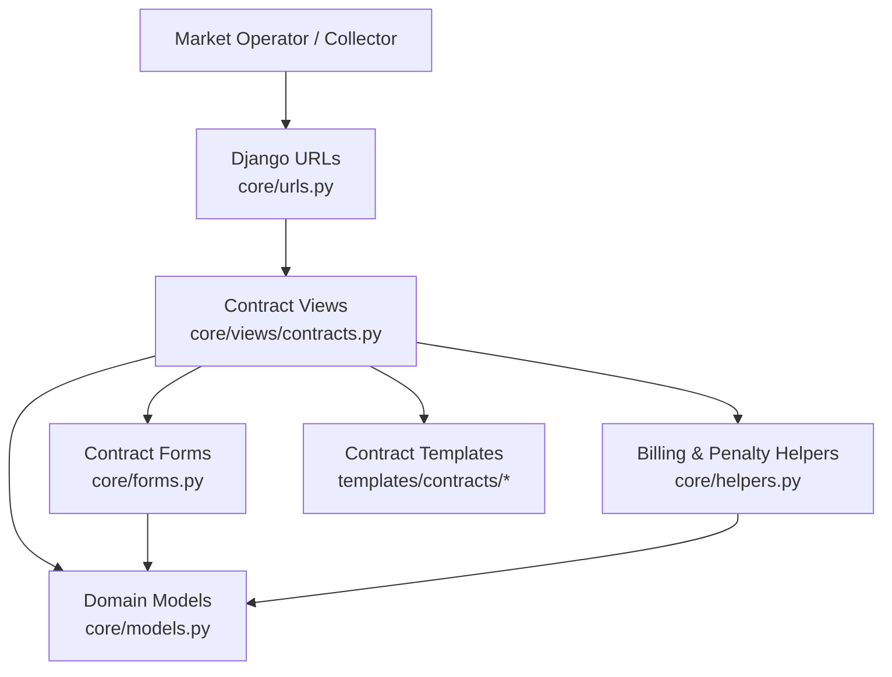
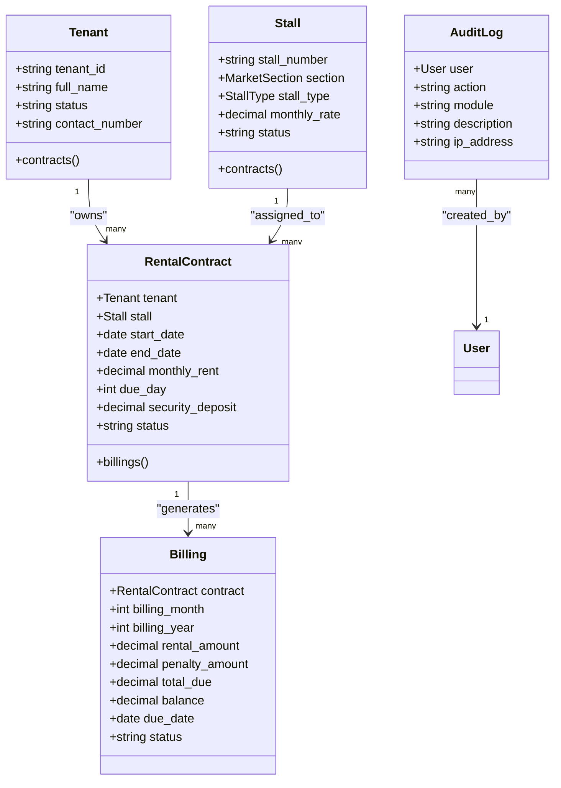
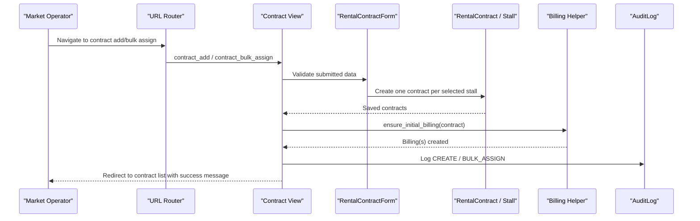
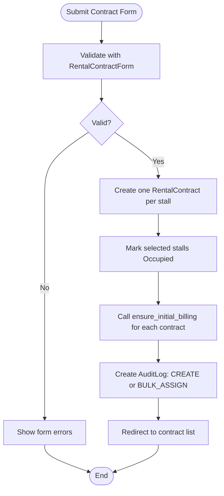
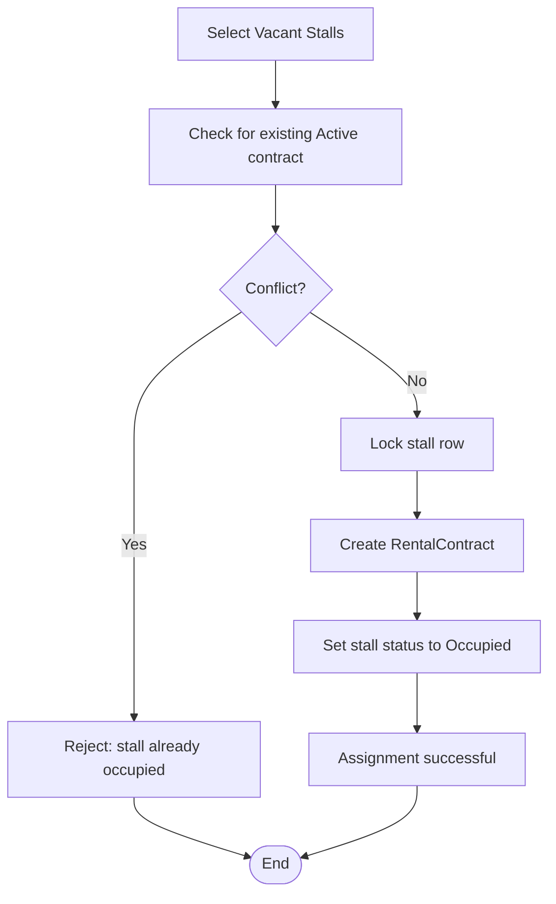
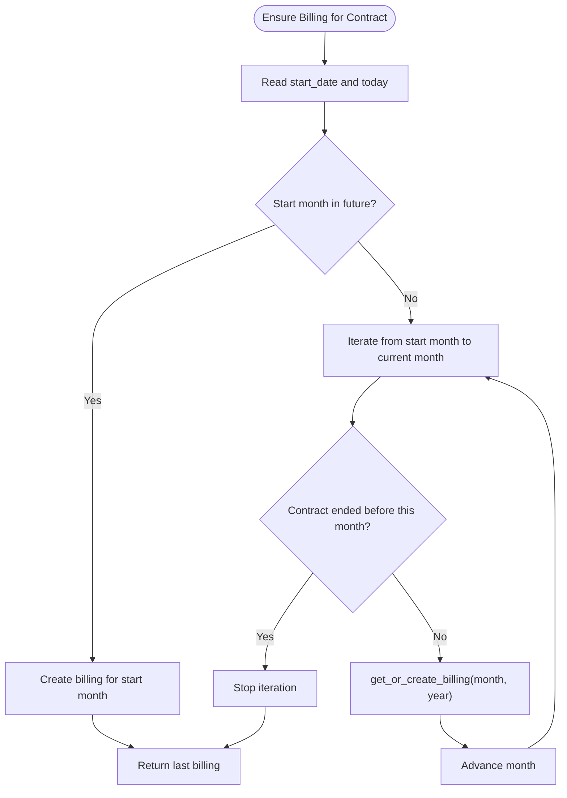
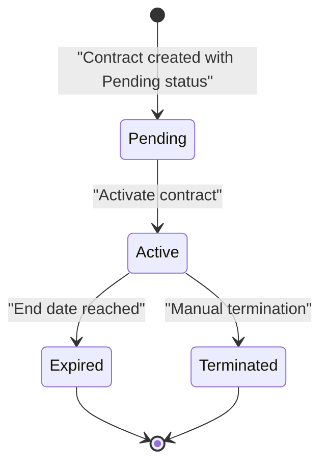
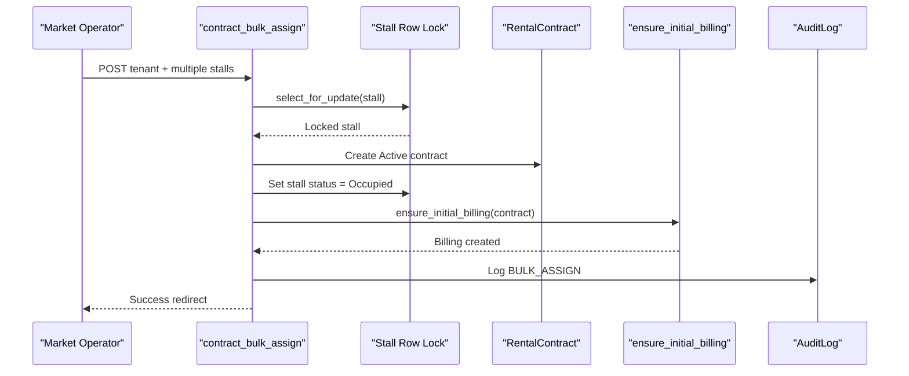
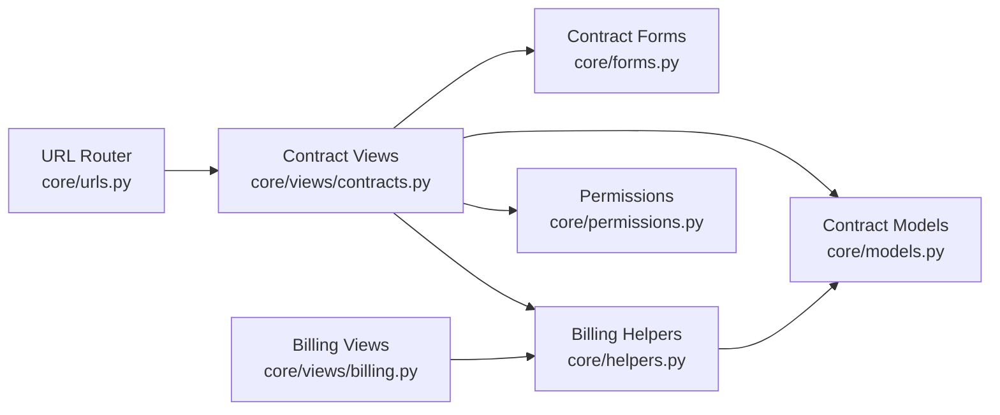

# Contract Management Module

<cite>
**Referenced Files in This Document**
- [core/models.py](file://core/models.py)
- [core/forms.py](file://core/forms.py)
- [core/views/contracts.py](file://core/views/contracts.py)
- [core/helpers.py](file://core/helpers.py)
- [core/urls.py](file://core/urls.py)
- [core/test_contract_form.py](file://core/test_contract_form.py)
</cite>

## Table of Contents
1. [Introduction](#introduction)
2. [Project Structure](#project-structure)
3. [Core Components](#core-components)
4. [Architecture Overview](#architecture-overview)
5. [Detailed Component Analysis](#detailed-component-analysis)
6. [Dependency Analysis](#dependency-analysis)
7. [Performance Considerations](#performance-considerations)
8. [Troubleshooting Guide](#troubleshooting-guide)
9. [Conclusion](#conclusion)

## Introduction
The Contract Management module governs how tenants are assigned to market stalls, how rental contracts are created and maintained, and how those contracts drive monthly billing. It enforces business rules such as preventing duplicate active stall assignments, automatically generating collectible billings, tracking contract history for renewals, and supporting bulk assignment of multiple stalls to a single tenant.

At a high level:
- A **tenant** is an Active merchant record.
- A **stall** is a physical market location with a monthly rate and occupancy status.
- A **rental contract** links one tenant to one stall over a date range with terms like due day, security deposit, and status.
- A **billing** represents one month’s collectible amount derived from the contract.
- An **audit log** records key actions such as creation, update, termination, and bulk assignment.

This document explains the data model, form validation, view workflows, lifecycle transitions, automatic billing computation, and audit logging that together implement the contract management process.

## Project Structure
The contract-related logic is primarily implemented across four files:
- `core/models.py`: Data models including Tenant, Stall, RentalContract, Billing, Payment, AuditLog, and related settings.
- `core/forms.py`: Form classes for creating/editing contracts, bulk assignment, and billing/payment validation.
- `core/views/contracts.py`: HTTP views for listing, creating, editing, terminating, viewing, printing, exporting, and bulk assigning contracts.
- `core/helpers.py`: Shared helpers for penalty calculation, billing generation, ledger recalculation, receipt numbering, and overdue processing.
- `core/urls.py`: URL routing for all contract endpoints.
- `core/test_contract_form.py`: Tests validating multi-stall selection, renewal auto-select behavior, duplicate prevention, and view-side contract creation.

**Diagram sources**
- [core/urls.py:107-120](file://core/urls.py#L107-L120)
- [core/views/contracts.py:45-529](file://core/views/contracts.py#L45-L529)
- [core/forms.py:281-400](file://core/forms.py#L281-L400)
- [core/models.py:117-187](file://core/models.py#L117-L187)
- [core/helpers.py:125-257](file://core/helpers.py#L125-L257)

**Section sources**
- [core/urls.py:107-120](file://core/urls.py#L107-L120)
- [core/views/contracts.py:45-529](file://core/views/contracts.py#L45-L529)
- [core/forms.py:281-400](file://core/forms.py#L281-L400)
- [core/models.py:117-187](file://core/models.py#L117-L187)
- [core/helpers.py:125-257](file://core/helpers.py#L125-L257)

## Core Components
The contract domain centers on these entities:

| Entity | Purpose | Key Fields | Important Behavior |
|---|---|---|---|
| Tenant | Merchant entity linked to a Django user account | `tenant_id`, `full_name`, `status`, `contact_number` | Only Active tenants can be assigned new contracts. |
| Stall | Physical market stall with rate and occupancy state | `stall_number`, `section`, `monthly_rate`, `status` | Status reflects Vacant, Occupied, Reserved, or Maintenance; must match active contract state. |
| RentalContract | Lease between tenant and stall | `tenant`, `stall`, `start_date`, `end_date`, `monthly_rent`, `due_day`, `security_deposit`, `status` | Enforces unique active contract per stall; supports Active, Expired, Terminated, Pending. |
| Billing | Monthly collectible obligation | `contract`, `billing_month`, `billing_year`, `rental_amount`, `penalty_amount`, `total_due`, `balance`, `due_date`, `status` | Auto-generated per active contract; idempotent by tenant/stall/month/year. |
| AuditLog | Immutable action trail | `user`, `action`, `module`, `description`, `ip_address` | Records CREATE, UPDATE, DELETE, TERMINATE, BULK_ASSIGN, AUTO_PENALTY. |

**Diagram sources**
- [core/models.py:117-187](file://core/models.py#L117-L187)
- [core/models.py:190-218](file://core/models.py#L190-L218)
- [core/models.py:304-316](file://core/models.py#L304-L316)

**Section sources**
- [core/models.py:117-187](file://core/models.py#L117-L187)
- [core/models.py:190-218](file://core/models.py#L190-L218)
- [core/models.py:304-316](file://core/models.py#L304-L316)

## Architecture Overview
The contract workflow connects UI requests to forms, models, and helper services:

**Diagram sources**
- [core/views/contracts.py:88-135](file://core/views/contracts.py#L88-L135)
- [core/views/contracts.py:431-529](file://core/views/contracts.py#L431-L529)
- [core/forms.py:335-363](file://core/forms.py#L335-L363)
- [core/helpers.py:208-235](file://core/helpers.py#L208-L235)

## Detailed Component Analysis

### Contract Creation Workflow
Contract creation supports two main entry points:
1. Single or multi-stall creation through the contract add form.
2. Bulk assignment through the dedicated bulk assignment view.

Both flows validate input via `RentalContractForm`, create one `RentalContract` per stall, mark the stall as Occupied, and generate initial billings.

Key behaviors:
- New contract forms expose a checklist of vacant stalls.
- If no monthly rent is provided for multi-stall creation, each stall uses its own `monthly_rate`.
- If exactly one stall is selected, a typed monthly rent is honored.
- After saving, `activate_new_contracts` marks stalls Occupied and calls `ensure_initial_billing`.
- Successful creation logs either `CREATE` or `BULK_ASSIGN` depending on the number of contracts.

**Diagram sources**
- [core/views/contracts.py:88-135](file://core/views/contracts.py#L88-L135)
- [core/forms.py:335-363](file://core/forms.py#L335-L363)
- [core/helpers.py:208-235](file://core/helpers.py#L208-L235)

**Section sources**
- [core/views/contracts.py:88-135](file://core/views/contracts.py#L88-L135)
- [core/forms.py:281-363](file://core/forms.py#L281-L363)
- [core/helpers.py:208-235](file://core/helpers.py#L208-L235)

### Terms Definition and System Settings
Contract terms are not hard-coded into the contract model. Instead, default terms are stored in `SystemSetting.terms_and_conditions` and printed on every rental contract. The system also stores configuration such as:
- Municipality and market names
- Office name
- Receipt prefix
- Default due day
- Penalty type and value
- Grace period
- Theme color and logo

These settings influence contract printing and billing penalties.

**Section sources**
- [core/models.py:26-68](file://core/models.py#L26-L68)

### Assignment Workflows Linking Tenants to Stalls
Assignment is enforced at three layers:

1. **Form layer**: `RentalContractForm` limits tenants to Active status and stalls to Vacant stalls without an active contract. For edit mode, it allows the currently edited stall even if Occupied.
2. **Validation layer**: The form’s `clean` method rejects an Active contract for a stall that already has another Active contract.
3. **Database layer**: `RentalContract.Meta.constraints` defines a conditional unique constraint so only one Active contract exists per stall.

Bulk assignment adds extra protection:
- The form excludes stalls that have an Active contract.
- Submission-time validation re-checks vacancy.
- The view locks each stall row with `select_for_update` before creating the contract and updating the stall status.

**Diagram sources**
- [core/forms.py:297-328](file://core/forms.py#L297-L328)
- [core/forms.py:389-399](file://core/forms.py#L389-L399)
- [core/models.py:176-184](file://core/models.py#L176-L184)
- [core/views/contracts.py:450-473](file://core/views/contracts.py#L450-L473)

**Section sources**
- [core/forms.py:297-328](file://core/forms.py#L297-L328)
- [core/forms.py:389-399](file://core/forms.py#L389-L399)
- [core/models.py:176-184](file://core/models.py#L176-L184)
- [core/views/contracts.py:450-473](file://core/views/contracts.py#L450-L473)

### Business Rule Enforcement: Duplicate Active Stall Assignments
The system prevents duplicate active stall assignments using:
- A conditional database constraint: only one Active contract per stall.
- Form-level validation rejecting Active status for a stall with another Active contract.
- Bulk assignment locking and vacancy checks.
- Edit/update logic that recalculates stall status when a contract becomes non-Active.

Tests confirm:
- A stall already under an Active contract cannot be assigned to another tenant.
- Direct database insertion of a conflicting Active contract raises `IntegrityError`.
- Multi-stall contracts allow a tenant to hold multiple stalls, but each stall must still be free.

**Section sources**
- [core/models.py:176-184](file://core/models.py#L176-L184)
- [core/forms.py:389-399](file://core/forms.py#L389-L399)
- [core/test_contract_form.py:205-221](file://core/test_contract_form.py#L205-L221)

### Automatic Monthly Collectible Calculations
Monthly collectibles are generated through shared helpers:

- `safe_due_date` computes a safe due date based on the contract’s due day and calendar month length.
- `compute_penalty_for_contract` calculates penalties using either contract-specific or system-wide settings.
- `get_or_create_billing` creates a Billing record idempotently for a given month and year.
- `ensure_initial_billing` generates billings from the contract’s start month up to the current month, skipping months after the contract ends.
- `ensure_current_month_billings` ensures every Active contract has a current-month billing.

Billing fields include:
- `rental_amount`: taken from `contract.monthly_rent`.
- `penalty_amount`: computed from grace period and penalty configuration.
- `total_due`: rental plus penalty minus discount.
- `amount_paid`, `balance`, `due_date`, and `status`.

**Diagram sources**
- [core/helpers.py:125-152](file://core/helpers.py#L125-L152)
- [core/helpers.py:155-205](file://core/helpers.py#L155-L205)
- [core/helpers.py:208-235](file://core/helpers.py#L208-L235)

**Section sources**
- [core/helpers.py:125-205](file://core/helpers.py#L125-L205)
- [core/helpers.py:208-235](file://core/helpers.py#L208-L235)

### Contract Lifecycle: Creation, Renewal, Termination
The contract lifecycle includes:

| Phase | Behavior |
|---|---|
| Creation | One contract per selected stall; stall marked Occupied; initial billings generated; audit logged. |
| Renewal | Existing contracts provide historical stall data; Active stalls appear first; lapsed contracts fall back to most recent history. |
| Termination | Contract status set to Terminated; end_date set to today; stall marked Vacant if no other Active contract remains; audit logged. |
| Editing | Stall status updated based on whether the contract is Active; initial billing ensured for Active contracts. |
| Deletion | Contract removed; stall marked Vacant if no other Active contract remains; audit logged. |

Renewal support is visible in the form’s `_assigned_stall_map`, which groups a tenant’s past and present stalls, prioritizing Active stalls and ordering by start date.

**Diagram sources**
- [core/models.py:157-187](file://core/models.py#L157-L187)
- [core/views/contracts.py:138-183](file://core/views/contracts.py#L138-L183)
- [core/views/contracts.py:225-246](file://core/views/contracts.py#L225-L246)
- [core/forms.py:365-387](file://core/forms.py#L365-L387)

**Section sources**
- [core/models.py:157-187](file://core/models.py#L157-L187)
- [core/views/contracts.py:138-183](file://core/views/contracts.py#L138-L183)
- [core/views/contracts.py:225-246](file://core/views/contracts.py#L225-L246)
- [core/forms.py:365-387](file://core/forms.py#L365-L387)

### Contract Form Validation Examples
The contract form validates several scenarios:

| Scenario | Expected Result |
|---|---|
| Submitting no stalls in multi-stall creation | Error: at least one vacant stall required. |
| Typing a monthly rent for one stall | Typed rent is used. |
| Leaving monthly rent blank for one stall | Falls back to stall’s `monthly_rate`. |
| Leaving monthly rent blank for multiple stalls | Each stall uses its own `monthly_rate`. |
| Selecting a stall already under an Active contract | Rejected by form and database constraint. |
| Assigning multiple stalls to the same tenant | Allowed, as long as each stall is free. |
| Editing an existing contract | Keeps the current stall selectable even if Occupied. |

**Section sources**
- [core/forms.py:335-363](file://core/forms.py#L335-L363)
- [core/forms.py:389-399](file://core/forms.py#L389-L399)
- [core/test_contract_form.py:158-221](file://core/test_contract_form.py#L158-L221)

### Date Range Handling
Date handling appears in both forms and helpers:

- `BulkAssignStallsForm.clean` rejects cases where `end_date <= start_date`.
- `safe_due_date` ensures the due day does not exceed the month’s last day.
- `ensure_initial_billing` skips billing months after the contract’s `end_date`.
- `ensure_current_month_billings` skips contracts starting in future months or ending before the current month.

**Section sources**
- [core/forms.py:719-725](file://core/forms.py#L719-L725)
- [core/helpers.py:125-129](file://core/helpers.py#L125-L129)
- [core/helpers.py:208-235](file://core/helpers.py#L208-L235)
- [core/helpers.py:238-257](file://core/helpers.py#L238-L257)

### Rental Amount Computation
Rental amount computation follows these rules:
- Contract `monthly_rent` drives billing `rental_amount`.
- For multi-stall creation without a typed rent, each contract inherits the stall’s `monthly_rate`.
- For single-stall creation, a typed rent overrides the stall rate.
- Billing `total_due` equals `rental_amount + penalty_amount - discount`.
- Billing `balance` equals `total_due - amount_paid`, clamped to zero when negative.

**Section sources**
- [core/forms.py:341-358](file://core/forms.py#L341-L358)
- [core/helpers.py:174-178](file://core/helpers.py#L174-L178)
- [core/forms.py:431-462](file://core/forms.py#L431-L462)

### Bulk Assignment Capabilities
Bulk assignment allows assigning one tenant to multiple vacant stalls efficiently:
- The form exposes a checkbox list of assignable stalls.
- The view locks each stall row during creation to prevent race conditions.
- Contracts are created with `status='Active'`, inheriting each stall’s `monthly_rate`.
- Stalls are marked Occupied immediately.
- Initial billings are generated outside the lock to keep the critical section small.
- An audit log records the tenant and stall numbers.

**Diagram sources**
- [core/views/contracts.py:431-529](file://core/views/contracts.py#L431-L529)
- [core/forms.py:652-725](file://core/forms.py#L652-L725)

**Section sources**
- [core/views/contracts.py:431-529](file://core/views/contracts.py#L431-L529)
- [core/forms.py:652-725](file://core/forms.py#L652-L725)

### Contract Status Management and Billing Impact
Contract statuses:
- **Active**: Eligible for current-month billing generation.
- **Expired**: No longer eligible for new billing months beyond the end date.
- **Terminated**: Ends the contract early; stall may become Vacant.
- **Pending**: Can exist, but active billing generation focuses on Active contracts.

Billing impact:
- `ensure_current_month_billings` iterates Active contracts and creates a billing for the current month if missing.
- `ensure_initial_billing` respects `start_date` and `end_date`, skipping months outside the contract window.
- Billing status (`Unpaid`, `Partial`, `Paid`, `Overdue`) is independent of contract status but depends on payments and overdue processing.

**Section sources**
- [core/models.py:157-187](file://core/models.py#L157-L187)
- [core/helpers.py:208-257](file://core/helpers.py#L208-L257)

### Contract History Tracking and Renewal Workflows
Contract history is tracked through:
- Multiple `RentalContract` rows per tenant and stall over time.
- `_assigned_stall_map`, which returns a tenant’s stalls grouped by Active and lapsed contracts, ordered by start date.
- Tests verifying that Active stalls appear before lapsed ones and that the most recent lapsed contract is preferred for fallback selection.

Renewal workflow:
- When creating a new contract for a tenant, the form exposes previously held stalls.
- Active stalls are prioritized.
- Lapsed stalls are available as fallback options.
- The frontend can use the emitted stall map to pre-select a familiar stall.

**Section sources**
- [core/forms.py:365-387](file://core/forms.py#L365-L387)
- [core/test_contract_form.py:15-81](file://core/test_contract_form.py#L15-L81)

### Termination Procedures and Audit Logging
Termination:
- Sets contract status to Terminated.
- Sets `end_date` to today.
- Marks the stall Vacant if no other Active contract exists for that stall.
- Creates an audit log entry with action `TERMINATE`.

Other audit events:
- `CREATE`: Single contract creation.
- `BULK_ASSIGN`: Multiple contracts created at once.
- `UPDATE`: Contract edit.
- `DELETE`: Contract deletion.
- `AUTO_PENALTY`: Overdue penalty application.

**Section sources**
- [core/views/contracts.py:225-246](file://core/views/contracts.py#L225-L246)
- [core/views/contracts.py:88-135](file://core/views/contracts.py#L88-L135)
- [core/views/contracts.py:138-183](file://core/views/contracts.py#L138-L183)
- [core/views/contracts.py:186-208](file://core/views/contracts.py#L186-L208)
- [core/helpers.py:423-500](file://core/helpers.py#L423-L500)

## Dependency Analysis
The contract module depends on related modules for roles, permissions, billing, and reporting:

**Diagram sources**
- [core/urls.py:17-22](file://core/urls.py#L17-L22)
- [core/views/contracts.py:1-13](file://core/views/contracts.py#L1-L13)
- [core/helpers.py:155-257](file://core/helpers.py#L155-L257)

**Section sources**
- [core/urls.py:17-22](file://core/urls.py#L17-L22)
- [core/views/contracts.py:1-13](file://core/views/contracts.py#L1-L13)
- [core/helpers.py:155-257](file://core/helpers.py#L155-L257)

## Performance Considerations
- Use `select_related` in contract list and view queries to reduce N+1 queries for tenant, stall, and section data.
- Keep bulk assignment locks narrow: lock stall rows only while creating contracts and updating stall status.
- Generate billings outside the transaction lock when possible to avoid holding database locks during helper computations.
- Use idempotent billing creation to safely retry or call from multiple entry points.
- Avoid unnecessary recomputation: `recalc_tenant_ledger` should be called only after meaningful debit/credit changes.

[No sources needed since this section provides general guidance]

## Troubleshooting Guide
Common issues and resolutions:

| Issue | Cause | Resolution |
|---|---|---|
| Cannot assign a stall to a tenant | Stall already has an Active contract | Verify stall status and existing contracts; wait for expiration or termination. |
| IntegrityError on contract creation | Database constraint violated: more than one Active contract per stall | Re-render the form and select a different stall. |
| Bulk assignment fails with “no longer vacant” | Stall status changed between render and submit | Refresh the page and reselect available stalls. |
| Billing not generated after contract creation | Contract start date is in the future or helper raised an exception | Check `start_date`; billing will be created for the start month or later. |
| Due date falls on invalid day | Due day exceeds month length | `safe_due_date` adjusts to the last day of the month. |
| Overdue penalty not applied | Grace period not exceeded or penalty setting missing | Confirm due date, grace period, and penalty configuration. |

**Section sources**
- [core/views/contracts.py:98-102](file://core/views/contracts.py#L98-L102)
- [core/views/contracts.py:450-473](file://core/views/contracts.py#L450-L473)
- [core/helpers.py:125-152](file://core/helpers.py#L125-L152)
- [core/helpers.py:423-500](file://core/helpers.py#L423-L500)

## Conclusion
The Contract Management module provides a robust foundation for managing market stall rentals. It enforces critical business rules against duplicate active stall assignments, supports flexible contract creation and renewal workflows, and automatically generates monthly collectibles tied to contract terms. Bulk assignment improves operational efficiency, while audit logging preserves accountability. Status management ensures that billing generation aligns with contract validity, and helper functions centralize financial calculations for consistency and reliability.

[No sources needed since this section summarizes without analyzing specific files]