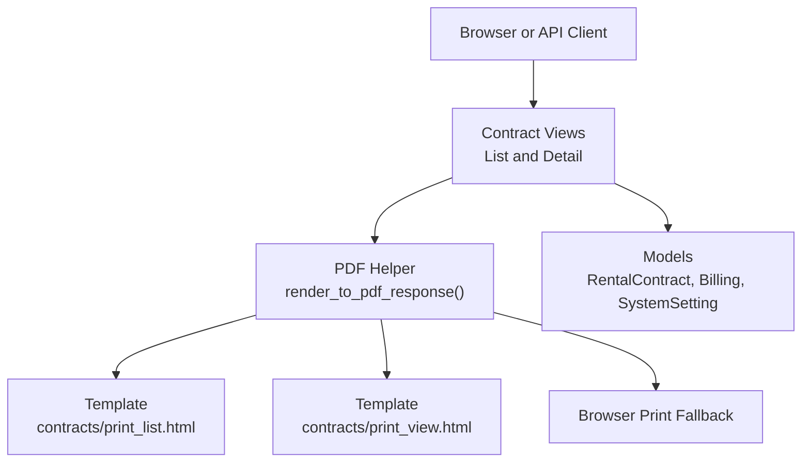
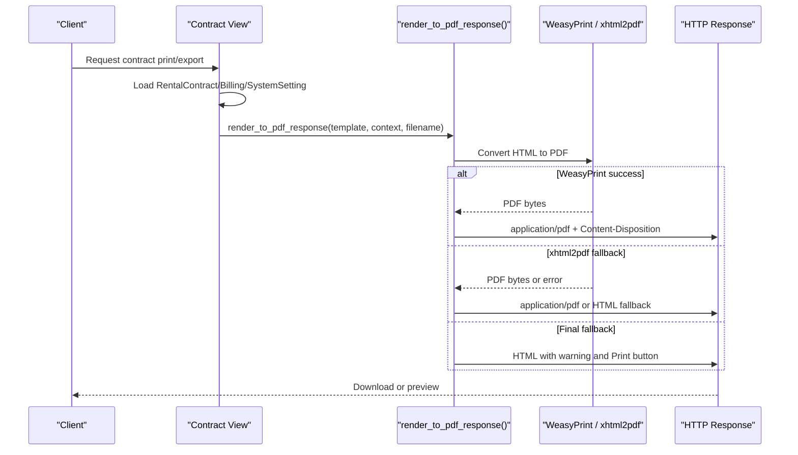
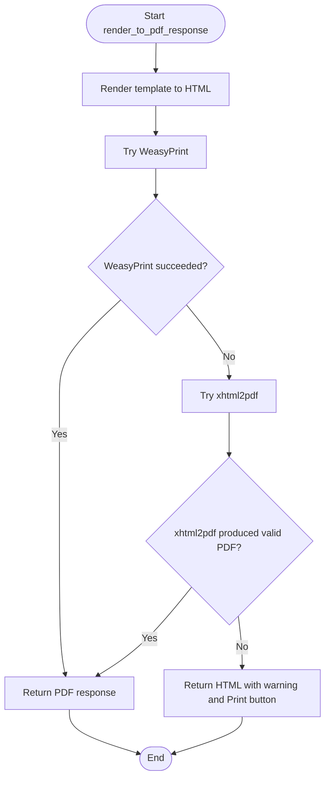
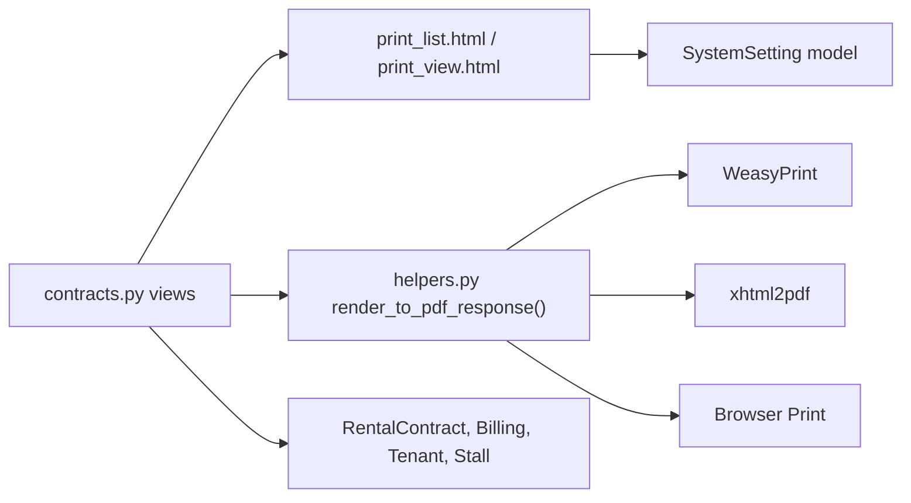

# Contract Printing & Export

<cite>
**Referenced Files in This Document**
- [helpers.py](file://core/helpers.py)
- [contracts.py](file://core/views/contracts.py)
- [print_list.html](file://templates/contracts/print_list.html)
- [print_view.html](file://templates/contracts/print_view.html)
- [models.py](file://core/models.py)
</cite>

## Table of Contents
1. [Introduction](#introduction)
2. [Project Structure](#project-structure)
3. [Core Components](#core-components)
4. [Architecture Overview](#architecture-overview)
5. [Detailed Component Analysis](#detailed-component-analysis)
6. [Dependency Analysis](#dependency-analysis)
7. [Performance Considerations](#performance-considerations)
8. [Troubleshooting Guide](#troubleshooting-guide)
9. [Conclusion](#conclusion)

## Introduction
This document explains the contract printing and export functionality for the market rental system. It covers how PDFs are generated, how print templates render official documents with municipality branding, and how export endpoints provide timestamped filenames. It also documents the differences between the list overview report and the detailed individual contract view, including billing history presentation, dynamic SystemSetting integration, and fallback behavior when WeasyPrint is unavailable.

## Project Structure
The contract printing feature spans three main areas:
- View logic that prepares context and selects the correct template.
- A shared PDF helper that renders HTML to PDF with WeasyPrint-first fallbacks.
- Print templates that format contracts as official municipal documents.

**Diagram sources**
- [contracts.py:380-428](file://core/views/contracts.py#L380-L428)
- [helpers.py:522-595](file://core/helpers.py#L522-L595)
- [print_list.html:1-64](file://templates/contracts/print_list.html#L1-L64)
- [print_view.html:1-73](file://templates/contracts/print_view.html#L1-L73)

**Section sources**
- [contracts.py:380-428](file://core/views/contracts.py#L380-L428)
- [helpers.py:522-595](file://core/helpers.py#L522-L595)
- [print_list.html:1-64](file://templates/contracts/print_list.html#L1-L64)
- [print_view.html:1-73](file://templates/contracts/print_view.html#L1-L73)

## Core Components
- `render_to_pdf_response()` centralizes PDF generation. It prefers WeasyPrint for high-fidelity CSS rendering, falls back to xhtml2pdf when available, and finally returns an HTML preview with a browser-based Print-to-PDF option.
- Contract views prepare data for both list and detail prints, including tenant, stall, billing history, and SystemSetting branding.
- Print templates define official layouts, municipality headers, tables, signatures, and terms sections.

Key responsibilities:
- List export: generates a landscape-oriented overview table of active contracts with search and status filters.
- Detail export: generates a single-contract document with billing history, terms, and signature blocks.
- Dynamic branding: uses SystemSetting fields such as municipality name, market name, office name, and terms and conditions.

**Section sources**
- [helpers.py:522-595](file://core/helpers.py#L522-L595)
- [contracts.py:380-428](file://core/views/contracts.py#L380-L428)
- [models.py:42-68](file://core/models.py#L42-L68)

## Architecture Overview
The PDF pipeline follows a consistent flow:
1. The client requests a contract print or export endpoint.
2. The view loads the relevant model data and builds a context dictionary.
3. The view calls `render_to_pdf_response()` with the appropriate template and filename.
4. The helper renders the template to HTML and attempts WeasyPrint conversion.
5. If WeasyPrint fails, it tries xhtml2pdf; if that also fails, it returns an HTML page with a warning and a Print button.

**Diagram sources**
- [contracts.py:380-428](file://core/views/contracts.py#L380-L428)
- [helpers.py:522-595](file://core/helpers.py#L522-L595)

## Detailed Component Analysis

### PDF Generation Pipeline: `render_to_pdf_response()`
This helper is the core of all PDF exports. Its behavior:
- Renders the requested Django template into an HTML string using the current request context.
- Attempts WeasyPrint first, passing a base URL when possible so static assets resolve correctly.
- On failure (common on Windows without GTK), tries xhtml2pdf.
- If both fail, returns an HTML response containing the rendered template plus a warning banner instructing users to use the browser’s Print → Save as PDF function.

Important characteristics:
- Returns a proper PDF HTTP response with `Content-Type: application/pdf` and `Content-Disposition: attachment`.
- Accepts a custom filename parameter to control downloaded file names.
- Provides graceful degradation so users can still print from the browser even when system libraries are missing.

**Diagram sources**
- [helpers.py:522-595](file://core/helpers.py#L522-L595)

**Section sources**
- [helpers.py:522-595](file://core/helpers.py#L522-L595)

### Contract List Print: `contracts/print_list.html`
Purpose:
- Produces an overview report of rental contracts suitable for official records and audits.
- Displays tenant, stall, section, dates, monthly rent, and status in a compact table.
- Includes municipality branding via SystemSetting and metadata such as generation time and user.

Layout highlights:
- Official header with municipality and market name, office name, and a decorative rule line.
- Landscape orientation configured for wide tabular data.
- Summary row showing total contract count.
- Signature block at the bottom for prepared-by and verified-by roles.

Data presentation:
- Currency values are formatted with decimal precision and thousands separators.
- Dates are localized through Django date formatting.
- Empty states show a centered message when no contracts match filters.

Branding integration:
- Municipality name, market name, and office name come from SystemSetting.
- The footer includes a computer-generated notice referencing the market name and generation date.

Export behavior:
- The list export endpoint constructs a filename like `contracts_list_YYYY-MM-DD.pdf`.
- The template provides buttons for direct browser printing and for triggering the backend PDF export.

**Section sources**
- [print_list.html:1-64](file://templates/contracts/print_list.html#L1-L64)
- [contracts.py:380-397](file://core/views/contracts.py#L380-L397)

### Contract Detail Print: `contracts/print_view.html`
Purpose:
- Generates a detailed, official contract document for a single rental contract.
- Presents contract metadata, billing history, terms and conditions, and signature lines.

Layout highlights:
- Official header identical in style to the list view but tailored for a single-contract document.
- Two-column information blocks for tenant, stall, period, status, rent, due day, deposit, and remarks.
- Billing history table showing period, stall number, due amount, paid amount, balance, and status.
- Terms and conditions section sourced from SystemSetting, followed by acknowledgment text and signature blocks.

Data presentation:
- Billing balances highlight overdue amounts in red and settled amounts in green.
- Currency formatting ensures consistent financial presentation.
- Date formatting shows human-readable periods.

Branding integration:
- Municipality, market, and office names appear in the header.
- Terms and conditions are dynamically loaded from SystemSetting.
- Footer includes a computer-generated notice referencing the market name and generation date.

Export behavior:
- The detail export endpoint constructs a filename like `contract_{id}_YYYY-MM-DD.pdf`.
- The template provides buttons for direct browser printing and for triggering the backend PDF export.

**Section sources**
- [print_view.html:1-73](file://templates/contracts/print_view.html#L1-L73)
- [contracts.py:400-428](file://core/views/contracts.py#L400-L428)

### View Logic: Contract Print and Export Endpoints
Responsibilities:
- `contract_list_export_pdf`: Loads filtered contracts, SystemSetting, current user, and timestamp, then exports to PDF.
- `contract_view_print`: Renders the detail print template for browser preview.
- `contract_view_export_pdf`: Loads the same context as the preview but exports to PDF with a timestamped filename.

Context preparation:
- Uses related queries to avoid N+1 issues for tenant, stall, and section data.
- Orders billings by year, month, creation time, and ID to present recent and relevant billing history.
- Injects SystemSetting for branding and terms.

Filename strategy:
- List export uses today’s ISO date to keep filenames unique per day.
- Detail export includes the contract ID and today’s ISO date for clarity and uniqueness.

**Section sources**
- [contracts.py:380-428](file://core/views/contracts.py#L380-L428)

### SystemSetting Integration
SystemSetting provides dynamic branding and policy content:
- Municipality name, market name, and office name populate the official header.
- Terms and conditions are printed on each contract document, allowing administrators to update policies without code changes.
- Logo and theme color exist in the model, though the current print templates primarily rely on text branding and Tailwind utility classes.

Model fields used by print templates:
- `municipality_name`
- `market_name`
- `office_name`
- `terms_and_conditions`

Default terms:
- The model defines default contract terms describing payment rules, penalties, usage restrictions, subletting prohibitions, cleanliness requirements, operating directives, prohibited goods, liability, deposit handling, termination conditions, anti-corruption reporting, and dispute resolution.

**Section sources**
- [models.py:26-68](file://core/models.py#L26-L68)
- [print_list.html:28-34](file://templates/contracts/print_list.html#L28-L34)
- [print_view.html:30-35](file://templates/contracts/print_view.html#L30-L35)
- [print_view.html:53-69](file://templates/contracts/print_view.html#L53-L69)

## Dependency Analysis
The contract printing feature depends on:
- Django template rendering for HTML generation.
- WeasyPrint for high-quality PDF output when system libraries are available.
- xhtml2pdf as a pure-Python fallback.
- Browser print-to-PDF as the final fallback.

**Diagram sources**
- [contracts.py:380-428](file://core/views/contracts.py#L380-L428)
- [helpers.py:522-595](file://core/helpers.py#L522-L595)
- [models.py:42-68](file://core/models.py#L42-L68)

**Section sources**
- [contracts.py:380-428](file://core/views/contracts.py#L380-L428)
- [helpers.py:522-595](file://core/helpers.py#L522-L595)
- [models.py:42-68](file://core/models.py#L42-L68)

## Performance Considerations
- Use select_related in views to reduce database queries when loading tenant, stall, and section data for print templates.
- Avoid heavy image embedding in PDFs unless necessary; prefer text-heavy layouts for faster rendering.
- Keep CSS minimal and inline where possible to improve compatibility across PDF engines.
- Prefer deterministic filenames based on IDs and dates to avoid collisions and simplify archival.

[No sources needed since this section provides general guidance]

## Troubleshooting Guide

### PDF Rendering Failures
Symptoms:
- No PDF download or a blank response.
- Error messages indicating missing system libraries.
- HTML preview returned instead of a PDF.

Likely causes:
- WeasyPrint requires system libraries such as GTK/Pango on some platforms.
- xhtml2pdf may not be installed or may fail on certain HTML/CSS features.
- Static asset paths may not resolve correctly if base_url is not provided.

Resolution steps:
- Install WeasyPrint dependencies or run on Linux where WeasyPrint works natively.
- Ensure xhtml2pdf is installed if relying on its fallback.
- Verify that static files are accessible and that base_url is set when rendering.
- Use the browser’s Print → Save as PDF option when automatic PDF generation is unavailable.

**Section sources**
- [helpers.py:522-595](file://core/helpers.py#L522-L595)

### Font Handling
Recommendations:
- Use web-safe fonts or include font files explicitly if embedding is required.
- Test print output across WeasyPrint and xhtml2pdf because font support differs.
- Avoid complex font features in production until validated.

[No sources needed since this section provides general guidance]

### Image Embedding
Recommendations:
- For official receipts and logos, ensure images are hosted and reachable via absolute URLs.
- Prefer small, optimized images to reduce PDF size and rendering time.
- Validate image embedding in both WeasyPrint and xhtml2pdf environments.

[No sources needed since this section provides general guidance]

### Data Presentation and Styling
Checklist:
- Confirm currency formatting uses two decimal places and thousands separators.
- Verify date formatting matches local expectations.
- Ensure table borders and colors remain legible when printed.
- Validate that SystemSetting branding appears correctly in headers and footers.

**Section sources**
- [print_list.html:1-64](file://templates/contracts/print_list.html#L1-L64)
- [print_view.html:1-73](file://templates/contracts/print_view.html#L1-L73)

## Conclusion
The contract printing and export system provides robust, branded PDF generation for both list overviews and individual contract details. It prioritizes WeasyPrint for quality, gracefully falls back to xhtml2pdf, and ultimately supports browser-based printing when automated rendering is unavailable. Dynamic SystemSetting integration ensures official municipality branding and up-to-date terms appear consistently across documents. Proper styling, data formatting, and troubleshooting practices help maintain reliable, professional outputs for official records.

[No sources needed since this section summarizes without analyzing specific files]