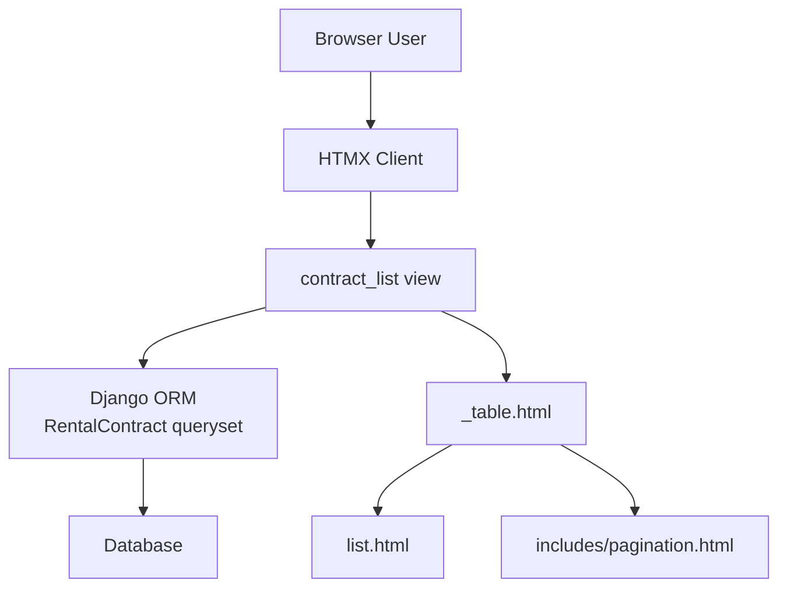
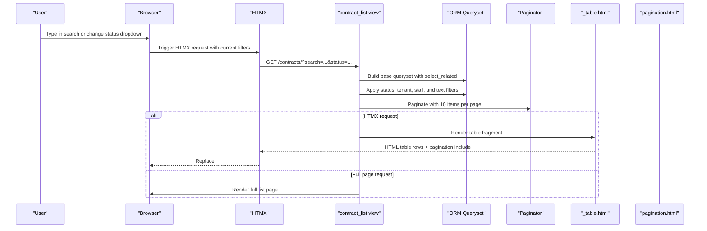
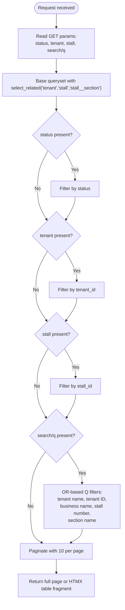
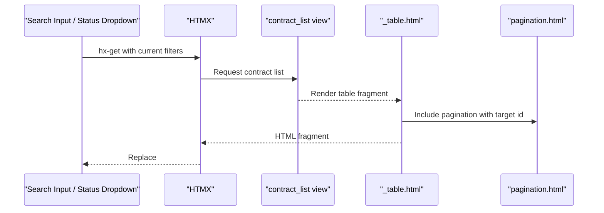
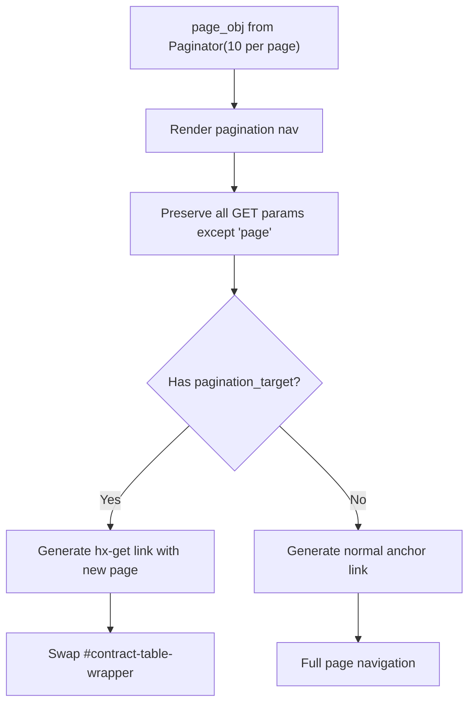
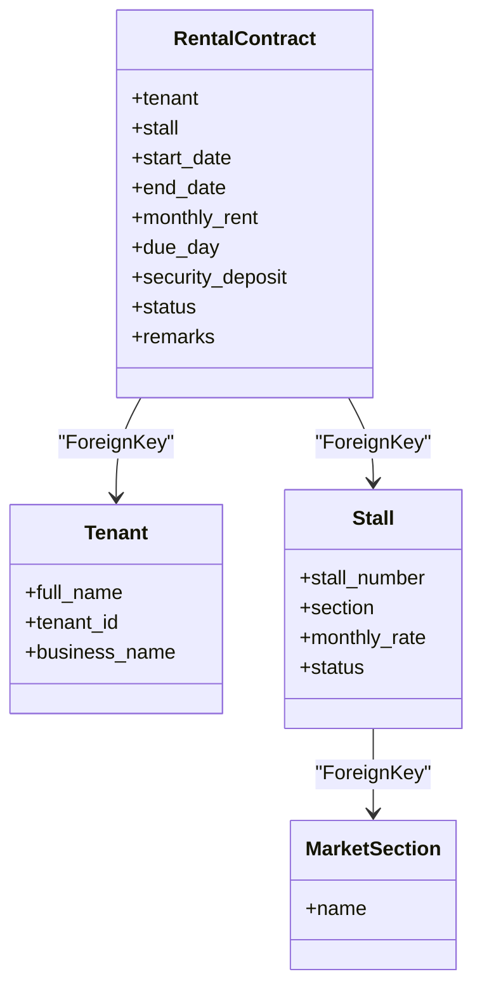
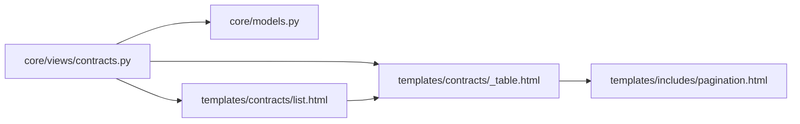

# Contract Search & Filtering

<cite>
**Referenced Files in This Document**
- [contracts.py](file://core/views/contracts.py)
- [list.html](file://templates/contracts/list.html)
- [_table.html](file://templates/contracts/_table.html)
- [pagination.html](file://templates/includes/pagination.html)
- [models.py](file://core/models.py)
</cite>

## Table of Contents
1. [Introduction](#introduction)
2. [Project Structure](#project-structure)
3. [Core Components](#core-components)
4. [Architecture Overview](#architecture-overview)
5. [Detailed Component Analysis](#detailed-component-analysis)
6. [Dependency Analysis](#dependency-analysis)
7. [Performance Considerations](#performance-considerations)
8. [Troubleshooting Guide](#troubleshooting-guide)
9. [Conclusion](#conclusion)

## Introduction
This document explains the contract search and filtering system for the Market Rental System. It covers:
- Multi-criteria filtering by status, tenant, stall, and free-text search across tenant names, IDs, business names, stall numbers, and section names.
- Django ORM query construction using `Q` objects for complex boolean combinations.
- Pagination with 10 items per page and HTMX-powered table updates.
- Query optimization using `select_related()` to reduce database joins.
- The filtering interface components: dropdown selectors, search input fields, and filter reset behavior.
- Performance considerations for large contract datasets and recommended optimization strategies.

## Project Structure
The contract list feature is implemented through a small set of focused files:
- A view that builds filtered, paginated contract queries.
- A main page template that renders filters and includes the table fragment.
- A table fragment rendered via HTMX for partial updates.
- A shared pagination template that supports both normal navigation and HTMX swapping.
- Data models defining contracts, tenants, stalls, and sections.

**Diagram sources**
- [contracts.py:45-85](file://core/views/contracts.py#L45-L85)
- [list.html:40-62](file://templates/contracts/list.html#L40-L62)
- [_table.html:1-66](file://templates/contracts/_table.html#L1-L66)
- [pagination.html:1-47](file://templates/includes/pagination.html#L1-L47)

**Section sources**
- [contracts.py:45-85](file://core/views/contracts.py#L45-L85)
- [list.html:1-65](file://templates/contracts/list.html#L1-L65)
- [_table.html:1-66](file://templates/contracts/_table.html#L1-L66)
- [pagination.html:1-47](file://templates/includes/pagination.html#L1-L47)

## Core Components
- **View layer**: Builds the base queryset, applies optional filters, paginates results, and returns either the full page or an HTMX table fragment.
- **Template layer**: Provides the filter bar, search input, status dropdown, and table rendering.
- **Pagination layer**: Renders page controls and integrates HTMX for seamless table updates without full page reloads.
- **Data layer**: Uses optimized ORM queries with related object prefetching.

Key responsibilities:
- Accepting GET parameters for status, tenant, stall, and text search.
- Combining filters safely with Django’s `Q` objects.
- Returning 10 contracts per page.
- Updating only the table area when filters change.

**Section sources**
- [contracts.py:45-85](file://core/views/contracts.py#L45-L85)
- [list.html:40-62](file://templates/contracts/list.html#L40-L62)
- [_table.html:1-66](file://templates/contracts/_table.html#L1-L66)
- [pagination.html:1-47](file://templates/includes/pagination.html#L1-L47)

## Architecture Overview
The contract search flow combines frontend interactions with backend query building:

**Diagram sources**
- [contracts.py:45-85](file://core/views/contracts.py#L45-L85)
- [list.html:40-62](file://templates/contracts/list.html#L40-L62)
- [_table.html:1-66](file://templates/contracts/_table.html#L1-L66)
- [pagination.html:1-47](file://templates/includes/pagination.html#L1-L47)

## Detailed Component Analysis

### Filter Parameters and Query Construction
The view reads the following GET parameters:
- `status`: Exact match on contract status.
- `tenant`: Exact match on tenant ID.
- `stall`: Exact match on stall ID.
- `search` or `q`: Case-insensitive text search across multiple fields.

Filter application logic:
- Status filter narrows contracts by exact status value.
- Tenant filter narrows contracts by tenant primary key.
- Stall filter narrows contracts by stall primary key.
- Text search uses OR conditions across:
  - Tenant full name
  - Tenant ID
  - Tenant business name
  - Stall number
  - Section name

Complex boolean combinations are built using Django’s `Q` objects combined with the OR operator. Filters are applied conditionally, so only provided parameters affect the query.

**Diagram sources**
- [contracts.py:45-85](file://core/views/contracts.py#L45-L85)

**Section sources**
- [contracts.py:45-85](file://core/views/contracts.py#L45-L85)

### HTMX-Powered Table Updates
The filtering interface uses HTMX to update only the table content:
- The search input triggers an HTMX GET request on key changes with a short delay.
- The status dropdown triggers an HTMX GET request on change.
- Both inputs include each other’s values so filters combine correctly.
- The response target is `#contract-table-wrapper`.
- URL state is pushed into the browser history for bookmarkable filters.

The table fragment includes:
- The contract table body.
- The pagination control include.

**Diagram sources**
- [list.html:40-62](file://templates/contracts/list.html#L40-L62)
- [_table.html:1-66](file://templates/contracts/_table.html#L1-L66)
- [pagination.html:1-47](file://templates/includes/pagination.html#L1-L47)

**Section sources**
- [list.html:40-62](file://templates/contracts/list.html#L40-L62)
- [_table.html:1-66](file://templates/contracts/_table.html#L1-L66)
- [pagination.html:1-47](file://templates/includes/pagination.html#L1-L47)

### Pagination Implementation
Pagination is handled by Django’s `Paginator`:
- Each page contains 10 contracts.
- The view passes a `page_obj` to templates.
- The pagination template preserves existing GET parameters while changing only the `page` parameter.
- When `pagination_target` is provided, pagination links become HTMX requests that swap the inner HTML of the target container.

**Diagram sources**
- [contracts.py:71-85](file://core/views/contracts.py#L71-L85)
- [pagination.html:1-47](file://templates/includes/pagination.html#L1-L47)

**Section sources**
- [contracts.py:71-85](file://core/views/contracts.py#L71-L85)
- [pagination.html:1-47](file://templates/includes/pagination.html#L1-L47)

### Filtering Interface Components
The filtering interface consists of:
- **Search input field**:
  - Name: `search`
  - Placeholder suggests searching tenant, stall, and section.
  - Triggers HTMX request after user input changes with a delay.
  - Includes the current status filter value.
- **Status dropdown selector**:
  - Name: `status`
  - Options: All Status, Active, Expired, Terminated, Pending.
  - Triggers HTMX request on change.
  - Includes the current search value.
- **Clear filter button**:
  - Appears when any filter is active.
  - Resets to the base contract list URL.

Note: While the view also accepts `tenant` and `stall` filters, the current list template does not expose dedicated dropdowns for them. Those parameters can still be used programmatically or via direct URLs.

**Section sources**
- [list.html:40-62](file://templates/contracts/list.html#L40-L62)
- [contracts.py:51-69](file://core/views/contracts.py#L51-L69)

### Search Result Optimization with select_related()
The view optimizes database queries by eagerly loading related objects:
- `tenant`
- `stall`
- `stall.section`

This avoids N+1 queries when rendering tenant names, tenant IDs, business names, stall numbers, and section names in the table.

**Diagram sources**
- [models.py:157-187](file://core/models.py#L157-L187)
- [models.py:93-114](file://core/models.py#L93-L114)
- [models.py:71-79](file://core/models.py#L71-L79)

**Section sources**
- [contracts.py:47-49](file://core/views/contracts.py#L47-L49)
- [models.py:71-187](file://core/models.py#L71-L187)

### Common Search Patterns and Filter Combinations
Examples of typical usage patterns:
- Show only active contracts:
  - Set `status=Active`.
- Find a specific tenant by name:
  - Enter the tenant’s full name in the search field.
- Find a tenant by ID:
  - Enter the tenant ID in the search field.
- Find a tenant by business name:
  - Enter the business name in the search field.
- Find a stall by number:
  - Enter the stall number in the search field.
- Find contracts in a section:
  - Enter the section name in the search field.
- Combine status and text search:
  - Select a status and type text in the search field.
- Narrow by tenant or stall directly:
  - Use `?tenant=<id>` or `?stall=<id>` in the URL.

These patterns map directly to the view’s filter logic and the template’s HTMX behavior.

**Section sources**
- [contracts.py:51-69](file://core/views/contracts.py#L51-L69)
- [list.html:40-62](file://templates/contracts/list.html#L40-L62)

## Dependency Analysis
The contract search feature depends on:
- Django views and decorators for access control.
- Django ORM for query building and pagination.
- Templates for rendering filters, tables, and pagination.
- HTMX for asynchronous table updates.
- Data models for contracts, tenants, stalls, and sections.

**Diagram sources**
- [contracts.py:45-85](file://core/views/contracts.py#L45-L85)
- [models.py:157-187](file://core/models.py#L157-L187)
- [list.html:1-65](file://templates/contracts/list.html#L1-L65)
- [_table.html:1-66](file://templates/contracts/_table.html#L1-L66)
- [pagination.html:1-47](file://templates/includes/pagination.html#L1-L47)

**Section sources**
- [contracts.py:45-85](file://core/views/contracts.py#L45-L85)
- [models.py:157-187](file://core/models.py#L157-L187)
- [list.html:1-65](file://templates/contracts/list.html#L1-L65)
- [_table.html:1-66](file://templates/contracts/_table.html#L1-L66)
- [pagination.html:1-47](file://templates/includes/pagination.html#L1-L47)

## Performance Considerations
Current optimizations:
- `select_related('tenant', 'stall', 'stall__section')` reduces join overhead.
- Pagination limits result sets to 10 items per page.
- HTMX updates only the table fragment, reducing bandwidth and reflow.

Recommendations for large contract datasets:
- Add database indexes on frequently searched columns:
  - `tenant.full_name`
  - `tenant.tenant_id`
  - `tenant.business_name`
  - `stall.stall_number`
  - `marketsection.name`
- Consider server-side search indexing if text search becomes slow.
- Avoid overly broad `icontains` searches on very large text fields; consider limiting search scope or adding constraints.
- Monitor query plans for expensive LIKE operations.
- Cache frequent filter combinations if appropriate, keeping cache invalidation in mind.
- Ensure HTMX requests do not trigger unnecessary heavy operations; keep the list view lightweight.

[No sources needed since this section provides general guidance]

## Troubleshooting Guide
Common issues and resolutions:
- **Filters not combining**:
  - Ensure both the search input and status dropdown include each other’s values via HTMX attributes.
  - Verify the request URL contains both parameters.
- **Table not updating**:
  - Confirm the HTMX target matches `#contract-table-wrapper`.
  - Check that the response includes the table fragment and pagination include.
- **Pagination breaks after filtering**:
  - Ensure pagination links preserve existing GET parameters.
  - Confirm `pagination_target` is passed to the pagination include.
- **Slow search performance**:
  - Review whether `select_related` is used.
  - Evaluate database indexes on searched fields.
  - Reduce unnecessary fields in the queryset.
- **Missing tenant or stall filters**:
  - The current template does not expose dedicated dropdowns for `tenant` and `stall`; use direct URL parameters or extend the interface.

**Section sources**
- [list.html:40-62](file://templates/contracts/list.html#L40-L62)
- [_table.html:1-66](file://templates/contracts/_table.html#L1-L66)
- [pagination.html:1-47](file://templates/includes/pagination.html#L1-L47)
- [contracts.py:45-85](file://core/views/contracts.py#L45-L85)

## Conclusion
The contract search and filtering system provides a practical, efficient way to navigate rental contracts. It combines clear filtering options with HTMX-driven table updates and optimized database queries. For growing datasets, additional indexing and search strategy refinements will help maintain responsiveness. The design balances simplicity and performance while remaining extensible for future filter enhancements.

[No sources needed since this section summarizes without analyzing specific files]