# Database Schema Design

<cite>
**Referenced Files in This Document**
- [core/models.py](file://core/models.py)
- [accounts/models.py](file://accounts/models.py)
- [core/migrations/0001_initial.py](file://core/migrations/0001_initial.py)
- [core/views/billing.py](file://core/views/billing.py)
- [core/views/payments.py](file://core/views/payments.py)
- [core/views/contracts.py](file://core/views/contracts.py)
</cite>

## Table of Contents
1. [Introduction](#introduction)
2. [Project Structure](#project-structure)
3. [Core Components](#core-components)
4. [Architecture Overview](#architecture-overview)
5. [Detailed Component Analysis](#detailed-component-analysis)
6. [Dependency Analysis](#dependency-analysis)
7. [Performance Considerations](#performance-considerations)
8. [Data Lifecycle Patterns](#data-lifecycle-patterns)
9. [Integrity, Transactions, and Backup Strategy](#integrity-transactions-and-backup-strategy)
10. [Migration Strategy and Version Management](#migration-strategy-and-version-management)
11. [Troubleshooting Guide](#troubleshooting-guide)
12. [Conclusion](#conclusion)

## Introduction
This document describes the Market Rental System database schema as implemented by Django models and migrations. It focuses on entity relationships, field definitions, constraints, indexes, validation rules, and data lifecycle patterns for tenant onboarding, contract management, billing cycles, and payment processing. The system models users, tenants, stalls, rental contracts, billings, payments, tenant ledgers, notices, audit logs, system settings, stall types, market sections, and penalty configuration.

The documentation is intended for both technical readers who need to understand the schema at a code level and non-technical readers who need to understand how the data supports market operations.

## Project Structure
The database schema lives primarily in the core application:
- `core/models.py` defines all domain entities.
- `core/migrations/0001_initial.py` captures the initial database structure created by Django migrations.
- `accounts/models.py` is a placeholder; user profiles are defined in `core.models.UserProfile`.
- Views under `core/views/` implement business workflows that create, update, and consume this data.

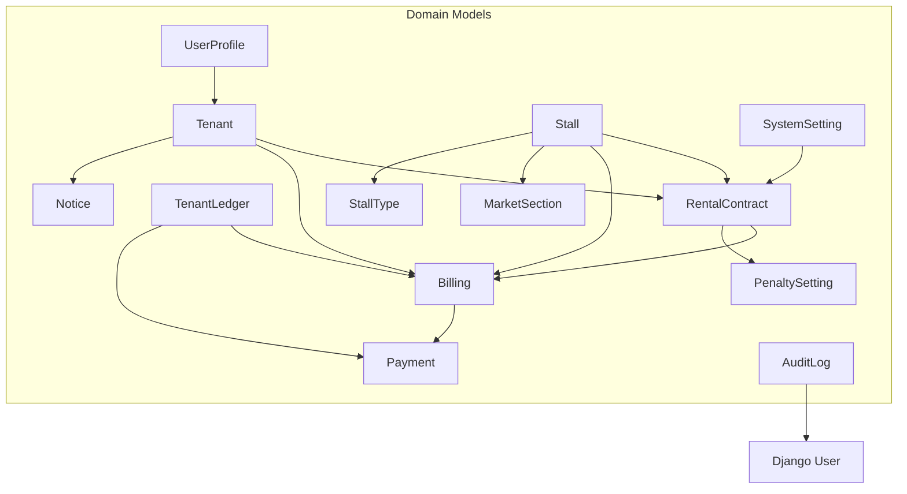

**Diagram sources**
- [core/models.py:7-69](file://core/models.py#L7-L69)
- [core/models.py:71-115](file://core/models.py#L71-L115)
- [core/models.py:117-188](file://core/models.py#L117-L188)
- [core/models.py:190-278](file://core/models.py#L190-L278)
- [core/models.py:280-336](file://core/models.py#L280-L336)

**Section sources**
- [core/models.py:7-336](file://core/models.py#L7-L336)
- [accounts/models.py:1-2](file://accounts/models.py#L1-L2)
- [core/migrations/0001_initial.py:17-662](file://core/migrations/0001_initial.py#L17-L662)

## Core Components
The following entities form the operational backbone of the Market Rental System:

| Entity | Purpose | Key Relationships | Important Constraints |
|---|---|---|---|
| `UserProfile` | Extends Django’s built-in user with role-based access control and profile fields. | One-to-one with Django `User`; related name `profile`. | Role choices include admin, collector, cashier, supervisor, treasurer, tenant. |
| `Tenant` | Represents a market vendor or lessee. | Optional one-to-one with Django `User`; related names `tenant`, `contracts`, `billings`, `payments`, `notices`, `ledger_entries`. | Unique `tenant_id`; status choices Active, Inactive, Suspended, Terminated. |
| `MarketSection` | Groups stalls into market sections. | One-to-many with `Stall`. | Unique section name. |
| `StallType` | Classifies stall categories. | One-to-many with `Stall`. | Unique stall type name. |
| `Stall` | Physical or virtual market stall. | Many-to-one with `MarketSection`; optional many-to-one with `StallType`; one-to-many with `RentalContract`, `Billing`, `Payment`. | Unique `stall_number`; status choices Vacant, Occupied, Reserved, Maintenance. |
| `RentalContract` | Legal agreement between tenant and market for a specific stall. | Many-to-one with `Tenant`; many-to-one with `Stall`; one-to-many with `Billing`, `PenaltySetting`. | Conditional unique constraint: only one active contract per stall. |
| `Billing` | Monthly billing record for a tenant-stall-contract combination. | Many-to-one with `Tenant`, `Stall`, `RentalContract`; one-to-many with `Payment`, `TenantLedger`. | Unique combination of tenant, stall, billing month, and billing year. |
| `Payment` | Official receipt and payment transaction. | Many-to-one with `Tenant`, `Stall`, `Billing`; optional many-to-one with Django `User` (collector). | Unique `receipt_number`; status choices Paid, Partial, Void, Cancelled. |
| `TenantLedger` | Running financial ledger per tenant. | Many-to-one with `Tenant`, `Billing`; optional many-to-one with `Payment`. | Ordered by transaction date; balances reflect debit/credit history. |
| `Notice` | Administrative notices sent to tenants. | Many-to-one with `Tenant`. | Unique `notice_number`; notice type choices include reminders, overdue notices, final demands, vacancy notices. |
| `AuditLog` | Immutable audit trail of important actions. | Optional many-to-one with Django `User`. | Records action, module, description, IP address, timestamp. |
| `SystemSetting` | Global market configuration such as municipality name, due day, penalty policy, logo, theme, and contract terms. | No direct foreign keys; referenced by views and business logic. | Single logical setting row; default terms included. |
| `PenaltySetting` | Contract-level penalty configuration overriding system defaults. | Many-to-one with `RentalContract`. | Supports fixed or percentage penalties with grace period and due day. |

**Section sources**
- [core/models.py:7-69](file://core/models.py#L7-L69)
- [core/models.py:71-115](file://core/models.py#L71-L115)
- [core/models.py:117-188](file://core/models.py#L117-L188)
- [core/models.py:190-278](file://core/models.py#L190-L278)
- [core/models.py:280-336](file://core/models.py#L280-L336)
- [core/migrations/0001_initial.py:17-662](file://core/migrations/0001_initial.py#L17-L662)

## Architecture Overview
At a high level, the database supports these major flows:
- **Tenant Onboarding**: Create `Tenant`, optionally link to a Django `User`, then create `UserProfile` for staff roles.
- **Contract Assignment**: Assign an active `RentalContract` to a `Tenant` and `Stall`, marking the stall occupied.
- **Billing Generation**: Generate monthly `Billing` records for active contracts, applying penalties when applicable.
- **Payment Processing**: Record `Payment` transactions, update billing totals, and post ledger entries.
- **Reporting and Notices**: Use `TenantLedger`, `Billing`, `Payment`, and `Notice` for reporting, compliance, and tenant communication.
- **Administration**: Manage `SystemSetting`, `AuditLog`, and role-based access through `UserProfile`.

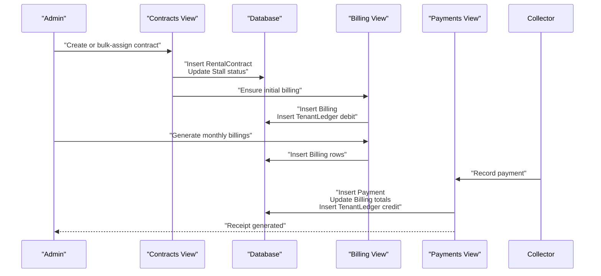

**Diagram sources**
- [core/views/contracts.py:20-36](file://core/views/contracts.py#L20-L36)
- [core/views/contracts.py:88-135](file://core/views/contracts.py#L88-L135)
- [core/views/billing.py:174-246](file://core/views/billing.py#L174-L246)
- [core/views/billing.py:415-489](file://core/views/billing.py#L415-L489)
- [core/views/payments.py:250-294](file://core/views/payments.py#L250-L294)

## Detailed Component Analysis

### UserProfile and Tenant Relationship
`UserProfile` extends Django’s authentication model with role-based permissions. `Tenant` represents the business-side identity of a market vendor. A tenant may optionally be linked to a Django `User`, enabling portal access while keeping administrative and tenant identities separate.

```mermaid
classDiagram
class UserProfile {
+OneToOneField user
+CharField role
+CharField phone
+TextField address
+BooleanField must_change_password
}
class Tenant {
+CharField tenant_id
+OneToOneField user
+CharField full_name
+TextField address
+CharField contact_number
+EmailField email
+CharField status
+DateField date_registered
+TextField notes
}
UserProfile --> "Django User" : "extends"
Tenant --> "Django User" : "optional link"
```

**Diagram sources**
- [core/models.py:7-24](file://core/models.py#L7-L24)
- [core/models.py:117-155](file://core/models.py#L117-L155)
- [core/migrations/0001_initial.py:612-649](file://core/migrations/0001_initial.py#L612-L649)
- [core/migrations/0001_initial.py:335-395](file://core/migrations/0001_initial.py#L335-L395)

**Section sources**
- [core/models.py:7-24](file://core/models.py#L7-L24)
- [core/models.py:117-155](file://core/models.py#L117-L155)
- [accounts/models.py:1-2](file://accounts/models.py#L1-L2)

### Stall, MarketSection, and StallType
`MarketSection` and `StallType` are reference tables. `Stall` belongs to a section and optionally to a stall type. Stalls have a unique number and a status that reflects occupancy.

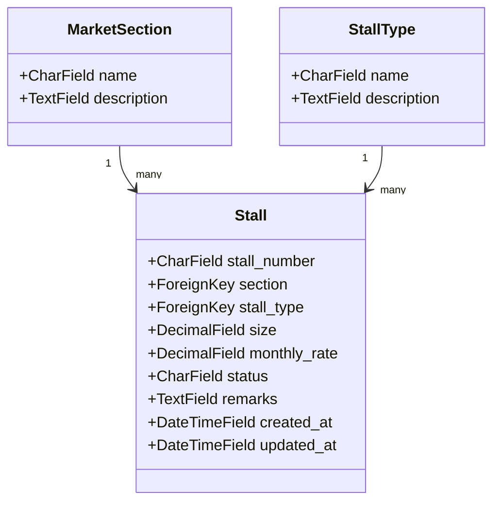

**Diagram sources**
- [core/models.py:71-115](file://core/models.py#L71-L115)
- [core/migrations/0001_initial.py:17-35](file://core/migrations/0001_initial.py#L17-L35)
- [core/migrations/0001_initial.py:77-95](file://core/migrations/0001_initial.py#L77-L95)
- [core/migrations/0001_initial.py:202-259](file://core/migrations/0001_initial.py#L202-L259)

**Section sources**
- [core/models.py:71-115](file://core/models.py#L71-L115)
- [core/migrations/0001_initial.py:17-35](file://core/migrations/0001_initial.py#L17-L35)
- [core/migrations/0001_initial.py:77-95](file://core/migrations/0001_initial.py#L77-L95)
- [core/migrations/0001_initial.py:202-259](file://core/migrations/0001_initial.py#L202-L259)

### RentalContract and PenaltySetting
A `RentalContract` binds a `Tenant` to a `Stall` for a defined period, with rent, due day, security deposit, and status. A conditional database constraint ensures only one active contract exists per stall. `PenaltySetting` allows per-contract overrides for penalty type, value, grace period, and due day.

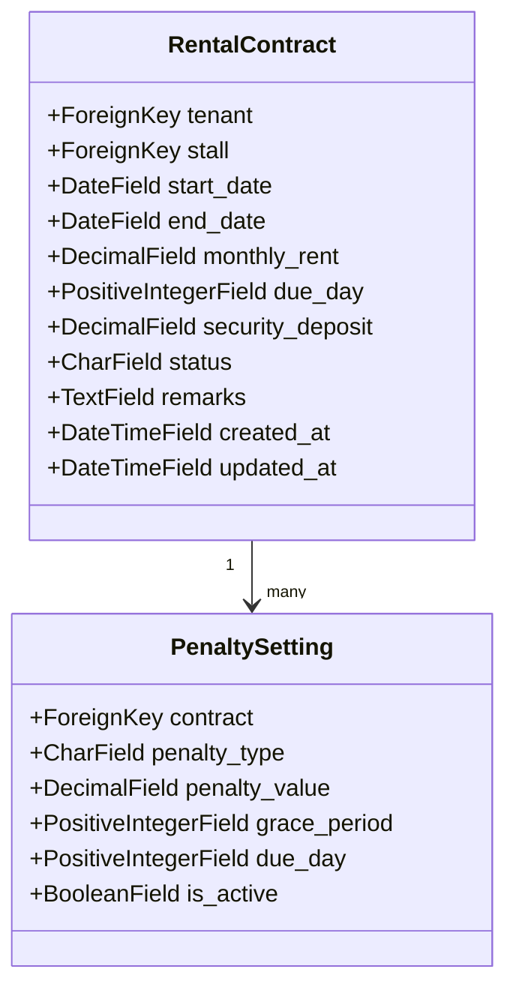

**Diagram sources**
- [core/models.py:157-188](file://core/models.py#L157-L188)
- [core/models.py:319-336](file://core/models.py#L319-L336)
- [core/migrations/0001_initial.py:36-76](file://core/migrations/0001_initial.py#L36-L76)
- [core/migrations/0001_initial.py:165-201](file://core/migrations/0001_initial.py#L165-L201)
- [core/migrations/0001_initial.py:650-657](file://core/migrations/0001_initial.py#L650-L657)

**Section sources**
- [core/models.py:157-188](file://core/models.py#L157-L188)
- [core/models.py:319-336](file://core/models.py#L319-L336)
- [core/migrations/0001_initial.py:36-76](file://core/migrations/0001_initial.py#L36-L76)
- [core/migrations/0001_initial.py:165-201](file://core/migrations/0001_initial.py#L165-L201)
- [core/migrations/0001_initial.py:650-657](file://core/migrations/0001_initial.py#L650-L657)

### Billing and Payment
`Billing` represents a monthly obligation for a tenant-stall-contract combination. It tracks rental amount, penalties, discounts, total due, amount paid, balance, due date, and status. `Payment` records each official receipt and payment transaction, linking back to the billing it settles.

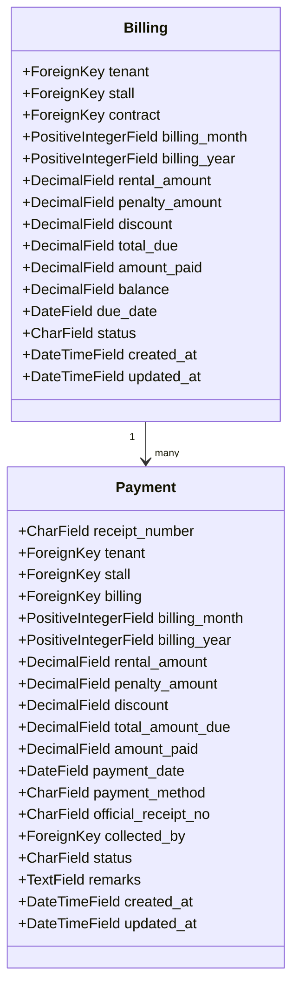

**Diagram sources**
- [core/models.py:190-259](file://core/models.py#L190-L259)
- [core/migrations/0001_initial.py:269-334](file://core/migrations/0001_initial.py#L269-L334)
- [core/migrations/0001_initial.py:405-502](file://core/migrations/0001_initial.py#L405-L502)
- [core/migrations/0001_initial.py:658-661](file://core/migrations/0001_initial.py#L658-L661)

**Section sources**
- [core/models.py:190-259](file://core/models.py#L190-L259)
- [core/migrations/0001_initial.py:269-334](file://core/migrations/0001_initial.py#L269-L334)
- [core/migrations/0001_initial.py:405-502](file://core/migrations/0001_initial.py#L405-L502)
- [core/migrations/0001_initial.py:658-661](file://core/migrations/0001_initial.py#L658-L661)

### TenantLedger and Notice
`TenantLedger` maintains a running financial history per tenant, tied to billings and payments. `Notice` records administrative communications such as payment reminders, overdue notices, final demands, and vacancy notices.

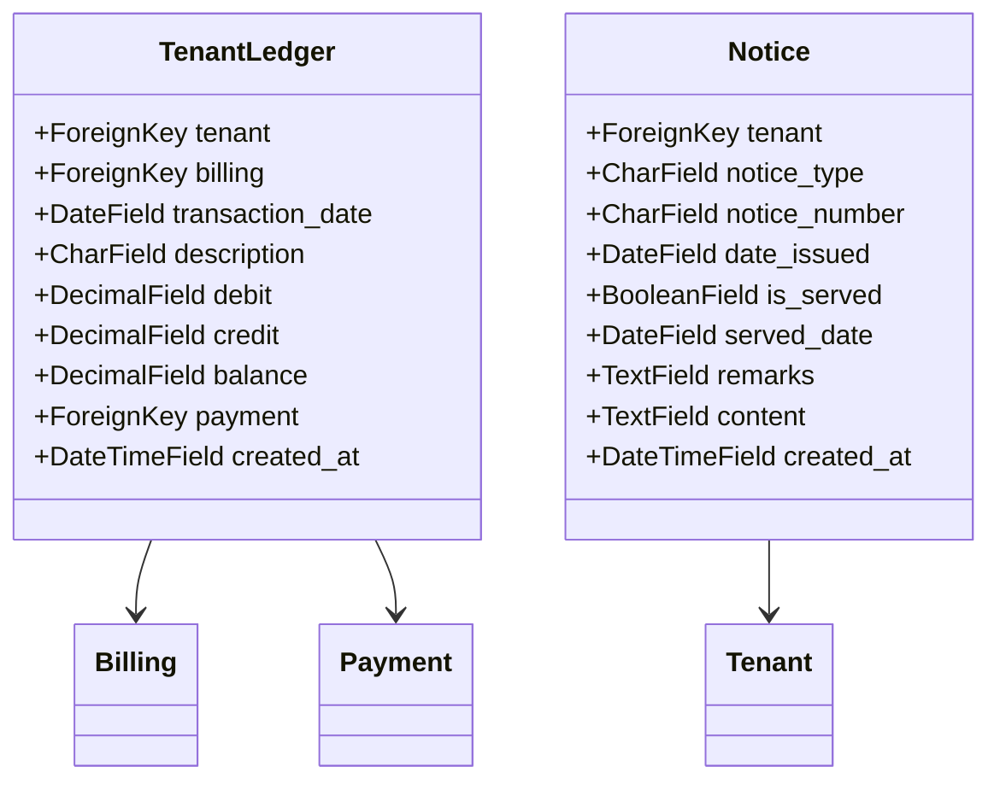

**Diagram sources**
- [core/models.py:261-278](file://core/models.py#L261-L278)
- [core/models.py:280-302](file://core/models.py#L280-L302)
- [core/migrations/0001_initial.py:503-546](file://core/migrations/0001_initial.py#L503-L546)
- [core/migrations/0001_initial.py:556-611](file://core/migrations/0001_initial.py#L556-L611)

**Section sources**
- [core/models.py:261-278](file://core/models.py#L261-L278)
- [core/models.py:280-302](file://core/models.py#L280-L302)
- [core/migrations/0001_initial.py:503-546](file://core/migrations/0001_initial.py#L503-L546)
- [core/migrations/0001_initial.py:556-611](file://core/migrations/0001_initial.py#L556-L611)

### AuditLog and SystemSetting
`AuditLog` provides an immutable record of system actions, including user, action, module, description, IP address, and timestamp. `SystemSetting` stores global configuration such as municipality name, market name, office name, receipt prefix, default due day, penalty policy, grace period, logo, theme color, and contract terms.

```mermaid
classDiagram
class AuditLog {
+ForeignKey user
+CharField action
+CharField module
+TextField description
+GenericIPAddressField ip_address
+DateTimeField created_at
}
class SystemSetting {
+CharField municipality_name
+CharField market_name
+CharField office_name
+CharField receipt_prefix
+PositiveIntegerField default_due_day
+CharField penalty_type
+DecimalField penalty_value
+PositiveIntegerField grace_period
+ImageField logo
+CharField theme_color
+TextField terms_and_conditions
}
AuditLog --> "Django User"
```

**Diagram sources**
- [core/models.py:42-69](file://core/models.py#L42-L69)
- [core/models.py:304-317](file://core/models.py#L304-L317)
- [core/migrations/0001_initial.py:96-133](file://core/migrations/0001_initial.py#L96-L133)
- [core/migrations/0001_initial.py:134-164](file://core/migrations/0001_initial.py#L134-L164)

**Section sources**
- [core/models.py:42-69](file://core/models.py#L42-L69)
- [core/models.py:304-317](file://core/models.py#L304-L317)
- [core/migrations/0001_initial.py:96-133](file://core/migrations/0001_initial.py#L96-L133)
- [core/migrations/0001_initial.py:134-164](file://core/migrations/0001_initial.py#L134-L164)

## Dependency Analysis
The primary dependency graph shows how entities relate through foreign keys and business logic:

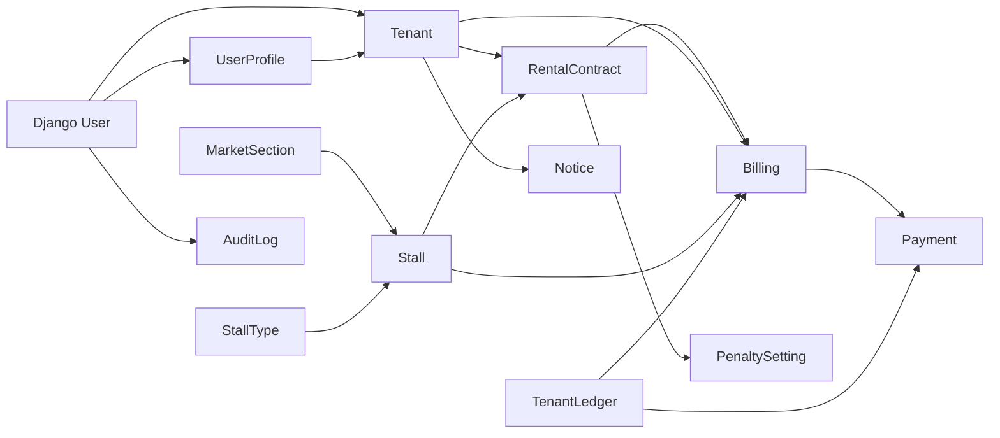

**Diagram sources**
- [core/models.py:7-69](file://core/models.py#L7-L69)
- [core/models.py:71-115](file://core/models.py#L71-L115)
- [core/models.py:117-188](file://core/models.py#L117-L188)
- [core/models.py:190-278](file://core/models.py#L190-L278)
- [core/models.py:280-336](file://core/models.py#L280-L336)

Key observations:
- `UserProfile` and `Tenant` both reference Django’s `User`, but serve different purposes: administrative roles versus vendor identity.
- `RentalContract` enforces business integrity by allowing only one active contract per stall.
- `Billing` uniquely identifies a tenant-stall-month-year combination, preventing duplicate billing periods.
- `Payment` is the authoritative source for money received; billing totals and ledger credits are derived from payments.
- `TenantLedger` provides historical accounting context for tenant obligations and payments.
- `AuditLog` and `SystemSetting` support governance and configurability without altering schema frequently.

**Section sources**
- [core/models.py:7-336](file://core/models.py#L7-L336)
- [core/migrations/0001_initial.py:17-662](file://core/migrations/0001_initial.py#L17-L662)

## Performance Considerations
Indexes and query optimization are important for a system that generates monthly billings and processes payments:

- **Unique constraints**:
  - `Stall.stall_number`: prevents duplicate stall identifiers.
  - `MarketSection.name` and `StallType.name`: ensure clean reference data.
  - `Billing.unique_together(tenant, stall, billing_month, billing_year)`: prevents duplicate billing periods.
  - `RentalContract.UniqueConstraint(stall, status)` where `status = 'Active'`: ensures only one active contract per stall.
  - `Payment.receipt_number` and `Notice.notice_number`: ensure unique receipts and notices.

- **Foreign key indexes**:
  - Django automatically creates indexes for foreign keys, improving join performance across `Tenant`, `Stall`, `RentalContract`, `Billing`, `Payment`, and `TenantLedger`.

- **Query patterns**:
  - Billing list and payment list views use `select_related` to reduce N+1 queries.
  - Batch collection uses `select_for_update` to prevent concurrent collectors from settling the same billing twice.
  - Ledger recalculation functions recompute running balances after edits or voids.

- **Recommended additional indexes**:
  - Composite index on `Billing(billing_year, billing_month)` for monthly reports.
  - Index on `Payment(payment_date)` for date-range queries.
  - Index on `TenantLedger(transaction_date)` for chronological ledger queries.
  - Index on `AuditLog(created_at)` for audit timeline queries.

[No sources needed since this section provides general guidance]

## Data Lifecycle Patterns

### Tenant Onboarding
1. Create `Tenant` with identification, contact, and business information.
2. Optionally link `Tenant.user` to a Django `User` for portal access.
3. For staff roles, create `UserProfile` with role choices.

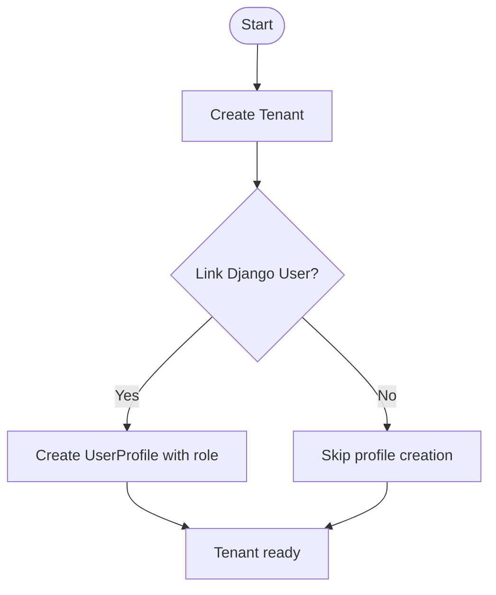

**Section sources**
- [core/models.py:7-24](file://core/models.py#L7-L24)
- [core/models.py:117-155](file://core/models.py#L117-L155)

### Contract Management
1. Create `RentalContract` for a `Tenant` and `Stall`.
2. Mark the `Stall` as `Occupied` if no other active contract exists.
3. Auto-generate initial billing using helper functions.
4. Update stall status when contracts are edited or terminated.

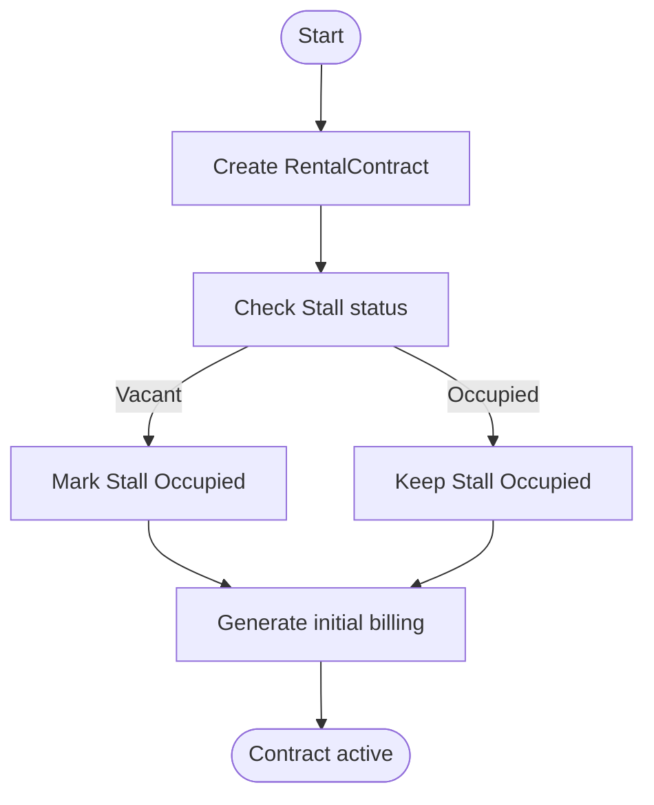

**Diagram sources**
- [core/views/contracts.py:20-36](file://core/views/contracts.py#L20-L36)
- [core/views/contracts.py:88-135](file://core/views/contracts.py#L88-L135)
- [core/views/contracts.py:431-530](file://core/views/contracts.py#L431-L530)

**Section sources**
- [core/models.py:157-188](file://core/models.py#L157-L188)
- [core/views/contracts.py:20-36](file://core/views/contracts.py#L20-L36)
- [core/views/contracts.py:88-135](file://core/views/contracts.py#L88-L135)
- [core/views/contracts.py:431-530](file://core/views/contracts.py#L431-L530)

### Billing Cycles
1. Ensure current month billings exist for active contracts.
2. Compute penalties based on `SystemSetting` or `PenaltySetting`.
3. Create `Billing` with due date, rental amount, penalty, discount, total due, and balance.
4. Post a debit entry to `TenantLedger`.

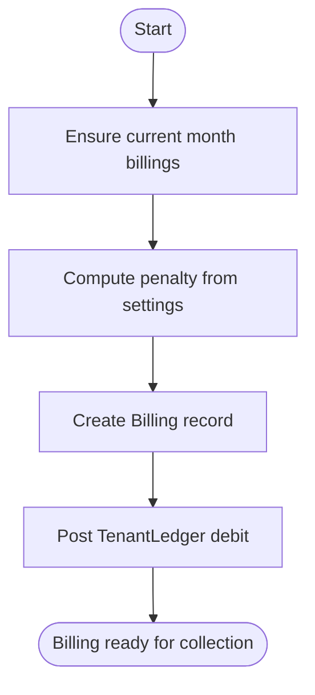

**Diagram sources**
- [core/views/billing.py:29-59](file://core/views/billing.py#L29-L59)
- [core/views/billing.py:174-246](file://core/views/billing.py#L174-L246)
- [core/views/billing.py:249-315](file://core/views/billing.py#L249-L315)

**Section sources**
- [core/models.py:190-219](file://core/models.py#L190-L219)
- [core/models.py:42-69](file://core/models.py#L42-L69)
- [core/models.py:319-336](file://core/models.py#L319-L336)
- [core/views/billing.py:29-59](file://core/views/billing.py#L29-L59)
- [core/views/billing.py:174-246](file://core/views/billing.py#L174-L246)
- [core/views/billing.py:249-315](file://core/views/billing.py#L249-L315)

### Payment Processing
1. Collector enters payment amount and method.
2. System creates `Payment`, updates `Billing.amount_paid` and `Billing.balance`, and posts a credit to `TenantLedger`.
3. Receipt is generated; batch collections share a consolidated official receipt number.
4. Voiding a payment recomputes billing totals and removes corresponding ledger entries.

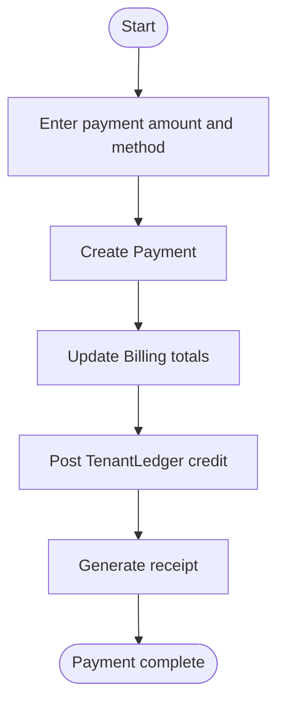

**Diagram sources**
- [core/views/billing.py:415-489](file://core/views/billing.py#L415-L489)
- [core/views/payments.py:250-294](file://core/views/payments.py#L250-L294)
- [core/views/payments.py:419-550](file://core/views/payments.py#L419-L550)

**Section sources**
- [core/models.py:221-259](file://core/models.py#L221-L259)
- [core/models.py:261-278](file://core/models.py#L261-L278)
- [core/views/billing.py:415-489](file://core/views/billing.py#L415-L489)
- [core/views/payments.py:250-294](file://core/views/payments.py#L250-L294)
- [core/views/payments.py:419-550](file://core/views/payments.py#L419-L550)

## Integrity, Transactions, and Backup Strategy

### Data Integrity Measures
- **Primary keys**: All models use Django’s auto-generated primary keys.
- **Unique constraints**:
  - `Stall.stall_number`
  - `MarketSection.name`
  - `StallType.name`
  - `Billing.unique_together(tenant, stall, billing_month, billing_year)`
  - `RentalContract.UniqueConstraint(stall, status)` for active contracts
  - `Payment.receipt_number`
  - `Notice.notice_number`
- **Foreign key cascades**:
  - Deleting a `Tenant`, `Stall`, or `RentalContract` cascades to dependent records such as billings, payments, and notices.
  - Deleting a `Billing` cascades to associated payments and ledger entries.
  - Deleting a `Payment` can be voided rather than deleted to preserve audit history.
- **Choices and validation**:
  - Status fields enforce allowed values through choices.
  - Decimal fields ensure precise monetary calculations.
  - Date fields enforce temporal boundaries for contracts, billings, and payments.

### Transaction Handling
- Contract creation and activation use atomic transactions to prevent partial state changes.
- Payment recording uses atomic transactions to ensure payment, billing update, and ledger posting occur together.
- Batch collection locks selected billings with `select_for_update` to prevent race conditions.
- Editing or voiding payments recomputes billing totals and ledger balances authoritatively.

### Backup Strategy Recommendations
- **Database-level backups**: Schedule regular full and incremental backups of the underlying database.
- **File storage backups**: Back up uploaded files such as logos and tenant ID images.
- **Audit log retention**: Retain `AuditLog` records for compliance and forensic analysis.
- **Migration safety**: Test migrations in staging before applying to production.
- **Rollback plan**: Maintain migration history and test rollback procedures for critical schema changes.

**Section sources**
- [core/models.py:157-188](file://core/models.py#L157-L188)
- [core/models.py:190-259](file://core/models.py#L190-L259)
- [core/migrations/0001_initial.py:650-661](file://core/migrations/0001_initial.py#L650-L661)
- [core/views/contracts.py:88-135](file://core/views/contracts.py#L88-L135)
- [core/views/billing.py:415-489](file://core/views/billing.py#L415-L489)
- [core/views/payments.py:419-550](file://core/views/payments.py#L419-L550)

## Migration Strategy and Version Management
The project uses Django migrations to manage schema evolution:
- `core/migrations/0001_initial.py` defines the initial schema for all core entities.
- Subsequent migrations add fields and constraints, such as tenant barangay, first/last name, and system setting terms and conditions.
- Migrations should be applied in order, tested in development and staging, and reviewed before production deployment.
- When adding new fields or changing constraints, generate migrations and verify backward compatibility.

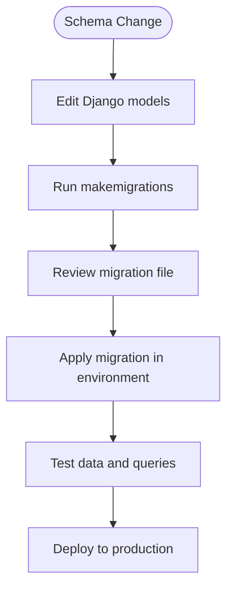

**Section sources**
- [core/migrations/0001_initial.py:1-662](file://core/migrations/0001_initial.py#L1-L662)

## Troubleshooting Guide

### Duplicate Billing Periods
- Symptom: Attempting to generate a billing for a tenant-stall-month-year already exists.
- Cause: `Billing.unique_together(tenant, stall, billing_month, billing_year)` prevents duplicates.
- Resolution: Check existing billings before generation; use idempotent helpers like `ensure_current_month_billings`.

**Section sources**
- [core/models.py:190-219](file://core/models.py#L190-L219)
- [core/views/billing.py:174-246](file://core/views/billing.py#L174-L246)

### Multiple Active Contracts Per Stall
- Symptom: Error when creating another active contract for the same stall.
- Cause: `RentalContract.UniqueConstraint(stall, status)` where `status = 'Active'`.
- Resolution: Terminate or expire the existing active contract before assigning a new one.

**Section sources**
- [core/models.py:157-188](file://core/models.py#L157-L188)
- [core/migrations/0001_initial.py:650-657](file://core/migrations/0001_initial.py#L650-L657)

### Payment Not Reflecting Balance
- Symptom: Billing balance does not decrease after payment.
- Cause: Payment may not have been recorded, or billing totals were not recomputed.
- Resolution: Verify payment existence, check `record_payment` usage, and run `recalc_billing_from_payments` if necessary.

**Section sources**
- [core/views/payments.py:250-294](file://core/views/payments.py#L250-L294)
- [core/views/payments.py:419-550](file://core/views/payments.py#L419-L550)

### Concurrent Collection Conflicts
- Symptom: Two collectors settle the same billing simultaneously.
- Cause: Race condition without locking.
- Resolution: Use `select_for_update` inside atomic transactions during batch collection.

**Section sources**
- [core/views/billing.py:511-624](file://core/views/billing.py#L511-L624)

## Conclusion
The Market Rental System database schema is designed around clear entity relationships, strong constraints, and well-defined data lifecycles. `UserProfile` and `Tenant` separate administrative and vendor identities. `Stall`, `RentalContract`, and `PenaltySetting` model physical assets and lease agreements. `Billing` and `Payment` provide robust financial tracking, while `TenantLedger` preserves historical accounting context. `Notice`, `AuditLog`, and `SystemSetting` support compliance, governance, and configurability.

For long-term maintainability:
- Keep migrations small, focused, and tested.
- Enforce business rules at the database level where possible.
- Use atomic transactions for critical operations.
- Monitor performance with appropriate indexes and query optimizations.
- Maintain audit trails and backup strategies for reliability and compliance.

[No sources needed since this section summarizes without analyzing specific files]