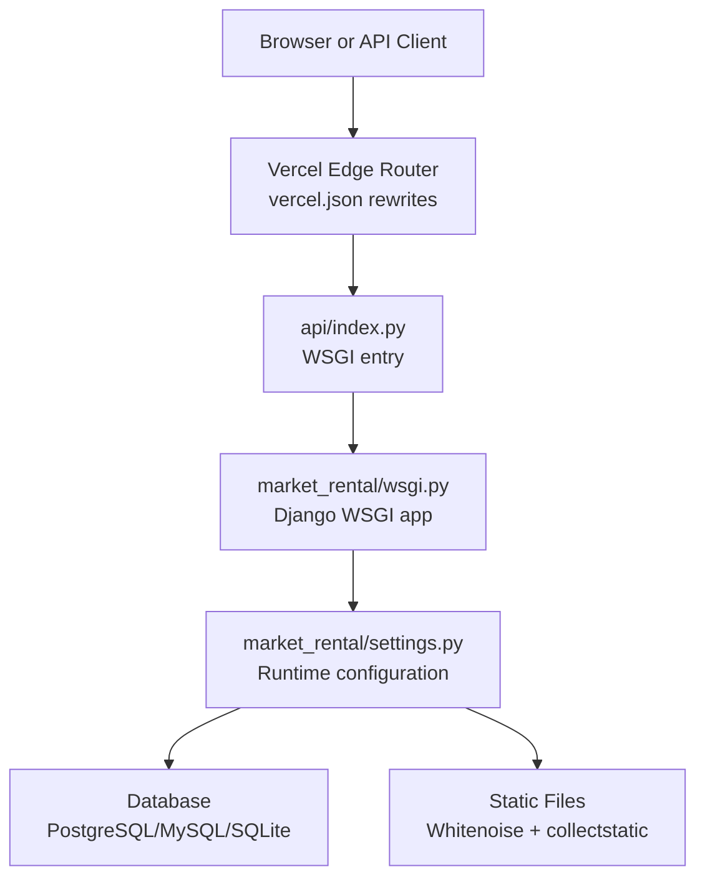
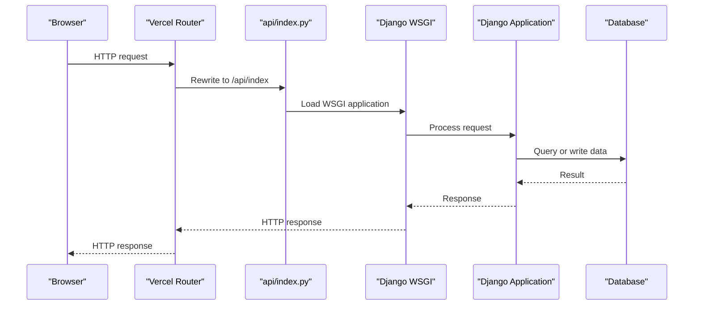
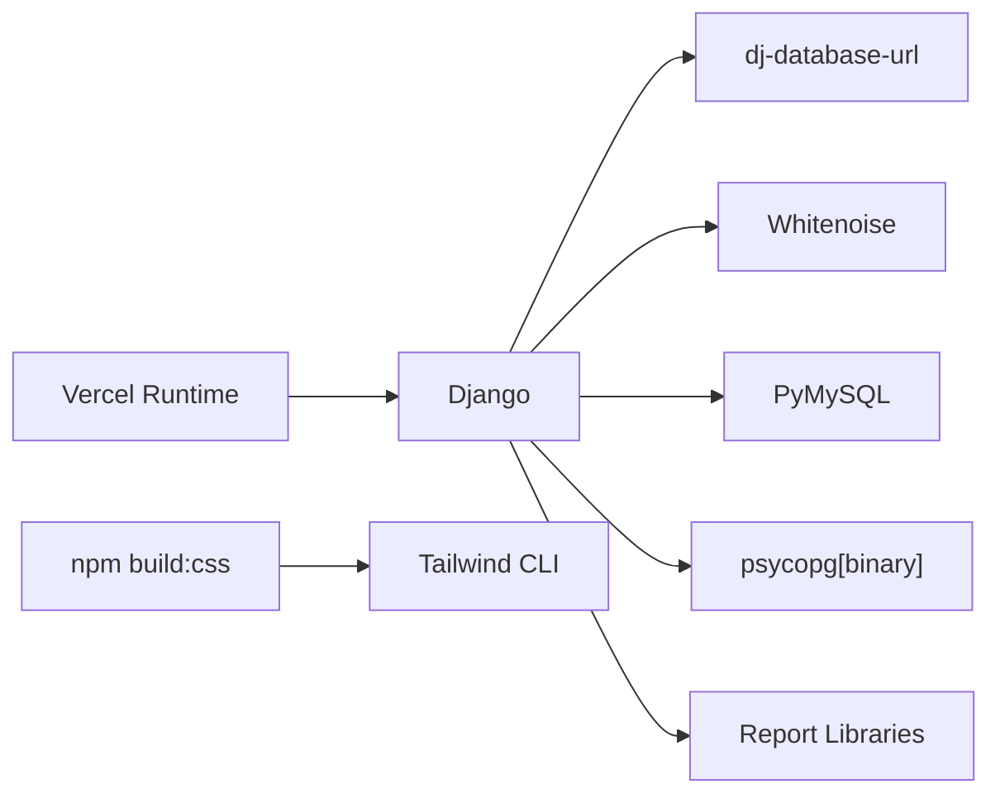

# Deployment & Production

<cite>
**Referenced Files in This Document**   
- [vercel.json](file://vercel.json)
- [api/index.py](file://api/index.py)
- [market_rental/settings.py](file://market_rental/settings.py)
- [market_rental/wsgi.py](file://market_rental/wsgi.py)
- [core/context_processors.py](file://core/context_processors.py)
- [requirements.txt](file://requirements.txt)
- [package.json](file://package.json)
</cite>

## Table of Contents
1. [Introduction](#introduction)
2. [Project Structure](#project-structure)
3. [Core Components](#core-components)
4. [Architecture Overview](#architecture-overview)
5. [Detailed Component Analysis](#detailed-component-analysis)
6. [Dependency Analysis](#dependency-analysis)
7. [Performance Considerations](#performance-considerations)
8. [Troubleshooting Guide](#troubleshooting-guide)
9. [Conclusion](#conclusion)
10. [Appendices](#appendices)

## Introduction
This document explains how to deploy and operate the Market Rental System in development, staging, and production environments. It covers environment configuration, database setup, static file management, Vercel serverless deployment, environment variable management, security hardening, performance optimizations, backup and disaster recovery planning, monitoring and logging guidance, and scaling considerations. The guidance is grounded in the repository’s actual configuration files and entry points.

## Project Structure
The project is a Django application with:
- A Vercel serverless entry point that forwards requests to the Django WSGI application.
- Environment-driven settings for databases, static assets, and security.
- A build pipeline that compiles Tailwind CSS and collects static files.
- Optional local MySQL bootstrap for development.

**Diagram sources**
- [vercel.json:1-11](file://vercel.json#L1-L11)
- [api/index.py:1-5](file://api/index.py#L1-L5)
- [market_rental/wsgi.py:10-17](file://market_rental/wsgi.py#L10-L17)
- [market_rental/settings.py:71-152](file://market_rental/settings.py#L71-L152)

**Section sources**
- [vercel.json:1-11](file://vercel.json#L1-L11)
- [api/index.py:1-5](file://api/index.py#L1-L5)
- [market_rental/wsgi.py:10-17](file://market_rental/wsgi.py#L10-L17)
- [market_rental/settings.py:1-200](file://market_rental/settings.py#L1-L200)

## Core Components
- Vercel configuration defines the build command and request rewrite to the Python API route.
- The Python API module exposes the Django WSGI application as the serverless handler.
- Django WSGI config loads settings and provides the application callable.
- Settings drive database selection, static asset handling, and security behavior based on environment variables.
- Context processors provide runtime system settings and cache-busting information used by templates.

Key responsibilities:
- Build-time: compile CSS and collect static assets.
- Runtime: serve dynamic pages via Django and static assets via Whitenoise.
- Configuration: read secrets from environment variables; prefer managed database URLs.

**Section sources**
- [vercel.json:1-11](file://vercel.json#L1-L11)
- [api/index.py:1-5](file://api/index.py#L1-L5)
- [market_rental/wsgi.py:10-17](file://market_rental/wsgi.py#L10-L17)
- [market_rental/settings.py:1-200](file://market_rental/settings.py#L1-L200)
- [core/context_processors.py:1-45](file://core/context_processors.py#L1-L45)

## Architecture Overview
The deployment architecture uses Vercel to host the Django application in a serverless runtime. All incoming requests are rewritten to the Python API endpoint, which delegates to the Django WSGI application. Static assets are collected and served through Whitenoise during the build step.

**Diagram sources**
- [vercel.json:4-9](file://vercel.json#L4-L9)
- [api/index.py:1-5](file://api/index.py#L1-L5)
- [market_rental/wsgi.py:10-17](file://market_rental/wsgi.py#L10-L17)

## Detailed Component Analysis

### Vercel Deployment Configuration
- Build command:
  - Compiles Tailwind CSS into a minified output file.
  - Runs Django’s static collection to prepare assets for production.
- Request routing:
  - Rewrites all paths to the Python API route so Django handles every URL.

Operational implications:
- Every deployment rebuilds CSS and collects static files.
- Ensure environment variables are configured in Vercel for production and preview deployments.

**Section sources**
- [vercel.json:1-11](file://vercel.json#L1-L11)
- [package.json:5-8](file://package.json#L5-L8)

### Serverless Entry Point and WSGI Integration
- The API index module imports the Django WSGI application and exposes it as the serverless handler.
- The WSGI module sets the Django settings module and returns the application callable.

Best practices:
- Keep the API index minimal to reduce cold-start overhead.
- Avoid heavy initialization at import time; rely on Django’s lazy loading.

**Section sources**
- [api/index.py:1-5](file://api/index.py#L1-L5)
- [market_rental/wsgi.py:10-17](file://market_rental/wsgi.py#L10-L17)

### Environment Configuration and Variables
Environment-driven configuration supports three modes:
- Managed database via DATABASE_URL (preferred for production).
- Local MySQL/MariaDB via DB_ENGINE=mysql and related MYSQL_* variables.
- SQLite fallback when neither is set.

Important variables:
- DJANGO_SECRET_KEY: Required secret for cryptographic signing.
- DJANGO_DEBUG: Controls debug mode and security defaults.
- DJANGO_ALLOWED_HOSTS: Host allowlist; includes Vercel domains when not debugging.
- DATABASE_URL: Full connection string for managed databases.
- DB_ENGINE: Switches between sqlite and mysql for local development.
- MYSQL_DB, MYSQL_HOST, MYSQL_PORT, MYSQL_USER, MYSQL_PASSWORD: Local MySQL credentials.
- DJANGO_CSRF_TRUSTED_ORIGINS: Additional trusted origins for CSRF validation.

Security posture:
- When DEBUG is false, SSL redirect, secure cookies, and proxy headers are enabled.
- Whitenoise serves compressed manifest static files.
- Trusted origins include Vercel preview and production domains plus any custom origins provided via environment.

Local MySQL bootstrap:
- If using MySQL locally, the settings attempt to create the database if missing. Failures are best-effort and do not block startup.

**Section sources**
- [market_rental/settings.py:15-27](file://market_rental/settings.py#L15-L27)
- [market_rental/settings.py:73-152](file://market_rental/settings.py#L73-L152)
- [market_rental/settings.py:174-190](file://market_rental/settings.py#L174-L190)

### Static File Management
Production static handling:
- Collectstatic runs during the build phase.
- Whitenoise serves hashed, compressed static assets.
- Development uses plain filenames with a template-provided version querystring for cache busting.

Cache-busting mechanism:
- A context processor reads the mtime of the compiled CSS file and injects a STATIC_VERSION into templates.
- This ensures browsers fetch updated assets after each build.

Recommendations:
- Keep the compiled CSS file present in the repository or ensure the build step always runs.
- For large teams, consider storing built assets in an artifact store and serving them via CDN.

**Section sources**
- [market_rental/settings.py:166-180](file://market_rental/settings.py#L166-L180)
- [core/context_processors.py:32-44](file://core/context_processors.py#L32-L44)
- [package.json:5-8](file://package.json#L5-L8)

### Security Hardening
Built-in protections:
- Security middleware is enabled.
- CSRF protection is active with trusted origins including Vercel domains and optional custom origins.
- Session and CSRF cookies are marked secure in non-debug environments.
- SSL redirect is enforced behind a reverse proxy.

Additional recommendations:
- Rotate DJANGO_SECRET_KEY regularly and never commit it to source control.
- Restrict ALLOWED_HOSTS to exact domain names in production.
- Use HTTPS-only cookies and enforce HSTS at the edge or reverse proxy.
- Apply least-privilege database credentials and restrict network access to the database.

**Section sources**
- [market_rental/settings.py:40-49](file://market_rental/settings.py#L40-L49)
- [market_rental/settings.py:182-190](file://market_rental/settings.py#L182-L190)

### Database Setup and Optimization
Supported configurations:
- Managed PostgreSQL or MySQL via DATABASE_URL.
- Local MySQL via DB_ENGINE=mysql and MYSQL_* variables.
- SQLite fallback for zero-config development.

Connection tuning:
- Connection max age and health checks are enabled for managed databases.
- Charset utf8mb4 is used for MySQL connections.

Optimization guidance:
- Add indexes on frequently filtered columns such as tenant identifiers, stall references, payment dates, and contract status fields.
- Use database-specific EXPLAIN plans to identify slow queries and add appropriate composite indexes.
- Partition large tables by date ranges where applicable (e.g., payments, billing records).
- Enable query caching at the database layer if supported by your managed provider.

Backup strategy:
- Schedule automated snapshots of the managed database.
- Export logical backups periodically and store them in a separate, encrypted storage bucket.
- Test restore procedures regularly and maintain runbooks for rollback scenarios.

**Section sources**
- [market_rental/settings.py:73-152](file://market_rental/settings.py#L73-L152)

### Caching Strategies
Current state:
- No explicit application-level cache backend is configured in settings.
- Static assets benefit from browser caching due to hashed filenames.

Recommended enhancements:
- Configure a cache backend (e.g., Redis or Memcached) for session and query result caching.
- Cache expensive report generation outputs and dashboard aggregates.
- Use cache invalidation strategies tied to model signals or scheduled tasks.

**Section sources**
- [market_rental/settings.py:1-200](file://market_rental/settings.py#L1-L200)

### Monitoring and Logging
Observability recommendations:
- Centralize logs from the serverless runtime and application.
- Capture request IDs, user identifiers (where appropriate), and error traces.
- Set up alerts for error rate spikes, latency outliers, and database connection failures.
- Integrate with a metrics platform to track CPU, memory, and cold start durations.

Application-side logging:
- Log authentication events, permission denials, and critical business operations.
- Avoid logging sensitive data such as passwords or full credit card numbers.

**Section sources**
- [market_rental/settings.py:40-49](file://market_rental/settings.py#L40-L49)

### Scaling Considerations
Serverless scaling:
- Vercel scales horizontally; ensure idempotent operations and avoid long-running tasks.
- Offload heavy workloads (PDF generation, bulk exports) to background jobs or external services.

Database scaling:
- Use a managed database with read replicas for reporting workloads.
- Tune connection pools and timeouts according to expected concurrency.

Static assets:
- Serve static files through a CDN integrated with Vercel or a dedicated object storage service.

**Section sources**
- [vercel.json:1-11](file://vercel.json#L1-L11)
- [market_rental/settings.py:166-180](file://market_rental/settings.py#L166-L180)

## Dependency Analysis
External dependencies relevant to deployment:
- Django: Web framework.
- dj-database-url: Parses DATABASE_URL for managed databases.
- psycopg[binary]: PostgreSQL driver (useful if switching to PostgreSQL).
- PyMySQL: MySQL driver for local MySQL support.
- Whitenoise: Static file serving and compression.
- Report generation libraries: openpyxl, weasyprint, reportlab, xhtml2pdf.

Build-time dependencies:
- Tailwind CLI for CSS compilation.

**Diagram sources**
- [requirements.txt:1-10](file://requirements.txt#L1-L10)
- [package.json:5-12](file://package.json#L5-L12)

**Section sources**
- [requirements.txt:1-10](file://requirements.txt#L1-L10)
- [package.json:5-12](file://package.json#L5-L12)

## Performance Considerations
- Prefer managed databases over local MySQL in production for reliability and performance.
- Ensure collectstatic runs successfully on every deployment to serve optimized assets.
- Minimize heavy computations in request handlers; use background workers for PDFs and exports.
- Monitor cold starts and optimize import chains to reduce latency.
- Use database indexes and query optimization to reduce response times.

[No sources needed since this section provides general guidance]

## Troubleshooting Guide
Common issues and resolutions:
- Missing DATABASE_URL:
  - Verify the environment variable is set in the hosting platform.
  - Confirm the connection string format matches the managed provider’s requirements.
- Allowed hosts errors:
  - Add the production domain to DJANGO_ALLOWED_HOSTS.
  - Ensure Vercel domains are included when DEBUG is disabled.
- Static files not updating:
  - Confirm the build script runs and collectstatic completes.
  - Check that the compiled CSS file exists and has a valid timestamp.
- CSRF failures:
  - Add custom domains to DJANGO_CSRF_TRUSTED_ORIGINS.
  - Ensure HTTPS is enforced and cookies are secure.

**Section sources**
- [market_rental/settings.py:15-27](file://market_rental/settings.py#L15-L27)
- [market_rental/settings.py:182-190](file://market_rental/settings.py#L182-L190)
- [core/context_processors.py:32-44](file://core/context_processors.py#L32-L44)

## Conclusion
The repository is configured for modern serverless deployment with Vercel, environment-driven settings, and robust static asset handling. Production readiness hinges on configuring secure environment variables, enabling SSL redirects, optimizing database connectivity, and implementing observability and backup procedures. With these practices, the system can scale reliably while maintaining security and performance.

[No sources needed since this section summarizes without analyzing specific files]

## Appendices

### Environment Variables Reference
- DJANGO_SECRET_KEY: Secret key for cryptographic signing.
- DJANGO_DEBUG: Enable or disable debug mode.
- DJANGO_ALLOWED_HOSTS: Comma-separated list of allowed hosts.
- DATABASE_URL: Managed database connection string.
- DB_ENGINE: sqlite or mysql for local development.
- MYSQL_DB, MYSQL_HOST, MYSQL_PORT, MYSQL_USER, MYSQL_PASSWORD: Local MySQL credentials.
- DJANGO_CSRF_TRUSTED_ORIGINS: Comma-separated list of trusted origins.

**Section sources**
- [market_rental/settings.py:15-27](file://market_rental/settings.py#L15-L27)
- [market_rental/settings.py:73-152](file://market_rental/settings.py#L73-L152)
- [market_rental/settings.py:182-190](file://market_rental/settings.py#L182-L190)

### Deployment Scripts and Procedures
- Build steps:
  - Compile Tailwind CSS.
  - Collect static files.
- Run migrations:
  - Execute Django migrations against the configured database.
- Seed data:
  - Use provided management commands to initialize reference data.

Note: These steps align with the repository’s build command and Django conventions.

**Section sources**
- [vercel.json:3-9](file://vercel.json#L3-L9)
- [package.json:5-8](file://package.json#L5-L8)

### Backup and Disaster Recovery Planning
- Automated snapshots of the managed database.
- Periodic logical backups stored in secure, offsite storage.
- Regularly test restore procedures and maintain documented runbooks.
- Define RPO/RTO targets and communicate escalation paths.

[No sources needed since this section provides general guidance]

### Security Best Practices and Compliance
- Enforce HTTPS and secure cookies.
- Restrict allowed hosts and CSRF trusted origins.
- Rotate secrets and apply least-privilege database access.
- Audit and monitor access to sensitive data.
- Align with applicable compliance frameworks (e.g., data protection regulations) by documenting data flows and retention policies.

**Section sources**
- [market_rental/settings.py:182-190](file://market_rental/settings.py#L182-L190)