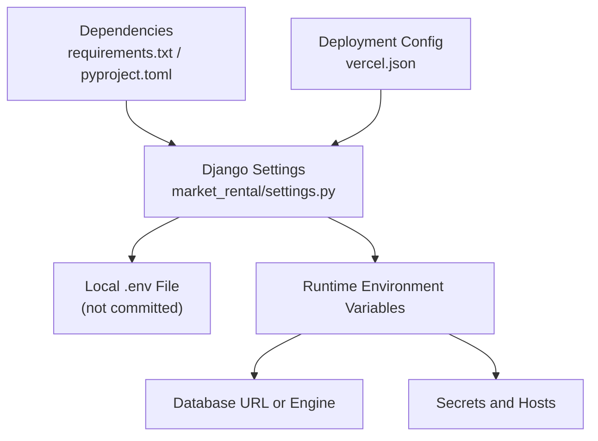
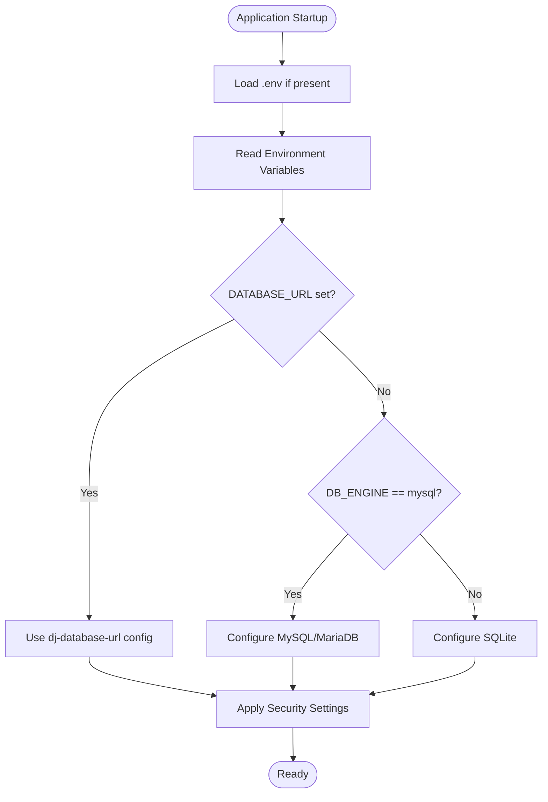
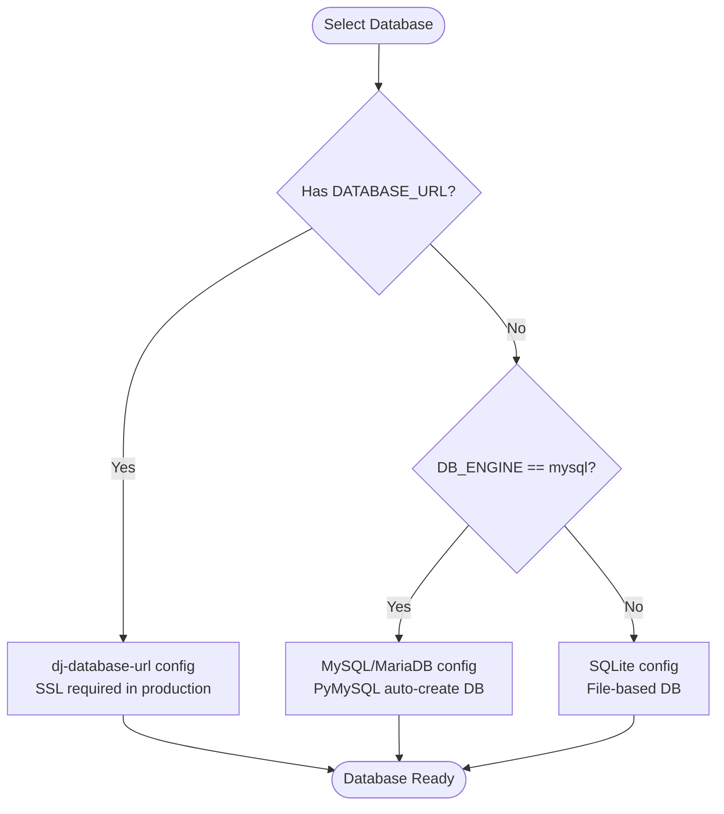
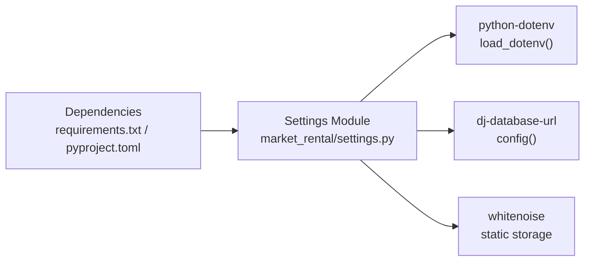

# Environment Configuration

<cite>
**Referenced Files in This Document**
- [settings.py](file://market_rental/settings.py)
- [requirements.txt](file://requirements.txt)
- [pyproject.toml](file://pyproject.toml)
- [.gitignore](file://.gitignore)
- [vercel.json](file://vercel.json)
</cite>

## Table of Contents
1. [Introduction](#introduction)
2. [Project Structure](#project-structure)
3. [Core Components](#core-components)
4. [Architecture Overview](#architecture-overview)
5. [Detailed Component Analysis](#detailed-component-analysis)
6. [Dependency Analysis](#dependency-analysis)
7. [Performance Considerations](#performance-considerations)
8. [Troubleshooting Guide](#troubleshooting-guide)
9. [Conclusion](#conclusion)

## Introduction
This document explains how the application is configured through environment variables and files. It covers:
- Required and optional environment variables, including secrets and database configuration
- The local `.env` file structure for development
- How production platforms inject secrets
- Database options for SQLite, MySQL/MariaDB, and managed databases via `dj-database-url`
- Security hardening settings such as `ALLOWED_HOSTS`, `CSRF_TRUSTED_ORIGINS`, and SSL behavior
- Environment-specific optimizations and debugging considerations

The configuration logic lives primarily in the Django settings module, which loads a local `.env` file and then reads runtime environment variables to configure the application.

## Project Structure
Environment-related configuration is centralized in the Django settings module. Supporting files include dependency declarations and deployment configuration.

**Diagram sources**
- [settings.py:1-11](file://market_rental/settings.py#L1-L11)
- [requirements.txt:1-10](file://requirements.txt#L1-L10)
- [pyproject.toml:1-18](file://pyproject.toml#L1-L18)
- [vercel.json:1-11](file://vercel.json#L1-L11)

**Section sources**
- [settings.py:1-11](file://market_rental/settings.py#L1-L11)
- [requirements.txt:1-10](file://requirements.txt#L1-L10)
- [pyproject.toml:1-18](file://pyproject.toml#L1-L18)
- [vercel.json:1-11](file://vercel.json#L1-L11)

## Core Components
This section summarizes the key environment-driven configuration components.

- Secrets and debug mode
  - `DJANGO_SECRET_KEY`: Application secret key. If missing locally, a development-only default is used.
  - `DJANGO_DEBUG`: Enables or disables debug mode. Accepts values like `true`, `1`, `yes`, or `on`.

- Hosts and CSRF
  - `DJANGO_ALLOWED_HOSTS`: Comma-separated list of allowed hostnames. In non-debug mode, Vercel domains and localhost are added automatically.
  - `DJANGO_CSRF_TRUSTED_ORIGINS`: Comma-separated HTTPS origins trusted by Django’s CSRF protection. Vercel preview and production domains are included by default.

- Database configuration
  - `DATABASE_URL`: Managed or remote database connection string (e.g., PostgreSQL, MySQL). When set, it takes precedence over other database settings.
  - `DB_ENGINE`: Switches between SQLite and MySQL/MariaDB when `DATABASE_URL` is not provided. Default is SQLite.
  - MySQL/MariaDB local variables (used only when `DB_ENGINE=mysql`):
    - `MYSQL_DB`, `MYSQL_HOST`, `MYSQL_PORT`, `MYSQL_USER`, `MYSQL_PASSWORD`

- Production security and static assets
  - Non-debug mode enables secure proxy headers, SSL redirect, and secure cookies.
  - Static files use hashed filenames with WhiteNoise compression.

**Section sources**
- [settings.py:15-26](file://market_rental/settings.py#L15-L26)
- [settings.py:73-76](file://market_rental/settings.py#L73-L76)
- [settings.py:109-152](file://market_rental/settings.py#L109-L152)
- [settings.py:174-190](file://market_rental/settings.py#L174-L190)

## Architecture Overview
The environment configuration follows a clear precedence model:

1. Local `.env` is loaded first for convenience during development.
2. Runtime environment variables always override `.env` values.
3. Database selection prioritizes `DATABASE_URL`; otherwise, it falls back to `DB_ENGINE`.
4. Security settings adapt based on `DEBUG`.

**Diagram sources**
- [settings.py:9-11](file://market_rental/settings.py#L9-L11)
- [settings.py:73-76](file://market_rental/settings.py#L73-L76)
- [settings.py:109-152](file://market_rental/settings.py#L109-L152)

## Detailed Component Analysis

### Environment Variables Reference

- `DJANGO_SECRET_KEY`
  - Purpose: Secret key for cryptographic signing.
  - Behavior: If absent locally, a development-only default is used. Production must provide a strong secret.
  - Source: [settings.py:15-18](file://market_rental/settings.py#L15-L18)

- `DJANGO_DEBUG`
  - Purpose: Controls debug mode.
  - Accepted values: `true`, `1`, `yes`, `on` enable debug; any other value disables it.
  - Impact: Changes allowed hosts defaults, CSRF trusted origins, SSL redirects, cookie security, and static asset handling.
  - Source: [settings.py:19](file://market_rental/settings.py#L19)

- `DJANGO_ALLOWED_HOSTS`
  - Purpose: Comma-separated list of allowed hostnames.
  - Behavior: In non-debug mode, Vercel domains and localhost are added automatically.
  - Source: [settings.py:21-26](file://market_rental/settings.py#L21-L26)

- `DJANGO_CSRF_TRUSTED_ORIGINS`
  - Purpose: Comma-separated HTTPS origins trusted by CSRF protection.
  - Behavior: Vercel preview and production domains are included by default; additional origins can be appended.
  - Source: [settings.py:186-190](file://market_rental/settings.py#L186-L190)

- `DATABASE_URL`
  - Purpose: Connection string for managed or remote databases.
  - Behavior: Takes precedence over `DB_ENGINE`; uses `dj-database-url` with connection pooling and health checks.
  - Source: [settings.py:73](file://market_rental/settings.py#L73), [settings.py:109-120](file://market_rental/settings.py#L109-L120)

- `DB_ENGINE`
  - Purpose: Selects local database engine when `DATABASE_URL` is not set.
  - Values: `sqlite` (default) or `mysql`.
  - Source: [settings.py:74-76](file://market_rental/settings.py#L74-L76)

- MySQL/MariaDB local variables (only when `DB_ENGINE=mysql`)
  - `MYSQL_DB`: Database name (default: `market_rental`).
  - `MYSQL_HOST`: Host address (default: `127.0.0.1`).
  - `MYSQL_PORT`: Port number (default: `3306`).
  - `MYSQL_USER`: Username (default: `root`).
  - `MYSQL_PASSWORD`: Password (default: empty).
  - Behavior: Attempts to create the database if missing using PyMySQL.
  - Source: [settings.py:121-144](file://market_rental/settings.py#L121-L144)

**Section sources**
- [settings.py:15-26](file://market_rental/settings.py#L15-L26)
- [settings.py:73-76](file://market_rental/settings.py#L73-L76)
- [settings.py:109-144](file://market_rental/settings.py#L109-L144)
- [settings.py:186-190](file://market_rental/settings.py#L186-L190)

### Local Development with `.env`
- The settings module loads a `.env` file from the project root at startup.
- Sensitive files like `.env` and `db.sqlite3` are ignored by version control.
- Recommended local `.env` keys:
  - `DJANGO_SECRET_KEY`: Generate a strong secret for local development.
  - `DJANGO_DEBUG=true`: Enable debug mode locally.
  - `DJANGO_ALLOWED_HOSTS=localhost,127.0.0.1`: Allow local access.
  - `DJANGO_CSRF_TRUSTED_ORIGINS=https://localhost,https://127.0.0.1`: Allow local CSRF requests.
  - `DB_ENGINE=sqlite`: Use SQLite by default.
  - Optional MySQL variables (`MYSQL_*`) if switching to MySQL locally.

Security note: Do not commit `.env` to source control. The repository explicitly ignores `.env`.

**Section sources**
- [settings.py:9-11](file://market_rental/settings.py#L9-L11)
- [.gitignore:7](file://.gitignore#L7)
- [.gitignore:10](file://.gitignore#L10)

### Production Environments and Secret Injection
- Production should never rely on `.env`. Instead, inject secrets through the hosting platform’s environment variable system.
- For Vercel:
  - Set `DJANGO_SECRET_KEY`, `DJANGO_DEBUG=false`, `DJANGO_ALLOWED_HOSTS`, and `DJANGO_CSRF_TRUSTED_ORIGINS` in the platform settings.
  - Provide `DATABASE_URL` for a managed database service.
  - The build command collects static assets before serving.
- Security behavior in non-debug mode:
  - Secure proxy header detection for reverse proxies.
  - Automatic HTTPS redirect.
  - Secure session and CSRF cookies.
  - CSRF trusted origins include Vercel domains plus any custom origins you provide.

**Section sources**
- [settings.py:174-190](file://market_rental/settings.py#L174-L190)
- [vercel.json:3-9](file://vercel.json#L3-L9)

### Database Configuration Options

#### SQLite (Default)
- Behavior: Zero-config SQLite database file under the project root.
- Use case: Local development without external services.
- Source: [settings.py:145-152](file://market_rental/settings.py#L145-L152)

#### MySQL/MariaDB (Local)
- Behavior: Uses PyMySQL to connect to a local MySQL/MariaDB server (commonly bundled with XAMPP).
- Auto-creation: Attempts to create the database if it does not exist.
- Configuration: Controlled by `DB_ENGINE=mysql` and `MYSQL_*` variables.
- Source: [settings.py:121-144](file://market_rental/settings.py#L121-L144)

#### Managed Databases via `dj-database-url`
- Behavior: Reads `DATABASE_URL` and configures the database through `dj-database-url`.
- Features: Connection pooling (`CONN_MAX_AGE=600`), health checks enabled, and SSL required in non-debug mode.
- Supported engines: Any backend supported by `dj-database-url` (e.g., PostgreSQL, MySQL).
- Source: [settings.py:109-120](file://market_rental/settings.py#L109-L120)

**Diagram sources**
- [settings.py:109-152](file://market_rental/settings.py#L109-L152)

**Section sources**
- [settings.py:109-152](file://market_rental/settings.py#L109-L152)

### Security Hardening Settings

- `ALLOWED_HOSTS`
  - Development: Typically includes `localhost` and `127.0.0.1`.
  - Production: Must include your domain(s); Vercel domains are added automatically in non-debug mode.
  - Source: [settings.py:21-26](file://market_rental/settings.py#L21-L26)

- `CSRF_TRUSTED_ORIGINS`
  - Development: Include local HTTPS origins if needed.
  - Production: Includes Vercel domains by default; add custom domains via `DJANGO_CSRF_TRUSTED_ORIGINS`.
  - Source: [settings.py:186-190](file://market_rental/settings.py#L186-L190)

- SSL and Secure Cookies
  - Enabled in non-debug mode:
    - `SECURE_PROXY_SSL_HEADER` detects HTTPS via reverse proxy headers.
    - `SECURE_SSL_REDIRECT=True` forces HTTPS.
    - `SESSION_COOKIE_SECURE=True` and `CSRF_COOKIE_SECURE=True` ensure cookies are sent over HTTPS only.
  - Source: [settings.py:182-185](file://market_rental/settings.py#L182-L185)

**Section sources**
- [settings.py:21-26](file://market_rental/settings.py#L21-L26)
- [settings.py:182-190](file://market_rental/settings.py#L182-L190)

### Environment-Specific Optimizations and Debugging

- Debug Mode
  - `DJANGO_DEBUG=true` enables verbose error pages and development-friendly behavior.
  - `DJANGO_DEBUG=false` enables production optimizations and security defaults.
  - Source: [settings.py:19](file://market_rental/settings.py#L19)

- Static Assets
  - Development: Plain filenames with template-level cache busting.
  - Production: Hashed filenames and compressed manifest storage via WhiteNoise. Requires collecting static assets during deployment.
  - Source: [settings.py:170-180](file://market_rental/settings.py#L170-L180)

- Deployment Build
  - Vercel build command compiles CSS and collects static assets before serving.
  - Source: [vercel.json:3](file://vercel.json#L3)

**Section sources**
- [settings.py:170-180](file://market_rental/settings.py#L170-L180)
- [vercel.json:3](file://vercel.json#L3)

## Dependency Analysis
Environment configuration depends on specific packages that support database URLs, dotenv loading, and static asset management.

**Diagram sources**
- [settings.py:1-5](file://market_rental/settings.py#L1-L5)
- [requirements.txt:1-10](file://requirements.txt#L1-L10)
- [pyproject.toml:6-18](file://pyproject.toml#L6-L18)

**Section sources**
- [settings.py:1-5](file://market_rental/settings.py#L1-L5)
- [requirements.txt:1-10](file://requirements.txt#L1-L10)
- [pyproject.toml:6-18](file://pyproject.toml#L6-L18)

## Performance Considerations
- Database Connections
  - Connection pooling is enabled with `CONN_MAX_AGE=600` seconds for both `dj-database-url` and local MySQL configurations.
  - Health checks are enabled for managed databases to improve reliability.
  - Source: [settings.py:114-119](file://market_rental/settings.py#L114-L119), [settings.py:141](file://market_rental/settings.py#L141)

- Static Assets
  - Production uses compressed manifest storage to reduce payload size and improve caching.
  - Source: [settings.py:174-180](file://market_rental/settings.py#L174-L180)

[No sources needed since this section provides general guidance]

## Troubleshooting Guide
- Missing or invalid `DJANGO_SECRET_KEY`
  - Symptom: Warnings about insecure secret key in development.
  - Resolution: Generate a strong secret and set it in your environment or `.env`.
  - Source: [settings.py:15-18](file://market_rental/settings.py#L15-L18)

- Hostname errors
  - Symptom: “Invalid HTTP_HOST header” or similar.
  - Resolution: Ensure `DJANGO_ALLOWED_HOSTS` includes your domain(s) and local addresses as appropriate.
  - Source: [settings.py:21-26](file://market_rental/settings.py#L21-L26)

- CSRF failures
  - Symptom: CSRF verification failed when making cross-origin requests.
  - Resolution: Add your origin(s) to `DJANGO_CSRF_TRUSTED_ORIGINS` using HTTPS.
  - Source: [settings.py:186-190](file://market_rental/settings.py#L186-L190)

- Database connection issues
  - Symptom: Cannot connect to database.
  - Resolution:
    - Verify `DATABASE_URL` format for managed databases.
    - For local MySQL, confirm `DB_ENGINE=mysql` and correct `MYSQL_*` variables.
    - Ensure the database exists or allow auto-creation for local MySQL.
  - Source: [settings.py:109-144](file://market_rental/settings.py#L109-L144)

- SSL and secure cookies
  - Symptom: Mixed content warnings or cookies not sent securely.
  - Resolution: Run behind an HTTPS-capable reverse proxy and keep `DJANGO_DEBUG=false`.
  - Source: [settings.py:182-185](file://market_rental/settings.py#L182-L185)

**Section sources**
- [settings.py:15-18](file://market_rental/settings.py#L15-L18)
- [settings.py:21-26](file://market_rental/settings.py#L21-L26)
- [settings.py:109-144](file://market_rental/settings.py#L109-L144)
- [settings.py:182-190](file://market_rental/settings.py#L182-L190)

## Conclusion
The application’s environment configuration is designed to be zero-config for local development while remaining secure and flexible for production. Developers can quickly start with SQLite, switch to MySQL/MariaDB locally, or connect to managed databases via a single connection string. Secrets and sensitive settings are injected through environment variables, with `.env` used only for local convenience. Production environments benefit from hardened security defaults, optimized static assets, and robust database connectivity.

[No sources needed since this section summarizes without analyzing specific files]