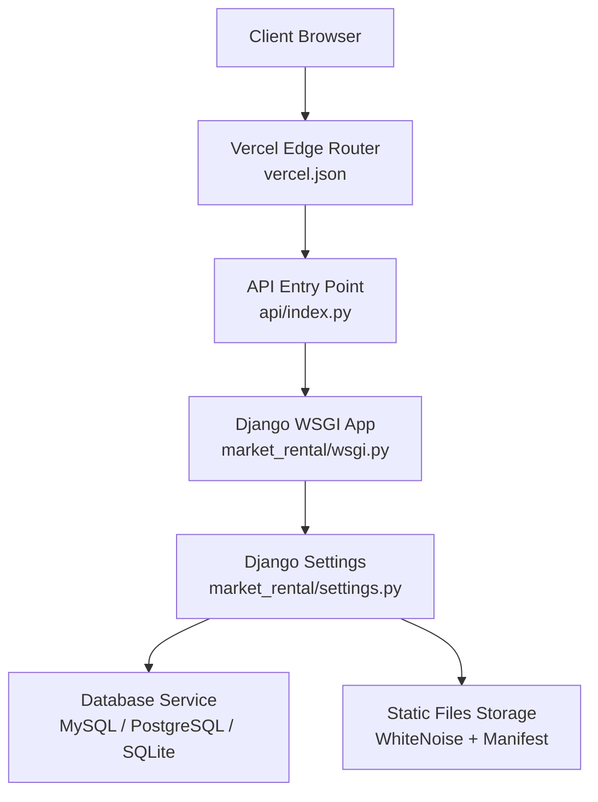
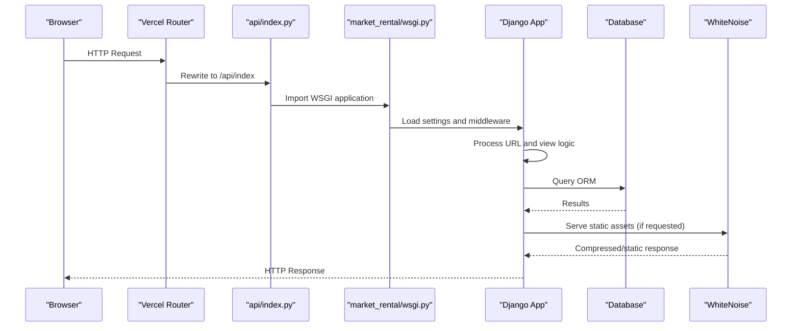
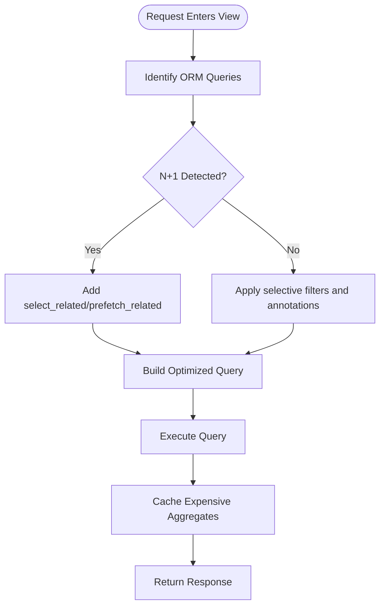
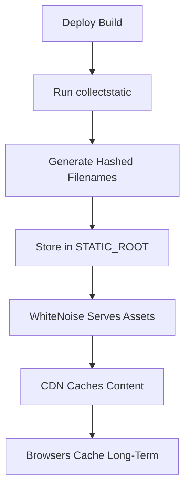
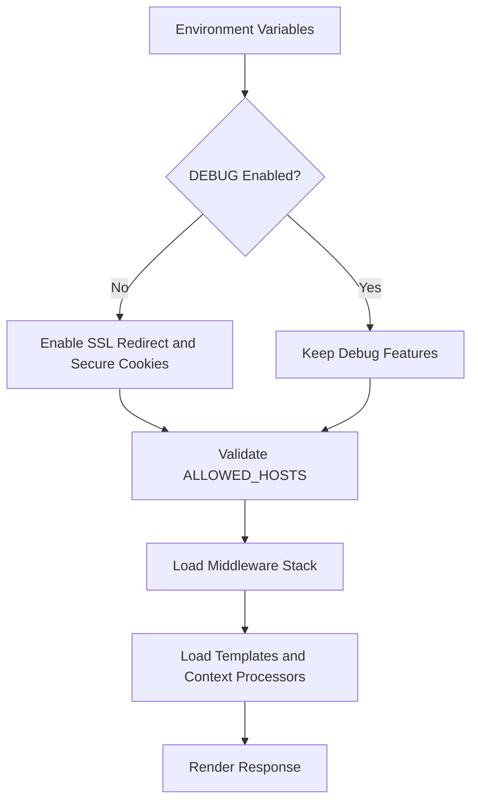
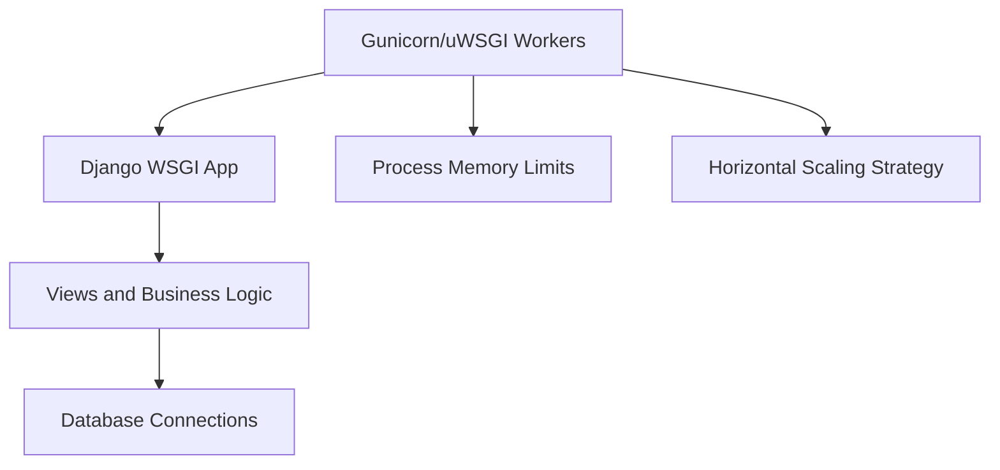
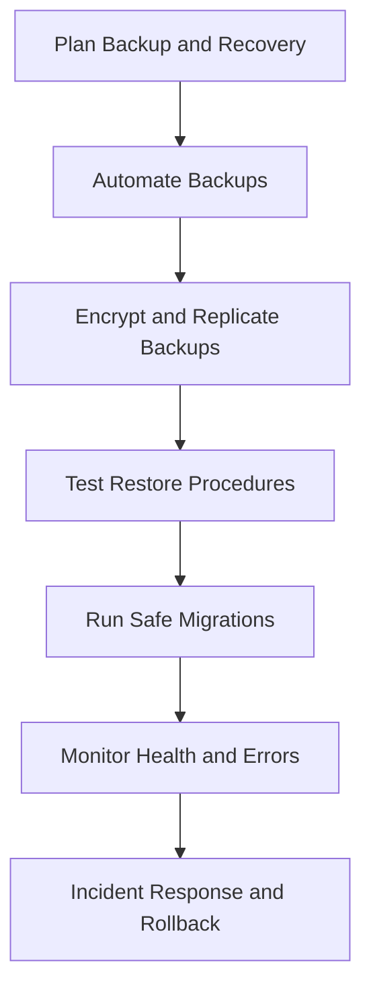
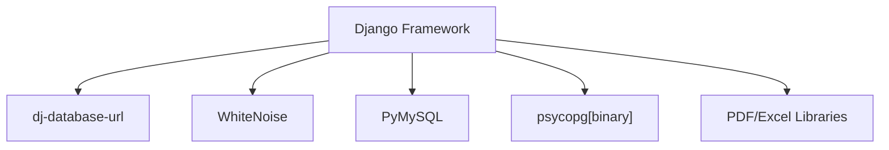

# Production Optimization

<cite>
**Referenced Files in This Document**
- [settings.py](file://market_rental/settings.py)
- [wsgi.py](file://market_rental/wsgi.py)
- [index.py](file://api/index.py)
- [vercel.json](file://vercel.json)
- [__init__.py](file://market_rental/__init__.py)
- [models.py](file://core/models.py)
- [requirements.txt](file://requirements.txt)
- [pyproject.toml](file://pyproject.toml)
- [uv.lock](file://uv.lock)
- [reset_market_data.py](file://core/management/commands/reset_market_data.py)
</cite>

## Table of Contents
1. [Introduction](#introduction)
2. [Project Structure](#project-structure)
3. [Core Components](#core-components)
4. [Architecture Overview](#architecture-overview)
5. [Detailed Component Analysis](#detailed-component-analysis)
6. [Dependency Analysis](#dependency-analysis)
7. [Performance Considerations](#performance-considerations)
8. [Troubleshooting Guide](#troubleshooting-guide)
9. [Conclusion](#conclusion)
10. [Appendices](#appendices)

## Introduction
This document provides production optimization guidance for the Market Rental System. It focuses on database optimization, static file delivery with WhiteNoise, Django runtime tuning, process and memory management, monitoring and error tracking, backup and disaster recovery, and data migration procedures. The recommendations are grounded in the current project configuration and models while remaining applicable to typical Django deployments.

## Project Structure
The application is a standard Django project:
- Application settings, middleware, static files, and database configuration live under `market_rental/settings.py`.
- WSGI entry points are provided by `market_rental/wsgi.py` and `api/index.py`, with Vercel routing configured through `vercel.json`.
- Business domain models are defined in `core/models.py`.
- Dependencies are declared in `requirements.txt`, `pyproject.toml`, and resolved in `uv.lock`.
- A destructive reset command exists under `core/management/commands/reset_market_data.py`.

**Diagram sources**
- [vercel.json:1-11](file://vercel.json#L1-L11)
- [index.py:1-3](file://api/index.py#L1-L3)
- [wsgi.py:1-16](file://market_rental/wsgi.py#L1-L16)
- [settings.py:40-49](file://market_rental/settings.py#L40-L49)
- [settings.py:166-180](file://market_rental/settings.py#L166-L180)

**Section sources**
- [vercel.json:1-11](file://vercel.json#L1-L11)
- [index.py:1-3](file://api/index.py#L1-L3)
- [wsgi.py:1-16](file://market_rental/wsgi.py#L1-L16)
- [settings.py:1-200](file://market_rental/settings.py#L1-L200)

## Core Components
- Database configuration supports three backends:
  - Managed or hosted databases via `DATABASE_URL` using `dj-database-url`.
  - Local MySQL/MariaDB via explicit settings.
  - Zero-config SQLite fallback.
- Static assets are served through WhiteNoise with compressed manifest storage when `DEBUG=False`.
- Middleware includes security, WhiteNoise, sessions, common request handling, CSRF, authentication, messages, and clickjacking protection.
- The deployment pipeline collects static files during build and routes all requests to the Django WSGI application.

Key configuration areas:
- Database URL and connection pooling options.
- SSL enforcement and secure cookies in non-debug mode.
- Static asset hashing and compression.
- Allowed hosts and CSRF trusted origins.

**Section sources**
- [settings.py:73-152](file://market_rental/settings.py#L73-L152)
- [settings.py:40-49](file://market_rental/settings.py#L40-L49)
- [settings.py:166-190](file://market_rental/settings.py#L166-L190)
- [vercel.json:1-11](file://vercel.json#L1-L11)

## Architecture Overview
The production request path goes through Vercel’s router into the Python entry point, which loads the Django WSGI application. Django then applies middleware, resolves URLs, executes views, interacts with the database, and serves responses. Static files are handled by WhiteNoise after `collectstatic` runs at build time.

**Diagram sources**
- [vercel.json:1-11](file://vercel.json#L1-L11)
- [index.py:1-3](file://api/index.py#L1-L3)
- [wsgi.py:1-16](file://market_rental/wsgi.py#L1-L16)
- [settings.py:40-49](file://market_rental/settings.py#L40-L49)
- [settings.py:166-180](file://market_rental/settings.py#L166-L180)

## Detailed Component Analysis

### Database Optimization
The project configures database connections through environment variables and supports multiple engines. In production, prefer a managed database service and supply `DATABASE_URL`. Connection reuse and health checks are enabled, and SSL is enforced outside debug mode.

Recommended indexing strategies based on model usage:
- Unique identifiers:
  - `Tenant.tenant_id`: already unique; ensure an index exists.
  - `Stall.stall_number`: already unique; ensure an index exists.
  - `Payment.receipt_number`: already unique; ensure an index exists.
  - `Notice.notice_number`: already unique; ensure an index exists.
- Foreign keys:
  - `RentalContract.tenant`, `RentalContract.stall`
  - `Billing.tenant`, `Billing.stall`, `Billing.contract`
  - `Payment.tenant`, `Payment.stall`, `Payment.billing`
  - `TenantLedger.tenant`, `TenantLedger.billing`, `TenantLedger.payment`
  - `Notice.tenant`
  - `AuditLog.user`
- Composite indexes for frequent queries:
  - `Billing(tenant, stall, billing_month, billing_year)` matches the existing uniqueness constraint.
  - `RentalContract(stall, status)` matches the conditional unique constraint for active contracts.
  - `Payment(billing_month, billing_year)` can accelerate monthly payment reports.
  - `AuditLog(created_at)` and `AuditLog(user)` support audit filtering and pagination.
- Date-based indexes:
  - `RentalContract.start_date`, `RentalContract.end_date`
  - `Billing.due_date`
  - `Payment.payment_date`
  - `TenantLedger.transaction_date`
- Text search fields:
  - `Tenant.full_name`, `Tenant.business_name`, `Tenant.address` may benefit from partial text indexes depending on the database engine.

Query optimization techniques:
- Use `select_related` for foreign key lookups and `prefetch_related` for reverse relations in list views and reports.
- Avoid N+1 queries in templates that iterate over related objects.
- Paginate large querysets and avoid loading entire tables into memory.
- Use annotated aggregations for financial summaries instead of looping in Python.
- Keep transactions small and atomic around write-heavy operations like payments and billing updates.

Connection pooling configuration:
- When using `DATABASE_URL`, connection pooling is delegated to the underlying driver and manager. The settings enable `conn_max_age=600` and `conn_health_checks=True`, and enforce SSL outside debug mode.
- For direct MySQL configurations, `CONN_MAX_AGE=600` is set, enabling persistent connections per worker process.
- Tune pool size according to your hosting platform limits and database capacity. On serverless platforms like Vercel, keep connections minimal and rely on platform-managed pools.

**Diagram sources**
- [settings.py:109-144](file://market_rental/settings.py#L109-L144)
- [models.py:93-336](file://core/models.py#L93-L336)

**Section sources**
- [settings.py:73-152](file://market_rental/settings.py#L73-L152)
- [models.py:93-336](file://core/models.py#L93-L336)

### Static File Optimization with WhiteNoise
In production (`DEBUG=False`), the project uses WhiteNoise’s compressed manifest storage backend. During deployment, static files are collected and hashed, enabling long-term browser caching and efficient CDN distribution.

Optimization steps:
- Run `python manage.py collectstatic --noinput` before deploying.
- Ensure `STATIC_ROOT` is correctly set and accessible to the web server or CDN origin.
- Enable WhiteNoise middleware early in the middleware stack to serve static assets efficiently.
- Configure CDN cache headers for hashed static files and set appropriate TTLs.
- Use HTTPS-only delivery and secure cookies when behind a reverse proxy.

Current configuration highlights:
- WhiteNoise middleware is included.
- Non-debug mode switches staticfiles storage to compressed manifest storage.
- Secure proxy header, SSL redirect, and secure cookies are enabled outside debug mode.

**Diagram sources**
- [settings.py:40-49](file://market_rental/settings.py#L40-L49)
- [settings.py:166-190](file://market_rental/settings.py#L166-L190)
- [vercel.json:1-11](file://vercel.json#L1-L11)

**Section sources**
- [settings.py:40-49](file://market_rental/settings.py#L40-L49)
- [settings.py:166-190](file://market_rental/settings.py#L166-L190)
- [vercel.json:1-11](file://vercel.json#L1-L11)

### Django Performance Tuning
Production tuning checklist:
- Set `DJANGO_DEBUG=false` to disable debug features and enable optimized behaviors.
- Restrict `ALLOWED_HOSTS` to production domains.
- Enable secure cookies and SSL redirects behind a reverse proxy.
- Keep middleware minimal and ordered efficiently.
- Use template caching by keeping `APP_DIRS=True` and avoiding expensive context processors where possible.
- Prefer database-backed sessions if session scaling becomes necessary.

Current settings relevant to performance:
- Debug flag controlled by environment variable.
- Allowed hosts derived from environment, with defaults extended for preview environments.
- Security middleware, WhiteNoise, sessions, common middleware, CSRF, authentication, messages, and clickjacking protection are present.
- Template context processors include request, auth, messages, system settings, user roles, and static version.

**Diagram sources**
- [settings.py:15-26](file://market_rental/settings.py#L15-L26)
- [settings.py:40-69](file://market_rental/settings.py#L40-L69)
- [settings.py:182-190](file://market_rental/settings.py#L182-L190)

**Section sources**
- [settings.py:15-26](file://market_rental/settings.py#L15-L26)
- [settings.py:40-69](file://market_rental/settings.py#L40-L69)
- [settings.py:182-190](file://market_rental/settings.py#L182-L190)

### Memory Management and Process Management
Memory management:
- Avoid loading large querysets without pagination.
- Use streaming responses for large exports and PDF generation.
- Minimize object creation in hot paths and reuse computed values.
- Monitor memory usage per worker and adjust worker count accordingly.

Process management:
- The project exposes a WSGI application suitable for Gunicorn or uWSGI.
- On Vercel, the entry point imports the WSGI application directly.
- Worker scaling should align with CPU cores and database connection limits.
- Use graceful reloads and zero-downtime deployments.

Current entry points:
- WSGI application loader in `market_rental/wsgi.py`.
- Vercel entry point in `api/index.py`.
- Routing rewrite in `vercel.json` forwards all requests to `/api/index`.

**Diagram sources**
- [wsgi.py:1-16](file://market_rental/wsgi.py#L1-L16)
- [index.py:1-3](file://api/index.py#L1-L3)
- [vercel.json:1-11](file://vercel.json#L1-L11)

**Section sources**
- [wsgi.py:1-16](file://market_rental/wsgi.py#L1-L16)
- [index.py:1-3](file://api/index.py#L1-L3)
- [vercel.json:1-11](file://vercel.json#L1-L11)

### Monitoring Setup: Logging, Error Tracking, and Profiling
Logging:
- No explicit logging configuration is present in the current settings.
- Implement structured logging with levels for request lifecycle, database queries, and business events.
- Centralize logs in a log aggregation service and correlate with request IDs.

Error tracking:
- Integrate an error tracking tool to capture exceptions, stack traces, and contextual data.
- Mask sensitive information such as passwords and tokens.
- Alert on critical errors and monitor error rates.

Profiling:
- Use profiling tools to identify slow views, heavy ORM queries, and template rendering bottlenecks.
- Track database query counts and execution times.
- Profile memory allocations during report generation and bulk operations.

Note: These are recommended practices; no specific logging or profiling code is currently present in the repository.

[No sources needed since this section provides general guidance]

### Backup Strategies, Disaster Recovery, and Data Migration
Backup strategies:
- Schedule regular automated backups of the database and media files.
- Encrypt backups and store them in a separate region or provider.
- Test restoration procedures regularly.

Disaster recovery:
- Define RPO and RTO targets aligned with business needs.
- Maintain runbooks for failover, rollback, and incident response.
- Validate data integrity after recovery.

Data migration procedures:
- Use Django migrations for schema changes and data transformations.
- Test migrations in staging before applying to production.
- Perform backward-compatible migrations and feature flags where necessary.
- The project includes a destructive reset command guarded against production-like environments; use it only in development or explicitly approved scenarios.

**Diagram sources**
- [reset_market_data.py:94-122](file://core/management/commands/reset_market_data.py#L94-L122)
- [reset_market_data.py:236-247](file://core/management/commands/reset_market_data.py#L236-L247)

**Section sources**
- [reset_market_data.py:94-122](file://core/management/commands/reset_market_data.py#L94-L122)
- [reset_market_data.py:236-247](file://core/management/commands/reset_market_data.py#L236-L247)

## Dependency Analysis
External dependencies relevant to production performance:
- Django framework and templating.
- `dj-database-url` for database configuration parsing.
- `whitenoise` for static file serving and compression.
- Database drivers: `psycopg[binary]` for PostgreSQL and `PyMySQL` for MySQL.
- Reporting and PDF libraries: `openpyxl`, `weasyprint`, `reportlab`, `xhtml2pdf`.

**Diagram sources**
- [requirements.txt:1-10](file://requirements.txt#L1-L10)
- [pyproject.toml:1-18](file://pyproject.toml#L1-L18)
- [uv.lock:1505-1512](file://uv.lock#L1505-L1512)

**Section sources**
- [requirements.txt:1-10](file://requirements.txt#L1-L10)
- [pyproject.toml:1-18](file://pyproject.toml#L1-L18)
- [uv.lock:1505-1512](file://uv.lock#L1505-L1512)

## Performance Considerations
- Keep `DEBUG=False` in production to reduce overhead and expose fewer details.
- Use WhiteNoise with compressed manifest storage for static assets.
- Enable SSL redirects and secure cookies behind a reverse proxy.
- Limit middleware to essential components and order them efficiently.
- Optimize ORM queries with selective fetching and pagination.
- Tune database connection pools according to platform constraints.
- Monitor memory usage and scale workers horizontally.
- Implement structured logging and error tracking for observability.
- Regularly test backups and disaster recovery procedures.

[No sources needed since this section provides general guidance]

## Troubleshooting Guide
Common issues and resolutions:
- Database connection failures:
  - Verify `DATABASE_URL` or MySQL credentials.
  - Confirm SSL requirements and network access.
  - Check connection pool limits and health checks.
- Static files not served:
  - Ensure `collectstatic` ran successfully.
  - Confirm WhiteNoise middleware placement and permissions.
  - Validate CDN cache invalidation after deployments.
- CSRF or host validation errors:
  - Update `ALLOWED_HOSTS` and `CSRF_TRUSTED_ORIGINS`.
  - Ensure correct proxy headers for HTTPS.
- Excessive memory usage:
  - Reduce worker count or increase memory limits.
  - Optimize large queries and avoid loading full datasets.

**Section sources**
- [settings.py:109-144](file://market_rental/settings.py#L109-L144)
- [settings.py:166-190](file://market_rental/settings.py#L166-L190)
- [settings.py:40-49](file://market_rental/settings.py#L40-L49)

## Conclusion
The Market Rental System is configured for production-ready operation with environment-driven database settings, WhiteNoise-powered static file delivery, and a secure middleware stack. To maximize performance and reliability:
- Optimize database queries and add targeted indexes.
- Harden Django settings for production and enable secure transport.
- Manage processes and memory with appropriate worker scaling.
- Establish comprehensive monitoring, logging, and error tracking.
- Implement robust backup, disaster recovery, and migration procedures.

[No sources needed since this section summarizes without analyzing specific files]

## Appendices

### Key Configuration Reference
- Database configuration:
  - Managed databases via `DATABASE_URL` with connection reuse and health checks.
  - Direct MySQL configuration with persistent connections.
  - SQLite fallback for local development.
- Static files:
  - WhiteNoise middleware and compressed manifest storage in non-debug mode.
  - Secure proxy header, SSL redirect, and secure cookies enabled outside debug mode.
- Deployment:
  - Vercel build command collects static files.
  - All requests rewritten to the Python entry point.

**Section sources**
- [settings.py:73-152](file://market_rental/settings.py#L73-L152)
- [settings.py:166-190](file://market_rental/settings.py#L166-L190)
- [vercel.json:1-11](file://vercel.json#L1-L11)