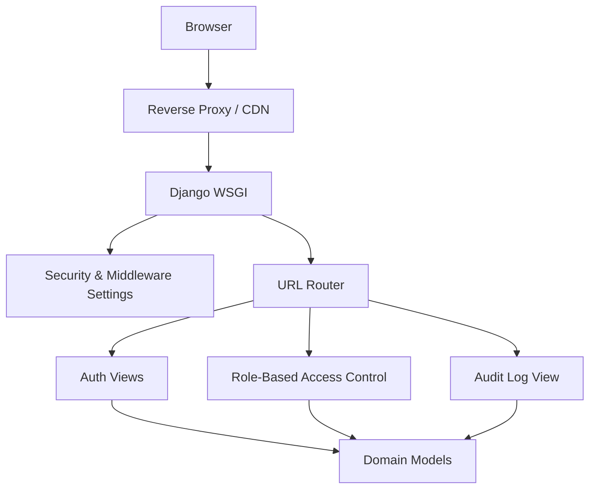
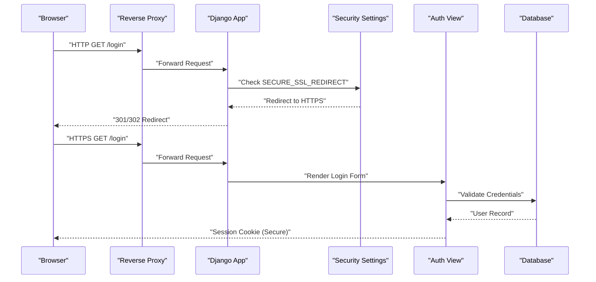
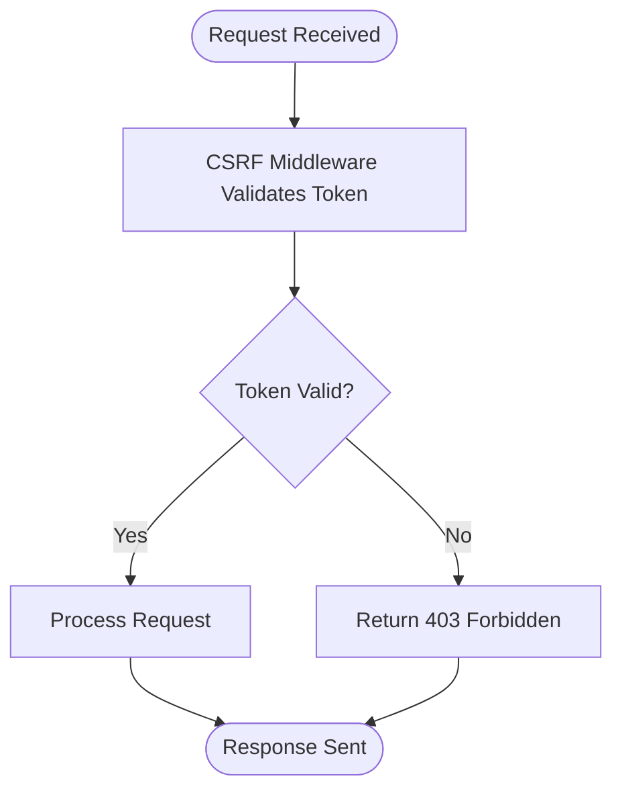
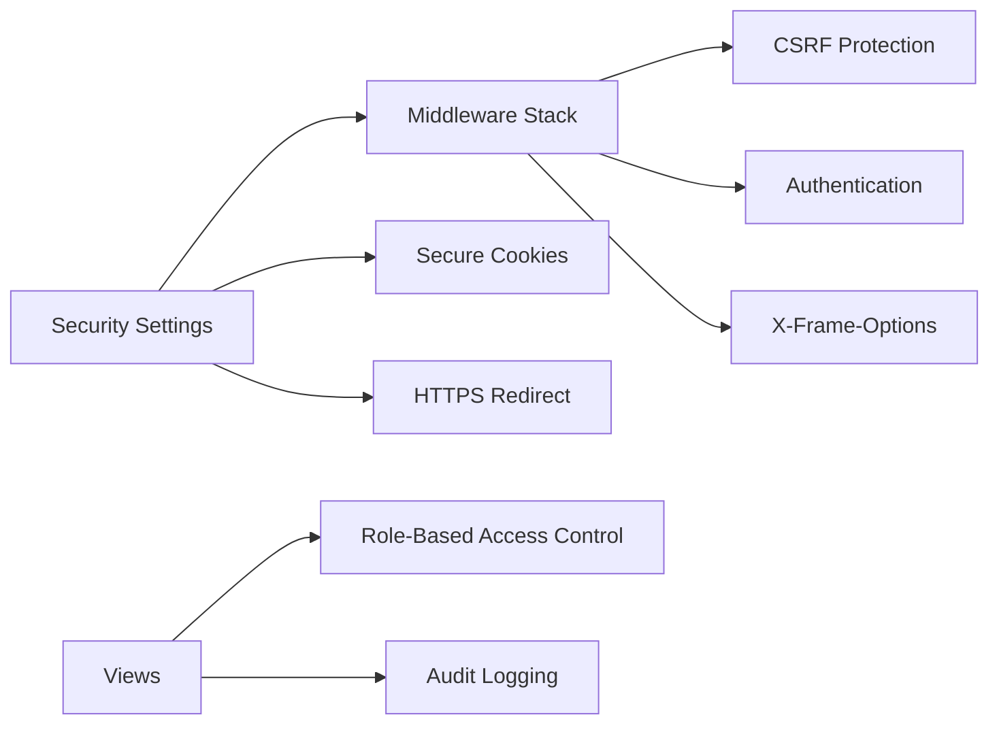

# Security Hardening

<cite>
**Referenced Files in This Document**
- [settings.py](file://market_rental/settings.py)
- [urls.py](file://market_rental/urls.py)
- [auth.py](file://core/views/auth.py)
- [permissions.py](file://core/permissions.py)
- [models.py](file://core/models.py)
- [audit.py](file://core/views/audit.py)
- [helpers.py](file://core/helpers.py)
- [forms.py](file://core/forms.py)
- [tenant_portal.py](file://core/views/tenant_portal.py)
- [login.html](file://templates/registration/login.html)
- [password.html](file://templates/tenant_portal/password.html)
- [_modal_form.html](file://templates/tenants/_modal_form.html)
- [reset_market_data.py](file://core/management/commands/reset_market_data.py)
</cite>

## Table of Contents
1. [Introduction](#introduction)
2. [Project Structure](#project-structure)
3. [Core Components](#core-components)
4. [Architecture Overview](#architecture-overview)
5. [Detailed Component Analysis](#detailed-component-analysis)
6. [Dependency Analysis](#dependency-analysis)
7. [Performance Considerations](#performance-considerations)
8. [Troubleshooting Guide](#troubleshooting-guide)
9. [Conclusion](#conclusion)
10. [Appendices](#appendices)

## Introduction
This document provides a comprehensive security hardening guide for the Market Rental System. It explains how SSL/TLS and HTTPS are configured, how CSRF protection is enabled, how authentication and authorization work, and what audit logging capabilities exist. It also identifies current gaps such as missing explicit security headers and content security policy configuration, and it outlines recommended improvements for input validation, SQL injection mitigation, session management, password policies, account lockout, monitoring, incident response, and compliance considerations for financial data handling.

## Project Structure
The application is a Django project with:
- Application settings and middleware in the project configuration.
- Authentication views under `core/views`.
- Role-based access control implemented through decorators and helpers.
- Domain models including users, tenants, contracts, billings, payments, notices, and audit logs.
- Audit log viewing and filtering.
- Tenant portal features including self-service password changes.
- Forms that enforce business rules and some input validation.

**Diagram sources**
- [settings.py:40-49](file://market_rental/settings.py#L40-L49)
- [urls.py:1-16](file://market_rental/urls.py#L1-L16)
- [auth.py:9-35](file://core/views/auth.py#L9-L35)
- [permissions.py:61-87](file://core/permissions.py#L61-L87)
- [audit.py:13-60](file://core/views/audit.py#L13-L60)
- [models.py:304-316](file://core/models.py#L304-L316)

**Section sources**
- [settings.py:1-200](file://market_rental/settings.py#L1-L200)
- [urls.py:1-16](file://market_rental/urls.py#L1-L16)

## Core Components
- Security middleware and cookie behavior are defined in the project settings.
- CSRF protection is enabled via Django’s built-in middleware.
- Authentication uses Django’s standard login/logout flow.
- Authorization is enforced through role-based decorators and helper functions.
- Audit logging is modeled and exposed through an admin-only view.
- Tenant portal includes forced password change and audit logging for password updates.
- Forms provide business-level validation for financial fields and tenant records.

Key security-relevant elements:
- SSL redirect and secure cookies in production.
- CSRF trusted origins configuration.
- Clickjacking protection via X-Frame-Options middleware.
- Password validators configured at the project level.
- AuditLog model capturing user actions, module, description, IP address, and timestamp.

**Section sources**
- [settings.py:40-49](file://market_rental/settings.py#L40-L49)
- [settings.py:154-159](file://market_rental/settings.py#L154-L159)
- [settings.py:182-190](file://market_rental/settings.py#L182-L190)
- [auth.py:9-35](file://core/views/auth.py#L9-L35)
- [permissions.py:61-87](file://core/permissions.py#L61-L87)
- [models.py:304-316](file://core/models.py#L304-L316)
- [audit.py:13-60](file://core/views/audit.py#L13-L60)
- [forms.py:431-462](file://core/forms.py#L431-L462)
- [forms.py:498-521](file://core/forms.py#L498-L521)

## Architecture Overview
The request lifecycle applies security middleware before reaching views. In production, HTTP requests are redirected to HTTPS, and secure cookies are used. CSRF tokens protect state-changing operations. Authentication views use Django’s form-based login. Authorization decorators restrict access by role. Audit logs record important actions.

**Diagram sources**
- [settings.py:182-190](file://market_rental/settings.py#L182-L190)
- [auth.py:9-35](file://core/views/auth.py#L9-L35)

## Detailed Component Analysis

### SSL/TLS Configuration and HTTPS Enforcement
- Production settings enable secure proxy header detection, HTTPS redirection, and secure cookies.
- Trusted CSRF origins include Vercel preview domains and environment-provided values.
- Static files are served securely through WhiteNoise in production.

Recommendations:
- Ensure the reverse proxy terminates TLS and forwards the correct protocol header.
- Enforce HSTS at the proxy layer.
- Configure certificate rotation and monitor expiration.

**Section sources**
- [settings.py:182-190](file://market_rental/settings.py#L182-L190)

### CSRF Protection
- CSRF middleware is active.
- CSRF cookie is marked secure in production.
- Trusted origins are explicitly configured.

Recommendations:
- Validate all state-changing endpoints require valid CSRF tokens.
- Avoid exposing sensitive APIs without additional CSRF or token-based protections.
- Monitor CSRF failures and block suspicious source IPs.

**Section sources**
- [settings.py:40-49](file://market_rental/settings.py#L40-L49)
- [settings.py:182-190](file://market_rental/settings.py#L182-L190)

### Secure Cookie Settings
- Session and CSRF cookies are set to secure in production.
- The application relies on HTTPS redirection to ensure cookies are only sent over secure connections.

Recommendations:
- Add SameSite cookie attributes at the proxy or application level if not already handled.
- Rotate secrets regularly and store them in a secure secret manager.
- Avoid logging sensitive cookies.

**Section sources**
- [settings.py:182-190](file://market_rental/settings.py#L182-L190)

### CSRF Prevention Flow

**Diagram sources**
- [settings.py:40-49](file://market_rental/settings.py#L40-L49)

### XSS Prevention
- Templates render forms using Django’s template system, which auto-escapes variables by default.
- No explicit Content-Security-Policy header is configured in the application settings.

Recommendations:
- Enable Content-Security-Policy at the proxy or via a custom middleware.
- Restrict script sources and disable inline scripts where possible.
- Sanitize any rich text inputs and avoid rendering untrusted HTML.

**Section sources**
- [settings.py:53-69](file://market_rental/settings.py#L53-L69)

### SQL Injection Mitigation
- The application uses Django ORM, which parameterizes queries and mitigates SQL injection by default.
- Some dynamic SQL is present in local database bootstrapping; this should be reviewed and minimized.

Recommendations:
- Avoid raw SQL where possible.
- If raw SQL is necessary, use parameterized queries and validate inputs strictly.
- Review database connection options and ensure least privilege access.

**Section sources**
- [settings.py:79-106](file://market_rental/settings.py#L79-L106)

### Authentication Security
- Login and logout views use Django’s authentication framework.
- Password validators are configured at the project level.
- Tenant portal supports forced password change when accounts are created with temporary passwords.

Recommendations:
- Implement account lockout after repeated failed attempts.
- Enforce minimum password length and complexity.
- Require password change on first login for new accounts.
- Invalidate sessions on password change.

**Section sources**
- [auth.py:9-35](file://core/views/auth.py#L9-L35)
- [settings.py:154-159](file://market_rental/settings.py#L154-L159)
- [tenant_portal.py:242-279](file://core/views/tenant_portal.py#L242-L279)
- [password.html:1-17](file://templates/tenant_portal/password.html#L1-L17)

### Session Management
- Sessions are managed by Django’s session middleware.
- Session cookies are secure in production.
- Password change updates the session authentication hash to keep the user logged in.

Recommendations:
- Set appropriate session timeout and idle expiration.
- Regenerate session IDs on privilege escalation.
- Store sessions in a secure backend if scaling horizontally.

**Section sources**
- [settings.py:40-49](file://market_rental/settings.py#L40-L49)
- [settings.py:182-190](file://market_rental/settings.py#L182-L190)
- [tenant_portal.py:252-268](file://core/views/tenant_portal.py#L252-L268)

### Account Lockout Mechanisms
- There is no explicit account lockout implementation in the current codebase.

Recommendations:
- Track failed login attempts per user and IP.
- Temporarily lock accounts after a threshold.
- Provide alerts and administrative controls for lockout events.
- Integrate lockout checks into the authentication view.

[No sources needed since this section proposes enhancements not present in the code]

### Authorization Best Practices and Role-Based Access Control
- Roles include admin, collector, cashier, supervisor, treasurer, and tenant.
- Decorators enforce access based on roles.
- Tenant isolation helpers restrict querysets to the current tenant for tenant accounts.

Recommendations:
- Apply object-level permissions for sensitive financial data.
- Use permission classes for API endpoints.
- Regularly review role assignments and audit access patterns.

**Section sources**
- [permissions.py:6-30](file://core/permissions.py#L6-L30)
- [permissions.py:61-87](file://core/permissions.py#L61-L87)
- [permissions.py:89-125](file://core/permissions.py#L89-L125)

### Security Headers and Content Security Policy
- Clickjacking protection is enabled via X-Frame-Options middleware.
- No explicit Content-Security-Policy, Referrer-Policy, Permissions-Policy, or Strict-Transport-Security headers are configured in the application.

Recommendations:
- Add CSP to restrict scripts, styles, and frames.
- Set Referrer-Policy to strict-origin-when-cross-origin.
- Enable HSTS at the proxy.
- Disable unnecessary browser features via Permissions-Policy.

**Section sources**
- [settings.py:40-49](file://market_rental/settings.py#L40-L49)

### Input Validation
- Forms validate billing totals, payment amounts, tenant uniqueness, stall assignment constraints, and date ranges.
- Financial calculations use Decimal types to prevent rounding errors.

Recommendations:
- Add server-side validation for all user inputs, including lookups and file uploads.
- Validate and sanitize uploaded ID images and documents.
- Limit upload sizes and file types.

**Section sources**
- [forms.py:156-198](file://core/forms.py#L156-L198)
- [forms.py:431-462](file://core/forms.py#L431-L462)
- [forms.py:498-521](file://core/forms.py#L498-L521)
- [forms.py:709-725](file://core/forms.py#L709-L725)
- [_modal_form.html:79-109](file://templates/tenants/_modal_form.html#L79-L109)

### Audit Logging, Security Monitoring, and Incident Response
- AuditLog model captures user, action, module, description, IP address, and timestamp.
- Admin-only audit log view supports filtering by user, action, module, date range, and free-text search.
- Password changes and automated penalty applications create audit entries.

Recommendations:
- Centralize logging and forward to a secure SIEM.
- Alert on suspicious actions such as bulk deletions or unauthorized access attempts.
- Define incident response procedures for data breaches and financial anomalies.
- Retain audit logs according to regulatory requirements.

**Section sources**
- [models.py:304-316](file://core/models.py#L304-L316)
- [audit.py:13-60](file://core/views/audit.py#L13-L60)
- [helpers.py:480-485](file://core/helpers.py#L480-L485)
- [tenant_portal.py:262-268](file://core/views/tenant_portal.py#L262-L268)

### Compliance Considerations for Financial Data Handling
- Billing, payments, and ledger entries are modeled with precise decimal fields and statuses.
- Audit logs provide a trail for financial actions.
- Contract terms and penalties are configurable.

Recommendations:
- Encrypt sensitive data at rest and in transit.
- Implement data retention and deletion policies aligned with regulations.
- Perform regular audits and reconciliations.
- Ensure segregation of duties between collectors, cashiers, supervisors, and administrators.

**Section sources**
- [models.py:190-277](file://core/models.py#L190-L277)
- [models.py:304-316](file://core/models.py#L304-L316)

## Dependency Analysis
The security posture depends on Django’s middleware stack, settings, and application logic.

**Diagram sources**
- [settings.py:40-49](file://market_rental/settings.py#L40-L49)
- [settings.py:182-190](file://market_rental/settings.py#L182-L190)
- [permissions.py:61-87](file://core/permissions.py#L61-L87)
- [audit.py:13-60](file://core/views/audit.py#L13-L60)

**Section sources**
- [settings.py:40-49](file://market_rental/settings.py#L40-L49)
- [settings.py:182-190](file://market_rental/settings.py#L182-L190)

## Performance Considerations
- Audit log queries use pagination and selective filtering to reduce load.
- Overdue penalty accrual is throttled per day using cache to avoid repeated computation.
- Database connections are pooled and health-checked in production.

Recommendations:
- Index frequently filtered audit log fields.
- Archive old audit logs periodically.
- Monitor slow queries and optimize heavy reports.

**Section sources**
- [audit.py:15-47](file://core/views/audit.py#L15-L47)
- [helpers.py:503-520](file://core/helpers.py#L503-L520)
- [settings.py:113-120](file://market_rental/settings.py#L113-L120)

## Troubleshooting Guide
Common issues and mitigations:
- HTTPS redirect failures: Verify proxy forwarding headers and domain configuration.
- CSRF token errors: Ensure trusted origins include the deployment domain and that forms include CSRF tokens.
- Weak password rejections: Confirm password validators and guide users to meet requirements.
- Permission denied messages: Review role assignments and decorator usage.
- Audit log gaps: Ensure critical flows create audit entries consistently.

Operational safeguards:
- Dangerous reset commands guard against accidental execution in production-like environments.

**Section sources**
- [settings.py:182-190](file://market_rental/settings.py#L182-L190)
- [settings.py:40-49](file://market_rental/settings.py#L40-L49)
- [settings.py:154-159](file://market_rental/settings.py#L154-L159)
- [permissions.py:61-87](file://core/permissions.py#L61-L87)
- [reset_market_data.py:94-128](file://core/management/commands/reset_market_data.py#L94-L128)

## Conclusion
The application implements foundational security measures including HTTPS redirection, secure cookies, CSRF protection, clickjacking protection, password validation, and audit logging. To reach a hardened production posture, add explicit security headers, implement account lockout, strengthen input validation for sensitive uploads, centralize logging and monitoring, and establish robust incident response and compliance procedures tailored to financial data handling.

[No sources needed since this section summarizes without analyzing specific files]

## Appendices

### Security Checklist
- TLS termination at the reverse proxy with HSTS enabled.
- HTTPS redirection and secure cookies configured.
- CSRF protection enabled and trusted origins validated.
- Content-Security-Policy and other security headers added.
- Role-based access control applied consistently.
- Audit logging centralized and monitored.
- Input validation extended to all user-supplied data.
- Account lockout and session management hardened.
- Compliance procedures documented and enforced.

[No sources needed since this section provides general guidance]